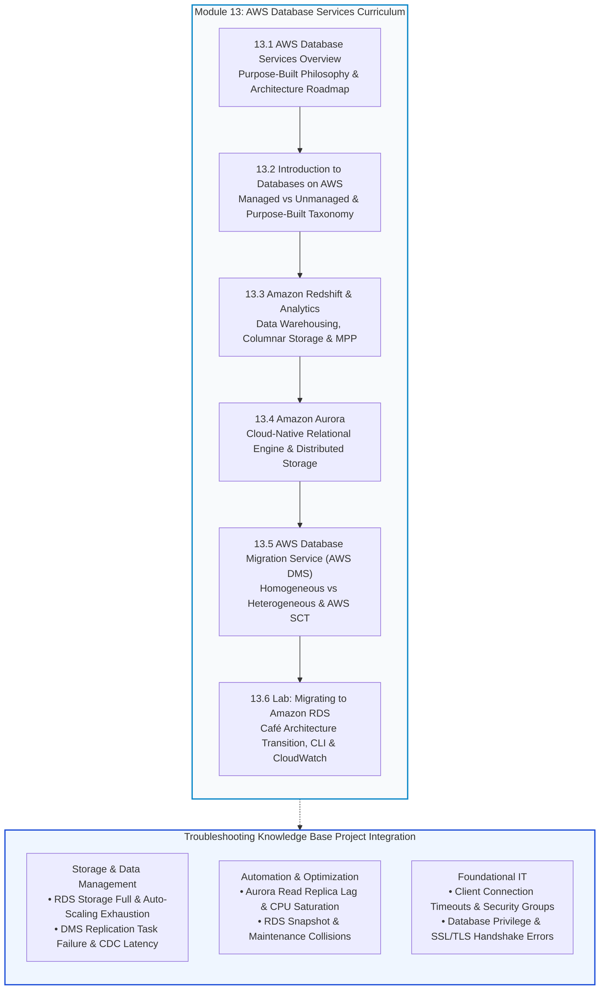
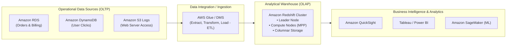
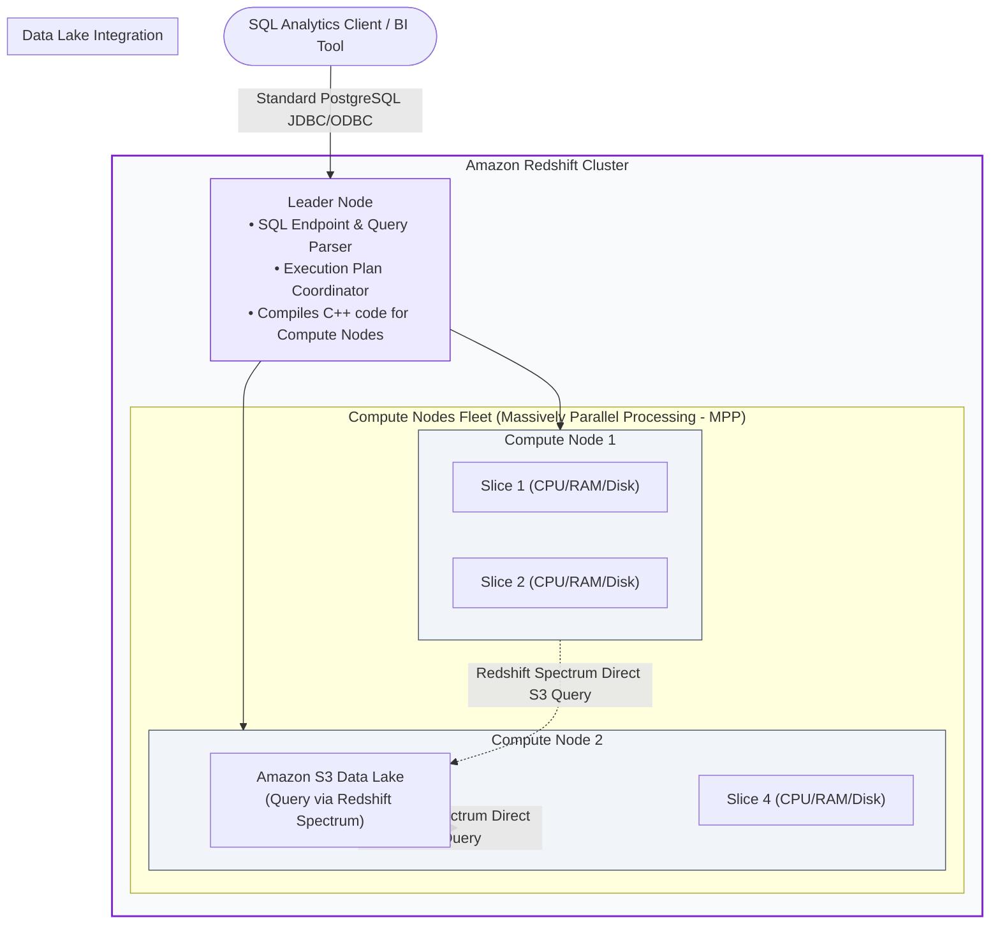
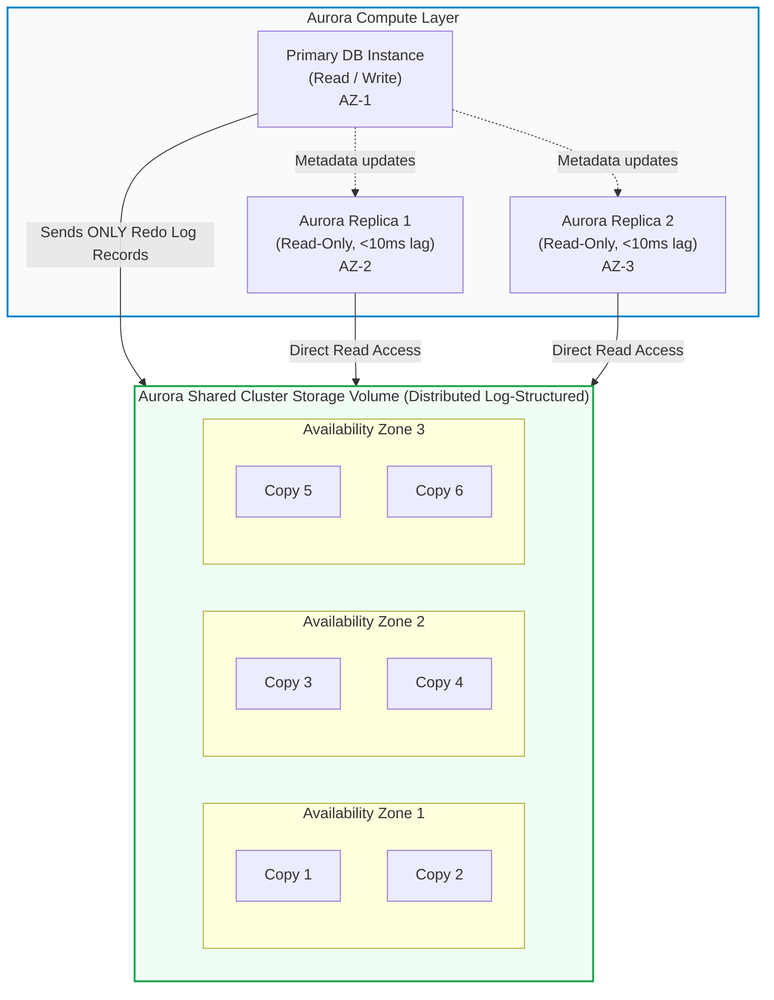
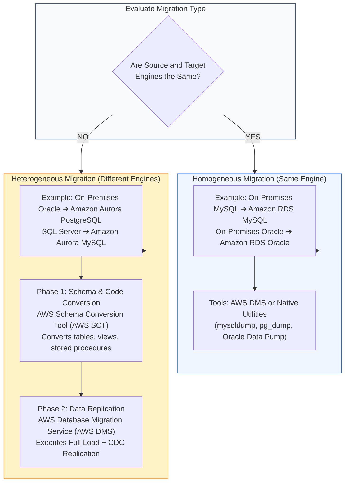
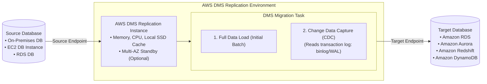
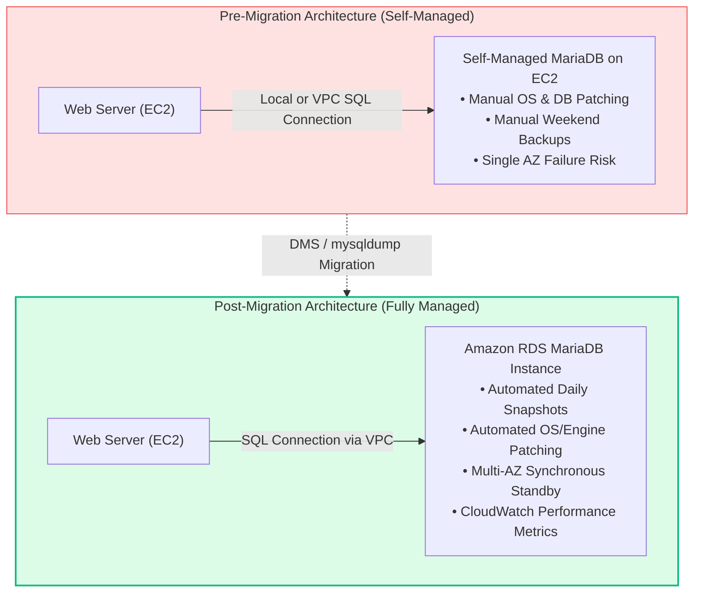

# 🗄️ Module 13: AWS Database Services Overview – Study Guide

> **Course**: AWS re/Start  
> **Module**: AWS Database Services (Module 13)  
> **Source Document**: `T17-0001-RSJAWS_EN-US_SG_M13_DATABASESVCSOVERVIEW.pdf`  
> **Target Audience**: AWS re/Start Learners / Cloud Practitioners / Solutions Architects / SysOps Administrators  

---

## 🎯 Unit Overview: Purpose-Built Databases on AWS & Moving Beyond "One-Size-Fits-All"

In legacy on-premises architectures, enterprise organizations routinely forced diverse application workloads into a single, monolithic relational database management system (RDBMS), such as Oracle, Microsoft SQL Server, or IBM DB2. Whether handling low-latency key-value session state, complex social network graphs, time-stamped IoT sensor telemetry, or petabyte-scale analytical aggregations, engineers bent their data models to fit traditional rows and columns. This **"one-size-fits-all"** database strategy resulted in severe performance bottlenecks, excessive licensing costs, brittle schema migrations, and complex Object-Relational Mapping (ORM) overhead.

Modern cloud-native engineering moves beyond monolithic relational databases by embracing **purpose-built databases**. Instead of forcing application access patterns to conform to a rigid relational schema, architects select the right database engine optimized specifically for the workload's data structure, query patterns, latency requirements, and scaling dimensions.

```
┌────────────────────────────────────────────────────────────────────────────────────────┐
│                   The Evolution: Monolithic vs. Purpose-Built Databases                │
├───────────────────────────────────────────┬────────────────────────────────────────────┤
│   Legacy Monolithic Architecture (RDBMS)  │    Modern Cloud-Native Architecture (AWS)  │
├───────────────────────────────────────────┼────────────────────────────────────────────┤
│ • Single monolithic database engine       │ • Decoupled microservices architecture     │
│ • "One-size-fits-all" schema mapping      │ • Purpose-built database per service       │
│ • Complex JOINs and denormalization hacks │ • Optimized data structures & query engines│
│ • Vertical scaling ceiling (larger boxes) │ • Horizontal auto-scaling & serverless     │
│ • Expensive commercial licensing models   │ • Pay-as-you-go open-source & cloud engines│
│ • Heavy DBA maintenance and manual toil  │ • Fully managed services (DBaaS)           │
└───────────────────────────────────────────┴────────────────────────────────────────────┘
```

Furthermore, managing databases on-premises imposes heavy operational overhead known as **undifferentiated heavy lifting**:
- **Hardware & Facilities**: Rack mounting physical servers, maintaining power, cooling, uninterruptible power supplies (UPS), and network cabling.
- **System Administration**: Operating system installation, patching, kernel updates, and hypervisor tuning.
- **Database Administration**: Engine installation, version patching, storage provisioning, index maintenance, and license compliance.
- **Availability & Resilience**: Designing complex active-passive failover clustering, configuring replication links, and managing disaster recovery offsite backups.

AWS manages this operational burden through the **AWS Shared Responsibility Model for Databases**. By adopting managed database services like **Amazon RDS**, **Amazon Aurora**, **Amazon DynamoDB**, and **Amazon Redshift**, organizations offload infrastructure provisioning, operating system maintenance, engine patching, automated backups, and multi-Availability Zone (Multi-AZ) high availability to AWS. This allows cloud practitioners and developers to focus on application logic, schema optimization, and delivering business value.

---

### 📌 Learning Objectives

- [ ] **Explore Available AWS Database Services**: Classify purpose-built AWS databases across Relational, Key-Value, Document, In-Memory, Graph, Time-Series, Ledger, and Data Warehouse categories.
- [ ] **Contrast Managed vs. Unmanaged Database Architectures**: Evaluate the operational and administrative differences between hosting databases on Amazon EC2 versus fully managed services like Amazon RDS and Amazon Aurora.
- [ ] **Define Amazon Redshift for OLAP Analytics**: Explain data warehousing architecture, columnar data storage, Massively Parallel Processing (MPP), and contrast Online Transaction Processing (OLTP) with Online Analytical Processing (OLAP).
- [ ] **Master Amazon Aurora Cloud-Native Architecture**: Describe Aurora's decoupled compute and log-structured distributed storage across 3 Availability Zones, MySQL and PostgreSQL compatibility, Aurora Serverless v2, and global replication.
- [ ] **Evaluate Database Migration Strategies with AWS DMS & AWS SCT**: Distinguish homogeneous migrations from heterogeneous migrations, configure Change Data Capture (CDC) for near-zero downtime, and apply the AWS Schema Conversion Tool.
- [ ] **Execute Hands-on Migration to Amazon RDS**: Migrate self-managed MariaDB workloads on Amazon EC2 to managed Amazon RDS using the AWS CLI and monitor database health via Amazon CloudWatch.
- [ ] **Populate the Troubleshooting Knowledge Base**: Formulate operational triage runbooks across the **Storage and Data Management**, **Automation and Optimization**, and **Foundational IT** categories.

---

## 🗺️ Module 13 Curriculum Roadmap

The following diagram outlines the structural progression of the **Module 13: AWS Database Services** curriculum:



---

## 🏛️ Managed vs. Unmanaged Database Responsibility Matrix

When deploying databases on AWS, organizations choose between self-managing the database on compute instances (**Amazon EC2**) or delegating operational management to AWS via **managed database services** (Amazon RDS, Amazon Aurora, Amazon DynamoDB).

```mermaid
flowchart LR
    subgraph OnPrem["On-Premises"]
        OP1["Customer manages: Everything from Hardware, HVAC, Power to App Optimization"]
    end

    subgraph IaaS["Database on Amazon EC2 (IaaS)"]
        EC2_1["AWS manages: Physical Hardware, Power, HVAC, Host Virtualization"]
        EC2_2["Customer manages: OS, DB Engine, Backups, High Availability, Scaling, Tuning"]
    end

    subgraph PaaS["Amazon RDS / Aurora (PaaS / DBaaS)"]
        RDS_1["AWS manages: Hardware, OS, DB Installation, Patching, Backups, Multi-AZ Failover"]
        RDS_2["Customer manages: Schema Design, Indexes, Queries, Application Optimization"]
    end

    OnPrem --> IaaS --> PaaS

    style OnPrem fill:#fee2e2,stroke:#ef4444,stroke-width:1px
    style IaaS fill:#fef3c7,stroke:#f59e0b,stroke-width:1px
    PaaS fill:#dcfce7,stroke:#10b981,stroke-width:2px
```

### Operational Responsibility Comparison:
| Operational Task | On-Premises Physical | Database on Amazon EC2 | Amazon RDS / Amazon Aurora |
| :--- | :---: | :---: | :---: |
| **Power, Cooling (HVAC), Physical Network** | Customer | AWS | AWS |
| **Rack and Stack Hardware** | Customer | AWS | AWS |
| **Physical Server Hardware Maintenance** | Customer | AWS | AWS |
| **Operating System Installation** | Customer | AWS (AMI) | AWS |
| **Operating System Patching & Kernel Updates** | Customer | Customer | AWS |
| **Database Engine Installation & Config** | Customer | Customer | AWS |
| **Database Engine Minor Patching** | Customer | Customer | AWS (Configurable) |
| **Automated Backups & Point-in-Time Recovery**| Customer | Customer (Scripts) | AWS (Automatic) |
| **Synchronous Multi-AZ High Availability** | Customer | Customer (Complex setup)| AWS (Single toggle) |
| **Storage & Compute Scaling** | Customer (Procurement)| Customer (EBS resize) | AWS (Online / Serverless)|
| **Application & Query Optimization** | Customer | Customer | Customer |

> [!NOTE]
> When should you run a database on Amazon EC2 instead of Amazon RDS?
> 1. You require full administrative root or operating system access (e.g., custom file system scripts or OS-level agents).
> 2. You must run an unsupported database engine (such as IBM DB2, Informix, or Couchbase) or a specific deprecated database version not supported by Amazon RDS.
> 3. You require features not supported by RDS, such as specific commercial database plugins or specialized linked servers requiring custom network drivers.

---

## 🗃️ 1. Introduction to AWS Purpose-Built Database Services

AWS provides a comprehensive portfolio of purpose-built database engines, each designed to optimize specific data models, concurrency patterns, and latency requirements.

```mermaid
graph TD
    Root["AWS Purpose-Built Databases"]

    Root --> Relational["Relational (OLTP)<br/>Complex queries, ACID transactions, SQL"]
    Root --> KeyValue["Key-Value & Document<br/>Ultra-low latency, flexible JSON schemas"]
    Root --> InMemory["In-Memory Caches<br/>Sub-millisecond microsecond latency"]
    Root --> Analytics["Data Warehouse (OLAP)<br/>Petabyte analytics, columnar storage"]
    Root --> Specialized["Specialized Engines<br/>Graphs, Time-Series, Ledgers"]

    Relational --> RDS["Amazon RDS<br/>(MySQL, PostgreSQL, MariaDB, Oracle, SQL Server)"]
    Relational --> Aurora["Amazon Aurora<br/>(MySQL & Postgres compatible, distributed storage)"]

    KeyValue --> DynamoDB["Amazon DynamoDB<br/>(Single-digit ms key-value)"]
    KeyValue --> DocDB["Amazon DocumentDB<br/>(MongoDB-compatible document store)"]

    InMemory --> ElastiCache["Amazon ElastiCache<br/>(Redis & Memcached caching)"]
    InMemory --> MemoryDB["Amazon MemoryDB<br/>(Durable transactional in-memory)"]

    Analytics --> Redshift["Amazon Redshift<br/>(Columnar MPP analytics warehouse)"]

    Specialized --> Neptune["Amazon Neptune<br/>(Property graph & RDF store)"]
    Specialized --> Timestream["Amazon Timestream<br/>(IoT & metrics time-series)"]
    Specialized --> QLDB["Amazon QLDB<br/>(Cryptographically verifiable ledger)"]

    style Root fill:#f1f5f9,stroke:#0f172a,stroke-width:2px
    style Relational fill:#e0f2fe,stroke:#0284c7,stroke-width:1px
    style KeyValue fill:#fef3c7,stroke:#d97706,stroke-width:1px
    style InMemory fill:#fee2e2,stroke:#dc2626,stroke-width:1px
    style Analytics fill:#f3e8ff,stroke:#7e22ce,stroke-width:1px
    style Specialized fill:#ecfdf5,stroke:#059669,stroke-width:1px
```



### Detailed Taxonomy of AWS Database Engines:

#### 1. Relational Databases (OLTP)
- **Amazon RDS (Relational Database Service)**: Provides managed instances for six popular engines: MySQL, PostgreSQL, MariaDB, Oracle, Microsoft SQL Server, and Amazon Aurora. Manages provisioning, patching, automated daily backups, and Multi-AZ synchronous replication.
- **Amazon Aurora**: Cloud-native relational database engine delivering up to **5x the throughput of standard MySQL** and **3x the throughput of standard PostgreSQL**, built on a distributed, self-healing, multi-AZ log-structured storage system.
- **Core Use Cases**: Transactional enterprise applications, ERP, CRM, financial ledger transactions, e-commerce checkouts requiring ACID (Atomicity, Consistency, Isolation, Durability) guarantees.

#### 2. Key-Value & Document Databases
- **Amazon DynamoDB**: Serverless, distributed NoSQL database delivering consistent single-digit millisecond latency at any scale. Supports key-value and document data structures, automatic multi-region global tables, and built-in in-memory caching via DynamoDB Accelerator (DAX).
- **Amazon DocumentDB**: Fully managed, MongoDB-compatible JSON document database built on a scalable cloud-native storage architecture.
- **Core Use Cases**: High-scale web applications, mobile backends, user profiles, shopping carts, session management, gaming leaderboards, and catalog management.

#### 3. In-Memory Data Stores
- **Amazon ElastiCache**: Managed caching service supporting **Redis** and **Memcached** to eliminate database read bottlenecks and deliver microsecond response times.
- **Amazon MemoryDB for Redis**: Durable, in-memory database built with a multi-AZ transactional log for ultra-fast primary database workloads.
- **Core Use Cases**: Real-time caching, session stores, live gaming state, streaming analytics, and sub-millisecond fraud detection.

#### 4. Graph Databases
- **Amazon Neptune**: Fast, reliable graph database engine optimized for storing and navigating complex relationships. Supports Apache TinkerPop Gremlin, openCypher, and W3C SPARQL query models.
- **Core Use Cases**: Social networks, recommendation engines, fraud detection rings, network topology mapping, and knowledge graphs.

#### 5. Time-Series Databases
- **Amazon Timestream**: Fast, scalable, serverless time-series database designed to ingest trillions of events per day. Automatically handles data lifecycle management across memory storage and magnetic storage.
- **Core Use Cases**: IoT sensor telemetry, DevOps server metric monitoring, industrial equipment tracking, and application performance logging.

#### 6. Ledger Databases
- **Amazon QLDB (Quantum Ledger Database)**: Fully managed ledger database that provides a transparent, immutable, and cryptographically verifiable transaction log owned by a central trusted authority.
- **Core Use Cases**: Supply chain provenance, financial audit tracking, regulatory compliance records, and insurance claim history.

---

## 📊 2. Data Warehousing & OLAP Analytics: Amazon Redshift

### What is a Data Warehouse?
A **data warehouse** is a specialized analytical database designed to aggregate, consolidate, and analyze historical data extracted from multiple disparate business sources (transactional databases, ERPs, CRM platforms, flat log files, and IoT streams). While transactional databases focus on fast record insertions and updates, data warehouses focus on reading and aggregating vast numbers of rows to produce business intelligence (BI) and predictive forecasts.



### Relational Database (OLTP) vs. Data Warehouse (OLAP)

| Dimension | OLTP (Online Transaction Processing) | OLAP (Online Analytical Processing) |
| :--- | :--- | :--- |
| **Primary Goal** | Fast execution of high-concurrency transactional updates | Complex analytical queries across massive historical data |
| **Target AWS Service** | **Amazon RDS / Amazon Aurora** | **Amazon Redshift** |
| **Typical Operations** | Frequent `INSERT`, `UPDATE`, `DELETE` of individual records | Bulk batch `INSERT` / `COPY`, complex aggregations (`SUM`, `AVG`, `GROUP BY`) |
| **Data Schema** | Highly normalized (3NF) to eliminate data redundancy | Denormalized (Star Schema, Snowflake Schema) optimized for reads |
| **Storage Orientation**| **Row-Oriented** (stores complete row together) | **Columnar** (stores each column's data contiguously) |
| **Query Scope** | Fetches a few specific rows by Primary Key (`WHERE id = ?`) | Scans millions or billions of rows across a few select columns |
| **Hardware Scaling** | Scale up compute/memory or add read replicas | Massively Parallel Processing (MPP) distributed cluster |
| **Data Volume** | Gigabytes to Terabytes | Terabytes to Exabytes |
| **Latency Expectation**| Sub-millisecond to low milliseconds | Seconds to minutes (for heavy multi-table aggregations) |

```
Row-Oriented Storage (OLTP):
Record 1: [ID=101, Name=Alice, Region=East, Sales=250.00]
Record 2: [ID=102, Name=Bob,   Region=West, Sales=420.00]
Record 3: [ID=103, Name=Carol, Region=East, Sales=180.00]
* Scanning total sales requires disk I/O to read IDs, Names, and Regions!

Columnar Storage (OLAP - Amazon Redshift):
ID Column:     [101, 102, 103]
Name Column:   [Alice, Bob, Carol]
Region Column: [East, West, East]
Sales Column:  [250.00, 420.00, 180.00]
* Scanning total sales reads ONLY the Sales Column blocks directly from disk!
```

> [!TIP]
> **Why Columnar Storage Accelerates Analytics**:
> In an analytical query like `SELECT SUM(Sales) FROM Orders WHERE Region = 'East'`, a traditional row-oriented database must read every single byte of every row into memory, discarding unused fields (e.g., customer names, shipping addresses, phone numbers). 
> Amazon Redshift's columnar storage reads **only the blocks containing the requested columns**, dramatically reducing disk I/O. Furthermore, because column data shares the same data type, Redshift achieves extreme data compression ratios (e.g., using `AZ64` or `ZSTD` encodings), further slashing disk space and I/O latency.

---

### Amazon Redshift Cluster Architecture

Amazon Redshift operates as a distributed cluster composed of a **Leader Node** and one or more **Compute Nodes**:



- **Leader Node**: The communication gateway. It accepts client connections via industry-standard PostgreSQL JDBC/ODBC drivers, parses SQL queries, compiles optimized execution code, and coordinates parallel execution across compute nodes.
- **Compute Nodes**: Execute compiled query code in parallel. Each node is partitioned into **Slices**. Each slice is allocated dedicated CPU cores, memory, and columnar disk storage to process a portion of the cluster's workload independently.
- **Redshift Spectrum**: Enables data analysts to query open data formats (Parquet, ORC, CSV, JSON) directly residing in **Amazon S3 data lakes** without needing to load the data into the Redshift cluster first.
- **Redshift Serverless**: Automatically provisions and scales data warehouse capacity (measured in Redshift Processing Units - RPUs) up and down based on query complexity and concurrency, eliminating cluster management.

---

## ⚡ 3. Cloud-Native Relational Engine: Amazon Aurora

### Why Traditional Relational Engines Bottleneck in the Cloud
Traditional database engines (MySQL, PostgreSQL, Oracle) were architected decades ago for single-server physical hardware. In these legacy systems, the compute engine (query parsing, caching, transaction management) is tightly coupled to the underlying file system and storage volume. When creating read replicas or high availability standbys, traditional systems must replicate the entire database volume or write heavy binary transaction logs across standard network storage, causing **I/O write amplification** and replication lag.

### The Aurora Breakthrough: "The Log is the Database"
Amazon Aurora decouples compute from storage. Aurora pushes SQL parsing, query planning, and transaction logging into the compute tier, while delegating storage management, crash recovery, and multi-AZ replication to a purpose-built, cloud-native **distributed log-structured storage service**.



### Key Architectural Pillars of Amazon Aurora:
1. **6-Way Replication Across 3 Availability Zones**:
   - Aurora automatically maintains **6 copies** of your data, distributed across **3 Availability Zones** (2 copies per AZ).
   - Write operations achieve quorum consensus upon acknowledgment from **4 out of 6 storage copies** (tolerating the loss of an entire AZ plus an additional storage disk without losing write availability).
   - Read operations require quorum from **3 out of 6 storage copies**.
2. **Self-Healing Storage**:
   - Storage volumes are partitioned into 10 GiB segments. Aurora continuously scans for disk errors and automatically repairs corrupted blocks in the background using peer storage nodes with zero performance degradation.
3. **Low-Latency Read Replicas (Up to 15)**:
   - Traditional MySQL RDS read replicas maintain their own separate storage volumes and can suffer significant replication lag.
   - Aurora Replicas share the **same underlying cluster volume** as the primary instance. Because data is already committed to the shared storage tier, Aurora Replicas experience replication lag typically under **10 milliseconds**.
   - If the primary instance fails, Aurora automatically promotes an Aurora Replica to primary in **under 30 seconds**.
4. **Aurora Serverless v2**:
   - Dynamically scales database compute capacity up or down in fractions of a second in response to application traffic, adjusting in fine-grained increments of **Aurora Capacity Units (ACUs)**.
   - Ideal for unpredictable, spiky, or multi-tenant SaaS workloads.
5. **Aurora Global Database**:
   - Spans multiple AWS Regions to provide disaster recovery and low-latency local read performance worldwide, replicating storage updates with typical latencies of under 1 second.

---

## 🚚 4. Database Migration Strategies: AWS DMS & AWS SCT

Organizations migrating existing database workloads from on-premises data centers, private cloud hosting, or Amazon EC2 to AWS managed databases leverage **AWS Database Migration Service (AWS DMS)** and the **AWS Schema Conversion Tool (AWS SCT)**.



### Homogeneous vs. Heterogeneous Database Migrations

| Feature | Homogeneous Database Migration | Heterogeneous Database Migration |
| :--- | :--- | :--- |
| **Engine Relationship**| Source and target database engines are identical or fully compatible (e.g., MySQL to RDS MySQL, PostgreSQL to RDS PostgreSQL). | Source and target engines are fundamentally different (e.g., Oracle to Aurora PostgreSQL, SQL Server to Aurora MySQL). |
| **Schema Compatibility**| Schema, data types, constraints, triggers, and stored procedures match 1-to-1. | Data types, SQL dialects, PL/SQL or T-SQL code, views, and functions must be translated. |
| **Role of AWS SCT** | **Not Required**. Native schema exports or DMS handle schema reproduction directly. | **Mandatory**. AWS SCT analyzes the source schema and converts it into target-compatible code. |
| **Role of AWS DMS** | Replicates table data, indexes, and near-continuous changes. | Migrates table data and handles ongoing Change Data Capture (CDC) after schema conversion. |

---

### Core Architecture of AWS Database Migration Service (AWS DMS)

AWS DMS executes database migrations quickly and securely while keeping the source database fully operational, minimizing application downtime.



### Components of AWS DMS:
1. **Replication Instance**: A dedicated managed EC2 compute instance that runs the DMS replication software, connects to source and target endpoints, and holds temporary replication cache during migration.
2. **Endpoints**: Configure connection metadata, network credentials, and driver configurations for the **Source Endpoint** and **Target Endpoint**.
3. **Replication Tasks**: Define the rules and parameters for data movement:
   - **Full Load**: Migrates existing data from source tables to target tables in bulk.
   - **Full Load + Change Data Capture (CDC)**: Migrates initial bulk data while continuously reading source database transaction logs (e.g., MySQL binary logs, PostgreSQL Write-Ahead Logs, Oracle redo logs) to capture real-time changes and apply them to the target.
   - **CDC Only**: Assumes initial tables have been seeded and continuously synchronizes delta changes.
4. **Near-Zero Downtime Cutover**:
   - The application continues reading and writing to the source database during the entire initial load.
   - CDC keeps the target database synchronized in real time.
   - When replication lag drops to near zero, the operations team schedules a brief maintenance window (minutes or seconds), updates application connection strings to point to the new AWS target database, and verifies the cutover.

> [!IMPORTANT]
> **What AWS DMS Does NOT Do**:
> AWS DMS is primarily a data pipeline engine. DMS does **not** convert secondary application objects (such as complex PL/SQL stored procedures, triggers, custom user functions, or complex package specifications) during heterogeneous migrations. That conversion must be evaluated and executed using the **AWS Schema Conversion Tool (AWS SCT)** before initiating the DMS replication task.

---

## 🛠️ 5. Hands-on Migration: Café Business Scenario & Lab Walkthrough

### Business Background: The Café Case Study
In the ongoing AWS re/Start scenario, Frank and Martha own a rapidly expanding neighborhood café that has launched an online ordering portal. Sofía and Nikhil manage the technical operations:

```
┌────────────────────────────────────────────────────────────────────────────────────────┐
│                          The Café Database Administration Dilemma                      │
├────────────────────────────────────────────────────────────────────────────────────────┤
│ • Pre-Migration State: MariaDB database running directly on a self-managed EC2 instance│
│ • Operational Pain 1: Manual Weekly Backups require late-night weekend overtime hours  │
│ • Operational Pain 2: Operating System & Engine Security Patching is complex and risky │
│ • Operational Pain 3: High Business Labor Costs due to paid technician weekend overtime│
│ • Single Point of Failure: No automated failover or cross-AZ disaster recovery        │
└────────────────────────────────────────────────────────────────────────────────────────┘
```

Olivia, an AWS Solutions Architect, recommends migrating the Café's database from the self-managed Amazon EC2 instance to a fully managed **Amazon RDS MariaDB** database instance.



---

### Step-by-Step Lab Implementation Workflow

#### Step 1: Provisioning Amazon RDS MariaDB via AWS CLI
The operations team provisions the managed RDS MariaDB database inside the existing VPC using the AWS Command Line Interface:

```bash
# 1. Create a DB Subnet Group across private subnets
aws rds create-db-subnet-group \
    --db-subnet-group-name cafe-db-subnet-group \
    --db-subnet-group-description "Private Subnets for Cafe RDS Database" \
    --subnet-ids "subnet-0a1b2c3d4e5f60001" "subnet-0a1b2c3d4e5f60002"

# 2. Provision the Amazon RDS MariaDB DB instance
aws rds create-db-instance \
    --db-instance-identifier cafe-db-instance \
    --db-instance-class db.t3.micro \
    --engine mariadb \
    --engine-version 10.5 \
    --allocated-storage 20 \
    --storage-type gp2 \
    --master-username cafeadmin \
    --master-user-password "SecureCafePassw0rd!" \
    --db-subnet-group-name cafe-db-subnet-group \
    --vpc-security-group-ids "sg-0987654321fedcba0" \
    --backup-retention-period 7 \
    --preferred-backup-window "03:00-04:00" \
    --preferred-maintenance-window "Sun:04:30-Sun:05:30" \
    --no-publicly-accessible
```

#### Step 2: Extracting & Seeding Database Records (mysqldump)
To perform a consistent migration from the source EC2 MariaDB instance to the target RDS MariaDB instance:

```bash
# 1. Connect to EC2 instance and create a consistent snapshot export
mysqldump -u root -p \
    --single-transaction \
    --quick \
    --databases cafe_db > cafe_db_backup.sql

# 2. Retrieve the Amazon RDS endpoint hostname
RDS_ENDPOINT=$(aws rds describe-db-instances \
    --db-instance-identifier cafe-db-instance \
    --query "DBInstances[0].Endpoint.Address" \
    --output text)

# 3. Import data directly into the Amazon RDS instance
mysql -h $RDS_ENDPOINT \
    -u cafeadmin \
    -p cafe_db < cafe_db_backup.sql
```

#### Step 3: Application Configuration & Verification
1. Update the Café application's configuration file (`/var/www/html/db_config.php`):
   ```php
   <?php
   // Update database host pointer from localhost to RDS endpoint
   $db_host = "cafe-db-instance.c9xyzexample.us-east-1.rds.amazonaws.com";
   $db_user = "cafeadmin";
   $db_pass = "SecureCafePassw0rd!";
   $db_name = "cafe_db";
   ?>
   ```
2. Navigate to the web application order page, place test pastry and coffee orders, and confirm that order records successfully persist into the new Amazon RDS instance.

#### Step 4: Monitoring Health via Amazon CloudWatch
Verify that the database instance operates within healthy performance parameters:
- **`CPUUtilization`**: Confirms that query execution remains below threshold limits.
- **`FreeStorageSpace`**: Verifies available volume storage capacity.
- **`DatabaseConnections`**: Tracks open connection pools from web instances.
- **`ReadIOPS` / `WriteIOPS`**: Measures underlying storage disk operations.

---

## 🛠️ Troubleshooting Knowledge Base Integration

As outlined in Slide 4 of the curriculum overview, learners must maintain systematic problem resolution runbooks across three primary categories: **Storage and Data Management**, **Automation and Optimization**, and **Foundational IT**.

```
┌────────────────────────────────────────────────────────────────────────────────────────┐
│                        Troubleshooting Knowledge Base Categories                       │
├──────────────────────────┬──────────────────────────────┬──────────────────────────────┤
│ Storage & Data Management│ Automation & Optimization    │ Foundational IT              │
├──────────────────────────┼──────────────────────────────┼──────────────────────────────┤
│ • DATA-01: RDS Disk Full │ • AUTO-03: Aurora Rep Lag    │ • FOUND-01: Connection Drop  │
│ • DATA-02: DMS CDC Fail  │ • AUTO-04: Backup Freeze     │ • FOUND-02: SSL Handshake    │
└──────────────────────────┴──────────────────────────────┴──────────────────────────────┘
```

---

### 6.1 Storage and Data Management: Triage Runbooks

#### Runbook DATA-01: Amazon RDS `Storage-Full` State & Allocation Exhaustion
- **Symptom**: Application displays `SQLSTATE[HY000]: General error: 1114 The table is full` or `Disk full` errors. In the AWS Management Console, the Amazon RDS DB instance state transitions to `storage-full` and rejects all subsequent `INSERT` and `UPDATE` statements.
- **Root Cause**:
  - The allocated Amazon EBS volume has reached 100% capacity due to unanticipated transactional data growth, heavy un-rotated binary log accumulation, or temporary query sorting tables.
  - **Storage Auto Scaling** was disabled or reached its configured `MaxAllocatedStorage` ceiling.
- **Diagnostic Triage**:
  ```bash
  # Check RDS current storage allocation and free storage metric
  aws rds describe-db-instances \
      --db-instance-identifier cafe-db-instance \
      --query "DBInstances[0].[AllocatedStorage,MaxAllocatedStorage,Status]"
  ```
- **Remediation**:
  1. **Immediate Storage Expansion**: Execute an emergency storage volume increase using the AWS CLI:
     ```bash
     aws rds modify-db-instance \
         --db-instance-identifier cafe-db-instance \
         --allocated-storage 50 \
         --apply-immediately
     ```
  2. **Enable Storage Auto Scaling**: Configure `MaxAllocatedStorage` (e.g., 200 GB) so AWS automatically scales storage by 10% or 5 GB when remaining free space drops below 10% for longer than 5 minutes.
  3. **Purge Binary Logs**: If binary logs are consuming space in MySQL/MariaDB, reduce the retention period:
     ```sql
     CALL mysql.rds_set_configuration('binlog retention hours', 24);
     ```

---

#### Runbook DATA-02: AWS DMS Replication Task Failure & CDC Latency Spill
- **Symptom**: AWS DMS replication task status switches to `Failed` or `Error`, with CloudWatch metrics showing soaring `CDCLatencySource` and `CDCLatencyTarget`. Target tables miss recent updates.
- **Root Cause**:
  - **Source Transaction Log Truncation**: High write velocity on the source database caused the MySQL binary log or PostgreSQL WAL log to be purged before the DMS replication task could read the changes.
  - **Replication Instance Resource Starvation**: The DMS replication instance ran out of memory (`ReplicationInstanceMemoryPressure`), spilling CDC transaction buffers to disk and stalling the task.
  - **Primary Key / Index Omission**: Target tables were created without primary keys or indexes, forcing DMS to execute full-table scans for every row update.
- **Remediation**:
  1. Increase the source binary log retention period to ensure transaction logs remain available for at least 48 to 72 hours.
  2. Scale up the DMS replication instance class (e.g., from `dms.t3.medium` to `dms.r5.large`) to accommodate high CDC transaction volume.
  3. Verify that all migrated tables possess primary keys or unique indexes on both source and target engines.

---

### 6.2 Automation and Optimization: Triage Runbooks

#### Runbook AUTO-03: Amazon Aurora Read Replica Lag Spike & CPU Saturation
- **Symptom**: End users report seeing stale data when querying Aurora Read Endpoints. CloudWatch metric `AuroraReplicaLag` spikes from <10 ms to several minutes, and the Read Replica instance displays 100% `CPUUtilization`.
- **Root Cause**:
  - A heavy analytical query (e.g., unindexed multi-table JOIN running for 40 minutes) on the Aurora Replica is blocking the replica's replay engine from applying storage page invalidation updates.
  - Compute instance size discrepancy: The primary writer instance is a powerful `db.r6g.2xlarge`, while the replica is an underpowered `db.t4g.medium` unable to handle both analytical queries and cache-invalidation messages.
- **Remediation**:
  1. Identify and kill long-running analytical queries blocking the engine:
     ```sql
     SHOW FULL PROCESSLIST;
     KILL <query_thread_id>;
     ```
  2. Ensure Aurora Read Replicas are configured with identical compute instance classes as the primary writer instance.
  3. Enable **Aurora Auto Scaling** to automatically add replica instances when average CPU utilization exceeds 70%.

---

#### Runbook AUTO-04: Automated RDS Backup & Maintenance Window Workload Collision
- **Symptom**: Application experiences periodic response timeouts, connection resets, and elevated transaction latency every Sunday at 04:30 UTC.
- **Root Cause**:
  - The Amazon RDS instance is deployed as a **Single-AZ** deployment. During the automated backup window, storage I/O is briefly suspended (on older generation storage) while a disk snapshot is taken.
  - Operating system patching or minor engine upgrades were scheduled in the **Preferred Maintenance Window** that overlaps with batch processing workloads.
- **Remediation**:
  1. **Convert to Multi-AZ Deployment**:
     ```bash
     aws rds modify-db-instance \
         --db-instance-identifier cafe-db-instance \
         --multi-az \
         --apply-immediately
     ```
     > [!TIP]
     > In Multi-AZ deployments, automated daily backups are taken from the **synchronous standby instance** in the secondary AZ, completely eliminating I/O freezes on the primary active instance.
  2. Reschedule backup and maintenance windows to the quietest operational hours of the week (e.g., Tuesday 02:00-03:00 UTC).

---

### 6.3 Foundational IT: Triage Runbooks

#### Runbook FOUND-01: Client Connection Timeout & VPC Security Group Misconfiguration
- **Symptom**: Application web server throws `Connection timed out` or `ERROR 2003 (HY000): Can't connect to MySQL server on '...' (110)` when attempting to reach the RDS endpoint.
- **Root Cause**:
  - The RDS DB instance Security Group lacks an inbound ingress rule permitting TCP port `3306` (MariaDB/MySQL) or `5432` (PostgreSQL) from the Web Server Security Group.
  - The RDS DB instance was placed in a subnet with no route to the application server's VPC, or Network Access Control Lists (NACLs) are blocking ephemeral response ports.
- **Diagnostic Triage**:
  ```bash
  # Test network socket connectivity from the application server
  nc -zv cafe-db-instance.c9xyzexample.us-east-1.rds.amazonaws.com 3306
  # Or using timeout
  timeout 3 bash -c "</dev/tcp/cafe-db-instance.c9xyzexample.us-east-1.rds.amazonaws.com/3306"
  ```
- **Remediation**:
  1. Update the RDS DB Security Group to reference the Web Server Security Group ID directly:
     ```bash
     aws ec2 authorize-security-group-ingress \
         --group-id sg-0987654321fedcba0 \
         --protocol tcp \
         --port 3306 \
         --source-group sg-0123456789abcdef0
     ```
  2. Confirm both the application servers and database instances reside in the same VPC (or have active VPC Peering/Transit Gateway routes established).

---

#### Runbook FOUND-02: Database Privilege Denial & SSL/TLS Handshake Failures
- **Symptom**: Application error logs report `Access denied for user 'cafeadmin'@'10.0.1.50' (using password: YES)` or `SSL connection error: SSL certificate verify failed`.
- **Root Cause**:
  - User permissions in MariaDB/MySQL are bound to specific host masks (e.g., `'cafeadmin'@'localhost'`) and reject connections originating from the application server's private IP (`'cafeadmin'@'10.0.1.%'`).
  - The database parameter group has enforced encryption (`rds.force_ssl = 1`), but the client application does not possess or reference the AWS Global Root CA certificate bundle.
- **Remediation**:
  1. Grant proper remote host privileges in the database:
     ```sql
     CREATE USER 'cafeadmin'@'10.0.%' IDENTIFIED BY 'SecureCafePassw0rd!';
     GRANT ALL PRIVILEGES ON cafe_db.* TO 'cafeadmin'@'10.0.%';
     FLUSH PRIVILEGES;
     ```
  2. Download the AWS Global Root CA bundle to the application web server and configure PHP/Python connection parameters:
     ```bash
     curl -s https://truststore.pki.rds.amazonaws.com/global/global-bundle.pem -o /etc/pki/tls/certs/global-bundle.pem
     ```

---

## 📝 Knowledge Check & Review Questions

### Question 1
An enterprise organization wants to migrate an existing 12 TB on-premises Oracle database to Amazon Aurora PostgreSQL while keeping the application online and operational during the migration. Which combination of AWS migration tools should the solutions architect use?
- A) Use the AWS Database Migration Service (AWS DMS) alone with a full-load task.
- B) Use the AWS Schema Conversion Tool (AWS SCT) to convert the database schema, followed by AWS DMS with Change Data Capture (CDC) enabled.
- C) Export the database using Oracle Data Pump and import it directly into Amazon Aurora PostgreSQL.
- D) Use AWS DataSync to copy Oracle datafile blocks directly to an Amazon S3 bucket.

> **Answer: B**  
> **Explanation**: Because the source engine (Oracle) and target engine (Aurora PostgreSQL) are heterogeneous (different engines), the schema, data types, and stored code must first be translated using the **AWS Schema Conversion Tool (AWS SCT)**. Once the schema is created on the target, **AWS Database Migration Service (AWS DMS)** with **Change Data Capture (CDC)** replicates the initial data and synchronizes ongoing changes with near-zero downtime. Oracle Data Pump cannot import directly into PostgreSQL.

---

### Question 2
A retail e-commerce company experiences massive traffic surges during holiday flash sales. Their database workload consists of unpredictable, spiky traffic with prolonged periods of inactivity followed by sudden 10x spikes in transactional checkouts. Which database configuration provides the most cost-effective and elastic relational solution?
- A) Amazon RDS MySQL provisioned on a `db.m5.8xlarge` instance running continuously.
- B) Amazon Redshift Serverless configured with 128 RPUs.
- C) Amazon Aurora Serverless v2.
- D) Self-managed MariaDB on an EC2 instance with an Auto Scaling Group.

> **Answer: C**  
> **Explanation**: **Amazon Aurora Serverless v2** automatically scales compute capacity in fine-grained increments (Aurora Capacity Units - ACUs) in fractions of a second to match application demand. It scales up instantly during sudden traffic surges and scales down during idle periods, saving significant costs compared to overprovisioned continuous instances. Amazon Redshift is an analytical data warehouse, not an OLTP checkout database.

---

### Question 3
An analytics team must run complex analytical SQL queries that calculate aggregate revenue across hundreds of millions of historical order records spanning five years. Why is Amazon Redshift significantly faster than Amazon RDS MySQL for this specific analytical workload?
- A) Amazon Redshift uses row-oriented storage to load all customer attributes simultaneously.
- B) Amazon Redshift uses columnar storage, scanning only the relevant data columns, and distributes query execution across multiple compute nodes using Massively Parallel Processing (MPP).
- C) Amazon Redshift stores all petabyte-scale data entirely in volatile RAM memory.
- D) Amazon Redshift disables data compression to avoid CPU decompression overhead.

> **Answer: B**  
> **Explanation**: Amazon Redshift achieves high performance on large-scale analytical aggregations by utilizing **columnar storage** (reading only the specific columns referenced in the query rather than entire rows) and **Massively Parallel Processing (MPP)** (distributing execution slices across a cluster of compute nodes). Amazon RDS MySQL uses row-oriented storage, which requires reading entire rows from disk.

---

### Question 4
A SysOps administrator configures an Amazon RDS MySQL database for production workloads. Which deployment configuration ensures that automated database snapshots do NOT impact transactional I/O on the primary database instance?
- A) Deploying the DB instance as an Amazon RDS Multi-AZ deployment.
- B) Setting the backup retention period to 0 days.
- C) Changing the storage type from gp2 to io1.
- D) Taking manual EBS snapshots from the EC2 management console.

> **Answer: A**  
> **Explanation**: In an **Amazon RDS Multi-AZ deployment**, AWS takes automated daily snapshots from the **synchronous standby instance** in the secondary Availability Zone. As a result, the primary database instance experiences no I/O suspension or degradation during snapshot creation. Setting retention to 0 disables automated backups entirely.

---

## 📌 Summary & Key Takeaways

1. **Purpose-Built Philosophy**: AWS replaces the obsolete "one-size-fits-all" monolithic relational database model with specialized engines optimized for specific access patterns (Relational, Key-Value, Document, In-Memory, Graph, Time-Series, Ledger, and OLAP Warehouse).
2. **Managed DBaaS Benefits**: Amazon RDS and Amazon Aurora eliminate undifferentiated heavy lifting by automating server provisioning, OS and engine patching, automated multi-day backups, point-in-time recovery, and multi-AZ synchronous failover.
3. **OLTP vs. OLAP**: Amazon RDS and Amazon Aurora excel at row-oriented Online Transaction Processing (**OLTP**) requiring high-concurrency ACID transactions; Amazon Redshift is built for columnar Online Analytical Processing (**OLAP**) executing complex aggregate queries across petabytes of historical data using Massively Parallel Processing (**MPP**).
4. **Aurora Architecture**: Amazon Aurora decouples compute from storage, writing only redo log records across a 6-way replicated, self-healing distributed storage fleet spanning 3 Availability Zones. It delivers up to 15 low-latency read replicas (<10ms lag) and automated failover in under 30 seconds.
5. **Modern Migration Pipeline**: Homogeneous migrations preserve the database engine (using native tools or AWS DMS). Heterogeneous migrations bridge different engines through a two-phase workflow: schema translation with the **AWS Schema Conversion Tool (AWS SCT)** and near-zero downtime data migration using **AWS Database Migration Service (AWS DMS)** with Change Data Capture (CDC).
6. **Operational Rigor**: Populating the **Troubleshooting Knowledge Base** across Storage & Data Management, Automation & Optimization, and Foundational IT ensures rapid incident triage, optimal resource utilization, and high cloud resilience.
