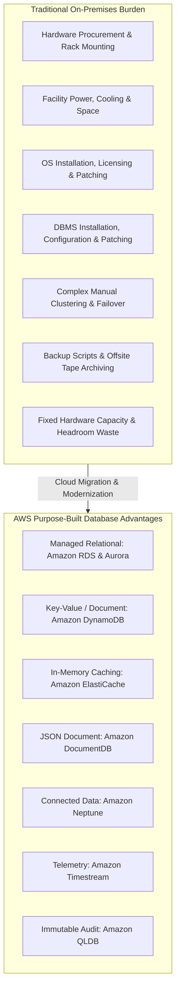
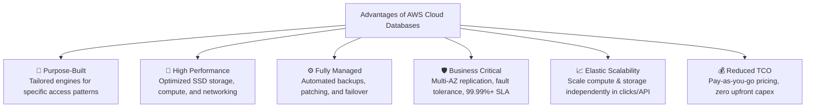
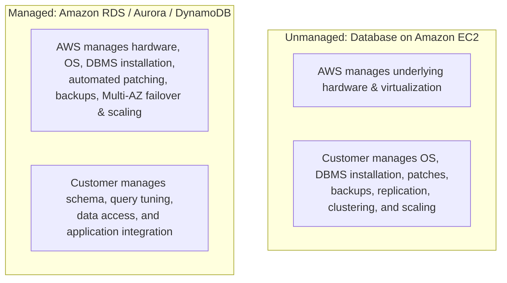
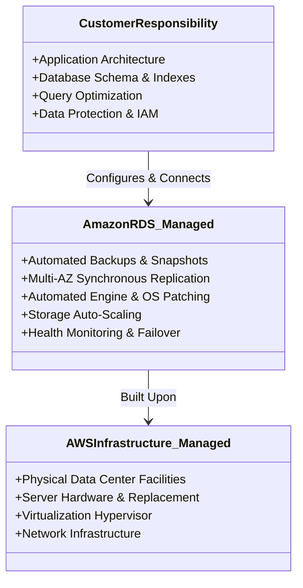
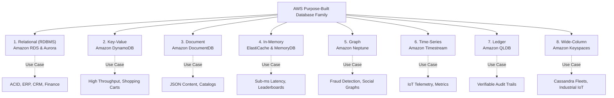
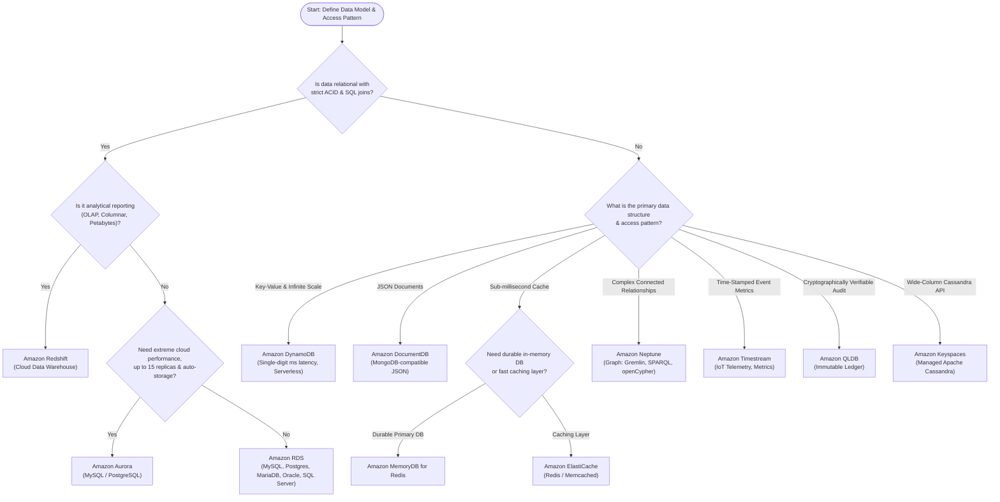

# 🌐 Introduction to Databases on AWS

> **Course**: AWS re/Start  
> **Module**: AWS Database Services (T17 – Introduction to Databases on AWS)  
> **Source Document**: `T17-AWS_Databases_Services/T17-0002-AWSD_INTRODATABASESAWS_EN.pdf`  
> **Target Audience**: AWS re/Start Learners, Cloud Practitioners, Solutions Architects, and Systems Operations Associates  

---

## 🎯 Lesson Overview

Databases serve as the mission-critical core of modern software applications, powering everything from global e-commerce platforms and banking systems to real-time mobile games and social networks. In traditional enterprise environments, operating database workloads on premises presents substantial operational friction, high capital expenditures, and rigid infrastructure constraints. Systems engineers and database administrators (DBAs) spend considerable time and resources on repetitive, low-value administrative tasks—often termed **"undifferentiated heavy lifting"**—rather than innovating and optimizing customer-facing applications.

Cloud computing transforms this paradigm. Amazon Web Services (AWS) provides both self-managed infrastructure and a comprehensive portfolio of fully managed, **purpose-built cloud databases**. Rather than forcing modern applications into a monolithic, "one-size-fits-all" relational database, AWS empowers developers and architects to select the right tool for the specific access pattern, data structure, latency requirement, and scale of their workloads.



---

## 📌 Learning Objectives

By completing this module and working through these comprehensive study notes, you will be able to:

- [ ] **Identify AWS Database Services**: Recognize the core AWS database offerings and describe their primary architectural benefits and capabilities.
- [ ] **Analyze On-Premises Operational Challenges**: Articulate the hardware, licensing, operational, and scaling friction inherent in running database servers in a private data center.
- [ ] **Contrast Unmanaged vs. Managed Solutions**: Differentiate between running self-managed databases on Amazon EC2 versus fully managed services like Amazon RDS, Amazon Aurora, and Amazon DynamoDB.
- [ ] **Evaluate the Database Shared Responsibility Model**: Delineate customer operational responsibilities across on-premises, EC2 IaaS, RDS PaaS, and serverless architectures.
- [ ] **Compare SQL and NoSQL Paradigms**: Contrast relational schemas, SQL querying, and vertical scaling with NoSQL non-relational document/key-value models, flexible schemas, and horizontal scaling.
- [ ] **Navigate the AWS Purpose-Built Database Taxonomy**: Classify AWS databases across Relational, Key-Value, Document, In-Memory, Graph, Time-Series, Ledger, and Wide-Column storage categories.
- [ ] **Apply Workload Decision Frameworks**: Formulate architecture recommendations based on data structure, query patterns, throughput requirements, latency constraints, and cost optimization goals.

---

## 🏗️ 1. Challenges of Running On-Premises Databases

Operating database management systems (DBMS) within corporate data centers or colocation facilities requires organizations to manage the complete technology stack—from physical building facilities down to database query indexing.

```mermaid
flowchart LR
    subgraph HeavyLifting["Undifferentiated Heavy Lifting (80% Effort)"]
        F1["Facility Space, Power & Cooling"]
        F2["Hardware Procurement & Lifecycles"]
        F3["OS Installation & Kernel Patching"]
        F4["DBMS Patching & Version Upgrades"]
        F5["Manual Backups & Tape Rotations"]
        F6["High Availability Cluster Tuning"]
    end

    subgraph BusinessValue["True Business Value (20% Effort)"]
        V1["Schema Modeling & Optimization"]
        V2["SQL Query & Index Tuning"]
        V3["Application Business Logic"]
        V4["User Experience & Feature Delivery"]
    end

    HeavyLifting -.->|"Distracts From"| BusinessValue
```



### Key Operational Challenges

1. **Hardware Procurement and Capacity Planning**:
   - Physical server procurement cycles typically take weeks or months (quoting, purchasing approval, shipping, racked, and cabled).
   - Capacity planning requires over-provisioning hardware to accommodate peak projected traffic years in advance, resulting in idle capital and wasted capacity during normal operating periods.

2. **Server Maintenance and Facility/Energy Footprint**:
   - Datacenters require uninterrupted power supplies (UPS), backup diesel generators, complex heating, ventilation, and air conditioning (HVAC) cooling, and round-the-clock physical security guards.
   - Server hardware failures (failed power supplies, failing memory DIMMs, degraded RAID disks) demand physical maintenance and spare parts inventory.

3. **Operating System (OS) Installation and Patching**:
   - Systems administrators must deploy base OS images, perform kernel tuning, configure storage volumes (LVM, RAID arrays), and consistently test and apply OS-level security patches and kernel updates.

4. **DBMS Software Installation and Licensing**:
   - Installing enterprise database software involves complex configuration parameters, storage layout design, and costly per-core or per-socket commercial licensing agreements (e.g., Oracle Database Enterprise Edition, Microsoft SQL Server).
   - Routine database engine patching requires coordinated maintenance windows, manual binary updates, and rollback planning.

5. **Backups, Disaster Recovery (DR), and High Availability (HA)**:
   - Ensuring database resilience requires configuring automated backup scripts, managing backup storage media (SAN, NAS, or off-site tape rotation), and frequently conducting restore drills to verify backup integrity.
   - Achieving high availability mandates setting up active-passive failover clustering (e.g., Oracle Data Guard, SQL Server AlwaysOn Availability Groups) across separated power and network domains, which is complex and error-prone.

6. **Limits on Scalability**:
   - Scaling an on-premises database vertically requires purchasing and installing larger physical hardware (CPUs, RAM). Once the largest available physical chassis is reached, vertical scaling reaches a hard physical limit.
   - Horizontal scaling (sharding data across multiple distinct database servers) requires custom application logic, complex cross-node transaction coordination, and significant engineering maintenance.

7. **Security Hardening and Compliance**:
   - Meeting compliance standards (PCI DSS, HIPAA, SOC 2, ISO 27001) demands rigorous physical security, host hardening, perimeter firewall management, network segmentation, and encryption at rest and in transit.

---

## ⚡ 2. Advantages of Databases on AWS

AWS replaces the physical constraints of on-premises infrastructure with elastic, programmatic, and fully managed cloud database services.



### Core Value Drivers

- **Purpose-Built Architecture**: Rather than shoehorning every data access pattern into a single relational database engine, AWS offers specialized engines optimized for specific workloads (relational, key-value, document, graph, in-memory, time-series, ledger).
- **Designed for High Performance**: AWS databases leverage optimized hardware (such as AWS Nitro System instances and Graviton processors), high-throughput NVMe SSD storage, and proprietary engine optimizations (e.g., Amazon Aurora delivering up to 5x the throughput of MySQL and 3x of PostgreSQL).
- **Fully Managed Operational Simplicity**: Automated provisioning, continuous incremental backups, automated minor-version patching, automated storage scaling, and automated multi-Availability Zone failover eliminate manual DBA overhead.
- **Built for Business-Critical Reliability**: Multi-AZ deployments provide synchronous replication across physically isolated datacenters within a region, enabling automatic failover in under 60 seconds with zero data loss.
- **Enterprise-Grade Security & Governance**: Built-in integration with AWS Key Management Service (AWS KMS) for encryption at rest, SSL/TLS encryption in transit, Amazon VPC private network isolation, and fine-grained access control through AWS Identity and Access Management (IAM).
- **Reduced Total Cost of Ownership (TCO)**: Eliminates upfront capital expenditure (CapEx) in favor of predictable operational expenses (OpEx), featuring pay-as-you-go consumption models, reserved instance savings, and serverless compute auto-scaling down to zero.

---

## 🔄 3. Unmanaged vs. Managed Database Solutions

When architecting a database on AWS, the first critical architectural decision is choosing between **Unmanaged (Self-Managed)** and **Managed** deployments.



### Unmanaged Solutions: Databases on Amazon EC2

In an unmanaged model, you launch Amazon EC2 virtual machine instances, attach Amazon Elastic Block Store (EBS) volumes, and manually install and configure your database engine of choice (e.g., MySQL, Oracle, PostgreSQL, IBM Db2, SAP ASE).

- **Customer Ownership**:
  - Operating system configuration, patching, and security hardening.
  - DBMS software installation, license management, and patch cycles.
  - Designing, scripting, and testing database backups and point-in-time recovery.
  - Setting up primary-replica replication, network heartbeat monitors, and automated failover scripts across Availability Zones.
  - Storage volume resizing, disk striping, and compute capacity scaling.
- **When to Choose Unmanaged on EC2**:
  - Complete control over the underlying operating system kernel or file system is mandatory.
  - Legacy third-party database plugins, agents, or custom OS-level extensions are required.
  - Specific database versions or database engines are not supported by Amazon RDS (e.g., IBM Db2, older legacy Oracle versions).
  - Existing corporate software licenses (BYOL) require physical host affinity or unsupported configurations.

### Managed Solutions: Amazon RDS, Aurora, and DynamoDB

In a managed database model, AWS provisions the compute and storage infrastructure, pre-installs the database engine, and orchestrates operational maintenance.

- **AWS Ownership**:
  - Physical infrastructure, hypervisor, OS installation, and automated OS patching.
  - Automated database software patching during configurable maintenance windows.
  - Automated daily backups and continuous transaction log archiving (allowing point-in-time recovery).
  - Multi-AZ synchronous replication and automated health checks with fast failover.
- **Customer Ownership**:
  - Database schema definition, table modeling, and indexing.
  - SQL query optimization and application architecture.
  - User permissions and credential management.
  - Database parameter group adjustments.

> [!NOTE]
> Managed database services free your engineering talent from "keeping the lights on," allowing developers to focus entirely on application features and performance optimization.

---

### Comprehensive Shared Responsibility Comparison

The following matrix delineates operational boundaries across on-premises, Amazon EC2, Amazon RDS, and Serverless database paradigms:

| Operational Responsibility | On-Premises Data Center | Database on Amazon EC2 | Amazon RDS / Aurora | Serverless (DynamoDB / Aurora Serverless) |
| :--- | :---: | :---: | :---: | :---: |
| **Power, HVAC & Physical Facility** | 👤 Customer | ☁️ AWS | ☁️ AWS | ☁️ AWS |
| **Rack, Stack & Cable Hardware** | 👤 Customer | ☁️ AWS | ☁️ AWS | ☁️ AWS |
| **Server Hardware Maintenance** | 👤 Customer | ☁️ AWS | ☁️ AWS | ☁️ AWS |
| **Hypervisor & Virtualization** | 👤 Customer | ☁️ AWS | ☁️ AWS | ☁️ AWS |
| **Operating System Installation** | 👤 Customer | 👤 Customer | ☁️ AWS | ☁️ AWS |
| **OS Security Patching & Upgrades** | 👤 Customer | 👤 Customer | ☁️ AWS | ☁️ AWS |
| **Database Software Installation** | 👤 Customer | 👤 Customer | ☁️ AWS | ☁️ AWS |
| **Database Engine Patching** | 👤 Customer | 👤 Customer | ☁️ AWS (Automated) | ☁️ AWS |
| **Backups & Point-in-Time Recovery** | 👤 Customer | 👤 Customer | ☁️ AWS (Automated) | ☁️ AWS (Automated) |
| **High Availability & Failover Setup** | 👤 Customer | 👤 Customer | ☁️ AWS (Multi-AZ) | ☁️ AWS (Built-in) |
| **Compute & Storage Scaling** | 👤 Customer | 👤 Customer | 🤝 Shared (Clicks/APIs) | ☁️ AWS (Automatic) |
| **Schema Design & Query Tuning** | 👤 Customer | 👤 Customer | 👤 Customer | 👤 Customer |
| **Data Encryption & Access Policies** | 👤 Customer | 👤 Customer | 👤 Customer | 👤 Customer |



---

## 📊 4. SQL vs. NoSQL Database Paradigms

Understanding the structural differences between relational (SQL) and non-relational (NoSQL) databases is essential when choosing an AWS database service.

```mermaid
flowchart TD
    subgraph SQLModel["Relational (SQL)"]
        direction TB
        T1["Table: Countries"]
        R1["Row: CountryCode | Name | Continent | SurfaceArea"]
        S1["Fixed Schema & Foreign Key Constraints"]
        Q1["Structured Query Language (SQL)"]
        Scale1["Vertical Scaling (Larger Hardware)"]
    end

    subgraph NoSQLModel["Non-Relational (NoSQL)"]
        direction TB
        C1["Collection / Table: Countries"]
        D1["Document / Item: Key-Value / JSON Object"]
        S2["Dynamic, Flexible Schemas"]
        Q2["API Queries / Document Key Lookups"]
        Scale2["Horizontal Scaling (Distributed Partitions)"]
    end
```



### Relational (SQL) Databases

- **Data Organization**: Structured tables composed of strict rows and columns.
- **Schema**: Rigid, predefined schemas defined by Data Definition Language (DDL). Schema changes often require table locking and planned migrations.
- **Integrity**: Enforces ACID properties (**A**tomicity, **C**onsistency, **I**solation, **D**urability) and relational constraints (primary keys, foreign keys, unique constraints).
- **Query Mechanism**: Declarative Structured Query Language (`SELECT`, `JOIN`, `GROUP BY`).
- **Scaling Characteristics**: Primarily scales vertically (increasing CPU, RAM, and IOPS on a single instance). Read scalability can be augmented via read replicas.

### Non-Relational (NoSQL) Databases

- **Data Organization**: Flexible structures including key-value pairs, JSON documents, graph nodes and edges, or wide-column families.
- **Schema**: Dynamic and flexible schemas; each item or document can contain distinct attributes without altering table definitions.
- **Integrity Model**: Often favors high availability and horizontal partitioning over strict multi-table ACID transactions (commonly adhering to the BASE model: **B**asically **A**vailable, **S**oft state, **E**ventual consistency, though systems like DynamoDB support single-table ACID transactions).
- **Query Mechanism**: API calls (`GetItem`, `PutItem`, `Query`) and specialized document path lookups rather than complex relational SQL `JOIN` operations.
- **Scaling Characteristics**: Scales horizontally with linear performance by sharding and distributing partitions across a vast fleet of storage nodes.

---

### Concrete Data Representation Example

The slide deck highlights how the same real-world entity is stored in SQL versus NoSQL:

#### 1. SQL Representation (Relational Table)

```sql
-- Relational Table Schema
CREATE TABLE Countries (
    CountryCode VARCHAR(3) PRIMARY KEY,
    Name VARCHAR(100) NOT NULL,
    Continent VARCHAR(50) NOT NULL,
    SurfaceArea DECIMAL(10, 2) NOT NULL
);

-- Row Data
INSERT INTO Countries (CountryCode, Name, Continent, SurfaceArea)
VALUES ('ABW', 'Aruba', 'North America', 193.00);
```

| CountryCode | Name | Continent | SurfaceArea |
| :--- | :--- | :--- | :--- |
| `ABW` | Aruba | North America | `193.00` |

#### 2. NoSQL Representation (JSON Document / DynamoDB Item)

```json
{
  "CountryCode": "ABW",
  "Name": "Aruba",
  "Continent": "North America",
  "SurfaceArea": 193.00,
  "Languages": ["Dutch", "Papiamento"],
  "Demographics": {
    "Population": 106766,
    "Capital": "Oranjestad"
  }
}
```

> [!TIP]
> Notice how the NoSQL model easily embeds complex nested structures (such as arrays of languages and nested demographic objects) into a single document without requiring relational joins across secondary tables.

---

### Workload Decision Factors

When evaluating databases for a given workload, architects must evaluate six fundamental factors:

1. **Data Structure**: Is data highly relational with complex multi-table referential integrity, or semi-structured/unstructured (JSON, key-value, graph)?
2. **Data Size**: Is the dataset bounded in gigabytes/terabytes, or expanding rapidly into petabytes and exabytes?
3. **Computation & Query Complexity**: Does the application require complex aggregation, multi-table joins, full-text search, or simple low-latency primary key lookups?
4. **Cost Model**: Is cost driven by allocated compute instance sizing (hourly DB instances) or pay-per-request / pay-per-read/write-capacity unit billing?
5. **Access Patterns**: Are queries unpredictable and ad-hoc (analytics/BI), or predictable, high-frequency, and read/write intensive (microservices)?
6. **Performance & Latency**: Does the application require sub-millisecond response times (in-memory caching) or are single-digit millisecond responses sufficient?

---

## 🧭 5. Purpose-Built Databases Taxonomy & Decision Guide

Modern cloud applications embrace **microservices architectures**, where each independent service utilizes a database engine tailored to its unique data structure and access patterns. AWS offers eight purpose-built database categories:



### 1. Relational Databases: Amazon RDS & Amazon Aurora
- **Primary Engines**: Amazon RDS supports six engines: MySQL, PostgreSQL, MariaDB, Oracle, Microsoft SQL Server, and Amazon Aurora.
- **Amazon Aurora Differentiator**: A cloud-native relational database engineered by AWS. Decouples compute from distributed storage, replicates six copies of data across three Availability Zones, delivers up to **5x MySQL throughput** and **3x PostgreSQL throughput**, and scales storage automatically up to 128 TiB.
- **Key Characteristics**: ACID compliance, rich SQL querying, multi-table joins, strict schema validation.
- **Typical Use Cases**: Enterprise Resource Planning (ERP), Customer Relationship Management (CRM), e-commerce financial ledgers, and traditional billing applications.

### 2. Key-Value Databases: Amazon DynamoDB
- **Key Characteristics**: Fully managed, serverless NoSQL database delivering consistent single-digit millisecond latency at virtually any scale. Automatically shards data across partitions.
- **Features**: Global Tables (multi-region active-active replication), DynamoDB Streams (change data capture), and ACID transaction support.
- **Typical Use Cases**: High-traffic shopping carts, session state management, user profiles, mobile gaming player state, and real-time bidding platforms.

### 3. Document Databases: Amazon DocumentDB (with MongoDB compatibility)
- **Key Characteristics**: Fully managed document database service designed to natively store, query, and index JSON data.
- **Architecture**: Separates compute and storage, providing automated replication across 3 AZs and storage scaling up to 128 TiB.
- **Typical Use Cases**: Content management systems (CMS), digital media catalogs, user profiles, and e-commerce product catalogs with varying attribute sets.

### 4. In-Memory Databases: Amazon ElastiCache & Amazon MemoryDB
- **Key Engines**:
  - **Amazon ElastiCache**: Managed Redis or Memcached service providing microsecond retrieval latencies by serving data directly from memory. Ideal as an in-memory caching layer in front of relational databases.
  - **Amazon MemoryDB for Redis**: Fully managed, Redis-compatible in-memory database that uses a distributed transactional log to provide durability alongside ultra-fast sub-millisecond reads and single-digit millisecond writes.
- **Typical Use Cases**: Real-time gaming leaderboards, web session stores, geospatial data indexes, and real-time streaming analytics.

### 5. Graph Databases: Amazon Neptune
- **Key Characteristics**: Purpose-built, high-performance graph database optimized for storing complex relationships and navigating billions of connections in milliseconds.
- **Supported Frameworks**: Apache TinkerPop Gremlin, W3C Resource Description Framework (RDF/SPARQL), and openCypher.
- **Typical Use Cases**: Fraud detection (uncovering money-laundering rings), social media relationship feeds, recommendation engines, and customer 360-degree knowledge graphs.

### 6. Time-Series Databases: Amazon Timestream
- **Key Characteristics**: Serverless, fast, scalable time-series database designed to store and analyze trillions of time-stamped events per day up to 1,000x faster and at 1/10th the cost of relational databases.
- **Features**: Built-in adaptive query engine and automatic data lifecycle management (routing hot data to memory and warm data to low-cost storage).
- **Typical Use Cases**: Internet of Things (IoT) sensor telemetry, DevOps infrastructure performance monitoring, fleet management telemetry, and industrial equipment tracking.

### 7. Ledger Databases: Amazon QLDB (Quantum Ledger Database)
- **Key Characteristics**: Fully managed ledger database that provides a transparent, immutable, and cryptographically verifiable transaction log owned by a central trusted authority.
- **Features**: Utilizes an append-only journal where changes cannot be modified or overwritten. Uses cryptographic hashing (SHA-256) to produce a verifiable audit trail.
- **Typical Use Cases**: Financial transaction history, supply chain provenance, government registry records, and regulatory compliance audit logs.

### 8. Wide-Column Databases: Amazon Keyspaces (for Apache Cassandra)
- **Key Characteristics**: Scalable, highly available, serverless Apache Cassandra-compatible database service.
- **Features**: Pay-per-request pricing, seamless integration with AWS services, and automatic table partitioning.
- **Typical Use Cases**: Industrial manufacturing telemetry, predictive maintenance, fleet sensor logging, and telecommunications call detail records.

### 9. Analytical Data Warehouses: Amazon Redshift
- **Key Characteristics**: Petabyte-to-exabyte scale SQL data warehouse utilizing columnar storage, massive parallel processing (MPP), and machine learning-driven automated optimization.
- **Typical Use Cases**: Enterprise Business Intelligence (BI), historical operational reporting, complex multidimensional analytics, and enterprise data lakes.

---

## 🌳 6. Database Selection Decision Tree

Use this decision flowchart to determine the optimal database service for your architecture:



---

## 📋 7. Purpose-Built Database Use Case Mapping Table

| Database Service | Data Model | Primary Query Languages / APIs | Typical Business Use Cases | Key Architectural Differentiators |
| :--- | :--- | :--- | :--- | :--- |
| **Amazon RDS** | Relational (OLTP) | Standard SQL (Engine-specific dialect) | ERP, CRM, e-commerce transactions, financial applications | Managed provisioning, Multi-AZ failover, read replicas, supports 5 standard engines |
| **Amazon Aurora** | Relational (OLTP) | MySQL & PostgreSQL native drivers | High-throughput web applications, mission-critical enterprise systems | Up to 5x MySQL throughput, 6-way storage replication across 3 AZs, storage auto-scales to 128 TiB |
| **Amazon DynamoDB** | Key-Value / Document | HTTP/REST APIs (`PutItem`, `GetItem`, PartiQL) | Mobile apps, gaming leaderboards, shopping carts, session state | Serverless, single-digit millisecond latency, Global Tables multi-region active-active |
| **Amazon DocumentDB** | JSON Document | MongoDB API | Content management, product catalogs, user profiles | Decoupled compute/storage, native JSON querying, scales storage automatically |
| **Amazon ElastiCache** | In-Memory Key-Value | Redis / Memcached native protocols | Caching database queries, real-time leaderboards, session caching | Sub-millisecond read/write latency, in-memory cluster scaling |
| **Amazon MemoryDB** | In-Memory Key-Value | Redis API | Ultra-fast primary database with data durability | Redis-compatible with a Multi-AZ transactional write log for zero data loss durability |
| **Amazon Neptune** | Graph (Nodes & Edges) | Gremlin, SPARQL, openCypher | Fraud detection, social networks, recommendation engines | Traverses millions of complex relationships in milliseconds, high-availability storage |
| **Amazon Timestream** | Time-Series | SQL with built-in time-series functions | IoT sensor streams, application metrics, server telemetry | Serverless, 1,000x faster than RDBMS for metrics, automated storage tiering (memory to storage) |
| **Amazon QLDB** | Ledger (Append-Only) | PartiQL (SQL-compatible) | Financial audit logs, supply chain tracking, regulatory compliance | Immutable journal, cryptographically verifiable hash chain, central authority |
| **Amazon Keyspaces** | Wide-Column | Cassandra Query Language (CQL) | Industrial IoT telemetry, equipment monitoring, fleet operations | Serverless Cassandra compatibility, auto-scaling, pay-per-request pricing |
| **Amazon Redshift** | Relational (OLAP Columnar) | PostgreSQL-compatible SQL | Enterprise data warehousing, business intelligence, big data analytics | Columnar storage, massively parallel processing (MPP), petabyte-to-exabyte scale |

---

## 💡 8. Key Architecture Takeaways

> [!IMPORTANT]
> - **Eliminate Undifferentiated Heavy Lifting**: Transitioning from self-managed databases on EC2 to Amazon RDS or serverless databases delegates infrastructure provisioning, automated patching, backup retention, and high-availability failover to AWS.
> - **Match the Database to the Access Pattern**: Avoid using relational databases as universal data stores. If your workload requires sub-millisecond retrieval, front your architecture with **Amazon ElastiCache**. If your application requires petabyte-scale key lookups, leverage **Amazon DynamoDB**.
> - **Amazon Aurora vs. Standard RDS**: Aurora is AWS's proprietary, cloud-native relational engine. For high-throughput enterprise relational workloads, Aurora provides superior throughput, automated storage expansion, and faster failover compared to standard Amazon RDS MySQL or PostgreSQL.
> - **When EC2 is Still Required**: Host database engines on Amazon EC2 only when you require operating system access, unsupported database engines/versions, or specialized third-party OS-level extensions.

---

## 🧠 9. Knowledge Check & Practice Questions

Test your comprehension of the concepts covered in this module:

### Question 1 (Slide Checkpoint)
**You are building a customer relationship management (CRM) application with structured customer records, order histories, and transactional requirements. Which AWS database service should you recommend?**
- A) Amazon Neptune
- B) Amazon RDS (or Amazon Aurora)
- C) Amazon Timestream
- D) Amazon ElastiCache

> **Answer: B**  
> **Explanation**: CRM applications rely on structured relational data models, complex multi-table relationships (customers, orders, invoices), and strict ACID transaction compliance. Amazon RDS or Amazon Aurora is the optimal choice. Amazon Neptune is designed for graph relationships, Timestream for time-stamped metrics, and ElastiCache for in-memory caching.

---

### Question 2 (Slide Checkpoint)
**Which database model stores structured data organized strictly into tables consisting of rows and columns with fixed schemas?**
- A) Key-Value
- B) Graph
- C) Relational (SQL)
- D) Wide-Column

> **Answer: C**  
> **Explanation**: Relational (SQL) databases organize data into rigid tabular structures composed of rows (records) and columns (attributes) governed by predefined schemas and primary/foreign keys.

---

### Question 3 (Slide Checkpoint)
**Which administrative tasks are you still responsible for when deploying a database on Amazon RDS? (Select TWO)**
- A) Applying security patches to the underlying Linux operating system
- B) Designing table schemas, primary keys, and indexes
- C) Replacing failed hardware drives in the storage array
- D) Performing physical server rack-and-stack operations
- E) Optimizing application SQL queries and database connection pools

> **Answers: B and E**  
> **Explanation**: Amazon RDS is a managed service where AWS assumes responsibility for hardware maintenance, OS installation and patching, and storage array operations. The customer retains ownership of schema modeling, table creation, indexing, SQL query tuning, and application integration.

---

### Question 4 (Scenario-Based)
**A gaming company is developing a multiplayer online mobile game. They need a database to store player session state and live leaderboards requiring sub-millisecond read response times. Which service best satisfies this requirement?**
- A) Amazon DocumentDB
- B) Amazon Redshift
- C) Amazon ElastiCache for Redis
- D) Amazon QLDB

> **Answer: C**  
> **Explanation**: Sub-millisecond latency requirements point directly to an in-memory database or caching solution. Amazon ElastiCache for Redis maintains all operational data in RAM and natively provides sorted sets (`ZSET`), making it the ideal engine for real-time leaderboard computations and session storage.

---

### Question 5 (Shared Responsibility)
**An organization has an existing legacy database running on a specialized version of Oracle that requires direct root access to the underlying Linux operating system to install custom kernel modules. Which deployment model must they choose?**
- A) Amazon RDS with Multi-AZ
- B) Amazon Aurora Serverless
- C) Database installed on an Amazon EC2 instance
- D) Amazon DynamoDB with DAX

> **Answer: C**  
> **Explanation**: Amazon RDS and Aurora are fully managed PaaS offerings that do not grant customer root or shell access to the underlying operating system. If direct OS access or custom kernel modules are required, the database must be hosted on an unmanaged Amazon EC2 virtual machine.

---

## 🔗 Related Curriculum Modules

- [T10-0001-RSDB_EN-US_SG_M06_DATABASESINTRO.md](../T10-Database/T10-0001-RSDB_EN-US_SG_M06_DATABASESINTRO.md) — Fundamental Concepts of Relational & NoSQL Databases
- [T10-0010-RSDB_EN-US_SG_M06_AMAZONRDS.md](../T10-Database/T10-0010-RSDB_EN-US_SG_M06_AMAZONRDS.md) — Deep Dive into Amazon RDS & Amazon Aurora
- [T10-0012-RSDB_EN-US_SG_M06_DYNAMODB.md](../T10-Database/T10-0012-RSDB_EN-US_SG_M06_DYNAMODB.md) — Amazon DynamoDB Architecture and Key-Value Modeling
- [T17-0003-AWSD_AMAZONREDSHIFT_EN.pdf](T17-0003-AWSD_AMAZONREDSHIFT_EN.pdf) — Cloud Data Warehousing with Amazon Redshift
- [T17-0004-AWSD_AMAZONAURORA_EN.pdf](T17-0004-AWSD_AMAZONAURORA_EN.pdf) — Amazon Aurora Architectural Deep Dive
