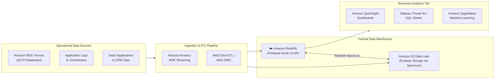
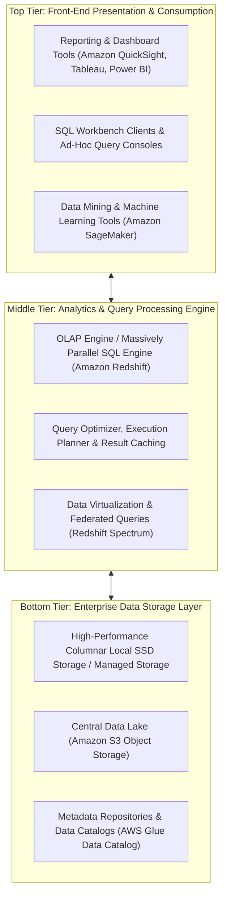
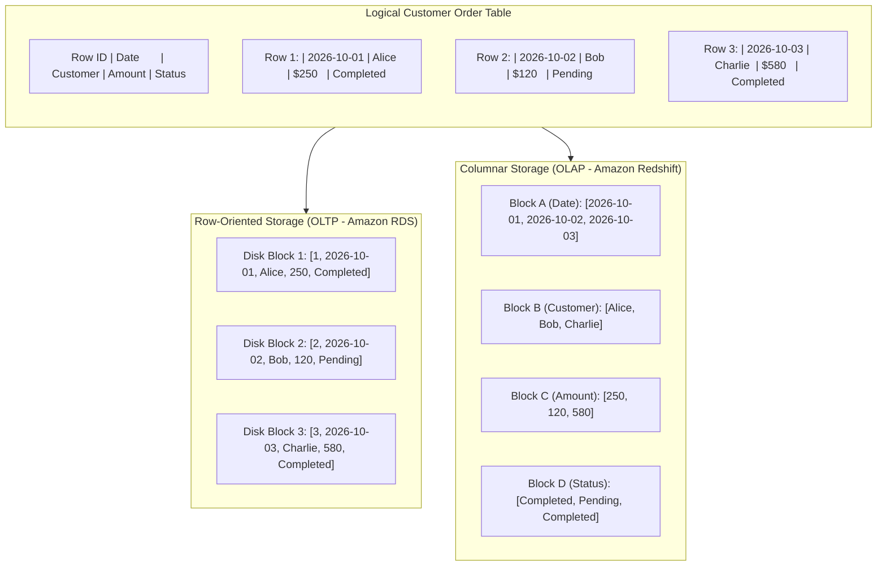
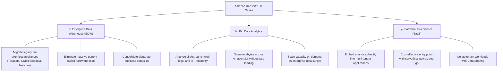
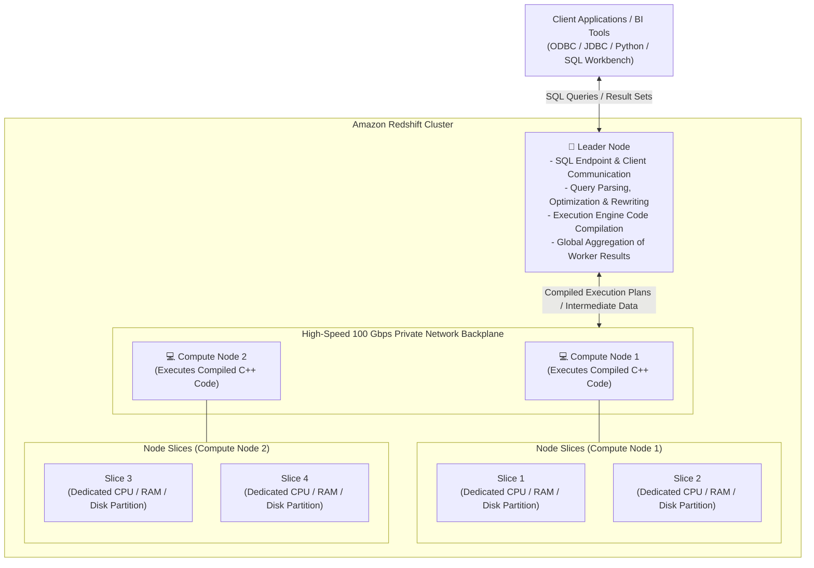
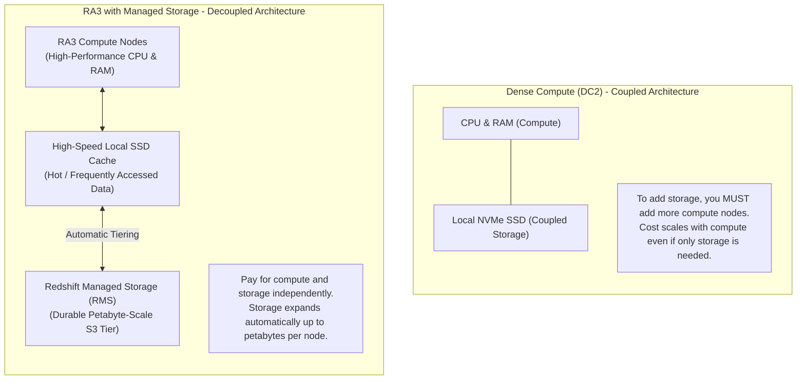
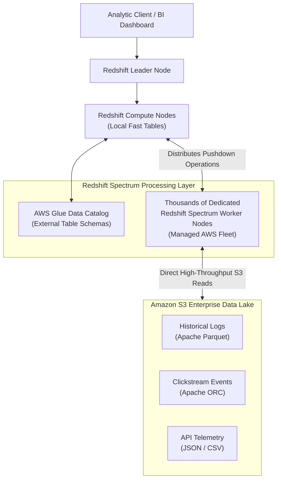
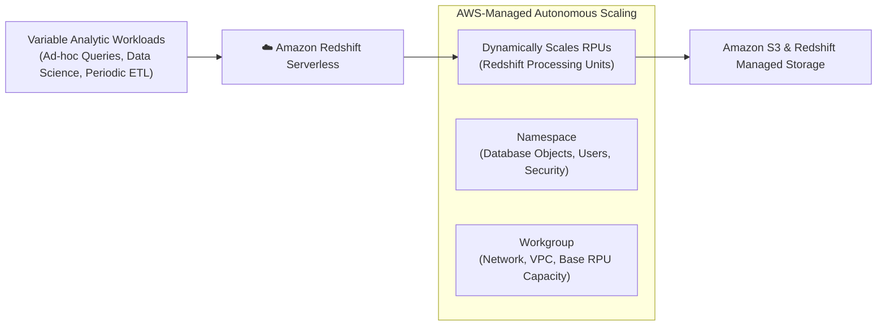
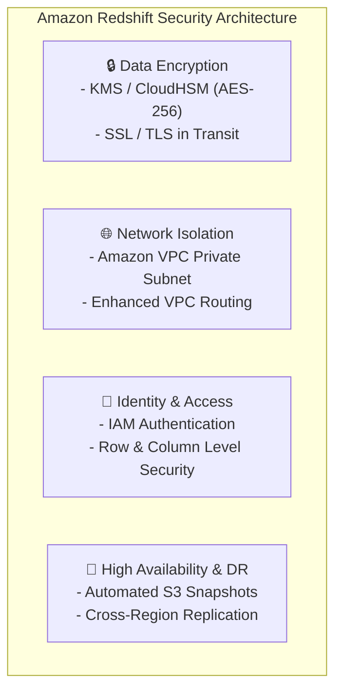

# 📊 Amazon Redshift: Cloud Data Warehousing & Analytics

> **Course**: AWS re/Start  
> **Module**: AWS Database Services (T17 – Amazon Redshift)  
> **Source Document**: `T17-AWS_Databases_Services/T17-0003-AWSD_AMAZONREDSHIFT_EN.pdf`  
> **Target Audience**: AWS re/Start Learners, Cloud Practitioners, Data Analysts, and Cloud Architects  

---

## 🎯 Module Overview

Organizations across every industry generate massive volumes of transactional, behavioral, and operational data. While operational relational databases (such as Amazon RDS and Amazon Aurora) excel at processing high-concurrency, short-lived online transactions, they are ill-suited for heavy, multi-table aggregations spanning millions or billions of historical records. Running intensive analytic queries against transactional production databases causes severe resource contention, locks records, degrades user experience, and risks application outages.

To solve this challenge, modern data architectures separate transactional processing from analytical processing by utilizing a **Data Warehouse**. A data warehouse acts as a centralized enterprise repository optimized specifically for complex historical analysis, business intelligence (BI), executive dashboards, and strategic decision-making.

**Amazon Redshift** is a fast, scalable, fully managed, petabyte-scale cloud data warehouse service offered by Amazon Web Services. Redshift enables organizations to query structured and semi-structured datasets spanning gigabytes to exabytes with sub-second response times using standard SQL. By combining **columnar storage**, **advanced data compression**, **Massively Parallel Processing (MPP)**, and seamless **Lake House** integration with Amazon S3 via **Redshift Spectrum**, Amazon Redshift delivers up to three times better price-performance than alternative cloud data warehouses.



---

## 📌 Learning Objectives

By completing this module and reviewing these comprehensive notes, you will be able to:

- [ ] **Define a Data Warehouse**: Explain the concept, purpose, and architectural tiers of a modern enterprise data warehouse.
- [ ] **Distinguish OLTP vs. OLAP**: Compare Online Transaction Processing and Online Analytical Processing across data modeling, access patterns, storage layouts, and performance characteristics.
- [ ] **Understand the Three Vs of Big Data**: Define Volume, Velocity, and Variety and explain how cloud data warehouses address them.
- [ ] **Explain Amazon Redshift Architecture**: Describe the roles of the Leader Node, Compute Nodes, Node Slices, and communication buses.
- [ ] **Compare Redshift Node Families**: Differentiate between Dense Compute (DC2) nodes and RA3 nodes with Redshift Managed Storage (RMS) separating compute from storage.
- [ ] **Analyze Core Performance Innovations**: Explain the inner workings of columnar storage, column-specific compression encodings, Massively Parallel Processing (MPP), Result Caching, and Concurrency Scaling.
- [ ] **Implement Lake House Architecture with Redshift Spectrum**: Query open-format data (Parquet, ORC, JSON, CSV) in Amazon S3 directly without loading into local storage.
- [ ] **Evaluate Amazon Redshift Serverless**: Contrast provisioned clusters with auto-scaling serverless data warehousing.
- [ ] **Architect Redshift Security & Compliance**: Configure VPC isolation, IAM authentication, role-based access control, AWS KMS encryption at rest, and automated snapshot backups.

---

## 🏢 1. Foundations of Data Warehousing

### 1.1 What is a Data Warehouse?

A **Data Warehouse (DWH)** is a centralized, consolidated enterprise repository of integrated data collected from one or multiple disparate sources. It is specifically designed and optimized to support **Business Intelligence (BI)**, executive reporting, statistical analysis, data mining, and strategic decision-making.

Data warehouses maintain historical records over long horizons (months, years, or decades), allowing analysts to identify trends, forecast performance, evaluate customer behavior, and evaluate business metrics over time.

```
Disparate Sources                     Central Data Warehouse                    Business Value
+----------------------+              +----------------------+             +----------------------+
| ERP Systems          |              |                      |             | Executive Dashboards |
| CRM Platforms        | -- ETL/ELT-->| Historical, Cleaned, | ----------> | Trend Analysis       |
| E-Commerce DBs       |              | Consolidated Records |             | Financial Forecasts  |
| Web & IoT Logs       |              |                      |             | Predictive ML Models |
+----------------------+              +----------------------+             +----------------------+
```

### 1.2 Core Benefits of a Data Warehouse

Implementing an enterprise data warehouse delivers five foundational business and technical advantages:

1. **Informed, Strategic Decision-Making**: Provides senior leadership, financial analysts, and business teams with unified, credible metrics derived from comprehensive historical data.
2. **Consolidation of Disparate Data Sources**: Breaks down organizational silos by ingesting and standardizing data from transactional databases, cloud applications, billing systems, and external APIs into a unified schema.
3. **Historical Data Analysis & Trend Discovery**: Unlike transactional databases that frequently archive or purge old data to maintain performance, data warehouses retain longitudinal history to uncover seasonal trends and year-over-year growth.
4. **Data Quality, Consistency, and Accuracy**: Data undergoes extraction, transformation, and loading (ETL/ELT) processes where anomalies are cleaned, currencies converted, schema mismatches resolved, and duplicate records deduplicated.
5. **Workload Isolation (Decoupling Analytics from Transactions)**: Heavy analytic queries (such as full table scans and multi-way aggregations) are offloaded to the warehouse. This protects customer-facing transactional databases from CPU exhaustion, lock contention, and latency spikes.

---

### 1.3 The Three Tiers of Data Warehouse Architecture

A classic data warehouse architecture is organized into three distinct tiers:



- **Top Tier (Presentation Layer)**: Front-end client applications and business intelligence tools where analysts, executives, and data scientists visualize findings, generate reports, run ad-hoc queries, and explore data patterns.
- **Middle Tier (Analytics Engine)**: The high-performance calculation engine that parses SQL queries, compiles efficient execution plans, distributes computation across parallel workers, and aggregates results. In AWS, Amazon Redshift serves as this powerhouse.
- **Bottom Tier (Storage Layer)**: The persistent storage repository where cleaned and transformed data resides on optimized physical media, columnar block files, or object storage (Amazon S3).

---

### 1.4 Modern Enterprise Data Strategy: Database vs. Data Lake vs. Data Warehouse

Modern enterprise architectures rarely rely on a single data storage paradigm. Instead, organizations employ a harmonious combination of **Databases**, **Data Lakes**, and **Data Warehouses**:

| Dimension | Transactional Database (e.g., RDS / Aurora) | Data Lake (e.g., Amazon S3) | Data Warehouse (e.g., Amazon Redshift) |
| :--- | :--- | :--- | :--- |
| **Primary Purpose** | Fast transactional CRUD operations for live applications | Centralized raw storage for all data types at limitless scale | High-speed analytical reporting and business intelligence |
| **Data Structure** | Structured (Relational schema enforced on write) | Raw, semi-structured, unstructured, and structured | Highly structured, modeled, cleaned, and curated |
| **Schema Design** | Schema-on-Write (Strict normalized 3NF schemas) | Schema-on-Read (Schema interpreted when consumed) | Schema-on-Write (Star schema, Snowflake schema) |
| **Data Freshness** | Real-time, microsecond-to-millisecond updates | Ingested continuously or in batches as raw streams | Loaded periodically via micro-batches, ETL, or streaming CDC |
| **Storage Cost** | High per GB (High-performance SSD block storage) | Ultra-low per GB (Tiered Amazon S3 object storage) | Moderate-to-low (Optimized columnar compression & RMS) |
| **Query Language** | Standard SQL (Index-optimized single-row lookups) | Presto, Athena, Spark, EMR, or SQL via Redshift Spectrum | Standard ANSI SQL (Optimized for aggregations and joins) |

> [!NOTE]
> **The Modern Lake House Pattern**: Instead of choosing between a Data Lake and a Data Warehouse, AWS enables a **Lake House Architecture**. Amazon Redshift can seamlessly query local petabyte-scale data warehouse storage while simultaneously querying exabytes of open-format data directly in Amazon S3 via **Amazon Redshift Spectrum**, eliminating the need to physically move data.

---

### 1.5 The Three Vs of Big Data

Modern analytics platforms must effectively address the **Three Vs of Big Data**:

1. **Volume (Scale of Data)**: The sheer quantity of data generated every second. Traditional systems collapse when datasets expand from gigabytes to terabytes and petabytes. Amazon Redshift handles volume by distributing data across scalable multi-node clusters and managed cloud storage.
2. **Velocity (Speed of Data Generation & Ingestion)**: The speed at which new data arrives from streaming sources, IoT sensors, clickstreams, and real-time transactions. Redshift supports continuous streaming ingestion directly from Amazon Kinesis Data Streams and Amazon Managed Streaming for Apache Kafka (MSK).
3. **Variety (Diversity of Data Types & Formats)**: Data comes in structured tables (relational databases), semi-structured records (JSON, XML, Avro, Parquet), and unstructured logs. Redshift natively ingests and queries both structured tables and semi-structured formats (using the native `SUPER` data type and Redshift Spectrum).

---

## ⚖️ 2. OLTP vs. OLAP Architectural Comparison

To understand why specialized cloud data warehouses exist, one must analyze the stark architectural contrast between **OLTP** (Online Transaction Processing) and **OLAP** (Online Analytical Processing).

### 2.1 Deep Comparison Table

| Attribute | OLTP (Online Transaction Processing) | OLAP (Online Analytical Processing) |
| :--- | :--- | :--- |
| **Typical AWS Services** | Amazon RDS, Amazon Aurora, DynamoDB | Amazon Redshift, Amazon Redshift Serverless |
| **Primary Focus** | Daily operational transaction processing | Enterprise historical analysis, BI, and strategy |
| **Data Access Pattern** | Frequent, high-concurrency read/write single-row operations | Low-to-moderate query concurrency, complex multi-table scans |
| **Query Characteristics** | Predictable, simple queries (`SELECT`, `INSERT`, `UPDATE`) | Ad-hoc, computationally intensive aggregations (`SUM`, `AVG`) |
| **Underlying Storage** | **Row-Oriented** (data stored row by row) | **Columnar Storage** (data stored column by column) |
| **Database Schema** | **Normalized (3NF)** to eliminate redundancy and update anomalies | **Denormalized (Star or Snowflake)** to maximize query speed |
| **I/O Efficiency** | Fetches entire rows; fast for single-record lookups | Fetches only queried columns; eliminates wasted I/O on unused fields |
| **Data Footprint** | Gigabytes to few Terabytes | Tens of Terabytes to Petabytes and Exabytes |
| **Latency Expectations** | Milliseconds to sub-milliseconds | Seconds to minutes for multi-billion-row aggregations |
| **Backup & Recovery** | Point-in-time recovery to the exact second required | Regular snapshots; disaster recovery via cluster restoration |

---

### 2.2 Storage Layout: Row-Oriented vs. Columnar Storage

The fundamental architectural difference between OLTP and OLAP systems lies in how records are written to physical disk blocks.



#### Why Columnar Storage Revolutionizes Analytical Queries:
Consider an analytic query designed to compute total enterprise revenue:

```sql
SELECT SUM(Amount) FROM Orders WHERE Status = 'Completed';
```

- **In a Row-Oriented Engine (OLTP)**: To read the `Amount` and `Status` fields, the database engine must read **every single disk block** containing every column (Row ID, Date, Customer, Amount, Status) from physical storage into memory. If each row contains 50 columns, 96% of the I/O bandwidth is wasted reading data irrelevant to the query!
- **In a Columnar Engine (Amazon Redshift)**: Redshift reads **only Block C (Amount) and Block D (Status)** from disk. All other columns are completely skipped at the physical storage layer. This cuts disk I/O by 80% to 95%, dramatically accelerating query execution.

---

### 2.3 Schema Design: 3NF vs. Star & Snowflake Schemas

- **Third Normal Form (3NF - OLTP)**:
  - Tables are heavily broken down into small normalized entities (Users, Addresses, Products, Categories, OrderItems) to avoid write duplication and prevent update anomalies.
  - Queries require complex multi-table `JOIN` statements that consume immense CPU and memory when run across massive historical datasets.
- **Star Schema (OLAP - Amazon Redshift)**:
  - Consists of a central **Fact Table** surrounded by denormalized **Dimension Tables**.
  - **Fact Table**: Contains quantitative numeric measures and foreign keys (e.g., Sales Revenue, Units Sold, Discount Amount, Transaction Timestamp).
  - **Dimension Tables**: Contain descriptive context (e.g., Customer demographics, Store geographic location, Product catalog).
  - Enables simple, lightning-fast SQL joins optimized for business intelligence queries.
- **Snowflake Schema (OLAP)**:
  - A variation of the star schema where dimension tables are partially normalized into sub-dimensions (e.g., Product joins to Subcategory, which joins to Category).

---

## 🚀 3. Amazon Redshift: Overview & Value Proposition

### 3.1 What is Amazon Redshift?

**Amazon Redshift** is a fully managed, petabyte-scale, high-performance cloud data warehouse service. It allows organizations to execute sophisticated, high-throughput analytical SQL queries against massive structured and semi-structured datasets with extraordinary price-performance.

AWS manages all infrastructure tasks—including hardware provisioning, cluster setup, operating system patching, database software updates, and continuous hardware fault monitoring—allowing data engineers and analysts to focus entirely on generating business insights.

```
+--------------------------------------------------------------------------+
|                            AMAZON REDSHIFT                               |
|                                                                          |
|  [ ANSI SQL Standard ]        [ Columnar Storage ]        [ MPP Scale ]  |
|  Compatible with PostgreSQL   Reduces I/O by orders of    Concurrently   |
|  drivers and BI tools         magnitude                   processes data |
|                                                                          |
|  [ Auto-Scaling & Serverless] [ Lake House Integration ]  [ Encryption ] |
|  Instantly handles query      Queries S3 directly via     Hardware-based |
|  concurrency spikes           Redshift Spectrum           AES-256 / KMS  |
+--------------------------------------------------------------------------+
```

---

### 3.2 Core Feature Dimensions

The official curriculum highlights three foundational pillars of Amazon Redshift:

#### 1. Management
- **Fully Managed Infrastructure**: Automated backups, continuous health monitoring, seamless hardware replacement, and automatic software patching.
- **Automated Workload Management (Auto WLM)**: Uses machine learning to dynamically manage query queues, allocate memory, and prioritize short, interactive queries alongside long-running batch jobs.
- **Automated Table Maintenance**: Redshift automatically runs `VACUUM` (reclaiming space and sorting data) and `ANALYZE` (updating table statistics) in the background during periods of low activity.

#### 2. Security & Compliance
- **Built-in End-to-End Encryption**: Data at rest is encrypted using hardware-accelerated AES-256 encryption integrated with AWS Key Management Service (AWS KMS) or CloudHSM. Data in transit is secured via SSL/TLS.
- **Network Isolation**: Clusters deploy securely inside private subnets of an Amazon Virtual Private Cloud (Amazon VPC).
- **Fine-Grained Access Control**: Supports Role-Based Access Control (RBAC), Row-Level Security (RLS), and Column-Level Security (CLS) to enforce strict governance over sensitive columns (e.g., PII, credit card numbers).

#### 3. Compatibility & Ecosystem Integration
- **PostgreSQL Compatibility**: Redshift's SQL interface is built upon PostgreSQL standards. It works out-of-the-box with standard JDBC/ODBC drivers.
- **Rich BI & ETL Ecosystem**: Native integration with industry-standard BI applications (Amazon QuickSight, Tableau, Microsoft Power BI, Looker) and ETL tools (AWS Glue, Informatica, dbt, Fivetran).

---

### 3.3 Amazon Redshift Enterprise Use Cases



1. **Enterprise Data Warehouse (EDW) Migration**:
   - Modernize aging, expensive on-premises data warehouses (e.g., Teradata, Oracle Exadata, IBM Netezza).
   - Customers migrate at their own pace without upfront capital expenditures, reducing operational and hardware costs by an order of magnitude.
2. **Big Data Analytics & IoT Telemetry**:
   - Ingest and analyze massive streams of clickstream logs, financial transactions, and sensor events.
   - Scale storage and compute independently to handle unpredictable business growth.
3. **Software as a Service (SaaS) & Embedded Analytics**:
   - SaaS vendors embed real-time reporting dashboards into customer-facing applications.
   - Multi-tenant architectures take advantage of **Redshift Data Sharing** to securely share live, transactionally consistent data across clusters and AWS accounts without copying data.

---

## 🏛️ 4. Architecture of an Amazon Redshift Cluster

An Amazon Redshift cluster consists of a distributed architecture designed around a **Leader Node** and one or more **Compute Nodes** interconnected via high-speed, dedicated private network backplanes.



---

### 4.1 The Leader Node

The **Leader Node** serves as the brain, coordinator, and external interface of the Redshift cluster:

- **Client Connection Endpoint**: Manages communication with client applications via standard JDBC and ODBC connections.
- **SQL Parsing & Optimization**: Parses incoming SQL queries, validates syntax against table catalogs, and develops an optimal query execution tree.
- **Code Compilation**: Compiles the execution plan into optimized, machine-level C++ code segments tailored specifically to the query parameters and data layout.
- **Workload Distribution**: Broadcasts compiled execution segments to compute nodes and orchestrates parallel execution.
- **Result Aggregation**: Receives intermediate query results returned by compute nodes, performs final sorting and joins if necessary, and returns the unified result set back to the client.
- **Cost Benefit**: AWS does **not charge** for the Leader Node when a multi-node cluster is provisioned; customers pay only for the Compute Nodes.

> [!IMPORTANT]
> The Leader Node only coordinates and aggregates. If a query only references tables stored entirely in the leader's catalog (or queries system catalogs), it runs solely on the leader. All analytical queries processing user data are executed by the Compute Nodes.

---

### 4.2 Compute Nodes & Node Slices

#### Compute Nodes
**Compute Nodes** are the workhorses of the Redshift cluster. They:
- Receive compiled C++ code segments from the Leader Node.
- Execute local data processing, scans, filtering, aggregations, and joins.
- Transmit intermediate results across compute nodes via the high-speed private interconnect when shuffle joins or redistributions are required.
- Send final computed slices back to the Leader Node.

#### Node Slices
Each Compute Node is logically partitioned into multiple **Node Slices**:
- A **Slice** is an independent processing unit allocated an equal portion of the compute node's CPU cores, memory, and physical disk storage.
- All slices work **concurrently and in parallel** to process incoming query segments.
- For example, if a cluster has 4 compute nodes and each compute node has 4 slices, an analytical query is split across **16 slices operating simultaneously in parallel**.

---

### 4.3 Data Distribution Styles

When data is loaded into a Redshift table, Redshift assigns rows across the cluster's slices based on the table's **Distribution Style (`DISTSTYLE`)**:

| Distribution Style | How Data is Distributed Across Slices | Ideal Use Case | Trade-offs |
| :--- | :--- | :--- | :--- |
| **`KEY`** | Rows are hashed across slices based on the values in a designated column (the distribution key). Matching values land on the same slice. | Large dimension and fact tables frequently joined together on the key column (e.g., `customer_id`). | Minimizes network redistribution during joins; uneven key distributions can cause slice skew. |
| **`ALL`** | A full copy of the entire table is stored on the first slice of every compute node. | Small, slowly changing dimension tables (< 3 million rows, e.g., product categories, zip codes). | Eliminates join network traffic entirely; increases storage consumption and write/update overhead. |
| **`EVEN`** | Rows are distributed across slices in a round-robin fashion, regardless of values. | Tables where join patterns are unknown, or tables that do not participate in frequent joins. | Guaranteed uniform data distribution across all slices; joins may require cross-node data broadcasting. |
| **`AUTO` (Default)** | Redshift automatically chooses the distribution strategy. Small tables start as `ALL`, then automatically migrate to `EVEN` or `KEY` as data grows. | Default setting for new tables; recommended for hands-off optimization. | Managed entirely by Redshift machine learning and table statistics. |

---

### 4.4 Node Families: DC2 vs. RA3 (Decoupled Compute & Storage)

Amazon Redshift provides two primary node architectures:



| Feature / Dimension | Dense Compute (`DC2`) | Managed Storage (`RA3`) |
| :--- | :--- | :--- |
| **Architecture** | Coupled compute and storage | **Decoupled** compute and storage |
| **Storage Medium** | Local high-speed NVMe SSDs only | Local SSD cache backed by Redshift Managed Storage (S3) |
| **Scaling Flexibility** | Scaling storage requires adding compute nodes | Compute and storage scale **independently** |
| **Maximum Storage per Node** | Up to 2.56 TB per node | Up to **128 TB** per node (RMS) |
| **Target Workload** | Datasets under 500 GB; intensive compute workloads | Datasets over 1 TB; enterprise data warehousing at scale |
| **Cross-Cluster Data Sharing** | Not supported | **Fully Supported** (live sharing across clusters without copies) |
| **AQUA Hardware Accelerator** | Not supported | Supported on `ra3.4xlarge` and `ra3.16xlarge` |

> [!TIP]
> **AWS Best Practice**: For all new modern enterprise production workloads, AWS strongly recommends **RA3 node types**. RA3 allows customers to size compute purely for query performance while storage automatically expands durably in Amazon S3, yielding significant cost savings.

---

## ⚡ 5. Core Performance Innovations

Amazon Redshift achieves up to 10x higher query performance than traditional relational databases through four core engineering innovations:

```
+--------------------------------------------------------------------------+
|                  REDSHIFT PERFORMANCE ARCHITECTURE                       |
|                                                                          |
|   [ 1. Columnar Storage ]               [ 2. Advanced Compression ]      |
|   Reads only the required columns       Column-specific encodings        |
|   from 1MB immutable blocks             (ZSTD, AZ64, Runlength)          |
|                                                                          |
|   [ 3. Massively Parallel (MPP) ]       [ 4. Concurrency Scaling ]       |
|   All slices execute queries            Automatically adds transient     |
|   simultaneously in parallel            cluster capacity during spikes   |
+--------------------------------------------------------------------------+
```

### 5.1 Columnar Data Storage

- **1 MB Block Size**: Redshift stores data in immutable 1 MB physical disk blocks.
- **Single-Column per Block**: Each 1 MB block contains data values for a **single column only**.
- **I/O Elimination**: A query requesting 3 columns out of a 100-column table skips reading the disk blocks for the other 97 columns.
- **Zone Maps (Metadata Pruning)**: For every 1 MB block, Redshift stores in-memory metadata recording the **minimum** and **maximum** values present in that block. When a query contains a `WHERE` filter (e.g., `WHERE order_date >= '2026-01-01'`), Redshift inspects the Zone Maps and completely skips reading blocks that fall outside the query range, eliminating massive amounts of physical disk reads.

---

### 5.2 Advanced Data Compression

Because columnar storage groups values of the exact same data type contiguously, data exhibits high predictability and redundancy. Redshift applies sophisticated, column-specific compression encodings:

- **Storage Footprint Reduction**: Typically compresses data by **3x to 5x** compared to raw data.
- **Accelerated I/O Throughput**: Because compressed data occupies fewer 1 MB blocks on disk, less data is transferred from storage into RAM. Data remains compressed while flowing through the I/O pipeline and is decompressed only during execution in memory.
- **Compression Algorithms**:
  - **`AZ64`**: Proprietary AWS algorithm designed specifically for numeric and date/time data types to deliver high compression ratios with lightning-fast decompression speeds.
  - **`ZSTD` (Zstandard)**: High compression ratio algorithm suitable for diverse structured and semi-structured text data.
  - **`Runlength`**: Replaces contiguous duplicate values with a counter; ideal for low-cardinality, sorted columns.
  - **`LZO`**: Balanced general-purpose compression algorithm.

---

### 5.3 Massively Parallel Processing (MPP)

**Massively Parallel Processing (MPP)** is an architectural paradigm where multiple processors (nodes and slices) coordinate to execute a single task across distinct data partitions:

- When an analytical query arrives, the Leader Node compiles the execution plan and broadcasts it to all Compute Nodes.
- Every slice executes the compiled code simultaneously against its own local slice of data.
- Slices do not share memory or disks (**Shared-Nothing Architecture**), preventing locking bottlenecks.
- High-bandwidth internal network interconnects allow slices to stream and exchange intermediate hash-join data directly without bottlenecking on the leader.

---

### 5.4 Result Caching & Concurrency Scaling

#### Result Caching
- When a user submits an analytical query that is identical to a recently executed query (and the underlying table data has not changed), Redshift bypasses execution entirely.
- The Leader Node immediately serves the cached result set from memory with **sub-second latency**, consuming zero compute cluster resources.

#### Concurrency Scaling
- In high-demand scenarios (e.g., end-of-quarter financial reporting or morning BI dashboard spikes), hundreds of business users may submit queries simultaneously.
- Traditional data warehouses suffer from query queuing and delayed response times.
- With **Concurrency Scaling**, Amazon Redshift automatically and transparently provisions transient, serverless secondary cluster capacity within seconds.
- Queries are routed seamlessly to secondary clusters to prevent queuing.
- **Pricing Benefit**: Redshift clusters accrue **one hour of free Concurrency Scaling credits every 24 hours** that the main cluster is active, covering the vast majority of enterprise usage spikes at zero additional cost.

---

## 🌊 6. Redshift Spectrum & Modern Lake House Architecture

### 6.1 What is Redshift Spectrum?

**Amazon Redshift Spectrum** is an integrated feature of Amazon Redshift that allows organizations to run complex analytical SQL queries directly against exabytes of data stored in **Amazon S3**, without needing to load or transform data into Redshift cluster tables.



---

### 6.2 Key Capabilities of Redshift Spectrum

1. **Exabyte-Scale Analytics**: Query data lakes directly in Amazon S3 spanning gigabytes to exabytes without purchasing massive local cluster disk storage.
2. **Open Data Format Support**: Queries open industry-standard columnar and flat formats:
   - Columnar: **Apache Parquet**, **Apache ORC** (highly recommended for performance).
   - Semi-Structured: **JSON**, **Ion**, **Avro**.
   - Delimited: **CSV**, **TSV**.
3. **AWS Glue Data Catalog Integration**: External tables are defined once in the AWS Glue Data Catalog and instantly become queryable by Redshift Spectrum, Amazon Athena, and Amazon EMR.
4. **Pushdown Optimizations**: Spectrum's massive serverless worker fleet executes filtering, projection, and aggregations directly in S3. Only the filtered, compressed subset of data is returned to your Redshift cluster, minimizing network traffic.
5. **Unified Lake House Queries**: Join external tables in Amazon S3 directly with local, high-frequency tables in your Redshift cluster in a single SQL statement:

```sql
-- Single SQL query joining local Redshift fact table with historical S3 data lake
SELECT 
    c.customer_name,
    SUM(o.order_total) AS total_historical_spend
FROM 
    redshift_local_db.customers c
JOIN 
    spectrum_external_db.s3_historical_orders o
    ON c.customer_id = o.customer_id
WHERE 
    o.order_date BETWEEN '2015-01-01' AND '2025-12-31'
GROUP BY 
    c.customer_name;
```

---

## ⚡ 7. Amazon Redshift Serverless

For dynamic, unpredictable, or sporadic workloads, AWS offers **Amazon Redshift Serverless**.



### 7.1 Key Concepts

- **No Cluster Management**: Eliminates the need to choose node types, node counts, distribution styles, or manage manual scaling.
- **Redshift Processing Units (RPUs)**: Workload capacity is measured in RPUs. Redshift Serverless automatically provisions the exact number of RPUs required to execute queries, dynamically scaling up during complex operations and scaling down to zero when idle.
- **Workgroups & Namespaces**:
  - **Namespace**: A collection of database objects (schemas, tables, users, security permissions).
  - **Workgroup**: A collection of compute resources (VPC configuration, subnet groups, base RPU capacity limit).
- **Cost Efficiency**: Customers pay strictly for the RPUs consumed during active query execution (billed per second), making it ideal for ad-hoc business intelligence and intermittent reporting.

---

### 7.2 Provisioned Clusters vs. Redshift Serverless

| Dimension | Amazon Redshift Provisioned Clusters | Amazon Redshift Serverless |
| :--- | :--- | :--- |
| **Operational Model** | Provision specific node types (RA3, DC2) and node counts | Zero infrastructure provisioning; fully autonomous |
| **Scaling Mechanism** | Elastic resize, classic resize, concurrency scaling | Automatically scales RPUs up/down in seconds based on demand |
| **Idle Costs** | Pay continuous hourly rate for provisioned compute | **Zero cost when idle** (scales compute to 0 RPUs) |
| **Predictability** | High predictability for steady-state 24/7 workloads | Optimal for unpredictable, bursty, or intermittent workloads |
| **Governance** | Granular control over node configurations and maintenance windows | Serverless; AWS manages patching and maintenance autonomously |

---

## 🛡️ 8. Security, Compliance & Operational Management

Amazon Redshift includes enterprise-grade security features built in at no additional cost:



### 8.1 Security Best Practices

1. **VPC Placement**: Deploy Redshift clusters in private subnets with strictly configured Security Groups restricting access to authorized CIDR blocks or BI servers.
2. **Enhanced VPC Routing**: Forces all `COPY` and `UNLOAD` traffic between your cluster and Amazon S3 to route securely through your private VPC and VPC endpoints rather than traversing the public internet.
3. **Data Encryption**:
   - **At Rest**: Enables hardware-accelerated AES-256 encryption across all cluster storage, Redshift Managed Storage, and snapshots using customer-managed AWS KMS keys.
   - **In Transit**: Requires SSL/TLS for all client connections to protect SQL queries and returned result sets.
4. **Fine-Grained Governance**:
   - **Row-Level Security (RLS)**: Enforces rules restricting analysts to only view rows corresponding to their geographical region or department.
   - **Column-Level Security (CLS)**: Masks sensitive columns (such as credit card numbers or Social Security numbers) from unauthorized roles.

---

### 8.2 Backup and Disaster Recovery

- **Automated Snapshots**: Redshift automatically captures point-in-time snapshots of the cluster every 8 hours or every 5 GB of data change, retaining them for up to 35 days in Amazon S3.
- **Manual Snapshots**: User-initiated snapshots are retained indefinitely until explicitly deleted.
- **Cross-Region Snapshot Replication**: Redshift can automatically copy snapshots to a secondary AWS Region to enable rapid cluster restoration in the event of a regional disaster.

---

## 📋 9. Comprehensive Summary & Key Takeaways

```
+--------------------------------------------------------------------------+
|                         SUMMARY AT A GLANCE                              |
|                                                                          |
| - Data Warehouse: Central enterprise repository for historical analytics |
|   and business intelligence; isolates heavy queries from OLTP databases. |
|                                                                          |
| - OLTP vs. OLAP: OLTP uses row storage & 3NF for fast transactions;      |
|   OLAP uses columnar storage & star schemas for massive aggregations.    |
|                                                                          |
| - Amazon Redshift: Fully managed, petabyte-scale cloud data warehouse    |
|   built on PostgreSQL standards with up to 10x query performance.        |
|                                                                          |
| - Cluster Architecture: Leader Node coordinates & compiles; Compute      |
|   Nodes & Slices execute in parallel (MPP) on independent data partitions|
|                                                                          |
| - Performance Engine: Columnar storage + 1MB blocks + Zone Maps + AZ64   |
|   compression + Concurrency Scaling eliminate physical disk bottlenecks. |
|                                                                          |
| - Lake House & Spectrum: Directly queries exabytes of open-format data   |
|   (Parquet/ORC) in Amazon S3 without data ingestion.                     |
|                                                                          |
| - Serverless: Dynamically scales RPUs up/down and charges $0 when idle.  |
+--------------------------------------------------------------------------+
```

---

## ✍️ 10. Checkpoint Knowledge Check & Practice Questions

Test your mastery of Amazon Redshift and data warehousing concepts. Detailed answers and architectural explanations follow.

### Questions

#### Question 1 (Source Slide 12)
**What is a data warehouse?**
- A) An operational database designed to process high-frequency, row-by-row transactional updates for e-commerce carts.
- B) A central enterprise repository of integrated historical information that can be analyzed to make more informed business decisions.
- C) A distributed caching engine used to store session tokens in memory.
- D) A raw object store used to store unformatted video and audio files.

#### Question 2 (Source Slide 12)
**What are the key benefits of using Amazon Redshift?**
- A) Fast, fully managed petabyte-scale cloud data warehouse with automated maintenance and built-in encryption.
- B) Up to 3x better price-performance than other cloud data warehouses through columnar storage, compression, and MPP.
- C) Capability to seamlessly query across both internal storage and an Amazon S3 data lake via Redshift Spectrum.
- D) All of the above.

#### Question 3 (Source Slide 12)
**What are the three Vs of big data?**
- A) Value, Validity, and Verification.
- B) Volume, Velocity, and Variety.
- C) Virtualization, Versioning, and Visibility.
- D) Vector, Variable, and Volatility.

#### Question 4
**In an Amazon Redshift cluster, what is the primary role of the Leader Node?**
- A) To physically store all 1 MB columnar data blocks on its local NVMe SSDs.
- B) To parse SQL queries, generate optimized execution plans, compile C++ code, distribute tasks to compute nodes, and aggregate final results.
- C) To run Redshift Spectrum queries against Amazon S3 data lakes without compute nodes.
- D) To act as a standby failover node in a synchronous Multi-AZ configuration.

#### Question 5
**Why does columnar storage provide superior performance for analytical queries compared to row-oriented storage?**
- A) It guarantees zero latency for single-row `INSERT` operations.
- B) It reads only the specific columns referenced in the query from disk blocks, drastically reducing I/O bandwidth consumption.
- C) It eliminates the need for SQL `JOIN` statements.
- D) It stores all table records uncompressed in memory.

#### Question 6
**How does Amazon Redshift Spectrum enable a modern Lake House architecture?**
- A) By copying all data from Amazon S3 into local Redshift SSD blocks during cluster initialization.
- B) By running SQL queries directly against exabytes of open-format data in Amazon S3 using a managed fleet of worker nodes without loading data into the cluster.
- C) By replacing Amazon S3 with an on-premises Hadoop cluster.
- D) By converting all S3 data into relational SQLite files.

#### Question 7
**Which Amazon Redshift node type features decoupled compute and storage, allowing storage to scale independently up to 128 TB per node in Redshift Managed Storage?**
- A) Dense Compute (`DC2`)
- B) Dense Storage (`DS2`)
- C) Managed Storage (`RA3`)
- D) General Purpose (`T4g`)

---

### Detailed Answer Key & Explanations

#### 1. Correct Answer: B
- **Explanation**: A data warehouse is a central repository that consolidates historical data from multiple operational sources. It isolates analytical reporting and business intelligence queries from operational transactional workloads. Option A describes an OLTP database (like Amazon RDS), Option C describes Amazon ElastiCache, and Option D describes Amazon S3.

#### 2. Correct Answer: D
- **Explanation**: Amazon Redshift provides all of these benefits: it is fully managed, cost-effective, petabyte-scale, leverages columnar storage and MPP for industry-leading price-performance, and features seamless Lake House querying across Amazon S3 data lakes via Redshift Spectrum.

#### 3. Correct Answer: B
- **Explanation**: The three classic Vs of Big Data are **Volume** (massive datasets expanding into terabytes/petabytes), **Velocity** (high-speed data streams arriving in real time), and **Variety** (diverse formats including structured tables, semi-structured JSON, and raw logs).

#### 4. Correct Answer: B
- **Explanation**: The Leader Node acts as the coordinator and SQL gateway for the cluster. It receives client connections, parses SQL statements, optimizes execution plans, compiles them into machine code, directs Compute Nodes to process data partitions, and aggregates the returned intermediate results before presenting them to the client.

#### 5. Correct Answer: B
- **Explanation**: Analytical queries typically select a small subset of columns across billions of rows (e.g., `SELECT SUM(Sales) FROM Orders`). In a columnar database, Redshift only reads the physical 1 MB blocks associated with the requested columns, eliminating 80% to 95% of disk I/O. In contrast, row-oriented engines must scan every block containing full rows.

#### 6. Correct Answer: B
- **Explanation**: Redshift Spectrum separates compute from storage by deploying a massive, AWS-managed fleet of serverless worker nodes to scan, filter, and aggregate open-format data (Parquet, ORC, JSON, CSV) directly in Amazon S3, returning only relevant data to the Redshift cluster for joins and final reporting.

#### 7. Correct Answer: C
- **Explanation**: **RA3 nodes** feature decoupled compute and storage. They utilize local high-speed SSDs as a hot cache while backing all persistent data with Redshift Managed Storage (RMS) built on Amazon S3. In contrast, `DC2` nodes couple compute and local SSD storage together.
