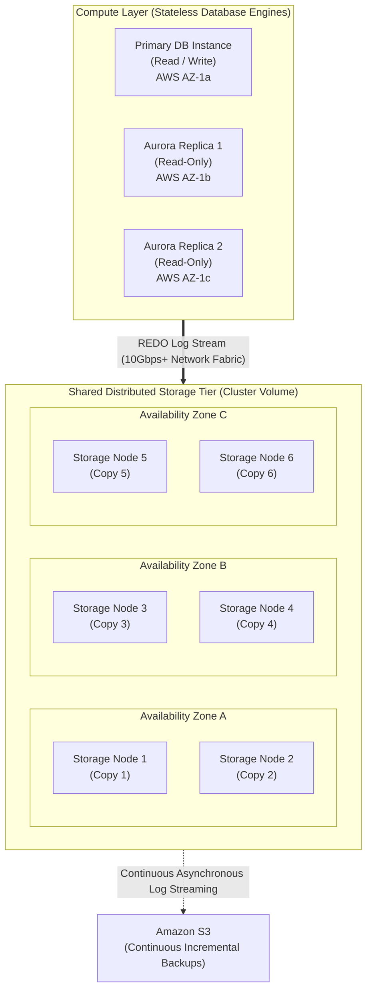
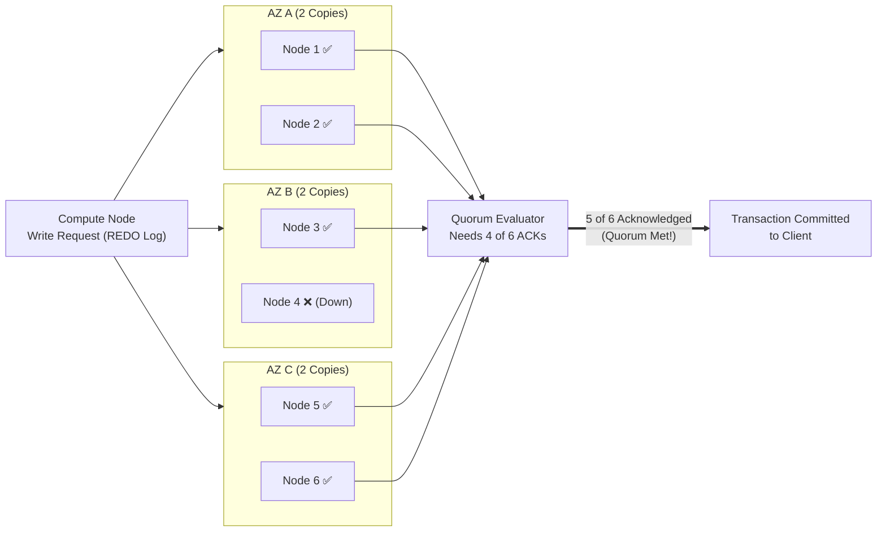
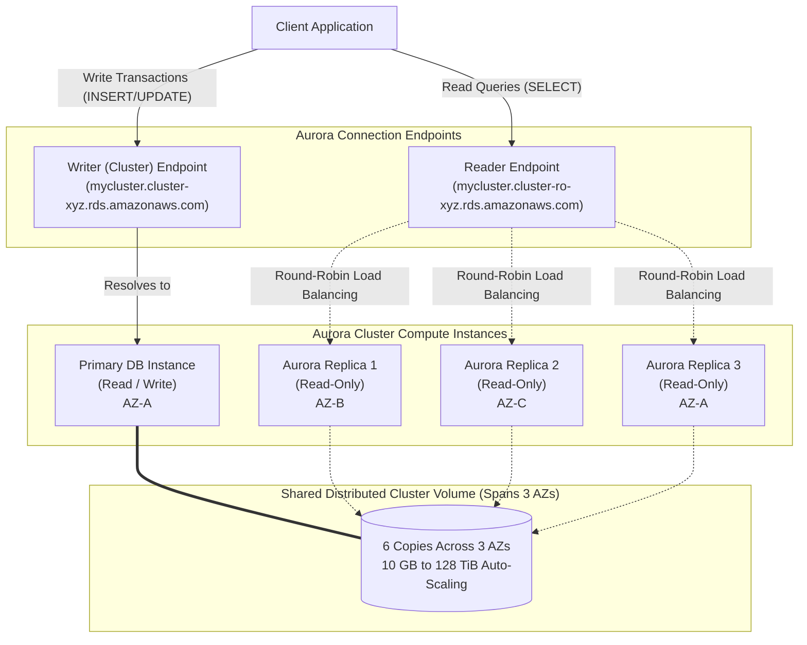

# ⚡ Amazon Aurora: Cloud-Native High-Performance Relational Database

> **Course**: AWS re/Start  
> **Module**: AWS Database Services (M13 – Amazon Aurora)  
> **Source Document**: `T17-AWS_Databases_Services/T17-0004-AWSD_AMAZONAURORA_EN.pdf`  
> **Target Audience**: AWS re/Start Learners, Cloud Practitioners, Solutions Architects, and Database Administrators  

---

## 🎯 Module Overview

Modern enterprise applications demand transactional database systems that deliver extreme throughput, bulletproof resilience, rapid failover, and linear scalability without prohibitive commercial licensing fees. Traditional relational database management systems (RDBMS)—such as monolithic deployments of Oracle, Microsoft SQL Server, or conventional MySQL and PostgreSQL engines—were originally designed decades ago for single-node servers attached to local physical disks. In the cloud, simply forklift-lifting these monolithic architectures onto virtual machine disks (such as standard EBS volumes) creates I/O bottlenecks, replication lags, complex failover orchestration, and storage capacity limits.

**Amazon Aurora** is AWS's flagship cloud-native relational database management engine, designed specifically to harness the distributed architecture of the AWS Cloud. Fully managed by **Amazon Relational Database Service (Amazon RDS)**, Aurora combines the speed, durability, and high availability of high-end commercial enterprise databases with the simplicity, open standards, and cost-effectiveness of open-source MySQL and PostgreSQL. 

By fundamentally decoupling database compute processing from a shared, distributed, log-structured storage subsystem, Amazon Aurora delivers:
- **Up to 5x the throughput** of standard MySQL running on the same underlying hardware.
- **Up to 3x the throughput** of standard PostgreSQL running on the same underlying hardware.
- **Enterprise-grade durability and availability** at **1/10th the cost** of traditional commercial database engines.

```mermaid
flowchart TD
    subgraph Traditional["Traditional Database on VM / RDS Standard"]
        App1["Application Client"] --> Compute1["Compute Node (EC2)"]
        Compute1 --> Engine1["Monolithic DB Engine\n(SQL + Transactions + Caching)"]
        Engine1 -->|"Data Pages + Redo Logs + Doublewrite"| Storage1["Attached Virtual Block Storage (EBS)"]
        Storage1 -.->|"EBS Replication (Intra-AZ)"| Storage1Mirror["EBS Mirror Copy"]
    end

    subgraph AuroraNative["Amazon Aurora Cloud-Native Architecture"]
        App2["Application Client"] --> Writer["Aurora Primary Compute\n(SQL Parser, Optimizer, Query Processing)"]
        Writer ==>|"Write REDO Log Records ONLY\n(No Data Pages, No Doublewrite)"| StorageTier["Distributed, Log-Structured Shared Cluster Volume\n(Spanning 3 AZs, 6 Storage Copies, Self-Healing)"]
        StorageTier -.->|"Shared Read Access"| Reader1["Aurora Replica 1"]
        StorageTier -.->|"Shared Read Access"| Reader2["Aurora Replica 2..15"]
    end
```



---

## 📌 Learning Objectives

By completing this module and reviewing these comprehensive notes, you will be able to:

- [ ] **Define Amazon Aurora**: Describe Amazon Aurora as a cloud-native, fully managed relational database engine compatible with MySQL and PostgreSQL.
- [ ] **Articulate the Value Proposition**: Explain how Aurora achieves up to 5x MySQL throughput, up to 3x PostgreSQL throughput, and 90% cost savings over commercial engines.
- [ ] **Analyze Disaggregated Architecture**: Detail the architectural separation between compute instances and the distributed, log-structured shared cluster volume.
- [ ] **Explain Distributed Storage Mechanics**: Describe the 6-way replication model across 3 Availability Zones (AZs), automated storage expansion from 10 GB to 128 TiB, and background self-healing.
- [ ] **Evaluate Quorum Consensus Models**: Explain write quorum (4 of 6) and read quorum (3 of 6), demonstrating how Aurora tolerates AZ failures without data loss or downtime.
- [ ] **Configure Aurora Replication & Failover**: Differentiate Aurora Replicas from standard RDS read replicas, explaining sub-10ms replica lag, zero storage replication overhead, and sub-30-second automated failover.
- [ ] **Navigate Cluster Endpoints**: Differentiate between the Cluster (Writer) Endpoint, Reader Endpoint, Custom Endpoints, and Instance Endpoints for intelligent traffic routing.
- [ ] **Explore Advanced Cloud-Native Features**: Evaluate Aurora Serverless v2, Aurora Global Database, Aurora Backtrack, and Fast Database Cloning for enterprise resilience and operational agility.
- [ ] **Compare Aurora vs. Standard RDS**: Conduct a technical trade-off comparison between Amazon Aurora and traditional Amazon RDS MySQL/PostgreSQL engines.
- [ ] **Identify Workload Use Cases**: Map Amazon Aurora architecture to enterprise business applications (ERP/CRM), SaaS platforms, high-throughput mobile/web gaming, and e-commerce platforms.

---

## ⚡ 1. What is Amazon Aurora?

Amazon Aurora is an enterprise-class, ACID-compliant relational database engine developed by AWS and fully managed through **Amazon RDS**. It provides drop-in compatibility with open-source MySQL and PostgreSQL databases, allowing organizations to run existing code, applications, drivers, and management tools without refactoring.

### Core Distinctions & Characteristics

1. **Fully Managed Service**:
   - Provisioned and administered through the AWS Management Console, AWS CLI, or AWS SDKs via the Amazon RDS control plane.
   - Automates routine maintenance: OS and database engine patching, continuous automated backups to Amazon S3, automated failure detection, and compute scaling.
2. **Open-Source Compatibility**:
   - **Aurora MySQL-Compatible Edition**: Wire-compatible with MySQL 5.7 and MySQL 8.0+. Supports standard MySQL connectors, stored procedures, triggers, and syntax.
   - **Aurora PostgreSQL-Compatible Edition**: Wire-compatible with PostgreSQL 11 through 16+. Supports native PostgreSQL extensions (e.g., PostGIS, `pgvector` for machine learning embeddings).
3. **Enterprise Reliability & Performance**:
   - Combines the speed and 99.99% availability of high-end proprietary commercial databases (e.g., Oracle RAC, Microsoft SQL Server Enterprise) with the open simplicity and economics of open-source software.
4. **Pay-As-You-Go Economics**:
   - Eliminates onerous upfront capital expenditures, punitive annual licensing contracts, and complex CPU core calculation audits typical of legacy enterprise database vendors.
   - Charges only for compute instances (per second), storage consumed (GB-months), and I/O requests (or flat-rate with Aurora I/O-Optimized).

> [!NOTE]
> Amazon Aurora is not an external engine ported to AWS. It is a re-architected database engine built specifically for cloud virtualization, fundamentally separating computation from persistence.

---

## 🚀 2. Performance & Cost Value Proposition

### Throughput Benchmarking
Under identical computational hardware conditions (memory, vCPU, and network bandwidth), Amazon Aurora delivers orders-of-magnitude improvements in transactions per second (TPS):
- **MySQL Compatibility**: Up to **5x the throughput** of standard MySQL running on Amazon RDS or EC2.
- **PostgreSQL Compatibility**: Up to **3x the throughput** of standard PostgreSQL running on Amazon RDS or EC2.

```
Standard MySQL Throughput:       [████] ~100k queries/sec
Amazon Aurora MySQL Throughput:   [████████████████████] ~500k+ queries/sec (5x)

Standard PostgreSQL Throughput:  [██████] ~120k queries/sec
Amazon Aurora PostgreSQL:        [██████████████████] ~360k+ queries/sec (3x)
```

### Why Commercial Databases Cost Up to 10x More
Legacy commercial relational databases (Oracle, IBM DB2, Microsoft SQL Server) require:
1. **Expensive Core-Based Licenses**: Thousands of dollars per vCPU core.
2. **Add-on Module Fees**: Extra charges for clustering, active data guarding, spatial indexes, and partitioned tables.
3. **Annual Maintenance & Support Contracts**: Up to 20–25% of initial license fees annually.

Amazon Aurora provides all enterprise clustering, multi-AZ replication, instant backup, and automated failover capabilities built into the base service at **one-tenth the total cost of ownership (TCO)** of commercial engines.

---

## 🏗️ 3. Disaggregated Cloud-Native Architecture

Traditional databases bundle query execution, transaction handling, caching, buffer pools, and disk write operations into a single operating process writing to a single filesystem or block device. When scaled, this architecture generates severe I/O traffic bottlenecks.

Amazon Aurora solves this through **Compute and Storage Disaggregation**.



### The Architectural Philosophy: "The Log is the Database"
In standard database engines, writing a transaction requires writing dirty memory pages, doublewrite buffers, undo logs, redo logs, and binary logs to block storage across the network.

In Amazon Aurora:
1. **Compute Nodes Generate Only Redo Logs**: The primary compute instance generates only minimal transaction redo log stream records and transmits them across the high-speed AWS network fabric to the storage nodes.
2. **Storage Nodes Materialize Pages Asynchronously**: The distributed storage nodes receive redo log records, append them to NVMe-backed storage, acknowledge the write to the database engine, and unpack the log records into full data pages asynchronously in the background.
3. **No Doublewrite Buffers or Full-Page Writes**: This reduces network I/O packets by up to 90%, freeing compute resources for transaction processing and query parsing.

### Distributed, Log-Structured, Shared Storage Volume
- **Single Shared Cluster Volume**: Unlike standard RDS where each read replica maintains an independent copy of EBS storage, all Aurora compute instances in a cluster access a **single shared virtual storage volume**.
- **Automatic Storage Scaling**: The cluster volume starts at 10 GB and expands automatically in **10 GB increments** up to **128 TiB** based on storage demand.
- **Zero Pre-Provisioning**: Administrators never need to allocate, partition, or provision storage in advance, completely avoiding out-of-space crashes.
- **Dynamic Downscaling**: Unused allocated storage is automatically reclaimed when data is deleted, optimizing ongoing storage expenditures.

---

## 🛡️ 4. Six-Way Replication & The Quorum Consensus Model

Aurora stores customer data across a purpose-built, multi-tenant storage fleet organized into 10 GiB protection units called **storage segments**. Every segment is replicated six times across three Availability Zones.



### The Quorum Consensus Model ($V=6$, $V_w=4$, $V_r=3$)
To guarantee strong consistency without requiring all storage nodes to respond synchronously, Aurora enforces a strict voting quorum model:
- **Write Quorum ($4/6$)**: A write transaction is marked as committed as soon as **4 out of the 6 copies** acknowledge persistence of the log record. The slowest two nodes cannot stall transaction processing.
- **Read Quorum ($3/6$)**: In the event of reconstruction or validation, the database reconstructs the state by reading from any **3 out of 6 copies**.

### Fault Tolerance Capabilities
| Failure Scenario | Quorum Status | Impact on Database Availability |
| :--- | :--- | :--- |
| **Loss of 1 Storage Copy** | 5 of 6 available ($> 4$) | **Zero Impact**: Full read and write availability maintained. |
| **Loss of Entire Availability Zone (2 Copies)** | 4 of 6 available ($= 4$) | **Zero Impact**: Full read and write availability maintained ($4/6$ write quorum satisfied). |
| **Loss of 1 Entire AZ + 1 Additional Copy (3 Copies Total)** | 3 of 6 available ($= 3$) | **Read-Only Availability**: Read quorum satisfied ($3/6$). Storage automatically self-heals in background to restore write quorum. |

### Continuous Self-Healing Storage
Aurora storage nodes continuously monitor disk block checksums and peer availability. If a storage node experiences disk degradation, network partition, or bit rot:
- The surviving nodes automatically detect the out-of-sync segment.
- The damaged 10 GiB segment is reconstructed and copied from healthy peer nodes across the 10Gbps+ network fabric.
- Self-healing occurs continuously in the background **without administrative intervention and without compute degradation**.

### Continuous Incremental Backups to Amazon S3
- The Aurora distributed storage fleet streams redo log records continuously and directly to Amazon Simple Storage Service (Amazon S3).
- **Zero Compute Impact**: Backups are performed by the storage tier itself, meaning there are no snapshot pauses, buffer flushes, or I/O performance penalties on the primary compute instance.
- **Point-in-Time Recovery (PITR)**: Administrators can restore a new Aurora cluster to any precise second within the backup retention window (up to 35 days).

---

## 🔄 5. High Availability, Replication & Endpoints

### Aurora DB Cluster Components
An Amazon Aurora DB Cluster consists of:
1. **Primary DB Instance**: Supports read and write operations, executing all insert, update, delete, and DDL statements.
2. **Aurora Replicas (Up to 15 Instances)**: Read-only compute instances distributed across up to 3 Availability Zones.
3. **Aurora Cluster Volume**: The virtual shared storage subsystem backing all compute instances.



### Aurora Replicas vs. Standard RDS Read Replicas
| Feature | Standard RDS Read Replicas | Amazon Aurora Replicas |
| :--- | :--- | :--- |
| **Max Replica Count** | Up to 5 (or 15 with RDS MySQL) | **Up to 15 Aurora Replicas** |
| **Underlying Storage** | Independent EBS volume per replica | **Single shared cluster volume** |
| **Replication Mechanism** | Asynchronous binlog / WAL replication across network | **Direct access to shared storage volume** + memory cache update |
| **Replication Lag** | Seconds to minutes (varies with write volume) | **Near-zero (typically sub-10 milliseconds)** |
| **Storage Cost** | Charged for storage on every replica ($N \times \text{Size}$) | **Charged once for shared cluster storage** |
| **Failover Target** | Manual promotion or multi-step failover | **Automatic failover target with zero data loss** |

### Automated Rapid Failover (< 30 Seconds)
In the event of a primary compute instance crash or AZ failure:
1. Amazon RDS monitors the primary instance health via continuous heartbeat checks.
2. If the primary becomes unresponsive, Aurora automatically elects an existing Aurora Replica and promotes it to primary.
3. Because the replica already mounts the shared storage volume, **no crash recovery, redo log roll-forward, or volume remounting is required**.
4. The Cluster (Writer) Endpoint DNS CNAME is updated to point to the newly promoted instance.
5. Failover completes in **under 30 seconds** (often under 15 seconds) with **zero data loss ($RPO = 0$)**.
6. If no Aurora Replica is provisioned, Aurora automatically attempts to create a new compute instance, resulting in a slightly longer recovery window (typically ~10 minutes).

> [!IMPORTANT]
> To guarantee rapid sub-30-second failover, always deploy at least one Aurora Replica in a different Availability Zone than the primary instance.

---

### Database Cluster Connection Endpoints

To decouple applications from underlying instance hostnames and IP addresses, Aurora provides four distinct endpoint types:

1. **Cluster Endpoint (Writer Endpoint)**:
   - Connects directly to the current primary DB instance.
   - Supports read and write operations.
   - Automatically tracks failover: when a replica is promoted, the cluster endpoint dynamically points to the new primary.
   - *Example*: `my-db-cluster.cluster-c123456789.us-east-1.rds.amazonaws.com`

2. **Reader Endpoint**:
   - Provides round-robin DNS load balancing across all available Aurora Replicas in the cluster.
   - Automatically adds newly created replicas and removes unhealthy ones from the rotation.
   - Dedicated to read-only reporting and query workloads.
   - *Example*: `my-db-cluster.cluster-ro-c123456789.us-east-1.rds.amazonaws.com`

3. **Custom Endpoints**:
   - Groups a subset of DB instances based on specific criteria (e.g., instance family, size, or workload type).
   - Allows routing distinct workloads (such as heavy analytical queries, ad-hoc business intelligence reports, or high-priority API calls) to isolated replica pools.
   - *Example*: Directing a heavy BI batch job to an endpoint backing memory-optimized `r6g` instances without affecting real-time web traffic on `c6g` instances.

4. **Instance Endpoints**:
   - Connects directly to a specific, named DB instance in the cluster.
   - Used for specialized DBA troubleshooting, fine-grained monitoring, or diagnostic queries.
   - *Example*: `my-db-replica-2.c123456789.us-east-1.rds.amazonaws.com`

---

## 🔮 6. Advanced Cloud-Native Features

### 1. Aurora Serverless v2
**Aurora Serverless v2** is an on-demand, auto-scaling configuration for Aurora MySQL and Aurora PostgreSQL.
- **Fine-Grained Elasticity**: Scales compute capacity dynamically in increments of **0.5 Aurora Capacity Units (ACUs)**, where 1 ACU provides approximately 2 GiB of memory along with corresponding CPU and networking.
- **Sub-Second Scaling**: Scales compute up and down in fractions of a second without dropping active client connections or causing transaction locks.
- **Ideal Use Cases**: Workloads with unpredictable spikes, development/test environments, infrequently accessed applications, or multi-tenant SaaS environments with varying customer activity.

```
Capacity (ACUs)
  ▲
16│               ┌──┐
12│           ┌───┘  └──┐
 8│       ┌───┘         └─────┐
 4│   ┌───┘                   └───────
 0└───┴───────────────────────────────► Time
      Low Traffic   Peak Spike   Return to Baseline
```

### 2. Aurora Global Database
Designed for globally distributed applications and cross-region disaster recovery:
- **Global Footprint**: Spans across multiple AWS Regions (up to 1 primary region and up to 5 secondary read-only regions).
- **Ultra-Low Latency**: Uses dedicated infrastructure at the storage layer to replicate data across regions in **under 1 second** ($RPO < 1\text{s}$).
- **Zero Application Compute Impact**: Cross-region replication is handled entirely by the storage fleet without consuming compute CPU cycles on the primary database.
- **Fast Regional Failover**: In the event of a catastrophic regional outage, a secondary region can be promoted to a full read/write cluster in **under 1 minute** ($RTO < 1\text{min}$).

### 3. Aurora Backtrack
Backtrack allows database administrators to rewind an Aurora MySQL cluster to a specific second in time without restoring a new database from a backup.
- **Rewind Within Minutes**: Undoes accidental `DROP TABLE`, destructive `DELETE` statements, or bad application deployments in just seconds to minutes.
- **No New Instance Provisioned**: Modifies the existing cluster in-place by rewinding the log pointers, preserving the existing cluster endpoints and configuration.
- **Bi-Directional**: Allows moving the database backward to inspect errors, and forward again if necessary.

> [!TIP]
> Aurora Backtrack must be enabled when creating the Aurora MySQL cluster. It maintains a FIFO backtrack log window (configurable up to 72 hours).

### 4. Fast Database Cloning
Aurora Fast Database Cloning creates instant, copy-on-write clones of existing databases:
- **Instantaneous Creation**: Clones multi-terabyte databases in minutes regardless of dataset size.
- **Copy-On-Write (COW) Storage**: The clone initially shares the exact same storage pointers as the source database. Storage charges apply only to data pages that diverge as modifications are written.
- **Use Cases**: Perfect for staging environments, destructive schema migration testing, dev/test branches, and running intensive analytical reports without impacting production.

---

## 📊 7. Amazon Aurora vs. Standard Amazon RDS (MySQL/PostgreSQL)

| Architecture / Feature | Amazon Aurora | Standard Amazon RDS (MySQL / PostgreSQL) |
| :--- | :--- | :--- |
| **Engine Architecture** | Cloud-native, decoupled compute & distributed storage | Monolithic engine running on EC2 with attached EBS storage |
| **Throughput Performance** | Up to **5x MySQL**, up to **3x PostgreSQL** | Baseline standard open-source engine performance |
| **Storage Architecture** | Shared virtual cluster volume (6 copies across 3 AZs) | EBS volumes (General Purpose `gp2`/`gp3` or Provisioned `io1`/`io2`) |
| **Storage Scalability** | **Auto-scales from 10 GB to 128 TiB** in 10 GB increments | Auto-scales up to 64 TiB (requires manual or autoscaling threshold rules) |
| **Replication Architecture** | Up to **15 Aurora Replicas** sharing the exact same storage | Up to **5 Read Replicas** with separate, duplicated EBS storage volumes |
| **Replication Lag** | **Sub-10 milliseconds** (near-instantaneous) | Tens of milliseconds to minutes (asynchronous logical replication) |
| **High Availability Setup** | Native to storage tier (6-way across 3 AZs by default) | Optional Multi-AZ synchronous replication to 1 standby instance in 2nd AZ |
| **Failover Duration** | **Under 30 seconds** to an existing Aurora Replica | **60 to 120 seconds** to Multi-AZ standby instance |
| **Backup Impact** | **Zero impact** (handled continuously by storage tier to S3) | Brief I/O suspension during snapshot on Single-AZ (none on Multi-AZ) |
| **Read Scaling Endpoint** | Dedicated **Reader Endpoint** with built-in DNS round-robin | Individual DNS endpoints for each replica; requires external load balancer |
| **Serverless Option** | **Aurora Serverless v2** (scales instantaneously in ACUs) | RDS Multi-AZ DB Cluster (limited automated scaling options) |
| **Disaster Recovery** | **Aurora Global Database** (< 1 sec replication to 5 regions) | Cross-Region Read Replicas (higher replication latency) |
| **Point-in-Time Rewind** | **Aurora Backtrack** (rewinds in place in minutes) | Restore to a new DB instance required (takes hours for large DBs) |

---

## 🏢 8. Workload Use Cases

Aurora is engineered for mission-critical, high-throughput, and low-latency applications across diverse industries:

### 1. Enterprise Business Applications (ERP, CRM, Finance)
- **Problem**: Enterprise systems require continuous 24/7 uptime, strict ACID compliance, and robust disaster recovery, but commercial database licensing fees drain IT budgets.
- **Aurora Solution**: Aurora provides high availability with 6-way replication, automated multi-AZ failover, and global cross-region disaster recovery at 1/10th the cost of legacy commercial engines.

### 2. Software as a Service (SaaS) Multi-Tenant Applications
- **Problem**: SaaS architectures experience unpredictable usage patterns, with customer activity varying drastically across different time zones.
- **Aurora Solution**: Aurora Serverless v2 dynamically adjusts compute capacity up and down in fractions of a second based on real-time application traffic, preventing over-provisioning and reducing idle costs.

### 3. Web and Mobile Gaming Applications
- **Problem**: Online games experience extreme traffic spikes during new game launches, seasonal events, and tournaments. Leaderboard updates and player state queries demand sub-millisecond latencies.
- **Aurora Solution**: 
  - Delivers up to 5x MySQL throughput to handle massive write transactions during player spikes.
  - Scales up to 15 Aurora Replicas via the Reader Endpoint to absorb millions of read queries for leaderboards and inventory checks.
  - Global Database enables low-latency gaming experiences for players worldwide.

### 4. E-Commerce Platforms
- **Problem**: High transaction volumes during flash sales (e.g., Prime Day, Black Friday) can overwhelm traditional database write buffers, leading to checkout failures.
- **Aurora Solution**: Log-structured storage handles high-concurrency writes without table-level disk bottlenecks. Automated failover guarantees zero lost customer shopping carts or payment transactions.

---

## 🧠 9. Checkpoint Review & Comprehensive Knowledge Check

Test your understanding of Amazon Aurora architecture, performance characteristics, and deployment models:

### Question 1: What is Amazon Aurora, and how is it related to Amazon RDS?
> **Answer**:
> **Amazon Aurora** is a cloud-native, fully managed relational database engine designed by AWS that is fully compatible with MySQL and PostgreSQL. It combines the high performance and availability of enterprise commercial databases with the simplicity and cost-effectiveness of open-source databases. Aurora is **fully managed by Amazon RDS**, which handles provisioning, patching, backup automation, monitoring, and failover management through standard AWS interfaces.

---

### Question 2: What are the two primary types of compute instances in an Amazon Aurora DB cluster?
> **Answer**:
> 1. **Primary DB Instance**: The single read/write instance that executes all transactional modifications (writes), updates, and DDL commands against the database cluster volume.
> 2. **Aurora Replica Instance**: Read-only instances (up to 15 per cluster) that connect to the same shared cluster volume to serve read queries, offload reporting traffic, and act as automated failover targets.

---

### Question 3: Why is Amazon Aurora an ideal database engine for web and mobile gaming applications?
> **Answer**:
> Gaming applications require:
> - **Extreme Write & Read Throughput**: Rapidly logging player states, achievements, and leaderboard statistics (Aurora delivers up to 5x MySQL throughput).
> - **Handling Unpredictable Traffic Surges**: Sudden player spikes during game releases or live events are seamlessly absorbed by adding up to 15 read replicas or leveraging Aurora Serverless v2.
> - **Global Reach & Low Latency**: Aurora Global Database replicates player data across multiple AWS regions with sub-second latency for players worldwide.
> - **High Availability**: Sub-30-second failover prevents game downtime and player disconnections.

---

### Question 4: Explain the difference between compute and storage architecture in Amazon Aurora versus traditional relational databases.
> **Answer**:
> In traditional relational databases, compute and storage are tightly coupled on the same virtual server or block storage volume, requiring the engine to write full data pages, undo logs, redo logs, and doublewrite buffers across the network.  
> In Amazon Aurora, **compute and storage are completely decoupled (disaggregated)**. The compute instances run a stateless database engine that transmits only lightweight **redo log streams** across a high-speed network fabric to a distributed, self-healing, log-structured shared storage tier spanning three Availability Zones.

---

### Question 5: How does Amazon Aurora's quorum consensus model operate during writes and reads, and what failures can it tolerate?
> **Answer**:
> Aurora replicates all data **6 times across 3 Availability Zones** (2 copies per AZ):
> - **Write Quorum ($4/6$)**: A write is committed when acknowledged by 4 of the 6 storage nodes.
> - **Read Quorum ($3/6$)**: Reads require agreement among 3 of the 6 copies for reconstruction.
> - **Fault Tolerance**:
>   - Can lose **1 AZ (2 copies)** and still maintain full read and write availability ($4/6$ writes still succeed).
>   - Can lose **1 AZ plus an additional node (3 copies total)** and still maintain read availability without data loss ($3/6$ read quorum met).
>   - Damaged storage segments continuously self-heal in the background.

---

### Question 6: What are the four types of connection endpoints provided by an Amazon Aurora cluster?
> **Answer**:
> 1. **Cluster (Writer) Endpoint**: Connects to the current primary DB instance for read/write transactions and automatically follows failover.
> 2. **Reader Endpoint**: Connects to and round-robin load balances across all available Aurora Replicas for read-only traffic.
> 3. **Custom Endpoint**: Connects to a user-defined subset of instances to isolate specific workloads (e.g., analytics or reporting).
> 4. **Instance Endpoint**: Connects directly to a specific individual instance for diagnostic or monitoring purposes.

---

### Question 7: How does Aurora Backtrack differ from restoring a database from an automated backup?
> **Answer**:
> - **Automated Backup Restore**: Provisions a **brand-new database instance and storage volume** from S3 snapshots and transaction logs, which can take several hours for multi-terabyte databases and creates a new endpoint.
> - **Aurora Backtrack**: Rewinds the **existing database in-place** to a specific second within a few minutes by shifting log record pointers. It preserves the same cluster endpoints and configuration without provisioning new resources.

---

## 📌 10. Key Takeaways & Summary

- **Cloud-Native Engine**: Amazon Aurora is AWS's proprietary relational database engine, fully managed by Amazon RDS, and compatible with open-source MySQL and PostgreSQL.
- **Superior Performance**: Delivers up to **5x the throughput of standard MySQL** and up to **3x the throughput of standard PostgreSQL** on identical hardware.
- **Commercial Power at 1/10th the Cost**: Eliminates expensive proprietary database licensing fees while delivering 99.99% availability and enterprise-grade performance.
- **Decoupled Architecture**: Separates compute processing from the storage layer. Compute nodes write only redo logs over high-speed networks, eliminating 90% of traditional I/O overhead.
- **Distributed Shared Storage**: Virtual cluster volume automatically expands from **10 GB to 128 TiB** in 10 GB increments without manual provisioning or downtime.
- **6-Way Replication Across 3 AZs**: Maintains 6 copies of data (2 per AZ) using a $4/6$ write quorum and $3/6$ read quorum, surviving the loss of an entire AZ without any write disruption.
- **Continuous Self-Healing**: Automatically repairs damaged disk blocks in 10 GiB segments across storage nodes without human intervention or performance degradation.
- **Zero-Impact Backups**: Streams redo logs continuously to Amazon S3 directly from the storage layer without locking or degrading compute performance.
- **Up to 15 Aurora Replicas**: Replicas share the cluster volume with sub-10ms replication lag, providing rapid automated failover in under 30 seconds with zero data loss.
- **Intelligent Endpoints**: Cluster (Writer) Endpoint for transactional writes, Reader Endpoint for automated read load balancing, and Custom Endpoints for workload isolation.
- **Enterprise Features**: Includes Aurora Serverless v2 (sub-second scaling in ACUs), Aurora Global Database (< 1s cross-region replication), Aurora Backtrack (in-place time rewind), and Fast Database Cloning (copy-on-write dev/test cloning).
