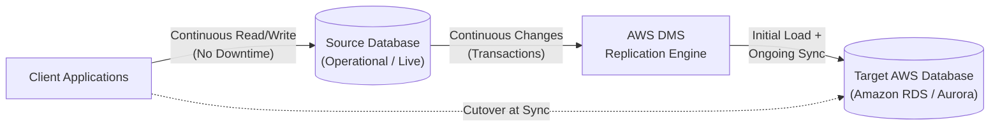
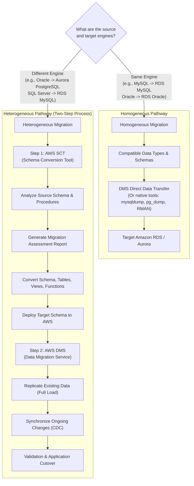
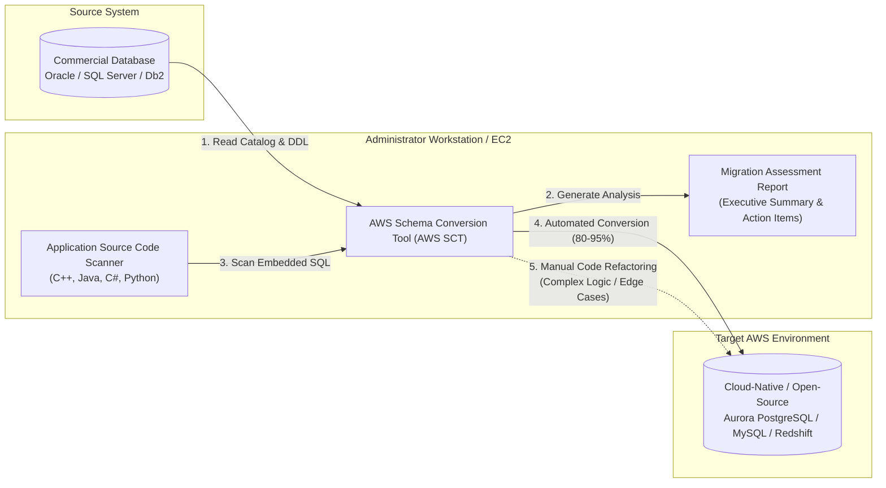
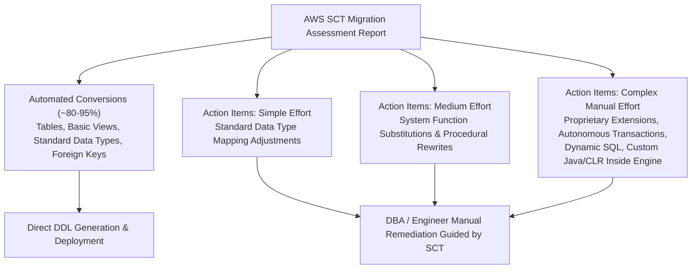
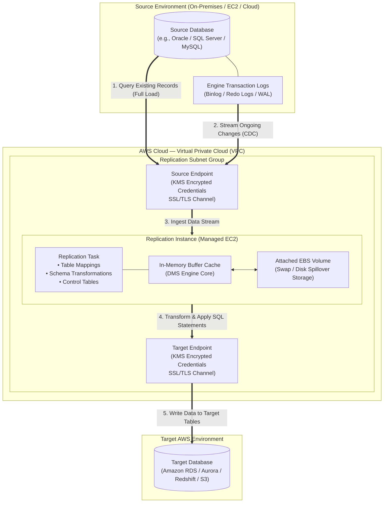
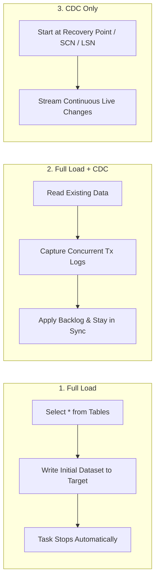
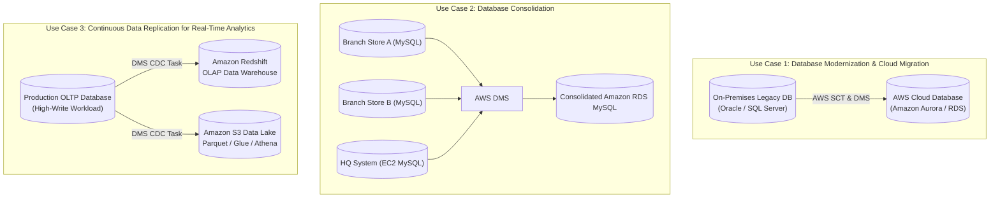
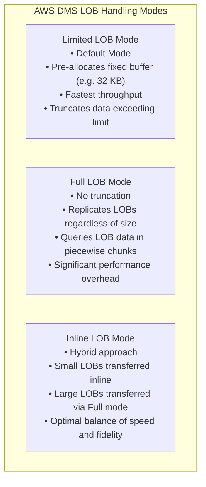
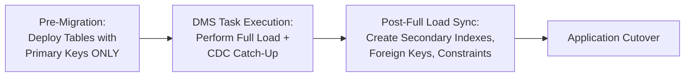
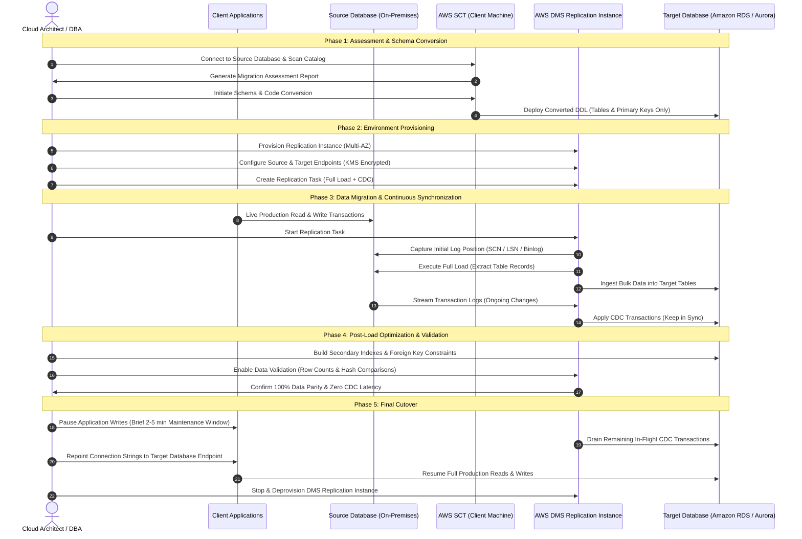

# 🔄 AWS Database Migration Service (AWS DMS) and AWS Schema Conversion Tool (AWS SCT)

> **Course**: AWS re/Start  
> **Module**: AWS Database Services (AWS Database Migration Service - AWS DMS & AWS SCT)  
> **Source Document**: `T17-AWS_Databases_Services/T17-0005-AWSD_AWSDBMIGRATION_EN.pdf`  
> **Target Audience**: AWS re/Start Learners, Cloud Practitioners, Solutions Architects, and Database Administrators  

---

## 🎯 Lesson Overview

Data is the foundational asset of modern digital enterprises. As organizations migrate infrastructure to the cloud, moving mission-critical production databases represents one of the most critical and complex undertakings in cloud adoption. Traditional database migration approaches often demand prolonged maintenance windows, extended application downtime, costly third-party replication software, and substantial manual code refactoring.

Amazon Web Services addresses these challenges through two complementary services:
1. **AWS Database Migration Service (AWS DMS)**: A managed replication engine that migrates relational databases, data warehouses, NoSQL databases, and streaming data stores to AWS quickly and securely, while keeping the source database fully operational to achieve near-zero application downtime.
2. **AWS Schema Conversion Tool (AWS SCT)**: A client-based application that automates the assessment, schema conversion, and code translation required when migrating between heterogeneous (different) database engines (e.g., migrating an on-premises commercial Oracle or Microsoft SQL Server database to an open-source or cloud-native database like Amazon Aurora or PostgreSQL).

Together, AWS DMS and AWS SCT provide an end-to-end modernization pathway—enabling organizations to break free from costly commercial database licensing, modernize legacy monolithic architectures, and transition smoothly into purpose-built AWS cloud database environments.

---

## 📌 Learning Objectives

By completing this module and reviewing these comprehensive study notes, you will be able to:

- [ ] **Define AWS DMS**: Articulate the core architecture, operational mechanisms, and primary capabilities of AWS Database Migration Service.
- [ ] **Differentiate Migration Types**: Contrast homogeneous database migrations (identical source and target engines) with heterogeneous migrations (different database engines).
- [ ] **Explain AWS SCT Functions**: Describe how the AWS Schema Conversion Tool analyzes source schemas, identifies conversion challenges, and automates schema translation for relational databases, data warehouses, and application code.
- [ ] **Interpret Migration Assessment Reports**: Evaluate automated conversion percentages, action item categories, and manual remediation requirements identified by AWS SCT.
- [ ] **Deconstruct AWS DMS Core Architecture**: Identify the roles and configurations of Replication Instances, Source Endpoints, Target Endpoints, and Replication Tasks.
- [ ] **Analyze Task Modes and CDC Mechanisms**: Differentiate between Full Load, Full Load + CDC (Change Data Capture), and CDC-only tasks, understanding how transaction logs (binlog, redo log, WAL) maintain synchronization.
- [ ] **Identify Key Migration Use Cases**: Apply AWS DMS to database consolidation, continuous data synchronization for real-time analytics, and cross-Region/cross-account migrations.
- [ ] **Implement Best Practices & Troubleshooting**: Manage Large Binary Objects (LOBs) using Limited vs. Full LOB modes, plan source transaction log retention, optimize network connectivity, and handle secondary indexes and constraints during cutover.

---

## 🏢 1. Introduction to AWS Database Migration Service (AWS DMS)

### What is AWS DMS?

**AWS Database Migration Service (AWS DMS)** is a managed migration and replication service that helps you migrate databases to AWS securely, easily, and with minimal operational downtime. 

Unlike traditional database migration workflows that require taking the source system completely offline for hours or days while exporting and importing dump files, AWS DMS maintains **continuous data replication**. During migration:
- The source database remains fully functional and responsive to production client applications.
- All transactional modifications (INSERT, UPDATE, DELETE) executed on the source during the initial data load are captured and synchronized to the target database.
- Production switchover (cutover) can occur when the source and target are in lockstep sync, reducing total application downtime to minutes or seconds.

### Core Capabilities and Features of AWS DMS

| Feature | Operational Mechanism & Architectural Value |
| :--- | :--- |
| **Broad Engine Support** | Migrates data to and from virtually all mainstream database engines, including commercial, open-source, and NoSQL systems (Oracle, Microsoft SQL Server, MySQL, PostgreSQL, MariaDB, Amazon Aurora, DynamoDB, MongoDB, Amazon S3, Amazon Redshift, Apache Kafka, and Amazon Kinesis). |
| **Near-Zero Application Downtime** | Keeps the source database operational throughout the migration window; users continue reading and writing data without interruption. |
| **Continuous Data Replication (CDC)** | Employs engine-native transaction logging (Change Data Capture) to read and stream real-time transactional changes to target data stores. |
| **Multi-AZ High Availability** | Allows provisioning replication instances with Multi-AZ redundancy, providing automatic failover to a standby instance in another Availability Zone if an infrastructure disruption occurs. |
| **Database Consolidation** | Ingests data concurrently from multiple disparate source databases (e.g., departmental or branch databases) and consolidates them into a single centralized target database. |
| **Data Streaming & Event Integration** | Streams database modifications directly into message brokers such as Amazon Kinesis Data Streams or Apache Kafka for real-time event-driven architectures. |
| **Built-in Resiliency & Self-Healing** | Continuously monitors source and target connections, network health, and replication processes; automatically restarts failed tasks from the last checkpoint upon recovery. |
| **In-Flight Data Transformation** | Enables table renaming, column mapping, schema filtering, and custom transformation rules during the migration pipeline. |

---

## 🔄 2. Core Migration Types: Homogeneous vs. Heterogeneous

Database migrations fall into two primary architectural classifications based on the compatibility of the source and target database engines.

### 1. Homogeneous Database Migrations

In a **homogeneous migration**, the source and target database engines are identical or inherently compatible (for example: on-premises MySQL to Amazon RDS for MySQL, on-premises Oracle Enterprise to Amazon RDS for Oracle, or self-hosted PostgreSQL on EC2 to Amazon Aurora PostgreSQL).

* **Schema Compatibility**: Because the database engines share identical data types, syntax, procedural languages, and system catalogs, the existing database schema does not require structural conversion or code translation.
* **Tooling Options**: 
  - AWS DMS can handle the complete migration lifecycle (initial full load plus ongoing CDC).
  - Alternatively, administrators can leverage native database utilities (such as Oracle Data Pump / RMAN, MySQL `mysqldump` / Percona XtraBackup, or PostgreSQL `pg_dump` / `pg_restore`) if a maintenance window is acceptable or if specialized engine features are desired.
* **Primary Use Cases**: Moving on-premises database workloads into managed AWS cloud environments (rehosting or "lift-and-shift") to eliminate hardware maintenance and operational management burdens without modifying application code.

### 2. Heterogeneous Database Migrations

In a **heterogeneous migration**, the source and target database engines are completely different (for example: commercial Microsoft SQL Server or Oracle Database migrating to open-source or cloud-native engines like Amazon Aurora MySQL, Amazon Aurora PostgreSQL, or Amazon Redshift).

Heterogeneous migrations cannot copy tables and code directly because proprietary data types, stored procedure languages (PL/SQL, T-SQL), triggers, packages, and system functions are incompatible across engines.

Heterogeneous migration is strictly a **two-step process**:
1. **Step 1: Schema and Code Conversion (AWS SCT)**:
   - Convert tables, constraints, foreign keys, views, stored procedures, user-defined functions, triggers, and application code using the AWS Schema Conversion Tool.
   - Apply the translated Data Definition Language (DDL) scripts to the target AWS database.
2. **Step 2: Data Migration and Synchronization (AWS DMS)**:
   - Deploy AWS DMS replication tasks to extract data from the source, map source data types to target data types in flight, load the data into the converted target tables, and continuously apply real-time changes until cutover.

### Homogeneous vs. Heterogeneous Comparison

| Dimension | Homogeneous Migration | Heterogeneous Migration |
| :--- | :--- | :--- |
| **Engine Compatibility** | Same engine (e.g., PostgreSQL $\rightarrow$ PostgreSQL) | Different engines (e.g., Oracle $\rightarrow$ Aurora PostgreSQL) |
| **Tooling Required** | AWS DMS alone (or native engine tools) | AWS SCT (Step 1) + AWS DMS (Step 2) |
| **Schema Conversion** | None required; schemas match directly | Mandatory; requires automated translation and manual review |
| **Stored Procedures / Code** | Fully compatible; no code changes | Requires translation from PL/SQL or T-SQL to target language |
| **Licensing Impact** | Retains existing engine licensing (BYOL or License Included) | Unlocks open-source economics; eliminates punitive commercial license fees |
| **Migration Complexity** | Low to moderate | Moderate to high (requires testing and query validation) |
| **Typical Target** | Amazon RDS for MySQL / PostgreSQL / Oracle / SQL Server | Amazon Aurora (PostgreSQL/MySQL), Amazon DynamoDB, Amazon Redshift |

---

## 🛠️ 3. AWS Schema Conversion Tool (AWS SCT)

### What is the AWS SCT?

The **AWS Schema Conversion Tool (AWS SCT)** is a standalone software application installed on an administrative client machine (Windows, Linux, or macOS) that automates the conversion of database schemas, indexes, views, stored procedures, triggers, and functions between different database engines.

Beyond relational schemas, AWS SCT supports:
- **Data Warehousing Migrations**: Converting legacy enterprise warehouses (Teradata, IBM Netezza, Oracle Exadata) to Amazon Redshift.
- **NoSQL Modernization**: Converting Apache Cassandra schemas and data access patterns to Amazon DynamoDB.
- **Application Code Scanning**: Inspecting application source code repositories (Java, C#, C++, Python) to locate embedded SQL statements and automatically converting them to syntax compatible with the target database.

### Supported Conversion Paths in AWS SCT

The following matrix highlights the major heterogeneous conversions supported by AWS SCT:

| Source Database Engine | Target AWS Database / Analytics Service |
| :--- | :--- |
| **Oracle Database** | Amazon Aurora (MySQL & PostgreSQL), Amazon RDS (MySQL, PostgreSQL, MariaDB) |
| **Oracle Data Warehouse** | Amazon Redshift |
| **Microsoft SQL Server** | Amazon Aurora (MySQL & PostgreSQL), Amazon RDS (MySQL, PostgreSQL, MariaDB), Amazon Redshift |
| **Microsoft Azure SQL Database** | Amazon Aurora (MySQL & PostgreSQL), Amazon RDS (MySQL, PostgreSQL) |
| **IBM Db2 for LUW** | Amazon Aurora (MySQL & PostgreSQL), Amazon RDS (MySQL, PostgreSQL) |
| **IBM Netezza** | Amazon Redshift |
| **Teradata** | Amazon Redshift |
| **SAP Adaptive Server Enterprise (ASE)** | Amazon Aurora (MySQL & PostgreSQL), Amazon RDS (MySQL, PostgreSQL, MariaDB) |
| **MySQL** | Amazon Aurora PostgreSQL, Amazon RDS PostgreSQL |
| **PostgreSQL** | Amazon Aurora MySQL, Amazon RDS MySQL |
| **Apache Cassandra** | Amazon DynamoDB |

### The AWS SCT Migration Assessment Report

Before modifying any production schema, AWS SCT generates a comprehensive **Migration Assessment Report**. This report gives system architects and DBAs complete visibility into the effort required to migrate the workload.

Key features of the report include:
1. **Executive Summary**: Displays an overall feasibility rating and the exact percentage of database objects that can be converted automatically without manual intervention (often 80% to 95% of standard schemas).
2. **Object Breakdown**: Itemizes tables, constraints, indexes, views, stored procedures, packages, functions, and user-defined types.
3. **Action Items Categorization**: Categorizes remaining objects by complexity (Simple, Medium, Complex), specifying estimated engineering hours needed to resolve each issue.
4. **Remediation Recommendations**: Provides code snippets and prescriptive architectural guidance for rewriting incompatible proprietary constructs (such as converting Oracle `CONNECT BY` hierarchical queries into PostgreSQL Common Table Expressions `WITH RECURSIVE`).

---

## 🏛️ 4. AWS DMS Architecture and Core Components

AWS DMS operates as an independent, scalable infrastructure layer positioned between the source and target data stores.

### 1. Replication Instance

The **Replication Instance** is a managed Amazon EC2 instance running AWS DMS specialized replication software. It resides within a designated Virtual Private Cloud (VPC) and Replication Subnet Group.

* **Compute and Memory Allocation**: 
  - AWS DMS is heavily memory-dependent. The replication engine buffers incoming changes from the source transaction logs in RAM before transforming and writing them to the target.
  - Sizing instance families: 
    - `dms.t3` (bursting, ideal for development, testing, and light workloads).
    - `dms.c5` / `dms.c6i` (compute-optimized, best for high-throughput, transformation-heavy workloads).
    - `dms.r5` / `dms.r6i` (memory-optimized, recommended for large production databases, high transactional velocity, and systems handling Large Binary Objects).
* **Storage**: Provisioned Amazon EBS volume attached to the replication instance. If the replication instance exhausts available memory during peak CDC transaction spikes, it spools unprocessed transactions to local disk to prevent data loss.
* **Multi-AZ Configuration**: 
  - In a Multi-AZ deployment, AWS DMS maintains a synchronous standby replica in a second Availability Zone.
  - If the primary instance suffers a hardware, operating system, or network degradation, AWS DMS automatically triggers a failover to the standby instance with zero data loss and minimal task interruption.

### 2. Endpoints (Source and Target)

An **Endpoint** defines the connection details, security credentials, networking path, and database engine type for the source or target system.

* **Connection Configuration**: Stores database host name or IP address, port number, database name, and authentication credentials.
* **Security & Encryption**:
  - Authentication credentials stored within DMS endpoints are encrypted at rest using **AWS Key Management Service (AWS KMS)** customer managed keys (CMKs) or AWS managed keys.
  - DMS supports SSL/TLS encryption in transit. Custom CA certificates can be uploaded directly to DMS to ensure tamper-proof communication across public or hybrid networks.
* **Endpoint Capabilities**:
  - **Source Endpoints**: Configure engine-specific connection attributes (Extra Connection Attributes - ECAs) such as log reading batch size, archive log polling intervals, and transaction log reader plugins.
  - **Target Endpoints**: Configure target performance attributes such as multi-threaded batch apply, parallel bulk-load settings, and target schema selection.

### 3. Replication Tasks

A **Replication Task** runs on the replication instance and carries out the actual data movement between the source and target endpoints.

Replication tasks are governed by:
- **Table Mapping Rules**: JSON rules defining which schemas, tables, and columns are included or excluded from replication.
- **Transformation Rules**: Inline rules that rename schemas, prefix or rename tables, drop unnecessary columns, change data types, or add synthetic metadata columns (such as commit timestamps).
- **Control Tables**: DMS-managed auxiliary tables written to the target database to record replication progress, task status, and data validation statistics.

### 4. Task Migration Types

AWS DMS provides three distinct task modes:

1. **Full Load (Migrate existing data)**:
   - Reads existing records from the source database tables using SQL `SELECT` queries and loads them into target tables.
   - Ideal for static datasets, one-time bulk transfers, or offline database migrations during planned maintenance windows.
   - Once all tables have completed loading, the task transitions to a `STOPPED` state.

2. **Full Load + CDC (Migrate existing data and replicate ongoing changes)**:
   - The gold standard for production migrations requiring near-zero downtime.
   - DMS records the current transaction log sequence number (e.g., SCN in Oracle, LSN in SQL Server, or Binlog position in MySQL) before initiating the full load.
   - While the full load reads source tables, DMS captures all concurrent transactional modifications (INSERT, UPDATE, DELETE) and caches them on the replication instance.
   - After the full load completes, DMS applies the cached transaction backlog to the target and transitions into steady-state continuous synchronization.

3. **Ongoing Replication / CDC Only (Replicate data changes only)**:
   - Ignores existing table data and replicates only new changes occurring after a designated start time or checkpoint.
   - Commonly used when the initial bulk dataset was transferred using an out-of-band mechanism (such as AWS Snowball, database backup restore, or native export/import) and DMS is required solely to catch up and maintain real-time sync.

### 5. Change Data Capture (CDC) Mechanics

AWS DMS achieves ongoing replication by reading the source database's native transaction logs directly—without relying on intrusive database triggers that degrade production performance.

| Database Engine | Native Logging Mechanism Utilized by AWS DMS |
| :--- | :--- |
| **MySQL / MariaDB** | Binary Logs (`binlog`) with `ROW` format logging enabled. |
| **Oracle Database** | Redo Logs and Archived Redo Logs read via Oracle LogMiner or DMS Binary Reader. |
| **Microsoft SQL Server** | Database Transaction Logs (.ldf) via SQL Server native Change Data Capture (CDC) or Replication. |
| **PostgreSQL** | Write-Ahead Logging (`WAL`) utilizing logical replication decoding plugins (`test_decoding`, `pglogical`, or `wal2json`). |
| **MongoDB** | Replica Set Oplog (`operations log`). |

---

## 📈 5. Common Migration Use Cases

### 1. Database Modernization and Cloud Migration
Enterprises transition away from expensive, proprietary on-premises databases to fully managed AWS services (such as Amazon Aurora or Amazon RDS). This migration slashes database licensing costs, eliminates hardware refresh cycles, and offloads administrative maintenance to AWS.

### 2. Database Consolidation
Global or decentralized enterprises frequently operate dozens or hundreds of disparate, smaller databases across retail stores, branch offices, or development environments. AWS DMS can run concurrent replication tasks from multiple source databases into a single, unified Amazon RDS or Aurora cluster—reducing operational overhead and enabling centralized reporting.

### 3. Continuous Replication for Real-Time Analytics (Offloading OLTP)
Running complex, read-heavy analytical reporting queries against a production online transaction processing (OLTP) database severely degrades transaction throughput and spikes CPU utilization. AWS DMS replicates production OLTP changes continuously into an analytics-optimized target—such as **Amazon Redshift**, an **Amazon S3 Data Lake**, or an **Amazon OpenSearch Service** cluster—enabling real-time business intelligence without impacting customer transactions.

### 4. Cross-Region and Cross-Account Synchronization
For distributed applications, disaster recovery, or corporate divestitures, AWS DMS can replicate data across different AWS Regions and AWS Accounts, facilitating low-latency regional read replicas or staging environments.

---

## ⚙️ 6. Migration Best Practices, Performance Tuning & Troubleshooting

Operating production database migrations requires careful planning around data structures, transaction logging, network throughput, and object lifecycles.

### Managing Large Binary Objects (LOBs)

LOB columns (`BLOB`, `CLOB`, `NCLOB`, `TEXT`, `IMAGE`) contain unstructured or semi-structured data (documents, images, JSON payloads) that can severely impact replication performance if misconfigured. AWS DMS provides three LOB handling modes:

1. **Limited LOB Mode (Recommended Default)**:
   - AWS DMS pre-allocates a fixed-size memory buffer for LOB columns based on the user-configured `MaxLOBSize` parameter (default: 32 KB).
   - Any LOB data smaller than or equal to this limit is transferred rapidly in a single pass.
   - **Caution**: Any LOB data exceeding `MaxLOBSize` is silently truncated. DBAs must query source tables in advance (`SELECT MAX(LENGTH(lob_column))`) to set an accurate threshold.
2. **Full LOB Mode**:
   - Replicates entire LOB objects regardless of size without truncation.
   - DMS initially loads rows with a placeholder, then makes secondary round-trip queries back to the source database to fetch the LOB data in chunks. This adds substantial network overhead and dramatically slows migration speeds.
3. **Inline LOB Mode**:
   - Combines the performance of Limited LOB mode with the completeness of Full LOB mode.
   - LOBs below the inline threshold are transferred directly within the row buffer; LOBs exceeding the threshold are retrieved in Full LOB mode, providing optimal performance without risking data loss.

### Source Transaction Log Retention

A critical failure mode during large migrations is **log truncation** on the source database.

> [!WARNING]
> **Source Log Truncation Risks**:  
> During a full-load phase that takes multiple hours or days, the source database continues generating transaction logs. If local maintenance scripts, automated log truncation, or log backup rotations purge transaction logs before AWS DMS reads them, the replication task will fail irrevocably with a missing log sequence error. Administrators must increase archive/redo log retention windows on the source before launching the migration task.

* **MySQL**: Configure `binlog_expire_logs_seconds` or retention policies to hold binary logs for at least 48 to 72 hours.
* **Oracle**: Ensure archive log disk space accommodates high log generation rates, or configure DMS Binary Reader to read directly from archive log directories.
* **SQL Server**: Ensure the database is in `FULL` recovery model and database log backups are coordinated with DMS CDC processing.
* **PostgreSQL**: Configure `wal_keep_size` or utilize logical replication slots to ensure WAL segments are preserved until confirmed by DMS.

### Network Bandwidth and Connectivity

Replicating high-velocity databases demands stable, high-throughput network connectivity:
* **AWS Direct Connect**: Dedicated private fiber connection between on-premises data centers and AWS VPC; provides guaranteed low-latency and deterministic transfer rates for mission-critical enterprise migrations.
* **AWS Site-to-Site VPN with IPsec**: Cost-effective encrypted tunnel over the public internet, suitable for moderate workloads.
* **VPC Peering or Transit Gateway**: Low-latency, high-bandwidth interconnects for migrations occurring across AWS VPCs or AWS Accounts.

### Secondary Indexes, Foreign Keys, and Constraints

To maximize data ingestion throughput and avoid constraint violations during migration, follow this sequencing strategy:

* **Do not create secondary indexes before Full Load**: Ingesting millions of rows into a target table that has secondary indexes forces the database engine to update index B-trees on every insert, severely degrading write performance.
* **Do not enable foreign key constraints during Full Load**: DMS loads tables in parallel across multiple threads. If Table B depends on a foreign key in Table A, and Table B loads faster, foreign key constraint checks will fail and drop records.
* **Best Practice**:
  1. Create target tables with **Primary Keys only**.
  2. Execute the AWS DMS Full Load.
  3. Once Full Load reaches 100% and ongoing CDC is active, apply DDL scripts to build secondary indexes, unique constraints, and foreign key relationships on the target.
  4. Allow CDC to achieve zero-latency synchronization before final cutover.

---

## 🚀 7. End-to-End Migration Lifecycle Walkthrough

The following sequence diagram details the end-to-end migration lifecycle for a production enterprise database transitioning from an on-premises data center to AWS.

### Detailed Phase-by-Phase Breakdown

1. **Assessment & Pre-requisites**:
   - Calculate network bandwidth requirements and provision AWS Direct Connect or VPN.
   - Run AWS SCT to generate the Migration Assessment Report. Review action items and manually refactor unsupported proprietary code.
   - Increase source database archive log retention to prevent log truncation.
2. **Target Schema Initialization**:
   - Use AWS SCT to deploy base DDL containing table definitions and primary keys only.
   - Omit secondary indexes, triggers, and foreign keys during this initial stage.
3. **DMS Infrastructure Deployment**:
   - Provision a Multi-AZ replication instance sized according to data volume and LOB profile.
   - Define source and target endpoints, verifying connectivity and SSL certificates.
   - Create a replication task configured for **Full Load + CDC** with data validation enabled.
4. **Execution and Continuous Replication**:
   - Start the replication task. AWS DMS extracts data, populates target tables, and begins caching transaction log changes.
   - After the full load completes, DMS applies all cached changes and enters continuous CDC replication mode.
5. **Optimization and Catch-Up**:
   - Execute DDL scripts on the target database to build secondary indexes, unique constraints, and foreign keys.
   - Monitor the Amazon CloudWatch metric `CDCLatency` until target replica lag reaches near-zero seconds.
6. **Production Cutover**:
   - Schedule a minimal maintenance window (typically 2 to 5 minutes).
   - Place the source database or application in read-only mode to prevent new transactions.
   - Monitor DMS CloudWatch metrics until all cached changes have been applied to the target.
   - Repoint application database connection strings (DNS CNAME or configuration files) to the Amazon RDS or Aurora endpoint.
   - Validate application health and resume full operational traffic on the new cloud database.

---

## ❓ 8. Review Questions & Knowledge Check

Test your understanding of the core concepts covered in this module.

### Question 1: Checkpoint Question
**What are the two primary steps in a heterogeneous database migration process?**
> **Answer**:  
> 1. **Step 1 (Schema & Code Conversion)**: Use the **AWS Schema Conversion Tool (AWS SCT)** to analyze, convert, and deploy the source database schema, views, stored procedures, functions, and application code to the target database.  
> 2. **Step 2 (Data Migration & Replication)**: Use **AWS Database Migration Service (AWS DMS)** to perform the initial data extraction (full load), map data types, and continuously replicate real-time transactional changes (CDC) until cutover.

---

### Question 2: Checkpoint Question
**Why would an enterprise choose AWS DMS over traditional export/import database utilities?**
> **Answer**:  
> Traditional utilities (such as flat-file dumps or native export tools) require the source database to be taken offline or placed into read-only mode for extended hours to guarantee consistency, resulting in significant business disruption. AWS DMS keeps the source database **fully operational and live** during migration by continuously capturing transactions from engine transaction logs, reducing production cutover downtime to near zero. Additionally, AWS DMS supports heterogeneous migrations across differing database engines, multi-source database consolidation, and high-availability Multi-AZ deployments.

---

### Question 3: Checkpoint Question
**What specific database objects does the AWS Schema Conversion Tool (AWS SCT) convert, and what auxiliary capability does it offer for application developers?**
> **Answer**:  
> AWS SCT converts database tables, constraints, foreign keys, views, stored procedures, user-defined functions, triggers, and data warehouse schemas. Beyond the database engine itself, AWS SCT includes an **Application Source Code Scanner** that parses external application code (written in Java, C#, C++, or Python) to detect embedded SQL statements and convert them to syntax compatible with the target cloud database.

---

### Question 4: Scenario-Based Question
**An enterprise is migrating a 2 TB on-premises Oracle database with high write activity to an Amazon Aurora PostgreSQL cluster. The migration task will take approximately 14 hours to complete the initial load. What critical source database configuration must the database administrator verify to prevent the migration task from failing mid-way?**
> **Answer**:  
> The database administrator must verify and expand the **Oracle archive log retention policy and storage space**. Because the initial full load takes 14 hours, the source Oracle database will generate substantial redo log volume. If archive logs are rotated, truncated, or purged by routine maintenance scripts before AWS DMS finishes the full load and reads those logs for CDC, the task will fail with a sequence gap error. The DBA must retain archive logs on disk for the full duration of the initial load plus a safety margin (e.g., 24–48 hours).

---

### Question 5: Performance Optimization Question
**A solutions architect notices that an AWS DMS full-load migration task is running exceptionally slowly on tables containing multiple Large Binary Objects (LOBs). How can the architect optimize the DMS task configuration to accelerate data transfer without losing data?**
> **Answer**:  
> The architect should transition from **Full LOB Mode** to **Inline LOB Mode** or properly configured **Limited LOB Mode**. In Full LOB Mode, DMS performs slow piecewise queries back to the source for every LOB. In Limited LOB Mode, DMS allocates a fast fixed buffer; however, data exceeding the limit is truncated. By analyzing the maximum size of LOBs across the tables (`SELECT MAX(LENGTH(lob_col))`) and selecting **Inline LOB Mode** with an optimal threshold, smaller LOBs are transferred in-line with maximum speed while larger LOBs are fetched completely, achieving both rapid transfer and full data fidelity.

---

## 📌 9. Key Takeaways & Summary Reference

* **AWS DMS Definition**: A fully managed data replication service that migrates relational, data warehouse, and NoSQL databases to AWS quickly and securely, keeping source databases live throughout the migration.
* **Homogeneous Migrations**: Migrations where the source and target engines are identical (e.g., MySQL $\rightarrow$ RDS MySQL). No schema conversion is needed; AWS DMS handles data replication directly.
* **Heterogeneous Migrations**: Migrations between different database engines (e.g., Oracle $\rightarrow$ Aurora PostgreSQL). Requires a mandatory two-step workflow: **AWS SCT** for schema and code translation, followed by **AWS DMS** for data migration.
* **AWS SCT Value**: Automatically translates schemas, views, stored procedures, functions, and embedded application SQL (typically converting 80–95% of objects automatically) and generates a detailed Migration Assessment Report highlighting required manual remediation.
* **DMS Architecture**: Built upon three core building blocks:
  - **Replication Instance**: Managed EC2 instance running replication software, sized by compute/memory, with optional Multi-AZ failover.
  - **Endpoints**: Secure connections (KMS-encrypted credentials, SSL/TLS) representing source and target databases.
  - **Replication Tasks**: Defined workloads executing Full Load, Full Load + CDC, or CDC Only using engine-native transaction logs.
* **Operational Best Practices**:
  - Size source transaction log retention to span the entire full-load duration.
  - Omit secondary indexes and foreign key constraints on the target until Full Load completes to maximize ingestion throughput.
  - Use Inline LOB Mode or properly calculated Limited LOB Mode to avoid severe performance degradation.
  - Validate data parity using DMS built-in validation before executing final application cutover.
