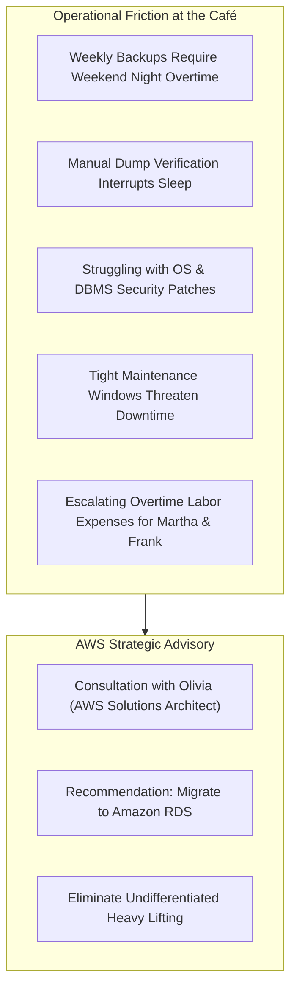
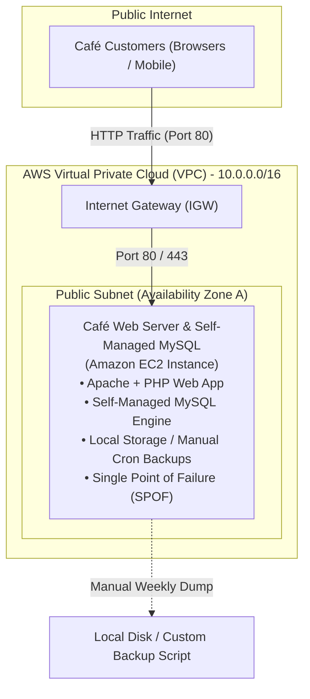
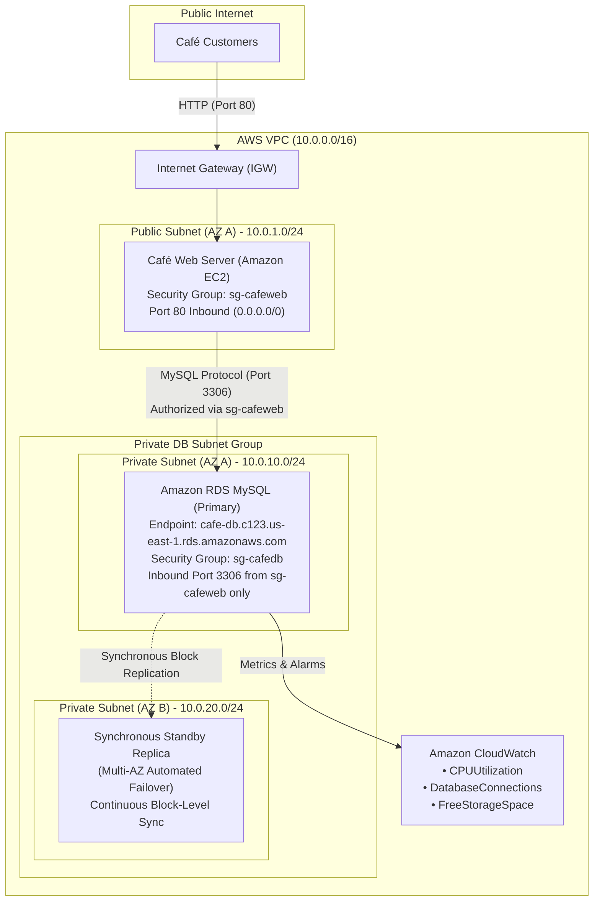
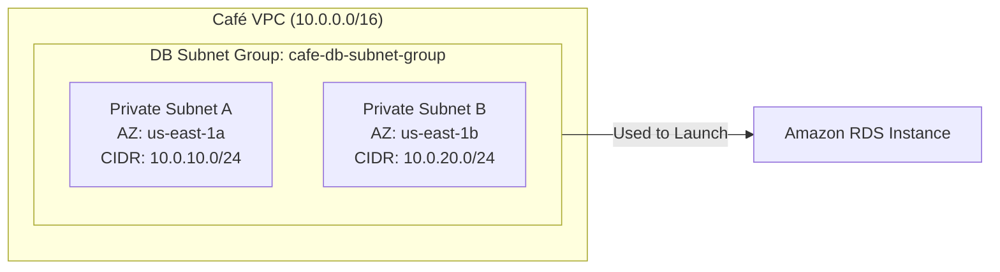
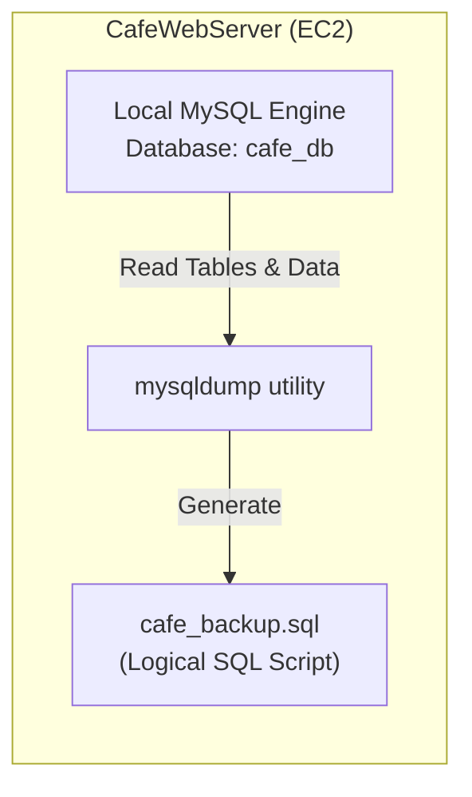
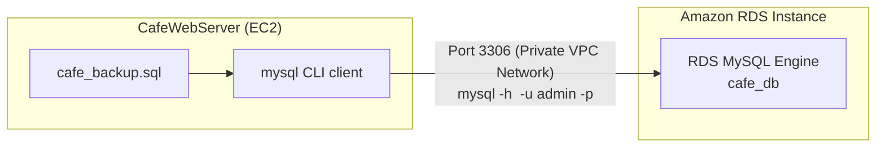
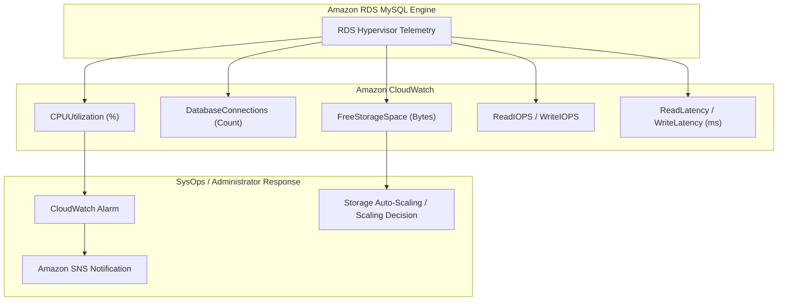
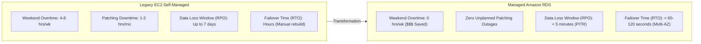
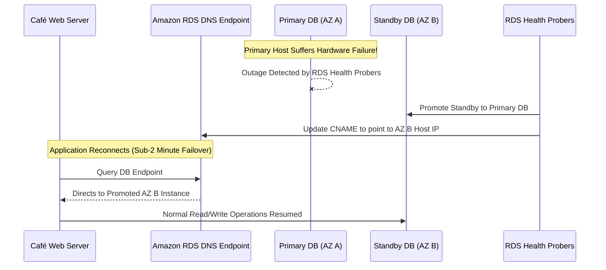

# 🗄️ Migrating to Amazon RDS – Café Database Migration Lab & Architecture Deep-Dive

> **Course**: AWS re/Start  
> **Module**: AWS Database Services  
> **Source Document**: `T17-AWS_Databases_Services/T17-0006-AWSD_MIGRATINGTORDS_EN.pdf`  
> **Target Audience**: AWS re/Start Learners, Cloud Practitioners, Solutions Architects, and Systems Operations Associates  

---

## 🎯 Lab Overview & Executive Summary

In modern enterprise and retail application development, running database management systems directly on unmanaged compute instances presents severe operational risks, high labor costs, and availability bottlenecks. When small to medium businesses rapidly digitize operations, they frequently begin with a monolithic or self-managed architecture—installing an application and its underlying database engine on the same server or across standalone virtual machines. Over time, recurring database administration burdens (often referred to as **"undifferentiated heavy lifting"**) compromise business agility and strain human resources.

The **Frank & Sofía Café** exemplifies this operational evolution:
- The café launched an online ordering system powered by a dynamic web application connecting to a self-managed relational database running on an Amazon Elastic Compute Cloud (Amazon EC2) instance.
- As order volume expanded, database administration tasks became an overwhelming operational and financial drain on the staff. System administrators **Sofía** and **Nikhil** spent weekend nights manually triggering backups, verifying dump integrity, and performing high-stress database patching windows outside of business hours.
- Café founders **Martha** and **Frank** realized that these manual maintenance duties were dramatically increasing labor costs due to recurring overtime hours.
- Following an architectural consultation with **Olivia**, an AWS Solutions Architect, the café decided to migrate its self-managed database to **Amazon Relational Database Service (Amazon RDS)**.

This guide provides a comprehensive architectural deep-dive and step-by-step technical walkthrough for migrating a self-managed database workload running on Amazon EC2 to Amazon RDS. By transitioning to Amazon RDS, the café offloads OS provisioning, automated backups, point-in-time recovery, automated patching, and Multi-AZ replication to AWS managed infrastructure, enabling Sofía and Nikhil to refocus their energy on developing innovative digital customer experiences.

```
┌────────────────────────────────────────────────────────────────────────────────────────┐
│                   Café Database Modernization Value Proposition                        │
├───────────────────────────────────┬────────────────────────────────────────────────────┤
│ Self-Managed EC2 Database         │ Managed Amazon RDS Deployment                      │
├───────────────────────────────────┼────────────────────────────────────────────────────┤
│ • Manual weekend backup scripts   │ • Automated daily snapshots & continuous write logs│
│ • High-risk manual OS/DB patching │ • Configurable automated maintenance windows       │
│ • Overtime labor & DBA fatigue    │ • Zero infrastructure management overhead          │
│ • Public subnet security exposure │ • Private DB subnet isolation across Multi-AZ      │
│ • Single point of failure (SPOF)  │ • Synchronous Multi-AZ standby failover (<60-120s) │
│ • Manual restore & crash recovery │ • 1-click Point-in-Time Recovery (PITR to 5 mins)  │
└───────────────────────────────────┴────────────────────────────────────────────────────┘
```

---

## 📌 Learning Objectives

By thoroughly reviewing this guide and completing the hands-on lab exercises, learners will be able to:

- [ ] **Analyze Business Drivers for Database Migration**: Identify the operational, financial, and architectural triggers that warrant migrating from self-managed databases to cloud-managed database services.
- [ ] **Deconstruct Database Operational Burdens**: Explain how manual database administrative tasks (backups, OS updates, database patching, storage scaling) create operational risks and inflate overtime labor expenses.
- [ ] **Architect Secure Multi-Tier Database Topologies**: Design a decoupled two-tier architecture incorporating public application subnets, private DB subnet groups spanning multiple Availability Zones, and least-privilege security group chaining.
- [ ] **Configure an Amazon RDS DB Subnet Group**: Create and configure DB subnet groups spanning at least two Availability Zones within a Virtual Private Cloud (VPC) using the AWS Management Console and AWS CLI.
- [ ] **Provision Managed Amazon RDS Instances**: Launch and configure a production-ready Amazon RDS database instance specifying engine versions, instance classes, storage allocation, credential management, and VPC security groups.
- [ ] **Execute Database Schema and Data Migration**: Safely extract database schemas and records from an Amazon EC2 instance using `mysqldump` and import the dump file directly into Amazon RDS using the native `mysql` client CLI.
- [ ] **Reconfigure Application Connectivity**: Update dynamic application configuration files (`db_config.php`) with the RDS endpoint hostname, master username, and credentials to redirect live traffic to the managed database.
- [ ] **Validate Application Functionality & Data Persistence**: Perform end-to-end integration testing by submitting new transactions through the web application and verifying persistent writes in the managed database instance.
- [ ] **Monitor Database Performance with Amazon CloudWatch**: Inspect core database health metrics including `CPUUtilization`, `DatabaseConnections`, `FreeStorageSpace`, and `Read/WriteLatency` to ensure operational stability.
- [ ] **Evaluate Post-Migration Benefits & Resiliency**: Contrast the operational maintenance, disaster recovery (PITR), and high availability (Multi-AZ) posture of Amazon RDS against legacy unmanaged deployments.

---

## 📚 Key Terminology

| Term | Technical Definition |
| :--- | :--- |
| **Amazon RDS** | Amazon Relational Database Service: A fully managed web service that simplifies the setup, operation, and scaling of relational databases in the AWS Cloud. |
| **Undifferentiated Heavy Lifting** | Repetitive, non-proprietary IT operational tasks (such as racking hardware, OS kernel patching, DBMS software upgrades, and manual tape/disk backups) that do not directly differentiate a business from its competitors. |
| **DB Subnet Group** | A collection of subnets (typically private) that you designate for your Amazon RDS DB instances in a VPC. A DB subnet group must include subnets in at least two distinct Availability Zones within an AWS Region. |
| **Multi-AZ Deployment** | An Amazon RDS high-availability configuration where AWS automatically provisions and maintains a synchronous standby replica in a different Availability Zone within the same Region, enabling automated failover during outages. |
| **Read Replica** | An asynchronous, read-only copy of an Amazon RDS DB instance used to offload read-intensive queries from the primary database instance and improve application read throughput. |
| **Point-in-Time Recovery (PITR)** | An Amazon RDS disaster recovery feature that combines automated daily storage volume snapshots with continuous transaction log archives, enabling database restoration to any second within the retention period (up to 35 days). |
| **Maintenance Window** | A user-defined recurring weekly time slot during which Amazon RDS applies pending engine updates, OS security patches, and hardware modifications. |
| **Security Group Chaining** | A network security architecture practice where the database security group restricts inbound traffic exclusively to the security group ID assigned to the web application tier, eliminating hardcoded IP dependencies. |
| **`mysqldump`** | A native client command-line utility used to generate logical backups containing SQL statements (`CREATE TABLE`, `INSERT`) needed to reproduce table structures and dataset rows. |
| **Recovery Point Objective (RPO)** | The acceptable amount of data loss measured in time (e.g., maximum data loss of 5 minutes during an unexpected outage). |
| **Recovery Time Objective (RTO)** | The maximum acceptable duration of time an application or database can remain offline before normal business operations are restored. |

---

## ☕ Café Business Scenario & Executive Drivers

### 1. The Story Behind the Migration

The Frank & Sofía Café has grown from a humble neighborhood coffee shop into a thriving regional business. When the owners, **Martha** and **Frank**, greenlit the development of an online ordering platform, café staff members **Sofía** and **Nikhil** took on the dual roles of web developers and systems administrators. 

Initially, they deployed the entire application stack—Apache HTTP Server, PHP runtime, and a MySQL relational database—onto a single Amazon EC2 instance running Amazon Linux inside a public VPC subnet. This setup enabled rapid time-to-market and low initial development cost. However, as online orders surged, the database grew significantly in size and criticality. 

Soon, the burden of self-managing the database became an acute operational bottleneck.



---

### 2. Stakeholder Dialogue Transcript

The following operational review captured the breaking point for the café team:

> **Nikhil**: *"Sofía and I are spending almost every Saturday and Sunday evening monitoring backup scripts. Because we have to take the backup manually when the café is closed to prevent inconsistent table states, we can't leave until midnight. Then, we have to verify that the dump file isn't corrupted."*
>
> **Sofía**: *"Last weekend was even worse. We had to apply a critical security patch to the Linux OS and MySQL server. The compilation and package dependencies failed twice, and we barely finished restoring services before Sunday morning opening. If an update fails, the entire café's online ordering goes dark."*
>
> **Martha**: *"Frank and I noticed our monthly payroll costs climbing. We are paying significant overtime hours for Sofía and Nikhil just to keep the database running. That is money we should be investing in expanding our catering business and improving our menu."*
>
> **Frank**: *"Our business relies on this ordering system now. If our single EC2 instance suffers a hardware fault or storage corruption, we could lose an entire day's worth of transactions. We reached out to Olivia from AWS to see if there is a better way."*
>
> **Olivia (AWS Solutions Architect)**: *"What you are experiencing is classic 'undifferentiated heavy lifting.' You are running a self-managed database on an EC2 instance, which means you are responsible for everything from operating system updates and database engine patches to storage scaling, disaster recovery scripts, and failover design.
> 
> My recommendation is to migrate your database to **Amazon Relational Database Service (Amazon RDS)**. Amazon RDS is a fully managed service that automates backups, software patching, failure detection, and recovery. By offloading these low-level administrative duties, Sofía and Nikhil will get their weekends back, your labor costs will drop, and your application will gain enterprise-grade reliability and security."*

---

### 3. Business Drivers & Technical Pain Points

The business drivers behind the café's decision to modernize can be categorized into four primary dimensions:

```
┌────────────────────────────────────────────────────────────────────────────────────────┐
│                        Café Modernization Drivers Matrix                               │
├───────────────────┬────────────────────────────────────────────────────────────────────┤
│ Driver Category   │ Specific Problem Statement & Business Impact                       │
├───────────────────┼────────────────────────────────────────────────────────────────────┤
│ 1. Labor & Cost   │ • High overtime payroll costs for weekend maintenance windows.    │
│    Optimization   │ • Opportunity cost: Engineers bogged down by routine IT chores     │
│                   │   instead of developing new customer-facing features.              │
├───────────────────┼────────────────────────────────────────────────────────────────────┤
│ 2. Reliability &  │ • Single Point of Failure (SPOF): App and DB colocated on EC2.     │
│    Availability   │ • No automated failover or standby replicas if instance fails.     │
│                   │ • RTO of hours/days if manual re-installation and restore required.│
├───────────────────┼────────────────────────────────────────────────────────────────────┤
│ 3. Data Loss Risk │ • Manual backups executed only once per week on weekends.          │
│    & Recovery     │ • Potential Recovery Point Objective (RPO) of up to 7 days of      │
│                   │   unrecoverable customer transactions if hardware fails on Friday. │
├───────────────────┼────────────────────────────────────────────────────────────────────┤
│ 4. Security &     │ • Database listener (port 3306) hosted in a public subnet.         │
│    Compliance     │ • Inconsistent OS/DBMS security patching due to operational fear   │
│                   │   of breaking application dependencies.                            │
└───────────────────┴────────────────────────────────────────────────────────────────────┘
```

> [!IMPORTANT]
> **Key Insight**: Self-managing a database on Amazon EC2 means treating the database as an *Infrastructure as a Service (IaaS)* workload. While EC2 grants complete root access to the operating system, it forces the customer to manage backups, OS updates, database upgrades, and fault tolerance. Amazon RDS operates as a *Platform as a Service (PaaS)* managed database offering, transferring routine maintenance and infrastructure management to AWS.

---

## 🏗️ Architectural Transformation: Before vs. After

### 1. Pre-Migration Architecture (Self-Managed EC2)

Prior to migration, the café's architecture suffered from architectural anti-patterns common to monolithic deployments:

1. **Colocated or Public Subnet Exposure**:
   - The web server and MySQL database server resided either on the same Amazon EC2 instance or on separate EC2 instances within a **public subnet**.
   - The database server required a public IPv4 address or direct internet routing, increasing the attack surface.
2. **Single Point of Failure (SPOF)**:
   - The database ran on a single EC2 instance tied to a single Availability Zone (AZ). If the physical underlying host or the AZ experienced degradation, the entire ordering system failed.
3. **Manual Backup Regimes**:
   - Backups relied on custom cron jobs or manual `mysqldump` commands written to local Amazon Elastic Block Store (Amazon EBS) volumes. 
   - These backups were not replicated across Availability Zones, leaving the café vulnerable to volume loss.
4. **Tight Resource Coupling**:
   - Web application traffic spikes (e.g., lunchtime rush) consumed CPU and memory resources required by the MySQL database daemon, causing query slowdowns and HTTP 504 gateway timeouts.



---

### 2. Post-Migration Architecture (Decoupled Multi-AZ Amazon RDS)

The modernized architecture follows the **AWS Well-Architected Framework** principles for operational excellence, security, and reliability:

1. **Two-Tier Decoupled Architecture**:
   - The compute/presentation tier (Café Web Server on EC2) is decoupled from the persistence tier (Amazon RDS).
   - Compute resources can scale independently of database storage and memory.
2. **Private DB Subnet Group & Multi-AZ Redundancy**:
   - Amazon RDS is provisioned within a dedicated **DB Subnet Group** comprising private subnets across two distinct Availability Zones (`us-east-1a` and `us-east-1b`).
   - The database has **no public IP address** and cannot be reached directly from the internet.
3. **Security Group Chaining**:
   - The Café Web Server security group permits inbound HTTP traffic on port 80 from the internet.
   - The RDS Database security group restricts inbound TCP traffic on port 3306 **exclusively to the Web Server security group ID**.
4. **Automated Protection & Disaster Recovery**:
   - Amazon RDS automatically performs continuous transaction logging and daily volume snapshots.
   - Point-in-time recovery enables restoration to within 5 minutes of any incident.
   - Optional Multi-AZ standby replica ensures synchronous replication and automatic failover in under 60 to 120 seconds.



---

### 3. Architecture Comparison Matrix

| Architectural Feature | Before: Self-Managed on EC2 | After: Managed Amazon RDS |
| :--- | :--- | :--- |
| **Compute / Storage Coupling** | Coupled on single instance/EBS | Fully decoupled across distinct tiers |
| **Network Security** | Public subnet exposure, public IP | Isolated in private subnets, no public IP |
| **Database Access Control** | IP/CIDR-based ingress | Security group chaining (`sg-cafeweb` $\rightarrow$ `sg-cafedb`) |
| **Backup Mechanism** | Manual weekend `mysqldump` scripts | Automated daily snapshots + continuous write logs |
| **Recovery Point Objective (RPO)** | Up to 7 days (previous weekend backup) | $\le 5$ minutes via Point-in-Time Recovery |
| **High Availability (HA)** | None (single EC2 instance = SPOF) | Multi-AZ synchronous standby failover (<120s) |
| **Software Patching** | Manual OS kernel & MySQL compilation | Automated scheduled weekly maintenance window |
| **Hardware Failure Impact** | System offline until instance rebuilt | Automatic host replacement & EBS re-attachment |
| **Administrative Labor** | 4–8 hours weekly overtime per engineer | 0 hours routine maintenance |

---

## 🔄 End-to-End Migration Sequence

The database migration follows an orderly sequence of data extraction, infrastructure provisioning, schema restoration, and application cutover:

```mermaid
sequenceDiagram
    autonumber
    actor Admin as Sofía / Nikhil (Admin)
    participant EC2 as Café Web Server (EC2)
    participant LocalDB as Local MySQL (EC2)
    participant RDS as Amazon RDS MySQL
    participant App as Web App (db_config.php)
    actor Customer as Café Customer

    Note over Admin,LocalDB: Phase 1: Assessment & Data Extraction
    Admin->>EC2: SSH into Café EC2 instance
    Admin->>LocalDB: Verify active tables (menu, orders, customers)
    Admin->>LocalDB: Run mysqldump --single-transaction cafe_db > cafe_backup.sql
    LocalDB-->>EC2: Structured SQL dump file created

    Note over Admin,RDS: Phase 2: Target Infrastructure Provisioning
    Admin->>RDS: Create DB Subnet Group spanning AZ A & AZ B
    Admin->>RDS: Provision Amazon RDS MySQL instance (cafe_db)
    RDS-->>Admin: DB Instance Status: Available & DNS Endpoint published

    Note over Admin,RDS: Phase 3: Data Restoration
    Admin->>EC2: Test network connectivity to RDS endpoint on port 3306
    Admin->>RDS: Import SQL dump: mysql -h <rds-endpoint> -u admin -p cafe_db < cafe_backup.sql
    RDS-->>Admin: Tables, views, and historical records populated

    Note over Admin,App: Phase 4: Application Cutover
    Admin->>App: Update db_config.php with RDS Endpoint, User & Password
    Admin->>App: Test database connection string

    Note over Customer,RDS: Phase 5: Production Verification
    Customer->>App: Submit new pastry & coffee order
    App->>RDS: INSERT INTO orders VALUES (...)
    RDS-->>App: Query OK, 1 row affected
    App-->>Customer: Order Confirmation (#1042)
    Admin->>RDS: SELECT * FROM orders; (Verify persistence)
```

---

## 🛠️ Hands-On Lab Walkthrough Step-by-Step

This section provides the end-to-end technical steps to replicate the migration performed by Sofía and Nikhil.

---

### Task 1: Inspecting the Current Architecture

Before migrating data, you must inspect the existing café web application and understand its underlying configuration and dataset.

#### 1.1 Access the Café Web Application
1. In the **AWS Management Console**, navigate to the **EC2 Console** (`Services > EC2 > Instances`).
2. Locate the instance named `CafeWebServer`.
3. Copy its **Public IPv4 address**.
4. Open a new web browser tab and navigate to:
   ```http
   http://<EC2-Public-IP>/
   ```
5. Observe the café web interface:
   - Notice the menu items (e.g., Espresso, Croissant, Green Tea).
   - Check the **Order** tab to see historical orders placed by customers.

#### 1.2 Inspect Local Database Configuration
1. Connect to the `CafeWebServer` instance via **EC2 Instance Connect** or **SSH**:
   ```bash
   ssh -i cafe-key.pem ec2-user@<EC2-Public-IP>
   ```
2. Navigate to the web application root directory:
   ```bash
   cd /var/www/html/
   ls -la
   ```
3. Inspect the active database configuration file `db_config.php`:
   ```bash
   cat db_config.php
   ```

*Listing 1.1: Pre-Migration `db_config.php` (Pointing to localhost)*
```php
<?php
// Cafe Application Database Connection Configuration (Legacy Localhost)
define('DB_SERVER', 'localhost');
define('DB_USERNAME', 'root');
define('DB_PASSWORD', 'CafePassword123!');
define('DB_DATABASE', 'cafe_db');

$db = mysqli_connect(DB_SERVER, DB_USERNAME, DB_PASSWORD, DB_DATABASE);

if (!$db) {
    die("ERROR: Could not connect to database. " . mysqli_connect_error());
}
?>
```

4. Connect to the local MySQL database instance using the command line client:
   ```bash
   mysql -u root -p'CafePassword123!' cafe_db
   ```
5. Inspect the database schema and count the existing records:
   ```sql
   SHOW TABLES;
   SELECT COUNT(*) AS total_menu_items FROM menu;
   SELECT COUNT(*) AS total_orders FROM orders;
   SELECT * FROM orders ORDER BY order_id DESC LIMIT 5;
   EXIT;
   ```

> [!NOTE]
> Make a note of the total order count. After the migration, you will use this baseline number to confirm that no data was lost during the transfer.

---

### Task 2: Creating a DB Subnet Group across Multiple Availability Zones

Amazon RDS requires a **DB Subnet Group** to define the network topology and IP address ranges where database instances can be placed. An RDS DB Subnet Group must span at least **two Availability Zones** within the Region to support Multi-AZ high availability and automated failovers.



#### 2.1 Create the DB Subnet Group via AWS Management Console
1. In the AWS Management Console, navigate to **RDS** (`Services > Database > RDS`).
2. In the left navigation pane, select **Subnet groups**.
3. Choose **Create DB subnet group**.
4. In the **Subnet group details** section:
   - **Name**: `cafe-db-subnet-group`
   - **Description**: `Private database subnets for Cafe ordering application`
   - **VPC**: Select `CafeVPC` (e.g., `vpc-0a1b2c3d4e5f67890`)
5. In the **Add subnets** section:
   - **Availability Zones**: Choose the two AZs used by your VPC (e.g., `us-east-1a` and `us-east-1b`).
   - **Subnets**: Select the two **private** subnets allocated for database traffic (e.g., `10.0.10.0/24` and `10.0.20.0/24`).
6. Choose **Create**.

#### 2.2 CLI Alternative: Creating the DB Subnet Group via AWS CLI
```bash
aws rds create-db-subnet-group \
    --db-subnet-group-name cafe-db-subnet-group \
    --db-subnet-group-description "Private DB Subnet Group for Cafe App" \
    --subnet-ids "subnet-0111111111111111a" "subnet-0222222222222222b" \
    --tags Key=Environment,Value=Production Key=Project,Value=CafeMigration
```

---

### Task 3: Creating the Amazon RDS Database Instance

With the networking foundation in place, provision the managed relational database instance.

#### 3.1 Configure Database Ingress Security Group
Before creating the instance, ensure a security group exists for the database that allows inbound MySQL traffic (TCP port 3306) **only from the web server security group**:

```bash
# Obtain Security Group IDs
WEB_SG_ID=$(aws ec2 describe-security-groups --filters "Name=group-name,Values=CafeWebSecurityGroup" --query "SecurityGroups[0].GroupId" --output text)
VPC_ID=$(aws ec2 describe-vpcs --filters "Name=tag:Name,Values=CafeVPC" --query "Vpcs[0].VpcId" --output text)

# Create Database Security Group
DB_SG_ID=$(aws ec2 create-security-group \
    --group-name CafeDBSecurityGroup \
    --description "Inbound MySQL access from Cafe Web Server only" \
    --vpc-id $VPC_ID \
    --output text)

# Authorize Port 3306 from Web Server Security Group
aws ec2 authorize-security-group-ingress \
    --group-id $DB_SG_ID \
    --protocol tcp \
    --port 3306 \
    --source-group $WEB_SG_ID
```

#### 3.2 Provision Amazon RDS MySQL via AWS Management Console
1. In the RDS Console, select **Databases** > **Create database**.
2. **Choose a database creation method**: `Standard create`.
3. **Engine options**:
   - Engine type: `MySQL` (or `MariaDB` depending on lab scenario)
   - Edition: `MySQL Community`
   - Engine Version: `MySQL 8.0.x` (or match source version)
4. **Templates**: Choose `Dev/Test` or `Free tier`.
5. **Settings**:
   - **DB instance identifier**: `cafe-db-instance`
   - **Master username**: `admin`
   - **Master password**: `CafePassword123!`
   - **Confirm master password**: `CafePassword123!`
6. **Instance configuration**:
   - DB instance class: `Burstable classes (includes t classes)` $\rightarrow$ `db.t3.micro` (or `db.t2.micro`)
7. **Storage**:
   - Storage type: `General Purpose SSD (gp2 or gp3)`
   - Allocated storage: `20 GiB`
   - Disable storage autoscaling for lab cost-control (or keep enabled for production).
8. **Connectivity**:
   - **Virtual private cloud (VPC)**: `CafeVPC`
   - **DB subnet group**: `cafe-db-subnet-group`
   - **Public access**: `No` (Critical: keep isolated within private subnets)
   - **VPC security group (firewall)**: Choose `Select existing` $\rightarrow$ Select `CafeDBSecurityGroup` (remove the `default` security group).
   - **Availability Zone**: `No preference`
   - **Database port**: `3306`
9. **Additional configuration**:
   - **Initial database name**: `cafe_db` *(Important: pre-creates the schema)*
   - **Enable automated backups**: Checked (Retention period: `7 days`)
   - **Backup window**: `No preference`
   - **Enable encryption**: Checked
10. Choose **Create database**.

#### 3.3 Provision Amazon RDS MySQL via AWS CLI
```bash
aws rds create-db-instance \
    --db-instance-identifier cafe-db-instance \
    --db-instance-class db.t3.micro \
    --engine mysql \
    --engine-version 8.0.32 \
    --master-username admin \
    --master-user-password CafePassword123! \
    --allocated-storage 20 \
    --db-subnet-group-name cafe-db-subnet-group \
    --vpc-security-group-ids $DB_SG_ID \
    --db-name cafe_db \
    --backup-retention-period 7 \
    --no-publicly-accessible \
    --tags Key=Environment,Value=Production Key=Application,Value=CafeOrdering
```

> [!NOTE]
> Database provisioning typically requires **5 to 10 minutes** while AWS allocates virtualized host capacity, configures underlying network interfaces, initializes the storage volume, and performs initial health verification. Wait until the status changes from `Creating` to `Available`.

#### 3.4 Retrieve the RDS Endpoint Address
Once the database status is `Available`, retrieve the connection endpoint:

```bash
RDS_ENDPOINT=$(aws rds describe-db-instances \
    --db-instance-identifier cafe-db-instance \
    --query "DBInstances[0].Endpoint.Address" \
    --output text)

echo "RDS Endpoint: $RDS_ENDPOINT"
```
*(Example output: `cafe-db-instance.c9xyz1234.us-east-1.rds.amazonaws.com`)*

---

### Task 4: Exporting Database Dump from EC2 using `mysqldump`

With the target RDS instance ready, log back into the `CafeWebServer` instance to perform a consistent data export of the current database.



1. Connect to the EC2 instance via SSH:
   ```bash
   ssh -i cafe-key.pem ec2-user@<EC2-Public-IP>
   ```
2. Run `mysqldump` to export `cafe_db` into a file named `cafe_backup.sql`:
   ```bash
   mysqldump -u root -p'CafePassword123!' \
       --single-transaction \
       --quick \
       --triggers \
       --routines \
       --databases cafe_db > cafe_backup.sql
   ```

> [!TIP]
> **Understanding Critical `mysqldump` Flags**:
> - `--single-transaction`: Uses InnoDB multi-version concurrency control (MVCC) to produce a consistent point-in-time snapshot of the database without locking tables or interrupting active read/write queries.
> - `--quick`: Forces `mysqldump` to retrieve rows from the server one row at a time rather than buffering entire tables in memory, preventing out-of-memory errors on small EC2 instances.
> - `--routines` and `--triggers`: Preserves stored procedures, functions, and database triggers.

3. Verify the contents and size of the generated SQL dump:
   ```bash
   ls -lh cafe_backup.sql
   head -n 25 cafe_backup.sql
   ```
   Ensure the output contains standard SQL statements such as `CREATE TABLE IF NOT EXISTS menu` and `INSERT INTO menu VALUES (...)`.

---

### Task 5: Importing SQL Dump into Amazon RDS MySQL

Now, stream the exported SQL dump directly from the EC2 instance across the private VPC network into the newly provisioned Amazon RDS instance.



1. Test network reachability from the EC2 instance to the RDS endpoint on port 3306:
   ```bash
   nc -zv <RDS_ENDPOINT> 3306
   ```
   *(Expected output: `Connection to cafe-db-instance.xxxx.us-east-1.rds.amazonaws.com 3306 port [tcp/mysql] succeeded!`)*

2. Import the backup file using the `mysql` client command:
   ```bash
   mysql -h <RDS_ENDPOINT> -u admin -p'CafePassword123!' cafe_db < cafe_backup.sql
   ```

3. Connect interactively to the RDS instance and verify data integrity:
   ```bash
   mysql -h <RDS_ENDPOINT> -u admin -p'CafePassword123!' cafe_db
   ```
4. Execute validation queries:
   ```sql
   -- List all migrated tables
   SHOW TABLES;

   -- Verify record counts against baseline
   SELECT COUNT(*) AS rds_menu_count FROM menu;
   SELECT COUNT(*) AS rds_orders_count FROM orders;

   -- Inspect latest order entries
   SELECT * FROM orders ORDER BY order_id DESC LIMIT 5;

   -- Check current database user and version
   SELECT USER(), VERSION(), NOW();

   EXIT;
   ```
5. Confirm that the `rds_orders_count` matches the exact number of rows recorded during Task 1.

---

### Task 6: Updating the Café Web Application Configuration

The database schema and data now reside safely in Amazon RDS. However, the Café web application is still pointing to `localhost`. You must update the configuration file to redirect live application traffic to the RDS endpoint.

1. Navigate to the application directory on the EC2 instance:
   ```bash
   cd /var/www/html/
   ```
2. Create a backup of the original configuration file:
   ```bash
   cp db_config.php db_config.php.bak
   ```
3. Edit `db_config.php` using your preferred text editor (`nano` or `vim`):
   ```bash
   nano db_config.php
   ```
4. Replace `localhost` with the RDS endpoint address:

*Listing 1.2: Modernized `db_config.php` (Pointing to Amazon RDS)*
```php
<?php
// Cafe Application Database Connection Configuration (Production Amazon RDS)
define('DB_SERVER', 'cafe-db-instance.c9xyz1234.us-east-1.rds.amazonaws.com');
define('DB_USERNAME', 'admin');
define('DB_PASSWORD', 'CafePassword123!');
define('DB_DATABASE', 'cafe_db');

// Establish persistent connection to managed RDS instance
$db = mysqli_connect(DB_SERVER, DB_USERNAME, DB_PASSWORD, DB_DATABASE);

// Validate connection health
if (!$db) {
    die("CRITICAL: Failed to connect to Amazon RDS instance. " . mysqli_connect_error());
}
?>
```
5. Save and close the file (`Ctrl+O`, `Enter`, `Ctrl+X` in nano).
6. Restart the Apache web server to clear any cached database connection pools:
   ```bash
   sudo systemctl restart httpd
   ```

---

### Task 7: Verifying Application Functionality & Data Persistence

To confirm the migration was completely successful, simulate a live customer transaction and verify that new records persist in Amazon RDS rather than the local EC2 database.

#### 7.1 Place a New Order through the Web Interface
1. Return to your web browser and refresh the Café Web Application:
   ```http
   http://<EC2-Public-IP>/
   ```
2. Navigate to the **Menu** page.
3. Select an item (e.g., *Caramel Macchiato* and *Blueberry Muffin*).
4. Enter a customer name (e.g., `Nikhil Test Order`) and submit the order.
5. Verify that an order confirmation number (e.g., `Order #1043`) appears on screen without PHP errors.

```
┌────────────────────────────────────────────────────────┐
│               ☕ Frank & Sofía Café 🥐                 │
│               Order Confirmation Success               │
├────────────────────────────────────────────────────────┤
│ Order ID:      #1043                                   │
│ Customer:      Nikhil Test Order                       │
│ Items:         1x Caramel Macchiato, 1x Blueberry Muf. │
│ Status:        Submitted to Kitchen                    │
│ Persistence:   Stored in Amazon RDS (cafe_db)          │
└────────────────────────────────────────────────────────┘
```

#### 7.2 Verify Persistent Storage in Amazon RDS
1. Query the Amazon RDS instance directly from the CLI:
   ```bash
   mysql -h <RDS_ENDPOINT> -u admin -p'CafePassword123!' -e "SELECT * FROM cafe_db.orders ORDER BY order_id DESC LIMIT 1;"
   ```
2. Observe that the new order (`#1043` for `Nikhil Test Order`) is returned from the Amazon RDS database.

#### 7.3 Decommission or Disable the Local MySQL Engine
To guarantee that the web application is no longer depending on the local EC2 MySQL daemon, stop and disable the local service:
```bash
sudo systemctl stop mariadb || sudo systemctl stop mysqld
sudo systemctl disable mariadb || sudo systemctl disable mysqld
```
3. Refresh the Café web application in your browser and submit another order.
4. The application continues functioning seamlessly, proving that all database dependencies have been successfully decoupled and transferred to Amazon RDS.

---

## 📊 Monitoring Amazon RDS with Amazon CloudWatch

One of the major benefits of moving to Amazon RDS is built-in telemetry integration with **Amazon CloudWatch**. Amazon RDS automatically pushes performance metrics to CloudWatch at 60-second intervals without requiring agent installations.



### Core CloudWatch Metrics for Amazon RDS

| Metric Name | Units | Operational Significance | Target Threshold / Recommendation |
| :--- | :--- | :--- | :--- |
| **`CPUUtilization`** | Percent | Percentage of CPU capacity utilized by database processes. | Keep average $<75\%$. Consistent spikes $>90\%$ indicate need for instance up-sizing (`db.t3.medium`). |
| **`DatabaseConnections`** | Count | Number of open client connections to the database instance. | Monitor for connection leaks or connection pool exhaustion. |
| **`FreeStorageSpace`** | Bytes | Remaining unused storage available to the database instance. | Set CloudWatch Alarm when free space drops below $20\%$. |
| **`ReadIOPS` / `WriteIOPS`** | Operations/sec | Average number of disk read/write I/O operations completed per second. | Ensure operations remain within provisioned baseline IOPS (e.g., 3,000 IOPS for gp3). |
| **`ReadLatency` / `WriteLatency`** | Seconds | Average duration of disk read/write operations. | Latency should typically remain under 10–20 milliseconds. High latency indicates disk queue buildup. |
| **`FreeableMemory`** | Bytes | Amount of available Random Access Memory (RAM). | Monitor to ensure database buffer pools have adequate headroom. |

#### Viewing Metrics via AWS CLI
```bash
# Check average CPU utilization for the past hour
aws cloudwatch get-metric-statistics \
    --namespace AWS/RDS \
    --metric-name CPUUtilization \
    --dimensions Name=DBInstanceIdentifier,Value=cafe-db-instance \
    --start-time $(date -u -d '1 hour ago' +%Y-%m-%dT%H:%M:%SZ) \
    --end-time $(date -u +%Y-%m-%dT%H:%M:%SZ) \
    --period 300 \
    --statistics Average
```

---

## 📈 Post-Migration Benefits Analysis & TCO

By moving to Amazon RDS, the café realized substantial operational and financial gains:



### 1. Direct Labor & Overtime Reductions
- **Pre-Migration**: Sofía and Nikhil worked an average of **6 overtime hours each weekend** executing manual backups and maintaining patch levels. At overtime rates, this cost Martha and Frank hundreds of dollars per week in avoidable labor expense.
- **Post-Migration**: Amazon RDS performs backups automatically during quiet periods and applies patches during scheduled maintenance windows. Weekend database maintenance hours were reduced to **zero**.

### 2. Automated Backups & Point-in-Time Recovery (PITR)
- **Snapshot Architecture**: Amazon RDS captures a complete storage volume snapshot daily and continuously writes transaction logs (`binlogs`) to Amazon S3.
- **Granular Restoration**: If a developer or application bug accidentally deletes a table (`DROP TABLE menu;`), administrators can restore the database to any specific second within the retention window (e.g., 10:41:22 AM).

### 3. High Availability Resilience (Multi-AZ)
- **Synchronous Standby**: In a Multi-AZ deployment, every commit written to the primary DB instance is synchronously replicated to a standby replica in an alternate Availability Zone.
- **Automated Failover**: If the primary instance experiences a hardware fault, storage failure, or network disruption, Amazon RDS automatically flips the DNS endpoint record to the standby instance in under **60 to 120 seconds**, with zero manual intervention.



---

## 🔀 Database Migration Strategies: `mysqldump` vs. AWS DMS

In this lab, the café used **`mysqldump`** for an offline migration. However, enterprise workloads frequently require alternative strategies depending on acceptable downtime limits:

| Feature / Consideration | Offline Migration (`mysqldump` + `mysql`) | Online Migration (AWS DMS + CDC) |
| :--- | :--- | :--- |
| **Downtime Window** | Requires a brief maintenance window where writes are halted. | Near-zero downtime; continuous data replication. |
| **Complexity** | Very low; uses standard native tools. | Moderate; requires replication instance and endpoint setup. |
| **Workload Sizing** | Best for small-to-medium databases ($<50\text{–}100\text{ GB}$). | Best for large databases, continuous operations, or cross-engine. |
| **Network Overhead** | Exports and imports full text SQL files. | Streams binary transaction logs (`binlog` capture). |
| **Cost** | Free (native database utility). | Minor cost for provisioned AWS DMS replication instance. |
| **Heterogeneous Engines** | Homogeneous only (MySQL to MySQL). | Supports heterogeneous migrations (e.g., Oracle $\rightarrow$ Aurora). |

> [!NOTE]
> For the café's database size (a few hundred megabytes), executing an offline export/import with `mysqldump` during closing hours was the most cost-effective and straightforward migration pattern.

---

## 📋 Comprehensive Shared Responsibility Model

Understanding who manages which layer of the database architecture is essential for cloud operations:

```
┌────────────────────────────────────────────────────────────────────────────────────────┐
│               Database Shared Responsibility Model Comparison                          │
├───────────────────────────────┬────────────────────────────┬───────────────────────────┤
│ Architectural Layer           │ Self-Managed on EC2        │ Managed Amazon RDS        │
├───────────────────────────────┼────────────────────────────┼───────────────────────────┤
│ Application Optimization      │ Customer                   │ Customer                  │
│ SQL Query & Schema Tuning     │ Customer                   │ Customer                  │
│ Database User Authentication  │ Customer                   │ Customer                  │
├───────────────────────────────┼────────────────────────────┼───────────────────────────┤
│ DBMS Version Upgrades         │ Customer                   │ AWS (Automated / Scheduled│
│ Database Engine Patching      │ Customer                   │ AWS (Fully Automated)     │
│ Database Backups & PITR       │ Customer                   │ AWS (Fully Automated)     │
│ Synchronous HA Failover       │ Customer (Manual clustering│ AWS (1-Click Multi-AZ)    │
│ OS Installation & Patching    │ Customer                   │ AWS (Managed by Service)  │
│ Server Hardware & Storage     │ AWS (EC2 Infrastructure)   │ AWS (RDS Infrastructure)  │
│ Data Center Facilities & Power│ AWS                        │ AWS                       │
└───────────────────────────────┴────────────────────────────┴───────────────────────────┘
```

---

## 📝 Knowledge Check & Review Questions

Test your understanding of the concepts covered in this lab and architectural guide:

### Question 1
**Why did Olivia recommend Amazon RDS instead of keeping the database on an Amazon EC2 instance?**
- A) Amazon RDS is free for all instance types and sizes indefinitely.
- B) Amazon RDS provides root operating system access so administrators can customize the Linux kernel.
- C) Amazon RDS is a fully managed service that automates backups, patch management, hardware provisioning, and failure recovery.
- D) Amazon RDS eliminates the need to create security groups or database user credentials.

*Answer*: **C**  
*Explanation*: Amazon RDS offloads the "undifferentiated heavy lifting" of database management—including automated daily snapshots, OS and database engine patching, storage scaling, and hardware replacement—enabling engineering teams to focus on business logic and customer applications. (Note: RDS intentionally abstracts away OS root access).

---

### Question 2
**What is the minimum architectural requirement when creating an Amazon RDS DB Subnet Group?**
- A) It must contain at least three public subnets in three different Regions.
- B) It must contain subnets in at least two different Availability Zones within the same VPC.
- C) It must contain one public subnet and one private subnet in the same Availability Zone.
- D) It must have an attached Internet Gateway and route table pointing to 0.0.0.0/0.

*Answer*: **B**  
*Explanation*: AWS enforces that every DB Subnet Group must span at least two Availability Zones within the target VPC. This requirement ensures the network infrastructure is prepared to support Multi-AZ deployments and automated standby failover without reconfiguration.

---

### Question 3
**When configuring security groups in a multi-tier web application, which rule demonstrates the most secure, least-privilege pattern for the database tier?**
- A) Allow inbound TCP port 3306 from CIDR `0.0.0.0/0`.
- B) Allow inbound TCP port 3306 from the public IP address of the EC2 web server.
- C) Allow inbound TCP port 3306 referencing the security group ID of the web server (`sg-cafeweb`).
- D) Allow all traffic from the VPC CIDR block `10.0.0.0/16`.

*Answer*: **C**  
*Explanation*: Security Group Chaining (referencing the Web Server's Security Group ID as the source for the DB Security Group ingress rule) implements strict least privilege. It ensures only instances explicitly assigned to the web tier can connect to the database, regardless of what private IP addresses they are assigned or whether the web tier autoscales across zones.

---

### Question 4
**Which flag should you use with `mysqldump` to ensure a consistent backup of InnoDB tables without locking the database or interrupting ongoing read/write traffic?**
- A) `--lock-all-tables`
- B) `--single-transaction`
- C) `--flush-logs`
- D) `--force`

*Answer*: **B**  
*Explanation*: The `--single-transaction` parameter uses InnoDB's Multi-Version Concurrency Control (MVCC) to create a consistent point-in-time snapshot of the database at the start of the dump without locking tables, allowing production applications to continue processing transactions unimpeded.

---

### Question 5
**What happens automatically when an Amazon RDS Multi-AZ primary database instance encounters an unrecoverable hardware failure?**
- A) AWS emails the administrator instructions on how to run a manual point-in-time recovery.
- B) The database remains offline until an administrator promotes the standby replica in the console.
- C) Amazon RDS automatically flips the database endpoint CNAME record to the standby instance in the secondary AZ, completing failover in typically under 60–120 seconds.
- D) The entire VPC is terminated and redeployed from an AWS CloudFormation template.

*Answer*: **C**  
*Explanation*: In a Multi-AZ deployment, Amazon RDS automatically detects primary instance faults, promotes the synchronous standby replica to primary status, and updates the DNS endpoint to point to the new primary. Because the endpoint hostname remains identical, client applications reconnect automatically once DNS caches refresh.

---

## 🏁 Summary & Post-Lab Best Practices Checklist

Congratulations! You have completed the migration of the Frank & Sofía Café relational database from a self-managed EC2 instance to a fully managed Amazon RDS deployment.

### Final Verification Checklist
- [x] Pre-migration schema and record count verified on EC2.
- [x] DB Subnet Group created across at least two Availability Zones.
- [x] RDS MySQL database instance launched in private subnets with encryption enabled.
- [x] Security group chaining configured on port 3306 between web and DB tiers.
- [x] Database dump extracted cleanly with `mysqldump --single-transaction`.
- [x] Schema and data restored into Amazon RDS via `mysql` client CLI.
- [x] Web application `db_config.php` updated with RDS endpoint hostname.
- [x] End-to-end order placement confirmed and validated in RDS.
- [x] Unmanaged local MySQL service stopped and disabled.
- [x] Amazon CloudWatch metrics verified for database health monitoring.
