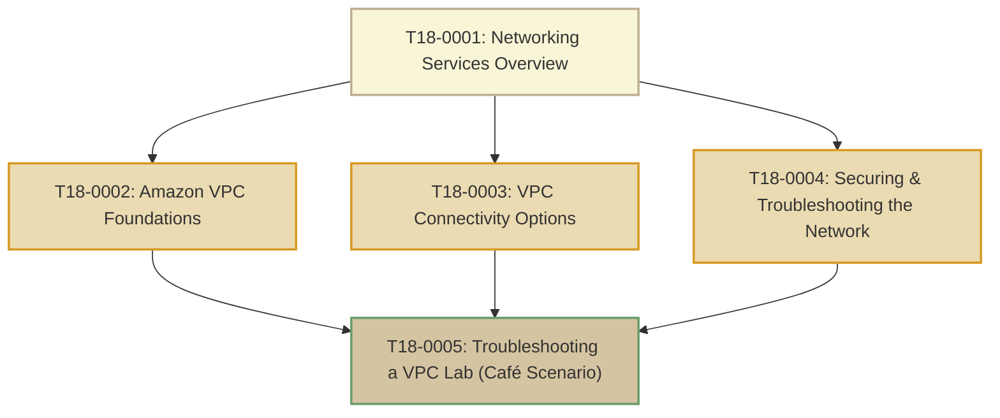

# T18: AWS Network Services

> **Course**: AWS re/Start Curriculum  
> **Module**: T18 – AWS Network Services (`M14`)  
> **Total Guides**: 5 Study Guides  
> **Status**: Completed (100%)

---

## Module Overview

The **AWS Network Services** module explores software-defined cloud networking, security perimeters, hybrid connectivity, and systematic incident diagnosis:
1. **Amazon Virtual Private Cloud (Amazon VPC)**: Foundational isolated virtual networks, IPv4 CIDR blocks (RFC 1918), public/private subnets, AWS-reserved IP addresses, route tables, and Internet Gateways.
2. **VPC Connectivity Options**: Managed NAT Gateways vs legacy NAT instances, VPC Peering, AWS Transit Gateway hub-and-spoke routing, AWS Site-to-Site VPN, AWS Direct Connect, and VPC Endpoints (Gateway vs Interface PrivateLink).
3. **Layered Defense-in-Depth & Telemetry**: Contrasting stateful Security Groups with stateless Network Access Control Lists (NACLs), analyzing ephemeral return ports (1024–65535), and capturing packet telemetry via VPC Flow Logs.
4. **Hands-On Troubleshooting Lab**: Diagnosing and repairing multi-layer network outages in the Café environment (missing default routes, locked security groups, and dropped ephemeral return packets).

---

## Study Guide Index

| # | Study Guide | Primary Topics Covered |
|---|-------------|------------------------|
| **0001** | [T18-0001-AWSN_NETWORKINGSVCSOVERVIEW_EN.md](file:///work/tmp/aws-cf/T18-AWS_Network_Services/T18-0001-AWSN_NETWORKINGSVCSOVERVIEW_EN.md) | Cloud networking fundamentals, module progression roadmap, high-availability VPC blueprints, troubleshooting KB runbooks (Networking, Security & Compliance) |
| **0002** | [T18-0002-RSJAWS_EN-US_SG_M13_AMAZONVPC.md](file:///work/tmp/aws-cf/T18-AWS_Network_Services/T18-0002-RSJAWS_EN-US_SG_M13_AMAZONVPC.md) | Isolated VPC networking, RFC 1918 CIDR blocks, subnet design, 5 reserved IP addresses, route tables, Internet Gateway, ENIs, default vs custom VPC |
| **0003** | [T18-0003-AWSN_AMAZONVPCCONNECTIVITY_EN.md](file:///work/tmp/aws-cf/T18-AWS_Network_Services/T18-0003-AWSN_AMAZONVPCCONNECTIVITY_EN.md) | NAT Gateway vs NAT Instance, non-transitive VPC Peering, Transit Gateway hub-and-spoke, Site-to-Site VPN, Direct Connect, Gateway vs Interface PrivateLink |
| **0004** | [T18-0004-AWSN_SECURETROUBLESHOOTNET_EN.md](file:///work/tmp/aws-cf/T18-AWS_Network_Services/T18-0004-AWSN_SECURETROUBLESHOOTNET_EN.md) | Layered defense-in-depth, Security Groups (stateful) vs Network ACLs (stateless, ephemeral ports 1024-65535), AWS WAF, Shield, VPC Flow Logs analysis |
| **0005** | [T18-0005-AWSN_CAFETROUBLESHOOTVPC_EN.md](file:///work/tmp/aws-cf/T18-AWS_Network_Services/T18-0005-AWSN_CAFETROUBLESHOOTVPC_EN.md) | Café network crisis post-mortem, systematic 8-task triage lab, fixing route tables, repairing security groups, configuring NACL return rules, flow log validation |

---

## Security Groups vs Network ACLs (NACLs)

| Feature | Security Groups | Network ACLs (NACLs) |
|---|---|---|
| **Operating Layer** | Instance / ENI level | Subnet boundary level |
| **State Tracking** | **Stateful**: Return traffic is automatically allowed regardless of inbound/outbound rules | **Stateless**: Return traffic must be explicitly allowed in both directions |
| **Rule Evaluation** | All rules evaluated before decision is reached | Rules evaluated in numerical order (lowest first; terminates on first match) |
| **Action Types** | Supports **Allow** rules only (implicit deny for anything not allowed) | Supports both **Allow** and **Deny** rules |
| **Ephemeral Ports** | Handled automatically by connection tracking table | Requires explicit rules for ephemeral ports (`1024–65535`) |
| **Default Configuration** | Blocks all inbound traffic; allows all outbound traffic | Allows all inbound and outbound traffic |
