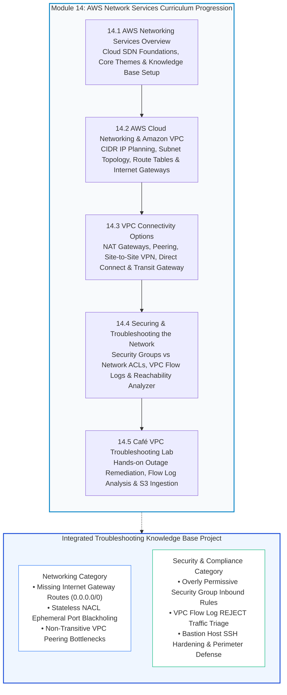
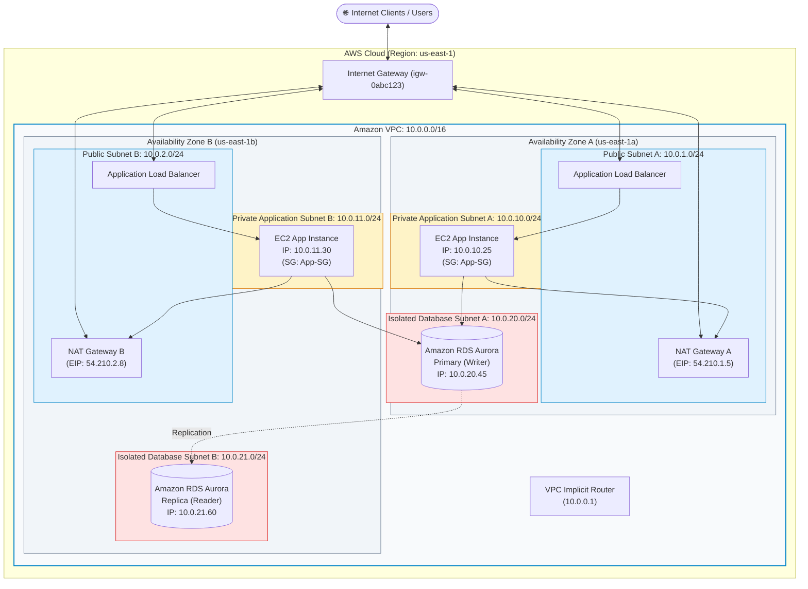
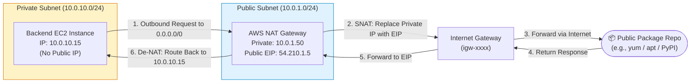
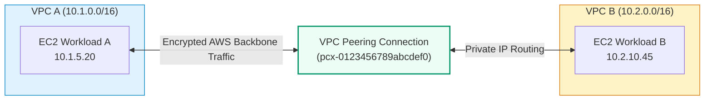
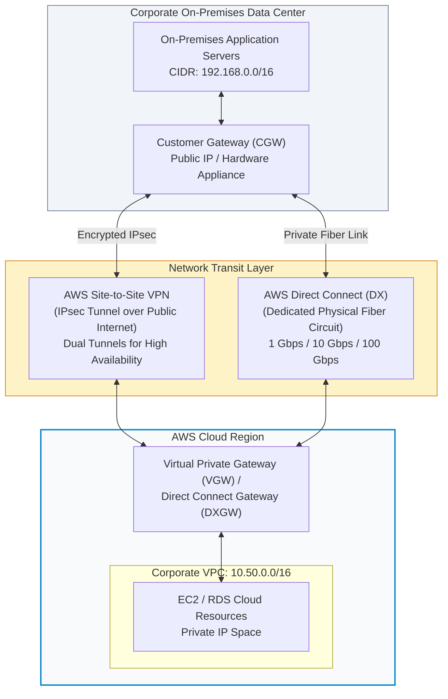
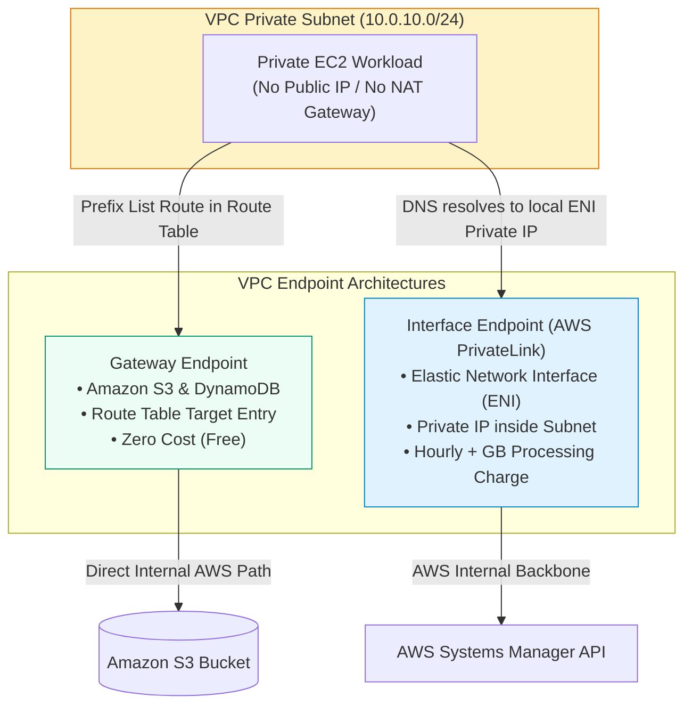
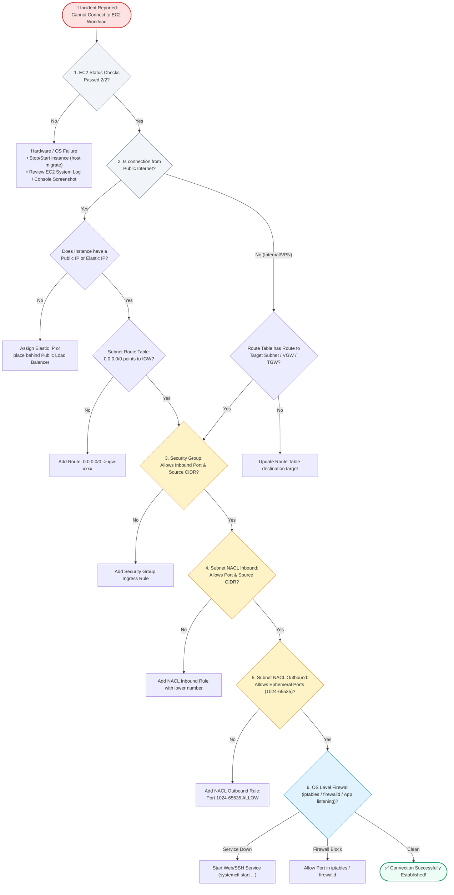
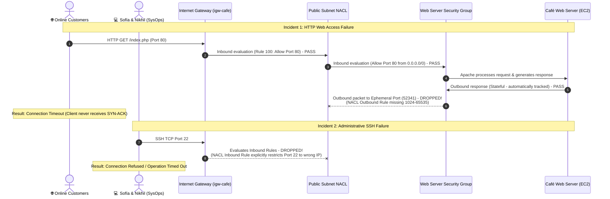
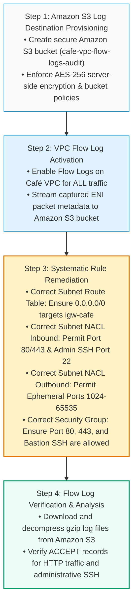

# 🌐 Module 14: AWS Network Services Overview – Study Guide

> **Course**: AWS re/Start  
> **Module**: AWS Network Services (Module 14)  
> **Source Document**: `T18-0001-AWSN_NETWORKINGSVCSOVERVIEW_EN.pdf`  
> **Target Audience**: AWS re/Start Learners / Cloud Practitioners / Solutions Architects / SysOps Administrators / DevOps Engineers  

---

## 🎯 Unit Overview: Cloud Networking Foundations & Network Topology Design

In traditional enterprise IT environments, establishing a corporate network required purchasing and racking physical hardware: core enterprise switches, border routers, hardware firewalls, and dedicated network cabling. Network engineers partitioned topologies using Virtual Local Area Networks (VLANs), configured static subnets, managed physical demilitarized zones (DMZs), and negotiated costly Multi-Protocol Label Switching (MPLS) telecommunication circuits. These static network topologies took weeks or months to provision, scaled poorly during sudden traffic surges, and presented significant operational bottlenecks.

Cloud networking replaces physical hardware with **Software-Defined Networking (SDN)**. In Amazon Web Services (AWS), the core foundational service for cloud networking is **Amazon Virtual Private Cloud (Amazon VPC)**. Amazon VPC provides a logically isolated virtual network within the AWS Cloud where organizations securely provision compute instances, managed database engines, container workloads, and serverless interfaces. 

```
┌──────────────────────────────────────────────────────────────────────────────────────────┐
│                   The Resilient Cloud Network Architecture Triangle                      │
├───────────────────────────────┬────────────────────────────┬─────────────────────────────┤
│      Logical Isolation        │    Hybrid Connectivity     │    Zero-Trust Defense       │
├───────────────────────────────┼────────────────────────────┼─────────────────────────────┤
│ • Private RFC 1918 CIDRs      │ • NAT Gateways             │ • Stateful Security Groups  │
│ • Multi-AZ Subnets            │ • VPC Peering              │ • Stateless Network ACLs    │
│ • Custom Route Tables         │ • Site-to-Site VPN         │ • VPC Flow Logs             │
│ • Internet Gateways (IGW)     │ • AWS Direct Connect (DX)  │ • Reachability Analyzer     │
│ • VPC Endpoints (PrivateLink) │ • AWS Transit Gateway      │ • Bastion Jump Hosts        │
└───────────────────────────────┴────────────────────────────┴─────────────────────────────┘
```

**Module 14: AWS Network Services** examines the architectural primitives, configuration methodologies, hybrid connectivity options, security frameworks, and troubleshooting practices necessary to design, operate, and maintain resilient AWS cloud networks. This module integrates four foundational domains:
1. **Amazon VPC Architecture**: Designing multi-tier, multi-Availability Zone networks using Classless Inter-Domain Routing (CIDR), public and private subnets, route tables, and Internet Gateways.
2. **VPC Connectivity Options**: Interconnecting VPCs and hybrid environments through NAT Gateways, VPC Peering, AWS Site-to-Site VPN, AWS Direct Connect, AWS Transit Gateway, and AWS PrivateLink.
3. **Network Security & Defense in Depth**: Enforcing layered perimeter and host defense using Security Groups, Network Access Control Lists (Network ACLs), VPC Flow Logs, and automated diagnostics.
4. **Hands-on Production Troubleshooting**: Diagnosing real-world network outages in the multi-tier Café application and recording operational runbooks into the **Troubleshooting Knowledge Base**.

---

### 📌 Learning Objectives

- [ ] **Define the Foundational Role of Amazon VPC**: Explain how Amazon VPC provides logical network isolation, IP address space management, and multi-tenant security boundaries within the AWS Cloud.
- [ ] **Design Multi-Tier VPC Topologies**: Plan and allocate RFC 1918 IPv4 and IPv6 CIDR blocks, partition networks into public and private subnets across multiple Availability Zones, and account for the five AWS-reserved IP addresses in each subnet.
- [ ] **Configure Routing and Internet Access**: Associate custom route tables with subnets, define destination and target routes using Longest Prefix Match (LPM), and attach Internet Gateways (IGW) for bidirectional internet translation.
- [ ] **Evaluate VPC Connectivity Solutions**: Differentiate use cases, traffic flows, bandwidth limits, and architectural constraints for NAT Gateways, NAT Instances, VPC Peering, Virtual Private Gateways (VGW), AWS Site-to-Site VPN, AWS Direct Connect (DX), and AWS Transit Gateway (TGW).
- [ ] **Implement AWS PrivateLink & VPC Endpoints**: Contrast Gateway Endpoints (Amazon S3 and DynamoDB) with Interface Endpoints (AWS PrivateLink), eliminating exposure to the public internet for AWS API communication.
- [ ] **Implement Layered Network Defense (Defense in Depth)**: Contrast stateful Security Groups (instance-level firewall) with stateless Network ACLs (subnet-level boundary filter), configuring explicit ephemeral return port rules.
- [ ] **Deploy Network Observability Tools**: Enable VPC Flow Logs to capture IP network metadata, publish records to Amazon S3 and Amazon CloudWatch Logs, and evaluate traffic patterns using VPC Reachability Analyzer.
- [ ] **Troubleshoot Complex VPC Issues in the Café Lab**: Resolve real-world connectivity blackholes, including missing default routes, restrictive Network ACLs, security group port blocks, and SSH authentication failures.
- [ ] **Document Troubleshooting Knowledge Base Runbooks**: Maintain professional incident response runbooks across the **Networking** and **Security & Compliance** operational categories.

---

## 🗺️ Module 14 Curriculum Roadmap

The following diagram illustrates the structural progression of the **Module 14: AWS Network Services** curriculum:



---

## 🏛️ Theme 1: Amazon Virtual Private Cloud (Amazon VPC) Core Foundations

### 1. The Foundational Role of Amazon VPC

Amazon VPC is the virtual network dedicated to an AWS account. It is logically isolated from other virtual networks in the AWS Cloud. When deploying services such as Amazon Elastic Compute Cloud (EC2) instances, Amazon Relational Database Service (RDS) databases, or Elastic Load Balancers (ELB), those resources must be placed within a subnet inside a VPC.

```
┌────────────────────────────────────────────────────────────────────────────────────────┐
│                              Amazon VPC Architectural Tenets                           │
├─────────────────────────┬──────────────────────────────────────────────────────────────┤
│ Regional Scope          │ A VPC spans all Availability Zones (AZs) in an AWS Region.   │
├─────────────────────────┼──────────────────────────────────────────────────────────────┤
│ Dedicated IP Space      │ Defined by a primary IPv4 CIDR block (/16 to /28).           │
├─────────────────────────┼──────────────────────────────────────────────────────────────┤
│ Granular Segmentation   │ Subdivided into subnets, each constrained to a single AZ.    │
├─────────────────────────┼──────────────────────────────────────────────────────────────┤
│ Boundary Enforcement    │ Complete control over ingress/egress traffic via route tables│
│                         │ and packet filtering mechanisms.                             │
└─────────────────────────┴──────────────────────────────────────────────────────────────┘
```

---

### 2. IP Addressing and CIDR Allocation

When creating a VPC, you assign an IPv4 Classless Inter-Domain Routing (CIDR) block.

#### RFC 1918 Private IP Address Standards
AWS recommends adhering to standard RFC 1918 private address ranges to prevent routing conflicts with public internet IP addresses:

| RFC 1918 Block | Subnet Mask Range | Total Available IP Addresses | Typical Use Case |
| :--- | :--- | :--- | :--- |
| **`10.0.0.0/8`** | `255.0.0.0` | 16,777,216 | Large enterprise cloud estates with multiple interconnected VPCs |
| **`172.16.0.0/12`** | `255.240.0.0` | 1,048,576 | Mid-sized multi-tier environments (AWS Default VPC uses `172.31.0.0/16`) |
| **`192.168.0.0/16`** | `255.255.0.0` | 65,536 | Small networks, branch offices, and isolated test lab environments |

> [!IMPORTANT]
> **CIDR Sizing Constraints in AWS**:
> - Allowed VPC block sizes range from **/16** (65,536 IP addresses) to **/28** (16 IP addresses).
> - You cannot change the primary CIDR block size after creation, though you can associate up to four secondary IPv4 CIDR blocks.
> - **Non-Overlapping IP Planning**: Ensure your VPC CIDR blocks do not overlap with corporate on-premises networks or other peered VPCs. Overlapping CIDRs prevent routing through VPN, Direct Connect, and VPC Peering.

---

### 3. Subnets and the Five Reserved IP Addresses

A subnet is a segment of the VPC's IP address range designated to a specific **Availability Zone (AZ)**. Subnets cannot span multiple AZs. 

AWS reserves **five IP addresses** in every subnet (the first four and the last one). For example, in a `10.0.0.0/24` subnet (total $2^8 = 256$ theoretical addresses), exactly **251 addresses** can be assigned to resources:

```
┌────────────────────────────────────────────────────────────────────────────────────────┐
│                   AWS Reserved IP Addresses in Subnet 10.0.0.0/24                      │
├──────────────┬─────────────────────────────┬───────────────────────────────────────────┤
│ IP Address   │ Architectural Role          │ Description                               │
├──────────────┼─────────────────────────────┼───────────────────────────────────────────┤
│ 10.0.0.0     │ Network Address             │ Base network identifier for the subnet    │
├──────────────┼─────────────────────────────┼───────────────────────────────────────────┤
│ 10.0.0.1     │ VPC Local Router            │ Assigned by AWS to the default VPC router │
├──────────────┼─────────────────────────────┼───────────────────────────────────────────┤
│ 10.0.0.2     │ Amazon Provided DNS         │ Base of VPC CIDR + 2; AmazonProvidedDNS   │
├──────────────┼─────────────────────────────┼───────────────────────────────────────────┤
│ 10.0.0.3     │ Future AWS Reservation      │ Reserved by AWS for future functionality  │
├──────────────┼─────────────────────────────┼───────────────────────────────────────────┤
│ 10.0.0.255   │ Network Broadcast Address   │ Broadcast is not supported in AWS VPC     │
└──────────────┴─────────────────────────────┴───────────────────────────────────────────┘
```

> [!NOTE]
> Even though AWS VPC networking does not support IP broadcast or multicast, `10.0.0.255` remains reserved for standard networking protocol compatibility.

---

### 4. Route Tables and Internet Gateways

A **route table** contains a set of rules (routes) that determine where network traffic from your subnet or gateway is directed.

- **Main Route Table**: Automatically created with the VPC. Automatically controls subnets not explicitly associated with another route table.
- **Custom Route Tables**: Created by administrators to explicitly define routing paths (e.g., routing traffic through an Internet Gateway or NAT Gateway).
- **Longest Prefix Match (LPM)**: When evaluating routing rules, the route table prioritizes the most specific CIDR prefix. For example, traffic destined for `10.0.1.5` matches `10.0.0.0/16 (local)` rather than `0.0.0.0/0 (igw)`.

#### The Internet Gateway (IGW)
An Internet Gateway is a horizontally scaled, redundant, and highly available VPC component that enables communication between instances in your VPC and the internet.
- **1:1 Attachment**: You can attach exactly one Internet Gateway to a VPC.
- **No Bandwidth Bottlenecks**: It imposes no availability risks or bandwidth constraints on network traffic.
- **Bi-Directional 1:1 NAT**: It translates private IPv4 addresses of public instances into their associated Public IPv4 or Elastic IP (EIP) addresses.

---

### 5. Multi-AZ VPC Architecture Anatomy

The following diagram illustrates a production-grade AWS VPC spanning two Availability Zones with decoupled public, private, and database tiers:



---

## 🔗 Theme 2: VPC Connectivity Options & Hybrid Topologies

Enterprise workloads frequently require connecting VPCs to the internet, to other VPCs, to corporate on-premises data centers, and directly to AWS managed services without traversing the public internet.

```
┌────────────────────────────────────────────────────────────────────────────────────────┐
│                        VPC Connectivity Scenario Decision Matrix                       │
├───────────────────────────────────┬────────────────────────────┬───────────────────────┤
│ Connectivity Scenario             │ Recommended AWS Solution   │ Solution Category     │
├───────────────────────────────────┼────────────────────────────┼───────────────────────┤
│ Outbound internet for private EC2 │ NAT Gateway (or NAT Inst.) │ EC2 Instance Egress   │
├───────────────────────────────────┼────────────────────────────┼───────────────────────┤
│ One-to-one VPC interconnection    │ VPC Peering                │ VPC-to-VPC            │
├───────────────────────────────────┼────────────────────────────┼───────────────────────┤
│ Scaled multi-VPC hub-and-spoke    │ AWS Transit Gateway (TGW)  │ VPC-to-VPC / Transit  │
├───────────────────────────────────┼────────────────────────────┼───────────────────────┤
│ Secure corporate hybrid link      │ AWS Site-to-Site VPN       │ Network-to-VPC (VPN)  │
├───────────────────────────────────┼────────────────────────────┼───────────────────────┤
│ Dedicated private physical link   │ AWS Direct Connect (DX)    │ Network-to-VPC (DX)   │
├───────────────────────────────────┼────────────────────────────┼───────────────────────┤
│ Private access to AWS services    │ AWS PrivateLink (VPC Endp) │ Managed Service / VPC │
└───────────────────────────────────┴────────────────────────────┴───────────────────────┘
```

---

### 1. Network Address Translation: NAT Gateway vs. NAT Instance

Instances deployed in private subnets do not have public IP addresses. To initiate outbound connections to the internet (e.g., downloading OS security patches, updating dependencies) while strictly blocking inbound traffic initiated from the internet, you deploy a NAT device in a **public subnet**.



#### Detailed Comparison: Managed NAT Gateway vs. Self-Managed NAT Instance

| Feature / Dimension | AWS NAT Gateway (Managed) | Amazon EC2 NAT Instance (Self-Managed) |
| :--- | :--- | :--- |
| **Maintenance & Patching** | Managed automatically by AWS | Managed manually by customer (OS updates, AMI maintenance) |
| **High Availability** | Built-in redundancy within the AZ; auto-recovers | Single point of failure; requires custom failover scripts |
| **Bandwidth & Scaling** | Scales automatically up to 45 Gbps | Limited by selected EC2 instance type bandwidth |
| **Cost Model** | Hourly charge per gateway + per-GB data processed | Hourly EC2 instance charge + data transfer egress costs |
| **Security Groups** | Cannot associate security groups (uses NACLs) | Secured using standard EC2 security groups |
| **Source/Dest. Check** | Handled natively by AWS service | **Must disable** Source/Destination check manually (`SrcDestCheck: false`) |
| **Port Forwarding / Bastion**| Not supported (pure outbound NAT) | Supported (can also act as a bastion host or reverse proxy) |

> [!TIP]
> **Production Best Practice**: Always deploy an **AWS NAT Gateway in each Availability Zone** where you run private workloads. If an AZ experiences an infrastructure failure, workloads in surviving AZs continue accessing the internet through their local NAT Gateway.

---

### 2. VPC Peering

VPC Peering is a networking connection between two VPCs that allows traffic to route between them using private IPv4 or IPv6 addresses.



#### Key Architectural Characteristics of VPC Peering:
1. **Non-Transitive Routing**: VPC Peering is strictly point-to-point. If VPC A is peered with VPC B, and VPC B is peered with VPC C, VPC A **cannot** route traffic to VPC C through VPC B. To communicate, an explicit peering connection between VPC A and VPC C must be created.
2. **No Overlapping CIDRs**: The CIDR blocks of the two peered VPCs must not overlap.
3. **No Single Point of Failure**: Peering connections rely on AWS physical network infrastructure; they do not introduce bandwidth bottlenecks or single points of failure.
4. **Inter-Region Support**: Peering operates across different AWS Regions and across different AWS accounts. Traffic is automatically encrypted over the AWS global fiber backbone.

---

### 3. Hybrid Connectivity: AWS Site-to-Site VPN vs. AWS Direct Connect

Organizations with on-premises data centers require dedicated, secure pathways to connect their physical infrastructure to AWS VPCs.



#### Hybrid Connectivity Comparison Table

| Attribute | AWS Site-to-Site VPN | AWS Direct Connect (DX) |
| :--- | :--- | :--- |
| **Physical Medium** | Public Internet (IPsec encrypted tunnels) | Dedicated private fiber-optic circuit |
| **Bandwidth** | Up to 1.25 Gbps per VPN tunnel | 1 Gbps, 10 Gbps, or 100 Gbps (hosted sub-1G available) |
| **Latency & Jitter** | Variable (dependent on public internet conditions) | Extremely low, consistent, and predictable |
| **Deployment Time** | Minutes (rapid provisioning) | Weeks to months (requires telco cross-connects) |
| **In-Transit Encryption** | AES-256 IPsec encryption by default | Unencrypted by default (can layer VPN or MACsec over DX) |
| **Typical Use Case** | Immediate hybrid setup, disaster recovery backup | Mission-critical workloads, continuous large-scale data transfer |

---

### 4. AWS Transit Gateway (TGW)

As enterprises scale to dozens or hundreds of VPCs across multiple accounts, point-to-point VPC Peering becomes an unmanageable full mesh ($N(N-1)/2$ connections).

**AWS Transit Gateway** acts as a regional software-defined router (hub-and-spoke topology):
- Connects thousands of VPCs, AWS Direct Connect gateways, and VPN connections to a single regional gateway.
- Supports **transitive routing** between attached VPCs and on-premises networks.
- Enables centralized network management, centralized egress filtering via an inspection VPC, and inter-region Transit Gateway peering.

---

### 5. AWS PrivateLink and VPC Endpoints

Traditionally, connecting from an EC2 instance in a private subnet to an AWS service (such as Amazon S3, Amazon DynamoDB, or AWS Systems Manager) required routing traffic through a NAT Gateway and an Internet Gateway over public IP endpoints.

**VPC Endpoints** allow private connections between your VPC and supported AWS services without requiring an Internet Gateway, NAT Gateway, VPN, or Direct Connect.



| Dimension | Gateway Endpoint | Interface Endpoint (AWS PrivateLink) |
| :--- | :--- | :--- |
| **Supported Services** | Amazon S3 and Amazon DynamoDB only | 100+ AWS services, Marketplace SaaS, and custom customer services |
| **Implementation Mechanism** | Target entry in the subnet route table (`pl-xxxx`) | Elastic Network Interface (ENI) with a private IP in your subnet |
| **Access Control** | Endpoint policies attached to the endpoint | Security Groups attached directly to the ENI interface |
| **Pricing** | **Free** (no hourly or data processing charges) | Hourly charge per ENI + per-GB data processed |
| **On-Premises Access** | Cannot be accessed from on-premises over VPN/DX | Can be accessed from on-premises over VPN or Direct Connect |

---

## 🛡️ Theme 3: Securing and Troubleshooting the Network

### 1. Layered Defense in Depth Model

Security in AWS networking operates across multiple complementary boundaries:
1. **Perimeter Edge**: AWS Shield, AWS WAF, and Amazon Route 53 absorb volumetric DDoS attacks and filter malicious web application payloads.
2. **Subnet Boundary**: **Network ACLs** act as stateless packet filters controlling traffic entering and exiting entire subnets.
3. **Instance / Host Boundary**: **Security Groups** act as stateful firewalls controlling traffic directly at the virtual network interface (ENI) level.
4. **Operating System Boundary**: Host-level firewalls (`iptables`, `nftables`, Windows Defender Firewall) enforce local application port binding policies.

---

### 2. Security Groups vs. Network ACLs (NACLs)

Understanding the fundamental operational differences between Security Groups and Network ACLs is critical for both security architecture and network troubleshooting.

```
┌────────────────────────────────────────────────────────────────────────────────────────┐
│                        Security Groups vs. Network ACLs Deep Dive                      │
├────────────────────────────┬─────────────────────────────┬─────────────────────────────┤
│ Architectural Dimension    │ Security Group              │ Network ACL (NACL)          │
├────────────────────────────┼─────────────────────────────┼─────────────────────────────┤
│ Enforcement Level          │ Instance / ENI level        │ Subnet boundary level       │
├────────────────────────────┼─────────────────────────────┼─────────────────────────────┤
│ State Management           │ **Stateful**                │ **Stateless**               │
├────────────────────────────┼─────────────────────────────┼─────────────────────────────┤
│ Rule Support               │ Allow rules ONLY            │ Allow AND Deny rules        │
├────────────────────────────┼─────────────────────────────┼─────────────────────────────┤
│ Rule Evaluation Order      │ All rules evaluated         │ Evaluated in numerical      │
│                            │ (most permissive matches)   │ order (lowest rule first)   │
├────────────────────────────┼─────────────────────────────┼─────────────────────────────┤
│ Return Traffic Handling    │ Automatically permitted     │ Explicit outbound rule must │
│                            │ regardless of inbound rules │ permit ephemeral ports      │
├────────────────────────────┼─────────────────────────────┼─────────────────────────────┤
│ Default Behavior (Custom)  │ Deny all inbound,           │ Deny all inbound,           │
│                            │ Allow all outbound          │ Deny all outbound           │
├────────────────────────────┼─────────────────────────────┼─────────────────────────────┤
│ Default Behavior (Default) │ Allow all inbound from SG,  │ Allow all inbound,          │
│                            │ Allow all outbound to all   │ Allow all outbound          │
└────────────────────────────┴─────────────────────────────┴─────────────────────────────┘
```

> [!WARNING]
> **The Stateless Ephemeral Port Trap**:
> Because Network ACLs are **stateless**, responses to allowed inbound requests are NOT automatically permitted. When an external client connects to an EC2 web server on port 80 (HTTP) or port 443 (HTTPS), the client expects the return response to be sent back to its temporary **ephemeral port** (typically `1024–65535`). If the subnet's Network ACL outbound rules do not explicitly permit TCP outbound on ports `1024–65535`, all outbound response packets are silently dropped!

---

### 3. Network Observability: VPC Flow Logs & Reachability Analyzer

#### VPC Flow Logs
VPC Flow Logs capture metadata about IP traffic entering and leaving network interfaces within your VPC.
- **Capture Scope**: Can be configured at the VPC level, Subnet level, or individual Elastic Network Interface (ENI) level.
- **Traffic Types**: `ACCEPT` (traffic permitted by both SGs and NACLs), `REJECT` (traffic blocked by either SGs or NACLs), or `ALL`.
- **Publish Destinations**: Amazon CloudWatch Logs, Amazon S3 buckets, and Amazon Kinesis Data Firehose.

```
Standard VPC Flow Log Record Format:
<version> <account-id> <interface-id> <srcaddr> <dstaddr> <srcport> <dstport> <protocol> <packets> <bytes> <start> <end> <action> <log-status>

Example Record (Permitted HTTP Traffic):
2 123456789012 eni-01234567 198.51.100.25 10.0.1.45 52418 80 6 12 1440 1609459200 1609459260 ACCEPT OK

Example Record (Blocked SSH Brute Force):
2 123456789012 eni-01234567 203.0.113.88 10.0.1.45 44122 22 6 1 40 1609459200 1609459260 REJECT OK
```

#### VPC Reachability Analyzer
VPC Reachability Analyzer is a configuration analysis tool that enables you to perform connectivity testing between resources in your virtual private clouds without sending actual data packets.
- Uses **automated reasoning algorithms** to model network configurations across route tables, security groups, NACLs, NAT Gateways, peering connections, and internet gateways.
- Pinpoints the exact blocking component (e.g., "Route table rtb-0abc has no route to igw-0xyz" or "Security group sg-012 does not allow ingress TCP on port 22").

---

### 4. Systematic Network Troubleshooting Triage Flowchart

When diagnosing network connectivity failures in AWS, follow this methodical triage flowchart to isolate the failure layer:



---

## ☕ Theme 4: Café Case Study – Troubleshooting Complex VPC Connectivity

### 1. Business Scenario & Incident Narrative

Frank and Martha’s café business has expanded rapidly, and customers now rely heavily on their online ordering application hosted on AWS. Recently, Sofía and Nikhil performed a security hardening sprint on the café’s Amazon VPC. 

Immediately following the deployment, customer service alerted the team that:
1. Customers could no longer load the café ordering website from their web browsers (HTTP/HTTPS timeouts).
2. Sofía and Nikhil were completely unable to establish Secure Shell (SSH) connections to the web server instance to inspect logs or troubleshoot the running Apache/PHP application.

Sofía and Nikhil consulted senior cloud administrators Mateo and Olivia to perform a structured post-incident diagnostic review.



---

### 2. Technical Lab Remediation Architecture

To resolve the outage and ensure future visibility, the café engineering team implemented a three-step remediation workflow:



#### Remediation CLI Execution Sequence:
```bash
# 1. Create S3 bucket for flow logs
aws s3api create-bucket \
    --bucket cafe-vpc-flow-logs-$(aws sts get-caller-identity --query Account --output text) \
    --region us-east-1

# 2. Create the VPC Flow Log capturing ALL traffic
aws ec2 create-flow-logs \
    --resource-type VPC \
    --resource-ids vpc-0cafe123456789abc \
    --traffic-type ALL \
    --log-destination-type s3 \
    --log-destination arn:aws:s3:::cafe-vpc-flow-logs-$(aws sts get-caller-identity --query Account --output text)/flow-logs/

# 3. Add missing Outbound Ephemeral Port rule to Public Subnet Network ACL
aws ec2 create-network-acl-entry \
    --network-acl-id acl-0cafe112233445566 \
    --rule-number 120 \
    --protocol tcp \
    --rule-action allow \
    --egress \
    --cidr-block 0.0.0.0/0 \
    --port-range From=1024,To=65535
```

---

## 🗂️ Troubleshooting Knowledge Base Project Integration

As systems administrators encounter and solve operational incidents throughout Module 14, they document production-grade runbooks in the **Troubleshooting Knowledge Base**. Module 14 focuses on two primary operational categories:
1. **Networking**
2. **Security & Compliance**

---

### Runbook 1: EC2 Instance in Public Subnet Unreachable via Internet

```markdown
### 📘 Knowledge Base Entry: NET-001
- **Category**: Networking
- **Severity**: High (Production Outage / Application Inaccessible)
- **Problem Statement**: EC2 instance launched in a public subnet cannot be reached via HTTP, HTTPS, or SSH from the public internet.

#### Diagnostic Checklist:
1. **EC2 Status Checks**:
   - Check AWS Management Console or run `aws ec2 describe-instance-status --instance-id i-xxxx`. Confirm `SystemStatus: ok` and `InstanceStatus: ok`.
2. **Public IP Assignment**:
   - Verify instance has a valid public IPv4 address or Elastic IP (EIP) assigned (`aws ec2 describe-instances --instance-ids i-xxxx --query "Reservations[].Instances[].PublicIpAddress"`).
3. **Subnet Route Table Configuration**:
   - Examine the route table associated with the instance's subnet. Verify that a default route exists:
     - `Destination: 0.0.0.0/0`
     - `Target: igw-xxxxxxxx`
4. **Internet Gateway Attachment**:
   - Verify the Internet Gateway is in the `attached` state to the parent VPC (`aws ec2 describe-internet-gateways --internet-gateway-ids igw-xxxx`).

#### Root Cause:
The subnet's route table was associated with the main VPC route table, which only contained the local route (`10.0.0.0/16 local`). The custom public route table containing `0.0.0.0/0 -> igw-xxxx` was not explicitly associated with the subnet.

#### Remediation:
Associate the public subnet with the custom route table:
```bash
aws ec2 associate-route-table \
    --subnet-id subnet-0public12345678 \
    --route-table-id rtb-0publicroute9876
```
```

---

### Runbook 2: Web Server Outage Caused by Stateless NACL Ephemeral Port Dropping

```markdown
### 📘 Knowledge Base Entry: NET-002
- **Category**: Networking / Security & Compliance
- **Severity**: Critical (Silent Outage / HTTP Connection Timeouts)
- **Problem Statement**: Clients initiate HTTP connections to port 80. Security Group allows port 80. NACL allows inbound port 80. However, clients experience continuous timeouts and cannot establish connections.

#### Diagnostic Checklist:
1. **Examine Security Group Rules**:
   - Inbound: Port 80 Allowed from `0.0.0.0/0`.
   - Security groups are stateful; return traffic is tracked and allowed automatically.
2. **Examine Subnet Network ACL Rules**:
   - Inbound: Rule 100 allows TCP Port 80 from `0.0.0.0/0`.
   - Outbound: Rule 100 allows TCP Port 80 to `0.0.0.0/0`.
3. **Inspect VPC Flow Logs**:
   - Analyze flow logs for the web server's ENI:
     ```
     ACCEPT 198.51.100.12 10.0.1.50 51420 80 6 (Inbound HTTP SYN accepted)
     REJECT 10.0.1.50 198.51.100.12 80 51420 6 (Outbound HTTP SYN-ACK rejected by NACL)
     ```

#### Root Cause:
Network ACLs are **stateless**. The client initiates traffic from ephemeral port `51420` to destination port `80`. The return response travels from source port `80` to destination port `51420`. The NACL outbound table only permitted destination port 80, silently dropping the response packet destined for ephemeral port 51420.

#### Remediation:
Add an outbound Network ACL rule permitting the ephemeral port range:
```bash
aws ec2 create-network-acl-entry \
    --network-acl-id acl-0123456789abcdef0 \
    --rule-number 110 \
    --protocol tcp \
    --rule-action allow \
    --egress \
    --cidr-block 0.0.0.0/0 \
    --port-range From=1024,To=65535
```
```

---

### Runbook 3: Backend Database Connection Failure Across Peered VPCs

```markdown
### 📘 Knowledge Base Entry: NET-003
- **Category**: Networking
- **Severity**: High (Application Backend Database Timeout)
- **Problem Statement**: Web application instances in VPC A (`10.1.0.0/16`) cannot establish database connections to Amazon RDS instances in VPC B (`10.2.0.0/16`) across an active VPC Peering connection (`pcx-xxxx`).

#### Diagnostic Checklist:
1. **Peering Connection Status**:
   - Verify peering connection status is `active` (accepted) and not `pending-acceptance` or `rejected`.
2. **Route Table Bi-Directionality**:
   - VPC A Route Table: Must have `10.2.0.0/16 -> pcx-xxxx`.
   - VPC B Route Table: Must have `10.1.0.0/16 -> pcx-xxxx`. (Often overlooked: routing must be configured in **both** directions).
3. **Database Security Group Ingress**:
   - Verify RDS Security Group allows TCP port 3306 (MySQL) or 5432 (PostgreSQL) with source `10.1.0.0/16` or the specific Security Group ID of the web tier (if in the same region).

#### Root Cause:
VPC B route table lacked a return route to VPC A's CIDR (`10.1.0.0/16`). Return traffic from the RDS instance was blackholed.

#### Remediation:
Add the missing route to VPC B's route table:
```bash
aws ec2 create-route \
    --route-table-id rtb-0vpcbdatabase \
    --destination-cidr-block 10.1.0.0/16 \
    --vpc-peering-connection-id pcx-0123456789abcdef0
```
```

---

## 🧠 Knowledge Check & Review Questions

Test your understanding of the networking architectural principles and troubleshooting procedures covered in Module 14:

### Question 1
**An application requires deployment across three Availability Zones. The architect provisions a subnet CIDR block of `10.0.1.0/24` in AZ-a, `10.0.2.0/24` in AZ-b, and `10.0.3.0/24` in AZ-c. How many total EC2 instances can be assigned IP addresses across these three subnets combined?**
- A) 768
- B) 753
- C) 765
- D) 750

> **Answer: B**  
> **Explanation**: A `/24` subnet contains $2^{(32 - 24)} = 256$ total IPv4 addresses. AWS strictly reserves **5 IP addresses** in every subnet (network address `.0`, VPC router `.1`, AWS DNS `.2`, future reservation `.3`, and broadcast `.255`). Thus, each subnet provides $256 - 5 = 251$ usable addresses. Across three subnets: $251 \times 3 = 753$ available host addresses.

---

### Question 2
**A SysOps administrator launches an EC2 instance in a private subnet and configures an AWS NAT Gateway in that same private subnet. When the EC2 instance attempts to run `yum update`, the request times out. What is the root cause of this failure?**
- A) The NAT Gateway security group is blocking outbound traffic on port 80/443.
- B) A NAT Gateway must be located in a public subnet with a route to an Internet Gateway.
- C) Source/Destination check was not disabled on the NAT Gateway.
- D) The EC2 instance does not have an attached Elastic IP address.

> **Answer: B**  
> **Explanation**: A NAT Gateway must reside in a **public subnet** (a subnet whose route table has a route `0.0.0.0/0` pointing to an Internet Gateway) and must have an Elastic IP attached. Placing a NAT Gateway in a private subnet creates a routing blackhole because the NAT Gateway itself has no path to reach the internet. (Also note: NAT Gateways do not use security groups, and Source/Destination checks apply only to EC2 NAT instances).

---

### Question 3
**You have three Amazon VPCs: VPC Red, VPC Blue, and VPC Green. A VPC peering connection exists between VPC Red and VPC Blue, and another peering connection exists between VPC Blue and VPC Green. An EC2 instance in VPC Red attempts to communicate with an EC2 instance in VPC Green. What will happen?**
- A) Communication succeeds if VPC Blue enables route propagation.
- B) Communication succeeds because VPC peering is transitive by default.
- C) Communication fails because VPC peering does not support transitive routing.
- D) Communication succeeds only if all three VPCs reside in the same Availability Zone.

> **Answer: C**  
> **Explanation**: VPC Peering is non-transitive. Traffic cannot pass through an intermediate VPC to reach a destination VPC. To enable communication between VPC Red and VPC Green, administrators must establish a direct VPC peering connection between Red and Green, or deploy an AWS Transit Gateway.

---

### Question 4
**A web server in a public subnet receives incoming traffic on port 443. The Security Group allows inbound port 443, and the Network ACL allows inbound port 443. Outbound rules on the Security Group allow all traffic, but the Network ACL outbound table only allows TCP port 443. Why do external clients fail to connect?**
- A) Security groups do not support HTTPS traffic termination.
- B) The Network ACL is stateless and blocks return traffic destined for the client's ephemeral port range (1024–65535).
- C) The Internet Gateway does not support SSL/TLS pass-through.
- D) Network ACL rule numbers must be in increments of 50.

> **Answer: B**  
> **Explanation**: Network ACLs are stateless. While the inbound request arrives on port 443, the client sends this request from an ephemeral port (typically ports 1024–65535). The server's return response is sent from source port 443 to destination ephemeral port. Because the NACL only allowed outbound traffic on port 443, the return packet is blocked.

---

### Question 5
**An organization needs to privately connect hundreds of EC2 instances running in private subnets to Amazon S3 to store analytics logs. The instances must not traverse an Internet Gateway, NAT Gateway, or public IP space, and the organization wishes to minimize ongoing hourly endpoint charges. Which solution is optimal?**
- A) Deploy an Interface VPC Endpoint (AWS PrivateLink) for Amazon S3.
- B) Deploy a Gateway VPC Endpoint for Amazon S3 and update the private route table.
- C) Create an AWS Site-to-Site VPN to loop back to Amazon S3.
- D) Attach Elastic IP addresses to all private EC2 instances.

> **Answer: B**  
> **Explanation**: Gateway VPC Endpoints are available for Amazon S3 and DynamoDB at **no additional cost** (no hourly charges, no per-GB data processing fees). They route traffic privately across the AWS internal network using route table prefix list entries (`pl-xxxx`). Interface Endpoints (AWS PrivateLink) also provide access to S3, but incur hourly and data processing charges.

---

### Question 6
**Which tool allows a cloud administrator to test and verify whether a route exists between an EC2 instance and an Internet Gateway using formal automated reasoning without sending any data packets?**
- A) VPC Flow Logs
- B) AWS CloudTrail
- C) VPC Reachability Analyzer
- D) Amazon CloudWatch Synthetics

> **Answer: C**  
> **Explanation**: VPC Reachability Analyzer uses formal automated reasoning to verify network reachability between source and destination resources in a VPC based on actual configuration rules without generating or transmitting packets across the network.

---

## 📚 Summary & Key Takeaways

```
┌────────────────────────────────────────────────────────────────────────────────────────┐
│                        Module 14 Architecture & Operations Summary                     │
├────────────────────────────────┬───────────────────────────────────────────────────────┤
│ Amazon VPC Foundations         │ Regional virtual network; primary CIDRs (/16 to /28); │
│                                │ subnets reside in a single AZ; 5 reserved IPs/subnet. │
├────────────────────────────────┼───────────────────────────────────────────────────────┤
│ Internet Routing               │ Internet Gateway (IGW) provides bidirectional 1:1 NAT;│
│                                │ Route table default route: 0.0.0.0/0 -> igw-xxxx.     │
├────────────────────────────────┼───────────────────────────────────────────────────────┤
│ Private Egress                 │ NAT Gateway placed in public subnet enables private   │
│                                │ workloads to initiate outbound internet connections.  │
├────────────────────────────────┼───────────────────────────────────────────────────────┤
│ Hybrid & Multi-VPC             │ Peering (non-transitive), Transit Gateway (hub/spoke),│
│                                │ VPN (IPsec), Direct Connect (private physical fiber). │
├────────────────────────────────┼───────────────────────────────────────────────────────┤
│ Security Boundaries            │ Security Groups (stateful, ENI level) combined with   │
│                                │ Network ACLs (stateless, subnet level, ephemeral rule)│
├────────────────────────────────┼───────────────────────────────────────────────────────┤
│ Observability & Runbooks       │ VPC Flow Logs capture ACCEPT/REJECT metadata;         │
│                                │ Knowledge base runbooks accelerate incident triage.   │
└────────────────────────────────┴───────────────────────────────────────────────────────┘
```

By completing Module 14, learners master the skills required to design secure, highly available cloud topologies and systematically troubleshoot networking outages in enterprise AWS environments.
