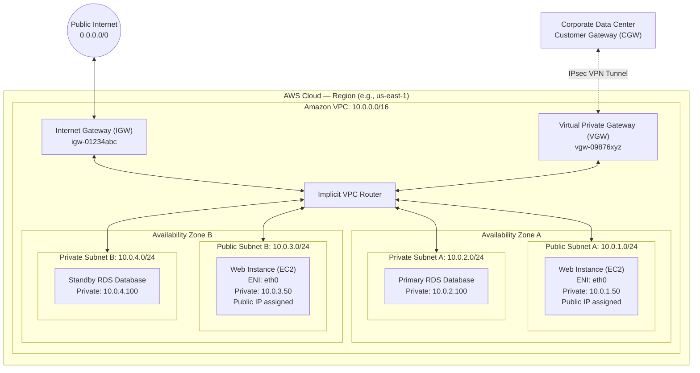
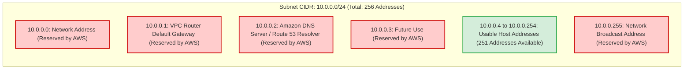
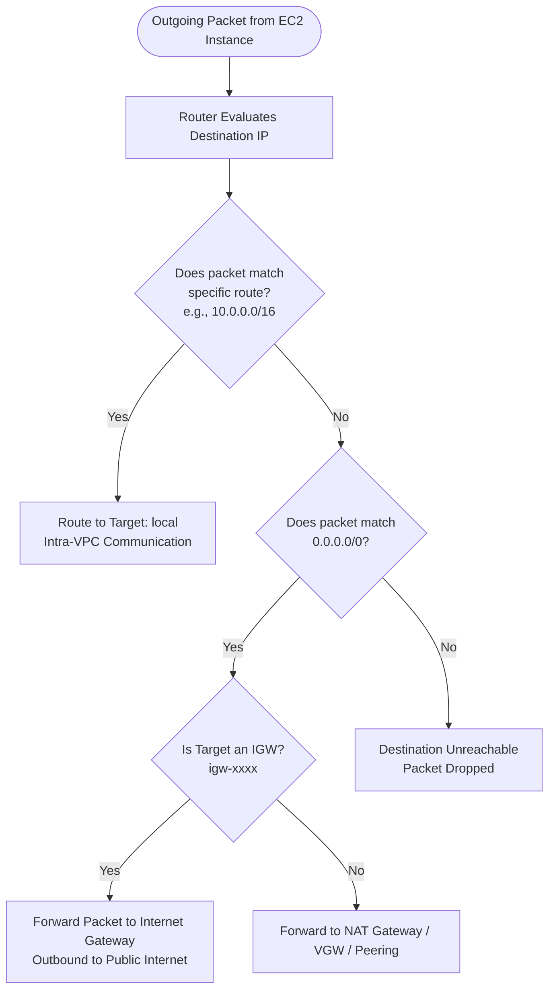
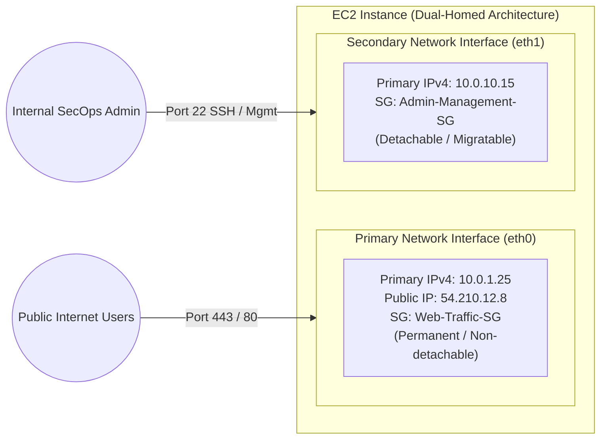
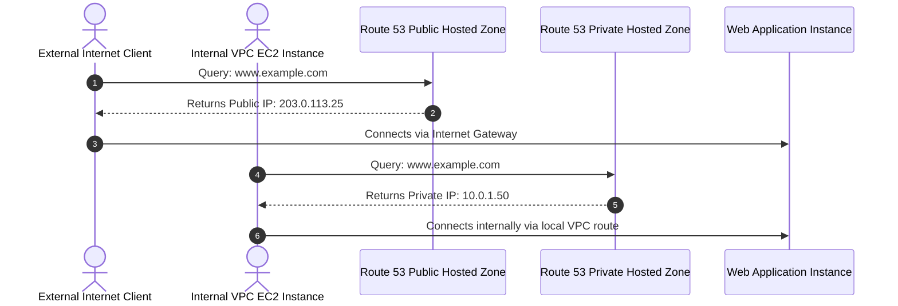

# 🌐 AWS Cloud Networking: Amazon Virtual Private Cloud (Amazon VPC)

> **Course**: AWS re/Start  
> **Module**: AWS Network Services – M13 Amazon VPC  
> **Source**: `T18-0002-RSJAWS_EN-US_SG_M13_AMAZONVPC.pdf`  
> **Target Audience**: AWS re/Start Learners / Cloud Practitioners / SysOps Administrators  

---

## 🎯 Module Overview

In traditional on-premises data centers, building and managing a secure enterprise network requires purchasing physical switches, routers, firewalls, and cabling. This hardware-centric model is capital-intensive, operationally rigid, and slow to adapt to changing workload demands.

**Amazon Virtual Private Cloud (Amazon VPC)** revolutionizes enterprise networking by virtualizing the network layer. Amazon VPC enables cloud architects and systems operators to provision a logically isolated section of the Amazon Web Services (AWS) Cloud where they can launch AWS resources in a virtual network that they closely define and control. 

This comprehensive study guide covers foundational VPC concepts, Classless Inter-Domain Routing (CIDR) IP addressing, subnet architecture, the five reserved IP addresses per subnet, route table mechanics, internet gateways, Elastic Network Interfaces (ENIs), VPC DNS resolution, and the critical differences between Default and Custom VPCs.

---

### 📌 Learning Objectives

- [ ] **Define Amazon VPC**: Articulate the purpose, logical isolation, and regional scope of Amazon VPC within the AWS Cloud.
- [ ] **Master VPC IP Addressing & CIDR**: Calculate IPv4 CIDR blocks according to RFC 1918 standards, evaluate network masks from `/16` to `/28`, and interpret bitwise subnetting notation.
- [ ] **Architect Subnets**: Distinguish between public and private subnets, enforce Availability Zone (AZ) boundaries, and calculate usable IP capacities.
- [ ] **Account for Reserved IP Addresses**: Identify the five AWS-reserved IP addresses in every subnet and explain the rationale behind each reservation.
- [ ] **Configure Routing & Gateways**: Analyze the role of the implicit VPC router, route tables, destination-target pairs, the immutable local route, and horizontally scaled Internet Gateways (IGWs).
- [ ] **Examine Elastic Network Interfaces (ENIs)**: Explain the attributes of primary (`eth0`) and secondary ENIs, including their use cases in dual-homed appliances and administrative isolation.
- [ ] **Evaluate VPC DNS & Resolution**: Understand Route 53 Resolver (AmazonProvidedDNS), DHCP option sets, Route 53 Private Hosted Zones, and Split-Horizon DNS.
- [ ] **Compare Default vs. Custom VPCs**: Contrast the automated configuration of a default VPC with production-grade custom VPC architectural requirements.

---

## 🏗️ 1. What is Amazon Virtual Private Cloud (Amazon VPC)?

### Foundational Definition
**Amazon Virtual Private Cloud (Amazon VPC)** is a foundational AWS networking service that enables you to provision a logically isolated section of the AWS Cloud dedicated to your AWS account. Within this private virtual network, you exert complete administrative control over:
- Selection of your IP address range (IPv4 and IPv6 CIDR blocks)
- Creation and placement of subnets across Availability Zones
- Configuration of route tables and network gateways
- Layered security boundaries using Security Groups and Network Access Control Lists (NACLs)

```
┌────────────────────────────────────────────────────────────────────────┐
│                        Core Attributes of Amazon VPC                   │
├────────────────────────────────────────────────────────────────────────┤
│  • Regional Scope: A VPC spans all Availability Zones within an AWS    │
│    Region, providing high availability and geographic resilience.      │
│  • Logical Isolation: Fully separated from other customer networks     │
│    and other VPCs in your own account unless explicitly peered.       │
│  • Software-Defined Networking (SDN): Eliminates physical hardware      │
│    maintenance while delivering carrier-grade throughput and security. │
│  • Granular Traffic Control: Controls ingress and egress traffic at     │
│    the subnet boundary (NACL) and network interface boundary (SG).     │
└────────────────────────────────────────────────────────────────────────┘
```

---

### End-to-End VPC Architecture Diagram

The following architecture diagram illustrates a multi-AZ VPC configured with public and private subnets, route tables, an Internet Gateway, and an on-premises hybrid connection:



---

## 🔢 2. VPC IP Addressing & CIDR Block Architecture

### Classless Inter-Domain Routing (CIDR) Overview
When creating an Amazon VPC, the first mandatory configuration is defining its allowable IP address space. In IPv4, this is specified as an address range formatted in **Classless Inter-Domain Routing (CIDR)** notation.

A CIDR block is expressed in the format:

$$\text{IPv4 Address} \,/\, n \quad \longrightarrow \quad \text{e.g., } 10.0.0.0/16$$

Where:
- **`x.x.x.x`**: A 32-bit IPv4 address represented as four 8-bit octets (values $0$ to $255$).
- **`/n` (Prefix Length)**: The number of contiguous leading bits assigned to the **network prefix**. The remaining $(32 - n)$ bits represent the **host identifier**.

```
         32-bit IPv4 Address Structure
┌────────────────────────────┬────────────────────────────┐
│   Network Prefix (n bits)  │   Host Identifier (32 - n) │
└────────────────────────────┴────────────────────────────┘
 ← Identifies the Network ──→ ← Identifies Unique Host ──→
```

> [!NOTE]
> As the prefix length $n$ increases, the number of remaining host bits decreases, yielding a smaller pool of available IP addresses. Conversely, a smaller prefix length $n$ provides a larger network space.

---

### CIDR Bit Representations & Range Examples

The following table demonstrates how changing the network prefix alters the available host addresses:

| CIDR Block | Binary Bit Representation (32 bits) | Total Addresses | Usable Range | Common Application |
| :--- | :--- | :--- | :--- | :--- |
| `0.0.0.0/0` | `xxxxxxxx.xxxxxxxx.xxxxxxxx.xxxxxxxx` | $2^{32} = 4,294,967,296$ | `0.0.0.0` – `255.255.255.255` | Default internet route (all IPv4) |
| `10.50.0.0/16` | `00001010.00110010.xxxxxxxx.xxxxxxxx` | $2^{16} = 65,536$ | `10.50.0.0` – `10.50.255.255` | Standard enterprise VPC size |
| `10.50.1.0/24` | `00001010.00110010.00000001.xxxxxxxx` | $2^8 = 256$ | `10.50.1.0` – `10.50.1.255` | Standard application subnet |
| `10.50.1.0/27` | `00001010.00110010.00000001.000xxxxx` | $2^5 = 32$ | `10.50.1.0` – `10.50.1.31` | Small specialized service subnet |
| `10.50.1.132/32` | `00001010.00110010.00000001.10000100` | $2^0 = 1$ | `10.50.1.132` (Single Host) | Specific host route / security rule |

---

### RFC 1918 Private IPv4 Address Ranges

To prevent IP routing conflicts between private cloud resources and public internet destinations, Amazon VPC mandates adhering to the private address spaces defined in **RFC 1918**:

| RFC 1918 Class | Network Prefix | Address Range | Total Available IP Space |
| :--- | :--- | :--- | :--- |
| **Class A** | `10.0.0.0/8` | `10.0.0.0` – `10.255.255.255` | $16,777,216$ addresses ($1 \times /8$) |
| **Class B** | `172.16.0.0/12` | `172.16.0.0` – `172.31.255.255` | $1,048,576$ addresses ($16 \times /16$) |
| **Class C** | `192.168.0.0/16` | `192.168.0.0` – `192.168.255.255` | $65,536$ addresses ($256 \times /24$) |

#### VPC Mask Size Restrictions:
AWS enforces explicit boundaries on VPC CIDR block sizes:
- **Maximum VPC Size**: `/16` netmask ($65,536$ total IP addresses).
- **Minimum VPC Size**: `/28` netmask ($16$ total IP addresses).

> [!IMPORTANT]
> Although RFC 1918 specifies `10.0.0.0/8`, you **cannot** provision a VPC with a `/8` mask. The largest single IPv4 CIDR block permitted in an AWS VPC is `/16`. You can, however, allocate `/16` blocks from the `10.0.0.0/8` range (e.g., `10.0.0.0/16`, `10.1.0.0/16`, `10.2.0.0/16`).

---

### Secondary CIDR Blocks & IPv6 Support

- **Primary CIDR Block**: Assigned during VPC creation and cannot be modified or replaced.
- **Secondary CIDR Blocks**: After creation, you can associate up to **four secondary IPv4 CIDR blocks** with your VPC to expand capacity.
- **IPv6 CIDR Blocks**: AWS allows optional association of an IPv6 block. AWS automatically allocates a **fixed `/56` prefix** from the AWS IPv6 address pool. Unlike IPv4, you cannot choose the specific IPv6 range.

```
       VPC CIDR Architecture
┌──────────────────────────────────────┐
│ Primary IPv4 CIDR: 10.0.0.0/16       │
│                                      │
│ Secondary CIDR 1: 10.1.0.0/16        │
│ Secondary CIDR 2: 10.2.0.0/16        │
│ Optional IPv6 CIDR: 2001:db8::/56    │
└──────────────────────────────────────┘
```

> [!WARNING]
> **Avoid Overlapping Address Ranges**: If you plan to connect your VPC to an on-premises data center via VPN or AWS Direct Connect, or interconnect multiple VPCs via VPC Peering or AWS Transit Gateway, their CIDR blocks **must not overlap**. Overlapping address spaces prevent route table configuration and lead to non-deterministic routing failure.

---

### Provisioning a VPC via AWS CLI

A VPC can be created programmatically using the AWS CLI `create-vpc` command:

```bash
# Provision a new custom VPC with a /16 CIDR block
aws ec2 create-vpc --cidr-block 10.0.0.0/16
```

**JSON Output Returned by the EC2 API:**
```json
{
  "Vpc": {
    "CidrBlock": "10.0.0.0/16",
    "DhcpOptionsId": "dopt-32058557",
    "State": "pending",
    "VpcId": "vpc-012345678912",
    "InstanceTenancy": "default",
    "Ipv6CidrBlockAssociationSet": [],
    "CidrBlockAssociationSet": [
      {
        "AssociationId": "vpc-cidr-assoc04ae2a5af46e7bb7c",
        "CidrBlock": "10.0.0.0/16",
        "CidrBlockState": {
          "State": "associated"
        }
      }
    ],
    "IsDefault": false,
    "Tags": []
  }
}
```

---

## 🗂️ 3. Subnets & The 5 Reserved IP Addresses

### Subnet Fundamentals
A **subnet** (subnetwork) is a logical subdivision of your VPC's IP address range. Subnets are used to isolate workloads, group resources by tiers (web, application, database), and control network visibility.

Key characteristics of subnets:
1. **Strict Availability Zone Boundary**: A subnet resides in **one and only one Availability Zone (AZ)**. It cannot span multiple AZs.
2. **Subset Constraint**: Every subnet's CIDR block must be a contiguous subset of the parent VPC CIDR.
3. **No Overlap**: Subnets within the same VPC cannot overlap in their address ranges.
4. **VPC Subnet Limit**: You can create up to **200 subnets per VPC** by default.
5. **Subnet Sizing Limits**: Minimum IPv4 size is `/28` ($16$ IPs); maximum size is `/16` ($65,536$ IPs). For IPv6, subnets are fixed at `/64`.

---

### The 5 Reserved IP Addresses per Subnet

In traditional networking, only two IP addresses in any subnet are unusable for hosts: the network address (first IP) and the broadcast address (last IP). 

However, in AWS, **five IP addresses are permanently reserved in every subnet** and cannot be assigned to any EC2 instance, ENI, or service endpoint.



#### Detailed Breakdown of AWS Reserved IPs:

| Offset | Example IP (`10.0.0.0/24`) | Architectural Role | Technical Rationale |
| :---: | :--- | :--- | :--- |
| **`.0`** | `10.0.0.0` | **Network Address** | Standard network identifier representing the wire/network boundary. |
| **`.1`** | `10.0.0.1` | **VPC Router** | Allocated to the implicit software router; serves as the default gateway for instances in the subnet. |
| **`.2`** | `10.0.0.2` | **Amazon DNS Server** | Address of the Route 53 Resolver (AmazonProvidedDNS). In any VPC, Amazon reserves base of VPC + 2, and also reserves base of each subnet + 2. |
| **`.3`** | `10.0.0.3` | **AWS Future Use** | Permanently reserved by AWS for potential future internal routing or control-plane infrastructure. |
| **Last IP** | `10.0.0.255` | **Broadcast Address** | Standard IPv4 broadcast address. **AWS VPC does not support broadcast or multicast traffic**; therefore, this address cannot be used. |

> [!CAUTION]
> Because 5 addresses are reserved, a minimum `/28` subnet (16 total addresses) provides only **11 usable IP addresses** ($16 - 5 = 11$). When sizing subnets for microservices, container clusters (Amazon EKS), or load balancers, always account for this 5-address overhead.

---

### Subnet Capacity Calculation Table

$$\text{Usable Hosts} = 2^{(32 - n)} - 5$$

| Subnet Prefix | Netmask | Total Addresses ($2^{32-n}$) | Reserved Addresses | Usable Host Addresses | Suitable Use Case |
| :---: | :--- | :---: | :---: | :---: | :--- |
| `/28` | `255.255.255.240` | $16$ | $5$ | **$11$** | Bastion jump host, small VPN endpoint |
| `/27` | `255.255.255.224` | $32$ | $5$ | **$27$** | Internal management services |
| `/26` | `255.255.255.192` | $64$ | $5$ | **$59$** | Application Load Balancers (ALBs) |
| `/24` | `255.255.255.0` | $256$ | $5$ | **$251$** | Standard web / application tiers |
| `/20` | `255.255.240.0` | $4,096$ | $5$ | **$4,091$** | Default VPC subnets, large container pools |
| `/16` | `255.255.0.0` | $65,536$ | $5$ | **$65,531$** | Maximum single-subnet allocation |

---

### Public Subnets vs. Private Subnets

Subnets are classified as **Public** or **Private** based entirely on their route table entries and public IP assignment policies:

```
┌────────────────────────────────────────────────────────────────────────┐
│                        Subnet Classification                           │
├────────────────────────────────────────────────────────────────────────┤
│  • Public Subnet:                                                      │
│    1. Its associated route table has a direct route to an Internet     │
│       Gateway (0.0.0.0/0 -> igw-xxxx).                                 │
│    2. Resources launched within it typically receive a public IPv4.    │
│                                                                        │
│  • Private Subnet:                                                     │
│    1. Its route table DOES NOT have a route to an Internet Gateway.    │
│    2. Outbound internet access (if required) must pass through a       │
│       Network Address Translation (NAT) Gateway in a public subnet.    │
│    3. Resources never receive public IPv4 addresses directly.          │
└────────────────────────────────────────────────────────────────────────┘
```

#### Auto-Assign Public IP Feature:
- When enabled on a subnet (`Modify auto-assign IP settings`), every new EC2 instance launched into that subnet receives a dynamic public IPv4 address automatically.
- **Dynamic nature**: Unlike an **Elastic IP (EIP)**, dynamic public IPs are released back into AWS's pool whenever the instance is stopped or terminated.
- In a **Default VPC**, all subnets have this setting enabled by default. In a **Custom VPC**, this setting is disabled by default.

---

## 🚦 4. Traffic Routing & Gateways

### The Implicit VPC Router & Route Tables
Traffic within an Amazon VPC does not travel across physical switches. Instead, it is governed by an **implicit, software-defined router** that operates automatically with built-in high availability.

To direct network packets, the router inspects the **Route Table** associated with the source subnet:
- A route table contains a set of routing rules (routes).
- Each rule consists of a **Destination** CIDR block and a **Target**.
- The router interprets each rule as: *"If a packet's destination IP matches this Destination CIDR, forward it to this Target."*

---

### The Default Local Route

Whenever a VPC is created, AWS automatically creates a **Main Route Table** containing an immutable default route:

| Destination | Target | Status | Can be Modified / Deleted? |
| :--- | :--- | :--- | :--- |
| `10.0.0.0/16` (VPC CIDR) | `local` | Active | **NO** (Immutable rule) |

> [!IMPORTANT]
> The `local` route allows all resources within the VPC to communicate directly with all other resources across all subnets and all Availability Zones in that VPC. You **cannot delete, override, or narrow** this local route. Intra-VPC traffic is always permitted at the route table level.

---

### Internet Gateway (IGW)

An **Internet Gateway (IGW)** is a horizontally scaled, redundant, and highly available VPC component that enables bidirectional communication between instances in your VPC and the public internet.

Key technical characteristics of an IGW:
- **Zero Bandwidth Bottleneck**: An IGW is not an EC2 instance or a physical appliance; it imposes no availability risks or bandwidth constraints.
- **1-to-1 Relationship**: Exactly **one Internet Gateway** can be attached to a VPC at a time.
- **NAT Functionality**: The IGW performs 1-to-1 Network Address Translation between private IPv4 addresses on ENIs and their associated public or Elastic IPv4 addresses.

---

### Route Table Evaluation & Longest Prefix Match

When an EC2 instance transmits an IP packet, the VPC router evaluates the destination IP against all rules in the subnet's route table using the **Longest Prefix Match** algorithm. The rule with the most specific (longest) netmask prefix wins:



#### Example Route Table Comparison:

**Custom Route Table (Public Subnet):**
| Destination | Target | Description |
| :--- | :--- | :--- |
| `10.0.0.0/16` | `local` | Routes intra-VPC traffic locally within the VPC. |
| `0.0.0.0/0` | `igw-0123456789abcdef0` | Routes all other traffic out to the Internet Gateway. |

**Default Route Table (Private Subnet):**
| Destination | Target | Description |
| :--- | :--- | :--- |
| `10.0.0.0/16` | `local` | Restricts traffic strictly within the VPC. |

---

### Hybrid Connectivity: VGW and Customer Gateway

To link an Amazon VPC to an on-premises enterprise data center:
- **Virtual Private Gateway (VGW)**: The VPN concentrator component provisioned on the AWS side of the connection, attached directly to the VPC.
- **Customer Gateway (CGW)**: Represents the customer-side physical router, firewall appliance, or software device in the corporate data center.
- **VPN Connection**: A secure, encrypted IPsec tunnel spanning the public internet between the Customer Gateway and the Virtual Private Gateway.

---

## 🖧 5. Elastic Network Interfaces (ENI)

### What is an Elastic Network Interface?
An **Elastic Network Interface (ENI)** is a virtual network interface card (vNIC) that connects an EC2 instance to the VPC network infrastructure.

An ENI includes the following attributes:
- A primary private IPv4 address from the IPv4 address range of its subnet
- One or more secondary private IPv4 addresses
- One Elastic IP (EIP) address per private IPv4 address
- One public IPv4 address (optional, dynamically assigned)
- One or more IPv6 addresses
- One or more Security Groups attached
- A unique Media Access Control (MAC) address
- A source/destination check flag (default: enabled)
- A description

---

### Primary vs. Secondary ENIs



#### Key Distinctions:
1. **Primary Network Interface (`eth0`)**:
   - Automatically created and attached when an instance launches.
   - Assigned a private IPv4 from the subnet.
   - **Cannot be detached** from the instance throughout its lifecycle.
2. **Secondary Network Interface (`eth1`, `eth2`, etc.)**:
   - Created independently in any subnet within the same Availability Zone.
   - Can be attached to an instance, detached, and hot-swapped to another instance.
   - Attributes (IP address, MAC address, security groups) remain with the ENI during migration.

---

### Practical Use Cases for Multiple ENIs

1. **Creating a Dedicated Management Network**:
   - Maintain separate interfaces for public production traffic (`eth0`) and internal administrative access (`eth1`).
   - Ensures that administrative tasks (backups, patch management, log shipping) do not consume user-facing application bandwidth.
2. **Deploying Network and Security Virtual Appliances**:
   - Firewalls, Intrusion Detection/Prevention Systems (IDS/IPS), proxy servers, and custom NAT instances require dual-homed configurations with one interface in a public subnet and another in a private subnet.
3. **Low-Cost High Availability / License Transfer**:
   - If an instance fails, detach its secondary ENI (which retains its static private IP address) and attach it to a standby instance, redirecting traffic immediately without DNS propagation delays.

---

## 🌐 6. VPC Domain Name System (DNS) & Name Resolution

### Amazon Route 53 Resolver (AmazonProvidedDNS)
Every VPC automatically includes a dedicated DNS server managed by AWS, formally known as the **Amazon Route 53 Resolver** (historically referred to as `AmazonProvidedDNS`).

- **IP Location**: The Route 53 Resolver is accessible at the **base of the VPC network range plus two** (e.g., in a `10.0.0.0/16` VPC, the DNS server is at `10.0.0.2`), as well as at the reserved link-local address `169.254.169.253`.
- **Default Resolution**: Directly answers internal DNS queries for private instance hostnames within the VPC and performs recursive lookups against public root nameservers for external domains.

---

### VPC DNS Configuration Options

A VPC provides three primary architectural approaches for name resolution:

1. **Amazon Route 53 Resolver (Default)**:
   - Controlled via two VPC configuration attributes:
     - `enableDnsSupport`: Enables/disables Route 53 Resolver queries within the VPC.
     - `enableDnsHostnames`: Determines whether instances launched in the VPC receive public DNS hostnames corresponding to their public IPs.
2. **Custom Enterprise DNS Server**:
   - Organizations with existing on-premises Active Directory or BIND DNS servers can redirect VPC instances to their own DNS servers by configuring custom **DHCP Option Sets**.
3. **Route 53 Private Hosted Zones**:
   - A Private Hosted Zone is a container that holds DNS records for private domains (e.g., `corp.internal`) resolvable only from within one or more associated VPCs.

---

### Split-Horizon DNS Architecture

A common enterprise pattern is **Split-Horizon DNS**, where internal and external clients query the exact same fully qualified domain name (FQDN) but receive different IP addresses:



- **Internal Query**: Initiated from inside the VPC $\rightarrow$ resolves to the **private IP address** (`10.0.1.50`), routing traffic internally without internet exposure or NAT costs.
- **External Query**: Initiated from the internet $\rightarrow$ resolves to the **public IP address** (`203.0.113.25`) via the public hosted zone.

---

## ⚖️ 7. Default VPC vs. Custom VPC Comparison

Every new AWS account is automatically provisioned with a Default VPC in each Region to ensure immediate usability for beginners. However, production architectures require Custom VPCs tailored to enterprise security guidelines.

| Architectural Feature | Default VPC | Custom VPC |
| :--- | :--- | :--- |
| **Creation Method** | Automatically generated by AWS upon account creation | Explicitly created by user via Console, CLI, or IaC (Terraform, CloudFormation) |
| **Primary IPv4 CIDR** | Pre-configured strictly as `172.31.0.0/16` ($65,536$ addresses) | User-defined RFC 1918 range (`/16` to `/28`) |
| **Subnet Provisioning** | One public subnet pre-created in each Availability Zone | Zero subnets created initially; user designs subnet topology |
| **Subnet CIDR Size** | Fixed `/20` per subnet ($4,096$ addresses each) | User-defined (e.g., `/24`, `/27`, `/28`) |
| **Internet Gateway** | Automatically attached (`igw-xxxx`) | Not attached; user must create and attach manually |
| **Main Route Table** | Pre-configured with default route `0.0.0.0/0` $\rightarrow$ `igw-xxxx` | Pre-configured only with `local` route (`10.x.x.x/16` $\rightarrow$ `local`) |
| **Auto-Assign Public IP** | **Enabled** on all subnets (instances get public IPs automatically) | **Disabled** by default on all newly created subnets |
| **Private Subnets** | None by default (all subnets are public) | Architected with explicit private subnets for sensitive tiers |
| **Deletion & Recreation** | Can be deleted; restored via AWS Management Console | Freely created and deleted as infrastructure needs change |
| **Production Recommendation** | Recommended only for sandbox testing and quick prototyping | **Mandatory standard** for enterprise, production, and compliant workloads |

---

## 🛠️ 8. Troubleshooting Knowledge Base & Common Scenarios

### Scenario 1: EC2 Instance in a "Public" Subnet Cannot Reach the Internet
**Symptom**: An administrator deploys an EC2 instance into a subnet intended for web traffic, but cannot connect via SSH and the instance cannot run software updates.

**Root-Cause Diagnosis Checklist**:
1. **Public IP Missing**: Did the instance receive a public IPv4 address? If the subnet's `Auto-Assign Public IP` was disabled and no Elastic IP was attached, the instance cannot communicate with the internet.
2. **Missing Route Table Entry**: Does the subnet's route table contain `0.0.0.0/0` targeting an attached Internet Gateway (`igw-xxxx`)? Without this rule, the subnet remains private regardless of naming.
3. **Security Group Ingress/Egress**: Does the instance's Security Group permit outbound traffic (e.g., port 80/443 to `0.0.0.0/0`) and inbound SSH (port 22) from the administrator's IP?
4. **Network ACL Rules**: Check the subnet's stateless Network Access Control List (NACL). Both inbound rules and ephemeral outbound rules (ports 1024–65535) must permit the traffic.

---

### Scenario 2: IP Address Exhaustion in a Production Subnet
**Symptom**: Auto Scaling fails to launch new EC2 instances or container nodes in an EKS cluster, reporting insufficient IP addresses in the subnet.

**Root-Cause & Mitigation**:
- **Cause**: The subnet was created with an overly restrictive mask (e.g., `/28` with only 11 usable IPs), and active workloads plus the 5 AWS reserved addresses exhausted the pool.
- **Resolution**:
  1. Subnet CIDR blocks cannot be resized once created.
  2. Provision a new, larger subnet (e.g., `/24` with 251 usable IPs) within the same Availability Zone.
  3. If VPC IP space is exhausted, associate a **Secondary CIDR block** (e.g., `10.1.0.0/16`) to the VPC and carve out new subnets from that secondary range.

---

### Scenario 3: Overlapping CIDR Blocks in Inter-VPC Peering
**Symptom**: An attempt to establish a VPC Peering connection between VPC A (`10.0.0.0/16`) and VPC B (`10.0.0.0/16`) fails with an error.

**Root-Cause & Mitigation**:
- **Cause**: AWS VPC Peering and Transit Gateways strictly prohibit establishing connections between VPCs with overlapping or identical CIDR blocks.
- **Resolution**: Plan IP address schemes centrally before provisioning. Ensure development, staging, and production VPCs use non-overlapping subranges of RFC 1918 (e.g., Dev: `10.10.0.0/16`, Staging: `10.20.0.0/16`, Prod: `10.30.0.0/16`).

---

## 📝 9. Knowledge Check & Review Questions

#### Question 1
An administrator creates a new subnet with the CIDR block `192.168.10.0/28`. How many EC2 instances can be simultaneously launched into this subnet?
- A) 16
- B) 14
- C) 11
- D) 8

**Correct Answer**: **C**  
*Explanation*: A `/28` mask provides $2^{(32-28)} = 16$ total addresses. AWS permanently reserves 5 IP addresses in every subnet (`.0`, `.1`, `.2`, `.3`, and `.15`), leaving $16 - 5 = 11$ usable host addresses.

---

#### Question 2
What makes an Amazon VPC subnet "public"?
- A) It is configured with an attached Virtual Private Gateway.
- B) Its associated route table contains an explicit route to an Internet Gateway (`0.0.0.0/0` $\rightarrow$ `igw-xxxx`).
- C) It is deployed across more than one Availability Zone.
- D) Its Network ACL allows inbound traffic on all ports from `0.0.0.0/0`.

**Correct Answer**: **B**  
*Explanation*: A subnet is classified as public if and only if its route table directs default internet traffic (`0.0.0.0/0`) to an Internet Gateway attached to the VPC.

---

#### Question 3
Which route table entry is present by default when an Amazon VPC is created and cannot be deleted or modified?
- A) `0.0.0.0/0` $\rightarrow$ `igw-xxxx`
- B) `127.0.0.1/32` $\rightarrow$ `loopback`
- C) `VPC CIDR` $\rightarrow$ `local`
- D) `169.254.169.254/32` $\rightarrow$ `metadata`

**Correct Answer**: **C**  
*Explanation*: Every VPC route table contains an immutable local route (VPC CIDR $\rightarrow$ `local`) that guarantees seamless, full-mesh network communication between all subnets in the VPC.

---

#### Question 4
A systems engineer requires that administrative maintenance traffic directed to an EC2 instance does not interfere with customer-facing web traffic. What is the recommended architectural approach?
- A) Deploy two separate VPCs and link them with an Elastic IP address.
- B) Attach a secondary Elastic Network Interface (ENI) to the instance configured on an isolated subnet.
- C) Use a larger CIDR block on the existing primary network interface.
- D) Create two Internet Gateways and attach both to the same VPC.

**Correct Answer**: **B**  
*Explanation*: Creating and attaching a secondary ENI (`eth1`) in a dedicated administrative or management subnet allows separation of production and maintenance traffic, complete with distinct security groups and routing.

---

#### Question 5
In an Amazon VPC with CIDR `10.50.0.0/16`, what is the reserved IP address used by default for the Amazon Route 53 Resolver DNS service?
- A) `10.50.0.1`
- B) `10.50.0.2`
- C) `10.50.0.3`
- D) `10.50.0.254`

**Correct Answer**: **B**  
*Explanation*: The Amazon-provided DNS server (Route 53 Resolver) is located at the base of the VPC network range plus two (`10.50.0.2`). AWS also reserves the base of each subnet plus two for the same purpose.

---

## 📌 10. Key Takeaways & Quick Reference

```
┌────────────────────────────────────────────────────────────────────────┐
│                        Amazon VPC Architecture Summary                 │
├────────────────────────────────────────────────────────────────────────┤
│  1. Amazon VPC: Logically isolated virtual network in AWS spanning     │
│     all Availability Zones in a Region.                                │
│  2. Sizing Constraints: IPv4 CIDRs restricted between /16 (65,536 IPs) │
│     and /28 (16 IPs). Follows RFC 1918 private addressing.             │
│  3. Subnet Constraints: 1 Subnet = 1 Availability Zone. Maximum of    │
│     200 subnets per VPC. Minimum size is /28.                          │
│  4. 5 Reserved IPs: .0 (Network), .1 (Router), .2 (DNS), .3 (Future),  │
│     and Last (.255 in /24) (Broadcast - no broadcast in VPC).          │
│  5. Route Tables: Govern egress from subnets. Evaluated by Longest     │
│     Prefix Match. The 'local' route cannot be removed.                 │
│  6. Internet Gateway (IGW): Horizontally scalable, 1:1 VPC mapping,    │
│     enables direct internet communication.                             │
│  7. ENI: Virtual NIC carrying private IPv4, MAC, and security groups.  │
│     Primary ENI cannot be detached; secondary ENIs can be migrated.    │
│  8. DNS Resolution: Provided by Route 53 Resolver at Base + 2. Supports│
│     Private Hosted Zones and Split-Horizon DNS setups.                 │
│  9. Default vs Custom: Default VPC is pre-wired for instant internet; │
│     Custom VPC requires deliberate subnet, IGW, and route design.      │
└────────────────────────────────────────────────────────────────────────┘
```
