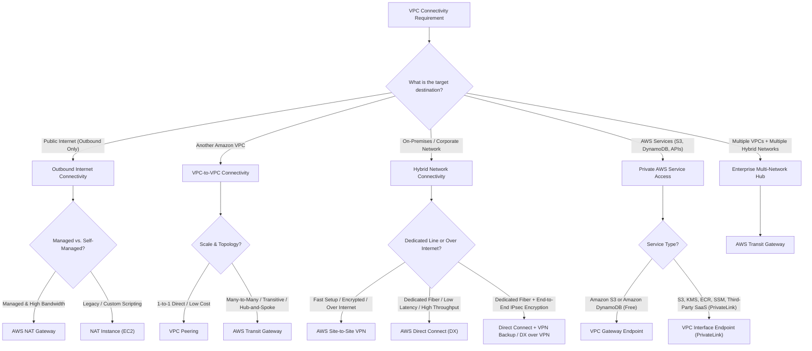
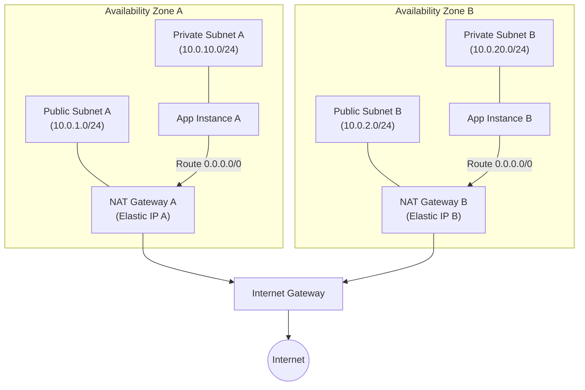
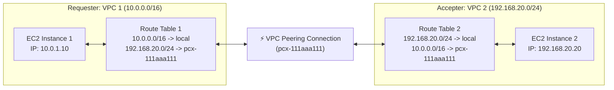
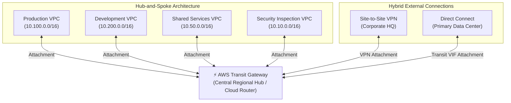
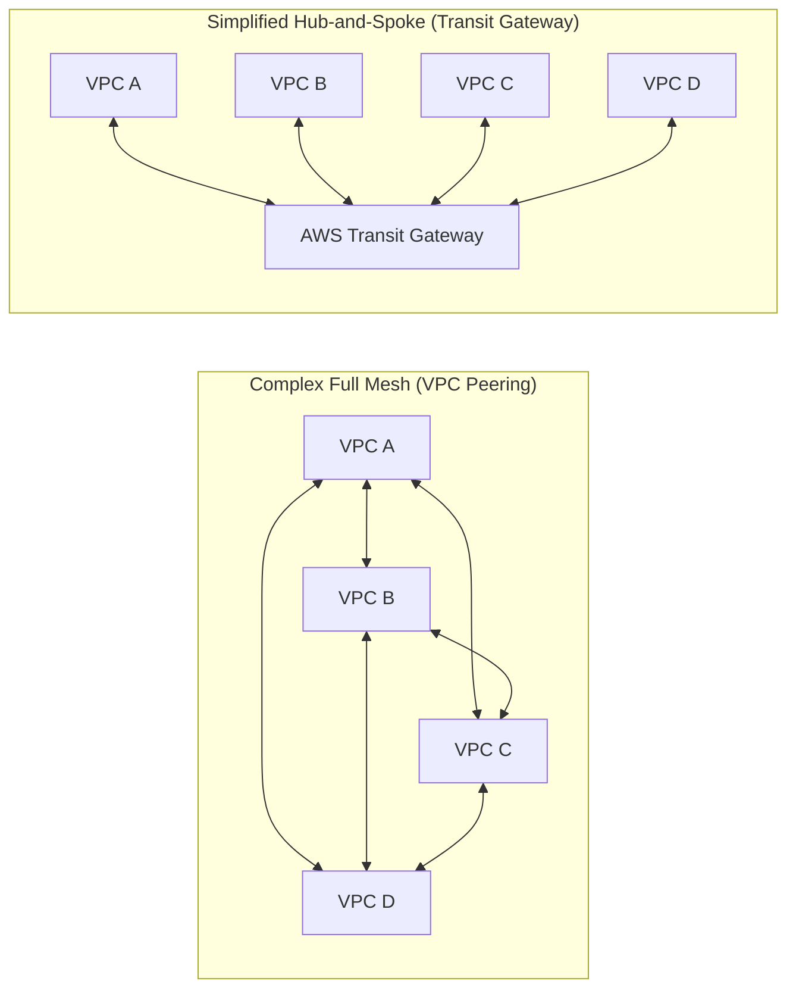
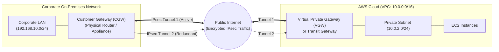
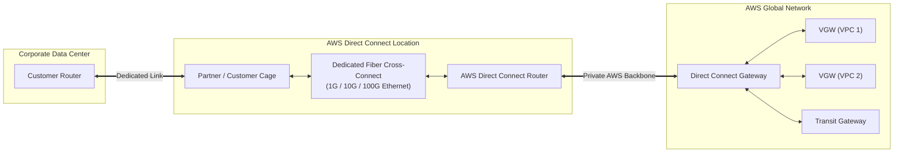
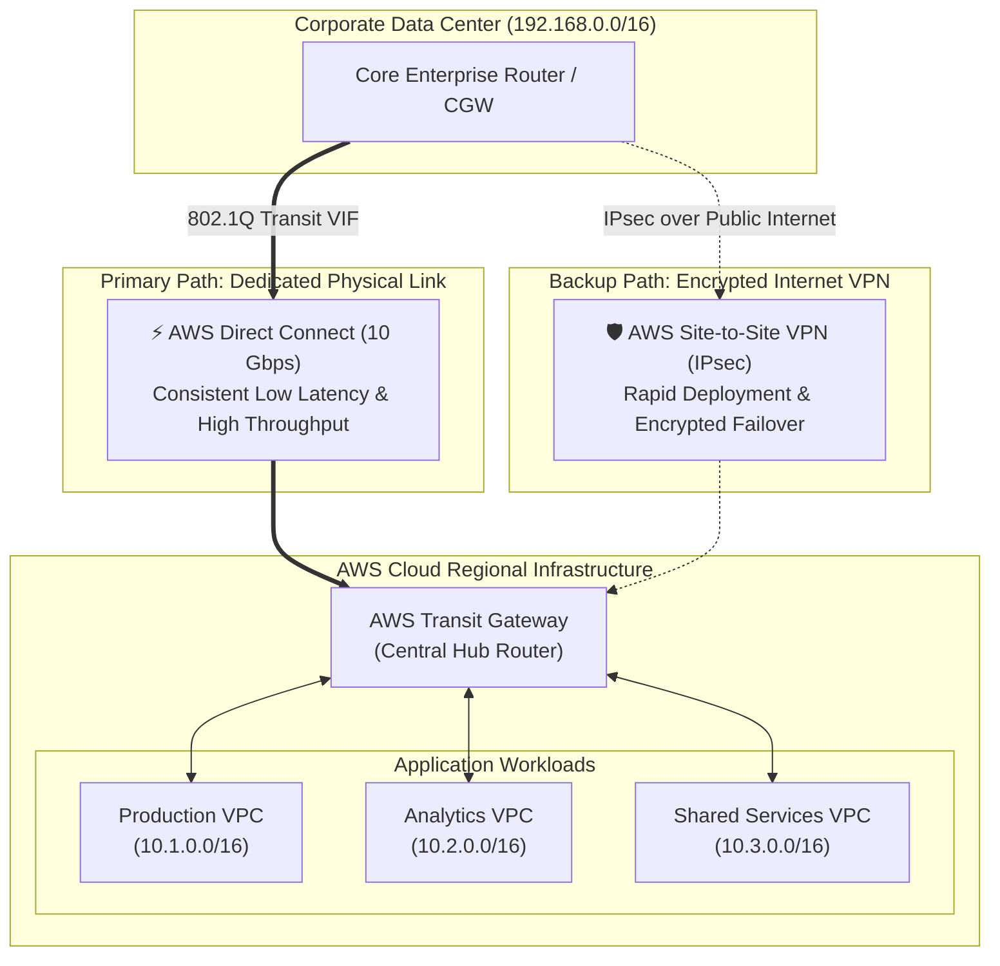
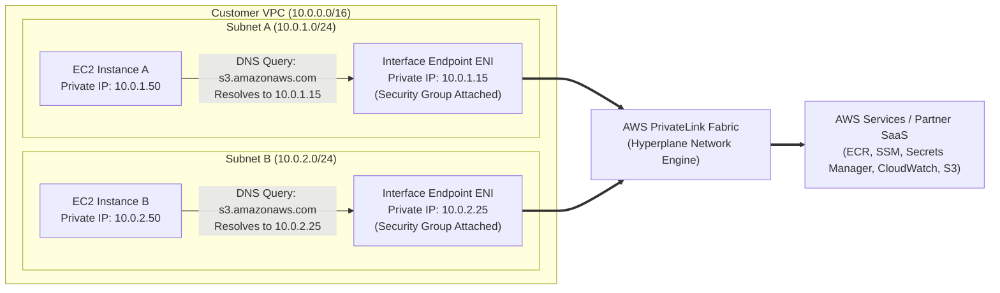

# 🌐 Amazon VPC Connectivity Options: Architectures, Scenarios, and Best Practices

> **Course**: AWS re/Start  
> **Module**: AWS Network Services (T18 – Amazon VPC Connectivity)  
> **Source Document**: `T18-AWS_Network_Services/T18-0003-AWSN_AMAZONVPCCONNECTIVITY_EN.pdf`  
> **Target Audience**: AWS re/Start Learners, Solutions Architects, SysOps Administrators, and Cloud Engineers  

---

## 🎯 Module Overview

An **Amazon Virtual Private Cloud (Amazon VPC)** provides an isolated, logically dedicated virtual network within the AWS Cloud. By default, resources launched within a VPC reside in complete network isolation: instances cannot communicate with the public internet, cannot reach resources in other VPCs, cannot connect to on-premises enterprise data centers, and must traverse the public internet to communicate with AWS services.

In enterprise cloud environments, pure isolation is rarely viable. Distributed workloads require robust, secure, high-performance, and resilient network interconnections. Designing cloud network architectures demands a deep understanding of VPC connectivity patterns, including:

1. **Outbound Internet Access**: Allowing private workloads (e.g., database instances, microservices, backend workers) to download OS patches, updates, and software packages without exposing them to inbound internet attacks.
2. **VPC-to-VPC Communication**: Linking internal business workloads across different VPCs, AWS accounts, or AWS Regions.
3. **Hybrid Cloud Connectivity**: Bridging corporate on-premises data centers, branch offices, and colocation facilities with AWS workloads.
4. **Private AWS Service Integration**: Securely consuming AWS services (such as Amazon S3, Amazon DynamoDB, or AWS Systems Manager) without internet gateways, NAT gateways, or traversing public networks.
5. **Centralized Hub-and-Spoke Routing**: Scaling enterprise connectivity across hundreds or thousands of VPCs and remote networks through a unified transit hub.

This guide provides an end-to-end technical reference for all VPC connectivity options, complete with architectural workflows, routing tables, command-line examples, decision matrices, and exam-focused knowledge checks.

---

## 📌 Learning Objectives

By completing this module and reviewing this reference guide, you will be able to:

- [ ] **Classify VPC Connectivity Patterns**: Identify the five core connectivity scenarios and map them to their corresponding AWS networking solutions.
- [ ] **Implement Outbound Internet Connectivity**: Contrast AWS managed NAT Gateways with legacy EC2 NAT Instances, detailing routing table entries, high availability, and operational maintenance.
- [ ] **Architect VPC-to-VPC Peering**: Understand peering connection establishment, routing tables, and fundamental limitations including non-transitive routing and non-overlapping CIDR constraints.
- [ ] **Scale with AWS Transit Gateway**: Explain how Transit Gateway provides transitive routing, simplifies full-mesh complexity into a hub-and-spoke topology, and supports multi-account enterprise architectures.
- [ ] **Evaluate Hybrid Connectivity**: Differentiate between AWS Site-to-Site VPN (IPsec over public internet) and AWS Direct Connect (dedicated physical fiber cross-connect), analyzing bandwidth, latency, setup time, and cost.
- [ ] **Distinguish VPC Endpoints**: Compare Gateway Endpoints (Amazon S3 and DynamoDB route table targets) with Interface Endpoints powered by AWS PrivateLink (Elastic Network Interfaces with private IPs).
- [ ] **Apply the Network Decision Matrix**: Select the optimal AWS networking technology based on workload requirements for bandwidth, latency, security, regulatory compliance, and budget.

---

## 🗺️ 1. VPC Connectivity Scenarios & Solutions Taxonomy

AWS provides dedicated networking services tailored to specific connectivity boundaries. Selecting the appropriate solution requires identifying the source, the destination, security mandates, and throughput requirements.



### 1.1 Connectivity Solutions Taxonomy

| Scenario | Target Destination | Recommended AWS Solutions | Solution Category | Key Characteristics |
| :--- | :--- | :--- | :--- | :--- |
| **Outbound Internet** | Public Internet (software repos, APIs, NTP) | **NAT Gateway**, NAT Instance | Amazon EC2 Instance Connectivity | Unidirectional outbound internet access for private subnets; blocks inbound unsolicited traffic. |
| **VPC-to-VPC (Direct)** | Single peer VPC in same or different Region | **VPC Peering** | VPC to VPC | Direct 1:1 connection over AWS backbone; non-transitive; no single point of failure; no bandwidth bottleneck. |
| **VPC-to-VPC (Mesh)** | Hundreds of VPCs across multiple accounts | **AWS Transit Gateway** | VPC to VPC & Network to VPC | Centralized regional network transit hub; supports transitive routing; replaces complex mesh topologies. |
| **Hybrid Network** | On-premises data center or corporate branch | **AWS Site-to-Site VPN** | Virtual Private Network (VPN) | IPsec tunnels over public internet; fast deployment; encrypted; variable latency depending on ISP routes. |
| **Dedicated Hybrid** | Enterprise data center requiring guaranteed QoS | **AWS Direct Connect (DX)** | Dedicated Physical Circuit | Dedicated physical fiber optic cross-connect; consistent low latency; high throughput (up to 100 Gbps); bypasses internet. |
| **Private AWS Services** | Amazon S3 or Amazon DynamoDB | **VPC Gateway Endpoint** | VPC Gateway Endpoint | Route table prefix list entry; completely free of charge; traffic never leaves AWS network. |
| **Private AWS & SaaS** | 100+ AWS services, customer services, SaaS | **AWS PrivateLink** (Interface Endpoints) | Interface Endpoint | Elastic Network Interface (ENI) with private IP inside subnet; DNS resolution; hourly fee + data processing fee. |

---

## 🌐 2. Scenario 1: Private Subnet to Internet Outbound Connectivity

### 2.1 The Architectural Challenge

In a multi-tier cloud architecture, security best practices dictate that backend servers (e.g., application servers, relational database instances, caching tiers) reside in **private subnets** without public IPv4 addresses. However, these private instances frequently require outbound internet access to:
- Download operating system security patches and package updates (`yum`, `apt`).
- Connect to third-party public API endpoints and payment gateways.
- Synchronize time with external NTP pools.
- Register with remote licensing servers.

Allowing direct internet access by assigning public IPs or attaching an Internet Gateway directly to a private subnet violates the principle of least privilege. The solution is **Network Address Translation (NAT)**, which enables private instances to initiate outbound connections to the internet while preventing external internet entities from initiating inbound connections to the private instances.

```mermaid
flowchart LR
    subgraph VPC["Amazon VPC (10.0.0.0/16)"]
        subgraph PrivateSubnet["Private Subnet (10.0.2.0/24)"]
            EC2["EC2 Instance\nPrivate IP: 10.0.2.50\nNo Public IP"]
        end

        subgraph PublicSubnet["Public Subnet (10.0.1.0/24)"]
            NAT["NAT Gateway\nPrivate IP: 10.0.1.25\nElastic IP: 54.214.12.5"]
        end

        IGW["Internet Gateway (IGW)"]
    end

    Internet(("Public Internet\n(OS Patches, APIs)"))

    EC2 -->|"1. Outbound Request (Src: 10.0.2.50)"| NAT
    NAT -->|"2. Translates Src IP to Elastic IP"| IGW
    IGW -->|"3. Routed to Destination"| Internet
    Internet -->|"4. Response Traffic (Dst: Elastic IP)"| IGW
    IGW -->|"5. Handed to NAT Gateway"| NAT
    NAT -->|"6. Un-translates Dst to 10.0.2.50"| EC2
    Internet -.x|"Blocked: Inbound Unsolicited Connection"| NAT
```

---

### 2.2 AWS NAT Gateway

An **AWS NAT Gateway** is a fully managed Network Address Translation service designed to provide private subnets with highly available, managed outbound internet connectivity.

#### Characteristics:
- **AWS Managed Service**: AWS manages software patches, provisioning, infrastructure, and automatic scaling.
- **Availability Zone Redundancy**: Built with automatic internal redundancy inside an Availability Zone (AZ). It is designed to handle hardware failures seamlessly within its AZ.
- **Elastic IP Requirement**: A public NAT Gateway must be deployed in a **public subnet** and requires an allocated **Elastic IP (EIP)** address at creation.
- **Supported Protocols**: Supports **TCP**, **UDP**, and **ICMP**.
- **Massive Bandwidth**: Starts automatically with a baseline bandwidth capacity of **5 Gbps** and scales automatically up to **45 Gbps** per gateway as traffic demands increase.
- **Burst Capacity**: Delivers up to 1,000,000 concurrent connections.
- **Security**: Because it operates unidirectionally for outbound-initiated traffic, it cannot be targeted by unsolicited inbound connections from the internet.

> [!IMPORTANT]
> **High Availability Architecture Rule**:  
> A single NAT Gateway is redundant *within* a single Availability Zone, but it is **not multi-AZ resilient**. If the Availability Zone containing your NAT Gateway experiences an outage, all private subnets routing through that NAT Gateway lose internet connectivity.  
> **Best Practice**: In multi-AZ production architectures, deploy **one NAT Gateway per Availability Zone** in each respective public subnet, and configure each private subnet's route table to route outbound traffic (`0.0.0.0/0`) through the NAT Gateway located in its own local AZ.



#### Step-by-Step Creation and Route Table Configuration:

1. **Step 1 - Select Public Subnet**: Navigate to Amazon VPC Console $\rightarrow$ NAT Gateways $\rightarrow$ Create NAT Gateway. Choose the public subnet where the NAT Gateway will reside (must have a route to an IGW).
2. **Step 2 - Allocate Elastic IP**: Assign an existing Elastic IP address or select *Allocate Elastic IP*.
3. **Step 3 - Update Private Route Tables**: Modify the route table associated with the private subnet(s) to add a default route sending all internet-bound traffic (`0.0.0.0/0`) to the newly created NAT Gateway target (`nat-xxxxxxxxxxxxxxxxx`).

#### Detailed Route Table Configuration:

##### Public Subnet Custom Route Table (Associated with Public Subnet)
| Destination | Target | Description |
| :--- | :--- | :--- |
| `10.0.0.0/16` | `local` | Internal communication within the entire VPC CIDR block. |
| `0.0.0.0/0` | `igw-0123456789abcdef0` | Default route pointing directly to the Internet Gateway. |

##### Private Subnet Route Table (Associated with Private Subnet)
| Destination | Target | Description |
| :--- | :--- | :--- |
| `10.0.0.0/16` | `local` | Internal communication within the entire VPC CIDR block. |
| `0.0.0.0/0` | `nat-0987654321fedcba0` | Default route pointing directly to the NAT Gateway in the public subnet. |

---

### 2.3 Legacy NAT Instance (Self-Managed EC2)

Before AWS introduced the managed NAT Gateway in December 2015, outbound internet access for private subnets was achieved using an Amazon EC2 instance running specialized NAT software (e.g., Amazon Linux AMI configured with `iptables` or a pre-configured Amazon Linux NAT AMI `amzn-ami-vpc-nat-*`).

#### Implementation Mechanism:
1. Launch an EC2 instance into a public subnet using an Amazon Linux NAT AMI.
2. Assign a public IPv4 address or Elastic IP address to the instance.
3. **Disable Source/Destination Checking**: By default, every EC2 instance inspects network packets and drops packets where the instance is neither the source nor the destination. For an EC2 instance to function as a NAT router, source/destination checking **must be disabled**:
   ```bash
   aws ec2 modify-instance-attribute \
     --instance-id i-0123456789abcdef0 \
     --no-source-dest-check
   ```
4. Update the private subnet route table to point `0.0.0.0/0` to the EC2 instance ID (`i-xxxxxxxxxxxxxxxxx`) or its network interface (`eni-xxxxxxxxx`).

#### Drawbacks and Limitations:
- **Single Point of Failure (SPOF)**: A single EC2 NAT instance will bring down outbound connectivity for all private subnets if the instance crashes or the underlying hardware fails.
- **Complex High Availability**: Achieving HA requires custom failover scripts, auto-scaling groups with complex health checks, floating Elastic IPs, and dynamic route table rewriting scripts.
- **Bandwidth Limitations**: Throughput is capped by the EC2 instance type's network performance (e.g., `t3.micro` is limited to low burstable network bandwidth).
- **Administrative Overhead**: System administrators are responsible for managing, patching, updating the OS kernel, and securing the NAT instance.
- **No Native Port Forwarding / NAT Gateway Simplification**: Requires manual management of `iptables` and connection tracking tables (`conntrack`).

---

### 2.4 Detailed Comparison: NAT Gateway vs. NAT Instance

| Feature / Dimension | AWS Managed NAT Gateway | Self-Managed NAT Instance (EC2) |
| :--- | :--- | :--- |
| **Service Type** | Fully managed AWS network service | Customer-managed EC2 compute instance |
| **High Availability** | Built-in redundancy within the local AZ | Customer responsibility (requires ASG + failover scripts) |
| **Bandwidth & Throughput** | Starts at 5 Gbps, automatically scales up to 45 Gbps | Limited to EC2 instance type bandwidth (e.g., T3, C5, M5) |
| **Maintenance & Patching** | Managed completely by AWS; zero administrative overhead | Customer must patch OS, update packages, and manage security |
| **Source/Dest Check** | Not applicable (handled automatically) | **Must be manually disabled** (`--no-source-dest-check`) |
| **Elastic IP Assignment** | Required during creation (1 EIP per gateway) | Required for public communication |
| **Security Group Support** | Cannot associate security groups with NAT Gateway (use Network ACLs on subnet) | Can associate standard EC2 Security Groups |
| **Bastion Host Capability** | **No** (Cannot be used as a jump server or SSH bastion) | **Yes** (Can serve dual roles as NAT and SSH bastion, though discouraged) |
| **Port Forwarding** | Not supported | Supported via custom `iptables` rules |
| **Cost Model** | Hourly gateway charge + Per-GB data processing fee | Standard EC2 instance hourly pricing + EBS storage + Data Transfer OUT |

> [!TIP]
> **Architectural Recommendation**:  
> Always choose **AWS NAT Gateway** for production workloads due to its managed high availability, seamless auto-scaling to 45 Gbps, and zero operational overhead. NAT Instances should only be considered in legacy environments or when specialized features like custom port forwarding or running as a dual-purpose bastion host on a tight budget are strictly required.

---

## 🔗 3. Scenario 2: VPC-to-VPC Connectivity

When workloads span multiple VPCs—such as separating Development, Staging, and Production environments, or segregating microservices across dedicated accounts—network architects must establish inter-VPC communication. AWS provides two primary architectures: **VPC Peering** and **AWS Transit Gateway**.

### 3.1 VPC Peering

A **VPC Peering Connection** is a 1-to-1 networking connection between two VPCs that enables routing traffic between them using private IPv4 or IPv6 addresses.



#### Core Characteristics:
- **No Single Point of Failure (SPOF)**: VPC Peering is not a physical appliance, gateway, or VPN connection. It is implemented directly within the AWS software-defined network (Hyperplane / AWS Nitro infrastructure). Therefore, it introduces **no bandwidth bottlenecks** and **no single point of failure**.
- **Traffic Stays on AWS Backbone**: All inter-VPC peering traffic travels exclusively over the private AWS global network backbone, never traversing the public internet. Inter-Region peering traffic is encrypted at the physical layer.
- **Cross-Account & Cross-Region Support**: Peering can connect VPCs owned by the same AWS account or different AWS accounts, located in the same AWS Region or across different AWS Regions.

#### Critical VPC Peering Limitations:

> [!CAUTION]
> **1. Non-Transitive Routing Rule**:  
> VPC peering does **NOT** support transitive routing. If VPC A is peered with VPC B, and VPC B is peered with VPC C, **VPC A cannot communicate with VPC C through VPC B**. To enable communication between VPC A and VPC C, an explicit direct peering connection must be established between A and C.

```
       VPC A (10.1.0.0/16)
          |
     [PCX Connection 1]
          |
          v
       VPC B (10.2.0.0/16)  <-- Cannot route transitively between A and C!
          |
     [PCX Connection 2]
          |
          v
       VPC C (10.3.0.0/16)

Direct communication between VPC A and VPC C requires an explicit [PCX Connection 3]!
```

> [!WARNING]
> **2. No Overlapping CIDR Blocks**:  
> A peering connection cannot be established between VPCs with matching or overlapping IPv4 or IPv6 CIDR blocks (e.g., both VPCs cannot use `10.0.0.0/16`). Network addressing must be uniquely planned.
> 
> **3. No Edge Routing / Gateway Sharing**:  
> You cannot route traffic through a peering connection to an Internet Gateway, NAT Gateway, Virtual Private Gateway, or VPC Endpoint located in the peered VPC.
> 
> **4. DNS Resolution Requirements**:  
> To resolve private DNS hostnames of instances in a peered VPC to their private IP addresses, you must explicitly enable **DNS Resolution** in the peering connection options (`RequesterPeeringConnectionOptions` / `AccepterPeeringConnectionOptions`).
> 
> **5. Security Group Cross-Referencing**:  
> While security group referencing across peer VPCs is supported within the **same AWS Region**, you cannot reference peer security groups across **different AWS Regions**.

#### Step-by-Step Workflow for Creating a VPC Peering Connection:

1. **Initiate Request**: The owner of the requester VPC sends a peering request to the accepter VPC (specifying Owner ID, VPC ID, and Region).
2. **Accept Request**: The owner of the accepter VPC accepts the connection request before it expires (requests expire after 7 days if unaccepted).
3. **Configure Route Tables**: Both VPC administrators must add reciprocal route entries in their route tables pointing the target CIDR block to the peering connection ID (`pcx-xxxxxxxx`).
4. **Adjust Security Groups & NACLs**: Ensure Security Groups allow inbound traffic from the peer VPC's CIDR or referenced security group.
5. **Enable DNS Hostname Resolution (Optional)**: Enable DNS resolution settings if instances need to communicate using private DNS names.

#### AWS CLI Example: Creating and Accepting a Peering Connection

##### 1. Requester Initiates Peering Request
```bash
aws ec2 create-vpc-peering-connection \
  --vpc-id vpc-1a2b3c4d \
  --peer-vpc-id vpc-11122233 \
  --peer-owner-id 444455556666
```

**Output JSON**:
```json
{
  "VpcPeeringConnection": {
    "Status": {
      "Message": "Initiating Request to 444455556666",
      "Code": "initiating-request"
    },
    "Tags": [],
    "RequesterVpcInfo": {
      "OwnerId": "444455556666",
      "VpcId": "vpc-1a2b3c4d",
      "CidrBlock": "10.0.0.0/28"
    },
    "VpcPeeringConnectionId": "pcx-111aaa111",
    "ExpirationTime": "2023-04-02T16:13:36.000Z",
    "AccepterVpcInfo": {
      "OwnerId": "444455556666",
      "VpcId": "vpc-11122233"
    }
  }
}
```

##### 2. Accepter Accepts Peering Request
```bash
aws ec2 accept-vpc-peering-connection \
  --vpc-peering-connection-id pcx-111aaa111
```

##### 3. Add Route in Requester VPC (VPC 1)
```bash
aws ec2 create-route \
  --route-table-id rtb-11111111 \
  --destination-cidr-block 192.168.20.0/24 \
  --vpc-peering-connection-id pcx-111aaa111
```

##### 4. Add Reciprocal Route in Accepter VPC (VPC 2)
```bash
aws ec2 create-route \
  --route-table-id rtb-22222222 \
  --destination-cidr-block 10.0.0.0/16 \
  --vpc-peering-connection-id pcx-111aaa111
```

---

### 3.2 AWS Transit Gateway (TGW)

As an organization grows to dozens, hundreds, or thousands of VPCs across multiple AWS accounts, managing point-to-point VPC peering connections becomes unsustainable. Connecting $N$ VPCs in a full mesh requires:

$$\text{Connections} = \frac{N(N - 1)}{2}$$

For 100 VPCs, a full mesh requires **4,950 peering connections**, creating operational gridlock and routing complexity.

**AWS Transit Gateway** acts as a centralized regional network transit hub (a cloud router) that connects VPCs, AWS Site-to-Site VPN connections, and AWS Direct Connect gateways through a **hub-and-spoke** architecture.



#### Key Capabilities of AWS Transit Gateway:
- **Transitive Routing**: Solves the non-transitive peering limitation. Any attached VPC or on-premises network can communicate with any other attached VPC through the Transit Gateway.
- **Massive Scale**: A single Transit Gateway can connect up to **5,000 VPC attachments** and support throughput up to **50 Gbps per VPC attachment** (with automated burst scaling).
- **Multiple Route Tables (Network Segmentation)**: Supports multiple discrete Transit Gateway route tables. This enables network isolation—for example, isolating Dev VPCs from Prod VPCs while allowing both to communicate with a Shared Services VPC.
- **Multicast Routing**: Supports IP multicast traffic, allowing distribution of real-time streaming media and financial ticker data to multiple subscribers simultaneously.
- **Inter-Region Peering**: Multiple Transit Gateways across different AWS Regions can be peered together over the private AWS global network backbone.

---

### 3.3 Architecture Comparison: Mesh VPC Peering vs. Hub-and-Spoke Transit Gateway



### 3.4 Comparison: VPC Peering vs. AWS Transit Gateway

| Architectural Attribute | VPC Peering | AWS Transit Gateway |
| :--- | :--- | :--- |
| **Network Topology** | Point-to-Point (1:1 Mesh) | Centralized Hub-and-Spoke |
| **Transitive Routing** | ❌ **No** (Strict non-transitive rule) | ✅ **Yes** (Native transitive routing) |
| **Routing Table Management** | Complex ($N(N-1)/2$ routes across all VPCs) | Simplified (Single attachment route per VPC to TGW) |
| **Max Interconnected VPCs** | Capped by peering limits per VPC (default 50, max 125) | Up to 5,000 VPC attachments per TGW |
| **Throughput / Bandwidth** | **Unlimited** (no single device bottleneck; AWS Nitro fabric) | Up to 50 Gbps per VPC attachment |
| **Multicast Support** | ❌ No | ✅ Yes (IGMP-based multicast groups) |
| **Hybrid Integration** | ❌ Cannot directly terminate VPN or DX | ✅ Direct termination for VPN and Direct Connect |
| **Cost Model** | **Free** (Only standard inter-AZ/Region data transfer charges) | Hourly charge per attachment + Per-GB data processing fee |
| **Ideal Use Case** | 2 to 10 VPCs; high throughput, low cost direct links | Enterprise multi-account architectures; 10+ VPCs; hybrid routing |

---

## 🏢 4. Scenario 3: Hybrid Network-to-VPC Connectivity

Enterprise architectures frequently require seamless communication between AWS VPC workloads and existing corporate IT environments (on-premises data centers, remote branches, colocation facilities).

### 4.1 AWS Site-to-Site VPN

**AWS Site-to-Site VPN** establishes an encrypted, secure IPsec virtual private network tunnel between your remote network and your Amazon VPC over the public internet.



#### Core Components:
1. **Virtual Private Gateway (VGW)**: The VPN concentrator on the AWS side attached to your VPC. Alternatively, an **AWS Transit Gateway** can serve as the VPN termination point for multi-VPC access.
2. **Customer Gateway (CGW)**: Represents your on-premises VPN appliance in AWS. It defines the public IP address, BGP Autonomous System Number (ASN), and configuration parameters of your physical or software router.
3. **Dual IPsec Tunnels**: For high availability, AWS automatically provisions **two redundant VPN tunnels** per Site-to-Site VPN connection terminating on separate AWS endpoints in distinct Availability Zones.
4. **Routing Options**:
   - **BGP Dynamic Routing**: Recommended. Automatically advertises routes and supports automatic failover between the two tunnels.
   - **Static Routing**: Requires manually configuring static CIDR prefixes in the AWS VPN connection.
5. **Route Propagation**: Enabling *Route Propagation* on the VPC route table automatically injects on-premises routes advertised via BGP into the VPC route table (`192.168.10.0/24 -> vgw-xxxx`).

#### Route Table Example with VGW:
| Destination | Target | Description |
| :--- | :--- | :--- |
| `10.0.0.0/16` | `local` | VPC internal routing |
| `192.168.10.0/24` | `vgw-0123456789abcdef0` | Traffic destined for corporate LAN routed to VGW |
| `0.0.0.0/0` | `nat-xxxxxxxx` or `igw-xxxxxxxx` | Internet egress |

---

### 4.2 AWS Direct Connect (DX)

**AWS Direct Connect** bypasses the public internet entirely by establishing a dedicated physical fiber optic network link from your on-premises data center or colocation facility to an AWS Direct Connect Location (Meet-Me Room / Co-location facility).



#### Connection Types:
- **Dedicated Connection**: A physical 1 Gbps, 10 Gbps, or 100 Gbps Ethernet port dedicated to a single customer. Requested directly from AWS.
- **Hosted Connection**: Sub-rate physical ports (50 Mbps, 100 Mbps, up to 10 Gbps) provisioned through an AWS Direct Connect Delivery Partner.

#### Virtual Interfaces (VIFs):
To utilize a Direct Connect link, you must configure one or more Virtual Interfaces (VIFs), each mapped to an 802.1Q VLAN tag:
1. **Private VIF**: Connects directly to a Virtual Private Gateway (VGW) to access a single Amazon VPC using private IP addresses.
2. **Public VIF**: Connects to all public AWS services globally (e.g., Amazon S3, DynamoDB, Amazon CloudWatch) over the dedicated connection using public IP addresses without traversing the public internet.
3. **Transit VIF**: Connects to an **AWS Direct Connect Gateway** associated with one or more **AWS Transit Gateways**, enabling a single physical Direct Connect circuit to route traffic to thousands of VPCs.

---

### 4.3 AWS Direct Connect Plus VPN (High-Resilience & Encryption)

While Direct Connect provides high bandwidth and low latency, traffic traversing standard DX is not encrypted by default (unless using MACsec on dedicated 10G/100G links). Furthermore, establishing a secondary redundant physical Direct Connect circuit takes weeks or months to provision.

**AWS Direct Connect + VPN** combines both technologies:
1. **Direct Connect with VPN Failover**: The primary traffic path uses Direct Connect. An AWS Site-to-Site VPN is configured as an automatic backup. If the physical DX circuit experiences a fiber cut, BGP dynamic routing fails over to the IPsec VPN tunnel over the public internet.
2. **VPN over Direct Connect (Public VIF + IPsec)**: For defense, healthcare, or financial workloads with strict compliance mandates requiring end-to-end data encryption in transit, an IPsec VPN tunnel is established inside a Direct Connect Public VIF or Transit VIF.

---

### 4.4 Hybrid Network Topology Architecture



---

## 🔒 5. Scenario 4: Private AWS Service Access (VPC Endpoints & AWS PrivateLink)

By default, AWS service API endpoints (such as `s3.us-east-1.amazonaws.com` or `dynamodb.us-east-1.amazonaws.com`) resolve to public IP addresses. To access these services from an EC2 instance, the VPC traditionally required an Internet Gateway or a NAT Gateway.

**AWS VPC Endpoints** allow you to privately connect your VPC to supported AWS services and VPC endpoint services powered by **AWS PrivateLink** without requiring an Internet Gateway, NAT Gateway, VPN connection, or Direct Connect connection. Instances in your VPC do not require public IP addresses to communicate with resources in the service.

AWS offers two types of VPC Endpoints: **Gateway Endpoints** and **Interface Endpoints**.

---

### 5.1 Gateway Endpoints

A **Gateway Endpoint** is a gateway that you specify as a target in your VPC route table for traffic destined for a supported AWS service.

#### Key Characteristics:
- **Supported Services**: Supports **ONLY two services**:
  1. **Amazon S3**
  2. **Amazon DynamoDB**
- **Implementation**: Implemented as a route table entry pointing to a managed **Prefix List ID** (e.g., `pl-63a5400a` for Amazon S3 in `us-east-1`).
- **Cost**: **Completely Free of Charge** (Zero hourly charges, zero data processing fees).
- **Access Control**: Governed by **VPC Endpoint Policies** (JSON IAM policies attached directly to the endpoint to restrict which S3 buckets or IAM principals can be accessed).
- **Network Scope**: Does not extend outside the VPC; cannot be accessed from on-premises networks across a VPN or Direct Connect.

#### Gateway Endpoint Route Table Example:
| Destination | Target | Description |
| :--- | :--- | :--- |
| `10.0.0.0/16` | `local` | VPC local routing |
| `pl-63a5400a` (S3 Prefix List) | `vpce-0123456789abcdef0` | Traffic to Amazon S3 routed directly to Gateway Endpoint |
| `0.0.0.0/0` | `nat-xxxxxxxx` | Default internet route |

---

### 5.2 Interface Endpoints (Powered by AWS PrivateLink)

An **Interface Endpoint** is an Elastic Network Interface (ENI) with a private IP address from the IP address range of your subnet that serves as an entry point for traffic destined for a supported AWS service, a customer-owned service, or an AWS Marketplace SaaS partner service.



#### Key Characteristics:
- **Supported Services**: Supports over **100+ AWS services** (e.g., Amazon S3, Amazon EC2 API, Amazon ECR, AWS Systems Manager, AWS Secrets Manager, AWS KMS, Amazon CloudWatch), custom services hosted in other VPCs, and AWS Marketplace Partner SaaS services.
- **Implementation**: Deploys an **Elastic Network Interface (ENI)** inside chosen subnets. Traffic to the service travels to this private IP address.
- **Private DNS Name**: When **Enable Private DNS** is turned on, standard public AWS service endpoints (such as `ssm.us-east-1.amazonaws.com` or `s3.us-east-1.amazonaws.com`) automatically resolve to the private IP address of the Interface Endpoint ENIs within your VPC. Application code requires zero modifications.
- **Security Group Protection**: Because Interface Endpoints are ENIs, you can attach standard **VPC Security Groups** to strictly control which instances, IP ranges, and ports can connect to the endpoint.
- **Hybrid Accessibility**: Unlike Gateway Endpoints, Interface Endpoints **can be accessed from on-premises networks** over an AWS Site-to-Site VPN or AWS Direct Connect.
- **Pricing**: Incurs an **hourly charge per Availability Zone** in which the endpoint is provisioned, plus a **per-GB data processing fee**.

---

### 5.3 Gateway Endpoints vs. Interface Endpoints: Visual & Technical Comparison

```mermaid
flowchart TD
    subgraph GWComp["Gateway Endpoint (S3 & DynamoDB)"]
        G_EC2["EC2 Instance in Private Subnet"]
        G_RT["VPC Route Table\n[ pl-xxxx -> vpce-gw-xxxx ]"]
        G_S3["Amazon S3 / DynamoDB"]
        
        G_EC2 -->|"Routes via Route Table"| G_RT
        G_RT -->|"No ENI / Free / Route-based"| G_S3
    end

    subgraph IFComp["Interface Endpoint / PrivateLink (100+ Services)"]
        I_EC2["EC2 Instance in Private Subnet"]
        I_DNS["Private DNS Resolution"]
        I_ENI["Endpoint ENI\n(Private IP in Subnet + SG)"]
        I_SVC["AWS Service / SaaS Application"]

        I_EC2 -->|"1. Resolves hostname to private IP"| I_DNS
        I_DNS -->|"2. Connects to local ENI"| I_ENI
        I_ENI -->|"3. PrivateLink Fabric (Hourly + GB Fee)"| I_SVC
    end
```



| Dimension / Feature | VPC Gateway Endpoint | VPC Interface Endpoint (AWS PrivateLink) |
| :--- | :--- | :--- |
| **Supported AWS Services** | **Amazon S3** and **Amazon DynamoDB** ONLY | **100+ AWS Services**, custom VPC services, SaaS |
| **Underlying Technology** | Route table prefix list target | Elastic Network Interface (ENI) with private IP |
| **Routing Mechanism** | Evaluated via VPC Route Table entry | Evaluated via DNS resolution to ENI private IP |
| **Cost** | **100% Free** ($0/hour, $0/GB data processed) | Hourly rate per AZ (~$0.01/hr) + Data processing fee (~$0.01/GB) |
| **Security Controls** | VPC Endpoint Policy (JSON IAM policy) | **Security Groups** + Network ACLs + Endpoint Policies |
| **On-Premises Access** | ❌ No (Cannot be reached over VPN/DX) | ✅ **Yes** (Accessible over Site-to-Site VPN & Direct Connect) |
| **Cross-Region Access** | ❌ No (Same AWS Region only) | ✅ Yes (Supported via inter-region PrivateLink) |
| **Private DNS Resolution** | Not applicable | Supported (Overwrites public DNS name locally) |

> [!TIP]
> **Amazon S3 Architectural Decision Tip**:  
> Amazon S3 is uniquely supported by **both** Gateway Endpoints and Interface Endpoints:  
> - Use **Gateway Endpoints** for workloads running *inside* the VPC because they are completely free and provide high performance.  
> - Use **Interface Endpoints** when on-premises applications need to access Amazon S3 privately over an AWS Direct Connect or Site-to-Site VPN connection, or when accessing S3 from a different AWS Region.

---

## 📊 6. Comprehensive VPC Connectivity Decision Matrix

| Requirement / Use Case | Recommended Solution | Bandwidth | Latency | Deployment Time | Security & Encryption | Cost Model |
| :--- | :--- | :--- | :--- | :--- | :--- | :--- |
| **Private instances need outbound internet access (patches/APIs)** | **AWS NAT Gateway** | 5 Gbps to 45 Gbps auto-scaling | Low (local AZ) | Minutes | Unidirectional egress; protects private instances from inbound attacks | Hourly fee (~$0.045/hr) + Data processing fee (~$0.045/GB) + EIP |
| **Direct 1:1 link between 2 VPCs with no overlapping CIDRs** | **VPC Peering** | Unlimited (AWS Nitro backbone) | Lowest (direct fiber route) | Minutes | Traffic remains on AWS backbone; inter-region encrypted | **Free** (Only standard inter-AZ/Region data transfer fees) |
| **Hub-and-spoke interconnect for 10+ VPCs and hybrid networks** | **AWS Transit Gateway** | Up to 50 Gbps per VPC attachment | Low (<5ms within Region) | Minutes | Centralized route tables; network segmentation via VRFs | Hourly fee per attachment (~$0.05/hr) + Data processing fee (~$0.02/GB) |
| **Quick, encrypted hybrid link to on-premises over internet** | **AWS Site-to-Site VPN** | Up to 1.25 Gbps per tunnel (ECMP can scale) | Variable (depends on public ISP routing) | <1 hour | IPsec encryption (AES-256, SHA-2) over public internet | Hourly fee per connection (~$0.05/hr) + Data transfer OUT |
| **Dedicated, predictable, high-throughput private hybrid circuit** | **AWS Direct Connect** | 1 Gbps, 10 Gbps, or 100 Gbps dedicated | Lowest & consistent | Weeks to months | Dedicated physical fiber cross-connect (optional MACsec or IPsec) | Port hourly fee + Lower Data Transfer Out rates |
| **Private S3 / DynamoDB access from within VPC** | **Gateway Endpoint** | Unlimited | Minimal | Instant | Endpoint policy + IAM; traffic stays on AWS backbone | **100% Free** ($0) |
| **Private AWS service access (KMS, SSM, ECR) or from on-premises** | **Interface Endpoint (PrivateLink)** | Up to 10 Gbps per ENI (burst to 40 Gbps) | Minimal | Minutes | Security groups + Endpoint policy; ENI in private subnet | Hourly fee per AZ ENI (~$0.01/hr) + Data processing fee (~$0.01/GB) |

---

## 🧠 7. Knowledge Check & Architectural Checkpoints

Test your understanding of the concepts covered in this module. Detailed answers and architectural rationales are provided below each question.

---

### Question 1
**A network administrator wants to connect instances in a VPC to on-premises resources over the internet. The data communication must be encrypted. Which VPC connectivity solution should the administrator use?**

#### Options:
- A. AWS Direct Connect with a Private VIF
- B. AWS Site-to-Site VPN
- C. VPC Peering Connection
- D. AWS Transit Gateway with a Public VIF

> [!NOTE]
> **Correct Answer: B. AWS Site-to-Site VPN**  
> **Explanation**:  
> AWS Site-to-Site VPN creates an encrypted IPsec connection between the on-premises Customer Gateway (CGW) and an AWS Virtual Private Gateway (VGW) or Transit Gateway (TGW) over the public internet.  
> - *Why not A?* AWS Direct Connect does **not** traverse the public internet; it is a dedicated physical fiber connection. Furthermore, standard Direct Connect traffic is unencrypted by default.  
> - *Why not C?* VPC Peering connects two Amazon VPCs, not an on-premises corporate network.  
> - *Why not D?* Transit Gateway does not directly use a Public VIF without Direct Connect, and Direct Connect does not route over the public internet.

---

### Question 2
**What is the primary difference between a VPC interface endpoint and a VPC gateway endpoint?**

#### Detailed Answer:
1. **Architectural Implementation**:
   - A **Gateway Endpoint** operates as a target entry in the VPC route table associated with a Prefix List ID (`pl-xxxx`). It does not consume private IP addresses from your subnet.
   - An **Interface Endpoint** provisions an Elastic Network Interface (ENI) with a private IP address directly inside your chosen subnet.
2. **Service Coverage**:
   - Gateway Endpoints support **only two services**: Amazon S3 and Amazon DynamoDB.
   - Interface Endpoints support **100+ AWS services**, custom VPC endpoint services, and third-party SaaS applications.
3. **Hybrid & Remote Accessibility**:
   - Gateway Endpoints **cannot** be accessed from on-premises networks across a VPN or Direct Connect.
   - Interface Endpoints **can** be queried and accessed from on-premises networks over Site-to-Site VPN and Direct Connect via their private IPs.
4. **Security Controls**:
   - Gateway Endpoints are secured via Endpoint Policies and Route Table associations.
   - Interface Endpoints are secured via standard **VPC Security Groups**, Network ACLs, and Endpoint Policies.
5. **Cost**:
   - Gateway Endpoints are **completely free**.
   - Interface Endpoints incur an hourly charge per AZ plus a per-GB data processing fee.

---

### Question 3
**Why is AWS Transit Gateway the preferred solution for connecting multiple VPCs and on-premises VPNs compared to a full mesh of VPC peering connections?**

#### Detailed Answer:
1. **Elimination of Transitive Routing Restrictions**: VPC peering connections are strictly non-transitive. If an enterprise has 50 VPCs that need inter-communication, each pair requires an explicit peering connection. Transit Gateway functions as a central cloud router supporting transitive routing, allowing any attached network to reach any other attached network according to routing rules.
2. **Management Complexity ($O(N^2)$ vs. $O(N)$)**: Connecting $N$ VPCs via VPC Peering requires $\frac{N(N-1)}{2}$ individual connections and thousands of route table entries. With Transit Gateway, each VPC requires only a single attachment to the hub and a single default or summary route entry pointing to the Transit Gateway (`tgw-xxxx`).
3. **Consolidated Hybrid Connectivity**: Transit Gateway serves as a single aggregation hub for both AWS Site-to-Site VPN connections and AWS Direct Connect circuits, routing hybrid traffic seamlessly across all attached VPCs without requiring individual VGWs per VPC.
4. **Network Segmentation**: Transit Gateway supports multiple distinct routing tables, allowing architects to isolate production environments from development environments while maintaining shared access to central logging or authentication VPCs.

---

### Question 4 (Scenario-Based Architectural Challenge)
**An organization has 300 EC2 instances across three private subnets in an Amazon VPC that query Amazon S3 to download terabytes of training datasets daily. The VPC currently routes internet traffic through a single NAT Gateway in a public subnet. The monthly AWS bill shows exceptionally high NAT Gateway data processing charges. How should the solutions architect optimize the network architecture to minimize costs while maintaining security?**

#### Recommended Architecture:
Deploy a **VPC Gateway Endpoint for Amazon S3** and associate it with the route tables of the three private subnets.
- **Cost Reduction**: Gateway Endpoints for S3 are **100% free of charge**. All S3 traffic will bypass the NAT Gateway entirely, eliminating NAT Gateway data processing fees ($0.045 per GB) and data transfer fees.
- **Performance & Security**: S3 traffic travels directly over the private AWS network fabric rather than bottlenecking at the NAT Gateway. Private instances remain completely isolated from the internet.

---

## 📌 8. Key Takeaways & Architectural Summary

- **NAT Devices**: Enable instances in a private subnet to establish outbound connections to the internet or other AWS services while blocking inbound connections initiated by external entities.
  - **AWS NAT Gateway**: Fully managed, auto-scales up to 45 Gbps, redundant within an AZ, requires an Elastic IP, zero administrative maintenance.
  - **NAT Instance**: Legacy EC2-based solution; requires disabling source/destination checking; represents a single point of failure unless custom HA scripts are maintained.
- **VPC Peering**: Direct point-to-point (1:1) private network connection between two VPCs using the AWS global network fabric.
  - **Non-Transitive**: Peering traffic cannot hop across intermediary VPCs (`A <-> B <-> C` does not route `A <-> C`).
  - **CIDR Restriction**: Peered VPCs cannot have matching or overlapping IP CIDR blocks.
- **AWS Transit Gateway (TGW)**: Regional network transit hub that simplifies network architecture by replacing complex full-mesh peering with a scalable **hub-and-spoke** model supporting native transitive routing across thousands of VPCs and hybrid on-premises networks.
- **AWS Site-to-Site VPN**: Rapidly deployed, encrypted IPsec communication link over the public internet connecting an on-premises Customer Gateway (CGW) to an AWS Virtual Private Gateway (VGW) or Transit Gateway (TGW).
- **AWS Direct Connect (DX)**: Dedicated physical fiber optic circuit that bypasses the public internet entirely to deliver consistent low latency, high bandwidth (up to 100 Gbps), and reduced data transfer costs.
- **VPC Endpoints (AWS PrivateLink)**: Keep traffic within the AWS network when accessing AWS services:
  - **Gateway Endpoints**: Free route table prefix list entries supporting **Amazon S3** and **Amazon DynamoDB** only.
  - **Interface Endpoints**: Elastic Network Interfaces (ENIs) with private IP addresses in your subnet powered by **AWS PrivateLink**, supporting 100+ AWS services, third-party SaaS, and hybrid on-premises access.
