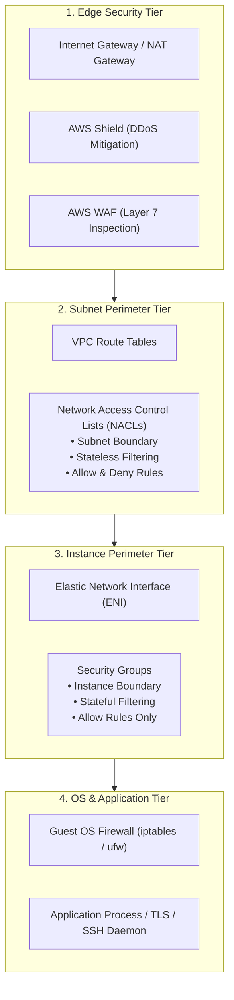
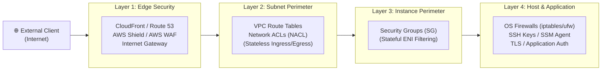
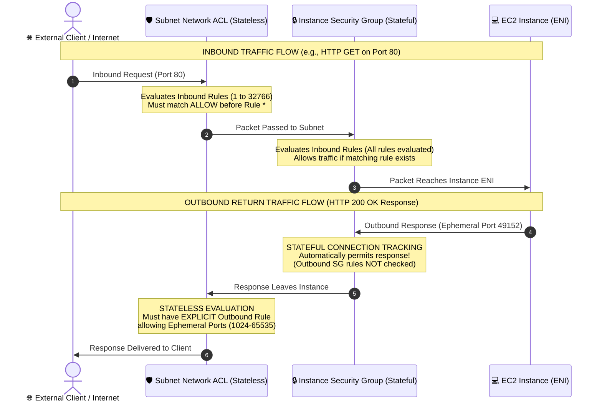
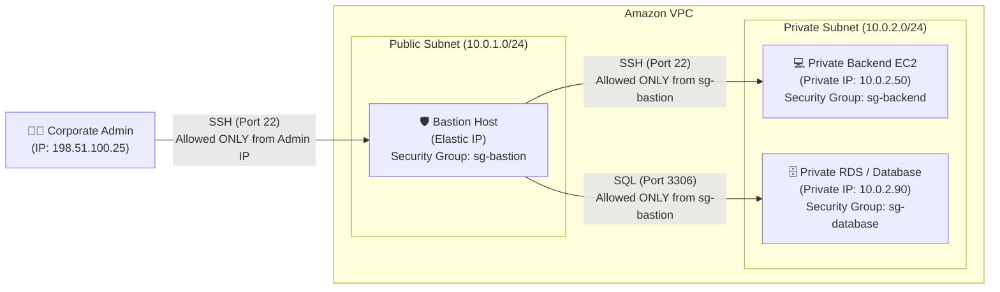
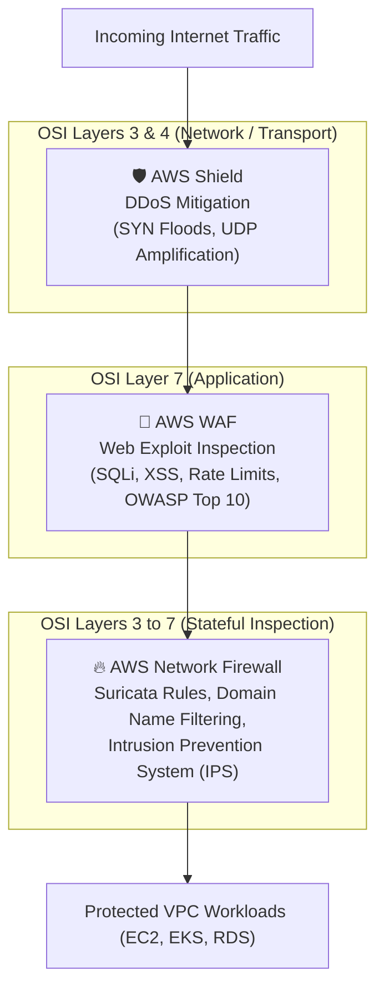
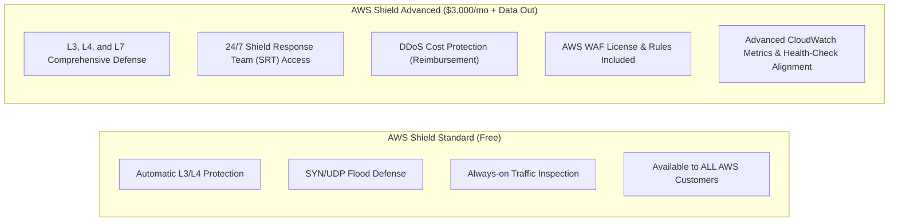
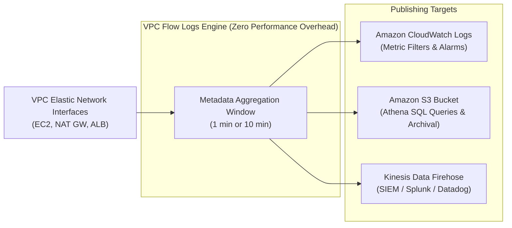
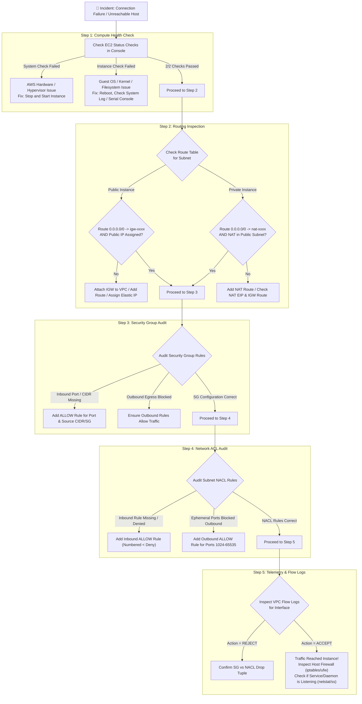
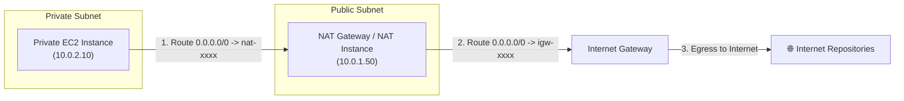

# 🛡️ Securing and Troubleshooting Your Amazon VPC Network

> **Course**: AWS re/Start  
> **Module**: AWS Network Services (T18 – Securing and Troubleshooting Your Network)  
> **Source Document**: `T18-AWS_Network_Services/T18-0004-AWSN_SECURETROUBLESHOOTNET_EN.pdf`  
> **Target Audience**: AWS re/Start Learners, Cloud Support Associates, Systems Operations Engineers, and Solutions Architects  

---

## 🎯 Module Overview

Securing workloads and diagnosing connectivity failures in a virtualized cloud environment requires a rigorous understanding of AWS networking primitives. Unlike traditional physical datacenters where security is often relegated to perimeter firewalls and physical cabling, an **Amazon Virtual Private Cloud (Amazon VPC)** implements software-defined networking (SDN) governed by granular, multi-layered policies.

A production-grade cloud architecture implements a **Defense-in-Depth** model: enforcing security controls at the edge, at the subnet perimeter, at the network interface boundary, and inside the guest operating system. When network communication breaks down—whether an EC2 instance is unreachable via SSH, web traffic times out, or resources cannot communicate across VPC peering connections—cloud engineers must apply a systematic, hypothesis-driven troubleshooting methodology.

This guide provides an end-to-end examination of Amazon VPC network security and diagnostics. It contrasts **Security Groups** and **Network Access Control Lists (NACLs)** in exhaustive detail, covers perimeter protection services (**AWS WAF**, **AWS Shield**, **AWS Network Firewall**), outlines network observability tools (**VPC Flow Logs**, **VPC Reachability Analyzer**), and presents a five-step diagnostic protocol for rapidly isolating and remediating network disruptions.



---

## 📌 Learning Objectives

By completing this module and studying these reference materials, you will be able to:

- [ ] **Architect Layered Defense-in-Depth**: Implement security controls across edge perimeters, subnet boundaries, elastic network interfaces, and host operating systems.
- [ ] **Differentiate Security Groups and NACLs**: Analyze the stateful vs. stateless operational models, rule evaluation logic, and default rule tables for both security mechanisms.
- [ ] **Manage Ephemeral Port Ranges**: Explain why stateless firewalls require outbound return rules for ephemeral ports (`1024–65535`) and configure them correctly.
- [ ] **Design Secure Administrative Access**: Deploy and harden Linux bastion hosts using security group chaining, and compare jump boxes to AWS Systems Manager Session Manager.
- [ ] **Evaluate Advanced Perimeter Services**: Contrast AWS WAF, AWS Shield Standard/Advanced, and AWS Network Firewall across OSI layers and threat models.
- [ ] **Leverage Network Telemetry Tools**: Capture and analyze packet metadata using VPC Flow Logs, and conduct non-destructive path audits using VPC Reachability Analyzer.
- [ ] **Execute a 5-Step Diagnostic Protocol**: Systematically troubleshoot unreachable instances, failed SSH connections, non-functional NAT devices, and misconfigured VPC peering connections.

---

## 🏰 1. Layered Defense-in-Depth for Amazon VPC

In cloud networking, relying on a single defensive control creates a single point of security failure. Amazon VPC enables a multi-tier, **Defense-in-Depth** security posture that protects compute and data assets at four distinct operational boundaries.



### 1.1 Layer 1: Edge Security Perimeter
The edge layer inspects and mitigates traffic before or as it crosses the AWS network perimeter into your VPC:
- **AWS Shield (Standard & Advanced)**: Safeguards against Layer 3 (Network) and Layer 4 (Transport) distributed denial-of-service (DDoS) attacks such as SYN floods, UDP reflection attacks, and packet fragmentation floods.
- **AWS WAF (Web Application Firewall)**: Inspects Layer 7 (HTTP/HTTPS) payloads for malicious patterns, including SQL Injection (SQLi), Cross-Site Scripting (XSS), and high-frequency request floods (rate limiting).
- **Amazon CloudFront & Route 53**: Distributes ingress globally across AWS Edge Locations, terminating malicious TCP handshakes far from the origin VPC.
- **Internet Gateways (IGW)**: Provides horizontal, redundant, VPC-level address translation (1:1 NAT) between public IP addresses and private EC2 IP addresses.

### 1.2 Layer 2: Subnet Perimeter
Subnets define the network segmentation boundary within an Availability Zone. Traffic entering or exiting a subnet crosses two primary controls:
- **Route Tables**: Determine whether a subnet has access to an Internet Gateway (making it public), a NAT Gateway / Virtual Private Gateway (making it private), or no external paths (isolated database subnet).
- **Network Access Control Lists (NACLs)**: Function as subnet-level packet filters. They inspect all ingress and egress packets passing across the subnet boundary, providing a coarse-grained outer defensive wall.

### 1.3 Layer 3: Instance / ENI Perimeter
Every EC2 instance communicates via an **Elastic Network Interface (ENI)**. Security at this layer operates directly on the hypervisor virtual interface:
- **Security Groups (SGs)**: Function as virtual firewalls attached directly to ENIs. Security groups enforce host-specific ingress and egress rules without affecting other instances in the same subnet.
- **Micro-segmentation**: Because Security Groups are applied at the ENI level rather than the subnet level, two instances residing in the exact same subnet can be completely isolated from each other by assigning them different Security Groups.

### 1.4 Layer 4: Host Operating System & Application Layer
If an unauthorized packet traverses edge defenses, NACLs, and Security Groups, final defensive lines reside within the operating system:
- **Host Firewalls**: Local software-based packet filters (such as `iptables`, `nftables`, `ufw` on Linux, or Windows Defender Firewall) enforce additional access policies.
- **Authentication & Cryptography**: SSH key-pair authentication (ED25519 or RSA 4096-bit), mutual TLS (mTLS), and centralized IAM authentication via **AWS Systems Manager Session Manager**.
- **Least-Privilege IAM Roles**: Assigning least-privilege IAM instance profiles to EC2 instances ensures that even if an application is compromised, the blast radius against AWS APIs is strictly bounded.

---

## ⚖️ 2. Security Groups vs. Network Access Control Lists (NACLs)

Understanding the fundamental technical distinctions between Security Groups and Network ACLs is essential for configuring VPC networks and passing technical certifications.



---

### 2.1 Security Groups: Deep Dive

A **Security Group** acts as a virtual firewall for your EC2 instances to control incoming and outgoing traffic at the **Elastic Network Interface (ENI)** level.

#### Key Characteristics
1. **Scope of Association**: Associated with ENIs (and by extension EC2 instances, RDS instances, ALBs, Lambda VPC interfaces). Multiple instances can share the same Security Group, and an individual ENI can have up to 5 Security Groups attached.
2. **Stateful Filtering**: Security groups track the connection state. 
   - If an inbound packet is allowed through a security group rule, the response traffic for that connection is **automatically allowed out**, regardless of outbound rules.
   - Conversely, if an outbound request is initiated and allowed by an outbound rule, the inbound return traffic for that request is **automatically allowed in**, regardless of inbound rules.
3. **Allow Rules Only**: You cannot create explicit `DENY` rules in a security group. Everything that is not explicitly permitted by an `ALLOW` rule is implicitly denied.
4. **Comprehensive Rule Evaluation**: Security groups evaluate all rules collectively before making an authorization decision. There are no rule numbers or execution precedence.
5. **Security Group Chaining**: Instead of specifying a CIDR block as the source or destination, you can specify another **Security Group ID** (e.g., `sg-0123456789abcdef0`). This allows traffic only from instances associated with the referenced security group, regardless of their IP addresses.

#### Default Security Group Behavior
When a VPC is created, AWS automatically creates a **Default Security Group**:

| Rule Type | Direction | Type | Protocol | Port Range | Source / Destination | Description |
| :--- | :--- | :--- | :--- | :--- | :--- | :--- |
| **Inbound** | Ingress | All traffic | ALL | ALL | `sg-xxxx` (Self-referencing) | Allows all traffic from instances assigned to this same security group. |
| **Outbound** | Egress | All traffic | ALL | ALL | `0.0.0.0/0` (Any IPv4) | Allows all outbound IPv4 traffic to any destination worldwide. |

> [!NOTE]
> When you create a **Custom Security Group**, it begins with:
> - **Inbound**: Empty (all incoming traffic is blocked).
> - **Outbound**: A single rule allowing all outbound IPv4 traffic (`0.0.0.0/0`).

---

### 2.2 Network Access Control Lists (NACLs): Deep Dive

A **Network ACL** is an optional layer of security for your VPC that acts as a virtual firewall for controlling traffic in and out of one or more **subnets**.

#### Key Characteristics
1. **Scope of Association**: Associated at the **subnet boundary**. Each subnet in a VPC must be associated with exactly one NACL. If you do not explicitly associate a subnet with a custom NACL, AWS automatically associates it with the VPC's default NACL. A single NACL can be associated with multiple subnets.
2. **Stateless Filtering**: NACLs do not track connection state. Every single packet is evaluated independently.
   - Allowing inbound traffic on port 80 does **NOT** automatically allow the server's response out.
   - You must configure an explicit **inbound rule** for incoming requests AND an explicit **outbound rule** for the outgoing responses.
3. **Allow and Deny Rules**: NACLs explicitly support both `ALLOW` and `DENY` actions. This enables specific security patterns, such as blocking a known malicious IP address (`DENY 203.0.113.50/32`) while allowing the rest of the CIDR block (`ALLOW 203.0.113.0/24`).
4. **Ordered Numerical Evaluation**:
   - Rules are numbered sequentially from **1 to 32766** (best practice: increment by 10 or 100, e.g., 100, 110, 120).
   - Rules are processed in strict order from **lowest number to highest number**.
   - As soon as a packet matches a rule, that rule's action (`ALLOW` or `DENY`) is executed immediately; **subsequent rules are ignored**.
   - Rule `*` is an uneditable, catch-all rule at the bottom that denies any traffic not matched by prior rules.

#### Default NACL Rule Tables
When a VPC is created, AWS provisions a **Default Network ACL** associated with all default subnets:

**Default Inbound Rule Table:**
| Rule # | Type | Protocol | Port Range | Source | Allow / Deny | Action & Purpose |
| :---: | :--- | :---: | :---: | :---: | :---: | :--- |
| **100** | ALL Traffic | ALL | ALL | `0.0.0.0/0` | **ALLOW** | Permits all inbound IPv4 traffic from any source. |
| **\*** | ALL Traffic | ALL | ALL | `0.0.0.0/0` | **DENY** | Catch-all: blocks any traffic not matched by prior rules. |

**Default Outbound Rule Table:**
| Rule # | Type | Protocol | Port Range | Destination | Allow / Deny | Action & Purpose |
| :---: | :--- | :---: | :---: | :---: | :---: | :--- |
| **100** | ALL Traffic | ALL | ALL | `0.0.0.0/0` | **ALLOW** | Permits all outbound IPv4 traffic to any destination. |
| **\*** | ALL Traffic | ALL | ALL | `0.0.0.0/0` | **DENY** | Catch-all: blocks any outbound traffic not matched by prior rules. |

> [!WARNING]
> When you create a **Custom Network ACL**, its default configuration is the exact opposite of the default NACL:
> - Custom Inbound: Only rule `*` (`DENY ALL`).
> - Custom Outbound: Only rule `*` (`DENY ALL`).
> 
> If you associate a subnet with a newly created custom NACL before adding allow rules, **all traffic into and out of that subnet will be blocked instantly**, causing an immediate outage.

---

### 2.3 The Ephemeral Port Dilemma in Stateless NACLs

Because Network ACLs are stateless, network engineers must account for **ephemeral ports** when authoring rules.

When a client (such as a web browser or API caller) establishes a TCP connection to an HTTP server:
1. The client sends a request to the server's **well-known port** (Destination Port: `80` or `443`).
2. The client operating system allocates a temporary, high-numbered port called an **ephemeral port** (e.g., `49215`) as the Source Port for that TCP session.
3. When the server generates its response packet, it reverses the tuple:
   - Source Port: `80` (HTTP)
   - Destination Port: `49215` (Client's ephemeral port)

```
[Client Browser]                                             [Server in VPC Subnet]
Source Port: 51234 (Ephemeral) ──── Inbound Request ──────> Destination Port: 80 (HTTP)
Destination Port: 51234 <──────── Outbound Response ─────── Source Port: 80 (HTTP)
```

#### Ephemeral Port Ranges by Operating System:
- **Linux Kernels (modern)**: `32768–60999`
- **Windows Server 2008 & later**: `49152–65535`
- **IANA Defined Standard**: `49152–65535`
- **NAT Gateways & Elastic Load Balancers**: `1024–65535`

> [!IMPORTANT]
> **Best Practice for NACL Outbound Rules**:
> To ensure your VPC web server can send responses back to clients on the internet, your subnet's Outbound NACL must include an explicit rule allowing TCP traffic to destination ports **`1024–65535`** destined for `0.0.0.0/0`.
> 
> If you only allow outbound port 80, the server will receive the HTTP request, process it, attempt to reply to the client's ephemeral port (e.g., port 52314), and the outbound NACL will **drop the packet**. The client will experience a connection timeout!

---

### 2.4 Exhaustive 10-Factor Comparison: Security Groups vs. NACLs

| # | Comparison Factor | Security Group (SG) | Network Access Control List (NACL) |
| :---: | :--- | :--- | :--- |
| **1** | **Operational Level** | **Instance / ENI Level** (Virtual firewall for individual virtual network interfaces). | **Subnet Level** (Perimeter boundary filtering for an entire subnet). |
| **2** | **Statefulness** | **Stateful**: Return traffic is automatically tracked and allowed regardless of inbound/outbound rules. | **Stateless**: Request and response traffic must be explicitly and independently permitted. |
| **3** | **Rule Actions** | **ALLOW rules only**. Implicit deny for all unspecified traffic. | **ALLOW and DENY rules** supported explicitly. |
| **4** | **Rule Evaluation Order** | **All rules evaluated collectively** before making a permit decision. No ordering or priorities. | **Processed in strict numerical order** (lowest to highest). First matching rule dictates action. |
| **5** | **Default Behavior (Default Entity)** | Allows all outbound IPv4 traffic; allows inbound traffic from instances in the same SG. | Allows ALL inbound and ALL outbound IPv4 traffic (Rule 100). |
| **6** | **Default Behavior (Custom Entity)** | Blocks all inbound traffic; allows all outbound traffic. | Blocks ALL inbound traffic; blocks ALL outbound traffic (Rule `*` only). |
| **7** | **Ephemeral Port Requirement** | **Not required**. Connection tracking automatically permits return traffic on ephemeral ports. | **Required**. Outbound (or inbound for client instances) rules must permit port ranges `1024–65535`. |
| **8** | **Source / Destination Targets** | Supports IPv4 CIDR, IPv6 CIDR, Prefix Lists, and **referenced Security Group IDs**. | Supports IPv4 CIDR and IPv6 CIDR blocks only (**cannot reference Security Groups**). |
| **9** | **Resource Multiplicity** | An ENI can have up to 5 Security Groups attached simultaneously. | A subnet can be associated with **only one** NACL at any given time. |
| **10** | **Primary Security Role** | Coarse and fine-grained application micro-segmentation and inter-tier authorization. | Coarse subnet boundary enforcement, subnet-wide IP blacklisting, and compliance boundaries. |

---

## 🚪 3. Secure Administrative Access & Bastion Hosts

### 3.1 Architecture of a Bastion Host (Jump Box)
A **Bastion Host** (or Jump Box) is a hardened, dedicated EC2 instance deployed in a **public subnet** that provides authorized system administrators with a secure entry point into private subnets.



#### Operational Characteristics:
- Deployed exclusively in a **public subnet** with an Internet Gateway route.
- Assigned an Elastic IP address or public DNS hostname.
- Stripped of unneeded software, compilers, and extraneous listening daemons to minimize the attack surface.
- Acts as a jump point: administrators SSH or RDP into the bastion first, and from there initiate connections to instances in private subnets.

### 3.2 Security Group Chaining Configuration
To achieve defense-in-depth, security groups are chained together using **Security Group ID references** rather than static CIDR blocks:

#### Step 1: Bastion Security Group (`sg-bastion`)
- **Inbound Rules**:
  - Type: `SSH` | Protocol: `TCP` | Port: `22` | Source: `198.51.100.25/32` (Administrator's specific static IP or corporate CIDR).
- **Outbound Rules**:
  - Type: `SSH` | Protocol: `TCP` | Port: `22` | Destination: `10.0.2.0/24` (Private Subnet CIDR) or `0.0.0.0/0`.

#### Step 2: Private Instance Security Group (`sg-backend`)
- **Inbound Rules**:
  - Type: `SSH` | Protocol: `TCP` | Port: `22` | Source: `sg-bastion` (**Referenced Security Group ID!**)
- **Outbound Rules**:
  - Default outbound or restricted to necessary repository endpoints.

> [!TIP]
> **Why Security Group Chaining is Superior to CIDR Rules**:
> Referencing `sg-bastion` as the source in `sg-backend` guarantees that **only** traffic originating from an interface attached to `sg-bastion` can reach port 22 on the backend. If the bastion host changes private IP addresses or if auto-scaling launches additional bastions, zero firewall reconfiguration is required on the backend servers!

### 3.3 SSH Key Management & Agent Forwarding
When connecting through a bastion host, storing private keys (`.pem` files) on the bastion itself is a major security vulnerability. If the bastion is compromised, an attacker gains credentials to all private systems.

- **Insecure Practice**: Copying private keys to the bastion using `scp` or `rsync`.
- **Recommended Practice: SSH Agent Forwarding (`ssh -A`)**:
  1. Load the private key into your local workstation's SSH authentication agent:
     ```bash
     ssh-add -K ~/.ssh/my-aws-keypair.pem
     ```
  2. Connect to the bastion host with agent forwarding enabled:
     ```bash
     ssh -A ec2-user@<bastion-public-ip>
     ```
  3. From the bastion session, jump directly to the private instance:
     ```bash
     ssh ec2-user@<private-instance-ip>
     ```
  The authentication challenge from the private instance is forwarded back to your local workstation's agent without exposing the private key on the bastion host.

### 3.4 Modern Alternative: AWS Systems Manager Session Manager
While bastion hosts remain standard curriculum components, AWS recommends **AWS Systems Manager Session Manager** for enterprise administrative access:

| Capability | Bastion Host (EC2) | SSM Session Manager |
| :--- | :--- | :--- |
| **Inbound Open Ports** | Requires port 22 (SSH) open to internet/VPN. | **Zero open inbound ports** (No port 22 needed). |
| **Public IP Address** | Requires public IP and IGW. | Works in fully private subnets (via SSM Agent & VPC Endpoints). |
| **Key Pair Management** | Requires SSH key pairs and rotation. | Controlled via **AWS IAM Policies** and MFA. |
| **Audit & Logging** | Manual configuration of shell audit logs. | Complete session keystroke logs saved to **S3** and **CloudWatch**. |
| **Infrastructure Cost** | Requires running EC2 instances continuously. | Fully managed service; no dedicated bastion EC2 instances. |

---

## 🛡️ 4. Advanced Network Security Services

Beyond native VPC primitives (Security Groups and NACLs), AWS provides specialized managed services that protect applications against complex distributed attacks, web exploits, and malicious payloads.



---

### 4.1 AWS WAF (Web Application Firewall)
**AWS WAF** operates at **Layer 7 (Application Layer)** of the OSI model. It monitors HTTP and HTTPS requests forwarded to Amazon CloudFront distributions, Application Load Balancers (ALBs), Amazon API Gateway REST APIs, or AWS AppSync GraphQL APIs.

#### Core Capabilities:
1. **Protection Against OWASP Top 10 Exploits**:
   - **SQL Injection (SQLi)**: Identifies and blocks malicious SQL syntax embedded in URL query parameters, cookies, or HTTP request bodies.
   - **Cross-Site Scripting (XSS)**: Sanitizes or drops requests containing malicious JavaScript or HTML tags.
2. **Rate-Based Rules**: Mitigates brute-force authentication attacks and HTTP request flood DoS attacks by tracking requests per IP address over sliding 5-minute windows (e.g., block any IP issuing > 2,000 requests in 5 minutes).
3. **AWS Managed Rules (AMR)**: Pre-configured, curated rule sets maintained by AWS security teams and AWS Marketplace partners (e.g., Core Rule Set, Known Bad Inputs, Bot Control, Account Takeover Prevention).
4. **Custom Rule Engine**: Allows security engineers to write boolean logic matching HTTP headers, request methods, IP reputation lists, geographic origins (Geo-blocking), and regex patterns.

---

### 4.2 AWS Shield (DDoS Protection)
**AWS Shield** is a managed Distributed Denial of Service (DDoS) protection service that safeguards applications running on AWS.



#### Comparison of Shield Tiers:
| Feature | AWS Shield Standard | AWS Shield Advanced |
| :--- | :--- | :--- |
| **Cost** | **Free** (Included automatically with all AWS accounts). | **$3,000 / month** base fee + data transfer out fees. |
| **OSI Layers Defended** | Layer 3 (Network) and Layer 4 (Transport). | Layers 3, 4, and 7 (Application Layer). |
| **Target Assets** | All AWS resources globally. | CloudFront, Route 53, ALB, NLB, Elastic IPs. |
| **Attack Types Mitigated** | SYN floods, ACK floods, UDP reflection, NTP floods. | Volumetric floods, application layer floods, DNS target attacks. |
| **Support Team Access** | Standard AWS Support channels. | **24/7 dedicated access to the Shield Response Team (SRT)**. |
| **Financial Cost Protection** | None (Customer pays for auto-scaled EC2/ELB capacity). | **DDoS Cost Spike Protection**: Credits provided for scaling spikes caused by DDoS attacks. |
| **WAF Integration** | WAF billed separately. | **AWS WAF usage fees waived** for protected resources. |

---

### 4.3 AWS Network Firewall
**AWS Network Firewall** is a stateful, fully managed network firewall and intrusion detection and prevention service (IDS/IPS) for Amazon VPC.

#### Core Capabilities:
1. **Stateful Inspection across Layers 3–7**: Inspects bidirectional network traffic at wire speed with automatic scaling up to tens of gigabits per second.
2. **Stateful Domain Filtering**: Restricts outbound HTTP/HTTPS traffic to an approved list of Fully Qualified Domain Names (FQDNs) (e.g., allow outbound access only to `*.github.com` and `repo.aws.amazon.com`, blocking all other external domains).
3. **Suricata-Compatible Rule Engine**: Supports tens of thousands of open-source Suricata rules, enabling advanced intrusion prevention, signature matching, and protocol analysis.
4. **VPC Routing Integration**: Deployed across dedicated firewall subnets in an **Inspection VPC** or transit gateway topology, transparently intercepting all traffic traversing VPC ingress and egress routes.

---

### 4.4 Advanced Network Security Services Matrix

| Feature / Service | Security Groups | Network ACLs | AWS WAF | AWS Shield Advanced | AWS Network Firewall |
| :--- | :--- | :--- | :--- | :--- | :--- |
| **OSI Layer** | Layer 4 (Transport) | Layer 4 (Transport) | **Layer 7** (Application) | Layers 3, 4, 7 | **Layers 3 through 7** |
| **Placement** | Instance ENI | Subnet Edge | CloudFront / ALB / API Gateway | Edge / CloudFront / ALB / EIP | Dedicated Firewall Subnet |
| **State Model** | Stateful | Stateless | Stateful Session/Rate | Anomaly / Behavioral | Stateful & Stateless Engines |
| **Key Threat Focus** | Host unauthorized access | Subnet IP blacklisting | SQLi, XSS, bots, Layer 7 DoS | Volumetric DDoS attacks | Malware C2, data exfiltration, IPS |
| **Payload Inspection** | No (Header only) | No (Header only) | **Yes** (HTTP/S bodies, headers) | Traffic flow anomaly | **Yes** (Deep packet inspection) |

---

## 🔍 5. Network Troubleshooting & Telemetry Tools

When connectivity issues occur, resolving them without empirical telemetry leads to guesswork. AWS provides non-intrusive diagnostic tools to monitor, log, and mathematically prove VPC network paths.

---

### 5.1 VPC Flow Logs

**VPC Flow Logs** is an agentless telemetry feature that captures metadata about the IP traffic going to and from network interfaces in your VPC. Flow logs can be published to **Amazon CloudWatch Logs**, **Amazon S3**, or **Amazon Kinesis Data Firehose**.



#### Key Architecture Principles:
- **Zero Impact on Network Performance**: Flow log collection occurs completely outside the path of network traffic; capturing flow logs introduces zero latency and zero packet jitter.
- **Scope Options**: Can be enabled at three levels:
  1. Entire **VPC** (captures all current and future subnets and ENIs).
  2. Individual **Subnet** (captures all ENIs in that subnet).
  3. Individual **Elastic Network Interface (ENI)**.
- **Traffic Filter Types**:
  - `ALL`: Captures both accepted and rejected packets.
  - `ACCEPT`: Captures only traffic permitted by Security Groups and NACLs.
  - `REJECT`: Captures only traffic blocked by Security Groups or NACLs (**essential for troubleshooting!**).

#### Flow Log Record Format & Decoding:
A default flow log record consists of 14 space-separated fields:

```
<version> <account-id> <interface-id> <srcaddr> <dstaddr> <srcport> <dstport> <protocol> <packets> <bytes> <start> <end> <action> <log-status>
```

#### Example Record 1 (Rejected Inbound Packet):
```
2 123456789012 eni-0123456789abcdef0 203.0.113.195 10.0.1.25 44120 22 6 1 40 1609459200 1609459260 REJECT OK
```
- **Interface**: `eni-0123456789abcdef0`
- **Source IP**: `203.0.113.195` (External Client)
- **Destination IP**: `10.0.1.25` (Internal EC2 Instance)
- **Source Port**: `44120` (Ephemeral Port)
- **Destination Port**: `22` (SSH)
- **Protocol**: `6` (TCP — IANA Protocol Number: 6=TCP, 17=UDP, 1=ICMP)
- **Action**: **`REJECT`** $\rightarrow$ Indicates that either an inbound **Security Group rule** or an inbound **Network ACL rule** blocked this connection.

#### Example Record 2 (Accepted HTTP Traffic):
```
2 123456789012 eni-0123456789abcdef0 198.51.100.12 10.0.1.25 51002 80 6 5 2400 1609459200 1609459260 ACCEPT OK
```
- **Action**: **`ACCEPT`** $\rightarrow$ Both Security Group and Network ACL permitted the packet.

> [!TIP]
> **Athena Query for Identifying Blocked Traffic**:
> To quickly isolate the top 10 external IP addresses being rejected by your firewalls, run this SQL query in Amazon Athena against your S3 Flow Log table:
> ```sql
> SELECT srcaddr, dstport, protocol, COUNT(*) AS drop_count
> FROM vpc_flow_logs
> WHERE action = 'REJECT'
> GROUP BY srcaddr, dstport, protocol
> ORDER BY drop_count DESC
> LIMIT 10;
> ```

---

### 5.2 VPC Reachability Analyzer
**VPC Reachability Analyzer** is a declarative network diagnostic tool that analyzes the configuration of your VPC resources to determine whether a network path exists between a source and destination.

#### How It Operates:
- **No Packets are Transmitted**: Unlike traditional `ping` or `traceroute`, Reachability Analyzer does not inject live traffic into your production network.
- **Automated Reasoning Engine**: It builds a mathematical model of your VPC configurations, evaluating Route Tables, Internet Gateways, NAT Gateways, VPC Peering connections, Transit Gateways, Network ACLs, and Security Groups.
- **Actionable Diagnostic Feedback**:
  - If the path is **Reachable**: It produces a step-by-step hop trace diagram of the entire route.
  - If the path is **Not Reachable**: It pinpoints the exact misconfigured resource and rule (e.g., *"Security group sg-01234 has no inbound rule allowing TCP on port 443 from 10.0.1.10/32"* or *"Subnet route table rtb-abcd has no route to igw-1234 for 0.0.0.0/0"*).

---

### 5.3 Route Table & Gateway Inspection
When troubleshooting routing, adhere to the **VPC Route Evaluation Rules**:
1. **Longest Prefix Match (Most Specific Route Wins)**: If a packet matches multiple CIDRs in a route table, the route with the most specific subnet mask (longest prefix) is selected.
   - Example: A route for `10.0.1.0/24 -> pcx-123` takes precedence over `10.0.0.0/16 -> local`.
2. **The Local Route Cannot Be Deleted or Overridden**: Every VPC route table contains a default `local` route covering the entire VPC CIDR block (e.g., `10.0.0.0/16 -> local`). Traffic between instances inside the VPC always routes locally unless blocked by firewalls.
3. **Gateway Targeting**:
   - Public Subnets must possess an explicit route: `0.0.0.0/0` targeted to an **Internet Gateway** (`igw-xxxx`).
   - Private Subnets requiring egress must possess a route: `0.0.0.0/0` targeted to a **NAT Gateway** (`nat-xxxx`) or **NAT Instance**.

---

## 🔧 6. Systematic VPC Troubleshooting Methodology

When an application fails to communicate over the network, jumping directly into random configuration edits frequently introduces secondary issues. Follow this structured **5-Step Diagnostic Protocol**.



---

### 6.1 Step 1: Verify EC2 Status Checks

Before troubleshooting network routes and firewalls, confirm that the underlying EC2 compute instance and hypervisor are functional. The EC2 console displays two independent status checks:

#### 1. System Status Check (`StatusCheckFailed_System`)
- **What It Monitors**: Underlying AWS systems required for the instance to run (physical host servers, network infrastructure, host software, power supplies).
- **Resolution**:
  - Stop the instance and start it again (causes the instance to migrate to a healthy physical host server).
  - Do **not** just reboot via the operating system—a reboot remains on the same physical host.

#### 2. Instance Status Check (`StatusCheckFailed_Instance`)
- **What It Monitors**: The guest operating system configuration and software health (kernel corruption, misconfigured network drivers, exhausted file system volumes, incorrect `/etc/fstab` mounts).
- **Resolution**:
  - Reboot the instance.
  - Review the **EC2 System Log** (Console: *Actions $\rightarrow$ Monitor and troubleshoot $\rightarrow$ Get system log*).
  - Connect via **EC2 Serial Console** to inspect boot errors.

---

### 6.2 Step 2: Route Table & Gateway Inspection

Verify that the subnet's route table contains a valid egress path to the intended destination:

```
+-----------------------------------------------------------------------------------------+
|                               Subnet Route Table Audit Checklist                        |
+-----------------------------------------------------------------------------------------+
| [ ] 1. Does the subnet have an associated Route Table? (Or using main route table?)     |
| [ ] 2. For Public Internet Access:                                                      |
|        - Is an Internet Gateway (IGW) attached to the VPC?                              |
|        - Is there a route: 0.0.0.0/0 -> igw-xxxxxxxx?                                   |
|        - Does the instance have an assigned Public IPv4 or Elastic IP?                  |
| [ ] 3. For Private Internet Access (via NAT):                                           |
|        - Is there a route: 0.0.0.0/0 -> nat-xxxxxxxx?                                   |
|        - Is the NAT Gateway deployed in a PUBLIC subnet with a route to an IGW?         |
|        - Does the NAT Gateway have an associated Elastic IP?                            |
| [ ] 4. For VPC Peering:                                                                 |
|        - Is there a route: <Peer-VPC-CIDR> -> pcx-xxxxxxxx in BOTH VPC route tables?    |
+-----------------------------------------------------------------------------------------+
```

---

### 6.3 Step 3: Security Group Inbound & Outbound Rules Audit

Verify that the Security Groups assigned to the instance's ENI allow the requested traffic:
1. **Inbound Protocol & Port**: Ensure the required listening port (e.g., TCP 22 for SSH, TCP 80/443 for web, TCP 3389 for RDP) is explicitly permitted.
2. **Source Validation**:
   - If the source is an external IP, verify that the administrator's public IP address hasn't changed (e.g., dynamic home ISP addresses).
   - If using security group references (`sg-xxxx`), confirm that the client instance actually has that referenced security group attached.
3. **Outbound Rules**:
   - While custom security groups allow all outbound traffic by default, enterprise environments often restrict outbound rules. If an instance needs to initiate outbound connections (e.g., downloading OS security patches or software packages), verify that the outbound rules permit TCP port 80/443 to `0.0.0.0/0`.

---

### 6.4 Step 4: Network ACL Inbound & Outbound Rules Audit

Inspect the Network ACL associated with the subnet hosting the instance:
1. **Rule Evaluation Sequence**:
   - Ensure that an explicit `ALLOW` rule is numbered **lower** than any conflicting `DENY` rule.
   - Example: If Rule 50 is `DENY 0.0.0.0/0` and Rule 100 is `ALLOW 0.0.0.0/0`, all traffic will be denied!
2. **Inbound Rule**: Confirm the inbound port (e.g., port 22 or 80) is permitted from the caller's CIDR.
3. **Outbound Rule (Ephemeral Ports)**:
   - Verify that the Outbound NACL contains an `ALLOW` rule for destination ports **`1024–65535`**.
   - If this rule is missing, responses from your servers will be dropped at the subnet boundary.

---

### 6.5 Step 5: VPC Flow Logs Verification & Host Inspection

If all AWS networking configurations appear correct, use telemetry to confirm whether packets are reaching the operating system:
1. **Inspect Flow Logs**:
   - Filter for `action = 'REJECT'`: Identifies if a Security Group or NACL is silently dropping the connection.
   - Filter for `action = 'ACCEPT'`: Proves that AWS networking infrastructure successfully delivered the packet to the instance's virtual network interface (`eni-xxxx`).
2. **Host-Level Diagnostics**:
   - If Flow Logs show `ACCEPT` but the client still cannot connect, the failure is inside the instance operating system:
     - **Host Firewall**: Check local firewalls (`sudo iptables -L -n -v` or `sudo ufw status`).
     - **Listening Daemons**: Check if the application or SSH daemon is actually bound and listening on the port:
       ```bash
       sudo ss -tulpn | grep :22
       # or
       sudo netstat -plnt | grep :80
       ```
     - **OS System Logs**: Inspect `/var/log/auth.log` or `/var/log/secure` for SSH authentication rejections.

---

## 📋 7. Common VPC Troubleshooting Scenarios & Playbooks

### Playbook 1: Cannot Connect to an EC2 Instance Over the Internet

#### Symptoms:
A user attempts to connect to an HTTP web server or SSH into an EC2 instance over the public internet, and the connection attempts time out.

#### Diagnostic Checklist:
1. **Public IP Verification**: Does the instance possess a Public IPv4 address or an Elastic IP address? (Instances with only a private IP address cannot be reached directly from the internet).
2. **Internet Gateway Attachment**: Is an Internet Gateway created AND attached to the VPC? (A detached IGW provides no routing).
3. **Route Table Targeting**: Does the route table of the instance's subnet have an active route for destination `0.0.0.0/0` pointing to the Internet Gateway (`igw-xxxx`)?
4. **Security Group Ingress**: Does the Security Group attached to the instance have an inbound rule allowing the protocol and port from the client's public IP address?
5. **Network ACL Ingress & Egress**:
   - Inbound NACL: Allows port 22/80/443 from `0.0.0.0/0`.
   - Outbound NACL: Allows ephemeral ports `1024–65535` to `0.0.0.0/0`.

---

### Playbook 2: Troubleshooting SSH Connections

#### Symptoms:
Running `ssh -i key.pem ec2-user@<public-ip>` results in one of two distinct error signatures:

```
Error Signature 1: "ssh: connect to host <ip> port 22: Connection timed out"
Error Signature 2: "ssh: connect to host <ip> port 22: Connection refused"
```

#### Root Cause Analysis:

| Error Message | Diagnostic Meaning | Likely Culprit & Action |
| :--- | :--- | :--- |
| **Connection timed out** | Packets are being **silently dropped** before reaching the instance or return packets are blocked. | 1. Security Group inbound rule missing port 22.<br/>2. NACL inbound or outbound (ephemeral) rule blocking port.<br/>3. Missing route to Internet Gateway.<br/>4. Instance lacks a public IP. |
| **Connection refused** | Packets successfully reached the instance, but the host **actively rejected the TCP SYN packet** (sent TCP RST). | 1. Security Group and NACLs are **working properly**!<br/>2. The SSH daemon (`sshd`) is stopped or crashed.<br/>3. SSH is configured to listen on a non-standard port (e.g., 2222).<br/>4. Host-level firewall (`iptables`) is rejecting the connection. |
| **Permission denied (publickey)** | Network connectivity is 100% functional; **cryptographic authentication failed**. | 1. Wrong private key (`.pem`) used.<br/>2. Wrong default username (e.g., using `root` instead of `ec2-user` or `ubuntu`).<br/>3. File permissions on local key too open (`chmod 400 key.pem` required).<br/>4. Permissions on remote `~/.ssh/authorized_keys` corrupted. |

> [!TIP]
> **AWS Systems Manager Automation Runbook**:
> When locked out of an SSH instance, execute the automated Systems Manager runbook **`AWSSupport-TroubleshootSSH`**. This automated document analyzes the VPC configuration, security groups, route tables, and instance filesystem permissions, reporting and repairing root causes automatically.

---

### Playbook 3: Troubleshooting NAT Devices (NAT Gateway & NAT Instance)

#### Symptoms:
Instances in a private subnet cannot download software updates from the internet (e.g., `yum update` or `apt-get update` hangs indefinitely).



#### Diagnostic Checklist:
1. **Private Subnet Route Table**:
   - Verify that the route table associated with the **private subnet** has a default route: `0.0.0.0/0 -> nat-xxxx`.
2. **NAT Gateway Location**:
   - Verify that the NAT Gateway itself is deployed in a **PUBLIC subnet**. (If deployed in a private subnet, it cannot communicate with the internet).
3. **Public Subnet Route Table**:
   - Verify that the route table associated with the **public subnet** containing the NAT Gateway has a route: `0.0.0.0/0 -> igw-xxxx`.
4. **Elastic IP Allocation**:
   - Ensure the NAT Gateway has an **Elastic IP address** allocated and associated with it.
5. **Special NAT Instance Considerations**:
   - If using a legacy EC2 NAT instance instead of a managed NAT Gateway:
     - **Disable Source/Destination Check**: By default, EC2 instances enforce source/destination checks. A NAT instance forwards traffic for other hosts, so you **must disable** this check (*EC2 Console $\rightarrow$ Actions $\rightarrow$ Networking $\rightarrow$ Change source/destination check $\rightarrow$ Stop*).
     - **Configure IP Forwarding & iptables MASQUERADE**: Verify `net.ipv4.ip_forward = 1` is enabled in `/etc/sysctl.conf`.
     - **Restart Instance**: If the NAT software hung, restart the instance.

---

### Playbook 4: Troubleshooting VPC Peering Connections

#### Symptoms:
Instances in VPC A (`10.1.0.0/16`) cannot reach instances in peered VPC B (`10.2.0.0/16`).

#### Diagnostic Checklist:
1. **Peering Connection Lifecycle State**:
   - Verify that the VPC Peering connection (`pcx-xxxx`) is in the **`Active`** state.
   - When a peering connection is requested, the owner of the accepter VPC must explicitly **Accept Request**. If the state is `Pending-Acceptance`, all traffic is dropped.
2. **Bidirectional Route Tables**:
   - Route tables in **VPC A** must have a route: `10.2.0.0/16 -> pcx-xxxx`.
   - Route tables in **VPC B** must have a route: `10.1.0.0/16 -> pcx-xxxx`.
   - Omitting the return route in either VPC results in one-way packet delivery and broken TCP handshakes.
3. **Security Group Ingress**:
   - Ensure that security groups on target instances permit inbound traffic from the peer VPC CIDR block (e.g., `10.1.0.0/16`).
   - *(Note: Cross-VPC Security Group referencing is supported only within the same AWS Region).*
4. **Network ACL Inspection**:
   - Ensure that subnet NACLs in both VPCs do not have explicit `DENY` rules blocking external private IP ranges.

---

## 🧠 8. Checkpoint Review Questions & In-Depth Solutions

### Question 1: VPC Security Methods
**Prompt**: *What are four methods to secure resources inside a virtual private cloud (VPC)?*

#### Solution & Explanation:
To achieve a Defense-in-Depth posture within an Amazon VPC, an architect implements:
1. **Route Tables**: Segregating network topologies into public, private, and isolated subnets by controlling default gateway egress paths.
2. **Network Access Control Lists (NACLs)**: Implementing stateless, subnet-boundary firewall rules that support both allow and deny actions.
3. **Security Groups**: Implementing stateful, virtual firewalls directly attached to Elastic Network Interfaces (ENIs) to enforce application-tier micro-segmentation.
4. **Bastion Hosts / AWS Systems Manager Session Manager**: Restricting administrative management access (SSH/RDP) to hardened entry points or private IAM-authenticated sessions.
*(Bonus Advanced Methods: AWS WAF for Layer 7 web exploit defense, AWS Shield for DDoS mitigation, and AWS Network Firewall for deep packet inspection).*

---

### Question 2: Default Security Group Permissions
**Prompt**: *What kind of inbound and outbound traffic does the default security group allow or deny?*

#### Solution & Explanation:
- **Inbound (Ingress)**:
  - **Denies all traffic originating from external sources** (the internet or other VPC resources).
  - **Allows all traffic originating from resources assigned to the exact same Security Group** (`Source: sg-xxxx`).
- **Outbound (Egress)**:
  - **Allows all outbound traffic** (`Destination: 0.0.0.0/0` across all protocols and ports).

---

### Question 3: Stateless Nature of Network ACLs
**Prompt**: *A network ACL is stateless. What does this mean in operational practice?*

#### Solution & Explanation:
A stateless packet filter evaluates every incoming and outgoing network packet independently without tracking connection states or session tables. 
- In practical terms: even if an inbound rule permits an incoming request (e.g., HTTP on port 80), the network ACL **will not automatically allow the server's response packet out**.
- Network administrators must explicitly define **both** an inbound rule (allowing the incoming request on the destination port) **and** an outbound rule (allowing the response to travel back to the client's temporary ephemeral port range, typically `1024–65535`).

---

### Question 4: Scenario-Based Diagnostic
**Prompt**: *An administrator deploys an EC2 web server in a public subnet. An Internet Gateway is attached, and the route table contains `0.0.0.0/0 -> igw-xxxx`. The instance has an Elastic IP address. The Security Group allows inbound port 80 from `0.0.0.0/0`. However, external users report that web page requests hang and time out. Network ACL Inbound allows Rule 100 Port 80 from `0.0.0.0/0`. What is the most likely root cause?*

#### Solution & Explanation:
- **Root Cause**: The **Outbound Network ACL** rule table is missing an allowance for **ephemeral ports (`1024–65535`)**.
- **Explanation**: The client sends an HTTP request with destination port 80 and source port 54321 (ephemeral). Inbound NACL Rule 100 permits the packet. The Security Group permits the packet. The web server receives the request and sends the HTTP 200 OK response with destination port 54321. Because Security Groups are stateful, the SG allows the response. However, because the NACL is stateless, the outbound NACL evaluates the packet. If the outbound NACL only allows port 80, the response packet destined for port 54321 is dropped by rule `*`. Adding Outbound NACL Rule: `TCP | Port 1024-65535 | Destination 0.0.0.0/0 | ALLOW` resolves the timeout immediately.

---

## 📌 9. Key Architectural Takeaways

- **Defense-in-Depth Principle**: Effective network security coordinates controls across Edge (Shield/WAF), Subnet (NACLs/Route Tables), Instance (Security Groups), and Host (OS firewalls/IAM).
- **Security Groups vs. NACLs**:
  - Security Groups: Stateful, ENI-level, Allow-only, all rules evaluated collectively.
  - NACLs: Stateless, Subnet-level, Allow & Deny, processed in numerical order.
- **Ephemeral Port Awareness**: Stateless firewalls require explicit outbound rules for return traffic across ports `1024–65535`.
- **Administrative Access**: Harden bastion hosts by restricting inbound SSH/RDP to known administrative CIDRs and chaining security group references (`sg-bastion`) on private backend servers. Prefer AWS Systems Manager Session Manager to eliminate public entry points entirely.
- **Troubleshooting Protocol**: Follow the 5-step methodology: EC2 Status Checks $\rightarrow$ Route Tables & Gateways $\rightarrow$ Security Groups $\rightarrow$ Network ACLs $\rightarrow$ VPC Flow Logs.
- **Telemetry-Driven Decisions**: Use VPC Flow Logs to inspect `REJECT` actions and VPC Reachability Analyzer to mathematically prove network path connectivity without invasive testing.
