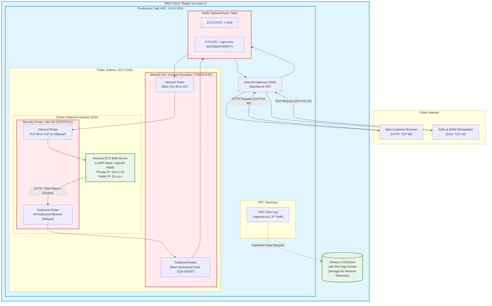
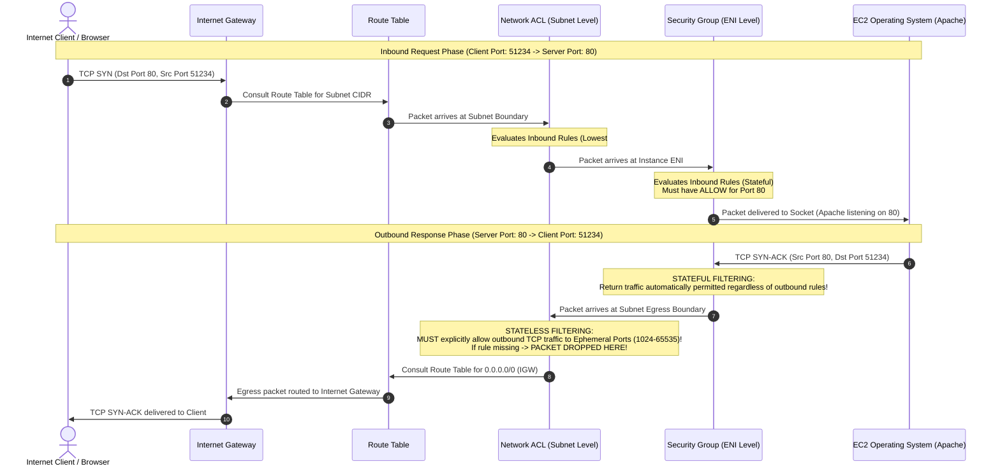
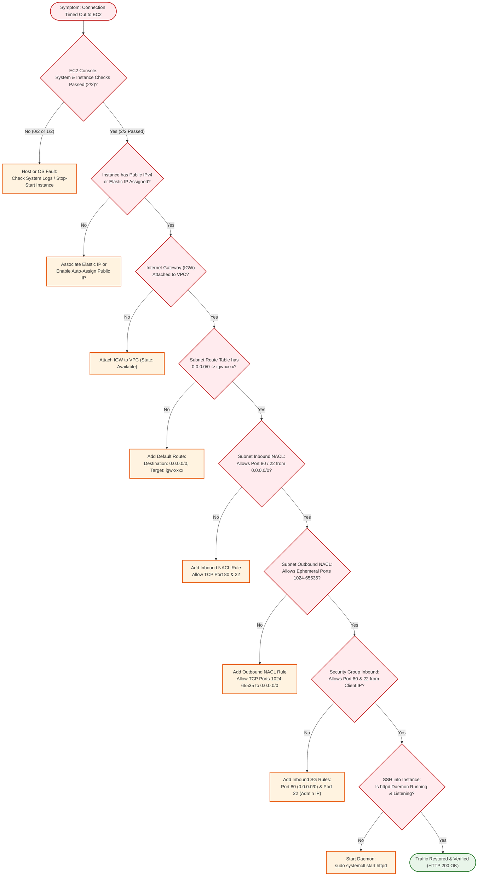

# 🛠️ Lab Walkthrough & Deep-Dive: Troubleshooting a VPC – Café Online Ordering Network Crisis

> **Course**: AWS re/Start  
> **Module**: AWS Network Services  
> **Source Document**: `T18-0005-AWSN_CAFETROUBLESHOOTVPC_EN.pdf`  
> **Target Audience**: AWS re/Start Learners / Cloud Practitioners / SysOps Administrators / Network Solutions Architects  

---

## 🎯 Lab Overview & Executive Summary

In modern enterprise cloud computing, the Virtual Private Cloud (Amazon VPC) is the foundational boundary that isolates compute workloads and regulates all ingress and egress communication. When an organization implements network security controls—such as Security Groups, Network Access Control Lists (Network ACLs), and customized Route Tables—a single misconfiguration can completely sever application traffic, causing critical downtime and business revenue loss.

The **Frank & Sofía Café** recently underwent a network security hardening initiative for their production VPC. While the goal was to protect their dynamic online ordering web application, the implementation introduced unintended networking misconfigurations. Minutes after applying the new security settings, customers reported that the café website was completely offline and unreachable. When the technical team attempted to connect to the server via Secure Shell (SSH) to investigate, their management sessions timed out as well.

This lab and deep-dive architectural guide leads students through a systematic investigation of the café VPC failure. By applying industry-standard SysOps troubleshooting methodologies and native AWS diagnostic tools—including **VPC Flow Logs**, **Amazon CloudWatch**, **Amazon S3**, **Route Table auditing**, and **packet-filter inspection**—learners will isolate and resolve each multi-layered network defect, restoring business operations for the café.

```
┌────────────────────────────────────────────────────────────────────────────────────────┐
│                     CAFÉ VPC TROUBLESHOOTING VALUE PROPOSITION                         │
├───────────────────────────────────┬────────────────────────────────────────────────────┤
│ Typical Ad-Hoc Troubleshooting    │ Systematic AWS SysOps Diagnostic Methodology       │
├───────────────────────────────────┼────────────────────────────────────────────────────┤
│ • Random guessing and rebooting   │ • Deterministic Layer 3/4 network isolation        │
│ • Disabling all firewalls blindly │ • Packet inspection via VPC Flow Logs in S3        │
│ • No visibility into dropped bits │ • Verification of Route Tables, NACLs, and SGs     │
│ • Re-introducing security risks   │ • Preserving least-privilege security hardening    │
│ • Zero documentation or runbooks  │ • Standardized 8-Pillar Knowledge Base integration │
└───────────────────────────────────┴────────────────────────────────────────────────────┘
```

---

## 📌 Learning Objectives

By thoroughly reviewing this guide and completing the hands-on lab exercises, learners will be able to:

- [ ] **Deconstruct Business Outages**: Translate executive incident reports and customer failure symptoms into concrete Layer 3 (Network) and Layer 4 (Transport) cloud networking hypotheses.
- [ ] **Deploy Network Observability via VPC Flow Logs**: Provision an Amazon S3 bucket for security telemetry, configure VPC Flow Logs using the AWS Management Console and AWS CLI (`aws ec2 create-flow-logs`), and analyze `ACCEPT` vs. `REJECT` traffic records.
- [ ] **Audit and Remediate VPC Route Tables**: Inspect subnet route associations and restore internet egress/ingress by adding default routes (`0.0.0.0/0`) targeting the attached Internet Gateway (`igw-xxxx`).
- [ ] **Configure Stateful Security Group Filtering**: Inspect instance Elastic Network Interfaces (ENIs), identify missing ingress rules, and author rules allowing HTTP (TCP port 80) and administrative SSH (TCP port 22) traffic while understanding stateful return behavior.
- [ ] **Diagnose Stateless Network ACLs & Ephemeral Ports**: Evaluate subnet-level NACL rules in numerical order, distinguish inbound vs. outbound filtering, and configure explicit return rules for client ephemeral port ranges (`1024-65535`).
- [ ] **Validate Public IPv4 and Internet Gateway Attachments**: Verify VPC Internet Gateway attachment status and ensure public IPv4 / Elastic IP address mapping for public-facing web servers.
- [ ] **Execute Multi-Stage Service Verification**: Connect via SSH, verify the Apache web server daemon status (`systemctl status httpd`), inspect web server logs, and confirm end-to-end browser order placement.
- [ ] **Standardize Institutional Knowledge**: Document root causes, remediation commands, and preventive guardrails in a structured 8-Pillar Troubleshooting Knowledge Base across Networking and Security & Compliance categories.

---

## ☕ Café Business Scenario & Incident Post-Mortem

### 1. Dialogue Transcript: The Incident Report

Following an urgent phone call from customers who could not place their morning breakfast orders, Martha met with Sofía and the technical team to address the production outage:

> **Martha**: *"You and Nikhil recently made changes to the virtual private cloud (VPC) where the café web server runs. The changes improved network security, but you discovered other issues when customers reported that they could not access the website."*
>
> **Sofía**: *"Yes, when Nikhil and I investigated the problem, we could not establish a Secure Shell (SSH) connection to the web server. So we could not diagnose any issues with the instance, but we think it’s a fundamental networking misconfiguration. We’ll meet with Mateo and Olivia to discuss it."*

---

### 2. Crisis Technical Briefing & Architecture Consultation

Nikhil and Sofía convened an emergency technical consultation with **Mateo** (Senior SysOps Engineer) and **Olivia** (Lead Solutions Architect) to formulate an incident triage plan:

> **Olivia (Solutions Architect)**: *"When both HTTP web traffic and SSH management connections fail simultaneously with connection timeouts, the problem rarely originates from the web server daemon or the Linux operating system. Timeouts indicate that IP packets are either being dropped in-flight by a firewall or routed into a black hole before reaching the Elastic Network Interface."*
>
> **Mateo (SysOps Engineer)**: *"Exactly. Instead of modifying instance settings or restarting the server blindly, we must systematically audit every hop in the network path. First, verify the route table associations and target gateways. Second, inspect both layers of virtual firewalls—Security Groups at the ENI level and Network ACLs at the subnet boundary. Third, establish complete observability by launching a VPC Flow Log to capture all network traffic into an S3 bucket so we can see precisely where packets are being rejected."*
>
> **Sofía**: *"Let's build the flow log first so we have forensic evidence, and then trace the packet path from the internet gateway all the way to the EC2 network interface."*

```
┌────────────────────────────────────────────────────────────────────────────────────────┐
│                        INCIDENT TRIAGE MATRIX: CAFÉ OUTAGE                             │
├─────────────────────────┬──────────────────────────────────────────────────────────────┤
│ Incident Title          │ Complete Unreachability of Café Production Web Application    │
│ Severity Level          │ Severity 1 (Critical Production Outage / Revenue Impairing)  │
│ Business Impact         │ 100% of online customers blocked from ordering food & coffee │
│ Technical Symptoms      │ • HTTP (TCP 80): Browser shows ERR_CONNECTION_TIMED_OUT      │
│                         │ • SSH (TCP 22): `ssh: connect to host ... Operation timed out`│
│                         │ • Instance Status Checks: Passed 2/2 (Hardware & OS healthy) │
│ Suspected Layer         │ AWS Software-Defined Networking (VPC Layer 3 / Layer 4)      │
│ Advisory Team           │ Sofía (Dev), Nikhil (DevOps), Mateo (SysOps), Olivia (Arch)   │
└─────────────────────────┴──────────────────────────────────────────────────────────────┘
```

---

## 🏗️ Café Web Server Runtime Architecture & Network Topology

The café architecture utilizes a dedicated Amazon VPC with a public subnet hosting the web server instance. Understanding the structural boundaries and traffic flow is vital for isolating network faults.

### Mermaid Architectural Diagram



---

## 🔬 Security Groups vs. Network ACLs: Deep-Dive Packet Traversal

In an Amazon VPC, security filtering occurs across two distinct abstraction layers. A foundational understanding of the differences between **Security Groups** and **Network Access Control Lists (NACLs)** is essential for cloud operations and troubleshooting.

### 1. Packet Traversal Sequence Diagram



---

### 2. Comprehensive Comparison: Security Groups vs. Network ACLs

| Architectural Dimension | Security Group (`cafe-SG`) | Network ACL (`cafe-NACL`) |
| :--- | :--- | :--- |
| **Operating Level** | Elastic Network Interface (ENI) / Instance | Subnet boundary |
| **State Nature** | **Stateful**: Return traffic is automatically tracked and allowed regardless of outbound rules | **Stateless**: Inbound and outbound traffic must be explicitly permitted in both directions |
| **Rule Capabilities** | Supports **ALLOW** rules only (implicit deny) | Supports both **ALLOW** and **DENY** rules |
| **Rule Evaluation Order** | Evaluates **ALL** rules before making an allow decision; no ordering | Evaluates rules in **strict numerical order** (lowest number first, immediate termination on match) |
| **Catch-All Rule** | Implicit deny for traffic not matching an allow rule | Default rule `*` denies all unmatched traffic |
| **Ephemeral Port Handling** | Automatic; return traffic inherits the established state | **Requires explicit outbound rules** allowing ports `1024-65535` back to clients |
| **Scope of Impact** | Only impacts instances/ENIs assigned to that specific Security Group | Impacts **every** compute resource and ENI situated inside the associated subnet |
| **Defense Role** | First line of defense for the host/application | Perimeter firewall guardrail for the entire network segment |

> [!IMPORTANT]
> **The Stateless Ephemeral Port Trap**: Because Network ACLs are completely stateless, allowing inbound traffic on port 80 or 22 is only half the requirement. When an external client initiates a connection, their operating system assigns a random client port from the **ephemeral port range** (e.g., `1024-65535`). When the web server sends the response, the destination port is that ephemeral port. If the subnet's outbound NACL does not explicitly allow outbound TCP traffic to ports `1024-65535`, the response packet is dropped at the subnet edge, causing the client connection to **time out**!

---

## 🔍 Technical Troubleshooting Root Causes in the Lab

The café VPC lab scenario intentionally injects four layered networking faults that reflect common real-world operational errors:

```
┌────────────────────────────────────────────────────────────────────────────────────────┐
│                      FOUR CORE VPC MISCONFIGURATIONS IN THE LAB                        │
├───────┬───────────────────────────┬────────────────────────────────────────────────────┤
│ Fault │ AWS Component             │ Failure Description & Engineering Consequence      │
├───────┼───────────────────────────┼────────────────────────────────────────────────────┤
│   1   │ VPC Route Table           │ Missing default route `0.0.0.0/0 -> igw-xxxx`      │
│       │                           │ Packets from internet cannot route return traffic  │
├───────┼───────────────────────────┼────────────────────────────────────────────────────┤
│   2   │ Security Group (cafe-SG)  │ Missing inbound rule for HTTP (80) & SSH (22)     │
│       │                           │ ENI drops incoming SYN packets (Silent Drop)       │
├───────┼───────────────────────────┼────────────────────────────────────────────────────┤
│   3   │ Network ACL (Subnet)      │ Missing outbound return rule for Ephemeral Ports   │
│       │                           │ Stateless drop of response packets (1024-65535)   │
├───────┼───────────────────────────┼────────────────────────────────────────────────────┤
│   4   │ Internet Gateway (IGW)    │ IGW unattached from VPC or subnet unassociated     │
│       │                           │ Complete isolation of public subnet from internet  │
└───────┴───────────────────────────┴────────────────────────────────────────────────────┘
```

### Deep-Dive Analysis of the Root Causes

#### 1. Route Table Misconfiguration
- **The Defect**: The public subnet is associated with a route table containing only the local route (`10.0.0.0/16 -> local`), or the default route (`0.0.0.0/0`) is missing or targeting an invalid/blackholed target.
- **The Behavior**: When traffic enters the VPC via the Internet Gateway, or when the instance attempts to transmit outbound packets to external IPs, the VPC router evaluates the longest prefix match. Lacking a `0.0.0.0/0` route pointing to `igw-xxxx`, the router discards the packet.

#### 2. Security Group Misconfiguration
- **The Defect**: During security hardening, engineers removed the wide-open `0.0.0.0/0` HTTP ingress rule or restricted SSH access to an invalid internal IP address, leaving ports 80 and 22 blocked.
- **The Behavior**: Security Groups enforce default-deny semantics. If an incoming TCP SYN packet arrives at the ENI and no rule explicitly permits the destination port and source CIDR, the packet is silently dropped. The client's TCP stack retransmits until reaching a timeout.

#### 3. Network ACL Misconfiguration
- **The Defect**: The custom NACL assigned to the public subnet contains an inbound rule allowing port 80, but its outbound rule table only permits port 80 outbound, or lacks a rule for ephemeral ports (`1024-65535`).
- **The Behavior**: The web server receives the inbound HTTP GET request, processes it, and generates an HTTP 200 response with destination port set to the client's source port (e.g., 52341). When this response hits the subnet egress boundary, the stateless NACL checks its outbound table. Finding no matching rule before the catch-all `* DENY`, the packet is terminated.

#### 4. Internet Gateway Attachment and Public IP Mapping
- **The Defect**: A VPC cannot communicate with the internet unless an Internet Gateway is provisioned and explicitly attached in `available` state. Furthermore, the EC2 instance must possess either an auto-assigned Public IPv4 address or an associated Elastic IP.
- **The Behavior**: Without a public IP, the Internet Gateway cannot perform 1:1 Network Address Translation (NAT) between the private IP (`10.0.1.50`) and an internationally routable public IPv4 address.

---

## 📋 Systematic Hands-On Lab Walkthrough Step-by-Step

### Lab Topology & Environment Specifications
- **VPC CIDR**: `10.0.0.0/16` (`cafe-VPC`)
- **Public Subnet CIDR**: `10.0.1.0/24` (`cafe-Public-Subnet`)
- **Internet Gateway**: `igw-0a1b2c3d4e5f67890` (`cafe-IGW`)
- **EC2 Instance**: `cafe-web-server` (Amazon Linux 2 / Apache / PHP)
- **Security Group**: `cafe-SG`
- **Network ACL**: `cafe-NACL`

---

### Task 1: Confirming External Connectivity Failure

Before modifying any cloud configuration, SysOps best practice dictates capturing baseline symptoms and documenting precise failure outputs.

#### Step 1.1: Test HTTP Connectivity
Open a local terminal or command prompt and attempt an HTTP request against the public IP or DNS name of the café web server:

```bash
# Attempt to fetch HTTP headers with a 10-second connection timeout
curl -Iv --connect-timeout 10 http://54.210.34.115/
```

**Observed Terminal Output**:
```
*   Trying 54.210.34.115:80...
* Connection timed out after 10001 milliseconds
* Closing connection 0
curl: (28) Connection timed out after 10001 milliseconds
```

#### Step 1.2: Test SSH Administrative Connectivity
Attempt to establish an administrative SSH connection using the café key pair:

```bash
ssh -i cafe-key.pem -o ConnectTimeout=10 ec2-user@54.210.34.115
```

**Observed Terminal Output**:
```
ssh: connect to host 54.210.34.115 port 22: Connection timed out
```

#### Step 1.3: Verify EC2 Instance Status Checks
In the AWS Management Console:
1. Navigate to **EC2** $\rightarrow$ **Instances**.
2. Select `cafe-web-server`.
3. Inspect the **Status check** tab.
4. **Result**: Both **System status check** and **Instance status check** display **2/2 checks passed**.

> [!NOTE]
> Passing 2/2 status checks proves that the underlying physical host, hypervisor, operating system kernel, and virtual network card are fully functional. The failure is strictly located within the VPC network routing or firewall policies.

---

### Task 2: Creating an Amazon S3 Bucket & Enabling VPC Flow Logs

To obtain objective packet telemetry, configure VPC Flow Logs to stream network capture data into an Amazon S3 bucket.

#### Step 2.1: Create the Dedicated S3 Bucket
Use the AWS CLI or Console to create a secure S3 bucket for flow log aggregation:

```bash
# Create bucket in the target region
aws s3api create-bucket \
    --bucket cafe-vpc-flow-logs-audit-lab \
    --region us-east-1

# Apply default server-side encryption (AES256)
aws s3api put-bucket-encryption \
    --bucket cafe-vpc-flow-logs-audit-lab \
    --server-side-encryption-configuration '{
        "Rules": [{"ApplyServerSideEncryptionByDefault": {"SSEAlgorithm": "AES256"}}]
    }'

# Block public access
aws s3api put-public-access-block \
    --bucket cafe-vpc-flow-logs-audit-lab \
    --public-access-block-configuration "BlockPublicAcls=true,IgnorePublicAcls=true,BlockPublicPolicy=true,RestrictPublicBuckets=true"
```

#### Step 2.2: Create the VPC Flow Log
Enable packet capture on the café VPC for **ALL** traffic (both accepted and rejected):

```bash
# Retrieve the Café VPC ID
VPC_ID=$(aws ec2 describe-vpcs --filters "Name=tag:Name,Values=cafe-VPC" --query "Vpcs[0].VpcId" --output text)

# Create the Flow Log targeting the S3 bucket
aws ec2 create-flow-logs \
    --resource-type VPC \
    --resource-ids $VPC_ID \
    --traffic-type ALL \
    --log-destination-type s3 \
    --log-destination arn:aws:s3:::cafe-vpc-flow-logs-audit-lab/vpc-flow-logs/ \
    --max-aggregation-interval 60
```

#### Step 2.3: Understanding Flow Log Record Syntax
VPC Flow Logs publish space-separated log events formatted according to the standard schema:

```
<version> <account-id> <interface-id> <srcaddr> <dstaddr> <srcport> <dstport> <protocol> <packets> <bytes> <start> <end> <action> <log-status>
```

Sample flow log records captured during our diagnostic test:
```text
2 123456789012 eni-01a2b3c4d5e6f7g8h 198.51.100.42 10.0.1.50 51423 80 6 1 40 1672531190 1672531250 REJECT OK
2 123456789012 eni-01a2b3c4d5e6f7g8h 198.51.100.42 10.0.1.50 49152 22 6 1 40 1672531190 1672531250 REJECT OK
```
- `srcaddr` (`198.51.100.42`): External client IP address
- `dstaddr` (`10.0.1.50`): Web server private IP address
- `dstport` (`80` / `22`): Target ports (HTTP / SSH)
- `protocol` (`6`): Transmission Control Protocol (TCP)
- `action` (**REJECT**): Indicates packet was dropped by a firewall policy before delivery!

---

### Task 3: Inspecting and Correcting Route Table Associations & Default Routes

#### Step 3.1: Audit Current Route Table Rules
Inspect the route table associated with `cafe-Public-Subnet`:

```bash
# Query the route table attached to the public subnet
SUBNET_ID=$(aws ec2 describe-subnets --filters "Name=tag:Name,Values=cafe-Public-Subnet" --query "Subnets[0].SubnetId" --output text)

aws ec2 describe-route-tables \
    --filters "Name=association.subnet-id,Values=$SUBNET_ID" \
    --query "RouteTables[*].{RouteTableId:RouteTableId,Routes:Routes}" \
    --output json
```

**Current Configuration Output**:
```json
[
  {
    "RouteTableId": "rtb-0123456789abcdef0",
    "Routes": [
      {
        "DestinationCidrBlock": "10.0.0.0/16",
        "GatewayId": "local",
        "Origin": "CreateRouteTable",
        "State": "active"
      }
    ]
  }
]
```

**Root Cause Found**: The route table **lacks a default route (`0.0.0.0/0`)** pointing to the Internet Gateway (`igw-xxxx`). As a result, any packet intended for external internet destinations cannot be forwarded.

#### Step 3.2: Verify Internet Gateway Attachment
Verify that `cafe-IGW` is attached to `cafe-VPC`:

```bash
aws ec2 describe-internet-gateways \
    --filters "Name=attachment.vpc-id,Values=$VPC_ID" \
    --output table
```
If unattached, attach it via:
```bash
aws ec2 attach-internet-gateway \
    --internet-gateway-id igw-0a1b2c3d4e5f67890 \
    --vpc-id $VPC_ID
```

#### Step 3.3: Remediate the Route Table
Add the missing default route targeting the Internet Gateway:

```bash
aws ec2 create-route \
    --route-table-id rtb-0123456789abcdef0 \
    --destination-cidr-block 0.0.0.0/0 \
    --gateway-id igw-0a1b2c3d4e5f67890
```

Verify the new route table configuration:
```bash
aws ec2 describe-route-tables --route-table-ids rtb-0123456789abcdef0 --query "RouteTables[0].Routes"
```

---

### Task 4: Inspecting and Correcting Security Group Rules (`cafe-SG`)

#### Step 4.1: Audit Existing Security Group Rules
Examine the inbound (ingress) rules associated with `cafe-SG`:

```bash
SG_ID=$(aws ec2 describe-security-groups --filters "Name=group-name,Values=cafe-SG" --query "SecurityGroups[0].GroupId" --output text)

aws ec2 describe-security-groups --group-ids $SG_ID --query "SecurityGroups[0].IpPermissions" --output json
```

**Current Inbound Rules Output**:
```json
[
  {
    "FromPort": 22,
    "ToPort": 22,
    "IpProtocol": "tcp",
    "IpRanges": [
      {
        "CidrIp": "10.0.0.0/16",
        "Description": "Internal SSH only"
      }
    ]
  }
]
```

**Root Causes Found**:
1. Port 80 (HTTP) is **completely missing** from the inbound rule table.
2. Port 22 (SSH) is restricted to `10.0.0.0/16`, blocking administrative access from external internet IP addresses.

#### Step 4.2: Remediate Security Group Ingress Rules
Add rules allowing public HTTP access and authorized administrative SSH access:

```bash
# Allow HTTP (port 80) from any IPv4 source
aws ec2 authorize-security-group-ingress \
    --group-id $SG_ID \
    --protocol tcp \
    --port 80 \
    --cidr 0.0.0.0/0

# Allow SSH (port 22) from Administrator public IP address (e.g. 198.51.100.42/32)
aws ec2 authorize-security-group-ingress \
    --group-id $SG_ID \
    --protocol tcp \
    --port 22 \
    --cidr 198.51.100.42/32
```

---

### Task 5: Inspecting and Correcting Network ACL Rules (`cafe-NACL`)

Even with Route Tables and Security Groups configured, connections may still fail due to stateless Network ACL blocking.

#### Step 5.1: Audit Subnet Network ACL Configuration
Query the inbound and outbound entries of the Network ACL associated with `cafe-Public-Subnet`:

```bash
NACL_ID=$(aws ec2 describe-network-acls \
    --filters "Name=association.subnet-id,Values=$SUBNET_ID" \
    --query "NetworkAcls[0].NetworkAclId" --output text)

aws ec2 describe-network-acls --network-acl-ids $NACL_ID --query "NetworkAcls[0].Entries" --output table
```

**Current NACL Rules Output**:
```
--------------------------------------------------------------------------------------------------
|                                           DescribeNetworkAcls                                  |
+----------+-------+---------------+--------------------+-----------+------------+---------------+
| CidrBlock| Egress|   PortRange   |      Protocol      | RuleAction| RuleNumber |     Type      |
+----------+-------+---------------+--------------------+-----------+------------+---------------+
| 0.0.0.0/0| False | 80 - 80       | 6 (TCP)            | allow     | 100        | Inbound HTTP  |
| 0.0.0.0/0| False | 22 - 22       | 6 (TCP)            | allow     | 110        | Inbound SSH   |
| 0.0.0.0/0| False | ALL           | -1                 | deny      | 32767 (*)  | Default Deny  |
| 0.0.0.0/0| True  | 80 - 80       | 6 (TCP)            | allow     | 100        | Outbound HTTP |
| 0.0.0.0/0| True  | ALL           | -1                 | deny      | 32767 (*)  | Default Deny  |
+----------+-------+---------------+--------------------+-----------+------------+---------------+
```

**Root Cause Found**:
- The outbound NACL only allows traffic destined for port 80.
- When an external client connects to the web server, the web server's response packet is directed to the client's **ephemeral port** (e.g., `51423`).
- Because rule 100 outbound only matches destination port 80, the return packet hits rule `* DENY` and is dropped!

#### Step 5.2: Remediate Network ACL Outbound Rules
Add an outbound NACL rule permitting TCP traffic to ephemeral ports `1024-65535`:

```bash
aws ec2 create-network-acl-entry \
    --network-acl-id $NACL_ID \
    --ingress-false \
    --rule-number 120 \
    --protocol 6 \
    --port-range From=1024,To=65535 \
    --cidr-block 0.0.0.0/0 \
    --rule-action allow
```

> [!TIP]
> **Ephemeral Port Ranges by Operating System**:
> - Linux Kernel 2.4+: `32768 - 60999`
> - Windows Server 2008 & modern Windows: `49152 - 65535`
> - IANA Standard / AWS Recommended Practice: `1024 - 65535` (covers all client platforms)

---

### Task 6: Testing SSH Connectivity & Verifying Web Server Daemon

With all network layers remediated, connect to the instance via SSH to verify internal services.

#### Step 6.1: Connect via SSH
Execute the SSH command from an authorized administrative workstation:

```bash
ssh -i cafe-key.pem ec2-user@54.210.34.115
```

**Successful Output**:
```
   ,     #_
   ~\_  ####_        Amazon Linux 2 AMI
  ~~  \_#####\
  ~~     \###|       https://aws.amazon.com/amazon-linux-2/
  ~~       \#/ ___
   ~~       V~' '->
    ~~~         /
      ~~~~._.  /
         _/
[ec2-user@ip-10-0-1-50 ~]$
```

#### Step 6.2: Inspect Web Server Daemon Status
Verify that Apache (`httpd`) and PHP are active and serving requests:

```bash
# Check service status
sudo systemctl status httpd
```

**Service Status Verification**:
```
● httpd.service - The Apache HTTP Server
   Loaded: loaded (/usr/lib/systemd/system/httpd.service; enabled; vendor preset: disabled)
   Active: active (running) since Mon 2026-10-12 14:22:10 UTC; 4h 12min ago
 Main PID: 2841 (httpd)
   Status: "Total requests: 0; Idle/Busy workers 100/0; Requests/sec: 0; Bytes served/sec:   0 B/sec"
   CGroup: /system.slice/httpd.service
           ├─2841 /usr/sbin/httpd -DFOREGROUND
           ├─2842 /usr/sbin/httpd -DFOREGROUND
           └─2843 /usr/sbin/httpd -DFOREGROUND
```

#### Step 6.3: Verify Local Web Socket Listening
Ensure Apache is bound to port 80 on all interfaces:

```bash
sudo netstat -tlpn | grep :80
```
**Output**:
```
tcp6       0      0 :::80                   :::*                    LISTEN      2841/httpd
```

---

### Task 7: Downloading and Analyzing VPC Flow Logs from Amazon S3

Now that the network has been remediated, download and inspect the VPC Flow Logs to observe the transition from `REJECT` to `ACCEPT`.

#### Step 7.1: Sync Flow Logs from S3
```bash
# Download compressed flow logs from the S3 audit bucket
aws s3 sync s3://cafe-vpc-flow-logs-audit-lab/vpc-flow-logs/ ./flow-logs-analysis/

# Decompress all flow log gzip archives
find ./flow-logs-analysis/ -name "*.gz" -exec gzip -d {} +
```

#### Step 7.2: Correlate Traffic Records
Filter log files to examine HTTP port 80 traffic:

```bash
grep " 80 6 " ./flow-logs-analysis/*
```

**Analyzed Flow Log Comparison**:
```text
# BEFORE REMEDIATION (Packets Dropped by Security Group & NACL):
2 123456789012 eni-01a2b3c4d5e6f7g8h 198.51.100.42 10.0.1.50 54122 80 6 1 40 1672531200 1672531260 REJECT OK
2 123456789012 eni-01a2b3c4d5e6f7g8h 198.51.100.42 10.0.1.50 54122 80 6 1 40 1672531260 1672531320 REJECT OK

# AFTER REMEDIATION (Packets Accepted and Processed):
2 123456789012 eni-01a2b3c4d5e6f7g8h 198.51.100.42 10.0.1.50 54190 80 6 8 840 1672532400 1672532460 ACCEPT OK
2 123456789012 eni-01a2b3c4d5e6f7g8h 10.0.1.50 198.51.100.42 80 54190 6 7 2480 1672532400 1672532460 ACCEPT OK
```

Notice that both the inbound request (`54190 -> 80`) and the outbound return packet (`80 -> 54190`) now report **ACCEPT OK**.

---

### Task 8: End-to-End Validation: Browser Access & Café Order Placement

#### Step 8.1: Test HTTP Response Code via cURL
```bash
curl -Iv http://54.210.34.115/
```
**Verification Response**:
```text
HTTP/1.1 200 OK
Date: Mon, 12 Oct 2026 18:35:12 GMT
Server: Apache/2.4.56 (Amazon Linux 2)
Content-Type: text/html; charset=UTF-8
```

#### Step 8.2: Browser Validation & Order Submission
1. Open a web browser and navigate to: `http://<Public-IP-Address>/cafe/`
2. The **Frank & Martha Café Online Ordering** portal renders successfully with pastry images, coffee options, and pricing.
3. Select **"Dark Roast Coffee"** and **"Cinnamon Roll"**, enter customer name **"Olivia"**, and click **Submit Order**.
4. The page returns: **"Thank you, Olivia! Your order #1042 has been placed and is being prepared."**
5. Verify MariaDB transactional database update:
   ```bash
   mysql -u cafe_admin -p -e "SELECT * FROM cafe_db.orders ORDER BY order_id DESC LIMIT 1;"
   ```

```
+----------+---------------+------------------------------+---------------------+
| order_id | customer_name | items_ordered                | order_timestamp     |
+----------+---------------+------------------------------+---------------------+
|     1042 | Olivia        | Dark Roast Coffee, Cinnamon  | 2026-10-12 18:36:01 |
+----------+---------------+------------------------------+---------------------+
```

---

## 🗺️ Diagnostic Triage Flowchart for AWS VPC Connectivity

When troubleshooting network reachability failures on AWS, follow this deterministic decision hierarchy:



---

## 🏛️ Troubleshooting Knowledge Base Project Integration

To institutionalize operational learning and align with enterprise SysOps standards (Module 8: Systems Operations), the three root causes identified during the café incident are documented below in full **8-Pillar Knowledge Base format**.

```
┌────────────────────────────────────────────────────────────────────────┐
│               Troubleshooting Knowledge Base Schema                    │
├───────┬──────────────────────────────────┬─────────────────────────────┤
│ 1. ID │ 2. Category & AWS Service        │ 3. Issue Description        │
├───────┼──────────────────────────────────┼─────────────────────────────┤
│ 4. Symptoms & Indicators                 │ 5. Root Cause Analysis (5W) │
├──────────────────────────────────────────┼─────────────────────────────┤
│ 6. Resolution Procedures (CLI & Console) │ 7. Helpful Diagnostic Tools │
├──────────────────────────────────────────┴─────────────────────────────┤
│ 8. Prevention & Guardrail Comments (Config / Alarms / IaC)             │
└────────────────────────────────────────────────────────────────────────┘
```

---

### Knowledge Base Entry 1: Route Table Missing Default Route

#### Pillar 1: Issue Number
`KB-NET-014`

#### Pillar 2: Category & AWS Service
- **Category**: Networking
- **AWS Service**: Amazon VPC (Route Tables / Internet Gateway)

#### Pillar 3: Issue Description
Public subnet hosting web server is isolated from external internet communication because the associated route table contains only the local VPC route and lacks an egress route targeting the Internet Gateway.

#### Pillar 4: Symptoms & Observable Indicators
- External clients encounter `curl: (28) Connection timed out after 10001 milliseconds`.
- SSH management attempts fail with `ssh: connect to host ... port 22: Connection timed out`.
- EC2 instance status checks report **2/2 passed**.
- Route table query returns only `10.0.0.0/16 -> local`.
- `traceroute` packets from outside the VPC stop responding at the edge provider boundary.

#### Pillar 5: Root Cause Analysis (RCA – 5 Whys)
1. **Why could clients not access the café website?** Packets sent from clients never elicited an HTTP response from the server.
2. **Why was no response received?** The web server could not route return traffic back to public internet IP addresses.
3. **Why could the server not route return traffic?** The subnet route table lacked an entry for destination `0.0.0.0/0`.
4. **Why was the route missing?** A custom route table was created during security hardening and associated with the subnet without copying the default internet gateway route.
5. **Why was the missing route not detected prior to production?** No automated integration smoke tests or reachability assertions were executed post-deployment.

#### Pillar 6: Resolution Procedures
- **AWS CLI Command**:
  ```bash
  aws ec2 create-route \
      --route-table-id rtb-0123456789abcdef0 \
      --destination-cidr-block 0.0.0.0/0 \
      --gateway-id igw-0a1b2c3d4e5f67890
  ```
- **AWS Management Console Path**:
  1. Open **VPC Console** $\rightarrow$ **Route Tables**.
  2. Select `cafe-Public-RouteTable` $\rightarrow$ click **Routes** tab $\rightarrow$ **Edit routes**.
  3. Click **Add route** $\rightarrow$ Destination: `0.0.0.0/0` $\rightarrow$ Target: **Internet Gateway** (`igw-xxxx`).
  4. Click **Save changes**.

#### Pillar 7: Helpful Diagnostic Tools & Resources
- **VPC Reachability Analyzer**: Create a path analysis from the Internet Gateway to the EC2 network interface; flags route table deficiencies immediately.
- **AWS CLI**: `aws ec2 describe-route-tables --filters "Name=association.subnet-id,Values=<subnet-id>"`.
- **AWS Documentation**: [AWS VPC Route Tables Documentation](https://docs.aws.amazon.com/vpc/latest/userguide/VPC_Route_Tables.html).

#### Pillar 8: Prevention Guardrails & Comments
- **AWS Config Rule**: Deploy managed rule `vpc-default-subnet-route-table-check` or custom Config rule requiring all public subnets to maintain a valid route to an active IGW.
- **Infrastructure as Code (IaC)**: Manage all subnets, route tables, and route associations via AWS CloudFormation or Terraform with strict dependency graphs (`DependsOn: AttachGateway`).

---

### Knowledge Base Entry 2: Security Group Dropping HTTP and SSH Ingress

#### Pillar 1: Issue Number
`KB-SEC-021`

#### Pillar 2: Category & AWS Service
- **Category**: Security & Compliance
- **AWS Service**: Amazon VPC (Security Groups)

#### Pillar 3: Issue Description
Web server instance network interface (ENI) drops all incoming HTTP (port 80) and administrative SSH (port 22) connections due to overly restrictive Security Group ingress rules implemented during a hardening exercise.

#### Pillar 4: Symptoms & Observable Indicators
- VPC Flow Logs report `REJECT OK` for packets with `dstport 80` and `dstport 22`.
- Web browsers display `ERR_CONNECTION_TIMED_OUT`.
- SSH terminal client hangs indefinitely until timeout.
- Security group inspection shows no rule for port 80 and port 22 restricted to internal VPC CIDR (`10.0.0.0/16`).

#### Pillar 5: Root Cause Analysis (RCA – 5 Whys)
1. **Why did incoming HTTP packets fail to reach Apache?** The virtual firewall at the Elastic Network Interface rejected incoming TCP SYN packets.
2. **Why did the ENI reject the packets?** Security Groups evaluate on an allow-only basis, and no matching rule existed for port 80.
3. **Why was the rule missing?** During a network hardening task, an administrator removed all `0.0.0.0/0` ingress rules intending to replace them with restricted ranges, but omitted public web access.
4. **Why was SSH also inaccessible?** SSH was locked to the private VPC subnet CIDR, preventing direct management access from external IP addresses.
5. **Why was there no fallback access?** No bastion host or AWS Systems Manager Session Manager had been configured for secure private access.

#### Pillar 6: Resolution Procedures
- **AWS CLI Commands**:
  ```bash
  # Authorize public HTTP
  aws ec2 authorize-security-group-ingress \
      --group-id sg-0123456789abcdef0 \
      --protocol tcp \
      --port 80 \
      --cidr 0.0.0.0/0

  # Authorize administrative SSH from authorized CIDR
  aws ec2 authorize-security-group-ingress \
      --group-id sg-0123456789abcdef0 \
      --protocol tcp \
      --port 22 \
      --cidr 198.51.100.42/32
  ```
- **AWS Management Console Path**:
  1. Open **EC2 Console** $\rightarrow$ **Security Groups**.
  2. Select `cafe-SG` $\rightarrow$ click **Inbound rules** tab $\rightarrow$ **Edit inbound rules**.
  3. Add rule: Type **HTTP**, Port **80**, Source **Anywhere-IPv4** (`0.0.0.0/0`).
  4. Add rule: Type **SSH**, Port **22**, Source **My IP** (`198.51.100.42/32`).
  5. Click **Save rules**.

#### Pillar 7: Helpful Diagnostic Tools & Resources
- **VPC Flow Logs**: Captures `action = REJECT` at the specific ENI ID.
- **AWS CLI**: `aws ec2 describe-security-groups --group-ids <sg-id>`.
- **AWS Systems Manager Session Manager**: Connect directly via AWS agent without needing port 22 open.

#### Pillar 8: Prevention Guardrails & Comments
- **Security Group Baseline**: Integrate automated CI/CD pipeline checks for CloudFormation / Terraform templates using tools like `cfn-lint` and `checkov`.
- **Systems Manager Migration**: Deprecate open port 22 SSH entirely in favor of AWS Systems Manager Session Manager, removing all management ports from public security groups.

---

### Knowledge Base Entry 3: Stateless NACL Dropping Outbound Return Ephemeral Traffic

#### Pillar 1: Issue Number
`KB-NET-015`

#### Pillar 2: Category & AWS Service
- **Category**: Networking
- **AWS Service**: Amazon VPC (Network Access Control Lists)

#### Pillar 3: Issue Description
Subnet Network ACL drops return TCP traffic from web server to client browsers because the outbound rule table lacks an explicit rule permitting traffic to client ephemeral ports (`1024-65535`).

#### Pillar 4: Symptoms & Observable Indicators
- Web browser hangs during TCP handshake completion and times out.
- Inbound HTTP port 80 shows `ACCEPT` in VPC Flow Logs, but corresponding outbound return packet shows `REJECT` or disappears from trace.
- Security Group ingress/egress rules are verified correct.
- Subnet NACL outbound rules show only port 80 allowed, followed by default rule `* DENY`.

#### Pillar 5: Root Cause Analysis (RCA – 5 Whys)
1. **Why did client requests time out when Security Group rules were verified open?** The client never received the TCP SYN-ACK return packet from the web server.
2. **Why was the return packet blocked?** The subnet Network ACL discarded the packet as it crossed the subnet egress boundary.
3. **Why did the NACL discard the packet?** The destination port of the packet was an ephemeral port (e.g., 52341), but the outbound NACL only permitted destination port 80.
4. **Why did the engineer assume outbound port 80 was sufficient?** The engineer mistakenly assumed NACLs behave statefully like Security Groups, where outbound responses are automatically permitted.
5. **Why was NACL statelessness misunderstood?** NACLs operate at Layer 4 without connection tracking state tables; responses require explicit rules covering the client ephemeral port range.

#### Pillar 6: Resolution Procedures
- **AWS CLI Command**:
  ```bash
  aws ec2 create-network-acl-entry \
      --network-acl-id acl-0123456789abcdef0 \
      --ingress-false \
      --rule-number 120 \
      --protocol 6 \
      --port-range From=1024,To=65535 \
      --cidr-block 0.0.0.0/0 \
      --rule-action allow
  ```
- **AWS Management Console Path**:
  1. Open **VPC Console** $\rightarrow$ **Network ACLs**.
  2. Select `cafe-NACL` $\rightarrow$ click **Outbound rules** tab $\rightarrow$ **Edit outbound rules**.
  3. Click **Add new rule** $\rightarrow$ Rule number: `120`, Type: **Custom TCP**, Port Range: `1024-65535`, Destination: `0.0.0.0/0`, Allow/Deny: **ALLOW**.
  4. Click **Save changes**.

#### Pillar 7: Helpful Diagnostic Tools & Resources
- **VPC Flow Logs**: Review flow records where `srcaddr = <EC2-IP>` and `dstport >= 1024` marked as `REJECT`.
- **AWS VPC Reachability Analyzer**: Specifically detects stateless NACL drop conditions on outbound return paths.
- **Documentation**: [AWS VPC Network ACL Ephemeral Ports](https://docs.aws.amazon.com/vpc/latest/userguide/vpc-network-acls.html#nacl-ephemeral-ports).

#### Pillar 8: Prevention Guardrails & Comments
- **Standard Operating Procedure**: Recommend using default Network ACLs (which permit all inbound and outbound traffic) and relying on Security Groups for granular access control unless explicit subnet-wide IP blocklists are strictly required.
- **Documentation Guardrail**: Maintain standardized NACL template snippets in IaC repositories ensuring ephemeral port outbound rules are included by default.

---

## ❓ Checkpoint Questions & Comprehensive Solutions

### Question 1: What are four common tasks for troubleshooting network connectivity on AWS?

**Comprehensive Solution & Technical Analysis**:
When investigating network reachability issues for resources in an Amazon VPC, systems operators should follow four foundational troubleshooting tasks in order:

1. **Verify Instance Availability and Health**: Check that the compute instance is up, running, and passing both **System Status Checks** (hypervisor/hardware reachability) and **Instance Status Checks** (OS kernel, filesystem, and network interface readiness).
2. **Verify Security Group Configuration**: Inspect the Elastic Network Interface (ENI) security groups to confirm that inbound rules explicitly permit traffic for required protocols and ports (e.g., TCP port 80 for web, TCP port 22 for SSH) from the client's source CIDR.
3. **Verify Network Access Control Lists (NACLs)**: Inspect the subnet-level NACLs to ensure that inbound rules permit incoming traffic and outbound rules permit return traffic to **ephemeral port ranges** (`1024-65535`), accounting for NACL stateless operation and sequential rule numbering.
4. **Verify Subnet Route Tables and Gateways**: Confirm that the subnet's route table contains appropriate destination routing rules pointing to valid targets (e.g., default route `0.0.0.0/0` targeting an attached **Internet Gateway** for public subnets, or a **NAT Gateway** for private subnets), and ensure the instance has a public or Elastic IP address.

---

### Question 2: Where can a systems operator publish a VPC flow log?

**Comprehensive Solution & Technical Analysis**:
AWS VPC Flow Logs capture IP traffic telemetry traversing network interfaces within a VPC. A systems operator can configure flow logs to publish to three primary AWS destinations:

1. **Amazon Simple Storage Service (Amazon S3)**:
   - Flow log records are batched, compressed (`gzip`), and published into a designated S3 bucket prefix.
   - Ideal for long-term historical storage, compliance auditing, large-scale data lake aggregation, and big data SQL querying via **Amazon Athena**.
2. **Amazon CloudWatch Logs**:
   - Flow log records are streamed into a CloudWatch Log Group.
   - Ideal for real-time monitoring, metric filters (e.g., alerting when `REJECT` counts exceed a threshold), CloudWatch Alarms, and interactive log querying using **CloudWatch Logs Insights**.
3. **Amazon Kinesis Data Firehose**:
   - Enables real-time streaming of network telemetry to third-party SIEM platforms (e.g., Splunk, Datadog) or custom streaming ingestion pipelines.

---

### Question 3: Which AWS CLI command do you use to create a VPC flow log?

**Comprehensive Solution & Technical Analysis**:
The foundational AWS CLI command is **`aws ec2 create-flow-logs`**.

#### Syntax Example 1: Publishing to an Amazon S3 Bucket
```bash
aws ec2 create-flow-logs \
    --resource-type VPC \
    --resource-ids vpc-0123456789abcdef0 \
    --traffic-type ALL \
    --log-destination-type s3 \
    --log-destination arn:aws:s3:::cafe-vpc-flow-logs-audit-lab/vpc-flow-logs/
```

#### Syntax Example 2: Publishing to Amazon CloudWatch Logs
```bash
aws ec2 create-flow-logs \
    --resource-type VPC \
    --resource-ids vpc-0123456789abcdef0 \
    --traffic-type ALL \
    --log-destination-type cloud-watch-logs \
    --log-group-name /aws/vpc/cafe-production-flow-logs \
    --deliver-logs-permission-arn arn:aws:iam::123456789012:role/FlowLogsRole
```

- **Parameters Breakdown**:
  - `--resource-type`: The type of resource to monitor (`VPC`, `Subnet`, or `NetworkInterface`).
  - `--resource-ids`: The unique identifier of the VPC, subnet, or ENI.
  - `--traffic-type`: The type of traffic to capture (`ACCEPT`, `REJECT`, or `ALL`).
  - `--log-destination-type`: Destination format (`s3`, `cloud-watch-logs`, or `kinesis-data-firehose`).
  - `--log-destination`: The ARN of the S3 bucket or log group destination.
  - `--deliver-logs-permission-arn`: The IAM role ARN granting the flow log service permission to publish to CloudWatch Logs (required for CloudWatch Logs; not required for S3 when bucket policy grants access).

---

## 📌 Summary & Key Takeaways

1. **Defense-in-Depth Requires Symmetric Verification**: Securing cloud networks across multiple abstraction layers (Route Tables, NACLs, Security Groups) provides robust security, but troubleshooting requires testing each layer in sequence rather than making uncoordinated changes.
2. **Stateful vs. Stateless Boundaries**: Security Groups track state and automatically handle return packets. Network ACLs are completely stateless and require explicit return rules covering client **ephemeral port ranges** (`1024-65535`).
3. **VPC Flow Logs Provide Definitive Truth**: Guessing network drops waste valuable incident response time. Capturing flow logs to Amazon S3 or CloudWatch Logs reveals exact IP addresses, ports, and whether packets were marked `ACCEPT` or `REJECT`.
4. **Verify Physical and Virtual Infrastructure First**: Passing 2/2 EC2 status checks confirms compute hardware and OS stability, allowing engineers to isolate failures strictly to VPC networking components.
5. **Standardize Knowledge Ingestion**: Every resolved outage should be codified into an 8-Pillar Knowledge Base entry with preventive guardrails (AWS Config rules, CloudWatch alarms, and IaC templates) to eliminate recurring operational defects.
