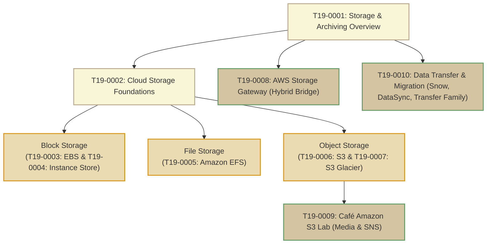

# T19: Storage and Archiving

> **Course**: AWS re/Start Curriculum  
> **Module**: T19 – Storage and Archiving (`M15`)  
> **Total Guides**: 10 Study Guides  
> **Status**: Completed (100%)

---

## Module Overview

The **Storage and Archiving** module provides comprehensive architectural depth on storing, tiering, securing, and transferring data across the Amazon Web Services cloud and hybrid environments:
1. **The Three Fundamental Storage Types**: Block Storage (EBS, Instance Store), File Storage (EFS, FSx), and Object Storage (S3).
2. **Persistent vs Ephemeral Block Storage**: High-IOPS physical NVMe instance stores versus network-attached, intra-AZ replicated Amazon EBS volumes and incremental S3 snapshots.
3. **Multi-AZ Elastic File Sharing**: POSIX-compliant, serverless NFS file systems with Amazon EFS mounted simultaneously across thousands of EC2 instances, containers, and Lambda functions.
4. **Object Storage Lifecycle & Cold Archiving**: Amazon S3 storage classes (Standard, Intelligent-Tiering, Standard-IA, One Zone-IA) transitioning to Amazon S3 Glacier (Instant, Flexible, Deep Archive) and immutable compliance with Vault Lock.
5. **Hybrid Cloud Bridges & Data Migration**: Connecting on-premises storage to AWS via AWS Storage Gateway (File, Volume, Tape), high-speed WAN replication with AWS DataSync, managed file transfers via AWS Transfer Family, and offline petabyte/exabyte physical appliances with the AWS Snow Family.

---

## Study Guide Index

| # | Study Guide | Primary Topics Covered |
|---|-------------|------------------------|
| **0001** | [T19-0001-STOR_STORAGEARCHIVEOVERVIEW_EN.md](file:///work/tmp/aws-cf/T19-Storage_and_Archiving/T19-0001-STOR_STORAGEARCHIVEOVERVIEW_EN.md) | Storage architecture continuum (Block, File, Object), tiering costs vs access latency, 9 module themes, troubleshooting KB runbooks |
| **0002** | [T19-0002-STOR_CLOUDSTORAGEOVERVIEW_EN.md](file:///work/tmp/aws-cf/T19-Storage_and_Archiving/T19-0002-STOR_CLOUDSTORAGEOVERVIEW_EN.md) | Storage as a service, on-prem vs cloud storage, distributed storage fabric, 12-factor comparison matrix (Object vs Block vs File), portfolio mapping |
| **0003** | [T19-0003-STOR_AMAZONEBS_EN.md](file:///work/tmp/aws-cf/T19-Storage_and_Archiving/T19-0003-STOR_AMAZONEBS_EN.md) | Amazon EBS volume types (gp2/gp3, io1/io2 Block Express, st1, sc1), AWS CLI management, Linux NVMe mounting, snapshots, Data Lifecycle Manager |
| **0004** | [T19-0004-STOR_INSTANCESTORE_EN.md](file:///work/tmp/aws-cf/T19-Storage_and_Archiving/T19-0004-STOR_INSTANCESTORE_EN.md) | Direct PCIe/NVMe physical host block storage, ephemeral persistence rules (reboot vs stop/terminate), ideal use cases (buffers, caches, HDFS) |
| **0005** | [T19-0005-STOR_AMAZONEFS_EN.md](file:///work/tmp/aws-cf/T19-Storage_and_Archiving/T19-0005-STOR_AMAZONEFS_EN.md) | Serverless POSIX NFSv4 shared file system, Multi-AZ mount targets, storage classes (Standard, IA, Archive), performance & throughput modes |
| **0006** | [T19-0006-STOR_STORAGES3_EN.md](file:///work/tmp/aws-cf/T19-Storage_and_Archiving/T19-0006-STOR_STORAGES3_EN.md) | S3 buckets and objects, storage classes (Standard, Intelligent-Tiering, Standard-IA, One Zone-IA), lifecycle policies, versioning, BPA, encryption |
| **0007** | [T19-0007-STOR_AMAZONGLACIER_EN.md](file:///work/tmp/aws-cf/T19-Storage_and_Archiving/T19-0007-STOR_AMAZONGLACIER_EN.md) | Archival storage classes (Instant, Flexible, Deep Archive), retrieval tiers (Expedited, Standard, Bulk), Vaults & immutable Vault Lock compliance |
| **0008** | [T19-0008-STOR_AWSSTORAGEGATEWAY_EN.md](file:///work/tmp/aws-cf/T19-Storage_and_Archiving/T19-0008-STOR_AWSSTORAGEGATEWAY_EN.md) | Hybrid storage bridges: S3 File Gateway (NFS/SMB), FSx File Gateway, Volume Gateway (Stored vs Cached), Tape Gateway (VTL for backup software) |
| **0009** | [T19-0009-STOR_CAFEAMAZONS3_EN.md](file:///work/tmp/aws-cf/T19-Storage_and_Archiving/T19-0009-STOR_CAFEAMAZONS3_EN.md) | Café media dropbox scenario (Frank, Sofía, Faythe), S3 bucket provisioning, SNS event notifications (`s3:ObjectCreated:*`), lifecycle rules |
| **0010** | [T19-0010-STOR_DATATRANSFERMIGRATION_EN.md](file:///work/tmp/aws-cf/T19-Storage_and_Archiving/T19-0010-STOR_DATATRANSFERMIGRATION_EN.md) | Online vs offline migration decision tree, AWS Transfer Family (SFTP, FTPS, AS2), AWS DataSync, AWS Snow Family (Snowcone, Snowball, Snowmobile) |

---

## AWS Storage Types Decision Matrix

| Storage Service | Architecture Type | Primary Protocol | Key Advantage | Typical Workloads |
|---|---|---|---|---|
| **Amazon EBS** | Persistent Block | NVMe / SCSI | Sub-millisecond latency, dedicated to 1 instance | Databases (PostgreSQL, MySQL, Oracle), Boot volumes |
| **EC2 Instance Store** | Ephemeral Block | Direct Host NVMe | Ultra-high IOPS, zero network latency | Scratchpad, distributed caches, replicated NoSQL |
| **Amazon EFS** | Regional Shared File | NFSv4.0 / NFSv4.1 | Concurrent multi-instance sharing across AZs | Web content management (WordPress), app code, analytics |
| **Amazon S3** | Regional Object | REST HTTP/HTTPS | 11 9's durability, infinite scale, lifecycle tiering | Data lakes, backups, media hosting, static websites |
| **Amazon S3 Glacier** | Cold Archival Object | REST / S3 API | Lowest cloud cost (< $1/TB/month), Vault Lock | Regulatory archives (7-10 yr compliance), tape replacement |
| **Storage Gateway** | Hybrid Bridge | NFS, SMB, iSCSI | Low-latency local cache with cloud backend | On-premise backup offload, local file shares |
