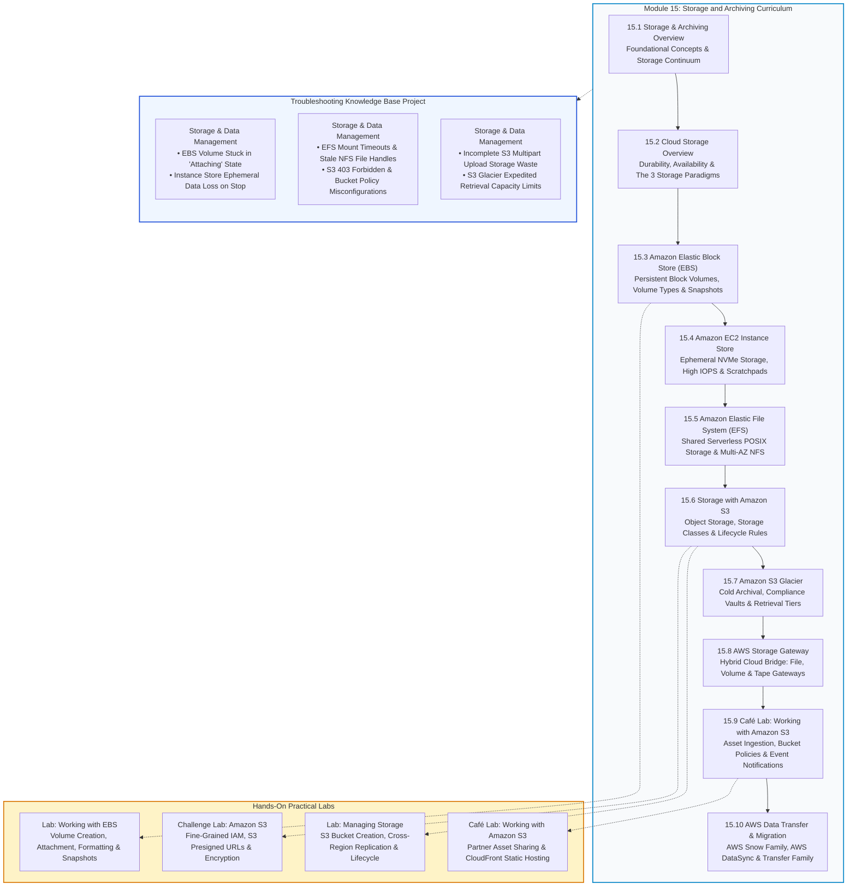
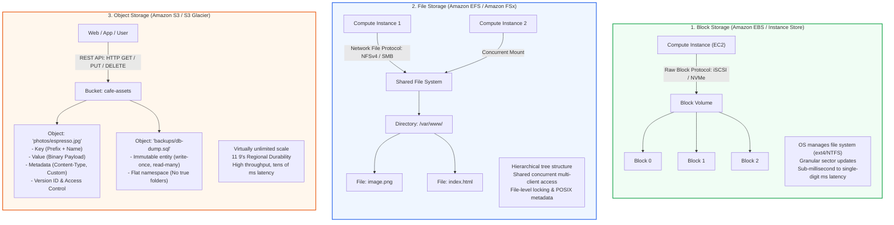
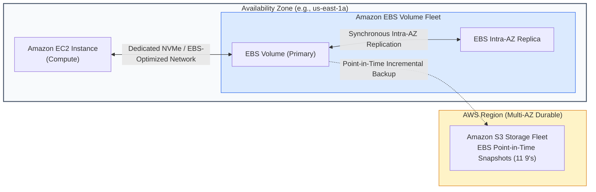
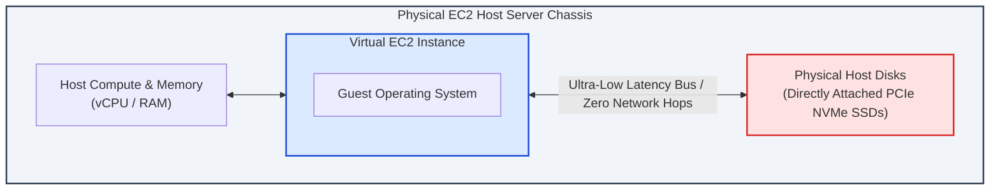
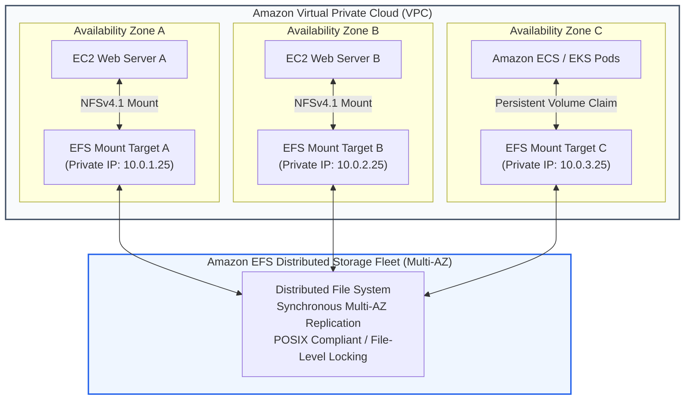
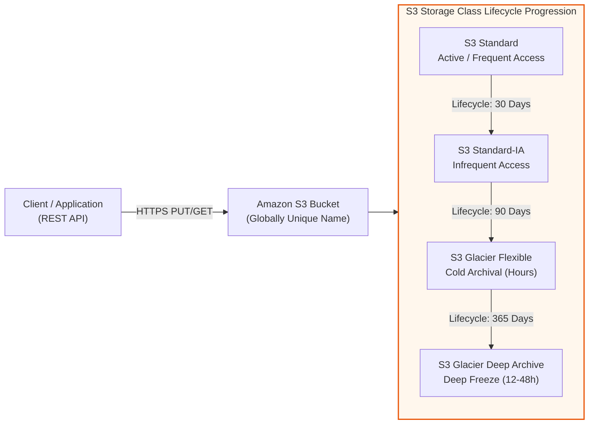
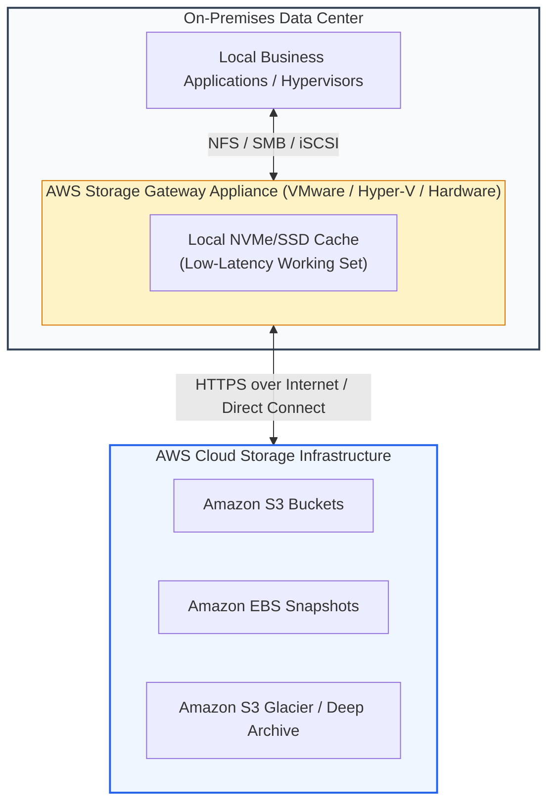
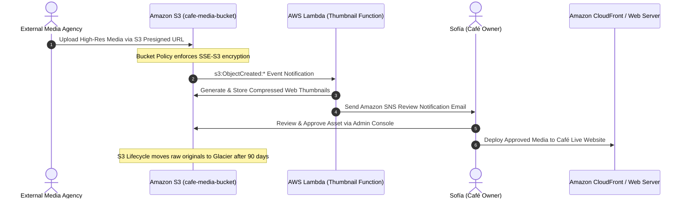

# 💾 Module 15: Storage and Archiving Overview – Study Guide

> **Course**: AWS re/Start  
> **Module**: Storage and Archiving (Module 15)  
> **Source Document**: `T19-0001-STOR_STORAGEARCHIVEOVERVIEW_EN.pdf`  
> **Target Audience**: AWS re/Start Learners / Cloud Practitioners / Solutions Architects / SysOps Administrators  

---

## 🎯 Unit Overview: Cloud Storage Foundations & The Storage Architecture Continuum

In traditional on-premises data centers, storage infrastructure represented one of the most inflexible, expensive, and operationally burdensome capital investments. Enterprise IT organizations routinely provisioned Storage Area Networks (SAN), Network Attached Storage (NAS) appliances, and physical tape libraries based on peak projections three to five years into the future. This legacy model created persistent operational vulnerabilities:
- **Excessive Capital Expenditure (CapEx)**: Purchasing petabytes of raw enterprise magnetic disks and all-flash arrays required massive upfront hardware capital before business demand materialized.
- **Capacity Forecasting Failures**: Under-provisioning caused disastrous storage exhaustion during workload surges, while over-provisioning resulted in expensive hardware operating at 20–30% capacity.
- **Physical Disk Failures & RAID Rebuild Penalties**: Disk degradation in multi-terabyte arrays triggered prolonged RAID rebuild cycles, degrading input/output operations per second (IOPS) and risking catastrophic secondary drive failures during rebuilds.
- **Forklift Upgrades & Manual Data Migration**: Every four to five years, hardware depreciation forced complex data migration projects between storage generations, risking data corruption, downtime, and operational fatigue.

Cloud storage fundamentally transforms this paradigm by converting storage infrastructure into an **elastic, utility-metered, and software-defined service**. In Amazon Web Services (AWS), storage is decoupled from underlying physical hardware constraints, delivering virtually unlimited capacity, automated multi-facility durability, and programmatic life-cycle management.

```
┌────────────────────────────────────────────────────────────────────────────────────────┐
│               The AWS Cloud Storage Continuum: Purpose-Built Data Services              │
├──────────────────────────┬────────────────────────────┬────────────────────────────────┤
│       Block Storage      │        File Storage        │         Object Storage         │
├──────────────────────────┼────────────────────────────┼────────────────────────────────┤
│ • High IOPS & low latency│ • Shared hierarchical tree │ • Flat namespace (Buckets/Keys)│
│ • Raw, unformatted blocks│ • Native POSIX filesystem  │ • 11 9's durability (Regional) │
│ • Dedicated to single EC2│ • Multi-instance concurrent│ • Unlimited elastic capacity   │
│ • Amazon EBS & Inst Store│ • Amazon EFS / FSx         │ • Amazon S3 & S3 Glacier       │
└──────────────────────────┴────────────────────────────┴────────────────────────────────┘
```

**Module 15: Storage and Archiving** provides an exhaustive examination of the primary storage paradigms, hybrid storage integration, and data transfer frameworks available on AWS. Through this module, learners master how to evaluate workload storage requirements, optimize storage tiering costs, configure persistent and ephemeral block storage, architect shared multi-AZ file systems, implement object lifecycle policies, bridge on-premises data centers with hybrid gateways, and migrate petabytes of enterprise data securely into the AWS Cloud.

---

### 📌 Learning Objectives

- [ ] **Define Cloud Storage Primitives**: Explain the core benefits of cloud storage, including durability (99.999999999%), high availability, elasticity, and utility-based pay-as-you-go economics.
- [ ] **Differentiate the Three Primary Storage Types**: Contrast Block Storage, File Storage, and Object Storage across architecture, access protocols, latency profiles, throughput characteristics, scalability limits, and cost models.
- [ ] **Configure Amazon Elastic Block Store (Amazon EBS)**: Evaluate SSD-backed (`gp3`, `io2`) and HDD-backed (`st1`, `sc1`) volume types, configure automated point-in-time EBS snapshots in Amazon S3, and apply Elastic Volumes for dynamic expansion.
- [ ] **Distinguish Amazon EC2 Instance Store Ephemeral Volumes**: Contrast high-IOPS, host-attached NVMe instance store volumes with network-attached EBS volumes, identifying non-persistent data lifecycles and temporary scratchpad use cases.
- [ ] **Implement Amazon Elastic File System (Amazon EFS)**: Deploy serverless, elastic, POSIX-compliant shared file systems across multiple Availability Zones supporting concurrent NFSv4 mounts for EC2 and container workloads.
- [ ] **Master Amazon Simple Storage Service (Amazon S3)**: Analyze the flat object storage architecture, configure storage classes (Standard, Intelligent-Tiering, Standard-IA, One Zone-IA), enforce security policies, and automate S3 Lifecycle transitions.
- [ ] **Architect Long-Term Archiving with Amazon S3 Glacier**: Compare cold storage archival tiers (Glacier Instant Retrieval, Glacier Flexible Retrieval, Glacier Deep Archive), retrieval timeframes, and compliance vault locks.
- [ ] **Bridge Hybrid Infrastructure with AWS Storage Gateway**: Differentiate Amazon S3 File Gateway, Volume Gateway (Cached vs. Stored Volumes), and Tape Gateway to integrate on-premises environments with AWS cloud storage.
- [ ] **Solve Business Scenarios in the Café Project**: Architect an Amazon S3 solution for the Frank and Sofía Café business to ingest external media assets securely, trigger event notifications, and automate lifecycle archiving.
- [ ] **Execute Large-Scale Data Migration Pipelines**: Evaluate offline physical data migration using the AWS Snow Family (Snowcone, Snowball, Snowmobile) and accelerated online data transfers via AWS DataSync and AWS Transfer Family.
- [ ] **Populate the Troubleshooting Knowledge Base**: Formulate operational triage runbooks for common storage failure modes within the **Storage and Data Management** category.

---

## 🗺️ Module 15 Curriculum Roadmap

The diagram below outlines the structural progression of the **Module 15: Storage and Archiving** curriculum, connecting theoretical foundations, hands-on labs, and real-world operational triage:



---

## 🏛️ The Three Storage Types: Architectural Comparison

A cornerstone competency for any cloud architect is distinguishing between **Block Storage**, **File Storage**, and **Object Storage**. Each architecture organizes, addresses, retrieves, and updates bits of data differently, resulting in vastly different performance characteristics, cost profiles, and access patterns.



### 1. Block Storage Architecture
- **Operational Model**: Divides storage into raw, fixed-size chunks of data called **blocks** (e.g., 512-byte or 4 KB sectors). Each block possesses an individual address but contains no metadata, file system structure, or organizational context.
- **Access Protocol**: Low-level bus and storage protocols such as **SCSI**, **Fibre Channel**, **iSCSI**, and **NVMe**.
- **Control**: The host operating system (e.g., Linux or Windows) mounts the raw volume, formats it with a file system (such as `ext4`, `XFS`, or `NTFS`), and creates the file allocation tables.
- **Granularity & Mutability**: Individual blocks can be modified in place. If a single byte inside a 10 GB relational database file changes, only the specific 4 KB block containing that byte is rewritten to disk.
- **Latency & Performance**: Sub-millisecond to low single-digit millisecond latency. Ideal for transactional database files, boot operating system disks, and high-frequency random I/O.
- **AWS Implementations**: **Amazon Elastic Block Store (Amazon EBS)** and **Amazon EC2 Instance Store**.

### 2. File Storage Architecture
- **Operational Model**: Organizes data hierarchically as files inside nested directories and subdirectories. Storage is exposed to operating systems as a shared file system.
- **Access Protocol**: Network file sharing protocols, primarily **Network File System (NFS)** for Linux/Unix and **Server Message Block (SMB / CIFS)** for Windows.
- **Control & Concurrency**: The storage appliance manages the underlying file system, permissions (POSIX permissions or Windows Access Control Lists), and file locking mechanisms. Hundreds or thousands of compute instances can mount the file system simultaneously.
- **Granularity & Mutability**: Files can be opened, appended to, read sequentially, or locked for exclusive write operations.
- **Latency & Performance**: Low single-digit to tens of milliseconds latency. Throughput scales elastically with workload demand.
- **AWS Implementations**: **Amazon Elastic File System (Amazon EFS)** and **Amazon FSx** (for Windows File Server, Lustre, NetApp ONTAP, OpenZFS).

### 3. Object Storage Architecture
- **Operational Model**: Stores data in a flat namespace as distinct, self-contained units called **objects** inside containers called **buckets**. There is no nested hierarchical file system; directory "paths" (prefixes) are merely naming conventions embedded in the object's unique key string.
- **Access Protocol**: Standard web protocols over **HTTP/HTTPS** using **REST APIs** (`GET`, `PUT`, `POST`, `DELETE`, `HEAD`).
- **Data Structure**: Every object consists of:
  1. **Key**: The unique name/identifier for the object (e.g., `images/2026/espresso.jpg`).
  2. **Value**: The binary data payload itself (from 0 bytes up to 5 TB).
  3. **Metadata**: A collection of name-value pairs containing system metadata (Creation Date, Size, Content-Type) and custom user metadata.
  4. **Version ID**: A unique identifier when bucket versioning is enabled.
  5. **Access Control Information**: Permissions granting or denying access.
- **Granularity & Mutability**: Objects are **immutable**. You cannot edit a single byte inside an existing object; modifying an object requires uploading a complete replacement object.
- **Latency & Scalability**: Tens to hundreds of milliseconds time-to-first-byte (TTFB). Delivers virtually unlimited aggregate throughput and capacity, with 99.999999999% (11 9s) durability across multiple physical facilities.
- **AWS Implementations**: **Amazon Simple Storage Service (Amazon S3)** and **Amazon S3 Glacier**.

---

### 📊 Storage Paradigms Comprehensive Comparison Matrix

| Evaluation Dimension | Block Storage (Amazon EBS / Instance Store) | File Storage (Amazon EFS) | Object Storage (Amazon S3) |
| :--- | :--- | :--- | :--- |
| **Smallest Addressable Unit** | Fixed-size raw Block (e.g., 4 KB sector) | File within hierarchical directory | Object (Payload + Metadata + Key) |
| **Namespace Structure** | Flat sector addresses (Managed by OS filesystem) | Hierarchical directory tree (`/dir/subdir/file`) | Flat global namespace within bucket |
| **Access Protocol / Interface**| Block protocols (NVMe, iSCSI, SCSI bus) | Network protocols (NFSv4.0/4.1, SMB) | REST API over HTTP/HTTPS (`GET`, `PUT`) |
| **Client Attachment Model** | Attached to single EC2 instance (EBS Multi-Attach limited to 1 AZ) | Concurrently mounted by 1,000s of EC2/container instances | Accessed globally via Internet/VPC endpoints by any client |
| **Typical Latency** | Sub-millisecond (Instance Store) to 1–5 ms (EBS) | Low single-digit milliseconds (1–10 ms) | Tens to hundreds of milliseconds (10–100 ms) |
| **Throughput Scaling** | Provisioned per volume (Up to 1,000 MB/s per EBS volume) | Scalable/Elastic (Up to tens of GB/s aggregate throughput) | Virtually unlimited (3,500 PUT / 5,500 GET per prefix/sec) |
| **Capacity Scaling** | Fixed provisioned volume size (Resize via API) | Automatically grows/shrinks elastically | Unlimited capacity without pre-provisioning |
| **Data Mutability** | In-place random read/write updates | In-place append, modify, read with file locking | Immutable (Write-once, replace entire object) |
| **Storage Redundancy Scope**| Replicated within a single Availability Zone | Synchronously replicated across $\ge 3$ Availability Zones | Synchronously replicated across $\ge 3$ Availability Zones |
| **Primary Use Cases** | Boot volumes, relational databases (Oracle, PostgreSQL, SQL Server) | Shared application files, CMS web roots (WordPress), home dirs | Unstructured web assets, big data lakes, backups, static websites |
| **Cost Basis** | Provisioned gigabytes per month ($/GB-month) | Consumed gigabytes per month ($/GB-month) | Consumed storage + API requests + data egress |

---

## 🧭 Core Module Themes & Architectural Deep-Dives

---

### 🌐 Theme 1: Cloud Storage Overview & Core Tenets

Cloud storage systems are engineered to eliminate the systemic vulnerabilities of physical disk infrastructure. AWS cloud storage delivers four foundational architectural pillars:

```
┌────────────────────────────────────────────────────────────────────────────────────────┐
│                        The Four Pillars of AWS Cloud Storage                           │
├──────────────────────────────┬─────────────────────────────────────────────────────────┤
│ 1. 11 9's Durability         │ Designed for 99.999999999% durability across facilities │
│ 2. High Availability (SLA)   │ Redundant multi-AZ infrastructure ensures 99.9% - 99.99%│
│ 3. Elastic Scalability       │ Seamlessly scales up or down with zero downtime         │
│ 4. Total Cost Optimization   │ Intelligent tiering, lifecycle archiving & pay-as-you-go│
└──────────────────────────────┴─────────────────────────────────────────────────────────┘
```

#### 1. Extreme Durability (99.999999999% – 11 9's)
- **What Durability Means**: Durability refers to data preservation over time—ensuring that once an object is written, it is never corrupted, destroyed, or lost.
- **The Scale of 11 9's**: A durability rating of 99.999999999% means that if an enterprise stores 10,000,000 objects in Amazon S3, you can expect to lose an average of a single object every 10,000 years.
- **Physical Implementation**: In services like Amazon S3 and Amazon EFS, AWS automatically and synchronously stores data redundantly across multiple distinct physical data centers (at least three Availability Zones) separated by meaningful geographic distances.

#### 2. High Availability
- **What Availability Means**: Availability refers to the uptime and operational readiness of the storage service—ensuring that authorized clients can successfully send requests to read and write data when needed.
- **Service Level Agreements (SLAs)**: Amazon S3 Standard provides a 99.99% availability commitment, with design targets ensuring instant failover if a single data center facility encounters network, cooling, or power interruptions.

#### 3. Dynamic Elasticity
- Storage capacity in the cloud is not bound by pre-ordered physical disk cages. Organizations can write a 1 KB JSON configuration file or ingest a 50 petabyte autonomous vehicle sensor dataset without submitting hardware procurement requests. Services like Amazon S3 and Amazon EFS automatically expand and contract capacity elastically.

#### 4. Cost Optimization & Lifecycle Economics
- AWS replaces flat, one-size-fits-all hardware depreciation with **multi-tiered storage pricing**. Workloads transition data through distinct price tiers as data ages and access frequency drops, reducing total cost of ownership (TCO) by up to 90% over time.

---

### 💽 Theme 2: Amazon Elastic Block Store (Amazon EBS)

**Amazon Elastic Block Store (Amazon EBS)** provides durable, persistent, network-attached block-level storage volumes designed for use with **Amazon EC2** instances.



#### Architectural Characteristics
- **Network-Attached Persistence**: EBS volumes exist independently from the life cycle of the EC2 instance. When an EC2 instance is stopped or restarted, data on attached EBS volumes remains completely intact.
- **Intra-AZ High Availability**: Every EBS volume is automatically replicated across multiple physical storage servers within its single Availability Zone to protect against single-hardware component failures (delivering 99.8% to 99.9% volume durability).
- **AZ Boundary Restriction**: An EBS volume can only be attached to an EC2 instance that resides in the **exact same Availability Zone**. To move an EBS volume to a different AZ, a snapshot must be created and restored into the target AZ.

#### Amazon EBS Volume Types & Specifications

```
┌────────────────────────────────────────────────────────────────────────────────────────┐
│                               Amazon EBS Volume Categories                             │
├───────────────────────────────────────────┬────────────────────────────────────────────┤
│           SSD-Backed Volumes              │             HDD-Backed Volumes             │
│   (Transactional, Boot, High IOPS)        │      (Throughput, Streaming, Big Data)     │
├───────────────────────────────────────────┼────────────────────────────────────────────┤
│ • General Purpose SSD (gp2, gp3)          │ • Throughput Optimized HDD (st1)           │
│ • Provisioned IOPS SSD (io1, io2, io2 BE) │ • Cold HDD (sc1)                           │
└───────────────────────────────────────────┴────────────────────────────────────────────┘
```

| Volume Category | Volume Type API | Max IOPS / Volume | Max Throughput / Vol | Dominant Workloads & Best Practices |
| :--- | :---: | :---: | :---: | :--- |
| **General Purpose SSD** | **`gp3`** *(Recommended)* | Up to 16,000 IOPS | Up to 1,000 MB/s | Default boot volumes, medium databases, virtual desktops. Allows independent provisioning of IOPS and throughput without sizing up storage. |
| **General Purpose SSD** | **`gp2`** *(Previous Gen)* | Up to 16,000 IOPS | Up to 250 MB/s | Baseline performance coupled to volume size (3 IOPS/GB) with burst credit bucket mechanism. |
| **Provisioned IOPS SSD** | **`io2` / `io2 Block Express`** | Up to 256,000 IOPS | Up to 4,000 MB/s | Mission-critical, I/O-intensive OLTP relational databases (SAP HANA, Oracle, Microsoft SQL Server). Sub-millisecond latencies, 99.999% durability. |
| **Throughput Optimized HDD**| **`st1`** | Up to 500 IOPS | Up to 500 MB/s | Big data pipelines, streaming workloads, log processing, data warehouses (Cannot be boot volumes). |
| **Cold HDD** | **`sc1`** | Up to 250 IOPS | Up to 250 MB/s | Lowest-cost block storage for infrequently accessed sequential data (Cannot be boot volumes). |

#### Amazon EBS Snapshots
- **Point-in-Time Incremental Backups**: EBS snapshots are point-in-time backups saved durably into **Amazon S3** (delivering 11 9's durability). Snapshots are **incremental**: only the specific blocks changed since the most recent snapshot are written, dramatically reducing backup storage costs.
- **Full Volume Restoration**: Although snapshots are saved incrementally, the restoration process treats each snapshot as a complete, independent volume image.
- **Cross-Region & Cross-AZ Migration**: Snapshots can be copied across Availability Zones and across AWS Regions, serving as the primary vehicle for Disaster Recovery (DR) and geographic migration.
- **EBS Elastic Volumes**: Allows online modifications of volume type, size, and IOPS performance in-place without stopping the EC2 instance or detaching the volume.

---

### ⚡ Theme 3: Amazon EC2 Instance Store

An **Amazon EC2 Instance Store** provides temporary block-level storage on physical solid-state drives (NVMe SSD) or magnetic hard drives directly installed on the host hardware chassis running the virtual EC2 instance.



#### Ephemeral Lifecycle & Risk Management
> [!CAUTION]
> **Ephemeral Storage Warning**: Instance store storage is **non-persistent**. If the virtual EC2 instance is **Stopped** (which migrates the instance to a different physical host upon next start), **Terminated**, or if the underlying host physical disk fails, all data residing on the instance store volume is **permanently and irretrievably erased**.

#### Data Retention Rules:
- Data is **PRESERVED** during: Operating system warm reboot (`sudo reboot`).
- Data is **LOST** during:
  - Instance **Stop** and subsequent **Start**
  - Instance **Termination**
  - Underlying physical hardware failure or host hypervisor crash

#### Strategic Use Cases
- High-frequency scratch spaces, temporary buffers, and temporary swap partitions.
- Web server stateless session caches (e.g., Redis / Memcached in volatile mode).
- Distributed, software-replicated database clusters that handle durability at the application tier (e.g., Apache Cassandra, Elasticsearch, Hadoop HDFS, MongoDB replica sets).

#### Amazon EBS vs. Amazon EC2 Instance Store Matrix

| Feature Dimension | Amazon Elastic Block Store (Amazon EBS) | Amazon EC2 Instance Store |
| :--- | :--- | :--- |
| **Physical Location** | Network-attached via dedicated storage network | Directly attached to physical host chassis |
| **Persistence Model** | **Persistent**: Survives instance Stop, Restart, Terminate | **Ephemeral**: Erased on Stop, Terminate, or Host Failure |
| **Lifecycle Binding** | Independent from EC2 instance lifecycle | Strictly bound to physical host hardware |
| **Snapshot Backup** | Point-in-time snapshots natively stored in S3 | No native snapshot mechanism (Must copy via OS scripts) |
| **Performance Profile** | High performance governed by provisioned IOPS/throughput | Maximum possible bare-metal IOPS and microsecond latency |
| **Billing Model** | Charged per GB-month provisioned + IOPS | Included in base hourly pricing of EC2 instance type |
| **Boot Volume Support** | Supported across virtually all instance types | Limited legacy support; predominantly secondary scratch |

---

### 📂 Theme 4: Amazon Elastic File System (Amazon EFS)

**Amazon Elastic File System (Amazon EFS)** is a fully managed, serverless, elastic **Network File System (NFS)** designed for Linux-based workloads that require shared, concurrent access to files across thousands of compute instances.



#### Architectural Capabilities
- **Serverless & Fully Elastic**: There is no storage provisioning or capacity planning. The file system automatically grows when files are added and automatically shrinks when files are deleted, charging only for active consumed gigabytes.
- **POSIX-Compliant Shared File System**: Implements standard POSIX filesystem permissions, directory structures, and file-level locking, ensuring seamless compatibility with enterprise Linux applications.
- **Multi-AZ Synchronous Replication**: By default, Amazon EFS writes every file synchronously across multiple Availability Zones in an AWS Region, delivering multi-AZ high availability and 11 9's durability.
- **Concurrent Access at Scale**: Thousands of EC2 instances, AWS Lambda functions, Amazon ECS tasks, Amazon EKS pods, and on-premises physical servers (connected via AWS Direct Connect or AWS Site-to-Site VPN) can mount an EFS file system concurrently.

#### Storage Classes & Cost Optimization
- **EFS Standard**: Designed for frequently accessed active files; delivers single-digit millisecond read/write latency.
- **EFS Infrequent Access (EFS IA)**: Reduces storage costs by up to 92% for files not accessed for 7, 14, 30, 60, or 90 days.
- **EFS Archive**: Designed for cold, long-term files accessed only a few times per year, reducing storage costs by up to 50% compared to EFS IA.
- **EFS Lifecycle Management & Intelligent-Tiering**: Automatically shifts files transparently between Standard, IA, and Archive storage classes based on access patterns without modifying file paths or interrupting application access.

---

### 🪣 Theme 5: Amazon Simple Storage Service (Amazon S3)

**Amazon Simple Storage Service (Amazon S3)** is the premier cloud-native object storage service, offering industry-leading scalability, data availability, security, and performance.



#### Core Data Concepts
- **Buckets**: Logical containers for objects stored in Amazon S3. Bucket names are **globally unique across all AWS accounts in all AWS Regions worldwide** (e.g., `s3://cafe-media-production-2026/`).
- **Objects**: Fundamental entities stored in S3, consisting of Object Key (identifier), Value (data payload up to 5 TB), Metadata, and Version ID.
- **Keys**: The full sequence of characters assigned to an object within a bucket, serving as the object's unique address (e.g., `static/images/menu/espresso_macchiato.jpg`).
- **Prefixes**: Any string between the bucket name and the object name delineated by forward slashes (`/`). S3 partitions performance across unique prefixes, allowing applications to achieve **3,500 PUT/POST/DELETE and 5,500 GET/HEAD requests per second per prefix**.

#### Amazon S3 Storage Classes

| Storage Class | Durability | Availability | AZ Redundancy | Min Duration | Retrieval Latency | Optimal Use Cases |
| :--- | :---: | :---: | :---: | :---: | :---: | :--- |
| **S3 Standard** | 99.999999999% | 99.99% | $\ge 3$ AZs | None | Milliseconds | Active web media, dynamic websites, cloud applications, big data analytics. |
| **S3 Intelligent-Tiering** | 99.999999999% | 99.9% | $\ge 3$ AZs | None | Milliseconds (Archive opt-in) | Data with unpredictable, changing, or unknown access patterns; zero operational overhead. |
| **S3 Standard-IA** | 99.999999999% | 99.9% | $\ge 3$ AZs | 30 days | Milliseconds | Long-term backups, disaster recovery files accessed less than once a month. |
| **S3 One Zone-IA** | 99.999999999% | 99.5% | 1 AZ | 30 days | Milliseconds | Non-critical, recreatable data or secondary copies not requiring multi-AZ protection. |
| **S3 Glacier Instant Retrieval** | 99.999999999% | 99.9% | $\ge 3$ AZs | 90 days | Milliseconds | Medical imaging, news media archives requiring immediate retrieval once a quarter. |
| **S3 Glacier Flexible Retrieval** | 99.999999999% | 99.9% | $\ge 3$ AZs | 90 days | Minutes to hours | Compliance archives, annual financial records, tape replacement backups. |
| **S3 Glacier Deep Archive** | 99.999999999% | 99.9% | $\ge 3$ AZs | 180 days | 12 to 48 hours | 7-to-10-year regulatory retention (HIPAA, financial audits) at lowest cloud cost. |

#### S3 Security & Access Governance
- **S3 Block Public Access**: Account-level and bucket-level centralized controls that override all permissive bucket policies and ACLs, preventing accidental public exposure of enterprise data.
- **Bucket Policies**: JSON-based resource policies attached directly to S3 buckets that enforce granular access rules (e.g., mandating encrypted transit via `aws:SecureTransport: true`).
- **IAM Policies**: Identity policies attached to IAM users, groups, or roles defining allowed S3 actions.
- **Server-Side Encryption (SSE)**:
  - **SSE-S3**: AWS manages encryption keys (AES-256).
  - **SSE-KMS**: Encryption keys managed via AWS Key Management Service (AWS KMS) for audit tracking and envelope encryption.
  - **SSE-C**: Customer provides and manages keys, while AWS handles encryption/decryption execution.

---

### ❄️ Theme 6: Amazon S3 Glacier & Archival Tiers

**Amazon S3 Glacier** provides low-cost, secure, and durable storage classes purpose-built for data archiving and long-term compliance retention.

```
┌────────────────────────────────────────────────────────────────────────────────────────┐
│                        The Amazon S3 Glacier Retrieval Spectrum                        │
├──────────────────────────┬─────────────────────────────┬───────────────────────────────┤
│ Glacier Instant          │ Glacier Flexible Retrieval  │ Glacier Deep Archive          │
├──────────────────────────┼─────────────────────────────┼───────────────────────────────┤
│ • Latency: Milliseconds  │ • Expedited: 1–5 minutes    │ • Standard: 12 hours          │
│ • Minimum storage: 90 d  │ • Standard: 3–5 hours       │ • Bulk: 48 hours              │
│ • Interactive queries    │ • Bulk: 5–12 hours (Free)   │ • Lowest storage cost in AWS  │
│ • Rapid archive access   │ • Minimum storage: 90 days  │ • Minimum storage: 180 days   │
└──────────────────────────┴─────────────────────────────┴───────────────────────────────┘
```

#### Retrieval Tiers in S3 Glacier Flexible Retrieval
1. **Expedited Retrieval**: Returns data in **1 to 5 minutes** for emergency operational needs (purchasable provisioned capacity units guarantee throughput during crises).
2. **Standard Retrieval**: Accesses archives within **3 to 5 hours**; standard default retrieval option.
3. **Bulk Retrieval**: Processes massive multi-terabyte data extractions within **5 to 12 hours** at the lowest cost (completely free data retrieval tier).

#### S3 Glacier Vaults & Vault Lock
- In the standalone Glacier data model, storage containers are called **vaults**, which hold individual **archives**.
- **S3 Glacier Vault Lock**: Allows security administrators to deploy immutable compliance policies (e.g., Write Once, Read Many - WORM). Once a Vault Lock policy is locked, **it cannot be modified, overridden, or deleted by any AWS identity, including the root user**, ensuring compliance with SEC Rule 17a-4(f) and financial regulatory frameworks.

---

### 🌉 Theme 7: AWS Storage Gateway (Hybrid Cloud Integration)

**AWS Storage Gateway** is a hybrid cloud storage service that bridges on-premises environments with AWS cloud storage, enabling local enterprise applications to transparently store data in AWS with local caching performance.



#### The Three Core Storage Gateway Types

```
┌────────────────────────────────────────────────────────────────────────────────────────┐
│                              AWS Storage Gateway Taxonomy                              │
├──────────────────────────┬─────────────────────────────┬───────────────────────────────┤
│ 1. S3 File Gateway       │ 2. Volume Gateway           │ 3. Tape Gateway (VTL)         │
├──────────────────────────┼─────────────────────────────┼───────────────────────────────┤
│ • Protocols: NFS / SMB   │ • Cached Volumes: Working   │ • Protocol: iSCSI VTL         │
│ • Directly maps to S3    │   set local, primary in S3  │ • Replaces physical tape automation│
│ • Local cache for files  │ • Stored Volumes: Primary   │ • Virtual tapes backed by S3  │
│ • Retains POSIX metadata │   local, async EBS snapshot │   and S3 Glacier Deep Archive │
└──────────────────────────┴─────────────────────────────┴───────────────────────────────┘
```

1. **Amazon S3 File Gateway**:
   - Presents file shares over **NFS** or **SMB** directly to on-premises servers.
   - Files are stored 1:1 as native objects in Amazon S3 buckets. Frequently accessed files are retained in the on-premises local SSD cache for sub-millisecond local reads.
2. **Volume Gateway**:
   - Presents block storage volumes to on-premises servers using the standard **iSCSI** protocol.
   - **Cached Volumes**: Primary data is stored durably in Amazon S3; only frequently read data is cached locally (Sizes: 1 TB to 32 TB). Drastically reduces on-premises physical disk footprints.
   - **Stored Volumes**: The entire primary dataset is stored on local on-premises physical disks, while asynchronous point-in-time backups are mirrored to AWS as Amazon EBS snapshots (Sizes: 1 TB to 16 TB).
3. **Tape Gateway (Virtual Tape Library - VTL)**:
   - Exposes an iSCSI-based virtual tape library consisting of virtual tape drives and a virtual media changer.
   - Drops into existing backup software (Veritas NetBackup, Veeam, Commvault) without workflow changes, replacing physical tape libraries with virtual tapes backed by Amazon S3, S3 Glacier, and S3 Glacier Deep Archive.

---

### ☕ Theme 8: Café Project Scenario: Managing Media & Backups with S3

In the continuing business evolution of Frank and Sofía's Café, the business expands its pastry and beverage lines, commissioning professional photography and video portfolios from an external media agency.



#### Key Architecture Lessons from the Café Scenario
1. **Secure External Collaboration**: Rather than giving external contractors administrative access or setting up complex FTP servers, Frank and Sofía generate **S3 Presigned URLs** or assign dedicated, restricted IAM roles, permitting temporary write access exclusively to an isolated upload folder.
2. **Automated Event-Driven Ingestion**: S3 Event Notifications immediately dispatch an execution trigger to AWS Lambda or Amazon SNS upon file arrival (`s3:ObjectCreated:*`), alerting Sofía for content approval and automatically generating web-optimized thumbnails.
3. **Automated Cost Protection via Lifecycle Rules**: High-resolution RAW original image files are transitioned to S3 Standard-IA after 30 days and archived to S3 Glacier after 90 days, keeping S3 storage costs negligible as the café's media catalog expands.

---

### 🚚 Theme 9: AWS Data Transfer & Migration Services

When enterprise organizations transition petabytes or exabytes of on-premises data into AWS, standard internet connections face severe physical bandwidth limitations. AWS provides specialized offline physical appliances and accelerated online transfer protocols.

```
┌────────────────────────────────────────────────────────────────────────────────────────┐
│                        Data Transfer Decision Framework                                │
├─────────────────────────────────────────┬──────────────────────────────────────────────┤
│      Offline Physical Appliance Fleet   │       Accelerated Online Network Services    │
├─────────────────────────────────────────┼──────────────────────────────────────────────┤
│ • AWS Snowcone (8 TB – 14 TB)           │ • AWS DataSync (Up to 10x network speed)     │
│ • AWS Snowball Edge (80 TB – 210 TB)    │ • AWS Transfer Family (Managed SFTP/FTPS)    │
│ • AWS Snowmobile (Up to 100 PB / truck) │ • AWS Direct Connect (Dedicated line)        │
└─────────────────────────────────────────┴──────────────────────────────────────────────┘
```

#### 1. The AWS Snow Family (Offline Physical Transport)
- **AWS Snowcone**: Small, ultra-portable, ruggedized edge computing and data transfer device. Offers 8 TB HDD or 14 TB SSD storage; weighs just 4.5 lbs (2.1 kg) and can be powered by batteries or drone mounts. Supports edge compute via Amazon EC2 and AWS IoT Greengrass.
- **AWS Snowball Edge**: Ruggedized physical shipping container designed for large-scale data transport:
  - *Storage Optimized*: 80 TB or 210 TB of NVMe capacity for bulk data migration and local object storage.
  - *Compute Optimized*: 42 TB storage with 104 vCPUs and optional GPUs for edge machine learning and pre-processing.
- **AWS Snowmobile**: A 45-foot ruggedized shipping container pulled by a semi-trailer truck. Delivers up to **100 petabytes (PB)** per vehicle for exabyte-scale data center consolidations.

#### 2. Online Transfer Services
- **AWS DataSync**: An online data transfer tool that automates and accelerates moving data between on-premises storage systems (NFS, SMB, HDFS, object stores) and AWS services (S3, EFS, FSx). Uses a purpose-built network protocol to transfer data up to **10 times faster** than open-source tools like `rsync` or `scp`.
- **AWS Transfer Family**: Provides fully managed support for **SFTP, FTPS, and FTP** directly into and out of Amazon S3 and Amazon EFS. Allows existing business-to-business (B2B) partners and client legacy scripts to upload files without modifying client applications.

---

## 📈 Storage Tiering: Cost vs. Access Latency Continuum

Selecting the appropriate storage service requires balancing access latency against storage expenditure:

```mermaid
flowchart LR
    subgraph Microsecond["Microseconds Latency / Highest Cost"]
        IS["EC2 Instance Store<br/>(Physical NVMe SSD)"]
    end

    subgraph LowMillisecond["1 - 5 Milliseconds Latency / Medium-High Cost"]
        EBS_io["EBS io2 Block Express"]
        EBS_gp["EBS gp3"]
        EFS_std["Amazon EFS Standard"]
    end

    subgraph TenMillisecond["Tens of Milliseconds / Low Cost"]
        S3_std["Amazon S3 Standard"]
        S3_ia["Amazon S3 Standard-IA"]
        S3_gir["S3 Glacier Instant"]
    end

    subgraph MinutesToHours["Minutes to Hours / Lowest Cost Archival"]
        S3_gfr["S3 Glacier Flexible"]
        S3_gda["S3 Glacier Deep Archive<br/>($0.00099 / GB-month)"]
    end

    Microsecond --> LowMillisecond --> TenMillisecond --> MinutesToHours

    style Microsecond fill:#fee2e2,stroke:#dc2626,stroke-width:2px
    style LowMillisecond fill:#fef3c7,stroke:#d97706,stroke-width:2px
    style TenMillisecond fill:#dcfce7,stroke:#16a34a,stroke-width:2px
    style MinutesToHours fill:#dbeafe,stroke:#2563eb,stroke-width:2px
```



```
┌────────────────────────────────────────────────────────────────────────────────────────┐
│              Relative Cost ($/GB-Month) vs. Retrieval Latency Continuum                │
├───────────────────────────────┬───────────────────────────┬────────────────────────────┤
│ Storage Tier                  │ Typical Latency           │ Relative Monthly Cost / GB │
├───────────────────────────────┼───────────────────────────┼────────────────────────────┤
│ Amazon EC2 Instance Store     │ Microseconds (< 0.1 ms)   │ High (Packaged in EC2 SKU) │
│ Amazon EBS Provisioned (io2)  │ Sub-millisecond (< 1 ms)  │ $$$$$ ($0.125 + IOPS cost) │
│ Amazon EBS General (gp3)      │ Low milliseconds (1–2 ms) │ $$$$ ($0.08 / GB)          │
│ Amazon EFS Standard           │ Low milliseconds (2–5 ms) │ $$$ ($0.30 / GB consumed)  │
│ Amazon S3 Standard            │ Tens of ms (20–50 ms)     │ $$ ($0.023 / GB)           │
│ Amazon S3 Standard-IA         │ Tens of ms (20–50 ms)     │ $ ($0.0125 / GB + retriev.)│
│ S3 Glacier Instant Retrieval  │ Tens of ms (20–50 ms)     │ $ ($0.004 / GB + retriev.) │
│ S3 Glacier Flexible Retrieval │ 1 minute to 5 hours       │ ¢ ($0.0036 / GB)           │
│ S3 Glacier Deep Archive       │ 12 to 48 hours            │ ¢¢ ($0.00099 / GB - min)   │
└───────────────────────────────┴───────────────────────────┴────────────────────────────┘
```

---

## 🛠️ Troubleshooting Knowledge Base: Storage & Data Management

As part of the **Troubleshooting Knowledge Base Project**, students must document operational triage runbooks for common production storage failure scenarios within the **Storage and Data Management** category.

---

### Runbook STOR-01: Amazon EBS Volume Stuck in `attaching` State or Filesystem Mount Failure

#### Problem Description
An administrator attempts to attach an Amazon EBS volume to an active Amazon EC2 Linux instance using the AWS CLI or management console. The volume status remains perpetually in the `attaching` state, or the operating system reports `mount: /mnt/data: mount point does not exist` or `wrong fs type, bad option, bad superblock`.

#### Root Cause Analysis
1. **Device Name Mapping Conflict**: Newer Nitro-based EC2 instances expose EBS volumes as NVMe block devices (`/dev/nvme[0-26]n1`) rather than legacy OS device identifiers (`/dev/xvdf` or `/dev/sdf`).
2. **Missing Filesystem Formatting**: The newly created EBS volume is raw block storage containing no initial filesystem structure (`ext4`/`XFS`).
3. **Availability Zone Mismatch**: The administrator attempted to attach an EBS volume located in `us-east-1a` to an EC2 instance deployed in `us-east-1b`.

#### Diagnostic & Triage Workflow
```bash
# 1. Verify instance and volume Availability Zones via AWS CLI
aws ec2 describe-instances --instance-ids i-0a1b2c3d4e5f6g7h8 --query "Reservations[].Instances[].Placement.AvailabilityZone" --output text
aws ec2 describe-volumes --volume-ids vol-0123456789abcdef0 --query "Volumes[].AvailabilityZone" --output text

# 2. On the EC2 Linux host, list all recognized NVMe block storage devices
lsblk

# 3. Check if the block device has an existing filesystem formatted
sudo file -s /dev/nvme1n1
# Output showing raw data: '/dev/nvme1n1: data' (Indicates unformatted block device)
```

#### Remediation Steps
1. If raw unformatted data is reported, format the new volume with an `XFS` filesystem:
   ```bash
   sudo mkfs -t xfs /dev/nvme1n1
   ```
2. Create the desired mount directory and mount the filesystem:
   ```bash
   sudo mkdir -p /mnt/data
   sudo mount /dev/nvme1n1 /mnt/data
   ```
3. To persist the mount across system reboots, obtain the block UUID and add it to `/etc/fstab`:
   ```bash
   sudo blkid /dev/nvme1n1
   # Add entry to /etc/fstab:
   # UUID=12345678-abcd-ef01-2345-6789abcdef01 /mnt/data xfs defaults,nofail 0 2
   ```

---

### Runbook STOR-02: EC2 Instance Store Ephemeral Data Loss Upon Accidental Instance Stop

#### Problem Description
A junior engineer stopped an EC2 database instance (`m5d.large`) over the weekend to reduce costs. Upon starting the instance on Monday morning, the custom caching directory mounted at `/mnt/ephemeral` is completely empty, and the application service fails to launch with missing state files.

#### Root Cause Analysis
- The instance type `m5d.large` includes an onboard physical NVMe SSD **Instance Store** volume.
- When an EC2 instance is placed in the **Stopped** state, AWS deallocates the underlying physical hardware host and returns it to the pool. When subsequently **Started**, the instance boots onto an entirely different physical server chassis. All data on host-attached instance store disks is **permanently destroyed**.

#### Diagnostic Check
```bash
# Verify volume block devices and instance store mapping
curl -s http://169.254.169.254/latest/meta-data/block-device-mapping/
```

#### Remediation & Architectural Prevention
1. **Reconstruct Ephemeral Mount**: The instance boot scripts (`cloud-init` or user-data) must automatically format and remount the instance store device on every boot:
   ```bash
   # User-data bootstrap script
   #!/bin/bash
   mkfs -t ext4 /dev/nvme1n1
   mkdir -p /mnt/ephemeral
   mount /dev/nvme1n1 /mnt/ephemeral
   chown -R appuser:appgroup /mnt/ephemeral
   ```
2. **Architectural Guardrail**: Never place application state, transactional logs, or unbacked customer assets on instance store disks. Migrate persistent state to **Amazon EBS** or **Amazon EFS**.

---

### Runbook STOR-03: Amazon EFS Mount Timeout & Stale NFS File Handle

#### Problem Description
A distributed fleet of Amazon EC2 web servers attempting to mount an Amazon EFS file system via NFS hangs indefinitely, throwing the error: `mount.nfs4: Connection timed out` or `nfs: server not responding, still trying`.

#### Root Cause Analysis
1. **Security Group Port 2049 Blocked**: The security group attached to the EFS Mount Targets does not allow inbound TCP traffic on port 2049 (NFS) from the EC2 instance's security group.
2. **Missing Mount Target in Subnet**: The EC2 instance is running in a subnet/AZ where no EFS Mount Target has been provisioned.
3. **DNS Resolution Failure**: The client is failing to resolve the regional EFS DNS name `fs-xxxxxxxx.efs.us-east-1.amazonaws.com` due to custom private DNS configurations in the VPC.

#### Diagnostic Commands
```bash
# 1. Test TCP reachability to the EFS Mount Target on NFS Port 2049
nc -zv -w 3 fs-0123456789abcdef0.efs.us-east-1.amazonaws.com 2049

# 2. Check if the security group permits inbound 2049 traffic
aws ec2 describe-security-groups --group-ids sg-efsmountgroup --output json
```

#### Remediation Steps
1. Add an inbound rule to the EFS Mount Target Security Group granting NFS access from the Web Server Security Group:
   ```bash
   aws ec2 authorize-security-group-ingress \
       --group-id sg-efsmountgroup \
       --protocol tcp \
       --port 2049 \
       --source-group sg-webservers
   ```
2. Utilize the recommended **Amazon EFS Mount Helper** with TLS encryption enabled:
   ```bash
   sudo yum install -y amazon-efs-utils
   sudo mkdir -p /var/www/html/shared
   sudo mount -t efs -o tls fs-0123456789abcdef0:/ /var/www/html/shared
   ```

---

### Runbook STOR-04: Amazon S3 `403 Access Denied` Error Despite Administrator IAM Permissions

#### Problem Description
A DevOps engineer possessing the `AdministratorAccess` AWS IAM policy receives an `HTTP 403 Forbidden: Access Denied` error when executing an `aws s3 cp` or `aws s3 ls` command on a production S3 bucket.

#### Root Cause Analysis
1. **Explicit Deny in Bucket Policy**: S3 evaluation logic dictates that an **Explicit Deny** in a resource-based Bucket Policy always overrides an IAM Allow statement.
2. **S3 Block Public Access**: Public access is blocked at the account or bucket level.
3. **AWS KMS Key Policy Exclusion**: The object is encrypted with AWS KMS (`SSE-KMS`), but the caller's IAM identity does not possess `kms:Decrypt` permissions in the KMS key policy.
4. **Service Control Policy (SCP)**: An AWS Organizations SCP explicitly denies S3 actions.

#### Diagnostic Workflow
```bash
# 1. Inspect the Bucket Policy for explicit deny statements
aws s3api get-bucket-policy --bucket cafe-production-assets-2026 --query Policy --output text | jq .

# 2. Verify SSE-KMS Key Policy permissions
aws kms get-key-policy --key-id arn:aws:kms:us-east-1:123456789012:key/abcd-1234 --policy-name default --output text | jq .
```

#### Remediation
1. Remove or modify conflicting explicit `Deny` blocks in the bucket policy (such as IP address whitelisting filters that omitted the current network gateway).
2. If KMS encryption is utilized, ensure the KMS Key Policy includes the caller's role:
   ```json
   {
     "Effect": "Allow",
     "Principal": {"AWS": "arn:aws:iam::123456789012:role/DevOpsAdminRole"},
     "Action": ["kms:Decrypt", "kms:GenerateDataKey"],
     "Resource": "*"
   }
   ```

---

### Runbook STOR-05: Unintended High Storage Billing Due to Incomplete Multipart Uploads

#### Problem Description
An organization observes steadily climbing Amazon S3 billing costs. However, listing bucket contents via `aws s3 ls` shows only a few gigabytes of visible objects, while AWS Cost Explorer and CloudWatch metrics report tens of terabytes of storage consumed.

#### Root Cause Analysis
- Applications uploading large files (> 100 MB) use the S3 Multipart Upload API. When an upload fails, terminates midway, or is canceled, the individual uploaded binary parts remain stored in S3 indefinitely.
- Incomplete multipart parts do not show up as normal completed objects in standard directory listings, but AWS continues to charge standard S3 storage rates for all retained parts.

#### Diagnostic Command
```bash
# List all active incomplete multipart uploads in the bucket
aws s3api list-multipart-uploads --bucket cafe-production-assets-2026
```

#### Remediation: S3 Lifecycle Cleanup Rule
Configure an automated S3 Lifecycle configuration rule that aborts and deletes incomplete multipart uploads after 7 days:
```json
{
  "Rules": [
    {
      "ID": "AbortIncompleteMultipartUploadsAfter7Days",
      "Status": "Enabled",
      "Filter": {},
      "AbortIncompleteMultipartUpload": {
        "DaysAfterInitiation": 7
      }
    }
  ]
}
```
Apply via the AWS CLI:
```bash
aws s3api put-bucket-lifecycle-configuration \
    --bucket cafe-production-assets-2026 \
    --lifecycle-configuration file://cleanup-rule.json
```

---

## 📝 Knowledge Check & Review Questions

### Question 1
A solutions architect is designing the storage tier for an enterprise relational database application hosted on Amazon EC2. The database workload requires sustained, ultra-low sub-millisecond storage latency and must guarantee up to 64,000 IOPS with 99.999% volume durability. Storage must persist independently of the EC2 instance lifecycle. Which storage solution should the architect select?
- A) Amazon EC2 Instance Store NVMe SSD
- B) Amazon EBS Provisioned IOPS SSD (`io2` or `io2 Block Express`)
- C) Amazon EFS with Max I/O performance mode
- D) Amazon EBS Throughput Optimized HDD (`st1`)

> **Answer: B**  
> **Explanation**: **Amazon EBS Provisioned IOPS SSD (`io2` / `io2 Block Express`)** is specifically engineered for mission-critical, I/O-intensive database workloads requiring sub-millisecond latency, up to 256,000 IOPS, and 99.999% volume durability, while maintaining persistence independent of the compute instance. Amazon EC2 Instance Store (Option A) provides high IOPS but is ephemeral and will lose all database data if the instance stops. Amazon EFS (Option C) is a shared file system, not high-IOPS raw block storage for relational databases. `st1` (Option D) is magnetic storage optimized for streaming sequential throughput, not random IOPS.

---

### Question 2
A media company generates 50 TB of high-resolution video recordings each month. For the first 30 days, video editors access the recordings frequently. Between 30 and 90 days, the files are accessed once or twice a month. After 90 days, the recordings are rarely accessed but must be retained for 7 years to meet broadcast regulatory requirements. If an old recording is needed for a breaking news broadcast, it must be retrievable in under 5 minutes. Which Amazon S3 lifecycle strategy meets these requirements at the lowest cost?
- A) Ingest to S3 Standard $\rightarrow$ Transition to S3 Standard-IA after 30 days $\rightarrow$ Transition to S3 Glacier Flexible Retrieval after 90 days (Using Expedited Retrieval when needed).
- B) Ingest to S3 Standard $\rightarrow$ Transition to S3 One Zone-IA after 30 days $\rightarrow$ Transition to S3 Glacier Deep Archive after 90 days.
- C) Ingest directly to S3 Glacier Flexible Retrieval for the entire 7-year duration.
- D) Ingest to S3 Standard $\rightarrow$ Transition to S3 Glacier Instant Retrieval after 30 days $\rightarrow$ Expire after 7 years.

> **Answer: A**  
> **Explanation**: Option A perfectly aligns with data access patterns and cost optimization: **S3 Standard** handles the first 30 days of frequent editing; **S3 Standard-IA** provides cheaper storage for the next 60 days of infrequent access; and **S3 Glacier Flexible Retrieval** provides ultra-low-cost archival for the remaining 7-year regulatory period while supporting **Expedited Retrieval (1–5 minutes)** for urgent news broadcasts. S3 Glacier Deep Archive (Option B) takes 12 to 48 hours to retrieve data, failing the 5-minute requirement.

---

### Question 3
A containerized web application running on multiple Amazon EC2 instances across three Availability Zones requires concurrent read and write access to a common shared Linux directory tree containing configuration files and uploaded user documents. The shared storage must provide POSIX compliance, high availability across multiple AZs, and automatic capacity elasticity. Which AWS service should be used?
- A) Amazon Elastic Block Store (Amazon EBS) with Multi-Attach enabled
- B) Amazon Elastic File System (Amazon EFS)
- C) Amazon S3 mounted via S3FS
- D) Amazon EC2 Instance Store

> **Answer: B**  
> **Explanation**: **Amazon Elastic File System (Amazon EFS)** is a serverless, POSIX-compliant shared file system designed to be mounted concurrently by thousands of Linux instances across multiple Availability Zones with native multi-AZ replication and elastic scaling. Amazon EBS Multi-Attach (Option A) only works within a single Availability Zone and requires a cluster-aware file system. S3 (Option C) is object storage, not a native POSIX shared filesystem. Instance Store (Option D) is ephemeral and local to a single host.

---

### Question 4
An on-premises data center has 450 TB of historical research data stored on Network Attached Storage (NAS). The organization wants to migrate this data to Amazon S3. The company has a shared 50 Mbps uplink connection to the internet that is heavily utilized during business hours. Management requires the data migration to be completed within 2 weeks without degrading corporate internet performance. Which migration method should be implemented?
- A) Upload data over the internet using the AWS CLI `aws s3 sync` command during business hours.
- B) Order multiple AWS Snowball Edge Storage Optimized devices, copy data locally, and ship them to AWS.
- C) Deploy an AWS S3 File Gateway on-premises and replicate data continuously over the 50 Mbps link.
- D) Establish an AWS Site-to-Site VPN and use `rsync` to migrate files directly to Amazon S3.

> **Answer: B**  
> **Explanation**: Migrating 450 TB over a shared 50 Mbps network connection would theoretically take more than 2.5 years of continuous transfer, completely failing the 2-week deadline and saturating corporate bandwidth. Utilizing multiple **AWS Snowball Edge Storage Optimized** appliances (each offering 80 TB or 210 TB) allows the organization to transfer data at local 10 GbE network speeds within days, physically shipping the encrypted appliances to AWS to complete the migration securely in less than two weeks.

---

### Question 5
A financial institution requires an automated archiving solution to replace its legacy on-premises physical tape library. The organization uses industry-standard backup software (Veeam) and wishes to preserve its existing tape backup cataloging procedures while storing virtual tape data in Amazon S3 and Amazon S3 Glacier Deep Archive. Which hybrid cloud service satisfies these criteria?
- A) AWS Storage Gateway – Tape Gateway (VTL)
- B) AWS Storage Gateway – S3 File Gateway
- C) AWS DataSync
- D) AWS Transfer Family

> **Answer: A**  
> **Explanation**: **AWS Storage Gateway – Tape Gateway** presents an iSCSI-based Virtual Tape Library (VTL) that integrates seamlessly with existing backup software (such as Veeam, Veritas, and Commvault). It eliminates physical tape handling by automatically moving virtual tape images to Amazon S3 for immediate backup access and archiving them into Amazon S3 Glacier Flexible Retrieval or Amazon S3 Glacier Deep Archive for long-term retention.

---

## 📌 Summary & Key Takeaways

1. **The Storage Triad**:
   - **Block Storage (Amazon EBS & Instance Store)**: Raw, unformatted blocks with high random IOPS and low latency for OS boot drives and relational databases.
   - **File Storage (Amazon EFS & FSx)**: Hierarchical, POSIX-compliant shared directory trees mounted concurrently by thousands of compute instances across multiple AZs.
   - **Object Storage (Amazon S3 & S3 Glacier)**: Flat namespaces storing immutable objects via REST APIs with 11 9's regional durability and virtually unlimited elastic scale.
2. **Persistence vs. Ephemerality**:
   - **Amazon EBS** volumes persist independently of compute lifecycles and offer snapshot backups to S3.
   - **Amazon EC2 Instance Store** provides blazing bare-metal NVMe performance but is strictly ephemeral (data is destroyed upon instance stop or termination).
3. **Continuous Cost Optimization**:
   - Workloads must leverage **S3 Lifecycle Policies** and **S3 Intelligent-Tiering** to automatically cascade aging data from active tiers (S3 Standard) down through infrequent access (S3 Standard-IA) to cold compliance archives (S3 Glacier Flexible Retrieval and S3 Glacier Deep Archive), cutting long-term storage expenditures by up to 90%.
4. **Hybrid Cloud Integration**:
   - **AWS Storage Gateway** bridges physical on-premises environments with AWS cloud storage via S3 File Gateway (NFS/SMB), Volume Gateway (iSCSI cached/stored blocks), and Tape Gateway (virtual tape libraries).
5. **Data Migration at Scale**:
   - Online transfers for moderate datasets or continuous replication leverage **AWS DataSync** and **AWS Transfer Family**.
   - Massive multi-terabyte to petabyte datasets constrained by network uplinks mandate the **AWS Snow Family** (Snowcone, Snowball Edge, and Snowmobile) for secure offline transport.
6. **Operational Rigor**:
   - Maintaining the **Troubleshooting Knowledge Base** across the **Storage and Data Management** category empowers cloud engineers to rapidly resolve volume attachment locks, EFS mount timeouts, S3 permission blocks, and hidden multipart upload billing leaks.
