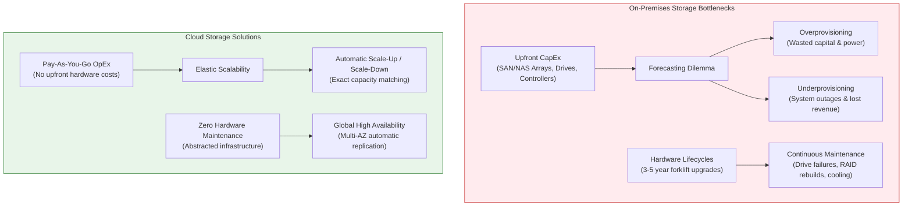
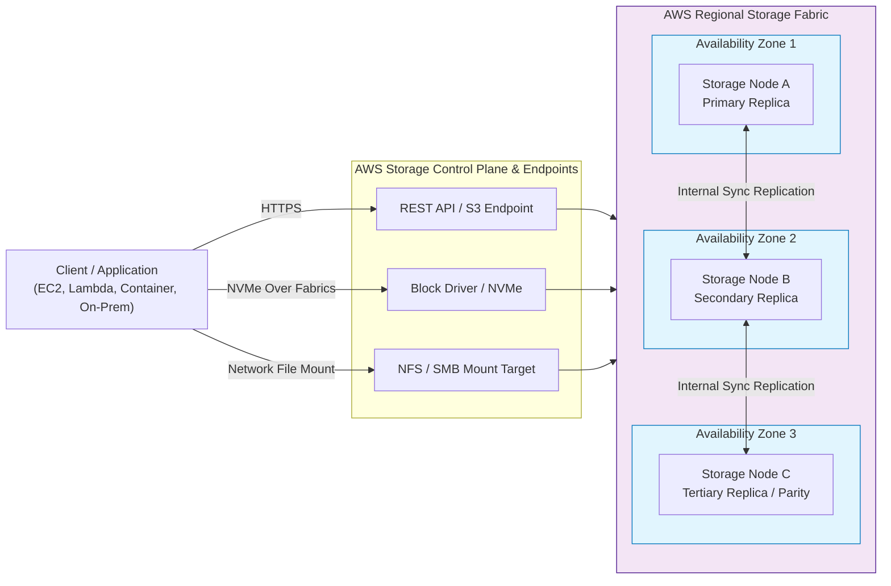
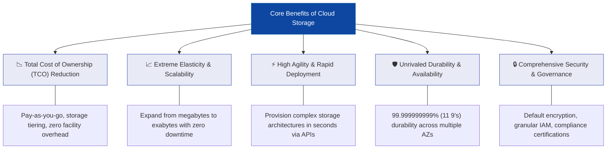
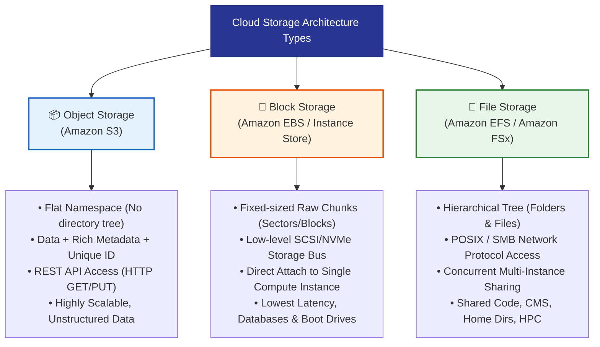
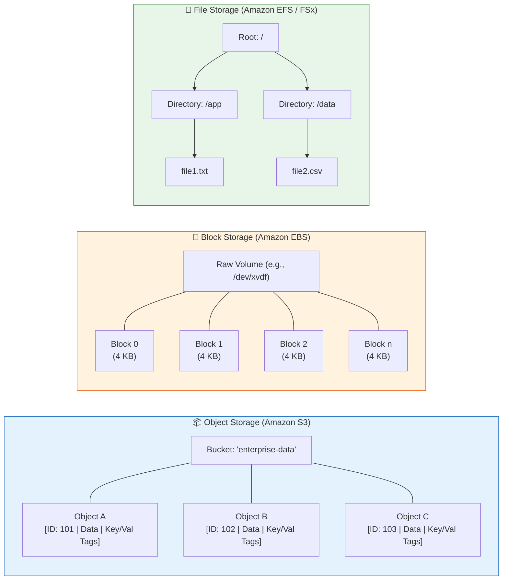
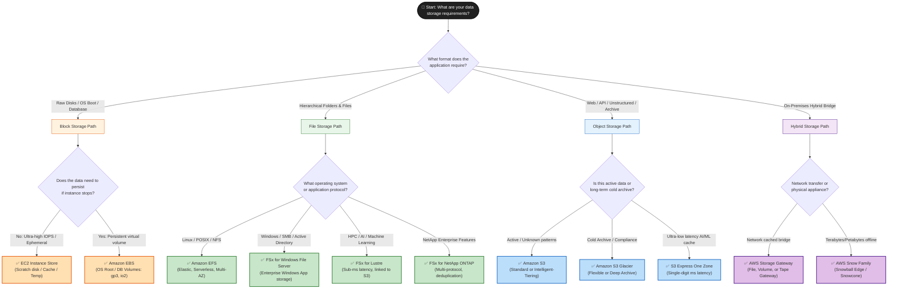

# ☁️ Cloud Storage Overview: Architecture, Formats, and the AWS Storage Portfolio

> **Course**: AWS re/Start  
> **Module**: Storage and Archiving  
> **Source Document**: `T19-0002-STOR_CLOUDSTORAGEOVERVIEW_EN.pdf`  
> **Target Audience**: AWS re/Start Learners / Cloud Practitioners / Solutions Architects  

---

## 🎯 Module Overview

Data is the lifeblood of modern enterprise applications. Every web application, database, machine learning pipeline, Internet of Things (IoT) network, and digital archiving system relies on an underlying storage subsystem to reliably persist, protect, and retrieve information. 

In traditional on-premises IT environments, managing physical storage required massive capital expenditures, complex SAN/NAS hardware arrays, tedious capacity planning, and continuous hardware lifecycle replacements. **Cloud storage** revolutionizes this model by providing scalable, high-performance, resilient storage capacity delivered as a utility over the internet.

This guide provides an exhaustive architectural breakdown of cloud storage fundamentals, contrasts how cloud storage eliminates on-premises operational burdens, explores the three fundamental storage formats (**Object**, **Block**, and **File**), provides a comprehensive 12-factor comparison matrix, and maps out the full **AWS Cloud Storage Portfolio**.

---

### 📌 Learning Objectives

- [ ] **Define Cloud Storage**: Understand the fundamental concepts of storage-as-a-service delivered over the internet.
- [ ] **Analyze On-Premises vs. Cloud Storage**: Contrast physical provisioning, CapEx/OpEx models, lifecycle refreshes, and maintenance overhead with elastic cloud storage.
- [ ] **Explain How Cloud Storage Works**: Understand distributed architecture, automated multi-Availability Zone replication, self-healing mechanisms, and durability models.
- [ ] **Identify Core Cloud Storage Benefits**: Evaluate Total Cost of Ownership (TCO) reductions, agility, elasticity, extreme durability ($11\times9\text{s}$), and security compliance.
- [ ] **Deeply Contrast the Three Cloud Storage Formats**:
  - **Object Storage (Amazon S3 / S3 Glacier)**: Flat namespace, metadata + unique URI, REST API access, virtually unlimited capacity.
  - **Block Storage (Amazon EBS / EC2 Instance Store)**: Fixed-size raw blocks, NVMe/SCSI protocols, dedicated single-instance compute attachment, low-latency transaction processing.
  - **File Storage (Amazon EFS / Amazon FSx)**: Hierarchical folder/file tree, network protocols (NFS/SMB), concurrent multi-instance read/write sharing.
- [ ] **Evaluate the 12-Factor Storage Comparison Matrix**: Compare storage paradigms across addressing, metadata, protocols, latency, concurrency, cost, and mutability.
- [ ] **Map the AWS Cloud Storage Portfolio**: Categorize AWS storage services across Object, Block, File, Hybrid Edge, and Backup domains.
- [ ] **Apply Workload Selection Decision Trees**: Determine the optimal AWS storage service for diverse real-world architectural scenarios.
- [ ] **Complete Knowledge Check & Certification Scenarios**: Validate mastery through exam-aligned questions and architectural rationales.

---

## 🏗️ 1. What is Cloud Storage?

### 1.1 Definition and Core Premise

> **Cloud storage** is a cloud computing service model that stores, manages, and maintains data remotely across distributed infrastructure, making it accessible to authorized clients over the internet or private networks through standard network protocols or application programming interfaces (APIs).

Instead of purchasing, housing, and maintaining physical hard disk drives (HDDs), solid-state drives (SSDs), or storage area networks (SANs) inside a private data center, organizations consume storage on-demand from a cloud provider (such as **Amazon Web Services**) that owns, operates, and secures the physical hardware layer.

```
+----------------------------------------------------------------------------------------------------+
|                                    TRADITIONAL ON-PREMISES STORAGE                                 |
|  [Procurement Delay] -> [Rack & Stack Hardware] -> [Manual RAID & LUNs] -> [Overprovisioning Buffer]  |
|  * High CapEx          * Hardware Refresh Cycles (3-5 yrs)       * Dedicated Facilities & Cooling  |
+----------------------------------------------------------------------------------------------------+
                                                  vs
+----------------------------------------------------------------------------------------------------+
|                                         AWS CLOUD STORAGE                                          |
|  [API Call / Console]  -->  [Instant Elastic Provisioning]  -->  [Automated Multi-AZ Durability]   |
|  * 100% OpEx (Pay-as-you-go) * Virtually Unlimited Scale        * Zero Hardware Maintenance        |
+----------------------------------------------------------------------------------------------------+
```

---

### 1.2 On-Premises Storage Challenges vs. Cloud Storage Advantages

In an on-premises data center, storage engineering presents major operational bottlenecks:



| Operational Dimension | On-Premises Storage | AWS Cloud Storage |
| :--- | :--- | :--- |
| **Financial Model** | **CapEx-heavy**: Large initial capital investments in disk shelves, SAN fabrics, host bus adapters (HBAs), and software licensing. | **OpEx-driven**: Utility pricing (pay only for gigabytes stored, requests processed, or data transferred). Zero upfront commitment. |
| **Capacity Planning** | **Rigid & Predictive**: Must forecast storage consumption 3 to 5 years into the future. Errors lead to wasted budget or catastrophic storage exhaustion. | **Elastic & Dynamic**: Instantly scale from gigabytes to petabytes or exabytes on demand. Scale down when data is deleted. |
| **Hardware Lifecycle** | **Forklift Upgrades**: Drives and controllers reach end-of-life (EOL) every 3–5 years, requiring high-risk, expensive data migrations. | **Perpetual Modernization**: AWS transparently upgrades underlying media (e.g., HDDs to SSDs to NVMe) with zero customer downtime. |
| **High Availability & DR** | **Complex & Expensive**: Requires purchasing duplicate hardware in secondary data centers, optical interconnects, and manual replication software. | **Built-in Resilience**: Redundant copies are automatically distributed across geographically distinct Availability Zones (AZs). |
| **Operational Overhead** | **Labor-intensive**: System administrators manually replace failed disks, configure RAID arrays, zone SAN fabrics, and patch firmware. | **API/Software-Defined**: Managed via AWS Management Console, AWS CLI, SDKs, or Infrastructure as Code (Terraform, AWS CloudFormation). |

---

## ⚙️ 2. How Cloud Storage Works: Architecture & Core Benefits

### 2.1 The Distributed Storage Fabric

Cloud storage abstracts physical media behind software-defined storage (SDS) virtualization layers. When an application writes data to an AWS storage service:

1. **Ingestion & Ingress**: The request is received through secure endpoints (REST APIs over HTTPS, POSIX file system system calls, or block-level SCSI/NVMe drivers).
2. **Data Chunking & Striping**: The storage engine divides large datasets into chunks or blocks and calculates cryptographic checksums for data integrity verification.
3. **Multi-Domain Replication**: The chunks are written across multiple independent storage nodes, server racks, power zones, and facilities (Availability Zones) within the AWS Region.
4. **Continuous Integrity Scans**: Background health monitors continuously verify checksums. If a physical drive degrades, the storage system transparently reconstructs the affected chunk using parity or surviving replicas without customer intervention.



---

### 2.2 Core Architectural Benefits of Cloud Storage



1. **Total Cost of Ownership (TCO) Reduction**:
   - Eliminates direct hardware depreciation, data center real estate, power, cooling, and maintenance contracts.
   - Provides intelligent lifecycle automation (e.g., S3 Intelligent-Tiering) to move rarely accessed data to ultra-low-cost archival tiers automatically.
2. **Extreme Elasticity**:
   - Storage resources automatically scale to accommodate sudden spikes in workload demand without provisioning delays or artificial ceiling limits.
3. **Developer & Organizational Agility**:
   - Developers create storage volumes, shared file systems, or object buckets via code or configuration in seconds, accelerating software delivery cycles.
4. **Exceptional Durability and Availability**:
   - **Durability** measures the probability that stored data will remain intact without corruption or loss over time. Services like Amazon S3 and Amazon EFS provide **99.999999999% (11 9's)** of durability.
   - **Availability** measures the percentage of time that the storage service endpoint is operational and reachable by client requests.
5. **Security, Governance, and Compliance**:
   - Features client-side and server-side encryption (SSE-S3, SSE-KMS, SSE-C) using 256-bit Advanced Encryption Standard (AES-256).
   - Fine-grained access control through AWS Identity and Access Management (IAM), bucket policies, and Access Control Lists (ACLs).
   - Comprehensive audit logging via **AWS CloudTrail** and compliance certifications across HIPAA, PCI-DSS, SOC 1/2/3, and FedRAMP.

---

## 🧩 3. The Three Fundamental Cloud Storage Formats

Cloud storage is categorized into three primary structural architectures: **Object Storage**, **Block Storage**, and **File Storage**. Choosing the correct storage type is one of the most critical architectural decisions for cost, latency, concurrency, and application compatibility.



---

### 3.1 Object Storage: Amazon S3

#### Conceptual Architecture
Object storage manages data as discrete, self-contained units known as **objects**. Unlike traditional operating systems, object storage does **not** organize data in a hierarchical tree of folders and subdirectories. Instead, it places all objects in a massive, flat namespace called a **bucket**.

#### Anatomy of an Object
Every object consists of three essential components:

```
+----------------------------------------------------------------------------------------------------+
|                                         ANATOMY OF AN OBJECT                                       |
+----------------------------------------------------------------------------------------------------+
| 1. DATA PAYLOAD       | The actual unstructured binary content (image, video, document, log file).  |
|                       | Sizes range from 0 bytes up to 5 Terabytes per single object.              |
+-----------------------+----------------------------------------------------------------------------+
| 2. METADATA           | A rich, customizable set of key-value pairs describing the data:           |
|                       | • System Metadata: Creation date, Content-Length, Content-Type, ETag.      |
|                       | • User Metadata: Custom tags (e.g., department=finance, project=alpha).     |
+-----------------------+----------------------------------------------------------------------------+
| 3. UNIQUE IDENTIFIER  | A globally unique key name / Uniform Resource Identifier (URI).            |
|    (Key / URI)        | Example: https://my-bucket.s3.amazonaws.com/uploads/2026/report.pdf        |
+-----------------------+----------------------------------------------------------------------------+
```

> [!NOTE]
> Although you may see slashes (`/`) in an object key (e.g., `photos/2026/vacation.jpg`), the storage system does not create nested physical folders. The string `photos/2026/` is simply a **key prefix** within a flat address space. Modern web consoles render prefixes as folders for human convenience.

#### Access Protocol and Mutability
- **Access Protocol**: Pure web protocols: **HTTP/HTTPS REST APIs**. Typical actions include `GET` (download), `PUT` (upload), `DELETE`, `HEAD` (fetch metadata), and `POST`.
- **Mutability Model**: Objects are **immutable**. You cannot open an object and modify a single byte in-place. If you change a single sentence in a 1 GB video or document, you must upload a new version or overwrite the entire object.
- **Consistency Model**: Amazon S3 delivers **strong read-after-write consistency** for `PUT` and `DELETE` requests of objects in all AWS Regions.

#### Premier AWS Service
- **Amazon Simple Storage Service (Amazon S3)** & **Amazon S3 Glacier**.

---

### 3.2 Block Storage: Amazon EBS & EC2 Instance Store

#### Conceptual Architecture
Block storage splits raw storage space into evenly sized chunks called **blocks** (typically 4 KB or 512 bytes each). Each block has a distinct, arbitrary physical address (Logical Block Address or LBA), but carries **no metadata** regarding the contents of the file or data structure.

The host operating system attached to the block volume treats it as an unformatted raw disk drive. The OS creates a partition table and installs a file system (such as **ext4**, **XFS** on Linux, or **NTFS** on Windows) or delegates block allocation directly to a database management system (DBMS).

```
+----------------------------------------------------------------------------------------------------+
|                                     RAW BLOCK STORAGE VOLUME                                       |
+--------------------+--------------------+--------------------+--------------------+----------------+
| Block Address 0001 | Block Address 0002 | Block Address 0003 | Block Address 0004 | Block Addr ... |
| [OS Inode Table]   | [File Part A]      | [File Part B]      | [Database Page 1]  | [Free Block]   |
+--------------------+--------------------+--------------------+--------------------+----------------+
           ^                                                                ^
           |--- Host OS / Database Engine directly reads & writes blocks ---|
```

#### Access Protocol and Attachment
- **Access Protocol**: Storage Area Network (SAN) or bus-level protocols: **SCSI**, **iSCSI**, or high-speed **NVMe** (Non-Volatile Memory Express).
- **Attachment Model**: Block volumes are tightly coupled to a single computing instance at a time. The volume must reside in the **same Availability Zone** as the instance (with specialized exceptions such as EBS Multi-Attach for clustered workloads).
- **Mutability Model**: **In-place random access modification**. The operating system or database engine can rewrite a single 4 KB block in the middle of a 500 GB database file without touching the rest of the volume.
- **Latency**: Delivers single-digit millisecond latency (EBS SSDs) down to microseconds (direct-attached NVMe Instance Store).

#### Premier AWS Services
- **Amazon Elastic Block Store (Amazon EBS)**: Network-attached persistent block storage surviving EC2 stop/terminate events.
- **EC2 Instance Store**: Physical, direct-attached ephemeral block storage bound to the physical host hardware.

---

### 3.3 File Storage: Amazon EFS & Amazon FSx

#### Conceptual Architecture
File storage organizes data in a traditional **hierarchical folder tree**. Files are nested inside directories, which can be nested inside parent directories.

Every file contains a filename, content bytes, and standard filesystem metadata attributes (POSIX permissions, owner UID/GID, access/modification timestamps, and file size).

```
+----------------------------------------------------------------------------------------------------+
|                                    HIERARCHICAL FILE STORAGE TREE                                  |
+----------------------------------------------------------------------------------------------------+
| / (Root Directory)                                                                                 |
| ├── var/                                                                                           |
| │   └── www/                                                                                       |
| │       ├── html/ (Shared Web Application Code)                                                    |
| │       │   ├── index.php                                                                          |
| │       │   └── wp-content/uploads/                                                                |
| ├── home/                                                                                          |
| │   ├── user1/ (Shared Developer Home Directory)                                                   |
| │   └── user2/                                                                                     |
| └── shared-datasets/                                                                               |
|     └── model_weights.bin                                                                          |
+----------------------------------------------------------------------------------------------------+
```

#### Access Protocol and Concurrency
- **Access Protocol**: Standard network file sharing protocols: **NFS** (Network File System, specifically NFSv4.0/4.1 for Linux) and **SMB** (Server Message Block / CIFS for Windows).
- **Attachment Model**: Loosely coupled network mount. Hundreds or thousands of compute instances (Amazon EC2, Amazon ECS, Amazon EKS, AWS Lambda, or on-premises servers via AWS Direct Connect / VPN) can mount the file system **simultaneously**.
- **File Locking & Concurrency**: Supports POSIX-compliant file locking (advisory or mandatory), read/write synchronization, and atomic renames, preventing data corruption across concurrent writes.

#### Premier AWS Services
- **Amazon Elastic File System (Amazon EFS)**: Serverless, elastic NFS for Linux workloads.
- **Amazon FSx family**: High-performance purpose-built file systems (Windows File Server, Lustre, NetApp ONTAP, OpenZFS).

---

## 📊 4. Structural Comparison: Object vs. Block vs. File Storage



---

### 4.1 Exhaustive 12-Factor Comparison Matrix

| Factor | 📦 Object Storage (S3 / Glacier) | 🧱 Block Storage (EBS / Instance Store) | 📁 File Storage (EFS / FSx) |
| :--- | :--- | :--- | :--- |
| **1. Data Organization** | Flat namespace; objects organized under buckets with prefix paths. | Fixed-size raw physical/virtual blocks with numeric addresses. | Strict hierarchical directory tree (nested folders and files). |
| **2. Metadata Capability** | Extensive, fully customizable key-value metadata & system attributes. | None stored with blocks; managed purely by the host OS filesystem. | Standard filesystem attributes (POSIX / NTFS: permissions, timestamps, size). |
| **3. Addressing Method** | Globally unique URI / URL (Bucket name + Object Key). | Logical Block Addressing (LBA) / Sector offsets. | Hierarchical directory file path (e.g., `/mnt/efs/data/file.csv`). |
| **4. Communication Protocol** | HTTP / HTTPS REST APIs (`GET`, `PUT`, `DELETE`). | Low-level storage bus: NVMe, SCSI, Fibre Channel. | Network file sharing protocols: NFSv4 (Linux), SMB (Windows), Lustre. |
| **5. Compute Attachment** | Decoupled; accessed over internet or VPC endpoints by any client. | Directly attached to a single EC2 instance (same AZ). | Network-mounted simultaneously across thousands of compute nodes. |
| **6. Multi-Instance Concurrency**| Unlimited concurrent clients worldwide. | 1:1 dedication to single instance (EBS Multi-Attach limited to single AZ io1/io2). | Concurrent multi-instance read/write with distributed file locking. |
| **7. Latency Profile** | Tens of milliseconds (HTTP protocol overhead). | Sub-millisecond (Instance Store) to single-digit ms (EBS SSD). | Low single-digit milliseconds (network protocol overhead). |
| **8. Throughput / IOPS Scale** | Massive aggregate throughput (tens of thousands of req/sec). | High IOPS and predictable throughput per attached volume. | Elastic throughput scaling with filesystem size or provisioned IOPS. |
| **9. Scalability Boundary** | Virtually limitless; exabytes per bucket, 5 TB max per object. | Volume-limited (EBS max 64 TiB per volume; attach multiple volumes). | Petabytes per filesystem; EFS grows and shrinks automatically. |
| **10. Modification Granularity** | Entire object replacement (immutable write/overwrite). | In-place random byte/block modification. | In-place file edits, append-only logs, and byte-range locks. |
| **11. Cost Structure** | Lowest baseline cost per GB stored; tiered cold archival pricing. | Medium to high per GB provisioned (charged whether full or empty). | Moderate to high per GB elastic consumed (charged for used bytes only). |
| **12. Primary Workloads** | Unstructured data, media distribution, data lakes, backups, web hosting. | Boot/root disks, relational databases (Oracle, SQL Server, MySQL), transactional systems. | Shared application code, WordPress uploads, home directories, HPC, analytics. |

---

## 🗺️ 5. AWS Cloud Storage Portfolio Mapping

The AWS storage ecosystem provides a specialized service for every tier of the modern data architecture. These services span object storage, block storage, network file systems, edge computing devices, and unified backup management.

```mermaid
flowchart TD
    AWSStorage["AWS Cloud Storage Portfolio"]
    
    AWSStorage --> ObjectCat["Object Storage"]
    AWSStorage --> BlockCat["Block Storage"]
    AWSStorage --> FileCat["File Storage"]
    AWSStorage --> HybridCat["Hybrid & Edge Storage"]
    AWSStorage --> ManagementCat["Data Management & Protection"]

    ObjectCat --> S3["Amazon S3<br/>(Standard, IA, Intelligent-Tiering, Express One Zone)"]
    ObjectCat --> Glacier["Amazon S3 Glacier<br/>(Instant, Flexible, Deep Archive)"]

    BlockCat --> EBS["Amazon EBS<br/>(gp3, io2 Block Express, st1, sc1)"]
    BlockCat --> InstStore["EC2 Instance Store<br/>(High-speed ephemeral NVMe)"]

    FileCat --> EFS["Amazon EFS<br/>(Serverless elastic NFS for Linux)"]
    FileCat --> FSx["Amazon FSx Family<br/>(Windows, Lustre, ONTAP, OpenZFS)"]
    FileCat --> FileCache["Amazon File Cache<br/>(High-speed temporary cache)"]

    HybridCat --> StorageGW["AWS Storage Gateway<br/>(S3 File, FSx File, Volume, Tape)"]
    HybridCat --> SnowFamily["AWS Snow Family<br/>(Snowcone, Snowball Edge, Snowmobile)"]

    ManagementCat --> AWSBackup["AWS Backup<br/>(Centralized policy-driven protection)"]
    ManagementCat --> DataSync["AWS DataSync<br/>(Accelerated data transfer)"]

    style AWSStorage fill:#232f3e,stroke:#ff9900,stroke-width:2px,color:#fff
    style ObjectCat fill:#e3f2fd,stroke:#1565c0
    style BlockCat fill:#fff3e0,stroke:#e65100
    style FileCat fill:#e8f5e9,stroke:#2e7d32
    style HybridCat fill:#f3e5f5,stroke:#4a148c
    style ManagementCat fill:#fbe9e7,stroke:#d84315
```



---

### 5.1 Object Storage Services

#### Amazon Simple Storage Service (Amazon S3)
Amazon S3 is the foundational object storage platform of AWS, offering industry-leading scalability, data availability, security, and performance.
- **S3 Standard**: Default tier for frequently accessed, active data. Sub-millisecond to low-millisecond latency.
- **S3 Intelligent-Tiering**: Automatically moves objects between access tiers (Frequent, Infrequent, Archive Instant, Archive, Deep Archive) based on access patterns without operational overhead or retrieval fees.
- **S3 Standard-Infrequent Access (S3 Standard-IA)**: Lower storage fee for data accessed less frequently but requiring immediate access when needed.
- **S3 One Zone-IA**: Lower-cost option storing data in a single Availability Zone (ideal for reproducible secondary backup data).
- **S3 Express One Zone**: High-performance, single-AZ tier delivering single-digit millisecond data access for latency-sensitive applications like AI/ML training and financial modeling.

#### Amazon S3 Glacier
Dedicated archival storage classes designed for long-term retention of compliance records, healthcare data, and digital asset archives:
- **S3 Glacier Instant Retrieval**: Lowest-cost storage for rarely accessed archives needing millisecond retrieval.
- **S3 Glacier Flexible Retrieval**: Retrieval options ranging from 1–5 minutes (Expedited), 3–5 hours (Standard), to 5–12 hours (Bulk). Free bulk retrievals.
- **S3 Glacier Deep Archive**: The lowest-cost storage in the cloud (fractions of a cent per GB/month). Designed for data retained for 7 to 10+ years (regulatory compliance), with retrieval times within 12 to 48 hours.

---

### 5.2 Block Storage Services

#### Amazon Elastic Block Store (Amazon EBS)
High-performance, persistent block storage volumes designed for EC2 instances. EBS volumes survive the stopping and restarting of instances.

```
+----------------------------------------------------------------------------------------------------+
|                                    AMAZON EBS VOLUME TYPES                                         |
+----------------------------------------------------------------------------------------------------+
| SSD-Backed Volumes (Transactional / Random I/O)                                                    |
| • General Purpose SSD (gp3): Baseline 3,000 IOPS and 125 MB/s independent of volume size.          |
| • General Purpose SSD (gp2): Performance tied to provisioned capacity (3 IOPS per GB).             |
| • Provisioned IOPS SSD (io2 Block Express): Up to 256,000 IOPS, 4,000 MB/s, 99.999% durability.   |
|                                                                                                    |
| HDD-Backed Volumes (Throughput-Intensive / Sequential I/O)                                          |
| • Throughput Optimized HDD (st1): Low-cost HDD for big data, data warehouses, log processing.       |
| • Cold HDD (sc1): Lowest-cost HDD storage for infrequently accessed sequential workloads.          |
+----------------------------------------------------------------------------------------------------+
```

#### EC2 Instance Store
- Physical solid-state or spinning drives directly connected to the host motherboard of the underlying physical EC2 server.
- **Ephemeral Lifecycle**: If the EC2 instance is stopped, hibernated, or terminated, all data residing on the Instance Store is **permanently lost**. Data persists only during an OS reboot.
- **Use Cases**: Temporary swap space, scratch disks, read caches, distributed in-memory buffers (e.g., Apache Hadoop/Spark worker nodes).

---

### 5.3 File Storage Services

#### Amazon Elastic File System (Amazon EFS)
- A serverless, fully elastic network file system natively supporting the **NFSv4** protocol for Linux-based workloads.
- Automatically grows and shrinks as files are added or removed; no capacity planning or pre-provisioning required.
- Accessible concurrently from thousands of EC2 instances, ECS/EKS containers, AWS Lambda functions, and on-premises servers.
- Automatically stores data across multiple Availability Zones for $11\times9\text{s}$ of durability.

#### Amazon FSx Family
Fully managed, third-party and specialized open-source file systems optimized for specific operating systems and workloads:
1. **Amazon FSx for Windows File Server**: Native Microsoft Windows file system built on Windows Server, fully compatible with Server Message Block (SMB), Active Directory integration, NTFS permissions, and DFS.
2. **Amazon FSx for Lustre**: Engineered for high-performance computing (HPC), machine learning training, genomics research, and video rendering. Delivers millions of IOPS and hundreds of GB/s throughput with sub-millisecond latencies. Seamlessly links with Amazon S3.
3. **Amazon FSx for NetApp ONTAP**: Provides full NetApp ONTAP enterprise storage capabilities (multi-protocol access via NFS, SMB, and iSCSI, thin provisioning, deduplication, snapshots, and cloning).
4. **Amazon FSx for OpenZFS**: Ultra-high-performance file storage for Linux applications powered by the popular ZFS filesystem, delivering up to 1 million IOPS with microsecond latencies.

#### Amazon File Cache
A fully managed high-speed temporary cache on AWS that accelerates workloads by caching data from on-premises file arrays, AWS file systems, or Amazon S3 buckets.

---

### 5.4 Hybrid Cloud Storage & Edge Computing

For organizations operating hybrid cloud architectures that must bridge on-premises data centers with AWS:

```
+----------------------------------------------------------------------------------------------------+
|                                      AWS HYBRID STORAGE SERVICES                                   |
+----------------------------------------------------------------------------------------------------+
| AWS STORAGE GATEWAY (Software Appliance installed on-premises)                                    |
| 1. S3 File Gateway: Exposes an NFS or SMB mount locally; writes backing data directly to Amazon S3.|
| 2. FSx File Gateway: Local low-latency cache for cloud-based FSx for Windows File Server.          |
| 3. Volume Gateway: Block storage over iSCSI:                                                        |
|    • Cached Volumes: Stores primary data in S3; retains frequently read blocks in local cache.     |
|    • Stored Volumes: Stores primary data locally; creates asynchronous point-in-time EBS snapshots.|
| 4. Tape Gateway: Replaces physical tape libraries with a virtual tape library (VTL) backed by S3.  |
+----------------------------------------------------------------------------------------------------+
| AWS SNOW FAMILY (Ruggedized Physical Hardware Appliances for Edge & Migration)                     |
| 1. AWS Snowcone: Ultra-portable, lightweight (4.5 lbs) device with 8 TB capacity for edge compute. |
| 2. AWS Snowball Edge: Ruggedized shipping suitcase container with up to 210 TB storage for massive |
|    data migration and edge computing (Storage Optimized / Compute Optimized).                     |
| 3. AWS Snowmobile: 45-foot ruggedized shipping container truck capable of moving up to 100 PB.     |
+----------------------------------------------------------------------------------------------------+
```

---

### 5.5 Comprehensive AWS Storage Portfolio Summary Table

| Service | Primary Storage Category | Primary Access Protocol | Storage Durability Model | Ideal Workload & Scenario |
| :--- | :--- | :--- | :--- | :--- |
| **Amazon S3** | Object | HTTP / HTTPS (REST API) | Multi-AZ ($11\times9\text{s}$) | Data lakes, website assets, backups, user uploads, application logs. |
| **Amazon S3 Glacier** | Object (Archive) | HTTP / HTTPS (REST API) | Multi-AZ ($11\times9\text{s}$) | Long-term compliance archiving, medical records, financial audit logs. |
| **Amazon EBS** | Block | NVMe / SCSI block bus | Single AZ (replicated inside AZ) | OS boot disks, production relational databases (PostgreSQL, SQL Server). |
| **EC2 Instance Store** | Block | Local NVMe / SATA | Non-durable (Ephemeral) | In-memory cache buffers, temporary processing scratchpads, Hadoop nodes. |
| **Amazon EFS** | File (Linux) | NFSv4.0 / NFSv4.1 | Multi-AZ ($11\times9\text{s}$) or Single AZ | Container storage (EKS/ECS), WordPress uploads, shared Linux home dirs. |
| **Amazon FSx (Windows)**| File (Windows) | SMB (v2.0 – v3.1.1) | Multi-AZ or Single AZ | Windows enterprise applications, Active Directory environments, IIS web apps. |
| **Amazon FSx (Lustre)** | File (HPC/POSIX) | Lustre / POSIX | Single AZ or Multi-AZ | Machine learning model training, seismic modeling, high-speed rendering. |
| **AWS Storage Gateway** | Hybrid (Object/Block/Tape) | NFS, SMB, iSCSI | Backed by AWS S3/EBS | Extending on-premises storage to AWS, local caching, cloud backup. |
| **AWS Snow Family** | Physical Edge / Offline Data | Physical device transfer | Hardware-encrypted (KMS) | Moving petabytes of data offline where network bandwidth is constrained. |

---

## 🎯 6. Workload Storage Selection Framework & Decision Tree

When architecting a solution on AWS, selecting the appropriate storage service requires evaluating data structure, access protocols, latency thresholds, concurrency requirements, and budget constraints.



---

## 💡 7. Real-World Architectural Case Studies

### Scenario 1: Multi-Tier E-Commerce Platform
- **Problem**: A retail web application hosted on an Auto Scaling group of Linux EC2 instances needs to serve product photos, maintain customer transaction logs, and store session state.
- **Architecture**:
  - **Product Media (Images/Videos)**: Stored in **Amazon S3** fronted by **Amazon CloudFront** for global low-latency CDN caching.
  - **Web Application Code & Shared Assets**: Mounted across instances using **Amazon EFS** so updates are instantly reflected on all web servers.
  - **Relational Database (Aurora/MySQL)**: The primary database engine uses underlying **Amazon EBS**-backed storage for transactional consistency and low-latency disk writes.

### Scenario 2: Regulatory Compliance Archiving for Financial Records
- **Problem**: A banking organization must preserve 15 years of transaction statements for tax and regulatory audits. Records are rarely accessed after 90 days but must never be deleted or altered.
- **Architecture**:
  - Statements are initially ingested into **Amazon S3 Standard**.
  - An **S3 Lifecycle Rule** transitions objects to **Amazon S3 Glacier Flexible Retrieval** after 90 days, and finally to **Amazon S3 Glacier Deep Archive** after 365 days.
  - **S3 Object Lock** in Compliance mode is enabled with Write-Once-Read-Many (WORM) storage to prevent modification or deletion by any user, including AWS root account credentials.

### Scenario 3: High-Performance AI Training Cluster
- **Problem**: An autonomous driving startup needs to train computer vision neural networks against millions of sensor images. Training nodes running on GPU-powered EC2 instances require massive throughput with sub-millisecond latencies.
- **Architecture**:
  - Master datasets reside cost-effectively in **Amazon S3**.
  - An **Amazon FSx for Lustre** cluster is deployed and linked directly to the S3 bucket.
  - When training begins, FSx for Lustre lazily loads object data from S3, serving files to GPU instances at hundreds of gigabytes per second. Completed model checkpoints are saved directly back to S3.

---

## 📝 8. Knowledge Check & Exam Readiness

Test your comprehension of cloud storage architectures, formats, and AWS services with the following practice questions based on curriculum checkpoint items:

### Question 1
**What are the three primary components/formats of cloud storage?**
- A) RAM, Cache, and Virtual Memory
- B) Object storage, Block storage, and File storage
- C) SAN, NAS, and DAS
- D) Public, Private, and Hybrid cloud storage

> **Correct Answer: B**  
> **Explanation**: The three fundamental architectural formats of cloud storage are **Object storage** (e.g., Amazon S3), **Block storage** (e.g., Amazon EBS), and **File storage** (e.g., Amazon EFS/FSx). While SAN, NAS, and DAS represent traditional physical storage models, the cloud abstracts these into the three standard software-defined formats.

---

### Question 2
**A solutions architect is looking for a low-cost, long-term data storage option for data archiving and backups that will be retained for 10 years and accessed less than once a year. Which AWS storage service best meets those requirements?**
- A) Amazon Elastic Block Store (Amazon EBS)
- B) Amazon Elastic File System (Amazon EFS)
- C) Amazon Simple Storage Service Glacier (Amazon S3 Glacier Deep Archive)
- D) Amazon FSx for Windows File Server

> **Correct Answer: C**  
> **Explanation**: **Amazon S3 Glacier** (specifically S3 Glacier Flexible Retrieval or S3 Glacier Deep Archive) is designed precisely for low-cost, highly durable long-term archival storage. EBS and EFS are engineered for active compute attachment and carry substantially higher cost-per-gigabyte profiles.

---

### Question 3
**Which of the following AWS storage services use block storage? (Select TWO)**
- A) Amazon Simple Storage Service (Amazon S3)
- B) Amazon Elastic Block Store (Amazon EBS)
- C) Amazon Elastic File System (Amazon EFS)
- D) EC2 Instance Store
- E) AWS Storage Gateway Tape Gateway

> **Correct Answer: B and D**  
> **Explanation**: Both **Amazon EBS** and **EC2 Instance Store** provide raw block-level storage volumes that can be formatted with an OS filesystem and attached directly to EC2 instances. Amazon S3 is object storage, Amazon EFS is file storage, and Tape Gateway emulates a tape storage interface.

---

### Question 4
**A team of developers is deploying a shared WordPress content management system across multiple Linux Amazon EC2 instances in an Auto Scaling group. The web application requires concurrent read and write access to a shared directory containing theme files and user-uploaded media. Which storage service should they choose?**
- A) Amazon EBS General Purpose SSD (gp3)
- B) Amazon Elastic File System (Amazon EFS)
- C) EC2 Instance Store
- D) Amazon FSx for Windows File Server

> **Correct Answer: B**  
> **Explanation**: **Amazon EFS** is a serverless network file system supporting concurrent multi-instance read/write access over NFS for Linux instances. Standard Amazon EBS volumes cannot be concurrently mounted across multiple instances in different Availability Zones for read/write sharing. Instance Store is ephemeral and non-shared, while FSx for Windows is designed for SMB/Windows workloads.

---

### Question 5
**An analytics engineer needs temporary high-speed scratch space for intermediate calculations during a distributed batch processing job on Amazon EC2. The data can be easily regenerated if the instance is terminated. Which storage option offers the lowest write latency at zero additional storage fee?**
- A) Amazon S3 Standard
- B) Amazon EBS io2 Block Express
- C) EC2 Instance Store
- D) Amazon EFS One Zone

> **Correct Answer: C**  
> **Explanation**: **EC2 Instance Store** provides physical, host-attached NVMe SSD block storage with microsecond latencies. Because the storage is physically built into the instance hardware, there is no additional cost beyond the EC2 hourly instance price. Because it is ephemeral, it is the ideal choice for non-persistent scratch space.

---

## 📌 9. Key Takeaways & Summary

- **Cloud Storage as a Service**: Cloud storage delivers storage capacity over the internet on a pay-as-you-go model, eliminating upfront CapEx, capacity forecasting risks, facility cooling/space overhead, and hardware refresh lifecycles.
- **Architectural Durability**: Cloud storage providers automatically replicate data across physically isolated Availability Zones, providing up to $11\times9\text{s}$ (99.999999999%) of durability.
- **The Three Core Formats**:
  1. **Object Storage (Amazon S3)**: Flat namespace; objects consist of data, rich key-value metadata, and a globally unique URI; accessed via HTTP REST APIs; virtually unlimited scale; ideal for unstructured media, data lakes, and backups.
  2. **Block Storage (Amazon EBS / Instance Store)**: Raw unformatted blocks accessed via SCSI/NVMe; dedicated to a single compute instance; lowest latency; ideal for operating systems and transactional databases.
  3. **File Storage (Amazon EFS / Amazon FSx)**: Hierarchical folder/file tree accessed via NFS/SMB; supports concurrent multi-instance read/write sharing with file locking; ideal for web clusters, shared application tiers, and HPC.
- **Comprehensive Portfolio**: AWS provides specialized services for every architectural need, including object storage (S3/Glacier), persistent and ephemeral block storage (EBS/Instance Store), managed file systems (EFS/FSx), hybrid data bridges (AWS Storage Gateway), and edge transfer hardware (AWS Snow Family).
