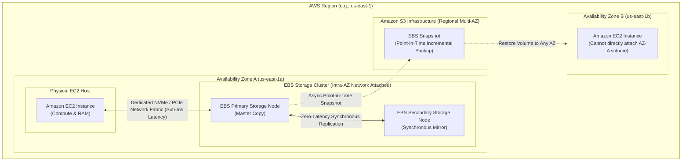
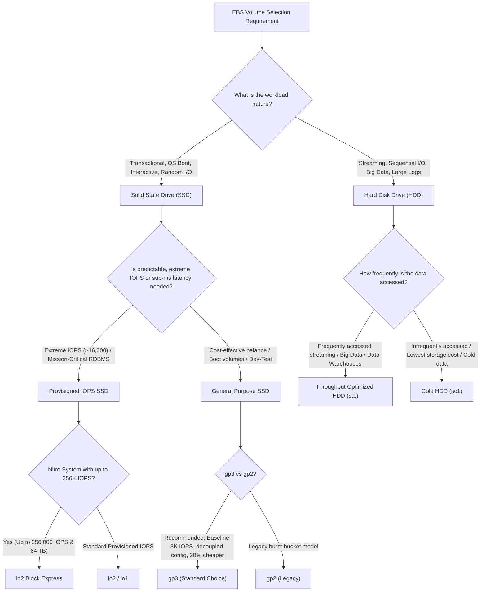
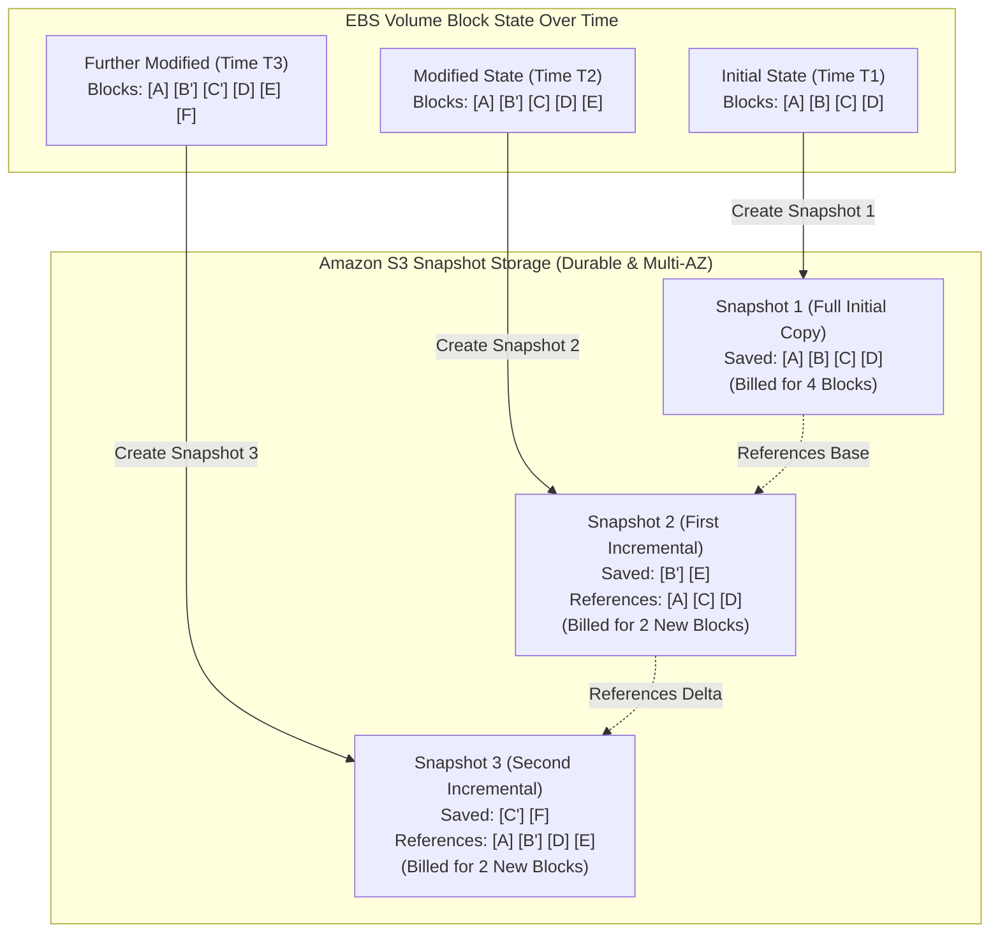
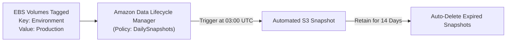

# 💾 Amazon Elastic Block Store (Amazon EBS): Architecture, Volume Types, and Lifecycle Management

> **Course**: AWS re/Start  
> **Module**: Storage and Archiving (T19 – Storage and Archiving)  
> **Source Document**: `T19-Storage_and_Archiving/T19-0003-STOR_AMAZONEBS_EN.pdf`  
> **Target Audience**: AWS re/Start Learners, Cloud Practitioners, SysOps Administrators, and Solutions Architects  

---

## 🎯 Module Overview

In modern cloud computing architectures, compute and storage layers are fundamentally decoupled to achieve elasticity, cost efficiency, and fault tolerance. **Amazon Elastic Block Store (Amazon EBS)** provides persistent, high-performance, network-attached block storage designed specifically for **Amazon Elastic Compute Cloud (Amazon EC2)** instances. 

Unlike ephemeral instance store volumes that lose their data when an EC2 instance stops or terminates, Amazon EBS volumes persist independently of instance life cycles. EBS delivers low-latency, point-in-time snapshotting to Amazon Simple Storage Service (Amazon S3), dynamic scaling without downtime via Elastic Volumes, and native data encryption backed by AWS Key Management Service (AWS KMS).

This comprehensive technical guide explores the architectural foundations of Amazon EBS, evaluates the five EBS volume types (SSD-backed and HDD-backed), details hands-on administration using the AWS Command Line Interface (AWS CLI) and Linux file systems, and demonstrates automated backup orchestration using Amazon Data Lifecycle Manager (Amazon DLM).

---

## 📌 Learning Objectives

By studying this guide and completing the hands-on commands, you will be able to:

- [ ] **Define Amazon EBS Architecture**: Explain how network-attached persistent block storage operates, including intra-Availability Zone replication, lifecycle independence, and the `DeleteOnTermination` attribute.
- [ ] **Differentiate EBS Volume Types**: Compare SSD-backed volumes (`gp2`, `gp3`, `io1`, `io2`, `io2 Block Express`) and HDD-backed volumes (`st1`, `sc1`), analyzing IOPS, throughput, latency, volume size limits, and workload compatibility.
- [ ] **Execute EBS CLI Management**: Provision, describe, attach, modify, and monitor EBS volumes using the AWS CLI.
- [ ] **Configure Linux Block Storage**: Identify NVMe storage devices, format volumes with modern file systems (`xfs`, `ext4`), mount volumes, and ensure persistent boot mounting in `/etc/fstab` using UUIDs.
- [ ] **Implement Dynamic Volume Expansion**: Resize EBS volumes on the fly and grow OS-level partitions and file systems without detaching or rebooting instances.
- [ ] **Manage EBS Snapshots**: Create incremental block-level point-in-time backups to Amazon S3, understand snapshot deletion mechanics, and copy snapshots across AWS Regions for disaster recovery.
- [ ] **Mitigate Restore Latency with FSR**: Utilize Fast Snapshot Restore (FSR) to eliminate initial I/O penalties associated with lazy loading blocks from Amazon S3.
- [ ] **Automate Backups with Amazon DLM**: Provision default IAM roles, construct JSON lifecycle policies, and enforce automated snapshot creation, retention, and deletion schedules.

---

## 🏗️ 1. What is Amazon Elastic Block Store (Amazon EBS)?

### 1.1 Architectural Foundations & Core Characteristics

**Amazon Elastic Block Store (Amazon EBS)** provides raw, unformatted block-level storage devices that can be mounted as volumes to EC2 instances. In operating system terminology, an EBS volume behaves identically to a physical hard drive or solid-state drive connected to a server, allowing administrators to format it with any standard file system (such as XFS, ext4, NTFS), host relational database engines, or run enterprise applications.



### 1.2 Key Architectural Characteristics

1. **Availability Zone (AZ) Scope & Hardware Replication**:
   - An EBS volume is **locked to a specific Availability Zone (AZ)**. An EC2 instance running in `us-east-1a` can only attach volumes located in `us-east-1a`.
   - Within its assigned AZ, an EBS volume is **automatically replicated across multiple physical storage servers** to prevent data loss from single hardware component failures.
   - EBS provides high durability: **99.8% to 99.9%** annual volume durability for General Purpose SSD and HDD volumes (an annual failure rate between 0.1% and 0.2%), and **99.999%** annual durability for `io2` and `io2 Block Express` volumes.

2. **Network-Attached Architecture**:
   - EBS volumes are physically separate from the compute host running the EC2 instance. They communicate across a highly optimized, high-speed network fabric via NVMe (Non-Volatile Memory Express) protocols.
   - Because EBS is off-instance storage, compute and storage can scale independently.

3. **Independent Lifecycle & Termination Behavior**:
   - EBS volumes persist independently from the lifecycle of EC2 instances. If an instance is stopped or restarted, all data residing on attached EBS volumes remains intact.
   - **`DeleteOnTermination` Attribute**:
     - By default, the root EBS volume created during EC2 instance launch has `DeleteOnTermination = true`. When the instance terminates, the root volume is deleted automatically.
     - Secondary EBS data volumes created and attached to an instance have `DeleteOnTermination = false` by default. They persist even after instance termination, allowing them to be reattached to new instances.
     - The `DeleteOnTermination` flag can be toggled at launch or dynamically updated at any time via the AWS CLI or Console.

4. **Transparent Encryption at Rest and In-Transit**:
   - EBS volume encryption is fully integrated with **AWS Key Management Service (AWS KMS)** using customer managed keys (CMK) or AWS managed keys (`aws/ebs`).
   - Encryption occurs on the physical EC2 host prior to data transmission over the network:
     - Data at rest inside the volume is encrypted.
     - All data moving in transit between the EC2 instance and the EBS storage server is encrypted.
     - All snapshots created from the encrypted volume are automatically encrypted.
     - All volumes restored from encrypted snapshots are encrypted.
   - EBS encryption utilizes industry-standard AES-256 algorithms with **zero impact on performance or IOPS latency**.

5. **Multi-Attach Capability**:
   - Supported on Provisioned IOPS SSD (`io1` and `io2`) volumes.
   - Multi-Attach allows a single EBS volume to be attached simultaneously to up to **16 Nitro-based EC2 instances** within the same Availability Zone.
   - Used for clustered enterprise applications (e.g., Oracle RAC, cluster-aware file systems like GFS2) that manage concurrent write synchronization at the software layer.

---

### 1.3 Storage Paradigm Comparison: EBS vs. Instance Store vs. EFS vs. S3

| Attribute | Amazon EBS | Amazon EC2 Instance Store | Amazon EFS | Amazon S3 |
| :--- | :--- | :--- | :--- | :--- |
| **Storage Type** | Block Storage (Raw disk) | Block Storage (Direct-attached disk) | File Storage (Managed POSIX NFS) | Object Storage (Key-Value) |
| **Persistence** | **Persistent** (Independent of instance) | **Ephemeral** (Lost on stop/terminate) | **Persistent** | **Persistent** |
| **Location Scope** | Specific Availability Zone (AZ) | Physical host running the instance | Multi-AZ within an AWS Region | Multi-AZ Regional Infrastructure |
| **Attachment** | One instance (Multi-Attach up to 16 for `io1`/`io2`) | Single host only | Thousands of EC2 instances concurrently | REST API / Web HTTP (No direct attachment) |
| **Access Latency** | Sub-millisecond to single-digit ms | Lowest (Microsecond latency) | Low (Single-digit ms) | Milliseconds to tens of ms |
| **Typical Use Cases** | OS boot volumes, databases, ERP systems | High-speed cache, temp buffers, scratch data | Shared CMS, home dirs, media workflows | Backup archives, static websites, data lakes |

---

## ⚡ 2. Deep Comparative Analysis of EBS Volume Types

AWS categorizes EBS volume types into two primary physical media categories:
1. **Solid State Drives (SSD)**: Optimized for transactional workloads requiring high IOPS, low latency, and random I/O operations.
2. **Hard Disk Drives (HDD)**: Optimized for large, streaming workloads requiring high throughput (MB/s) and sequential I/O operations.



---

### 2.1 General Purpose SSD (`gp2` vs `gp3`)

General Purpose SSD volumes provide a balance of price and performance for a broad range of transactional workloads, virtual desktops, system boot volumes, and software development environments.

#### 1. General Purpose SSD (`gp2` - Legacy)
- **Architecture**: Performance is strictly coupled to the provisioned volume size.
- **Baseline Performance**: Delivers 3 IOPS per provisioned GiB (e.g., a 100 GiB volume provides a baseline of 300 IOPS).
- **I/O Burst Bucket**: Volumes under 1,000 GiB (1 TiB) accumulate I/O credits up to an initial burst limit of 3,000 IOPS. When burst credits are exhausted, performance falls back to the baseline 3 IOPS/GiB.
- **Limits**: Maximum 16,000 IOPS and 250 MB/s throughput (reached at 5,334 GiB).
- **Drawback**: To achieve 3,000 IOPS sustained performance, you must provision at least 1,000 GiB of storage, paying for unused disk capacity.

#### 2. General Purpose SSD (`gp3` - Modern Recommended Standard)
- **Decoupled Architecture**: Storage capacity, IOPS, and throughput are configured independently without scaling disk size.
- **Baseline Performance**: Every `gp3` volume—regardless of capacity (even at 1 GiB)—provides a complimentary baseline performance of:
  - **3,000 IOPS**
  - **125 MB/s Throughput**
- **Independent Scaling**: Administrators can scale up to **16,000 IOPS** and **1,000 MB/s throughput** independently by paying nominal add-on fees, without purchasing additional disk gigabytes.
- **Cost Efficiency**: Up to **20% lower cost per GB** compared to `gp2`.

---

### 2.2 Provisioned IOPS SSD (`io1`, `io2`, and `io2 Block Express`)

Provisioned IOPS SSD volumes are engineered for I/O-intensive, business-critical workloads, such as large relational database engines (SAP HANA, Oracle Database, Microsoft SQL Server, PostgreSQL, MySQL) and NoSQL clusters (Cassandra, MongoDB).

#### 1. Provisioned IOPS SSD (`io1`)
- **IOPS-to-Capacity Ratio**: Up to 50:1 (50 IOPS per GiB).
- **Limits**: Up to 64,000 IOPS and 1,000 MB/s throughput per volume (on Nitro-based instances).
- **Durability**: 99.8% to 99.9% annual volume durability.

#### 2. Provisioned IOPS SSD (`io2`)
- **IOPS-to-Capacity Ratio**: Up to 500:1 (500 IOPS per GiB)—a 10x improvement over `io1`.
- **Limits**: Up to 64,000 IOPS and 1,000 MB/s throughput per volume.
- **Durability**: **99.999%** annual volume durability (100x higher reliability than `io1`), reducing the risk of storage hardware failure to 1 in 100,000.
- **Pricing**: Billed at the exact same price points as `io1`.

#### 3. Provisioned IOPS SSD (`io2 Block Express`)
- **Next-Generation Architecture**: Runs on the AWS Nitro System using custom hardware accelerators and scalable storage area network protocols.
- **Extreme Scale**:
  - Maximum volume size: **64 TB** (65,536 GiB).
  - Maximum IOPS: **256,000 IOPS**.
  - Maximum Throughput: **4,000 MB/s (4 GB/s)**.
  - IOPS-to-Capacity Ratio: **1,000:1**.
  - **Sub-Millisecond Latency**: Guarantees sub-millisecond P99.9 I/O latency.

---

### 2.3 Throughput Optimized HDD (`st1`) & Cold HDD (`sc1`)

HDD-backed volumes store data on rotating magnetic platters. They are designed for large sequential access patterns and **cannot be used as EC2 boot volumes**.

#### 1. Throughput Optimized HDD (`st1`)
- **Use Cases**: Frequently accessed, throughput-intensive, large sequential data streams (Apache Kafka, Hadoop MapReduce, Amazon EMR clusters, log processing, data warehouses).
- **Performance Model**: Employs a burst bucket model driven by volume capacity. Baseline throughput is 40 MB/s per TB, bursting up to 250 MB/s per TB.
- **Limits**: Up to 500 IOPS and **500 MB/s** throughput per volume; volume sizes range from 125 GiB to 16 TiB.

#### 2. Cold HDD (`sc1`)
- **Use Cases**: Infrequently accessed data sets where storage cost is the paramount architectural priority (cold file servers, long-term log retention, inactive archives).
- **Performance Model**: Baseline throughput of 12 MB/s per TB, bursting up to 80 MB/s per TB.
- **Limits**: Up to 250 IOPS and **250 MB/s** throughput per volume; lowest storage cost among all block storage options.

---

### 2.4 EBS Volume Types Comparison Matrix

| Specification | `gp3` (General Purpose SSD) | `gp2` (General Purpose SSD) | `io2 Block Express` | `io2` / `io1` (Provisioned IOPS) | `st1` (Throughput Optimized HDD) | `sc1` (Cold HDD) |
| :--- | :--- | :--- | :--- | :--- | :--- | :--- |
| **Media Type** | Solid State Drive (SSD) | Solid State Drive (SSD) | Solid State Drive (SSD) | Solid State Drive (SSD) | Hard Disk Drive (HDD) | Hard Disk Drive (HDD) |
| **Volume Size Range** | 1 GiB – 16 TiB | 1 GiB – 16 TiB | 4 GiB – 64 TiB | 4 GiB – 16 TiB | 125 GiB – 16 TiB | 125 GiB – 16 TiB |
| **Max IOPS / Volume** | 16,000 IOPS | 16,000 IOPS | **256,000 IOPS** | 64,000 IOPS | 500 IOPS | 250 IOPS |
| **Max Throughput** | 1,000 MB/s | 250 MB/s | **4,000 MB/s** | 1,000 MB/s | 500 MB/s | 250 MB/s |
| **Baseline Included** | 3,000 IOPS / 125 MB/s | 3 IOPS / GiB (burst 3K) | Provisioned | Provisioned | Burst-bucket | Burst-bucket |
| **Durability (AFR)** | 99.8% – 99.9% | 99.8% – 99.9% | **99.999%** | 99.999% (`io2`) / 99.8% (`io1`) | 99.8% – 99.9% | 99.8% – 99.9% |
| **Boot Volume Capable**| **Yes** | **Yes** | **Yes** | **Yes** | **No** (Data only) | **No** (Data only) |
| **Billing Model** | Provisioned GiB + Provisioned IOPS/MBps above base | Provisioned GiB | Provisioned GiB + Provisioned IOPS | Provisioned GiB + Provisioned IOPS | Provisioned GiB | Provisioned GiB |
| **Primary Workloads** | Default choice: web servers, dev/test, virtual desktops | Legacy general workloads | Mission-critical SAP HANA, Oracle, MS SQL Server | High-IOPS transactional databases | Big Data, Kafka, log analytics, data warehouses | Cold archives, infrequent sequential access |

---

## 🛠️ 3. Managing EBS Volumes with the AWS CLI & Linux Operating System

The AWS CLI allows cloud engineers to automate the lifecycle of block storage devices. The following walkthrough demonstrates end-to-end administration: creating a volume, attaching it to an EC2 instance, formatting and mounting it within a Linux operating system, and performing dynamic on-the-fly resizing.

---

### 3.1 Step 1: Provisioning an EBS Volume

To provision a 50 GiB `gp3` volume in `us-east-1a`:

```bash
# Create a 50 GiB gp3 EBS volume in Availability Zone us-east-1a
aws ec2 create-volume \
    --availability-zone us-east-1a \
    --size 50 \
    --volume-type gp3 \
    --tag-specifications 'ResourceType=volume,Tags=[{Key=Name,Value=AnalyticsDataVolume},{Key=Environment,Value=Production}]'
```

**CLI JSON Output Response**:
```json
{
    "AvailabilityZone": "us-east-1a",
    "CreateTime": "2026-10-12T18:40:00.000Z",
    "Encrypted": false,
    "Size": 50,
    "SnapshotId": "",
    "State": "creating",
    "VolumeId": "vol-0a1b2c3d4e5f67890",
    "Iops": 3000,
    "Throughput": 125,
    "VolumeType": "gp3",
    "MultiAttachEnabled": false,
    "Tags": [
        {
            "Key": "Name",
            "Value": "AnalyticsDataVolume"
        },
        {
            "Key": "Environment",
            "Value": "Production"
        }
    ]
}
```

---

### 3.2 Step 2: Describing Volume Status

Verify the volume transition from `creating` to `available`:

```bash
# Query the state of the newly provisioned volume
aws ec2 describe-volumes \
    --volume-ids vol-0a1b2c3d4e5f67890 \
    --query "Volumes[0].{ID:VolumeId,State:State,Size:Size,Type:VolumeType,IOPS:Iops}" \
    --output table
```

**CLI Output Table**:
```text
------------------------------------------------------
|                   DescribeVolumes                  |
+----------------------+-------+-------+-------------+
|          ID          | IOPS  | Size  |    State    |
+----------------------+-------+-------+-------------+
| vol-0a1b2c3d4e5f67890| 3000  | 50    | available   |
+----------------------+-------+-------+-------------+
```

---

### 3.3 Step 3: Attaching the EBS Volume to an EC2 Instance

Attach the volume to an active EC2 instance (`i-01474ef662b89480`) located in the **same Availability Zone** (`us-east-1a`):

```bash
# Attach the volume using device node /dev/sdf
aws ec2 attach-volume \
    --volume-id vol-0a1b2c3d4e5f67890 \
    --instance-id i-01474ef662b89480 \
    --device /dev/sdf
```

**CLI JSON Output Response**:
```json
{
    "AttachTime": "2026-10-12T18:42:15.000Z",
    "Device": "/dev/sdf",
    "InstanceId": "i-01474ef662b89480",
    "State": "attaching",
    "VolumeId": "vol-0a1b2c3d4e5f67890"
}
```

> [!IMPORTANT]
> **Availability Zone Constraint**: EBS volumes can only be attached to EC2 instances in the exact same Availability Zone. If your instance is in `us-east-1b`, an attachment attempt from a volume in `us-east-1a` will fail with an `InvalidVolume.ZoneMismatch` error.

---

### 3.4 Step 4: Linux OS Device Identification, Formatting, and Mounting

On AWS Nitro-based instances (such as `t3`, `c5`, `m5`, `r5`, and modern generations), EBS volumes attached as `/dev/sdf` are exposed to the Linux kernel as **NVMe block devices** (e.g., `/dev/nvme1n1`).

Log in to the Linux instance via SSH or AWS Systems Manager Session Manager:

```bash
# 1. List block storage devices to find the new unformatted volume
lsblk
```

**Sample `lsblk` Output**:
```text
NAME          MAJ:MIN RM SIZE RO TYPE MOUNTPOINTS
nvme0n1       259:0    0   8G  0 disk 
├─nvme0n1p1   259:1    0   8G  0 part /
└─nvme0n1p128 259:2    0   1M  0 part 
nvme1n1       259:3    0  50G  0 disk 
```

Notice `nvme1n1` is a raw 50 GB disk with no partitions or file systems attached.

```bash
# 2. Check if the block device already has a file system
sudo file -s /dev/nvme1n1
```
*Output: `/dev/nvme1n1: data` (Indicates the device contains unformatted raw data).*

```bash
# 3. Format the device with the high-performance XFS file system
sudo mkfs -t xfs /dev/nvme1n1

# 4. Create the target mount point directory
sudo mkdir -p /mnt/data

# 5. Mount the formatted volume to the directory
sudo mount /dev/nvme1n1 /mnt/data

# 6. Verify filesystem mounting and available disk space
df -hT /mnt/data
```

**Sample `df -hT` Output**:
```text
Filesystem     Type  Size  Used Avail Use% Mounted on
/dev/nvme1n1   xfs    50G  390M   50G   1% /mnt/data
```

---

### 3.5 Step 5: Configuring Persistent Mounts in `/etc/fstab`

If an EC2 instance reboots, temporary mounts configured via `mount` are lost. To maintain persistent mounting across system reboots, configure `/etc/fstab` using the block device's **UUID** rather than device names (which can change between reboots):

```bash
# 1. Retrieve the UUID of the storage device
sudo blkid /dev/nvme1n1
```
*Sample Output: `/dev/nvme1n1: UUID="9e8f4c3a-1234-4567-89ab-cdef01234567" TYPE="xfs"`*

```bash
# 2. Back up existing /etc/fstab
sudo cp /etc/fstab /etc/fstab.bak

# 3. Append the UUID entry to /etc/fstab using nofail
echo 'UUID=9e8f4c3a-1234-4567-89ab-cdef01234567 /mnt/data xfs defaults,nofail 0 2' | sudo tee -a /etc/fstab

# 4. Test the fstab syntax without rebooting
sudo umount /mnt/data
sudo mount -a
```

> [!TIP]
> **Why `nofail` is Essential**: The `nofail` mount option allows the Linux boot sequence to continue uninterrupted even if the EBS volume is detached or fails to mount. Without `nofail`, an unattached volume referenced in `/etc/fstab` will cause system boot failure.

---

### 3.6 Step 6: Modifying Volumes on the Fly (Elastic Volumes)

AWS **Elastic Volumes** enables dynamic modification of EBS volume size, IOPS, and throughput without detaching the volume or rebooting the EC2 instance.

```bash
# Expand the volume size from 50 GiB to 100 GiB and boost IOPS to 4,000 on the fly
aws ec2 modify-volume \
    --volume-id vol-0a1b2c3d4e5f67890 \
    --size 100 \
    --iops 4000 \
    --volume-type gp3
```

**CLI JSON Output Response**:
```json
{
    "VolumeModification": {
        "VolumeId": "vol-0a1b2c3d4e5f67890",
        "ModificationState": "modifying",
        "TargetSize": 100,
        "TargetIops": 4000,
        "TargetVolumeType": "gp3",
        "Progress": 0,
        "StartTime": "2026-10-12T18:50:00.000Z"
    }
}
```

Once the modification completes in AWS, expand the file system at the OS level:

```bash
# 1. If partitions are used, grow partition 1 (example: sudo growpart /dev/nvme1n1 1)
# 2. For an unpartitioned XFS volume mounted at /mnt/data, grow the file system:
sudo xfs_growfs -d /mnt/data

# (If using ext4, run: sudo resize2fs /dev/nvme1n1)

# 3. Verify the new 100 GiB capacity
df -h /mnt/data
```

> [!NOTE]
> EBS Elastic Volumes supports **volume expansion only**. You can expand a volume from 50 GiB to 100 GiB, but you cannot downsize a volume from 100 GiB to 50 GiB. To downsize, create a smaller volume, format it, and transfer files at the operating system level.

---

## 📸 4. EBS Snapshots, Data Lifecycle Manager & Disaster Recovery

### 4.1 How Incremental Snapshots Work

An **Amazon EBS Snapshot** is a point-in-time, incremental backup of an EBS volume stored redundantly across multiple Availability Zones in **Amazon Simple Storage Service (Amazon S3)**.



- **Incremental Efficiency**:
  - The first snapshot of a volume copies all written blocks.
  - Subsequent snapshots copy **only the blocks that changed** since the previous snapshot.
  - You are only billed for unique, modified blocks stored in S3.
- **Snapshot Deletion Mechanics**:
  - If Snapshot 2 is deleted, AWS automatically consolidates and retains any blocks referenced by Snapshot 3. Deleting an intermediate snapshot **never corrupts subsequent snapshots**.

---

### 4.2 Creating, Copying, and Restoring Snapshots via AWS CLI

#### 1. Creating a Snapshot
```bash
aws ec2 create-snapshot \
    --volume-id vol-0a1b2c3d4e5f67890 \
    --description "Nightly production database snapshot" \
    --tag-specifications 'ResourceType=snapshot,Tags=[{Key=Backup,Value=True}]'
```

#### 2. Cross-Region Copying (Disaster Recovery)
Snapshots can be copied to other AWS Regions for geographical disaster recovery or workload migration:

```bash
# Copy snapshot from us-east-1 to us-west-2
aws ec2 copy-snapshot \
    --source-region us-east-1 \
    --source-snapshot-id snap-0fa00f50184685abf \
    --destination-region us-west-2 \
    --description "Disaster recovery copy in Oregon"
```

#### 3. Restoring a Snapshot into a New Volume
To restore data or recreate a volume in any Availability Zone:

```bash
# Restore snapshot into a new gp3 volume in us-east-1b
aws ec2 create-volume \
    --availability-zone us-east-1b \
    --snapshot-id snap-0fa00f50184685abf \
    --volume-type gp3 \
    --size 50
```

---

### 4.3 Mitigating Initial Latency: Fast Snapshot Restore (FSR)

When an EBS volume is created from an Amazon S3 snapshot, it becomes available immediately. However, data blocks are copied from S3 to the EBS storage hardware only when first accessed by the operating system—a process called **lazy loading**.
- **The Problem**: The first read to an uninitialized block encounters higher I/O latency while the block is pulled across the network from S3.
- **The Solution - Fast Snapshot Restore (FSR)**:
  - FSR eliminates lazy loading penalties by pre-warming snapshots.
  - Volumes restored from an FSR-enabled snapshot deliver maximum IOPS and throughput instantaneously upon creation.
  - FSR is enabled on a per-AZ basis:

```bash
# Enable Fast Snapshot Restore for a snapshot in us-east-1a
aws ec2 enable-fast-snapshot-restores \
    --availability-zones us-east-1a \
    --source-snapshot-ids snap-0fa00f50184685abf
```

---

### 4.4 Automated Backup Orchestration: Amazon Data Lifecycle Manager (Amazon DLM)

**Amazon Data Lifecycle Manager (Amazon DLM)** automates the creation, retention, and deletion of EBS snapshots and EBS-backed AMIs.



#### Step 1: Create the Default DLM Service Role
Before defining policies, Amazon DLM requires an AWS Identity and Access Management (IAM) service-linked execution role (`AWSDataLifecycleManagerDefaultRole`):

```bash
# Provision the default IAM role for Data Lifecycle Manager
aws dlm create-default-role
```

#### Step 2: Define Policy Details JSON (`policyDetails.json`)
Create a file named `policyDetails.json` targeting volumes with specific tags:

```json
{
    "ResourceTypes": [
        "VOLUME"
    ],
    "TargetTags": [
        {
            "Key": "Environment",
            "Value": "Production"
        }
    ],
    "Schedules": [
        {
            "Name": "DailySnapshots",
            "CreateRule": {
                "Interval": 24,
                "IntervalUnit": "HOURS",
                "Times": [
                    "03:00"
                ]
            },
            "RetainRule": {
                "Count": 14
            },
            "CopyTags": true,
            "TagsToAdd": [
                {
                    "Key": "CreatedBy",
                    "Value": "AmazonDLM"
                }
            ]
        }
    ]
}
```

#### Step 3: Create and Enable the Lifecycle Policy

```bash
# Deploy the lifecycle policy
aws dlm create-lifecycle-policy \
    --description "Automated 14-day production snapshot retention policy" \
    --state ENABLED \
    --execution-role-arn arn:aws:iam::123456789012:role/AWSDataLifecycleManagerDefaultRole \
    --policy-details file://policyDetails.json
```

---

## 🔒 5. EBS Security, Encryption, and Performance Optimization

### 5.1 Transparent Volume Encryption

Amazon EBS encryption secures data at rest, data in transit, and snapshots:

1. **Account-Level Default Encryption**:
   - You can enforce encryption for all newly created EBS volumes across an entire AWS Region:
   ```bash
   # Enable EBS encryption by default in the current region
   aws ec2 enable-ebs-encryption-by-default
   ```
2. **KMS Key Management**:
   - Volumes can use the default AWS managed key (`aws/ebs`) or a customer managed key (CMK).
   - Snapshots can be re-encrypted with a different KMS key during a copy operation, enabling secure snapshot sharing across accounts.

### 5.2 Performance Optimization: EBS-Optimized Instances & Block Size

1. **EBS-Optimized EC2 Instances**:
   - Standard EC2 instances share network bandwidth between regular IP traffic and EBS storage traffic.
   - **EBS-Optimized instances** utilize a dedicated, isolated hardware pipeline solely for EBS I/O, ensuring storage performance is not degraded by network contention. Modern instance types (Nitro-based) are EBS-optimized by default.
2. **Throughput vs. IOPS Relationship**:
   - Storage throughput is governed by the mathematical formula:
     $$\text{Throughput (MB/s)} = \text{IOPS} \times \text{I/O Block Size (KB)} \div 1024$$
   - For small random I/O (e.g., 4 KB to 16 KB blocks typical of transactional databases), IOPS is the primary constraint.
   - For large sequential I/O (e.g., 256 KB to 1,024 KB blocks typical of Big Data and streaming), throughput (MB/s) is the primary constraint.

---

## ❓ 6. Checkpoint Questions & Real-World Scenarios

### Question 1
**A cloud engineer wants to choose a volume type for additional storage on a virtual desktop environment. Which volume type should the engineer use?**

> **Detailed Answer**:  
> The engineer should choose **General Purpose SSD (`gp3`)** (or legacy `gp2`). Virtual desktop infrastructure (VDI) workloads feature interactive, latency-sensitive user operations with varying burst patterns. `gp3` provides an ideal balance of cost and performance, delivering a baseline of 3,000 IOPS and 125 MB/s throughput regardless of provisioned capacity, at a 20% lower price point compared to `gp2`. HDD options (`st1`/`sc1`) are unsuitable because magnetic media lacks the random read/write latency required for smooth desktop operating systems.

---

### Question 2
**A cloud engineer has restored an EBS volume for an unresponsive instance from a recent snapshot. The engineer is concerned about the initial latency of the restored snapshot. What can the engineer do to prevent this latency?**

> **Detailed Answer**:  
> The engineer should enable **Fast Snapshot Restore (FSR)** on the snapshot within the target Availability Zone prior to volume creation.  
> 
> When an EBS volume is created from an Amazon S3 snapshot without FSR, blocks are pulled lazily from S3 upon first access, incurring elevated latency. FSR pre-warms the snapshot data blocks within the target AZ, ensuring that newly provisioned volumes immediately deliver maximum rated performance. Alternatively, if FSR is not enabled, the engineer can initialize (pre-warm) the volume manually at the operating system level by reading all disk blocks using utility commands such as `dd` or `fio`.

---

### Question 3
**Which IAM role do you need to create before you can use Amazon Data Lifecycle Manager (Amazon DLM)?**

> **Detailed Answer**:  
> You must create the **`AWSDataLifecycleManagerDefaultRole`**.  
> 
> This service-linked execution role grants Amazon DLM permissions to describe EC2 instances and volumes, create snapshots, delete expired snapshots according to retention rules, tag resources, and manage Fast Snapshot Restore configurations. It can be provisioned via the AWS CLI using `aws dlm create-default-role`.

---

### Question 4 (Scenario Challenge)
**An enterprise runs an Oracle Database cluster on EC2 requiring 80,000 IOPS, 2,500 MB/s throughput, and 99.999% durability. Which volume type must be selected, and what underlying EC2 architecture is required?**

> **Detailed Answer**:  
> The team must select **Provisioned IOPS SSD (`io2 Block Express`)** attached to an **AWS Nitro System** instance type. Standard `gp3`, `gp2`, `io1`, and standard `io2` max out at 64,000 IOPS and 1,000 MB/s throughput. Only `io2 Block Express` can achieve up to 256,000 IOPS and 4,000 MB/s throughput with sub-millisecond latency and 99.999% durability.

---

## 📝 7. Key Takeaways & Summary

- **Block-Level Network Attached**: Amazon EBS provides off-instance, persistent block storage volumes connected via high-speed NVMe network fabric, persisting independently of EC2 compute lifecycles.
- **Intra-AZ Durability**: Every EBS volume is tied to a specific Availability Zone and automatically replicated across multiple physical storage servers within that AZ.
- **SSD vs. HDD**:
  - **SSD (`gp3`, `gp2`, `io2`, `io1`)**: Small, random I/O, transactional databases, OS boot volumes, virtual desktops. `gp3` is the standard baseline choice.
  - **HDD (`st1`, `sc1`)**: Large, sequential streaming I/O, Big Data, data warehousing, log archives. Cannot be used as boot volumes.
- **Elastic Volumes**: EBS volumes can be modified on the fly—increasing capacity, scaling IOPS, or switching volume types—without detaching the volume or experiencing application downtime.
- **Incremental Snapshots**: Point-in-time volume backups are stored incrementally in Amazon S3. Fast Snapshot Restore (FSR) eliminates lazy-loading latency.
- **Automated Lifecycle**: Amazon Data Lifecycle Manager (DLM) utilizes resource tags and scheduled policies to automate snapshot creation, retention windows, and deletion.
