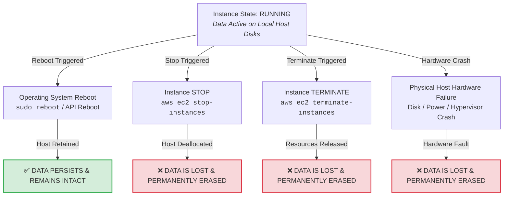
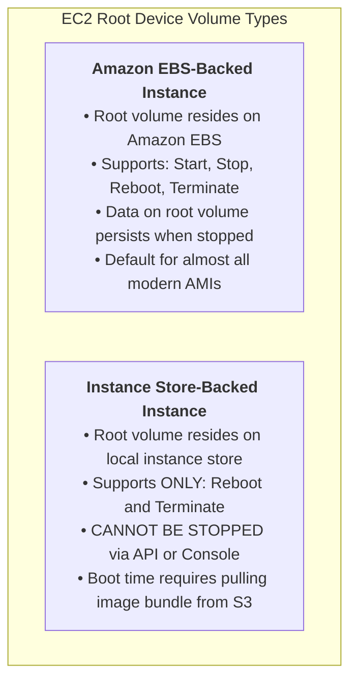
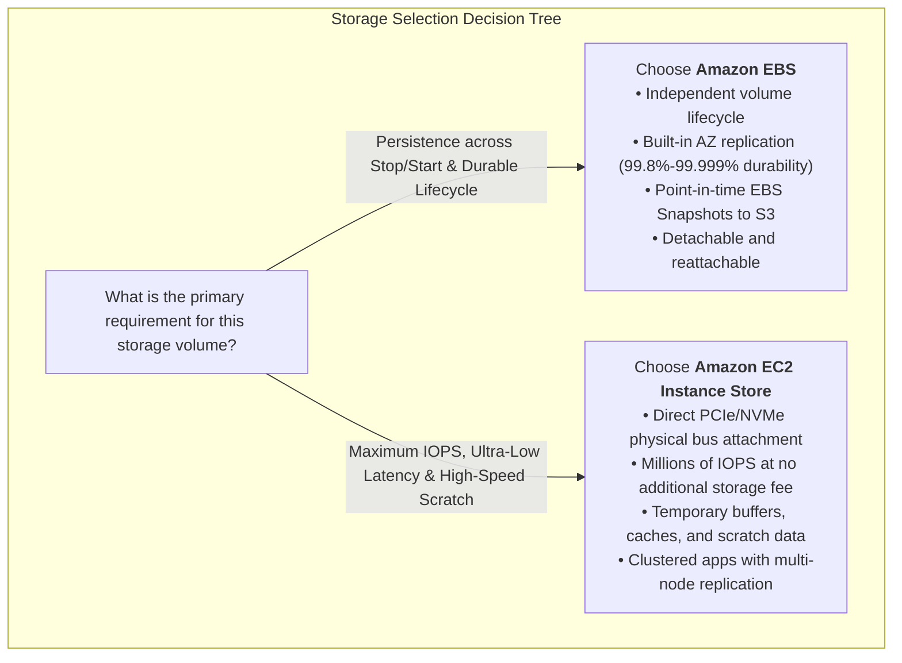
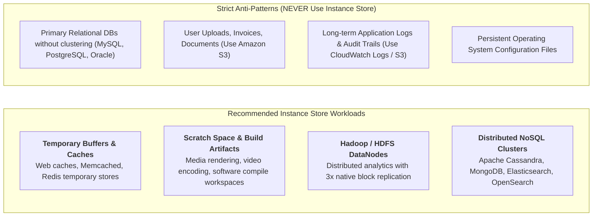
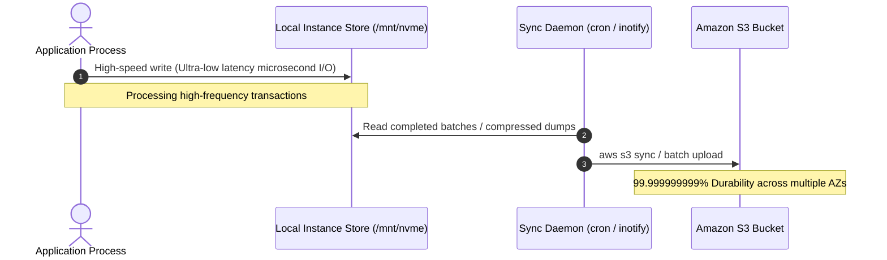
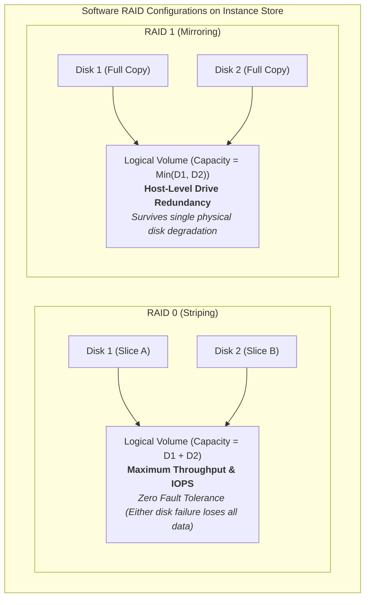

# ⚡ Amazon EC2 Instance Store: High-Performance Ephemeral Block Storage

> **Course**: AWS re/Start  
> **Module**: Storage and Archiving  
> **Source Document**: `T19-0004-STOR_INSTANCESTORE_EN.pdf`  
> **Target Audience**: AWS re/Start Learners & Cloud Practitioners  

---

## 🎯 Module Overview

In modern cloud computing, input/output (I/O) performance is frequently the decisive bottleneck for data-intensive workloads. While network-attached block storage like Amazon Elastic Block Store (Amazon EBS) provides durable, persistent, and independent lifecycle management, network latency and transmission overhead can constrain applications requiring microsecond-level access and millions of IOPS (Input/Output Operations Per Second).

An **Amazon EC2 Instance Store** (often referred to as *ephemeral storage*) provides high-speed, temporary block-level storage physically attached directly to the host computer running the Amazon Elastic Compute Cloud (Amazon EC2) instance. Because the storage media resides on the same hardware motherboard and chassis as the host CPUs, data transfers bypass the network layer entirely, delivering ultra-high throughput and ultra-low access latency.

However, this raw physical performance comes with a critical architectural trade-off: **ephemerality**. Instance store storage is non-persistent; its data lifecycle is intimately bound to the underlying physical server. Understanding when, why, and how to deploy instance stores—alongside strategies for mitigating data loss—is a cornerstone skill for AWS cloud architects and system administrators.

---

## 📌 Learning Objectives

- [ ] Define the architecture and role of an **Amazon EC2 Instance Store** as host-attached temporary block storage.
- [ ] Contrast the physical NVMe/SATA bus architecture of an instance store with the network-attached fabric of Amazon EBS.
- [ ] Understand the **Block Device Mapping** workflow, device naming, and manual vs. automatic OS mounting.
- [ ] Master the **Data Persistence Lifecycle (The Ephemeral Matrix)** across instance reboot, stop, terminate, and hardware failure.
- [ ] Distinguish between **Instance-Store Backed** and **EBS-Backed** root device volumes, including stop/start restrictions.
- [ ] Analyze the **10-Factor Comparison Table** contrasting Amazon EBS and EC2 Instance Store.
- [ ] Identify ideal workloads (buffers, caches, HDFS data nodes, distributed replicated NoSQL databases) and recognize architectural anti-patterns.
- [ ] Implement operational best practices, including regular backups to Amazon S3/EBS and software RAID (RAID 0 vs. RAID 1) configuration.
- [ ] Answer all module checkpoint and exam-style review questions with technical precision.

---

## 📚 Key Terminology

| Term | Technical Definition |
| :--- | :--- |
| **Instance Store** | Temporary block-level storage located on physical solid-state drives (SSDs) or hard disk drives (HDDs) physically attached to the underlying host hardware server running the EC2 instance. |
| **Ephemeral Storage** | Non-persistent storage whose lifecycle is strictly tied to the running state of an instance on a specific physical hypervisor host. |
| **Block Device Mapping** | A configuration mapping that defines the block devices (EBS volumes and instance store volumes) exposed to an Amazon EC2 instance at boot time. |
| **NVMe (Non-Volatile Memory Express)** | A high-performance, low-latency storage host controller interface designed for SSDs connected via PCIe buses. |
| **EBS-Backed Instance** | An EC2 instance whose root volume is hosted on an Amazon Elastic Block Store (EBS) volume, enabling instance stop, start, and persistence across host migrations. |
| **Instance-Store Backed Instance** | An EC2 instance whose root volume is located directly on an instance store disk; such instances cannot be stopped, only rebooted or terminated. |
| **Software RAID** | Redundant Array of Independent Disks configured at the guest operating system level (e.g., using Linux `mdadm`) to stripe (RAID 0) or mirror (RAID 1) instance store disks. |
| **Application-Level Replication** | Architectural redundancy implemented within distributed software (e.g., Cassandra, MongoDB, Kafka) where data is copied across multiple independent nodes to protect against node failure. |

---

## 🧱 What is an Amazon EC2 Instance Store?

An **Amazon EC2 Instance Store** delivers temporary block-level storage for Amazon EC2 instances. Unlike network-attached storage solutions, instance store disks are installed directly inside the physical chassis of the rack-mounted server hosting your virtual machine.

```mermaid
flowchart TD
    subgraph PhysicalHost["AWS Data Center Physical Host Server"]
        Motherboard["Host Motherboard & Hypervisor (AWS Nitro / Xen)"]
        
        subgraph ComputeResources["Compute & Memory"]
            CPU["Host Multi-Core CPUs"]
            RAM["Host System RAM"]
        end
        
        subgraph PhysicalDisks["Physical Host Storage (Direct Bus Attachment)"]
            Disk1["Physical NVMe SSD #1"]
            Disk2["Physical NVMe SSD #2"]
        end
        
        subgraph GuestVM["Amazon EC2 Instance (Guest VM)"]
            VCPU["Virtual CPUs (vCPU)"]
            VRAM["Instance Memory (RAM)"]
            VDisk1["Instance Store Volume (/dev/nvme1n1)"]
            VDisk2["Instance Store Volume (/dev/nvme2n1)"]
        end
        
        Motherboard --> ComputeResources
        Motherboard --> PhysicalDisks
        ComputeResources -. Virtualizes .-> GuestVM
        Disk1 ==>|PCIe / NVMe Bus (Direct High-Speed I/O)| VDisk1
        Disk2 ==>|PCIe / NVMe Bus (Direct High-Speed I/O)| VDisk2
    end
```

### Core Characteristics:
1. **Host-Physically Attached**: The disks reside on the exact physical server executing the hypervisor and guest virtual machine.
2. **Dedicated to the Instance**: The allocated instance store slices or full drives are dedicated exclusively to that specific EC2 instance during its active execution.
3. **Pre-allocated Capacity**: The quantity, capacity, and drive technology (NVMe SSD, SATA SSD, or HDD) are permanently determined by the instance type selected (e.g., `c5ad.4xlarge`, `i3en.2xlarge`, `m5d.large`).
4. **No Network Overhead**: Because data travels over the host motherboard's internal PCIe or SATA bus rather than Ethernet cables and storage network switches, latency is measured in tens of microseconds rather than milliseconds.

> [!NOTE]
> **Why is it called "Ephemeral"?**  
> The word *ephemeral* means lasting for a very short time. Instance store storage is called ephemeral because its contents disappear the moment the virtual machine transitions away from the physical host computer.

---

## 🔬 Physical vs. Virtual Architecture

To understand why instance stores exist alongside Amazon EBS, we must analyze the hardware and communication paths that govern data movement.

```mermaid
flowchart LR
    subgraph EC2Host["Physical EC2 Host Server"]
        EC2["EC2 Instance (Guest OS)"]
        PCIeBus["Host Internal PCIe / NVMe Bus"]
        ISDisk["Physical Instance Store SSD"]
        
        EC2 <==>|Ultra-Low Latency (Microseconds)<br>Hundreds of Thousands of IOPS| PCIeBus
        PCIeBus <==> ISDisk
    end
    
    subgraph NetworkFabric["AWS High-Speed Network Fabric"]
        NIC["Host Network Interface (ENA)"]
        Switch["AWS Network Switches & Routers"]
    end
    
    subgraph EBSStorageRack["Amazon EBS Storage Fleet"]
        EBSNode["EBS Storage Controller & Redundant Disks"]
    end
    
    EC2 <==>|Network Traffic| NIC
    NIC <==> Switch
    Switch <==>|Sub-millisecond Latency<br>Shared Fabric Transit| EBSNode
```

### 1. Direct Bus Attachment vs. Network Transit Delay
- **Instance Store**: Communicates directly through local PCIe lanes or SATA controller interfaces. There is zero network serialization, zero packet encapsulation, and no external storage appliance latency.
- **Amazon EBS**: Communicates over the AWS network fabric using specialized Elastic Network Adapters (ENA) and Nitro storage cards. While AWS Nitro provides dedicated network bandwidth for EBS-optimized instances, physics dictates that crossing network links incurs slightly higher latency than local PCIe bus transfers.

### 2. High Random I/O and Throughput
- Instance store volumes on storage-optimized instance families (such as `I3`, `I3en`, `I4i`, and `Im4gn`) deliver:
  - Millions of random read/write IOPS.
  - Multi-gigabyte per second sequential throughput.
  - Consistent sub-millisecond (often microsecond-level) latencies.
- This makes them indispensable for extreme I/O workloads where standard network-attached storage would become a financial or performance bottleneck.

### 3. Ephemeral Lifecycle Binding
- Because an instance store is a physical disk inside a physical server, your data lives on that specific piece of silicon.
- If the EC2 instance is stopped or terminated, AWS releases the physical compute host back to the shared pool. When you start the instance again, AWS allocates compute capacity on an entirely different physical host in the Availability Zone. The original host-attached disk remains behind, and its blocks are cryptographically wiped before reassignment.

---

## ⚙️ Block Device Mapping & Volume Lifecycle Management

Understanding how instance store volumes are exposed to an operating system is essential for configuration and automation.

### 1. Attachment via Block Device Mapping
- **Launch-Time Configuration**: You configure instance store volumes when launching an instance using the Amazon EC2 API, AWS CLI, AWS Management Console, or Infrastructure as Code (Terraform/CloudFormation).
- **No Dynamic Post-Launch Attachment**: Unlike EBS volumes—which can be created, attached, detached, and modified at any time while an instance is running—instance store volumes **cannot be attached or detached after the instance has launched**.
- **Immutable Lifetime**: You cannot create or destroy instance store volumes independently of their parent EC2 instance. They exist if and only if the instance exists on that host.

```bash
# Example AWS CLI command launching an instance with instance store mapping
aws ec2 run-instances \
    --image-id ami-0abcdef1234567890 \
    --instance-type m5d.xlarge \
    --key-name MyKeyPair \
    --block-device-mappings '[{"DeviceName":"/dev/xvdb","VirtualName":"ephemeral0"}]'
```

### 2. Mounting Instance Store Volumes in the Operating System
Depending on the instance generation and AMI:
- **Automatic vs. Manual Mounting**:
  - In some legacy AMIs, formatting and mounting occurred automatically.
  - In modern AWS Nitro instances (such as `m5d`, `c5ad`, `r6id`), instance store drives appear as raw unformatted NVMe block devices (e.g., `/dev/nvme1n1`, `/dev/nvme2n1`). The operating system administrator must create a filesystem and mount the device.

```bash
# 1. Identify available block devices
lsblk

# 2. Check if the device has an existing filesystem
sudo file -s /dev/nvme1n1

# 3. Format the drive with ext4 or XFS
sudo mkfs -t xfs /dev/nvme1n1

# 4. Create a target mount point directory
sudo mkdir -p /mnt/scratch-storage

# 5. Mount the instance store volume
sudo mount /dev/nvme1n1 /mnt/scratch-storage

# 6. Verify filesystem mount and available capacity
df -hT /mnt/scratch-storage
```

> [!WARNING]
> **Fstab Configuration Precaution**:  
> When adding instance store mounts to `/etc/fstab` for persistence across reboots, always use the `nofail` mount option (e.g., `/dev/nvme1n1 /mnt/scratch-storage xfs defaults,nofail 0 2`). If an instance is resized to an instance type lacking local storage, the missing drive will cause the Linux boot process to stall without `nofail`.

---

## 🔄 Lifecycle & Data Persistence Rules (The Ephemeral Matrix)

The lifecycle of instance store data is strictly defined by EC2 state transitions and underlying hardware events.



### The Ephemeral Persistence Matrix

| Event / Action | What Happens to the Instance? | What Happens to Instance Store Data? | Explanation & Mechanics |
| :--- | :--- | :--- | :--- |
| **Guest OS Reboot** (`sudo reboot`) | Reboots within the same hypervisor guest. | **✅ PERSISTS** | The instance remains on the exact same physical host hardware. Memory clears, but local disk platters/flash cells remain untouched. |
| **EC2 API Reboot** (`aws ec2 reboot-instances`) | AWS hypervisor issues a warm reset to the VM. | **✅ PERSISTS** | The VM does not leave the physical host. Storage controllers remain powered. |
| **Instance Stop** (`aws ec2 stop-instances`) | VM is powered down; compute capacity released. | **❌ LOST (ERASED)** | The instance deallocates the physical host. When started later, it launches on a different host. Instance store blocks are zeroed out for security. |
| **Instance Termination** (`aws ec2 terminate-instances`) | VM is permanently destroyed. | **❌ LOST (ERASED)** | All associated resources are released back to the AWS hardware pool. Storage is cryptographically scrubbed. |
| **Underlying Host Failure** | Physical motherboard, drive, or power supply crashes. | **❌ LOST (ERASED)** | The hardware holding the physical blocks has failed. AWS Auto Recovery moves the instance to a new host, leaving corrupted/dead local disks behind. |

### Root Device Architecture: Instance-Store Backed vs. EBS-Backed

An EC2 instance must have a root volume containing the operating system image used to boot the server.



> [!IMPORTANT]
> **The Cannot-Stop Rule**:  
> For an **instance-store backed instance**, the **Stop** action is permanently disabled in the AWS Management Console and CLI (`aws ec2 stop-instances` returns an error). If you shut down the guest operating system, the instance transitions directly to `terminated`. Only EBS-backed instances can be stopped and restarted.

---

## ⚖️ Amazon EBS vs. Amazon EC2 Instance Store: Comprehensive Comparison

Choosing between Amazon EBS and EC2 Instance Store is one of the most critical structural decisions when designing storage on AWS.



### 10-Factor Comprehensive Comparison Table

| # | Comparison Factor | Amazon EBS (Elastic Block Store) | Amazon EC2 Instance Store |
| :-: | :--- | :--- | :--- |
| **1** | **Storage Type** | Network-attached block storage device. | Host-attached physical block storage device. |
| **2** | **Physical Attachment** | Connected over high-speed AWS internal network fabric (SAN architecture). | Physically installed inside the host server chassis via PCIe/SATA bus. |
| **3** | **Persistence & Lifecycle** | **Persistent**: Volume exists independently of instance lifecycle. Can survive stop and termination. | **Ephemeral (Temporary)**: Exists only for the lifetime of the instance on that host. Erased on stop or termination. |
| **4** | **Maximum I/O Performance** | High (Up to 256,000 IOPS and 4,000 MB/s on `io2 Block Express`). Subject to network throughput limits. | Ultra-High (Up to several million IOPS and multi-GB/s throughput on NVMe SSD instances). Direct bus speed. |
| **5** | **Latency Profile** | Sub-millisecond to single-digit milliseconds. | Microsecond-level (tens of microseconds for direct NVMe read/write). |
| **6** | **Encryption Capabilities** | Transparent native AWS KMS encryption (EBS encryption enabled at volume creation with zero overhead). | Encrypted at rest natively on modern Nitro instances using hardware-accelerated NVMe keys (keys destroyed at deallocation). |
| **7** | **Snapshots & Backups** | Native point-in-time incremental snapshots directly to Amazon S3 via EC2 API / AWS Backup. | No native snapshot mechanism. Backups must be orchestrated manually by copying data to S3 or EBS. |
| **8** | **Pricing Model** | Billed per GB-month provisioned, plus provisioned IOPS/throughput fees (for `io1`, `io2`, `gp3`). | Included in the hourly EC2 instance price. No additional per-GB storage billing. |
| **9** | **Failover & Reattachment** | Can be detached from an unhealthy instance and attached to another instance in the same AZ. | Cannot be detached or moved. Tightly bound to the specific host hardware. |
| **10** | **Stop / Start Capability** | Instances can be stopped to save compute costs and started later without losing data. | Stopping an instance discards all data. Instance-store backed root instances cannot be stopped at all. |

---

## 🎯 When to Use Instance Store (Ideal Use Cases)

Because instance stores offer extreme speed without data durability, they are suited for specific workloads that either value ephemeral speed or manage replication at the application layer.



### 1. Temporary Buffers, Caches, and Scratch Space
- **Web Application Caching**: In-memory or on-disk caching proxies (Varnish, Redis, Nginx cache) where losing cache items merely causes a cache miss without corrupting application state.
- **Render Farms & Video Transcoding**: High-throughput temporary workspaces where raw video frames are extracted, manipulated, and written out to Amazon S3 upon completion.
- **Compiler Farms & CI/CD Runners**: Fast scratch disks for compiling source code and linking massive binary libraries.

### 2. Distributed, Replicated Analytics (Hadoop / HDFS)
- Frameworks like Apache Hadoop, Apache Spark, and MapReduce are designed with hardware failure in mind.
- **HDFS 3x Replication**: The Hadoop Distributed File System automatically creates three replicas of every data block across different physical worker nodes. If an underlying host hosting an instance store fails, HDFS detects the missing block and re-replicates it from surviving nodes automatically.

### 3. Distributed NoSQL & Search Databases
- Clustered systems such as **Apache Cassandra**, **Apache Kafka**, **MongoDB replica sets**, and **Elasticsearch / OpenSearch** maintain active quorum-based replication across multiple availability zones.
- Deploying these nodes on storage-optimized instance store instances (`i3`, `i4i`) yields staggering query and indexing throughput. If an instance fails or is terminated, the cluster automatically re-syncs state from surviving peer nodes.

### ❌ Anti-Patterns (When NOT to Use Instance Store)
- **Standalone Relational Databases**: Hosting a single MySQL, PostgreSQL, or SQL Server database on an instance store guarantees complete business data loss upon an unplanned host failure or instance restart.
- **Static Assets and User Uploads**: Photos, user profile avatars, and legal documents must always be uploaded directly to Amazon S3.
- **Stateful Web Servers**: Servers storing local session states or persistent uploaded files.

---

## 🛠️ Best Practices for Instance Store Management

Deploying instance store volumes in production environments requires specific architectural guardrails to prevent catastrophic data loss.

### 1. Automated Backup and Synchronization Pipelines
Since instance store volumes do not support native AWS snapshots, applications must continuously ship state to durable storage systems like **Amazon S3** or **Amazon EBS**.



- **Cron-Driven Sync Scripts**: Periodic execution of `aws s3 sync /mnt/data s3://my-backup-bucket/data/`.
- **Checkpointing**: In high-performance computing (HPC) simulations, compute nodes periodically export checkpoint state to S3 so computations can resume on a fresh instance if a node fails.

### 2. Software RAID Configurations (RAID 0 vs. RAID 1)
When an EC2 instance type includes multiple physical instance store volumes (for example, `i3.4xlarge` includes two 1.9 TB NVMe SSDs), administrators can combine them using Linux `mdadm`.



#### RAID Configuration Summary:
- **RAID 0 (Striping)**: Combines multiple drives into a single logical volume by striping data across them.
  - **Pros**: Multiplies IOPS and throughput by the number of disks; maximizes usable disk space.
  - **Cons**: Doubles the risk of volume failure. Ideal for pure scratch data, rendering, and ephemeral caches.
- **RAID 1 (Mirroring)**: Mirrors identical data across two disks on the same host.
  - **Pros**: Protects against individual drive sector or disk failure while the host remains online.
  - **Cons**: Cuts usable storage capacity in half; does **not** protect against instance stop, termination, or host-level hypervisor failure.

```bash
# Example: Creating a RAID 0 array using mdadm across two NVMe instance store disks
sudo mdadm --create --verbose /dev/md0 --level=0 --raid-devices=2 /dev/nvme1n1 /dev/nvme2n1
sudo mkfs.xfs /dev/md0
sudo mkdir -p /mnt/raid0-scratch
sudo mount /dev/md0 /mnt/raid0-scratch
```

---

## ❓ Review & Checkpoint Questions

### 1. Which type of storage does an Amazon EC2 instance store provide?
> **Answer**:  
> An instance store provides **temporary, non-persistent, block-level storage** that is physically attached directly to the host computer running the EC2 instance. It delivers ultra-high performance, high IOPS, and low latency for temporary data.

### 2. After an instance has been terminated, what happens to the data in the associated instance store?
> **Answer**:  
> The data is **permanently lost and deleted**. When an instance terminates, the host computer resources are deallocated, and the underlying storage blocks are cryptographically scrubbed and zeroed out before being reallocated to other AWS customers.

### 3. After an instance has been rebooted, what happens to the data in the associated instance store?
> **Answer**:  
> The data **persists and remains intact**. An operating system reboot (whether initiated via the guest OS `sudo reboot` or via the AWS EC2 API/Management Console) keeps the virtual machine on the same underlying physical host hardware, preserving all local instance store blocks.

### 4. What happens to instance store data if you stop an EBS-backed EC2 instance that has an instance store volume attached?
> **Answer**:  
> The instance store data is **lost and discarded**. While the EBS root volume persists during an instance stop (`aws ec2 stop-instances`), the instance store is deallocated from the host. When the instance is subsequently started, it boots on a new physical host with a completely fresh, unformatted instance store volume.

### 5. Can you detach an instance store volume from one EC2 instance and attach it to another running instance in the same Availability Zone?
> **Answer**:  
> **No**. Instance store volumes are physically attached to the underlying server hardware hosting that specific instance. They cannot be detached, moved, or reattached to another instance. For reattachable block storage, Amazon EBS must be used.

---

## 📝 Key Takeaways & Architectural Summary

- **Physical Attachment**: Amazon EC2 Instance Store volumes are physically installed on the host computer running the virtual machine, bypassing the network to deliver microsecond-level latency and millions of IOPS.
- **Ephemeral Lifecycle**: Instance store volumes exist only for the active lifespan of the instance on that host. Data persists across reboots, but is **permanently lost upon instance stop, termination, or host hardware failure**.
- **Launch-Time Mapping**: Instance stores must be mapped during instance launch via Block Device Mapping and cannot be created, attached, or detached dynamically post-launch.
- **Root Volume Constraints**: Instances using instance-store backed root volumes cannot be stopped—only rebooted or terminated.
- **Target Workloads**: Best utilized for non-persistent scratch space, temporary caches, media rendering buffers, and distributed clustered databases (Hadoop HDFS, Cassandra, Elasticsearch) with built-in application-level replication.
- **Operational Guardrails**: Critical data residing on or processed by instance stores must be regularly mirrored or backed up to persistent storage systems such as Amazon S3 or Amazon EBS.
