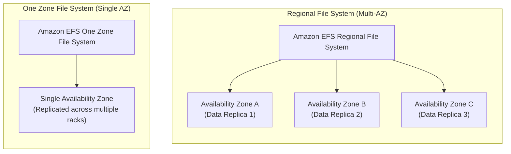
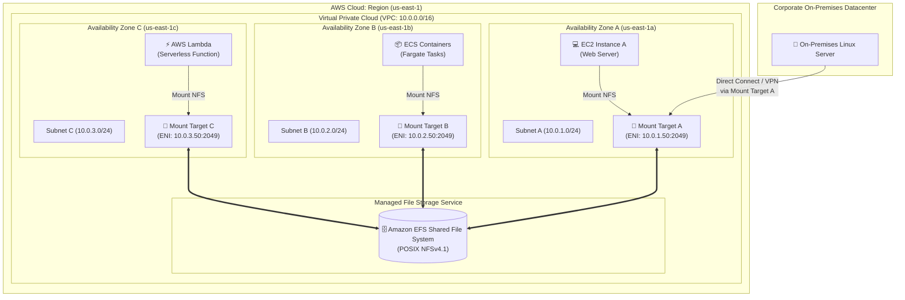
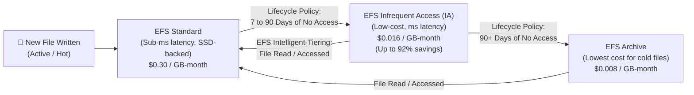
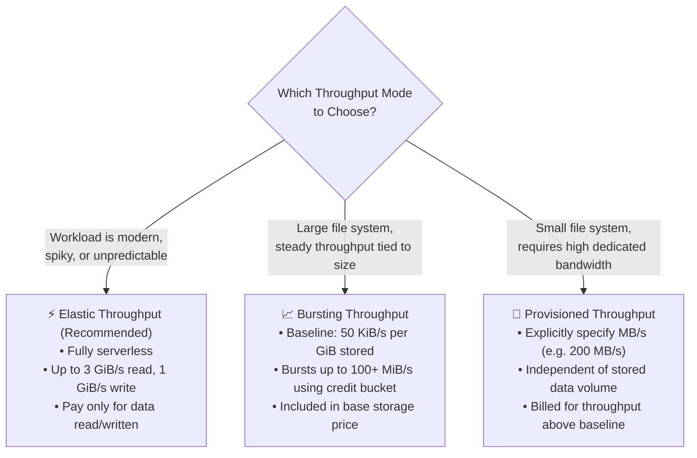
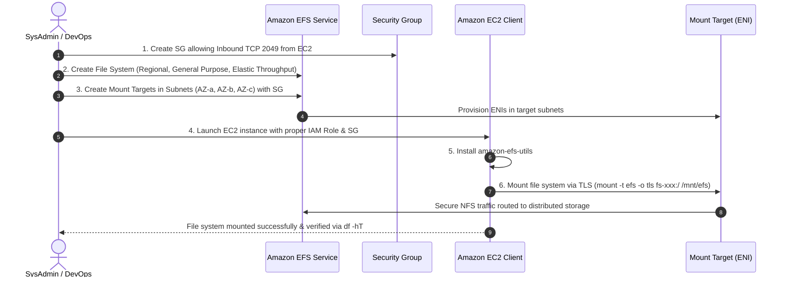

# 📂 Amazon Elastic File System (Amazon EFS): Cloud-Native Shared File Storage

> **Course**: AWS re/Start  
> **Module**: Storage and Archiving (T19 – Amazon EFS)  
> **Source Document**: `T19-Storage_and_Archiving/T19-0005-STOR_AMAZONEFS_EN.pdf`  
> **Target Audience**: AWS re/Start Learners, Cloud Practitioners, Solutions Architects, and DevOps Engineers  

---

## 🎯 Module Overview

In modern cloud computing, applications frequently require a shared file storage system that can be accessed concurrently by hundreds or thousands of compute instances. Traditional on-premises Network Attached Storage (NAS) solutions require upfront hardware provisioning, complex storage fabric configuration, manual capacity forecasting, and expensive maintenance contracts. When storage limits are exceeded, operations stall; conversely, when capacity is over-provisioned, organizations waste valuable capital.

**Amazon Elastic File System (Amazon EFS)** solves these challenges by providing a serverless, fully managed, highly available, and dynamically elastic file system designed for cloud-native applications, container workloads, and on-premises environments. Built on open standards, Amazon EFS supports the **Network File System versions 4.0 and 4.1 (NFSv4)** protocols and complies with standard POSIX file system permissions and semantics.

Amazon EFS automatically scales file storage capacity up or down as files are added or deleted, expanding to petabytes of data without interrupting applications or requiring manual volume resizing. By distributing data redundantly across multiple Availability Zones (AZs) in an AWS Region, Amazon EFS delivers 99.999999999% (11 9s) of durability, multi-AZ resilience, and concurrent multi-client read/write capabilities for Amazon EC2, Amazon ECS, Amazon EKS, AWS Lambda, and on-premises servers.

---

## 📌 Learning Objectives

By completing this module and studying these comprehensive notes, you will be able to:

- [ ] **Define Amazon EFS**: Explain the core capabilities of Amazon EFS as a fully managed, serverless, POSIX-compliant Network File System (NFSv4.0 and NFSv4.1) solution.
- [ ] **Analyze Architectural Foundations**: Differentiate elastic auto-scaling capacity from fixed block storage, and evaluate multi-AZ redundancy versus single-AZ configurations.
- [ ] **Understand Multi-Client Concurrency**: Articulate how thousands of EC2 instances, containers, and serverless functions concurrently read and write to a single unified namespace with strong consistency.
- [ ] **Master Mounting Architecture**: Describe how Mount Targets (Elastic Network Interfaces) in VPC subnets operate, how DNS resolves clients to local Availability Zones, and how security groups protect NFS traffic (TCP port 2049).
- [ ] **Mount EFS on Linux**: Execute mount commands using both the standard Linux NFSv4 client and the Amazon EFS Mount Helper (`amazon-efs-utils`) with TLS 1.2 in-transit encryption and IAM role authentication.
- [ ] **Evaluate EFS Storage Classes**: Compare EFS Standard, EFS Infrequent Access (EFS IA), EFS Archive, and One Zone storage classes across performance, durability, and cost metrics.
- [ ] **Configure Lifecycle Management & Intelligent-Tiering**: Implement automated lifecycle policies to tier colder data to cost-optimized storage classes and tier files back upon access.
- [ ] **Distinguish Performance & Throughput Modes**: Select between General Purpose and Max I/O performance modes, and evaluate Bursting, Provisioned, and Elastic throughput modes based on workload patterns.
- [ ] **Implement EFS Access Points**: Configure application-specific entry points that enforce POSIX User IDs (UID/GID) and restrict access to dedicated directory subtrees.
- [ ] **Compare AWS Storage Services**: Contrast Amazon EFS with Amazon Elastic Block Store (Amazon EBS) and Amazon Simple Storage Service (Amazon S3) across protocols, access models, latency, and ideal use cases.

---

## 📚 Key Terminology

| Term | Definition |
| :--- | :--- |
| **Amazon EFS** | A serverless, fully managed, cloud-native file storage service supporting NFSv4.0/4.1 protocols for shared access across multiple compute clients. |
| **NFS (Network File System)** | A distributed file system protocol allowing a client computer to access files over a network in a manner similar to local storage. |
| **POSIX Compliance** | Portable Operating System Interface standards governing file system semantics, including directory trees, file locks, user/group IDs, and permissions (`rwx`). |
| **Mount Target** | An Elastic Network Interface (ENI) provisioned in a specific VPC subnet that provides an IP address and endpoint for clients in that AZ to mount the EFS file system. |
| **EFS Mount Helper** | A utility utility (`amazon-efs-utils`) that simplifies mounting EFS file systems, enabling TLS in-transit encryption, IAM authentication, and CloudWatch metrics. |
| **EFS Standard** | The primary multi-AZ storage class designed for active, frequently accessed data with sub-millisecond read latencies. |
| **EFS Infrequent Access (IA)** | A cost-optimized storage tier for files accessed less frequently (e.g., after 7–90 days of inactivity), offering up to 92% storage cost reduction with a small retrieval fee. |
| **EFS Archive** | A cost-optimized tier for cold long-term file data accessed only a few times per year, offering the lowest storage cost for Regional file systems. |
| **EFS Intelligent-Tiering** | Automated lifecycle management that transitions inactive files to IA/Archive tiers and promotes them back to Standard upon read access. |
| **General Purpose Mode** | The default EFS performance mode optimized for lowest metadata latencies and ideal for web serving, CMS, and developer home directories. |
| **Max I/O Mode** | An EFS performance mode designed for massive scale-out parallel workloads, scaling to hundreds of thousands of IOPS with slightly higher per-operation latency. |
| **Elastic Throughput** | A serverless throughput mode where EFS automatically scales throughput up and down based on real-time application workload demands, billed pay-as-you-go. |
| **EFS Access Point** | An application-specific entry point into an EFS file system that enforces POSIX identity (UID/GID) and restricts client root directory access. |

---

## 🏛️ 1. What is Amazon Elastic File System (Amazon EFS)?

### Definition and Core Purpose
**Amazon Elastic File System (Amazon EFS)** is a scalable, fully managed, serverless file storage service that provides a shared file system accessible over a network using the **Network File System versions 4.0 and 4.1 (NFSv4)** protocols.

```
┌────────────────────────────────────────────────────────────────────────┐
│                        Amazon EFS Core Pillars                         │
├────────────────────────────────────────────────────────────────────────┤
│ • Serverless & Fully Managed: No hardware, disks, or servers to manage │
│ • Dynamic Elasticity: Automatically grows and shrinks on demand        │
│ • Strong POSIX Semantics: Hierarchical directories, file locks, chmod  │
│ • Multi-AZ Durability: Replicated across multiple AZs (11 9s durability│
│ • Massive Concurrency: Thousands of instances, containers, & Lambdas   │
│ • Flexible Access: Cloud (VPC, EC2, ECS, EKS) and On-Premises (DirectConnect)│
└────────────────────────────────────────────────────────────────────────┘
```

### Key Differences Between File, Block, and Object Storage

To understand where Amazon EFS fits within the AWS storage landscape, it is helpful to look at how operating systems and applications interact with data:

1. **Block Storage (Amazon EBS)**:
   - Data is stored in raw, fixed-size blocks without higher-level file metadata.
   - Operates like a virtual physical hard drive attached directly to a single compute instance (with EBS Multi-Attach limited to select Nitro instances within a single AZ).
   - Lowest latency (sub-millisecond), ideal for boot volumes, transactional relational databases (PostgreSQL, MySQL, Oracle), and high-performance operating system storage.

2. **File Storage (Amazon EFS)**:
   - Data is organized hierarchically into folders, subfolders, and individual files with standard POSIX metadata (ownership, permissions, timestamps, file sizes).
   - Operates like a centralized shared network drive (NAS) mounted across a network.
   - Ideal for workloads where multiple compute instances must read and write to the exact same file paths concurrently.

3. **Object Storage (Amazon S3)**:
   - Data is stored as discrete objects containing data, a unique identifier key, and arbitrary metadata inside a flat bucket namespace.
   - Accessed via web-standard REST APIs (HTTP `GET`, `PUT`, `DELETE`), rather than traditional file system mount points or drive letters.
   - Virtually unlimited scale, designed for static media assets, big data lakes, backups, and cloud-native applications.

---

## 📐 2. Architectural Foundations

### 1. Dynamic Elastic Capacity
Unlike traditional storage volumes where administrators must pre-allocate a specific volume size (e.g., 500 GiB or 2 TiB) and monitor disk usage to prevent outages, Amazon EFS features **dynamic elasticity**:
- **Zero Pre-Provisioning**: You never specify a storage capacity when creating an EFS file system.
- **Auto-Growth**: When files are added, capacity expands instantly to petabyte scale.
- **Auto-Shrink**: When files are deleted, capacity contracts automatically.
- **Pay-for-What-You-Use**: Billing is calculated based on the average gigabytes stored per month. There are no minimum fees or empty disk space charges.

### 2. Multi-AZ High Availability & Durability
Amazon EFS offers two primary architectural durability models:



- **Regional Storage Classes (Default / Multi-AZ)**:
  - Data is redundantly written and stored across multiple physically isolated Availability Zones within an AWS Region.
  - **Durability**: 99.999999999% (11 9s) annual durability.
  - **Availability**: Designed for 99.99% (four 9s) availability.
  - **Resilience**: File systems remain fully operational even in the catastrophic event of a complete Availability Zone failure or datacenter disruption.
- **One Zone Storage Classes**:
  - Data is stored redundantly within a single Availability Zone.
  - **Availability**: Designed for 99.9% availability.
  - **Cost Advantage**: Storage costs are approximately **47% lower** than Regional storage classes.
  - **Trade-Off**: If the specific Availability Zone encounters an outage or disaster, file access is temporarily unavailable, and catastrophic physical destruction of that AZ could result in unrecoverable data loss.
  - **Best For**: Development, testing, staging environments, build artifacts, or workloads where data can be easily regenerated from other sources.

### 3. Concurrent Multi-Client Sharing
Amazon EFS is engineered from the ground up for massive horizontal concurrency:
- **Thousands of Clients**: Up to thousands of compute clients can mount an EFS file system simultaneously.
- **Heterogeneous Workloads**: Clients can include:
  - Amazon EC2 Linux instances across multiple Availability Zones.
  - Container tasks running on Amazon ECS (Elastic Container Service) with AWS Fargate or EC2 launch types.
  - Kubernetes pods running on Amazon EKS (Elastic Kubernetes Service).
  - Serverless functions running on AWS Lambda.
  - On-premises servers connected via AWS Direct Connect or AWS Site-to-Site VPN.
- **Strong Read-After-Write Consistency**: Once a client finishes writing a file and closes the file descriptor (or issues a sync operation), all other clients immediately observe the latest data. EFS also supports standard advisory file locking via NFSv4.

---

## 🌐 3. How EFS Works & Mounting Architecture

### Mount Targets and Network Topology
To make an EFS file system accessible inside your Virtual Private Cloud (VPC), AWS provisions **Mount Targets** inside your subnets:
1. **Mount Target Elastic Network Interface (ENI)**: A mount target is an ENI that receives a private IP address from your chosen VPC subnet.
2. **One Mount Target Per Availability Zone**: In Regional file systems, you create one mount target in each AZ where your compute resources reside.
3. **Security Groups**: Each mount target is associated with VPC Security Groups that must permit inbound traffic on **TCP Port 2049** (the standardized NFS port) from your client instances.



### DNS Name Resolution and Traffic Optimization
Amazon EFS provides a standardized regional DNS name for every file system:
```text
<file-system-id>.efs.<region>.amazonaws.com
```
*(Example: `fs-0123456789abcdef0.efs.us-east-1.amazonaws.com`)*

When an EC2 instance or container in `us-east-1a` queries this DNS name, AWS Route 53 resolver automatically returns the private IP address of the mount target in **that same Availability Zone (`us-east-1a`)**.
- **Performance**: Keeps storage network traffic within the local Availability Zone to minimize network latency.
- **Cost Reduction**: Avoids inter-AZ data transfer fees.

> [!NOTE]
> If a client resides in an AZ that does not have a mount target, or if connecting from on-premises over AWS Direct Connect / VPN, the client can specify the specific AZ-level DNS name (`<az-name>.<file-system-id>.efs.<region>.amazonaws.com`) or mount target IP directly.

---

### Mounting on Linux: Standard NFS vs Amazon EFS Mount Helper

Linux systems can mount Amazon EFS using two methods:

```
┌────────────────────────────────────────────────────────────────────────┐
│                        EFS Mounting Approaches                         │
├────────────────────────────────────────────────────────────────────────┤
│ 1. Standard Linux NFS Client (mount -t nfs4)                           │
│    • Universal; supported on any Linux distribution with nfs-common    │
│    • Requires specifying explicit NFS mount options                    │
│    • No native support for TLS encryption in transit or IAM auth       │
│                                                                        │
│ 2. Amazon EFS Mount Helper (amazon-efs-utils)                          │
│    • Recommended by AWS for security and manageability                │
│    • Seamless TLS 1.2 in-transit encryption via stunnel                │
│    • IAM role-based authorization and Access Point integration         │
│    • Automatically discovers mount target DNS records                  │
└────────────────────────────────────────────────────────────────────────┘
```

#### Approach 1: Standard Linux NFSv4 Client
Using the native `mount` utility with optimized NFS options:

```bash
# 1. Install standard NFS client utilities
sudo dnf install -y nfs-utils         # Amazon Linux 2023 / RHEL
# or: sudo apt-get install -y nfs-common # Ubuntu / Debian

# 2. Create the local mount directory
sudo mkdir -p /mnt/efs

# 3. Mount using standard NFSv4.1 options
sudo mount -t nfs4 -o nfsvers=4.1,rsize=1048576,wsize=1048576,hard,timeo=600,retrans=2,noresvport \
    fs-0123456789abcdef0.efs.us-east-1.amazonaws.com:/ /mnt/efs
```

#### Approach 2: Amazon EFS Mount Helper (`amazon-efs-utils`)
The AWS-provided `amazon-efs-utils` package is pre-installed on Amazon Linux and available for Debian, Ubuntu, CentOS, and SUSE:

```bash
# 1. Install amazon-efs-utils
sudo dnf install -y amazon-efs-utils   # Amazon Linux

# 2. Mount with in-transit encryption (TLS)
sudo mount -t efs -o tls fs-0123456789abcdef0:/ /mnt/efs

# 3. Mount using IAM authorization and TLS
sudo mount -t efs -o tls,iam fs-0123456789abcdef0:/ /mnt/efs

# 4. Mount using an EFS Access Point
sudo mount -t efs -o tls,accesspoint=fsap-0123456789abcdef0 fs-0123456789abcdef0:/ /mnt/efs
```

#### Persistent Mounting via `/etc/fstab`
To automatically remount the file system across instance reboots, add an entry to `/etc/fstab`:

```text
# Using amazon-efs-utils with TLS and _netdev (wait for network stack)
fs-0123456789abcdef0:/ /mnt/efs efs _netdev,tls 0 0

# Using an Access Point with IAM and TLS
fs-0123456789abcdef0:/ /mnt/efs efs _netdev,tls,iam,accesspoint=fsap-0123456789abcdef0 0 0
```

> [!IMPORTANT]
> Always include the `_netdev` mount option in `/etc/fstab`. This instructs the Linux system init daemon (systemd) to delay mounting until network interfaces and internet routing are fully initialized during boot.

---

### EFS Access Points
An **EFS Access Point** is an application-specific endpoint configured on an EFS file system that provides enhanced security and simplified multi-tenancy:
- **Root Directory Enforcement**: Locks a specific client or container into a designated subdirectory (e.g., `/data/app1`), preventing the client from traversing up to parent directories or accessing other applications' data.
- **POSIX Identity Override**: Automatically overrides the client's operating system credentials and enforces a fixed POSIX User ID (UID), Group ID (GID), and secondary groups for all file operations performed through that access point.
- **Automatic Subdirectory Creation**: When an access point is first accessed, EFS can automatically create the target root directory with pre-assigned ownership and permission permissions if it does not already exist.
- **Container and Serverless Integration**: Highly recommended for containerized architectures (Amazon ECS tasks and Amazon EKS pods) and AWS Lambda functions to prevent privilege escalation and enforce clean tenant isolation.

---

## 🗄️ 4. Storage Classes & Lifecycle Management

Amazon EFS offers multiple storage classes designed to balance performance against storage cost across the data lifecycle.



### Storage Classes Comparison

| Storage Class | Availability / Redundancy | Typical Access Pattern | Relative Cost (Storage) | Retrieval Fee | Latency |
| :--- | :--- | :--- | :--- | :--- | :--- |
| **EFS Standard** | Multi-AZ (Regional) | Frequently accessed active data | Baseline ($0.30/GB-mo) | None | Sub-millisecond |
| **EFS Infrequent Access (IA)** | Multi-AZ (Regional) | Inactive files accessed occasionally | ~92% lower ($0.016/GB-mo) | ~$0.01 per GB read | Low single-digit ms |
| **EFS Archive** | Multi-AZ (Regional) | Cold data accessed rarely (a few times/year) | ~97% lower ($0.008/GB-mo) | ~$0.03 per GB read | Low single-digit ms |
| **EFS One Zone** | Single AZ | Active data not requiring Multi-AZ resilience | ~47% lower ($0.16/GB-mo) | None | Sub-millisecond |
| **EFS One Zone-IA** | Single AZ | Inactive single-AZ data | ~95% lower ($0.013/GB-mo) | ~$0.01 per GB read | Low single-digit ms |

### Lifecycle Management & Intelligent-Tiering
Managing storage tiers manually is cumbersome and error-prone. Amazon EFS provides automated **Lifecycle Management**:
1. **Transition into Infrequent Access**: You specify a transition policy threshold: `7`, `14`, `30`, `60`, or `90` days. If a file is not read or modified for that duration, EFS automatically moves it from Standard to Infrequent Access behind the scenes.
2. **Transition into Archive**: You can configure a secondary threshold to transition cold files from IA to EFS Archive.
3. **Transition Back to Standard (Read-Tiering)**: When **EFS Intelligent-Tiering** is enabled, any read request made to a file stored in IA or Archive automatically transitions that file back into the EFS Standard tier. This ensures that files that become active again enjoy sub-millisecond latencies and avoid ongoing retrieval fees.

> [!TIP]
> Lifecycle management is completely transparent to client operating systems and applications. File paths, directory trees, file metadata, and access permissions remain identical, regardless of which underlying storage class holds the bytes.

---

## ⚡ 5. Performance Attributes & Throughput Modes

When creating and configuring an Amazon EFS file system, you configure two architectural attributes: **Performance Mode** and **Throughput Mode**.

### 1. Performance Modes

| Attribute | General Purpose Mode (Default) | Max I/O Mode |
| :--- | :--- | :--- |
| **Target Workload** | Web serving, CMS, developer home directories, general enterprise apps | Big data analytics, genomics, media rendering, parallel processing |
| **Metadata Latency** | **Lowest latency** per file operation (sub-millisecond) | Slightly higher per-operation metadata latency |
| **Max IOPS** | Up to 35,000 IOPS | Scales to 500,000+ IOPS |
| **Scaling Mechanism** | Optimized for serial and moderately concurrent operations | Optimized for massive scale-out parallel architectures |
| **Selection Guidance** | **Always start with General Purpose.** | Choose Max I/O only if CloudWatch `PercentIOLimit` consistently reaches 100%. |

> [!CAUTION]
> The Performance Mode is selected when the file system is created and **cannot be changed** afterwards. To switch between General Purpose and Max I/O, you must create a new file system and migrate data using AWS DataSync.

---

### 2. Throughput Modes

Amazon EFS offers three distinct throughput modes to accommodate different workload profiles:



1. **Elastic Throughput (Recommended for Most Workloads)**:
   - Serverless throughput that automatically scales up to 3 GiB/s read throughput and 1 GiB/s write throughput per file system.
   - You do not provision throughput or manage burst credits.
   - You pay solely for the actual gigabytes of data read or written (pay-per-request model).
   - Ideal for unpredictable, spiky, or unknown application traffic patterns.

2. **Bursting Throughput**:
   - Baseline throughput scales linearly with the size of data stored in EFS Standard (50 KiB/s per GiB, or 50 MiB/s per 1 TiB stored).
   - File systems accumulate burst credits when operating below baseline and can burst up to 100 MiB/s (or higher for file systems larger than 1 TiB).
   - If a file system with low stored data volume exhausts its burst credits, throughput drops to its small baseline, causing application slowdowns.

3. **Provisioned Throughput**:
   - Allows administrators to explicitly reserve a dedicated throughput rate (e.g., 200 MiB/s or 500 MiB/s) independent of the amount of data stored in the file system.
   - Useful for applications that store a small dataset (e.g., 50 GiB) but require high sustained throughput (e.g., 100 MiB/s).
   - You are billed for the provisioned throughput that exceeds your baseline allowance.

---

## 🔒 6. Security, Authorization & Encryption

Amazon EFS incorporates comprehensive security layers spanning networking, identity, operating system controls, and cryptography:

```
┌────────────────────────────────────────────────────────────────────────┐
│                        Amazon EFS Defense-in-Depth                     │
├────────────────────────────────────────────────────────────────────────┤
│ 1. Network Layer: VPC Subnets & Security Groups (TCP 2049 inbound)     │
│ 2. IAM Authorization: File system policies & IAM role credentials      │
│ 3. EFS Access Points: Enforced POSIX UID/GID & root directory jailed   │
│ 4. OS POSIX Permissions: User/group file ownership and chmod bits      │
│ 5. Encryption at Rest: AWS Key Management Service (AWS KMS)            │
│ 6. Encryption in Transit: Transport Layer Security (TLS 1.2)           │
└────────────────────────────────────────────────────────────────────────┘
```

### Encryption at Rest and in Transit
- **Encryption at Rest**:
  - Encrypts all file data and directory metadata using the industry-standard AES-256 algorithm.
  - Managed via **AWS Key Management Service (AWS KMS)**. You can use the AWS-managed KMS key (`aws/elasticfilesystem`) or a Customer Managed Key (CMK).
  - Must be configured at file system creation time and cannot be disabled.
- **Encryption in Transit**:
  - Protects network communication between the client instance and EFS mount targets using **Transport Layer Security (TLS 1.2)**.
  - Enabled automatically when mounting via the Amazon EFS Mount Helper (`-o tls`). The mount helper establishes a local `stunnel` background daemon that tunnels NFS traffic over encrypted TLS sockets to the mount target.

### IAM Policy Controls
EFS supports resource-based file system policies that govern client actions:
- `elasticfilesystem:ClientMount`: Grants read-only mounting permission.
- `elasticfilesystem:ClientWrite`: Grants write permission to the file system.
- `elasticfilesystem:ClientRootAccess`: Grants client permission to access the file system as system root (`UID=0`). By default, root squashing converts root users to `nobody` unless this permission is explicitly granted.

---

## 📊 7. Amazon EFS vs Amazon EBS vs Amazon S3: Comprehensive Comparison

Choosing the appropriate storage service is a primary architectural decision in AWS. The following matrix details the distinct trade-offs between Amazon EFS, Amazon EBS, and Amazon S3:

| Architectural Dimension | Amazon Elastic File System (EFS) | Amazon Elastic Block Store (EBS) | Amazon Simple Storage Service (S3) |
| :--- | :--- | :--- | :--- |
| **Storage Paradigm** | **File Storage** (Hierarchical tree) | **Block Storage** (Raw disk blocks) | **Object Storage** (Buckets & keys) |
| **Protocol / Interface** | NFSv4.0 / NFSv4.1 | Direct block device (NVMe / SCSI bus) | HTTP/HTTPS REST APIs |
| **Scope of Attachment** | Multi-AZ (within VPC / On-Prem) | Single AZ (attached to EC2 instance) | Global / Regional web endpoints |
| **Multi-Client Concurrency** | **Thousands** of instances/containers concurrently | Single instance (or select Nitro instances in 1 AZ via Multi-Attach) | Virtually **unlimited** concurrent clients |
| **Capacity Management** | **Elastic**: Auto-grows & auto-shrinks | **Provisioned**: Fixed volume size (resizable via Elastic Volumes) | **Unlimited**: No pre-allocation or sizing needed |
| **Typical Latency** | Low single-digit milliseconds (sub-ms reads) | **Sub-millisecond** (lowest latency) | 100–200 milliseconds (standard REST) |
| **Operating System Support** | Native Linux (macOS/Windows via Gateway/third-party) | Linux, Windows, macOS (any OS) | OS agnostic (accessed via web/API/SDK) |
| **POSIX Permissions** | **Full POSIX compliance** (`chmod`, `chown`, file locks) | Governed by guest OS file system formatting (ext4, XFS, NTFS) | Not POSIX compliant (metadata tags, ACLs, bucket policies) |
| **Durability Design** | 99.999999999% (11 9s) for Regional | 99.8% – 99.999% (AFR: 0.1% – 0.2%) | 99.999999999% (11 9s) |
| **Lifecycle Tiering** | Automatic (Standard $\rightarrow$ IA $\rightarrow$ Archive) | Manual (EBS Snapshots to S3) | Comprehensive (Standard $\rightarrow$ IA $\rightarrow$ Glacier $\rightarrow$ Deep Archive) |
| **Primary Use Cases** | Web CMS (WordPress), shared dev directories, container shared storage, big data processing | Operating system boot drives, high-performance OLTP relational databases (RDS, self-hosted MySQL) | Static website hosting, cloud data lakes, multimedia backups, application object storage |
| **Relative Pricing Model** | Pay for stored bytes + requests/throughput | Pay for provisioned capacity + IOPS regardless of usage | Pay for stored bytes + API requests (`GET`/`PUT`) + egress |

---

## 🛠️ 8. Step-by-Step Implementation & Configuration Guide

Setting up an Amazon EFS file system involves five core operational phases:



### Phase 1: Create the Security Group for EFS Mount Targets
Before creating mount targets, you must configure a dedicated security group that accepts incoming NFS traffic:

```bash
# Create Security Group for EFS Mount Targets
aws ec2 create-security-group \
    --group-name "efs-mount-targets-sg" \
    --description "Permit inbound NFS traffic from application instances" \
    --vpc-id "vpc-0123456789abcdef0"

# Add Inbound Rule for Port 2049 referencing the EC2 Security Group
aws ec2 authorize-security-group-ingress \
    --group-id "sg-0efs1111111111111" \
    --protocol tcp \
    --port 2049 \
    --source-group "sg-0ec2222222222222"
```

### Phase 2: Create the EFS File System
Using the AWS CLI or AWS Management Console:

```bash
# Create Regional EFS File System with Elastic Throughput and Encryption
aws efs create-file-system \
    --performance-mode generalPurpose \
    --throughput-mode elastic \
    --encrypted \
    --tags Key=Name,Value=Production-Shared-Storage \
    --region us-east-1
```
*(Returns file system ID, e.g., `fs-0123456789abcdef0`)*

### Phase 3: Create Mount Targets in Target Subnets
Provision a mount target in each Availability Zone subnet:

```bash
# Create Mount Target in Subnet A (us-east-1a)
aws efs create-mount-target \
    --file-system-id fs-0123456789abcdef0 \
    --subnet-id subnet-0aaaa111111111111 \
    --security-groups sg-0efs1111111111111

# Create Mount Target in Subnet B (us-east-1b)
aws efs create-mount-target \
    --file-system-id fs-0123456789abcdef0 \
    --subnet-id subnet-0bbbb222222222222 \
    --security-groups sg-0efs1111111111111
```

### Phase 4: Connect to EC2 and Mount the File System
On your Amazon Linux or Ubuntu EC2 instance:

```bash
# 1. Update package manager and install efs-utils
sudo dnf install -y amazon-efs-utils

# 2. Create the target mount directory
sudo mkdir -p /mnt/shared-data

# 3. Mount with TLS encryption enabled
sudo mount -t efs -o tls fs-0123456789abcdef0:/ /mnt/shared-data

# 4. Verify the mount
df -hT /mnt/shared-data
```

Expected output:
```text
Filesystem                     Type  Size  Used Avail Use% Mounted on
fs-0123456789abcdef0.efs...    nfs4  8.0E     0  8.0E   0% /mnt/shared-data
```
*(Notice that the available size shows 8.0 Exabytes, reflecting EFS's virtually limitless elastic capacity).*

### Phase 5: Test Multi-Client Shared Writes
Create a file on Instance A:
```bash
# On Instance A:
echo "Hello from EC2 Instance A ($(hostname)) - $(date)" | sudo tee /mnt/shared-data/cluster.log
```

Immediately view the file from Instance B mounted to the same EFS:
```bash
# On Instance B:
cat /mnt/shared-data/cluster.log
```
The output confirms immediate read-after-write consistency across physically separate instances in different Availability Zones.

---

## 💼 9. Common Workloads and Architecture Patterns

Amazon EFS is tailored for workloads requiring a robust, shared, POSIX-compliant file system:

```
┌────────────────────────────────────────────────────────────────────────┐
│                        Top Amazon EFS Workloads                        │
├────────────────────────────────────────────────────────────────────────┤
│ 1. Scalable Web Content Management (WordPress, Drupal, Magento)        │
│ 2. Containerized Application Storage (Amazon ECS & Amazon EKS)         │
│ 3. Serverless Lambda Shared Storage & Machine Learning Inference       │
│ 4. Enterprise Home Directories & Developer Workspace Persistence       │
│ 5. Big Data Analytics, Genomics, & Media Rendering Pipelines           │
│ 6. Continuous Integration & Artifact Repositories (Jenkins, GitLab)    │
└────────────────────────────────────────────────────────────────────────┘
```

1. **Scalable Web Content Management (WordPress / Drupal)**:
   - Web servers deployed across an Auto Scaling Group in multiple AZs serve web requests behind an Application Load Balancer (ALB).
   - Core application files, PHP scripts, user-uploaded media (`wp-content/uploads`), and themes reside on a shared EFS mount.
   - Any uploaded asset is instantly available to all web server instances without custom sync scripts or rsync cron jobs.

2. **Containerized Shared Persistent Storage (ECS & EKS)**:
   - Stateful containers or microservices requiring persistent state across container restarts mount EFS volumes.
   - When a Kubernetes pod is rescheduled to a different worker node or different AZ, it immediately remounts the identical EFS persistent volume claim (PVC) without data migration.

3. **Serverless Functions with Large Data Models (AWS Lambda)**:
   - AWS Lambda functions can mount an EFS file system directly within their VPC configuration.
   - Solves Lambda's ephemeral `/tmp` storage limitation, enabling serverless functions to access gigabytes or terabytes of shared data, pre-trained machine learning model weights, and shared reference libraries with low latency.

4. **Continuous Integration & Build Caches (Jenkins / GitLab Runners)**:
   - Build worker instances in CI/CD pipelines share a centralized dependency cache (Maven, npm, Gradle, Docker image layers) stored on EFS.
   - Dramatically reduces build times across dynamic worker pools by avoiding redundant dependency downloads.

---

## ❓ 10. Checkpoint Questions & Answers

### Question 1 (Source Slide Review)
**Which file system protocol does Amazon EFS support?**
> **Answer**:  
> Amazon EFS supports the **Network File System (NFS)** protocol, specifically **NFS version 4.0 (NFSv4.0) and NFS version 4.1 (NFSv4.1)**. It provides full POSIX file system compliance, allowing Linux-based operating systems to interact with files using standard system calls, directory structures, and permissions.

---

### Question 2 (Source Slide Review)
**Which AWS services are able to access Amazon EFS concurrently?**
> **Answer**:  
> Thousands of compute clients can access Amazon EFS concurrently, including:
> - **Amazon EC2** Linux instances (spanning multiple Availability Zones)
> - **Amazon ECS** (Elastic Container Service) tasks (both EC2 and AWS Fargate launch types)
> - **Amazon EKS** (Elastic Kubernetes Service) worker nodes and pods
> - **AWS Lambda** serverless functions
> - **AWS App Runner** services
> - **On-premises physical servers and virtual machines** connected via AWS Direct Connect or AWS Site-to-Site VPN.

---

### Question 3 (Source Slide Review)
**What are the main benefits of using Amazon EFS in your cloud environment?**
> **Answer**:  
> The core benefits of Amazon EFS include:
> 1. **Fully Managed & Serverless**: Zero hardware provisioning, disk volume sizing, patching, or storage maintenance overhead.
> 2. **Dynamic Elasticity**: Automatically scales storage capacity up to petabytes and contracts when files are deleted; you pay only for what you store.
> 3. **High Availability & Durability**: Regional storage classes redundantly distribute data across multiple Availability Zones, delivering 99.999999999% (11 9s) of durability.
> 4. **Massive Multi-Client Sharing**: Enables concurrent shared read/write access across thousands of compute instances with strong data consistency.
> 5. **Cost Optimization**: Integrated Lifecycle Management and Intelligent-Tiering automatically move colder files to Infrequent Access and Archive tiers, saving up to 92% to 97% on storage costs.

---

### Question 4 (Advanced Scenario Review)
**A solutions architect is designing a high-traffic WordPress deployment hosted on EC2 instances behind an Application Load Balancer across three Availability Zones. Which storage configuration best supports shared media uploads while minimizing administrative overhead and maximizing resilience?**
> **Answer**:  
> Configure an **Amazon EFS Regional file system** with Mount Targets deployed in the subnets of each of the three Availability Zones. Mount the EFS file system at `/var/www/html/wp-content/uploads` on all EC2 web instances using the Amazon EFS Mount Helper (`amazon-efs-utils`) with TLS encryption enabled. Enable **EFS Intelligent-Tiering** with a 30-day lifecycle rule to automatically move aged media files to EFS Infrequent Access. This architecture provides high availability, automatic scaling, multi-AZ resilience, and automated cost optimization without requiring manual volume resizing or synchronization scripts.

---

## 🎯 11. Key Takeaways & Summary

```
┌────────────────────────────────────────────────────────────────────────┐
│                        Amazon EFS Summary Cheat Sheet                  │
├────────────────────────────────────────────────────────────────────────┤
│ • Protocol: NFSv4.0 and NFSv4.1; POSIX compliant                      │
│ • Architecture: Serverless, elastic auto-growth/shrink, petabyte scale │
│ • Redundancy: Multi-AZ (11 9s durability) vs One Zone (47% discount)   │
│ • Connectivity: Mount Targets (ENIs in subnets) on TCP port 2049       │
│ • Mount Tool: amazon-efs-utils (handles TLS encryption & IAM auth)     │
│ • Storage Classes: Standard, Infrequent Access (IA), Archive, One Zone │
│ • Performance Modes: General Purpose (low latency) vs Max I/O          │
│ • Throughput Modes: Elastic (recommended), Bursting, Provisioned       │
│ • Security: KMS at rest, TLS 1.2 in transit, Access Points for tenancy │
│ • Primary Comparison: EFS = Shared NAS; EBS = Block Disk; S3 = REST Obj│
└────────────────────────────────────────────────────────────────────────┘
```

- **Shared Network File Storage**: Amazon EFS is the ideal choice when multiple Linux instances, containers, or serverless functions require concurrent access to a shared hierarchical file system.
- **Serverless Simplicity**: Eliminates the operational complexity of managing traditional NAS storage appliances and file servers.
- **Pay Only For Used Storage**: Avoids over-provisioning and capacity planning by automatically expanding and contracting with application data.
- **Seamless AWS Integration**: Connects natively with Amazon EC2, Amazon ECS, Amazon EKS, and AWS Lambda, bridging legacy file-based architectures to modern cloud-native infrastructures.
