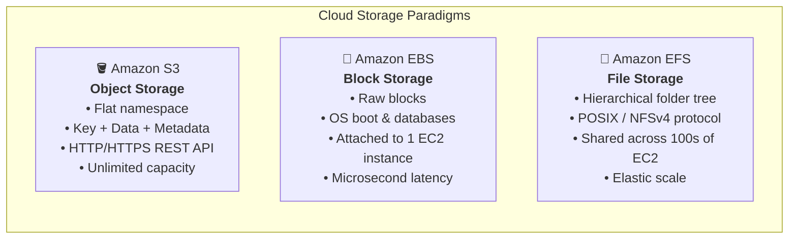
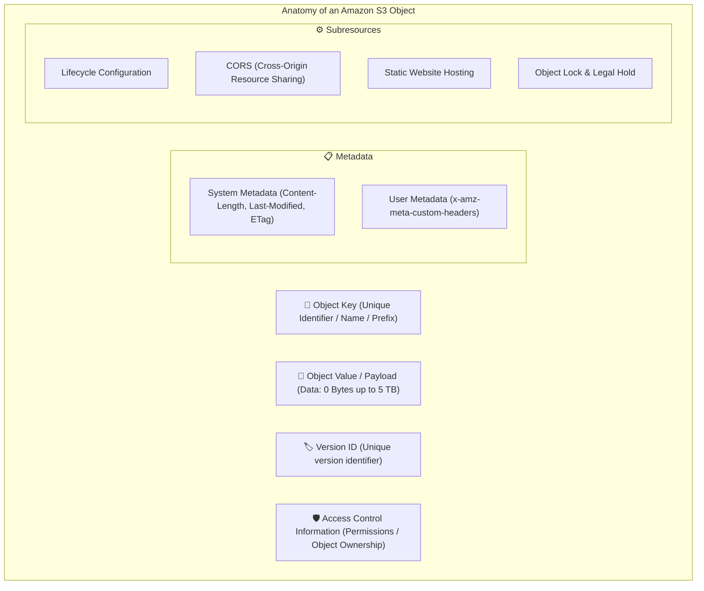
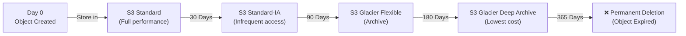
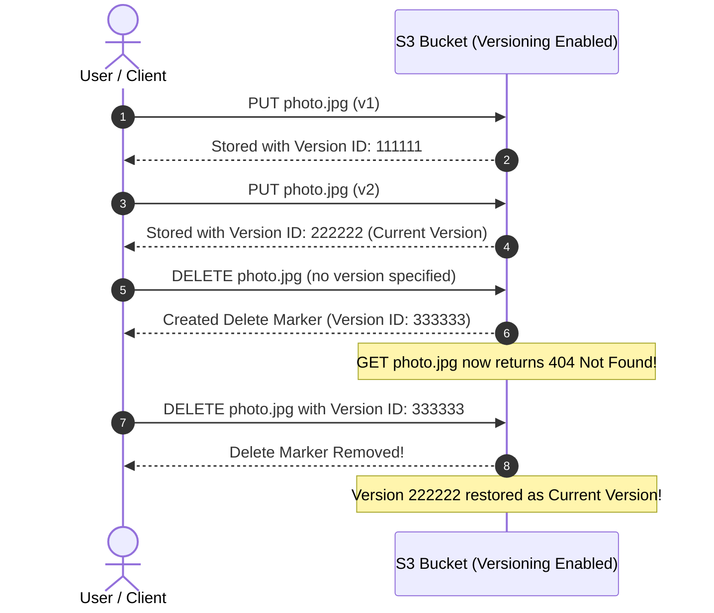
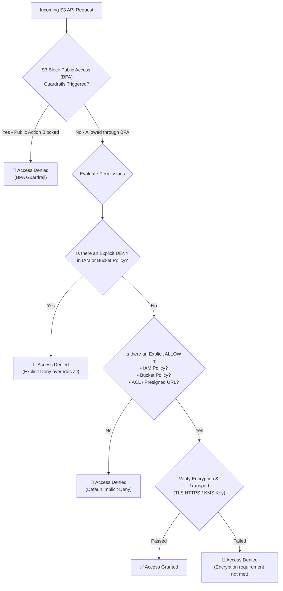
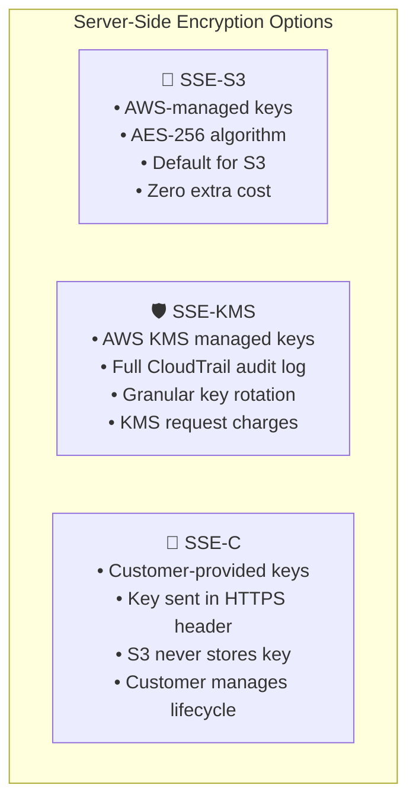
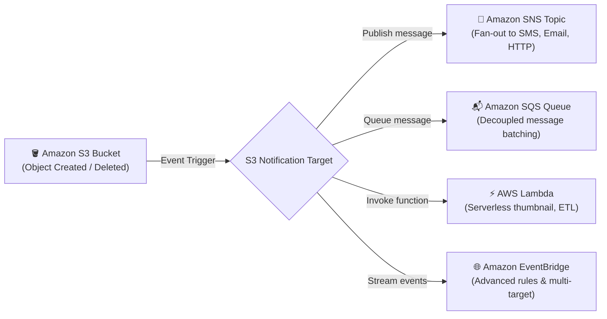

# 🪣 Storage with Amazon S3 – Study Guide & Comprehensive Reference

> **Course**: AWS re/Start  
> **Module**: Storage and Archiving  
> **Source Document**: `T19-Storage_and_Archiving/T19-0006-STOR_STORAGES3_EN.pdf`  
> **Target Audience**: AWS re/Start Learners, Cloud Practitioners, and Solutions Architects  

---

## 🎯 Module Overview

Data is the foundational asset of modern cloud applications, powering big data analytics, artificial intelligence and machine learning (AI/ML) models, web applications, streaming platforms, and enterprise disaster recovery strategies. Traditional on-premises storage arrays (SAN and NAS) present severe operational challenges: hardware lead times, complex capacity forecasting, upfront capital expenditures (CapEx), high maintenance overhead, and brittle multi-datacenter disaster recovery setups.

**Amazon Simple Storage Service (Amazon S3)** is an internet-scale object storage service engineered to deliver industry-leading scalability, data availability, security, and performance. Amazon S3 enables organizations to store and protect virtually unlimited quantities of unstructured data for any use case—including data lakes, cloud-native applications, backups, archives, IoT telemetry, and static web hosting.

This comprehensive guide covers the core concepts, storage classes, lifecycle automation, access control guardrails, encryption mechanisms, and practical AWS Command Line Interface (AWS CLI) workflows required to master Amazon S3.

---

### 📌 Learning Objectives

- [ ] **Define Amazon S3 Fundamentals**: Explain the core architecture of object storage, logical buckets, object keys, metadata, and web-addressable REST endpoints.
- [ ] **Distinguish Cloud Storage Paradigms**: Differentiate object storage (Amazon S3) from block storage (Amazon EBS) and file storage (Amazon EFS).
- [ ] **Master Bucket & Object Data Models**: Apply globally unique naming rules, DNS compliance, Regional scopes, and understand object components (Key, Value, Version ID, Metadata, Subresources).
- [ ] **Evaluate S3 Storage Classes**: Compare tiers (S3 Standard, S3 Intelligent-Tiering, S3 Standard-IA, S3 One Zone-IA, S3 Express One Zone, and S3 Glacier options) across durability, availability, latency, retention constraints, and pricing dynamics.
- [ ] **Automate S3 Storage Management**: Formulate S3 Lifecycle policies (transitions and expirations), manage S3 Versioning (delete markers, MFA Delete), and configure Cross-Region (CRR) and Same-Region (SRR) Replication.
- [ ] **Implement Multi-Layered S3 Security**: Apply S3 Block Public Access (BPA) controls, compare IAM policies vs. Bucket Policies vs. legacy ACLs, and evaluate Server-Side Encryption (SSE-S3, SSE-KMS, SSE-C).
- [ ] **Enforce Compliance with S3 Object Lock**: Configure Write Once, Read Many (WORM) storage using Governance mode, Compliance mode, Retention periods, and Legal holds.
- [ ] **Architect Event-Driven Storage Workflows**: Configure S3 Event Notifications targeting Amazon SNS, Amazon SQS, and AWS Lambda.
- [ ] **Execute S3 Operations via AWS CLI**: Perform high-level (`aws s3`) and low-level (`aws s3api`) CLI commands for bucket creation, synchronization, lifecycle management, and querying.
- [ ] **Validate Core Competencies**: Solve checkpoint questions and architectural design problems.

---

## 📚 Key Terminology

| Term | Definition |
| :--- | :--- |
| **Object Storage** | A storage architecture that manages data as distinct objects (containing payload, unique key, and metadata) in a flat namespace, accessed via HTTP/REST APIs. |
| **S3 Bucket** | A logical container for objects stored in Amazon S3, associated with a specific AWS Region and bearing a globally unique DNS name. |
| **Object Key** | The unique sequence of Unicode characters representing the name and logical path of an object within an S3 bucket (e.g., `logs/2026/app.log`). |
| **Object Metadata** | Name-value pairs associated with an object, categorized into system metadata (e.g., `Content-Type`, `ETag`) and custom user metadata (`x-amz-meta-*`). |
| **11 9s Durability** | A resilience design target of 99.999999999% durability over a given year, meaning an expected loss of 1 out of 10 billion objects. |
| **S3 Intelligent-Tiering** | A cloud storage class that automatically optimizes storage costs by moving data between access tiers based on frequency of access without performance impact or retrieval fees. |
| **S3 Lifecycle Policy** | An automated set of rules defining scheduled actions for objects, including tier transitions and permanent expiration. |
| **S3 Versioning** | A bucket-level feature that preserves every version of every object stored, protecting against accidental overwrites and deletions. |
| **Delete Marker** | A zero-byte placeholder placed by S3 on top of an object when a delete request is issued on a version-enabled bucket without specifying a version ID. |
| **S3 Block Public Access (BPA)** | Centralized account- and bucket-level security controls that override resource policies and ACLs to prevent public exposure. |
| **S3 Bucket Policy** | A resource-based JSON access control policy attached directly to an S3 bucket to grant or deny permissions to AWS principals. |
| **SSE-S3 / SSE-KMS / SSE-C** | Three primary server-side encryption options: AWS managed keys (SSE-S3), AWS KMS managed keys (SSE-KMS), or customer-provided keys (SSE-C). |
| **S3 Object Lock** | A WORM (Write Once, Read Many) feature that prevents objects from being deleted or overwritten for a fixed retention period or indefinitely. |
| **Replication (CRR / SRR)** | Automated, asynchronous bucket-to-bucket replication across different AWS Regions (CRR) or within the same AWS Region (SRR). |
| **S3 Express One Zone** | A single-AZ, directory-bucket storage class delivering ultra-low single-digit millisecond latency for compute-intensive workloads. |
| **Presigned URL** | A time-limited, cryptographically signed URL granting temporary read or write access to an S3 object to clients without AWS credentials. |

---

## 🏗️ 1. What is Amazon Simple Storage Service (Amazon S3)?

**Amazon Simple Storage Service (Amazon S3)** is an object storage service designed to provide secure, durable, and highly available data storage in the AWS Cloud. Amazon S3 allows customers to store and retrieve any amount of data at any time from anywhere on the web.

```
┌────────────────────────────────────────────────────────────────────────┐
│                        Amazon S3 Core Pillars                          │
│                                                                        │
│ • Scalability: Virtually unlimited capacity; objects from 0 B to 5 TB │
│ • Durability: Designed for 99.999999999% (11 9s) of data durability    │
│ • Web Native: Every object is addressable via standard REST HTTP/HTTPS │
│ • Security: Private by default, Block Public Access, built-in SSE      │
│ • Consistency: Strong read-after-write consistency for all operations  │
│ • Management: Lifecycle automation, event triggers, intelligent tiering│
└────────────────────────────────────────────────────────────────────────┘
```

### Storage Paradigms Compared: Object vs. Block vs. File

Understanding when to select Amazon S3 requires contrasting the three fundamental cloud storage paradigms:

| Dimension | Object Storage (Amazon S3) | Block Storage (Amazon EBS) | File Storage (Amazon EFS) |
| :--- | :--- | :--- | :--- |
| **Data Organization** | Flat namespace; Key + Data + Metadata | Raw storage blocks on virtual drive volumes | Hierarchical directory tree (folders/files) |
| **Modification Model** | **Atomic replacement**: Modifying 1 byte requires re-uploading the entire object | **Block-level updates**: Directly modifies specific altered 512B/4KB blocks | **File-level delta**: Incremental byte reads and writes |
| **Access Protocol** | HTTP / HTTPS (REST API, AWS SDKs, CLI) | Block protocols (NVMe, iSCSI) attached to EC2 | Network File System (NFSv4), POSIX compliant |
| **OS Mountability** | **No** (accessed over HTTP/REST endpoints) | **Yes** (formatted with filesystem: ext4, XFS, NTFS) | **Yes** (concurrently mounted by hundreds of instances) |
| **Max Capacity** | Virtually unlimited; single object up to 5 TB | Up to 16 TiB (or 64 TiB for io2 Block Express) | Petabytes of elastic, auto-expanding capacity |
| **Typical Use Cases** | Data lakes, backup archives, static assets, media distribution | OS boot disks, transactional databases (MySQL, Oracle) | Shared enterprise files, web content management (WordPress) |



> [!IMPORTANT]
> **No Partial Updates in Object Storage**: Amazon S3 is an object store, not a filesystem. If an application updates a single record in a 2 GB database file stored in S3, it cannot modify those few bytes in place; the entire 2 GB object must be re-uploaded. For random, transactional read/write workloads requiring partial block modification, use **Amazon EBS** or a managed database.

### Strong Consistency Model

Amazon S3 provides **strong read-after-write consistency** for `PUT` and `DELETE` requests of objects in all AWS Regions.
- **Immediate Read Consistency**: Immediately after a successful `PUT` of a new object or an overwrite of an existing object, any subsequent `GET` or `HEAD` request will return the latest version.
- **Immediate Listing Consistency**: After a successful `PUT` or `DELETE`, listing objects in a bucket (`LIST`) immediately reflects the changes.
- **Concurrent Writes**: S3 uses atomic updates. If two `PUT` requests are sent simultaneously to the same key, the one with the latest timestamp wins.

---

## 🧩 2. Core S3 Concepts & Data Model

Amazon S3 organizes data around two foundational primitives: **Buckets** and **Objects**.

### Buckets

A **bucket** is a logical container for objects stored in Amazon S3. Every object in Amazon S3 must reside inside a bucket.

#### 1. Globally Unique Namespace
S3 bucket names share a single global namespace across **all AWS accounts and all AWS Regions worldwide**. Once an AWS account creates a bucket named `my-production-media`, no other account anywhere in the world can create a bucket with that name until it is deleted.

#### 2. Region-Specific Storage
Although bucket names are globally unique, each bucket is physically created and anchored within a specific **AWS Region** selected during provisioning (e.g., `us-east-1`, `eu-west-1`, `ap-northeast-1`). Objects stored within that bucket never leave that Region unless explicitly configured via replication or transfer commands.

#### 3. DNS-Compliant Bucket Naming Rules
Bucket names must adhere strictly to DNS naming standards because they are directly resolvable as web domain names:
- Length must be between **3 and 63 characters**.
- Must consist only of lowercase letters (`a-z`), numbers (`0-9`), and hyphens (`-`).
- Must begin and end with a letter or number.
- Must **NOT** contain uppercase letters or underscores (`_`).
- Must **NOT** be formatted as an IP address (e.g., `192.168.5.4`).
- Must **NOT** contain two adjacent periods or dashes formatted as prefixes.

#### 4. Virtual-Hosted–Style URL Standard
Objects stored in Amazon S3 are accessible over HTTPS using standard virtual-hosted-style URLs:

$$\text{https://}[bucket-name]\text{.s3.}[region]\text{.amazonaws.com/}[key]$$

*Example*:
`https://finance-reports-2026.s3.us-east-1.amazonaws.com/q1/summary.pdf`

---

### Anatomy of an S3 Object

An **object** is the fundamental entity stored in Amazon S3. It consists of the following components:



1. **Object Key (Name)**: The unique string identifier assigned to an object within a bucket. S3 presents a flat namespace, but forward slashes (`/`) in keys simulate hierarchical directory structures (e.g., `dept/marketing/campaigns/q1.png` has prefix `dept/marketing/campaigns/`).
2. **Object Value (Data Payload)**: The file content itself. An object can range in size from **0 bytes up to 5 TB**.
   - *Single PUT limit*: Up to **5 GB** in a single upload.
   - *Multipart Upload*: Recommended for objects larger than **100 MB**, and strictly required for objects larger than **5 GB** (supports parallel chunk uploads up to 5 TB).
3. **Version ID**: A unique string generated by S3 to distinguish multiple iterations of the same key when Versioning is enabled.
4. **Metadata**: A collection of name-value pairs that describe the object:
   - **System Metadata**: Automatically maintained by AWS (e.g., `Content-Length`, `Last-Modified`, `ETag`, `Storage-Class`, `Server-Side-Encryption`).
   - **User-Defined Metadata**: Custom headers prefixed with `x-amz-meta-` passed during object creation (e.g., `x-amz-meta-department: finance`). Once an object is uploaded, metadata cannot be modified without copying the object.
5. **Access Control Information**: Permissions granting or denying read/write privileges to specific AWS principals.
6. **Subresources**: Additional configurations associated with the object or bucket, such as Lifecycle rules, CORS policies, Website hosting, and Object Lock flags.

---

## 📦 3. S3 Storage Classes Comprehensive Deep Dive

Amazon S3 offers a comprehensive suite of storage classes engineered for diverse access patterns, retention timelines, and pricing budgets.

```mermaid
flowchart TD
    Data["Incoming Data to Amazon S3"] --> Q1{"Do you know access patterns?"}
    
    Q1 -->|Unknown or Changing| IT["🧠 S3 Intelligent-Tiering<br/>• Automatic tiering<br/>• No retrieval fees<br/>• Frequent, Infrequent, Archive tiers"]
    Q1 -->|Known Access Pattern| Q2{"What is the required access latency?"}
    
    Q2 -->|Single-digit Millisecond| E1Z["⚡ S3 Express One Zone<br/>• High-frequency compute/AI<br/>• Single AZ Directory Bucket"]
    Q2 -->|Millisecond Retrieval| Q3{"How frequently is it accessed?"}
    Q2 -->|Minutes to Hours Archive| Q4{"What is your archival tolerance?"}
    
    Q3 -->|Frequent (> Once/month)| S3Std["🪣 S3 Standard<br/>• Active data, cloud apps<br/>• 11 9s durability (>= 3 AZs)<br/>• 99.99% SLA"]
    Q3 -->|Infrequent (< Once/month)| Q5{"Can data survive AZ loss?"}
    
    Q5 -->|No, requires >= 3 AZs| S3IA["📂 S3 Standard-IA<br/>• Long-term active backups<br/>• Low storage cost + retrieval fee"]
    Q5 -->|Yes, reproducible data| S31Z["📦 S3 One Zone-IA<br/>• Secondary backups, re-creatable<br/>• Single AZ, 20% cheaper than Standard-IA"]
    
    Q4 -->|Immediate (ms)| GIR["❄️ S3 Glacier Instant Retrieval<br/>• Rarely accessed, ms retrieval<br/>• Medical archives, news media"]
    Q4 -->|Minutes to Hours| GFR["🧊 S3 Glacier Flexible Retrieval<br/>• 1-5 min (Expedited) or 3-5 hr<br/>• Free bulk retrievals (5-12 hr)"]
    Q4 -->|Hours to Days (Lowest Cost)| GDA["🏔️ S3 Glacier Deep Archive<br/>• 12 to 48 hr retrieval<br/>• Regulatory retention (7-10 yrs)"]
```

### 1. S3 Standard (Frequent Access)
- **Characteristics**: General-purpose storage for active, frequently accessed data.
- **Durability & Availability**: 99.999999999% (11 9s) durability across $\ge 3$ Availability Zones; 99.99% availability SLA.
- **Latency**: Single-digit to low double-digit milliseconds.
- **Constraints**: No minimum storage duration; no minimum billable object size; no retrieval fees.
- **Best For**: Dynamic websites, mobile applications, content distribution, data lake staging areas.

### 2. S3 Intelligent-Tiering (Automatic Optimization)
- **Characteristics**: Automatically delivers cost savings by monitoring access patterns and shifting objects between access tiers without operational intervention or retrieval fees.
- **Access Tiers**:
  1. *Frequent Access Tier*: Default tier; standard pricing.
  2. *Infrequent Access Tier*: Automatically moves objects after **30 consecutive days** without access (saves ~40% on storage).
  3. *Archive Instant Access Tier*: Automatically moves objects after **90 consecutive days** without access (saves ~68% on storage; millisecond retrieval).
  4. *Archive Access Tier (Optional)*: Configurable from **90 to 730 days**; asynchronous retrieval (3–5 hours).
  5. *Deep Archive Access Tier (Optional)*: Configurable from **180 to 730 days**; lowest-cost asynchronous retrieval (12 hours).
- **Billing Details**: Small monthly monitoring and automation fee per object ($\ge 128\text{ KB}$). Objects smaller than 128 KB remain in the Frequent tier without incurring monitoring fees.

### 3. S3 Standard-Infrequent Access (S3 Standard-IA)
- **Characteristics**: For data accessed less frequently but requiring instant millisecond retrieval when requested.
- **Durability & Availability**: 11 9s durability across $\ge 3$ AZs; 99.9% availability SLA.
- **Cost Profile**: Significantly lower storage price per GB than S3 Standard, but incurs a **per-GB data retrieval fee**.
- **Constraints**: Minimum billable object size is **128 KB**; minimum billable retention duration is **30 days**.
- **Best For**: Disaster recovery backups, long-term operational logs, older media assets.

### 4. S3 One Zone-Infrequent Access (S3 One Zone-IA)
- **Characteristics**: Stores data within a **single Availability Zone** rather than multi-AZ redundancy.
- **Cost Profile**: Storage cost is **20% lower** than S3 Standard-IA.
- **Durability & Availability**: 11 9s durability *within that single AZ*; 99.5% availability SLA.
- **Risk**: If the physical Availability Zone is damaged or destroyed, data stored in S3 One Zone-IA can be permanently lost.
- **Best For**: Secondary backup copies of on-premises data, thumbnail caches, or data easily reproduced from other sources.

### 5. S3 Express One Zone (Ultra-Low Latency)
- **Characteristics**: High-performance, single-AZ storage class designed to deliver **consistent single-digit millisecond data access** (up to 10x faster than S3 Standard).
- **Architecture**: Operates within specialized S3 **directory buckets**, co-locating storage with AWS compute resources.
- **Request Performance**: Handles hundreds of thousands of requests per second with microsecond variance.
- **Best For**: Real-time AI/ML training, financial quantitative modeling, query-heavy big data analytics engines.

### 6. S3 Glacier Archival Storage Classes
- **S3 Glacier Instant Retrieval**: Lowest-cost storage for rarely accessed data requiring millisecond retrieval (medical records, news imagery). Minimum 90-day storage.
- **S3 Glacier Flexible Retrieval**: Flexible archival with retrieval options: Expedited (1–5 min), Standard (3–5 hours), and Free Bulk (5–12 hours). Minimum 90-day storage.
- **S3 Glacier Deep Archive**: Lowest-cost cloud storage available across the entire industry. Designed for 7–10 year regulatory compliance archives. Retrieval times: Standard (12 hours), Bulk (48 hours). Minimum 180-day storage.
- **S3 on Outposts**: Extends Amazon S3 object storage APIs to on-premises environments via AWS Outposts hardware.

---

### Comprehensive S3 Storage Classes Comparison Matrix

| Storage Class | Durability | Availability SLA | AZ Redundancy | First-Byte Latency | Min. Storage Duration | Min. Billable Size | Retrieval Fee | Primary Workloads |
| :--- | :--- | :--- | :--- | :--- | :--- | :--- | :--- | :--- |
| **S3 Standard** | 11 9s | 99.99% | $\ge 3$ AZs | Milliseconds | None | None | None | Active web apps, dynamic media, analytics |
| **S3 Intelligent-Tiering** | 11 9s | 99.9% | $\ge 3$ AZs | Milliseconds | None | None (monitoring $\ge 128\text{ KB}$) | **None** | Data with unknown or unpredictable access patterns |
| **S3 Standard-IA** | 11 9s | 99.9% | $\ge 3$ AZs | Milliseconds | 30 days | 128 KB | Per GB retrieved | Long-term active backups, disaster recovery |
| **S3 One Zone-IA** | 11 9s (1 AZ) | 99.5% | **1 AZ** | Milliseconds | 30 days | 128 KB | Per GB retrieved | Reproducible data, secondary backup copies |
| **S3 Express One Zone** | 11 9s (1 AZ) | 99.95% | **1 AZ** | **Single-digit ms** | None | None | None | AI/ML training, low-latency analytics |
| **S3 Glacier Instant Retrieval** | 11 9s | 99.9% | $\ge 3$ AZs | Milliseconds | 90 days | 128 KB | Per GB retrieved | Medical imaging, compliance docs needing immediate access |
| **S3 Glacier Flexible Retrieval** | 11 9s | 99.9% | $\ge 3$ AZs | 1 min to 12 hrs | 90 days | 40 KB | Per GB retrieved | Offsite tape replacement, periodic audit archives |
| **S3 Glacier Deep Archive** | 11 9s | 99.9% | $\ge 3$ AZs | 12 to 48 hrs | 180 days | 40 KB | Per GB retrieved | Long-term digital preservation, regulatory data (7+ yrs) |

---

## ⚙️ 4. S3 Storage Management

### S3 Lifecycle Policies

An **S3 Lifecycle configuration** is a set of automated rules that govern how S3 manages objects over time. A lifecycle configuration consists of two primary types of actions:

1. **Transition Actions**: Automatically transitions objects between storage classes as they age to minimize costs (e.g., S3 Standard $\rightarrow$ S3 Standard-IA $\rightarrow$ S3 Glacier Flexible Retrieval $\rightarrow$ S3 Glacier Deep Archive).
2. **Expiration Actions**: Automatically deletes objects, permanently removes noncurrent versions, or cleans up expired object delete markers after a specified timeframe.



> [!TIP]
> **Lifecycle Rule Scoping**: Lifecycle rules can be applied to:
> - The entire bucket.
> - A specific **prefix** (e.g., `logs/archive/`).
> - Objects filtered by **object tags** (e.g., `ArchivePolicy: True`).
> - Objects filtered by **object size** (e.g., objects larger than 128 KB).

---

### S3 Versioning

**S3 Versioning** maintains multiple variants of an object in the same bucket. When enabled, S3 automatically assigns a unique **Version ID** to every newly created object.

#### Bucket Versioning States
1. **Unversioned (Disabled)**: The default state of a newly created bucket. Overwriting an object replaces it in place.
2. **Enabled**: Versioning is active. All subsequent uploads receive unique Version IDs.
3. **Suspended**: Once Versioning has been enabled on a bucket, it **can never be returned to the Unversioned state**; it can only be suspended. Existing versions remain stored and protected, but new uploads receive a Version ID of `null`.



#### How Delete Markers Work
- When an object is deleted without specifying a Version ID, S3 **does not delete the object**. Instead, it inserts a **Delete Marker** with its own Version ID on top of the version stack.
- A standard `GET` request will return `404 Not Found`.
- To permanently delete an object version, a client must explicitly execute `DELETE` with the specific `VersionId`.
- Removing the Delete Marker restores the previous object version as the active, current version.

#### MFA Delete
To prevent catastrophic accidental or malicious deletions, **MFA Delete** requires Multi-Factor Authentication (a six-digit code from a hardware/virtual MFA token) to:
- Change the versioning state of the bucket.
- Permanently delete an object version.
*MFA Delete can only be configured via the AWS CLI or SDK using the root account credentials.*

---

### S3 Replication (CRR & SRR)

Amazon S3 Replication automatically, asynchronously copies objects across buckets.
- **Cross-Region Replication (CRR)**: Copies objects to a destination bucket in a **different AWS Region**. Used for disaster recovery compliance, minimizing latency for globally distributed users, and multi-region data sovereignty.
- **Same-Region Replication (SRR)**: Copies objects to a destination bucket within the **same AWS Region**. Used for aggregate log collection into a central bucket, isolating production and staging environments, or enforcing data residency.

> [!IMPORTANT]
> **Replication Prerequisites**:
> 1. S3 Versioning **must be enabled** on both the source and destination buckets.
> 2. The source bucket requires an **IAM execution role** granting read permissions on the source and write permissions on the destination.
> 3. Existing objects in the bucket prior to enabling replication are **not** automatically replicated unless S3 Batch Replication is explicitly executed.

---

## 🔒 5. S3 Security & Access Control

Amazon S3 provides multi-layered security controls to protect data at rest, in transit, and during administrative access.



### S3 Block Public Access (BPA)

S3 Block Public Access provides four distinct settings that can be enforced at the **bucket level** or centrally across the **entire AWS account**:

1. **`BlockPublicAcls`**: Blocks new public access control lists (ACLs) and prevents uploading objects with public ACLs.
2. **`IgnorePublicAcls`**: Causes S3 to ignore all existing public ACLs on the bucket and its objects, effectively nullifying any historical public access granted via ACLs.
3. **`BlockPublicPolicy`**: Prevents the attachment of new bucket policies that grant public access.
4. **`RestrictPublicBuckets`**: Restricts access to buckets with existing public policies to only AWS service principals and authorized users within the bucket owner's account.

> [!CAUTION]
> AWS now enables S3 Block Public Access by default on all newly created buckets. Unless a bucket is specifically intended to serve unauthenticated public assets (such as a static website without CloudFront), keep all four BPA settings enabled.

---

### Access Control Mechanisms Compared

| Control Mechanism | Policy Type | Scope | Modern Best Practice |
| :--- | :--- | :--- | :--- |
| **IAM Policies** | Identity-based | Attached to IAM Users, Groups, or Roles. Governs what AWS principals can do across all AWS services. | Standard for internal enterprise team access and service-to-service roles. |
| **S3 Bucket Policies** | Resource-based | Attached directly to an S3 bucket in JSON format. Controls who can access the bucket and its objects. | **Recommended standard** for enforcing encryption, cross-account access, and IP/VPC restrictions. |
| **Access Control Lists (ACLs)** | Legacy Resource-based | Attached to individual buckets or individual objects. | **Disabled by default** via *S3 Object Ownership: Bucket Owner Enforced*. Modern architectures use Bucket Policies exclusively. |
| **Presigned URLs** | Cryptographic Token | Grants temporary, time-limited read or write access to a specific object. | **Best practice** for secure user uploads or private media downloads without exposing AWS credentials. |

---

### Server-Side Encryption (SSE)

Amazon S3 encrypts all new objects by default. When storing sensitive data, organizations can select from three server-side encryption models:



1. **SSE-S3 (Server-Side Encryption with Amazon S3-Managed Keys)**:
   - S3 manages key generation, rotation, and cryptographic operations using **AES-256**.
   - Zero configuration overhead and no additional charge.
   - Default encryption standard applied to all new objects.
2. **SSE-KMS (Server-Side Encryption with AWS Key Management Service)**:
   - Uses AWS KMS keys (default `aws/s3` key or customer managed keys).
   - Provides granular key rotation, separate IAM permissions for key usage, and comprehensive **AWS CloudTrail audit trails** tracking every decryption request.
   - Incurs AWS KMS API request costs.
3. **SSE-C (Server-Side Encryption with Customer-Provided Keys)**:
   - The client provides their own encryption key within the HTTPS request headers of each `PUT` or `GET` call.
   - S3 performs the encryption/decryption in memory and immediately purges the key from memory. S3 never stores the customer's encryption key.

#### Enforcing HTTPS In-Transit
Data in transit should always be encrypted using TLS/HTTPS. You can enforce HTTPS using a bucket policy condition requiring `aws:SecureTransport`:

```json
{
  "Version": "2012-10-17",
  "Statement": [
    {
      "Sid": "EnforceTLSRequestsOnly",
      "Effect": "Deny",
      "Principal": "*",
      "Action": "s3:*",
      "Resource": [
        "arn:aws:s3:::my-secure-bucket",
        "arn:aws:s3:::my-secure-bucket/*"
      ],
      "Condition": {
        "Bool": {
          "aws:SecureTransport": "false"
        }
      }
    }
  ]
}
```

---

### S3 Object Lock & WORM Compliance

**S3 Object Lock** enforces a **Write Once, Read Many (WORM)** storage model to prevent objects from being deleted or overwritten for a fixed retention period or indefinitely. It is certified for compliance with strict financial and legal regulations (such as SEC Rule 17a-4, FINRA, and CFTC).

> [!NOTE]
> S3 Versioning must be enabled on the bucket before S3 Object Lock can be configured.

#### Retention Modes
1. **Governance Mode**:
   - Protects objects from deletion by most users.
   - Users with specific IAM permissions (specifically `s3:BypassGovernanceRetention`) can alter retention settings, shorten retention dates, or delete the object version.
   - Ideal for testing or internal policy enforcement where authorized administrators retain emergency override rights.
2. **Compliance Mode**:
   - **Absolute protection**: No AWS user—including the AWS Account Root User—can delete the object or alter its retention settings until the retention period has elapsed.
   - The retention period can be extended, but it can never be shortened or removed.
   - Ideal for strict regulatory compliance.

#### Legal Holds
- An independent binary flag (**ON** or **OFF**) applied to an object version.
- Has **no expiration date**; it remains in effect until explicitly removed.
- Prevents deletion regardless of the retention period.
- A user with `s3:PutObjectLegalHold` permission can place or remove a legal hold at any time.

---

## 🔔 6. S3 Event Notifications

Amazon S3 Event Notifications enable asynchronous, event-driven architectures by publishing events when specific actions occur within a bucket (e.g., `s3:ObjectCreated:*`, `s3:ObjectRemoved:*`, `s3:ObjectRestore:Completed`).



### Supported Notification Targets:
1. **Amazon SNS (Simple Notification Service)**: Broadcasts notifications to multiple subscribers, email addresses, or downstream webhooks.
2. **Amazon SQS (Simple Queue Service)**: Queues messages reliably for worker fleets running on EC2 or ECS to process files asynchronously.
3. **AWS Lambda**: Invokes a serverless function immediately to perform real-time data transformations (e.g., image resizing, indexing metadata in DynamoDB).
4. **Amazon EventBridge**: Enables advanced JSON pattern matching, cross-account event routing, and fan-out to over 20 AWS target services.

---

## 💻 7. Storing, Retrieving & Archiving via AWS CLI

The AWS Command Line Interface (AWS CLI) provides two interfaces for Amazon S3:
1. **`aws s3`**: High-level, user-friendly commands designed for rapid file management and directory synchronization.
2. **`aws s3api`**: Low-level commands providing direct 1:1 mappings to the underlying Amazon S3 REST API methods.

---

### High-Level S3 Commands (`aws s3`)

#### 1. Create a Bucket (`mb`)
```bash
aws s3 mb s3://my-unique-company-backup-bucket --region us-east-1
```

#### 2. List Buckets and Bucket Contents (`ls`)
```bash
# List all buckets in the account
aws s3 ls

# List objects inside a specific bucket
aws s3 ls s3://my-unique-company-backup-bucket/

# List objects recursively with human-readable file sizes
aws s3 ls s3://my-unique-company-backup-bucket/photos/ --recursive --human-readable
```

#### 3. Upload & Copy Files (`cp`)
```bash
# Copy a local file to S3
aws s3 cp application.log s3://my-unique-company-backup-bucket/logs/application.log

# Upload a file and specify a storage class
aws s3 cp dataset.csv s3://my-unique-company-backup-bucket/data/dataset.csv \
    --storage-class INTELLIGENT_TIERING

# Upload with SSE-KMS encryption
aws s3 cp report.pdf s3://my-unique-company-backup-bucket/reports/report.pdf \
    --sse aws:kms \
    --sse-kms-key-id arn:aws:kms:us-east-1:123456789012:key/your-key-uuid
```

#### 4. Synchronize Directories (`sync`)
```bash
# Synchronize local directory to S3 (only uploads modified or new files)
aws s3 sync ./website-assets s3://my-unique-company-backup-bucket/assets/

# Sync with deletion flag (removes files in S3 that no longer exist locally)
aws s3 sync ./dist s3://my-unique-company-backup-bucket/web/ --delete
```

#### 5. Remove Objects and Buckets (`rm` / `rb`)
```bash
# Delete a single object
aws s3 rm s3://my-unique-company-backup-bucket/logs/application.log

# Delete all objects under a prefix recursively
aws s3 rm s3://my-unique-company-backup-bucket/temp/ --recursive

# Delete an empty bucket
aws s3 rb s3://my-unique-company-backup-bucket

# Force delete a non-empty bucket (deletes all objects then deletes the bucket)
aws s3 rb s3://my-unique-company-backup-bucket --force
```

---

### Low-Level S3 API Commands (`aws s3api`)

#### 1. Create a Bucket with Location Constraint
```bash
# In us-east-1 (default, no location constraint needed)
aws s3api create-bucket \
    --bucket my-api-bucket-2026 \
    --region us-east-1

# In any other region (requires LocationConstraint)
aws s3api create-bucket \
    --bucket my-api-bucket-eu \
    --region eu-central-1 \
    --create-bucket-configuration LocationConstraint=eu-central-1
```

#### 2. Query and List Buckets
```bash
# List all bucket names using JMESPath query
aws s3api list-buckets --query "Buckets[].Name" --output table
```

#### 3. Put and Get Objects
```bash
# Upload an object with metadata
aws s3api put-object \
    --bucket my-api-bucket-2026 \
    --key config/app.json \
    --body ./app.json \
    --metadata environment=production,owner=devops

# Download an object
aws s3api get-object \
    --bucket my-api-bucket-2026 \
    --key config/app.json \
    ./downloaded-app.json
```

#### 4. Copy and Delete Objects
```bash
# Copy an object between buckets
aws s3api copy-object \
    --copy-source my-source-bucket/data.csv \
    --bucket my-dest-bucket \
    --key archived-data.csv

# Delete a specific object
aws s3api delete-object \
    --bucket my-api-bucket-2026 \
    --key config/app.json
```

#### 5. Configure Bucket Lifecycle via JSON
Create a file named `lifecycle.json`:
```json
{
  "Rules": [
    {
      "ID": "TransitionAndExpireRule",
      "Status": "Enabled",
      "Filter": {
        "Prefix": "logs/"
      },
      "Transitions": [
        {
          "Days": 30,
          "StorageClass": "STANDARD_IA"
        },
        {
          "Days": 90,
          "StorageClass": "GLACIER"
        },
        {
          "Days": 180,
          "StorageClass": "DEEP_ARCHIVE"
        }
      ],
      "Expiration": {
        "Days": 365
      }
    }
  ]
}
```

Apply the lifecycle configuration:
```bash
aws s3api put-bucket-lifecycle-configuration \
    --bucket my-api-bucket-2026 \
    --lifecycle-configuration file://lifecycle.json
```

#### 6. Configure Block Public Access via CLI
```bash
aws s3api put-public-access-block \
    --bucket my-api-bucket-2026 \
    --public-access-block-configuration \
    "BlockPublicAcls=true,IgnorePublicAcls=true,BlockPublicPolicy=true,RestrictPublicBuckets=true"
```

#### 7. Enable Versioning via CLI
```bash
aws s3api put-bucket-versioning \
    --bucket my-api-bucket-2026 \
    --versioning-configuration Status=Enabled
```

---

## 🧪 8. Practical Architecture Scenarios

### Scenario 1: Multi-Tier Data Lake Architecture
A health-tech startup collects petabytes of clinical trial telemetry. Incoming data is uploaded directly by mobile medical devices.
- **Ingestion**: Raw telemetry is streamed into S3 via Amazon Kinesis Firehose.
- **Storage Class**: Data is stored using **S3 Intelligent-Tiering** to automatically reduce costs as telemetry ages, without needing manual forecasting.
- **Security**: Data is encrypted at rest using **SSE-KMS** with an AWS KMS Customer Managed Key (CMK) to maintain compliance audit trails in AWS CloudTrail.
- **Processing**: Amazon Athena queries the dataset serverlessly.

### Scenario 2: Regulatory Compliance Archival
A financial enterprise is mandated by law to store 10 years of immutable stock trade records.
- **Storage Class**: Objects are transitioned via **S3 Lifecycle rules** from S3 Standard to **S3 Glacier Deep Archive** after 90 days.
- **Immutability**: **S3 Object Lock** in **Compliance Mode** is enabled with a retention duration of 3,650 days (10 years).
- **Protection**: Neither the DevOps team nor AWS account administrators can delete or modify records during the retention period.

---

## 💡 9. Best Practices & Optimization Checklist

### Security Checklist
- [x] **Enforce S3 Block Public Access**: Apply account-level and bucket-level BPA unless the bucket is intentionally public.
- [x] **Enforce HTTPS In-Transit**: Attach a bucket policy denying requests where `aws:SecureTransport` is `false`.
- [x] **Disable ACLs**: Use *Bucket Owner Enforced* object ownership and manage access exclusively through IAM and Bucket Policies.
- [x] **Enable Versioning & MFA Delete**: Protect mission-critical production data from accidental deletion or compromised credentials.
- [x] **Audit Access with CloudTrail & S3 Access Logs**: Enable S3 server access logging and AWS CloudTrail object-level data events.

### Cost Optimization Checklist
- [x] **Leverage S3 Intelligent-Tiering**: Default to Intelligent-Tiering for dynamic datasets with unpredictable access patterns.
- [x] **Configure Lifecycle Transitions**: Automate movement of aging data into Standard-IA, Glacier Flexible Retrieval, or Glacier Deep Archive.
- [x] **Clean Up Incomplete Multipart Uploads**: Configure a lifecycle rule with `AbortIncompleteMultipartUpload` to delete stranded chunks after 7 days.
- [x] **Prune Noncurrent Versions**: Configure lifecycle rules to expire noncurrent object versions after 30–90 days.

### Performance Checklist
- [x] **Multipart Upload**: Use multipart upload for objects larger than 100 MB to parallelize transmission and recover from network disconnects.
- [x] **S3 Transfer Acceleration**: Enable Transfer Acceleration for fast client uploads across long geographic distances via AWS Edge Locations.
- [x] **S3 Express One Zone**: Adopt S3 Express One Zone directory buckets for compute-bound ML model training and analytics requiring single-digit millisecond latency.

---

## ❓ 10. Checkpoint Questions & Knowledge Check

### Question 1
**Which Amazon S3 storage class is best for archive data that needs immediate access?**
- **A.** S3 Glacier Flexible Retrieval
- **B.** S3 Standard-IA
- **C.** S3 Glacier Instant Retrieval
- **D.** S3 Glacier Deep Archive

> **Answer: C**  
> **Explanation**: **S3 Glacier Instant Retrieval** delivers the lowest-cost storage for rarely accessed archival data that still requires immediate, millisecond retrieval when requested. S3 Glacier Flexible Retrieval and S3 Glacier Deep Archive require minutes to hours for retrieval.

---

### Question 2
**What are the three versioning states of an Amazon S3 bucket?**
- **A.** Inactive, Active, Terminated
- **B.** Unversioned (Disabled), Enabled, Suspended
- **C.** Default, Retention, Locked
- **D.** None, Basic, Multi-Factor

> **Answer: B**  
> **Explanation**: By default, a newly created bucket is in the **Unversioned (Disabled)** state. Once an administrator enables versioning, the bucket is in the **Enabled** state. Versioning can subsequently be **Suspended**, but it can never be returned to the Unversioned state.

---

### Question 3
**Which feature can a developer use to prevent an object from being deleted or overwritten either for a fixed amount of time or indefinitely in Amazon S3?**
- **A.** S3 Lifecycle Policies
- **B.** S3 Block Public Access
- **C.** S3 Object Lock
- **D.** S3 Cross-Region Replication

> **Answer: C**  
> **Explanation**: **S3 Object Lock** enforces a Write Once, Read Many (WORM) storage model. Using Retention periods (in Governance or Compliance mode) or Legal holds, Object Lock prevents an object version from being deleted or overwritten for a fixed period or indefinitely.

---

### Question 4 (Challenge Question)
**A solutions architect wants to automatically tier objects with unpredictable access patterns to optimize costs without incurring data retrieval fees. Which storage class should be selected?**
- **A.** S3 Standard-IA
- **B.** S3 One Zone-IA
- **C.** S3 Glacier Instant Retrieval
- **D.** S3 Intelligent-Tiering

> **Answer: D**  
> **Explanation**: **S3 Intelligent-Tiering** is explicitly designed for data with unknown, changing, or unpredictable access patterns. It moves data between Frequent, Infrequent, and Archive Instant tiers automatically and charges **no retrieval fees**.

---

## 🏁 Key Ideas & Summary Takeaways

- **Object Storage Model**: Amazon S3 stores unstructured data as objects (Key, Payload up to 5 TB, Version ID, Metadata) inside globally unique, Region-anchored buckets accessible via REST URLs.
- **Exceptional Resilience**: S3 Standard storage classes achieve **99.999999999% (11 9s) of durability** by automatically replicating data across at least three physically separated Availability Zones.
- **Storage Tiering Variety**: From high-throughput **S3 Express One Zone** (single-digit millisecond latency) to **S3 Intelligent-Tiering** (automatic cost optimization) and **S3 Glacier Deep Archive** (lowest-cost long-term retention), S3 provides tailored cost-performance tiers for any lifecycle stage.
- **Automated Lifecycle & Versioning**: Lifecycle policies automate transitions and deletions based on object age, while Versioning and Delete Markers safeguard data against accidental loss.
- **Layered Security & Compliance**: Protect buckets using account-wide **Block Public Access (BPA)**, resource-based **Bucket Policies**, **Server-Side Encryption (SSE-S3 / SSE-KMS / SSE-C)**, and **S3 Object Lock** (WORM compliance in Governance or Compliance mode).
- **Flexible Management**: Administrate storage interactively or programmatically via the high-level `aws s3` CLI commands (`mb`, `ls`, `cp`, `sync`, `rm`) or low-level `aws s3api` REST endpoints.
