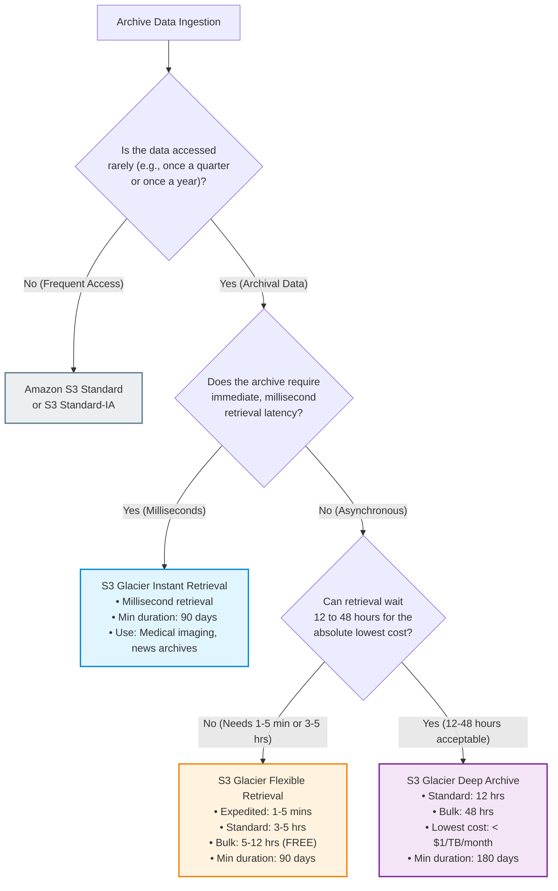
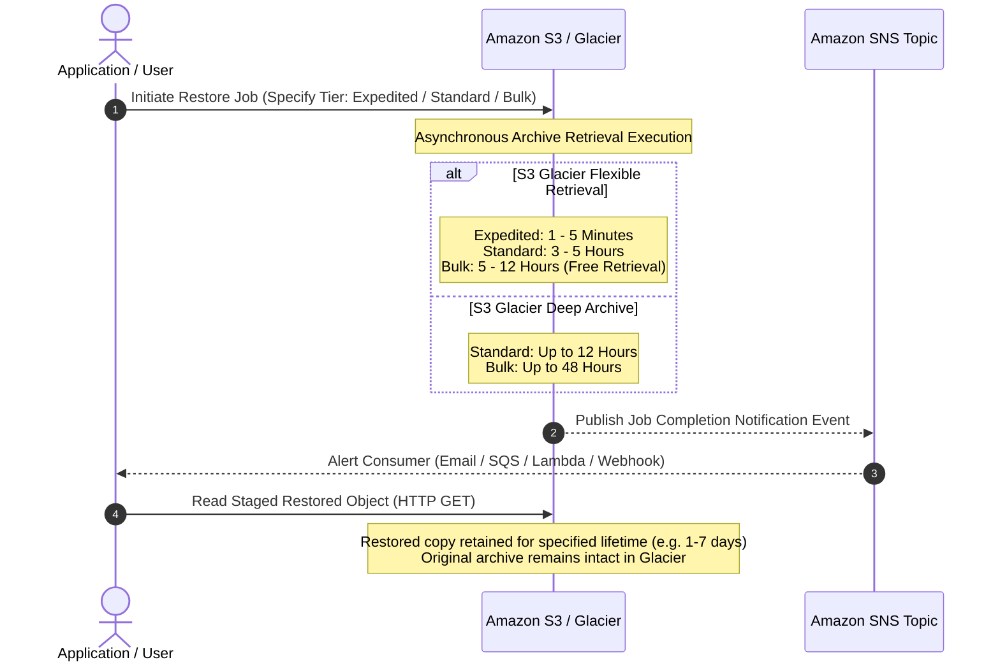
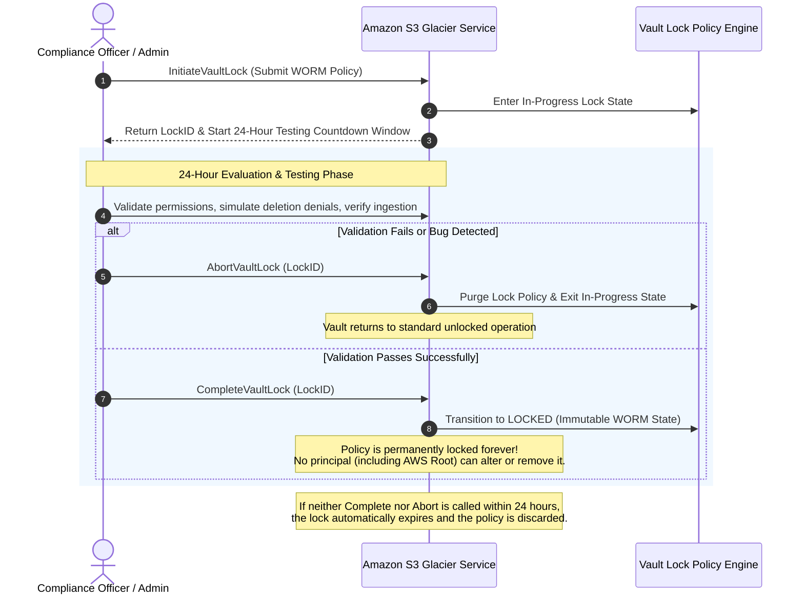

# 🧊 Module 19: Amazon S3 Glacier Storage and Archiving – Study Guide

> **Course**: AWS re/Start  
> **Module**: Storage and Archiving  
> **Source Document**: `T19-0007-STOR_AMAZONGLACIER_EN.pdf`  
> **Target Audience**: AWS re/Start Learners / Cloud Practitioners / Solutions Architects / SysOps Administrators / DevOps Engineers  

---

## 🎯 Unit Overview: Long-Term Archiving & Enterprise Data Preservation

In modern IT environments, organizations generate and accumulate massive volumes of digital data: transactional database backups, electronic medical records, financial audit trails, legal discovery archives, genomic datasets, and regulatory compliance logs. While these assets must be retained for years or even decades to satisfy legal, regulatory, or business governance mandates, they are rarely accessed after their active operational lifecycle concludes.

Storing cold archive data on high-performance primary storage systems (such as on-premises SAN/NAS arrays or cloud hot tiers like Amazon S3 Standard) incurs unsustainable storage costs. Conversely, traditional offline archival mechanisms—primarily magnetic tape libraries (LTO)—suffer from severe physical vulnerabilities:
- Manual handling, transportation, and off-site vaulting logistics
- Media degradation and bit rot over multi-year storage cycles
- Expensive hardware refresh cycles and tape drive obsolescence (e.g., LTO generation incompatibility)
- Slow, labor-intensive recovery workflows that require locating physical cassettes and mounting them in robotic tape autoloaders
- Lack of modern programmatic access, automated auditing, or enterprise-grade encryption at rest

```
┌──────────────────────────────────────────────────────────────────────────────────────────────────┐
│                   The Enterprise Cloud Archival Storage Paradigm                                 │
├───────────────────────────────┬────────────────────────────────────┬─────────────────────────────┤
│      Extreme Cost Efficiency  │       11 9's Durability            │     Compliance & Security   │
├───────────────────────────────┼────────────────────────────────────┼─────────────────────────────┤
│ • Fractions of a cent per GB  │ • 99.999999999% durability         │ • WORM (Write Once, Read    │
│ • S3 Glacier Flexible Retr.   │ • Replicated across ≥ 3 AZs        │   Many) via Vault Lock      │
│ • S3 Glacier Deep Archive     │ • Continuous automated data checks │ • SEC 17a-4 & FINRA compliant│
│   (< $1.00 per TB / month)    │ • Self-healing bit rot protection  │ • Default AES-256 encryption│
└───────────────────────────────┴────────────────────────────────────┴─────────────────────────────┘
```

**Amazon Simple Storage Service Glacier (Amazon S3 Glacier)** is a secure, durable, and extremely low-cost cloud storage service purpose-built for data archiving and long-term backup. Designed to replace tape automation and reduce total cost of ownership (TCO), Amazon S3 Glacier provides three purpose-engineered archive storage classes within Amazon S3:
1. **S3 Glacier Instant Retrieval**: For rarely accessed archives requiring immediate millisecond retrieval.
2. **S3 Glacier Flexible Retrieval** *(formerly Amazon S3 Glacier)*: For asynchronous archive retrieval from minutes to hours, featuring free bulk retrieval.
3. **S3 Glacier Deep Archive**: The lowest-cost storage in the cloud for digital preservation, compliance data, and cold tape replacement.

This guide provides an end-to-end examination of Amazon S3 Glacier, exploring its storage class taxonomy, underlying REST data model (Vaults, Archives, Jobs, Notifications), retrieval tiers, immutable Vault Lock policies, data ingestion patterns, and hands-on operational practices.

---

### 📌 Learning Objectives

- [ ] **Define Amazon S3 Glacier**: Articulate the core value proposition, durability model (11 9's), and cost structure of S3 Glacier for enterprise backup and archival.
- [ ] **Differentiate the Three Glacier Storage Classes**: Analyze access patterns, retrieval latencies (milliseconds vs. hours), minimum billable storage durations (90 vs. 180 days), and minimum object sizes across S3 Glacier Instant Retrieval, S3 Glacier Flexible Retrieval, and S3 Glacier Deep Archive.
- [ ] **Evaluate Retrieval Tiers & Latency Profiles**: Contrast Expedited (1–5 min), Standard (3–5 hr), and Bulk (5–12 hr) retrieval options for Flexible Retrieval, and evaluate Standard (12 hr) vs. Bulk (48 hr) tiers for Deep Archive.
- [ ] **Master the Glacier Data Model**: Distinguish between standalone Glacier primitives (Vaults, Archives, Jobs, Notification Configurations) and Amazon S3-integrated bucket object abstractions.
- [ ] **Enforce Compliance with S3 Glacier Vault Lock**: Formulate resource-based Vault Access Policies and implement immutable Write Once, Read Many (WORM) controls using the two-phase Vault Lock workflow (24-hour test window).
- [ ] **Architect Automated Data Ingestion Pipelines**: Configure Amazon S3 Lifecycle transition policies, direct API/SDK multipart uploads, AWS Storage Gateway (Tape Gateway), and AWS Snow Family devices.
- [ ] **Audit Security & Encryption Baselines**: Understand mandatory default AES-256 server-side encryption, IAM policy access controls, and cross-account access delegation.

---

## 🗺️ Amazon S3 Glacier Storage Class Decision Matrix

Selecting the appropriate archival storage class requires balancing access frequency, retrieval latency requirements, and cost boundaries:



---

## 🏛️ Deep-Dive: The Three Amazon S3 Glacier Storage Classes

AWS provides three distinct storage classes bearing the "Glacier" designation. While all three share the same underlying multi-AZ 11 9's durability foundation, they cater to radically distinct operational access profiles.

```
┌──────────────────────────────────────────────────────────────────────────────────────────────────┐
│                             S3 Glacier Storage Class Comparison                                  │
├───────────────────────────────┬────────────────────────────────────┬─────────────────────────────┤
│  S3 Glacier Instant Retrieval │    S3 Glacier Flexible Retrieval   │   S3 Glacier Deep Archive   │
├───────────────────────────────┼────────────────────────────────────┼─────────────────────────────┤
│ • Millisecond retrieval speed │ • Asynchronous job retrieval       │ • Asynchronous job retrieval│
│ • Synchronous GET requests    │ • Minutes to hours (1 min - 12 hr) │ • 12 to 48 hour retrieval   │
│ • Rarely accessed (once/qtr)  │ • Rarely accessed (1-2 times/year) │ • Rarely accessed (coldest) │
│ • 90-day minimum storage      │ • 90-day minimum storage           │ • 180-day minimum storage   │
│ • Higher per-GB retrieval fee │ • Free Bulk retrieval option       │ • Rock-bottom storage cost  │
└───────────────────────────────┴────────────────────────────────────┴─────────────────────────────┘
```

### 1. Amazon S3 Glacier Instant Retrieval
- **Operational Profile**: Designed for long-lived, rarely accessed data that requires immediate, sub-second access when requested.
- **Latency**: Milliseconds (identical retrieval latency to S3 Standard and S3 Standard-Infrequent Access).
- **Access Protocol**: Standard synchronous HTTP `GET` requests (no restore job or staging step required).
- **Minimum Billable Storage Duration**: **90 days**. Objects deleted, overwritten, or transitioned prior to 90 days incur a pro-rated early deletion fee.
- **Minimum Billable Object Size**: **128 KB**. Objects smaller than 128 KB are billed at the 128 KB storage rate.
- **Cost Structure**: Substantially lower storage rate than S3 Standard-IA (up to 68% savings), but carries a higher data retrieval fee per GB.
- **Ideal Use Cases**:
  - Medical image archiving (PACS / DICOM files) that physicians may need to review during an emergency clinic visit.
  - Media asset news archives and user-generated photos where users expect instant loading on web portals.
  - Legal document repositories accessed unpredictably during active litigation.

---

### 2. Amazon S3 Glacier Flexible Retrieval *(formerly S3 Glacier)*
- **Operational Profile**: Designed for archive data accessed 1 to 2 times per year where asynchronous retrieval within minutes or hours is acceptable.
- **Latency**: Asynchronous (1 minute to 12 hours depending on retrieval tier).
- **Access Protocol**: Requires initiating an asynchronous `RestoreObject` job. The restored copy is temporarily staged in S3 for access.
- **Minimum Billable Storage Duration**: **90 days**.
- **Minimum Billable Object Size**: **128 KB**. (Additionally, for standalone direct Glacier archives, a 32 KB storage overhead + 8 KB metadata overhead is applied).
- **Cost Structure**: Up to 85% lower storage cost than S3 Standard. Offers **free Bulk retrievals**, eliminating data retrieval fees for large-scale operations.
- **Ideal Use Cases**:
  - Annual financial audit records and tax documentation.
  - Secondary backup copies for disaster recovery (DR) where RTO is several hours.
  - Video production raw footage archived after final cut release.

---

### 3. Amazon S3 Glacier Deep Archive
- **Operational Profile**: The lowest-cost storage tier across all cloud hyperscalers, purpose-built for cold digital preservation, long-term regulatory compliance, and off-premises physical tape replacement.
- **Storage Cost**: Less than **$1 per TB per month** (approximately **$0.00099 per GB per month** in standard regions).
- **Latency**: Asynchronous (12 to 48 hours).
- **Minimum Billable Storage Duration**: **180 days**. Objects removed prior to 180 days incur pro-rated early deletion charges.
- **Minimum Billable Object Size**: **128 KB**.
- **Cost Structure**: Rock-bottom storage fees with higher per-GB retrieval fees and request rates compared to Flexible Retrieval.
- **Ideal Use Cases**:
  - 7- to 10-year regulatory archives for financial services (SEC Rule 17a-4), healthcare (HIPAA), and government records.
  - Seismic survey data, astronomical raw telemetry, and genomic sequencing raw reads.
  - Physical magnetic tape replacement (LTO tape migration to cloud) where data is retained purely as insurance against catastrophic loss and may never be read again.

---

## 📊 Comprehensive Storage Class & Lifecycle Comparison Matrix

The table below outlines the operational, financial, and technical parameters of all Amazon S3 storage classes, highlighting the three Glacier options:

| Metric / Feature | S3 Standard | S3 Standard-IA | S3 One Zone-IA | S3 Glacier Instant Retrieval | S3 Glacier Flexible Retrieval | S3 Glacier Deep Archive |
| :--- | :--- | :--- | :--- | :--- | :--- | :--- |
| **Designed Durability** | 99.999999999% (11 9's) | 99.999999999% (11 9's) | 99.999999999% (11 9's) | 99.999999999% (11 9's) | 99.999999999% (11 9's) | 99.999999999% (11 9's) |
| **Designed Availability** | 99.99% | 99.9% | 99.5% | 99.9% | 99.9% | 99.9% |
| **Availability SLA** | 99.9% | 99.0% | 99.0% | 99.0% | 99.0% | 99.0% |
| **Availability Zones** | $\ge 3$ AZs | $\ge 3$ AZs | 1 AZ | $\ge 3$ AZs | $\ge 3$ AZs | $\ge 3$ AZs |
| **Retrieval Latency** | Milliseconds | Milliseconds | Milliseconds | **Milliseconds** | **Minutes to Hours** | **12 to 48 Hours** |
| **Access Method** | Direct HTTP `GET` | Direct HTTP `GET` | Direct HTTP `GET` | Direct HTTP `GET` | Asynchronous Restore Job | Asynchronous Restore Job |
| **Min. Storage Duration** | None | 30 days | 30 days | **90 days** | **90 days** | **180 days** |
| **Min. Billable Object Size** | None | 128 KB | 128 KB | **128 KB** | **128 KB** | **128 KB** |
| **Data Retrieval Fee** | None | Per GB | Per GB | Per GB (Higher) | Free (Bulk) / Per GB | Per GB |
| **Relative Storage Cost** | ¢¢¢¢¢ | ¢¢¢ | ¢¢ | ¢¢ | ¢ | **< ¢ (Lowest)** |

> [!WARNING] **Early Deletion Penalty Calculations**
> If an object stored in **S3 Glacier Instant Retrieval** or **S3 Glacier Flexible Retrieval** is deleted or overwritten 30 days after upload, AWS bills the full storage fee for the remaining 60 days (to satisfy the 90-day minimum). Similarly, in **S3 Glacier Deep Archive**, an object deleted after 45 days incurs early deletion charges for the remaining 135 days. Ensure lifecycle policies do not transition rapidly changing or short-lived objects into Glacier classes.

---

## ⏱️ Retrieval Tiers & Restoration Timelines

When accessing data archived in **S3 Glacier Flexible Retrieval** or **S3 Glacier Deep Archive**, consumers must select a retrieval tier that dictates completion time, queue priority, and cost:



### Retrieval Tiers for S3 Glacier Flexible Retrieval

```
┌──────────────────────────────────────────────────────────────────────────────────────────────────┐
│                   S3 Glacier Flexible Retrieval Tier Comparison                                  │
├───────────────────────────────┬────────────────────────────────────┬─────────────────────────────┤
│         Expedited Tier        │           Standard Tier            │          Bulk Tier          │
├───────────────────────────────┼────────────────────────────────────┼─────────────────────────────┤
│ • Speed: 1 to 5 Minutes       │ • Speed: 3 to 5 Hours              │ • Speed: 5 to 12 Hours      │
│ • High cost per GB & request  │ • Default tier                     │ • FREE data retrieval fees  │
│ • Max archive size: 250 MB    │ • Handles any archive size         │ • Petabyte-scale extraction │
│ • Provisioned Capacity option │ • Standard retrieval rate          │ • Lowest cost batch restores│
└───────────────────────────────┴────────────────────────────────────┴─────────────────────────────┘
```

1. **Expedited Retrieval**:
   - **Time**: **1 to 5 minutes**.
   - **Capacity Models**:
     - *On-Demand*: Handled on a best-effort basis. During severe regional demand spikes, on-demand expedited retrievals may be throttled.
     - *Provisioned Capacity Units (PCUs)*: Guaranteed capacity allocated in 5-minute restoration slots. Each PCU guarantees at least 3 expedited retrievals every 5 minutes and up to 150 MB/s of retrieval throughput.
   - **Limitations**: Restricted to archives up to **250 MB** per request.
   - **Use Case**: Critical disaster recovery activations, active operational emergencies, medical triage.

2. **Standard Retrieval (Default)**:
   - **Time**: **3 to 5 hours**.
   - **Characteristics**: Default tier balance between retrieval speed and cost.
   - **Use Case**: Day-ahead data processing, staging datasets for scheduled analytics runs, responding to standard legal discovery requests.

3. **Bulk Retrieval**:
   - **Time**: **5 to 12 hours**.
   - **Characteristics**: **Zero data retrieval fees** ($0.00 per GB retrieved). The only cost incurred is the batch request fee.
   - **Use Case**: Restoring petabyte-scale datasets, re-indexing legacy historical catalogs, bulk migrations.

---

### Retrieval Tiers for S3 Glacier Deep Archive

1. **Standard Retrieval**:
   - **Time**: **Within 12 hours**.
   - **Use Case**: Standard retrieval for cold preservation assets.
2. **Bulk Retrieval**:
   - **Time**: **Within 48 hours**.
   - **Characteristics**: Lowest cost per GB retrieval for Deep Archive.
   - **Use Case**: Massive multi-terabyte or petabyte cold archive extraction where time-to-delivery is secondary to budget preservation.

---

## 🏗️ Architectural Foundations: Standalone S3 Glacier Data Model

Amazon S3 Glacier originally debuted as an independent, standalone AWS storage service accessible via direct REST APIs, before being tightly coupled into Amazon S3 storage classes. Understanding the standalone Glacier data model is vital for utilizing native Glacier APIs, AWS Storage Gateway Tape Gateway, and direct Glacier SDK integrations.

```
┌──────────────────────────────────────────────────────────────────────────────────────────────────┐
│                             Amazon S3 Glacier Core Data Model                                    │
├───────────────────────────────┬──────────────────────────────────────────────────────────────────┤
│             Vault             │ Container for organizing archives within an AWS Region           │
│                               │ Example: my-corporate-archive-vault                              │
├───────────────────────────────┼──────────────────────────────────────────────────────────────────┤
│            Archive            │ Any single unit of data (tar, zip, photo, database dump)         │
│                               │ Size: 1 byte to 40 TB. Immutable. Assigned unique 138-char ID    │
├───────────────────────────────┼──────────────────────────────────────────────────────────────────┤
│              Job              │ Asynchronous operation (Archive Retrieval or Inventory Retrieval)│
│                               │ Tracked by unique Job ID. Completes asynchronously               │
├───────────────────────────────┼──────────────────────────────────────────────────────────────────┤
│   Notification Configuration  │ Amazon SNS linkage configured on vault to alert on Job completion│
└───────────────────────────────┴──────────────────────────────────────────────────────────────────┘
```

### 1. Vaults
- **Definition**: A vault is a regional container for grouping and storing archives.
- **Limits**: An AWS account can create up to **1,000 vaults per AWS Region**.
- **Naming Conventions**: 1 to 255 characters (letters, numbers, hyphens, periods, underscores).
- **URI Structure**:
  ```
  https://glacier.<region>.amazonaws.com/<account-id>/vaults/<vault-name>
  ```
- **Example REST Endpoint**:
  ```
  https://glacier.us-west-2.amazonaws.com/111122223333/vaults/financial-records-vault
  ```
- **Vault Description Metadata**:
  A Describe Vault API call returns the vault ARN, creation date, last inventory date, number of archives, and total vault size in bytes.

---

### 2. Archives
- **Definition**: An archive is any atomic unit of data stored within a vault (such as a document, TAR bundle, ISO image, database dump, or media file).
- **Size Limits**: Any single archive can range from **1 byte up to 40 TB** (significantly larger than the 5 TB single-object ceiling in Amazon S3).
- **Archive ID**:
  - AWS Glacier automatically generates and assigns a unique, immutable Archive ID string upon upload (typically 138+ characters, e.g., `NkJ8ql9...EXAMPLEArchiveId`).
  - **The client cannot specify or customize the Archive ID.**
  - Applications must maintain their own external database (e.g., Amazon DynamoDB or Amazon RDS) to map internal human-readable file names to Glacier Archive IDs.
- **Archive Description**: An optional, client-supplied text string up to **1,024 bytes** of ASCII characters.
- **Immutability**: Once uploaded, an archive cannot be edited or updated. Any modification requires uploading a new archive, resulting in a distinct Archive ID.
- **URI Structure**:
  ```
  https://glacier.<region>.amazonaws.com/<account-id>/vaults/<vault-name>/archives/<archive-id>
  ```

---

### 3. Jobs
- **Definition**: Because S3 Glacier is an asynchronous storage system, read operations cannot execute synchronously over HTTP GET. Clients must initiate an asynchronous **Job**.
- **Job Types**:
  1. `archive-retrieval`: Fetches data payload of a specific archive.
  2. `inventory-retrieval`: Prepares a complete manifest inventory list of all archives stored within a vault (including Archive IDs, sizes, creation dates, and descriptions).
- **Inventory Frequency**: Glacier automatically prepares vault inventories once daily. Requesting an on-demand inventory initiates an asynchronous job that takes 3 to 5 hours to generate.
- **Job ID & URI Structure**:
  ```
  https://glacier.<region>.amazonaws.com/<account-id>/vaults/<vault-name>/jobs/<job-id>
  ```
- **Output Staging**: Once a job finishes, Glacier maintains the output staged for download for **24 hours** before cleaning it up.

---

### 4. Notification Configuration
- **Definition**: Eliminates the need for client applications to poll job status in a busy loop.
- **Integration**: Links the Glacier vault directly to an **Amazon Simple Notification Service (Amazon SNS)** topic.
- **Supported Notification Events**:
  - `ArchiveRetrievalCompleted`
  - `InventoryRetrievalCompleted`
- **URI Structure**:
  ```
  https://glacier.<region>.amazonaws.com/<account-id>/vaults/<vault-name>/notification-configuration
  ```
- **JSON Configuration Schema**:
  ```json
  {
    "Topic": "arn:aws:sns:us-west-2:111122223333:glacier-notifications-topic",
    "Events": [
      "ArchiveRetrievalCompleted",
      "InventoryRetrievalCompleted"
    ]
  }
  ```

---

## ⚖️ Architectural Comparison: Standalone Glacier vs. Amazon S3

Understanding the design tradeoffs between native Amazon S3 and native Amazon S3 Glacier:

| Architecture Dimension | Amazon S3 (Standard / IA) | Amazon S3 Glacier (Direct Standalone API) |
| :--- | :--- | :--- |
| **Primary Container** | Bucket (`s3://bucket-name`) | Vault (`glacier:.../vaults/vault-name`) |
| **Data Unit** | Object (Key + Payload + Metadata) | Archive (Payload + Description) |
| **Naming Identifier** | User-defined Key (e.g., `/reports/2026/q1.pdf`) | System-assigned 138-character opaque Archive ID |
| **Maximum Item Size** | **5 TB** per object | **40 TB** per archive |
| **Latency Profile** | Milliseconds (Synchronous) | Minutes to hours (Asynchronous via Jobs) |
| **Directory / List Access** | Instantaneous `ListObjectsV2` API | Asynchronous `inventory-retrieval` job (3–5 hours) |
| **Metadata Flexibility** | Custom User Metadata (Key-Value pairs, up to 2 KB) | Single optional description string (up to 1,024 bytes) |
| **Default Encryption** | SSE-S3 default (AES-256) or SSE-KMS | Mandatory automatic AES-256 (keys managed by Glacier) |
| **Primary Ingestion API** | `PutObject`, `UploadPart` | `UploadArchive`, `InitiateMultipartUpload` |

---

## 🔒 Security, IAM & S3 Glacier Vault Lock

Security and access control in Amazon S3 Glacier operate across three distinct defense tiers:

```
┌──────────────────────────────────────────────────────────────────────────────────────────────────┐
│                         Amazon S3 Glacier Security & Access Architecture                         │
├───────────────────────────────┬────────────────────────────────────┬─────────────────────────────┤
│         IAM Policies          │       Vault Access Policies        │     S3 Glacier Vault Lock   │
├───────────────────────────────┼────────────────────────────────────┼─────────────────────────────┤
│ • Identity-based permissions  │ • Resource-based policies          │ • Regulatory compliance     │
│ • Attached to Users/Roles     │ • Attached directly to Vault       │ • Write Once, Read Many     │
│ • Defines API call privileges │ • Manages cross-account access     │ • Immutable lock mechanism  │
│ • Fully editable anytime      │ • Fully editable anytime           │ • PERMANENT & IRREVOCABLE   │
└───────────────────────────────┴────────────────────────────────────┴─────────────────────────────┘
```

### 1. Encryption at Rest & Key Management
- **Automatic Mandatory Encryption**: All data archived in Amazon S3 Glacier is automatically encrypted at rest using **Advanced Encryption Standard with 256-bit keys (AES-256)**.
- **Key Management**: Amazon S3 Glacier manages encryption keys on behalf of the customer automatically.
- **In-Transit Protection**: All API interactions require secure transport encrypted via **TLS / HTTPS**.

---

### 2. Vault Access Policies (Resource-Based IAM)
Vault access policies are resource-based JSON policies attached directly to a vault to govern access permissions. Like S3 bucket policies, vault access policies can be edited, updated, or deleted at any time by administrators with appropriate permissions.

#### Sample Vault Access Policy: Cross-Account Permissions
The following policy grants cross-account upload permissions to AWS accounts `123456789012` and `444455556666` while preserving administrative control within account `999999999999`:

```json
{
  "Version": "2012-10-17",
  "Statement": [
    {
      "Sid": "cross-account-upload",
      "Effect": "Allow",
      "Principal": {
        "AWS": [
          "arn:aws:iam::123456789012:root",
          "arn:aws:iam::444455556666:root"
        ]
      },
      "Action": [
        "glacier:UploadArchive",
        "glacier:InitiateMultipartUpload",
        "glacier:CompleteMultipartUpload"
      ],
      "Resource": "arn:aws:glacier:us-west-2:999999999999:vaults/corporate-records-vault"
    }
  ]
}
```

---

### 3. S3 Glacier Vault Lock (Immutable Compliance & WORM)
In heavily regulated industries (banking, securities, healthcare, government), legal statutes mandate that financial records, communications, and audit trails remain tamper-proof under **Write Once, Read Many (WORM)** storage rules. Regulatory frameworks include:
- **SEC Rule 17a-4(f)** (Financial Industry Regulatory Authority)
- **FINRA Rule 4511(c)**
- **CFTC Rule 1.31** (Commodity Futures Trading Commission)

Amazon S3 Glacier Vault Lock allows organizations to deploy and lock compliance controls on individual vaults with an immutable Vault Lock Policy. Once locked, **the policy cannot be modified, deleted, or overridden by anyone—not even the AWS account root user or AWS Support staff**—until all specified retention periods have lapsed.

#### The Two-Phase Vault Lock Workflow



1. **Initiate Vault Lock (`InitiateVaultLock`)**:
   - The compliance administrator attaches a proposed Vault Lock policy.
   - S3 Glacier assigns an alphanumeric `LockId` and places the vault into the `InProgress` lock state.
   - A **24-hour testing countdown timer begins**.
2. **Evaluation & Verification Window**:
   - The administrator has exactly 24 hours to test and validate that the policy functions as expected and does not accidentally lock out legitimate applications.
3. **Lock Finalization Options**:
   - **Abort Lock (`AbortVaultLock`)**: If the policy requires modifications or contains an error, the admin aborts the lock using the `LockId`. The policy is purged.
   - **Complete Lock (`CompleteVaultLock`)**: If validation succeeds, the admin completes the lock using the `LockId`. The policy permanently transitions to the `Locked` state.
   - **Automatic Expiration**: If neither `CompleteVaultLock` nor `AbortVaultLock` is issued within 24 hours, the `LockId` expires automatically, discarding the tentative policy.

#### Sample Vault Lock Policy: Enforcing 365-Day Retention (WORM)
The following Vault Lock policy denies any attempt to delete an archive if the archive is younger than 365 days (31,536,000 seconds):

```json
{
  "Version": "2012-10-17",
  "Statement": [
    {
      "Sid": "enforce-one-year-worm-retention",
      "Effect": "Deny",
      "Principal": "*",
      "Action": "glacier:DeleteArchive",
      "Resource": "arn:aws:glacier:us-west-2:999999999999:vaults/regulatory-compliance-vault",
      "Condition": {
        "NumericLessThan": {
          "glacier:ArchiveAgeInDays": "365"
        }
      }
    }
  ]
}
```

> [!CAUTION] **Irreversible Compliance Lock**
> Once a Vault Lock policy is finalized via `CompleteVaultLock`, it is permanently immutable. If a policy specifies `Deny glacier:DeleteArchive` unconditionally or for a retention period of 10 years, **the archives cannot be deleted under any circumstances until the retention period expires**. Not even deleting the AWS account will bypass the lock if billing remains active. Always thoroughly validate lock policies during the 24-hour test window!

---

## 🚀 Data Ingestion & Integration Mechanisms

Organizations ingest data into Amazon S3 Glacier through four primary architectural patterns:

```
┌──────────────────────────────────────────────────────────────────────────────────────────────────┐
│                             S3 Glacier Ingestion Methodologies                                   │
├───────────────────────────────┬──────────────────────────────────────────────────────────────────┤
│ Amazon S3 Lifecycle Rules     │ Automated rules transitioning S3 objects into Glacier tiers      │
├───────────────────────────────┼──────────────────────────────────────────────────────────────────┤
│ Direct Glacier REST APIs / SDK│ Programmatic direct upload of large single archives (up to 40 TB)│
├───────────────────────────────┼──────────────────────────────────────────────────────────────────┤
│ AWS Storage Gateway           │ Virtual Tape Library (Tape Gateway) replacing on-premises tapes  │
├───────────────────────────────┼──────────────────────────────────────────────────────────────────┤
│ AWS Snow Family               │ Physical Snowball Edge appliances for offline petabyte ingestion │
└───────────────────────────────┴──────────────────────────────────────────────────────────────────┘
```

### 1. Amazon S3 Lifecycle Configuration Rules
The most common enterprise pattern involves storing active objects in Amazon S3 Standard, and leveraging declarative XML/JSON lifecycle management policies to automatically cascade objects into colder Glacier tiers over time.

```mermaid
flowchart LR
    Day0["Day 0:<br/>S3 Standard<br/>(Active Ingestion)"] 
    -->|After 30 Days| Day30["Day 30:<br/>S3 Standard-IA<br/>(Infrequent Queries)"]
    -->|After 90 Days| Day90["Day 90:<br/>S3 Glacier Flexible<br/>(Annual Audits)"]
    -->|After 180 Days| Day180["Day 180:<br/>S3 Glacier Deep Archive<br/>(Compliance Vault)"]
    -->|After 2555 Days (7 Yrs)| Expire["Day 2555:<br/>Permanent Expiration<br/>(Automatic Purge)"]

    classDef s0 fill:#e3f2fd,stroke:#1565c0,stroke-width:2px;
    classDef s1 fill:#e8f5e9,stroke:#2e7d32,stroke-width:2px;
    classDef s2 fill:#fff3e0,stroke:#e65100,stroke-width:2px;
    classDef s3 fill:#f3e5f5,stroke:#6a1b9a,stroke-width:2px;
    classDef s4 fill:#ffebee,stroke:#c62828,stroke-width:2px;

    class Day0 s0;
    class Day30 s1;
    class Day90 s2;
    class Day180 s3;
    class Expire s4;
```

#### Sample S3 Lifecycle Policy Configuration (JSON)
```json
{
  "Rules": [
    {
      "ID": "archive-corporate-backups-lifecycle",
      "Status": "Enabled",
      "Filter": {
        "Prefix": "backups/"
      },
      "Transitions": [
        {
          "Days": 30,
          "StorageClass": "STANDARD_IA"
        },
        {
          "Days": 90,
          "StorageClass": "GLACIER"
        },
        {
          "Days": 180,
          "StorageClass": "DEEP_ARCHIVE"
        }
      ],
      "Expiration": {
        "Days": 2555
      }
    }
  ]
}
```

---

### 2. Direct S3 Glacier REST API & SDKs
- **Java, Python (Boto3), and .NET AWS SDKs**: Enable custom applications to upload, download, and catalog archives directly against Glacier vaults.
- **Multipart Upload API**:
  - Mandatory for archives larger than **100 MB** (and recommended for any archive exceeding 20 MB).
  - Enables uploading archives in parts ranging from 1 MB to 4 GB (powers of 2, e.g., 1 MB, 2 MB, 4 MB, 8 MB).
  - Provides network fault tolerance: individual failed parts can be retried without restarting the multi-gigabyte upload.

---

### 3. AWS Storage Gateway (Tape Gateway / Virtual Tape Library)
- **Tape Modernization**: Deploys a virtual or hardware appliance in the on-premises datacenter that presents standard iSCSI Virtual Tape Library (VTL) interfaces to existing backup software (e.g., Veeam, Commvault, Veritas, IBM Spectrum Protect).
- **Automated Glacier Archival**:
  - Virtual tapes are written locally with zero disruption to backup administrator workflows.
  - Ejected virtual tapes are automatically encrypted and transferred over the network into **Amazon S3 Glacier Flexible Retrieval**.
  - Tapes configured for long-term retention can be exported into the virtual tape pool backed by **Amazon S3 Glacier Deep Archive**, reducing physical tape infrastructure maintenance to zero.

---

### 4. AWS Snow Family for Massive Migrations
- For migrating petabytes of cold legacy data where WAN bandwidth is constrained, organizations deploy **AWS Snowball Edge Storage Optimized** appliances (80 TB or 210 TB capacity).
- Data copied to the appliance is physically shipped to an AWS data center, where AWS imports the data directly into an Amazon S3 bucket, subsequently triggering lifecycle transitions into S3 Glacier or Deep Archive.

---

## 🛠️ Step-by-Step Practical Walkthrough: Managing Glacier Vaults & Lifecycle

### Walkthrough 1: Creating a Glacier Vault via AWS CLI

```bash
# 1. Create a new Amazon S3 Glacier vault in us-west-2
aws glacier create-vault \
    --account-id - \
    --vault-name CorporateAuditRecordsVault \
    --region us-west-2

# 2. Describe the newly created vault to inspect metadata
aws glacier describe-vault \
    --account-id - \
    --vault-name CorporateAuditRecordsVault \
    --region us-west-2
```

*Sample CLI JSON Output:*
```json
{
    "VaultARN": "arn:aws:glacier:us-west-2:111122223333:vaults/CorporateAuditRecordsVault",
    "VaultName": "CorporateAuditRecordsVault",
    "CreationDate": "2026-10-13T01:30:00.000Z",
    "LastInventoryDate": null,
    "NumberOfArchives": 0,
    "SizeInBytes": 0
}
```

---

### Walkthrough 2: Attaching a Vault Notification Configuration

```bash
# 1. Create a notification-config.json file
cat << 'EOF' > notification-config.json
{
  "Topic": "arn:aws:sns:us-west-2:111122223333:GlacierArchiveAlerts",
  "Events": [
    "ArchiveRetrievalCompleted",
    "InventoryRetrievalCompleted"
  ]
}
EOF

# 2. Apply notification configuration to the vault
aws glacier set-vault-notifications \
    --account-id - \
    --vault-name CorporateAuditRecordsVault \
    --vault-notification-config file://notification-config.json \
    --region us-west-2
```

---

### Walkthrough 3: Executing an S3 Object Restore via AWS CLI

When an object has transitioned to **S3 Glacier Flexible Retrieval** inside an S3 bucket, restore it using the AWS CLI:

```bash
# 1. Initiate an expedited asynchronous restore job for a 3-day temporary window
aws s3api restore-object \
    --bucket my-enterprise-compliance-bucket \
    --key financial-reports/2025-annual-audit.pdf \
    --restore-request '{"Days":3,"GlacierJobParameters":{"Tier":"Expedited"}}'

# 2. Inspect object restore status using head-object
aws s3api head-object \
    --bucket my-enterprise-compliance-bucket \
    --key financial-reports/2025-annual-audit.pdf
```

*Output Header Interpretation:*
- While restore is running: `Restore: ongoing-request="true"`
- When restore is complete: `Restore: ongoing-request="false", expiry-date="Fri, 16 Oct 2026 00:00:00 GMT"`
- After completion, clients issue standard `aws s3 cp` or HTTP `GET` commands to download the temporary copy.

---

## 💡 Real-World Architectural Case Studies

### Case Study 1: Nationwide Diagnostic Imaging Provider (Instant vs. Flexible)
- **Scenario**: A national healthcare provider archives 15 million CT scans and MRI images (averaging 50 MB each). Physicians rarely review imaging older than 6 months, but when an emergency trauma patient enters the hospital, clinical staff require immediate access to historical imaging within seconds.
- **Architectural Solution**: The provider implements S3 Lifecycle rules transitioning DICOM imaging to **S3 Glacier Instant Retrieval** at Day 180.
- **Outcome**: The organization cuts storage expenses by 68% compared to S3 Standard while preserving millisecond retrieval performance, ensuring critical clinical access during acute trauma care.

---

### Case Study 2: Global Financial Services Firm (WORM Vault Lock & Deep Archive)
- **Scenario**: An international investment firm is subject to SEC Rule 17a-4, requiring all financial transaction audit logs to be preserved in an immutable, unalterable format for exactly 7 years (2,555 days).
- **Architectural Solution**:
  1. Transaction logs are streamed from application clusters into Amazon S3.
  2. S3 Lifecycle transitions logs to **S3 Glacier Deep Archive** after 90 days.
  3. A **Vault Lock policy** is initiated and locked via `CompleteVaultLock`, enforcing `Deny glacier:DeleteArchive` where `ArchiveAgeInDays < 2555`.
- **Outcome**: The firm achieves 100% SEC compliance at under $1 per TB per month, mathematically eliminating the risk of rogue insider deletion or ransomware tampering.

---

## 📌 Key Architectural Takeaways

- **Purpose-Built Archival**: Amazon S3 Glacier is engineered specifically for secure, durable (11 9's), and extremely low-cost storage of cold, infrequently accessed enterprise data.
- **Storage Class Taxonomy**:
  - **S3 Glacier Instant Retrieval**: Millisecond latency for rare access (90-day minimum).
  - **S3 Glacier Flexible Retrieval**: Asynchronous retrieval from 1–5 min to 12 hours (free Bulk retrieval, 90-day minimum).
  - **S3 Glacier Deep Archive**: Lowest cost storage in the cloud (< $1/TB/month) with 12- to 48-hour retrieval (180-day minimum).
- **Core Primitives (Direct API)**:
  - **Vault**: Regional container (up to 1,000 per account per region).
  - **Archive**: Single immutable unit of data up to 40 TB, indexed via system-assigned Archive ID.
  - **Job**: Asynchronous retrieval mechanism for archive data or vault inventory.
  - **Notification Configuration**: Vault-level integration with Amazon SNS for event completion alerts.
- **Default AES-256 Encryption**: Every archive is encrypted automatically by default with keys managed transparently by AWS.
- **Vault Access vs. Vault Lock**:
  - Vault Access policies manage permissions and can be edited anytime.
  - Vault Lock policies enforce immutable WORM compliance and cannot be modified or deleted by anyone once finalized.

---

## ❓ Checkpoint & Review Questions

### Checkpoint Questions (from Curriculum Slides)

#### 1. What are the three storage classes that make up Amazon S3 Glacier?
> **Answer**:
> The three storage classes are:
> 1. **Amazon S3 Glacier Instant Retrieval**: Delivers low-cost storage for long-lived, rarely accessed data requiring immediate retrieval in milliseconds.
> 2. **Amazon S3 Glacier Flexible Retrieval** *(formerly Amazon S3 Glacier)*: Delivers low-cost archive storage accessed 1–2 times per year with asynchronous retrieval options (Expedited: 1–5 minutes, Standard: 3–5 hours, and free Bulk: 5–12 hours).
> 3. **Amazon S3 Glacier Deep Archive**: Delivers the lowest-cost storage in the cloud (< $1/TB/month) supporting long-term digital preservation and compliance retention with retrieval times of 12 to 48 hours.

---

#### 2. What is created in order to retrieve an archive or create an inventory of a vault?
> **Answer**:
> An **Amazon S3 Glacier Job** is created. Because Amazon S3 Glacier is an asynchronous storage service, clients cannot execute immediate synchronous reads. Instead, clients submit an asynchronous job request specifying either `archive-retrieval` (to retrieve a data archive) or `inventory-retrieval` (to generate a list of archives in the vault). The job executes asynchronously, and its completion can trigger an Amazon SNS notification.

---

#### 3. Which information does the vault description provide?
> **Answer**:
> When a client describes a vault (via `DescribeVault` API or `aws glacier describe-vault`), S3 Glacier returns comprehensive metadata including:
> - **VaultARN**: The Amazon Resource Name uniquely identifying the vault.
> - **VaultName**: The human-readable name of the vault.
> - **CreationDate**: The ISO 8601 timestamp when the vault was created.
> - **LastInventoryDate**: The timestamp of the most recent automated daily vault inventory.
> - **NumberOfArchives**: The total count of archives stored in the vault as of the last inventory.
> - **SizeInBytes**: The aggregate total storage size of all archives in the vault in bytes.

---

### Practice Exam-Level Questions

#### 4. A media company has 500 TB of completed raw video footage. Editors access this footage approximately once every 14 months for retrospective documentaries. If footage is needed, editors can wait up to 24 hours. The CFO wants the lowest possible storage cost. Which storage solution should be recommended?
- [ ] A. Amazon S3 Standard-Infrequent Access
- [ ] B. Amazon S3 Glacier Instant Retrieval
- [ ] C. Amazon S3 Glacier Flexible Retrieval
- [x] D. Amazon S3 Glacier Deep Archive
> **Explanation**: **D is correct**. Amazon S3 Glacier Deep Archive delivers the absolute lowest-cost storage in the cloud (< $1 per TB per month). Because access is exceptionally rare (once every 14 months) and retrieval latency of up to 24 hours is acceptable (Deep Archive Standard is 12 hours, Bulk is 48 hours), Deep Archive perfectly satisfies all technical and financial constraints. S3 Standard-IA and Glacier Instant Retrieval are significantly more expensive per GB-month.

---

#### 5. A security compliance officer must ensure that corporate tax audit documents cannot be deleted or altered by any user, including administrators and the AWS root user, for a period of 5 years. What is the most secure and compliant mechanism to achieve this?
- [ ] A. Configure an IAM policy denying `s3:DeleteObject` for all users and attach it to the root account.
- [ ] B. Create an S3 Glacier vault, attach a Vault Lock policy denying `glacier:DeleteArchive` for archives younger than 5 years, and execute `CompleteVaultLock` within the 24-hour test window.
- [ ] C. Enable S3 Multi-Factor Authentication (MFA) Delete on the bucket and store the MFA hardware token in an off-site physical safe.
- [ ] D. Attach a Vault Access policy with an explicit Deny statement for `glacier:DeleteArchive`.
> **Explanation**: **B is correct**. S3 Glacier Vault Lock enforces Write Once, Read Many (WORM) regulatory compliance. Once a Vault Lock policy is initiated and completed using `CompleteVaultLock`, the policy becomes permanently immutable. Neither IAM administrators, the root user, nor AWS Support can alter or delete the policy or delete archives before the retention duration expires. Option A and D are incorrect because standard IAM and Vault Access policies can be edited or deleted at any time by privileged principals. Option C is incorrect because root can disable MFA or modify bucket settings.

---

#### 6. An application team uploads 50,000 files per day to an S3 bucket. Each file is exactly 15 KB. The team configures an S3 Lifecycle rule to transition all objects to S3 Glacier Flexible Retrieval immediately upon creation. At the end of the month, the team notices their storage bill increased rather than decreased. What is the root cause?
- [ ] A. Glacier Flexible Retrieval requires objects to be stored in S3 Standard for at least 60 days before transitioning.
- [ ] B. S3 Glacier Flexible Retrieval charges a minimum billable object size of 128 KB, plus 40 KB of metadata/index overhead per object, causing 15 KB files to be billed at 168 KB.
- [ ] C. Objects smaller than 64 KB cannot be encrypted with AES-256 in Glacier.
- [ ] D. Glacier charges an hourly data transfer fee for objects stored under 1 MB.
> **Explanation**: **B is correct**. Both S3 Glacier Instant Retrieval and S3 Glacier Flexible Retrieval enforce a minimum billable object size of 128 KB. Furthermore, S3 transitions to Glacier incur an additional 32 KB of storage overhead for Glacier archive tracking plus 8 KB for S3 object metadata. Storing millions of tiny 15 KB files results in severe billing inflation because each 15 KB object is billed as at least 128 KB (or 168 KB). The architectural best practice is to aggregate or bundle tiny files into TAR or ZIP containers before transitioning to Glacier.
