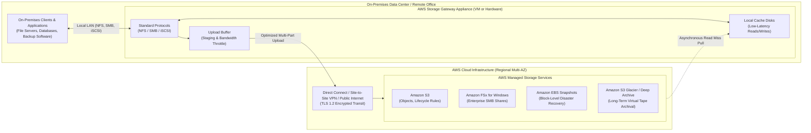
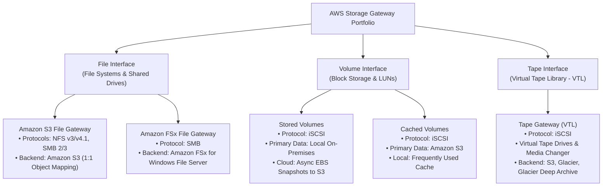
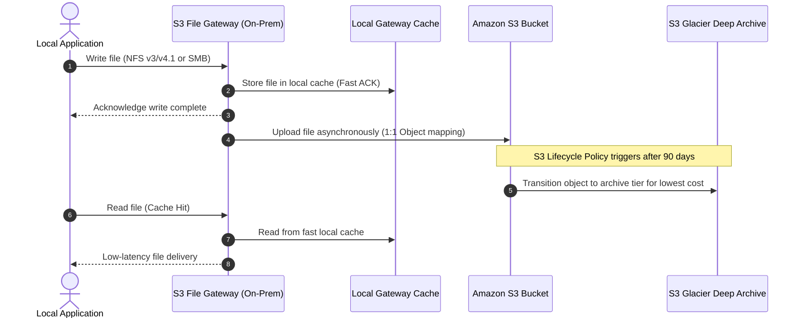
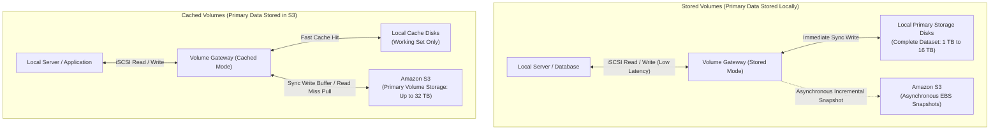
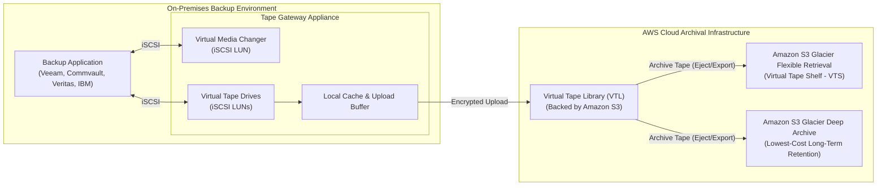
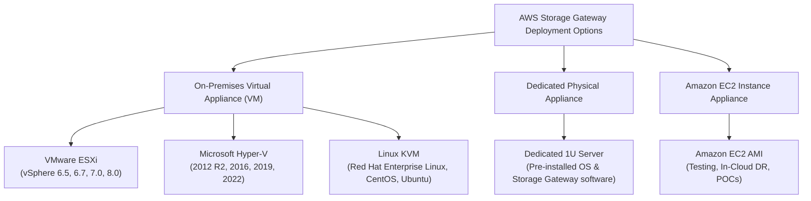
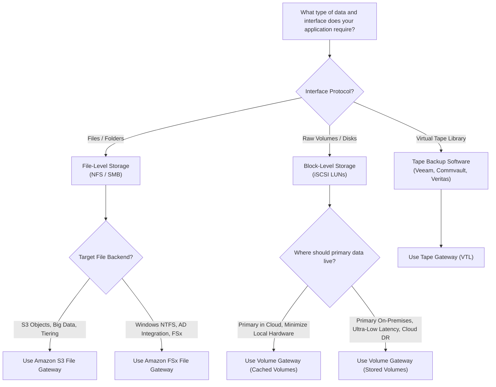

# 🌉 AWS Storage Gateway: Hybrid Cloud Storage Architecture, Gateway Types, and Enterprise Deployment

> **Course**: AWS re/Start  
> **Module**: Storage and Archiving  
> **Source Document**: `T19-Storage_and_Archiving/T19-0008-STOR_AWSSTORAGEGATEWAY_EN.pdf`  
> **Target Audience**: AWS re/Start Learners, Cloud Practitioners, SysOps Administrators, and Solutions Architects  

---

## 🎯 Module Overview

Enterprises and organizations frequently face the challenge of bridging existing on-premises data centers with the elasticity, scalability, and cost efficiency of the AWS Cloud. Many legacy business-critical applications cannot be refactored immediately to use native cloud APIs (such as Amazon S3 REST APIs), yet on-premises storage hardware is capital-intensive to expand, complex to refresh, and costly to maintain.

**AWS Storage Gateway** solves this challenge by serving as a seamless hybrid cloud storage service. It enables on-premises software and hardware appliances to interface directly with AWS Cloud storage services using standard storage protocols—such as Network File System (NFS), Server Message Block (SMB), and Internet Small Computer Systems Interface (iSCSI). 

By providing local caching for low-latency data access while offloading durable, virtually unlimited storage to Amazon Simple Storage Service (Amazon S3), Amazon FSx for Windows File Server, Amazon Elastic Block Store (Amazon EBS) snapshots, and Amazon S3 Glacier archive tiers, AWS Storage Gateway delivers the best of both worlds: local application performance and cloud economics.

---

## 📌 Learning Objectives

By studying this guide, you will be able to:

- [ ] **Define AWS Storage Gateway Architecture**: Articulate how the hybrid model connects on-premises environments to AWS Cloud storage services via virtual and physical gateway appliances.
- [ ] **Analyze Core Hybrid Benefits**: Explain the operational advantages of low-latency local caching, protocol translation, data protection, bandwidth optimization, and regulatory compliance.
- [ ] **Differentiate the Gateway Types**: Contrast Amazon S3 File Gateway, Amazon FSx File Gateway, Volume Gateway (Stored vs. Cached), and Tape Gateway across protocols, storage backends, and target workloads.
- [ ] **Evaluate Volume Gateway Modes**: Distinguish between Cached Volumes (cloud-primary with local cache) and Stored Volumes (local-primary with asynchronous cloud EBS snapshots).
- [ ] **Modernize Backup with Tape Gateway**: Explain how Virtual Tape Libraries (VTL) replace physical tape automation without disrupting legacy backup applications like Veeam, Commvault, and Veritas.
- [ ] **Select Deployment Form Factors**: Compare VMware ESXi, Microsoft Hyper-V, Linux KVM virtual appliances, dedicated AWS Storage Gateway hardware appliances, and Amazon EC2 cloud instances.
- [ ] **Navigate the Gateway Decision Framework**: Apply architectural decision trees and scenario criteria to select the optimal Storage Gateway configuration for migration, backup, and disaster recovery.

---

## 🏗️ 1. What is AWS Storage Gateway?

### 1.1 Architectural Foundations & The Hybrid Model

**AWS Storage Gateway** is a hybrid storage service that connects an on-premises software appliance or hardware appliance with cloud-based storage to provide seamless data integration with data security features between an organization's on-premises IT environment and the AWS storage infrastructure.

The service operates on a dual-component model:
1. **On-Premises Gateway Component**: Installed in the local environment as a Virtual Machine (VMware ESXi, Microsoft Hyper-V, Linux KVM) or as a pre-configured physical hardware appliance. The gateway presents standard network storage interfaces to existing clients and hosts local cache and upload buffer storage.
2. **AWS Cloud Storage Component**: Managed AWS storage backends that provide virtually unlimited capacity, 99.999999999% (11 9s) of data durability, automated replication across multiple Availability Zones, and policy-driven lifecycle management.

### 1.2 Core Benefits & Value Propositions

* **Low-Latency Local Access via Intelligent Caching**: On-premises applications maintain read/write performance comparable to local storage systems because frequently accessed (working set) data resides in local SSD/HDD cache disks.
* **Standard Storage Protocol Support**: Eliminates application code refactoring. Applications interact with the gateway using established, industry-standard protocols including NFS (v3, v4.1), SMB (v2, v3), and iSCSI.
* **Cost-Optimized Cloud Tiering**: Organizations eliminate massive capital expenditures (CapEx) on physical storage arrays and tape libraries, converting storage to an operational expenditure (OpEx) model backed by low-cost cloud tiers (e.g., S3 Standard-Infrequent Access, S3 Glacier Deep Archive).
* **Robust Security and Compliance**:
  * **In Transit**: All data transferred between the on-premises gateway and AWS endpoints is encrypted using SSL/TLS 1.2.
  * **At Rest**: Data stored in AWS is encrypted by default using AWS Key Management Service (AWS KMS) customer-managed keys (CMKs) or AWS-managed keys.
  * **Access Controls**: Integrated with AWS Identity and Access Management (IAM), Amazon CloudWatch, and AWS CloudTrail for auditability and compliance (HIPAA, PCI-DSS, SOC).
* **Optimized Bandwidth and Transfer Management**: Storage Gateway automatically optimizes network usage through data compression, delta transfers (only transferring changed blocks), and configurable bandwidth throttling schedules.

---

## 🔍 2. Deep Dive: The Storage Gateway Types

AWS Storage Gateway provides distinct gateway types categorized under three core interfaces: **File**, **Volume**, and **Tape**.

---

### 2.1 Amazon S3 File Gateway

**Amazon S3 File Gateway** provides a file interface that enables on-premises servers and clients to store and retrieve objects directly in Amazon S3 using standard file protocols.

#### Key Characteristics
* **Standard File Protocols**: Supports NFS (versions 3 and 4.1) for Linux/UNIX environments and SMB (versions 2 and 3) for Microsoft Windows environments.
* **1:1 Object Mapping**: Unlike proprietary file systems, files written to the gateway map directly to individual objects in an Amazon S3 bucket. A file named `/finance/report.pdf` becomes an S3 object with the key `finance/report.pdf`.
* **Direct Cloud Processing**: Because files are native S3 objects, cloud-native services (such as Amazon Athena, AWS Lambda, Amazon EMR, and Amazon Rekognition) can process data directly in S3 without routing back through the gateway.
* **Metadata & Permissions Preservation**: Preserves POSIX permissions and metadata for NFS mounts, and Windows Access Control Lists (ACLs) and Active Directory integration for SMB shares.
* **S3 Lifecycle Integration**: Objects written through the gateway inherit bucket lifecycle rules, allowing automated transition across S3 Standard, S3 Standard-IA, S3 Intelligent-Tiering, S3 Glacier Flexible Retrieval, and S3 Glacier Deep Archive.

#### Common Use Cases
1. **On-Premises Backup Targets**: Writing database dumps, system backups, or media assets directly to Amazon S3 via standard network shares.
2. **Cloud Data Ingestion & Analytics Pipelines**: Ingesting medical imaging, IoT logs, or transaction archives locally, which are instantly readable in S3 for big data analytics.
3. **Hybrid File Repositories**: Providing shared storage for departmental users where active files remain cached locally while aged content sits cost-effectively in S3.

---

### 2.2 Amazon FSx File Gateway

**Amazon FSx File Gateway** provides low-latency, on-premises access to fully managed, highly reliable, and scalable file shares hosted on **Amazon FSx for Windows File Server**.

#### Key Characteristics
* **SMB Protocol & Native Windows Ecosystem**: Exposes file shares over SMB, integrating natively with Microsoft Active Directory domain services, Windows NTFS access control lists (ACLs), and shadow copies.
* **Local Caching of Enterprise Shares**: Maintains a local cache of frequently accessed data, enabling branch offices and corporate headquarters to experience sub-millisecond access times without replicating entire file shares locally.
* **Elimination of Multi-Site Synchronization Overhead**: Multiple branch offices can each deploy an FSx File Gateway pointing to the same centralized Amazon FSx file system in AWS, simplifying enterprise collaboration and file locking across geographically dispersed sites.

#### Common Use Cases
* **Enterprise Collaboration & Home Directories**: Remote workers and branch offices accessing shared project drives, Windows user profiles, and home folders.
* **Content Management Systems (CMS)**: Windows-based publishing and media applications requiring shared SMB storage with on-premises responsiveness.

---

### 2.3 Volume Gateway (Block Storage via iSCSI)

**Volume Gateway** provides cloud-backed block storage volumes that on-premises servers attach to as virtual hard disks using the industry-standard **iSCSI** (Internet Small Computer Systems Interface) protocol.

Volume Gateway operates in two distinct configurations: **Stored Volumes** and **Cached Volumes**.

#### 2.3.1 Stored Volumes
* **Primary Data Location**: Stored entirely on-premises on local storage disks.
* **Cloud Role**: Asynchronously creates point-in-time backups in the form of **Amazon EBS snapshots** stored durably in Amazon S3.
* **Volume Capacity**: Supports volumes from **1 TB up to 16 TB** in size (with a total storage capacity of up to 512 TB per gateway across 32 volumes).
* **Performance Profile**: Provides ultra-low latency for all read and write operations because 100% of the active dataset resides locally on physical hardware.
* **Disaster Recovery (DR)**: In the event of an on-premises disaster, administrators can restore the point-in-time EBS snapshots directly as Amazon EBS volumes and attach them to Amazon EC2 instances to resume operations in the AWS Cloud.

#### 2.3.2 Cached Volumes
* **Primary Data Location**: Stored primarily in **Amazon S3**.
* **Cloud Role**: Acts as the authoritative, durable primary data store.
* **Local Role**: Retains only recently and frequently accessed data in a local on-premises cache disk.
* **Volume Capacity**: Supports volumes from **1 GB up to 32 TB** in size (with total capacity up to 1 PB per gateway across 32 volumes).
* **Infrastructure Savings**: Drastically reduces capital expenditure on local storage hardware, as organizations only need to provision local disk capacity sufficient for their active "working set" (typically 20% of total volume size).
* **Disaster Recovery**: Entire primary volumes can be recovered or attached in AWS as EBS snapshots within minutes.

---

### 2.4 Tape Gateway (Virtual Tape Library - VTL)

**Tape Gateway** modernizes enterprise tape backup operations by replacing physical tape libraries, physical tape media, robotic auto-loaders, and off-site courier services with a cost-effective, cloud-backed **Virtual Tape Library (VTL)**.

#### Key Characteristics
* **Seamless Backup Application Compatibility**: Connects to industry-leading enterprise backup software—such as Veeam Backup & Replication, Commvault, Veritas NetBackup/Backup Exec, Dell EMC NetWorker, and IBM Spectrum Protect—using the standard iSCSI interface.
* **No Process Re-Engineering**: Backup administrators continue using their existing backup jobs, schedules, catalogs, and retention rules without modifying workflows.
* **Virtual Media Changer & Drives**: Presents a virtual media changer and up to 64 virtual tape drives to the backup software.
* **Virtual Tape Shelf (VTS)**: When the backup software ejects or exports a virtual tape, Tape Gateway automatically transfers the virtual tape from the online VTL (Amazon S3) to **Amazon S3 Glacier Flexible Retrieval** or **Amazon S3 Glacier Deep Archive**, reducing storage costs to as low as $0.00099 per GB/month.
* **Zero Physical Media Deterioration**: Eliminates physical tape degradation, mechanical robot jams, head cleaning, and off-site vault retrieval fees.

---

## 📊 3. Comprehensive Comparison Matrix: The 4 Gateway Types

| Feature / Dimension | Amazon S3 File Gateway | Amazon FSx File Gateway | Volume Gateway (Cached / Stored) | Tape Gateway (VTL) |
| :--- | :--- | :--- | :--- | :--- |
| **Interface Protocol** | NFS (v3, v4.1), SMB (v2, v3) | SMB (v2, v3) | iSCSI Block Storage | iSCSI (Virtual Tape Drives & Media Changer) |
| **Data Presentation** | Network file shares mounted by OS | Windows SMB network shares | Formatted raw block disks / LUNs | Virtual tapes within a Virtual Tape Library |
| **AWS Cloud Backend** | Amazon S3 (Standard, IA, Glacier) | Amazon FSx for Windows File Server | Amazon S3 (as objects / EBS snapshots) | Amazon S3, S3 Glacier, S3 Glacier Deep Archive |
| **Data Format in Cloud** | Native S3 Objects (1:1 file-to-object mapping) | Native Windows File Shares (NTFS) | Point-in-time Amazon EBS Snapshots | Virtual tape images (TAR format internally) |
| **Direct Cloud Access** | **Yes** (Native access via S3 APIs, Athena, Lambda) | **Yes** (Native access via AWS-hosted FSx) | **No** (Must restore snapshot to EBS volume first) | **No** (Must retrieve tape to Tape Gateway VTL first) |
| **Caching Mechanism** | Read/write local cache for recent files | Read local cache for active SMB file data | **Cached**: Working set in local cache **Stored**: 100% full dataset stored locally | Local cache for active backup write buffer & staging |
| **Maximum Volume / Share Size** | 5 TB per individual file (S3 object limit) | File system up to 64 TB (FSx limit) | **Cached**: Up to 32 TB per volume **Stored**: Up to 16 TB per volume | Up to 5 TB per virtual tape (1,500 tapes per gateway) |
| **Primary Use Cases** | Backup to S3, big data ingestion, hybrid file shares | Enterprise Windows file shares, branch office collaboration | Database storage, virtual disks, local block storage expansion | Replacing physical tape libraries & offsite archiving |

---

## ⚙️ 4. Deployment Architecture & Hardware Options

To deploy AWS Storage Gateway, organizations can choose between virtualized software appliances and dedicated physical appliances based on data center infrastructure availability.

### 4.1 Deployment Form Factors

1. **Virtual Machine Appliance (VM)**:
   * **VMware ESXi**: Downloadable Open Virtual Appliance (OVA) template compatible with enterprise hypervisors.
   * **Microsoft Hyper-V**: Downloadable Virtual Hard Disk (VHDX) image.
   * **Linux Kernel-based Virtual Machine (KVM)**: QCOW2 image for open-source enterprise hypervisors.
   * *System Requirements*: Typically 4 to 16 vCPUs, 16 GB to 64 GB RAM, dedicated root disk, and separate physical disks dedicated for local cache and upload buffer.
2. **Dedicated Physical Hardware Appliance**:
   * A standalone, turnkey 1U rack-mount server pre-configured and shipped by AWS (or AWS hardware partners).
   * Ideal for branch offices, manufacturing plants, or remote facilities that lack hypervisor infrastructure or virtualization administrators.
   * Features pre-installed solid-state drives (SSDs) for caching and upload buffers, redundant power supplies, and integrated hardware cryptographic acceleration.
3. **Amazon EC2 AMI Appliance**:
   * Deployed directly inside an Amazon Virtual Private Cloud (Amazon VPC).
   * Used for disaster recovery testing, data migration between cloud environments, or simulating on-premises environments during architectural proof-of-concepts (PoCs).

### 4.2 Storage Configuration on the Gateway

A properly provisioned Storage Gateway appliance requires three distinct storage allocations:
* **Root Disk**: Hosts the operating system and gateway runtime software (approx. 80 GB).
* **Upload Buffer**: Temporary staging area that holds data before it is encrypted and transmitted asynchronously to AWS. If network connectivity is interrupted, incoming writes queue here safely.
* **Cache Disk**: Dedicated high-performance local storage (ideally SSD) that stores recently read and written data to service client requests with sub-millisecond latency.

### 4.3 Network & Connectivity Requirements

* **Activation Port**: Port 80 (HTTP) is used strictly once during initial gateway activation from the local administrator browser to obtain the gateway activation key.
* **AWS Service Endpoints**: Port 443 (HTTPS) outbound to AWS Storage Gateway and Amazon S3 endpoints.
* **Storage Protocol Ports**:
  * **S3 File Gateway**: Port 2049 (NFS), Ports 139 and 445 (SMB), Port 111 (Portmapper).
  * **FSx File Gateway**: Port 445 (SMB), Port 53 (DNS), Port 88 (Kerberos).
  * **Volume & Tape Gateway**: Port 3260 (iSCSI target).
* **Network Paths**: Can route traffic over the public internet (via TLS 1.2), an **AWS Site-to-Site VPN**, or a private dedicated connection via **AWS Direct Connect** with VPC endpoints (AWS PrivateLink) for maximum security and guaranteed bandwidth.

---

## 🧭 5. Architectural Decision Framework

Use the following decision tree to determine which Storage Gateway solution aligns with your business and technical constraints:

### Scenario-Based Selection Guide

* **Scenario A: Cloud Migration & Modern Object Ingestion**
  * *Requirement*: A media company generates 10 TB of video footage daily on-premises. Editors need quick local access, but analytics and transcoding must run in AWS using Amazon Rekognition and AWS Elemental MediaConvert.
  * *Recommended Solution*: **Amazon S3 File Gateway**. Video files map directly to S3 objects, allowing AWS services immediate access to process them.
* **Scenario B: Enterprise Windows Branch Collaboration**
  * *Requirement*: Multiple regional engineering offices work on shared CAD and project files hosted on Amazon FSx for Windows File Server. High WAN latency causes file open delays.
  * *Recommended Solution*: **Amazon FSx File Gateway**. Local caching at each branch office provides sub-millisecond access to shared Windows file systems.
* **Scenario C: Database Block Storage with Cloud DR**
  * *Requirement*: An on-premises Microsoft SQL Server requires high IOPS block storage with zero WAN latency overhead, but needs automated disaster recovery to AWS.
  * *Recommended Solution*: **Volume Gateway (Stored Volumes)**. Primary data remains local for maximum write performance, while point-in-time EBS snapshots allow rapid spin-up of EC2 instances in AWS during an outage.
* **Scenario D: Minimizing Datacenter SAN Footprint**
  * *Requirement*: An enterprise data center has exhausted physical SAN capacity and wants to avoid buying new arrays while retaining iSCSI mount compatibility for application servers.
  * *Recommended Solution*: **Volume Gateway (Cached Volumes)**. Expands storage up to 32 TB per volume into Amazon S3 while maintaining local cache disks for active data.
* **Scenario E: Regulatory Compliance and Tape Replacement**
  * *Requirement*: Financial auditing mandates retaining monthly backups for 7 years. Managing physical LTO tapes and paying third-party vault storage has become unsustainable.
  * *Recommended Solution*: **Tape Gateway (VTL)**. Integrates with existing backup software via iSCSI and moves archived tapes directly to **Amazon S3 Glacier Deep Archive**.

---

## 🔒 6. Security, Resilience, and Operational Best Practices

> [!IMPORTANT]
> **Gateway Cache Sizing**:  
> Size your cache disk to accommodate at least the active working set of your data plus sufficient headroom for upload spikes. A commonly recommended baseline is **20% of your total working data size**. If the cache disk fills up due to constrained upload bandwidth, write operations can throttle or fail.

> [!TIP]
> **Optimizing Network Bandwidth with Throttling Schedules**:  
> Use the AWS Storage Gateway console to establish bandwidth rate limits during business hours (e.g., capping upload throughput to 50 Mbps from 08:00 to 18:00) and opening full pipe capacity overnight to prevent gateway syncs from saturating WAN links.

> [!NOTE]
> **High Availability on VMware ESXi**:  
> Storage Gateway integrates directly with VMware vSphere High Availability (vSphere HA). By deploying the Storage Gateway VM in a clustered environment with shared storage and enabling gateway health checks, vSphere HA automatically restarts the gateway VM on an alternate host within seconds if hardware failure occurs.

### CloudWatch Monitoring & Health Metrics
SysOps administrators should monitor the following key Amazon CloudWatch metrics for AWS Storage Gateway:
1. `CachePercentDirty`: Percentage of cache storage containing data not yet uploaded to AWS. High percentages indicate WAN bottlenecking or insufficient upload buffer sizing.
2. `CacheHitPercent`: Percentage of read operations serviced directly from local cache. A low hit rate indicates that the cache disk is undersized and clients are incurring WAN latency penalties on read misses.
3. `UploadBufferUsedPercent`: Percentage of the upload buffer currently occupied. If this approaches 100%, client write operations will fail.
4. `QueuedWrites`: Number of write operations queued in the upload buffer waiting for cloud synchronization.

---

## 📝 7. Checkpoint Questions & Detailed Analysis

### Slide Checkpoint Questions (from Curriculum)

#### Question 1
**What are the four Storage Gateway types?**
* **Answer**:
  1. **Amazon S3 File Gateway**
  2. **Amazon FSx File Gateway**
  3. **Volume Gateway** (comprising *Stored Volumes* and *Cached Volumes*)
  4. **Tape Gateway** (Virtual Tape Library - VTL)
* **Technical Context**: These gateway types address distinct interface requirements: File (NFS/SMB to S3 or FSx), Block (iSCSI to S3/EBS snapshots), and Tape (iSCSI VTL to S3/Glacier).

#### Question 2
**What are the two ways to deploy the on-premises component of Storage Gateway?**
* **Answer**:
  1. **Virtual Machine Appliance (VM)**: Deployed on VMware ESXi, Microsoft Hyper-V, or Linux KVM hypervisors.
  2. **Dedicated Physical Hardware Appliance**: Pre-configured 1U rack-mount server hardware supplied by AWS.
* **Technical Context**: Additionally, an Amazon Machine Image (AMI) can be launched as an EC2 instance in the AWS Cloud for testing, proofs-of-concept, or cloud-to-cloud disaster recovery scenarios.

#### Question 3
**A systems administrator wants to archive the log files of an on-premises database to the AWS Cloud and store them for the lowest cost. Which Storage Gateway type should the administrator choose?**
* **Answer**: **Amazon S3 File Gateway** (leveraging Amazon S3 Lifecycle rules to Amazon S3 Glacier Deep Archive).
* **Detailed Rationale**:
  * Log files are native file system objects. An administrator can mount an Amazon S3 File Gateway share (via NFS or SMB) directly to the database host or log collector.
  * Files written to the share are stored as native 1:1 objects in an Amazon S3 bucket.
  * By configuring an **Amazon S3 Lifecycle policy** on the target bucket, the logs can transition automatically to **Amazon S3 Glacier Flexible Retrieval** or **Amazon S3 Glacier Deep Archive** (the lowest-cost storage tier across all cloud providers, starting at $0.00099/GB/month).
  * *Note on Tape Gateway*: If the organization's existing database archiving was performed through enterprise backup software (such as Commvault or Veritas) writing to virtual tapes, Tape Gateway would also route to Glacier Deep Archive. However, for native file-based log archiving directly from operating systems, S3 File Gateway is the ideal and standard architectural choice.

---

## 🎯 8. Key Takeaways & Summary

* **Hybrid Bridge**: AWS Storage Gateway connects on-premises environments with AWS cloud storage seamlessly without rewriting legacy enterprise applications.
* **Protocol Translation**: Translates standard protocols (**NFS**, **SMB**, and **iSCSI**) into secure, optimized cloud REST API calls.
* **Four Gateway Solutions**:
  * **S3 File Gateway**: Direct 1:1 file-to-object storage in S3 via NFS/SMB for analytics, backup, and hybrid file sharing.
  * **FSx File Gateway**: Low-latency SMB caching for Windows file shares on Amazon FSx for Windows File Server.
  * **Volume Gateway**: Block-level iSCSI storage available as **Stored Volumes** (primary data on-premises with cloud EBS snapshots) or **Cached Volumes** (primary data in S3 with local cache).
  * **Tape Gateway**: Replaces physical tape libraries with cloud-backed Virtual Tape Libraries (VTL) archived to S3 Glacier and Glacier Deep Archive.
* **Deployment Versatility**: Deployable as a virtual machine (VMware ESXi, Hyper-V, KVM), a dedicated physical 1U hardware appliance, or an Amazon EC2 instance.
* **Security & Optimization**: End-to-end encryption (TLS 1.2 in transit, KMS at rest), intelligent local caching, multi-part parallel transfers, and scheduled bandwidth throttling.
