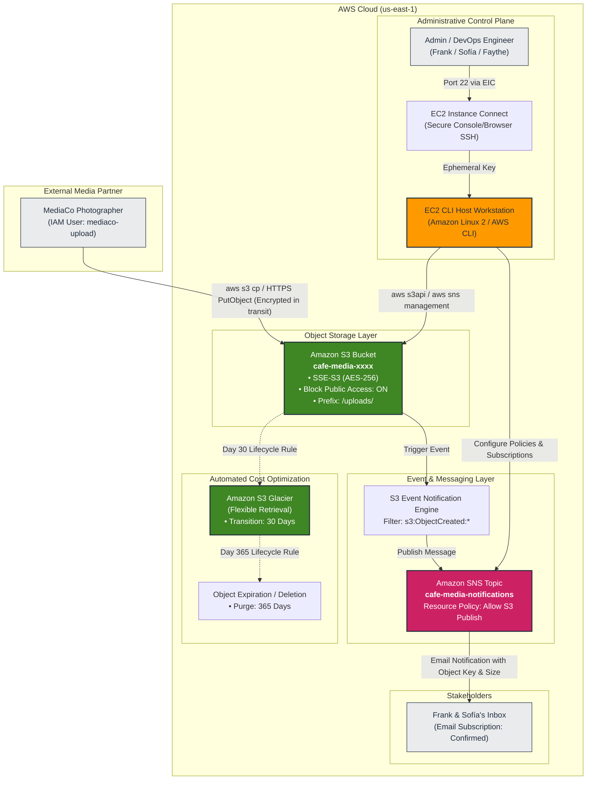
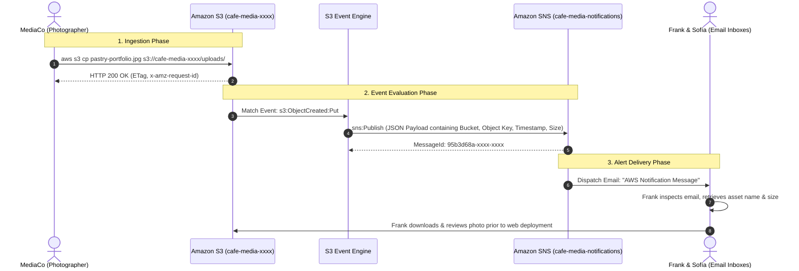
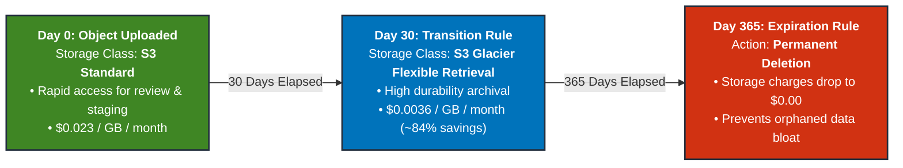
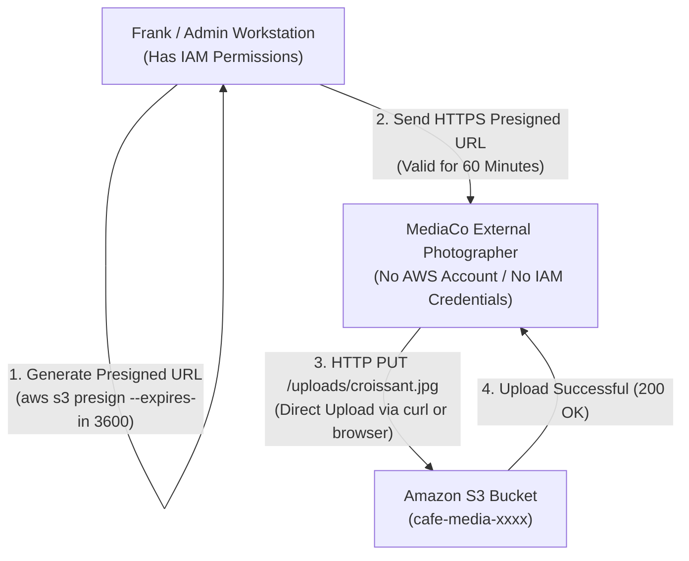
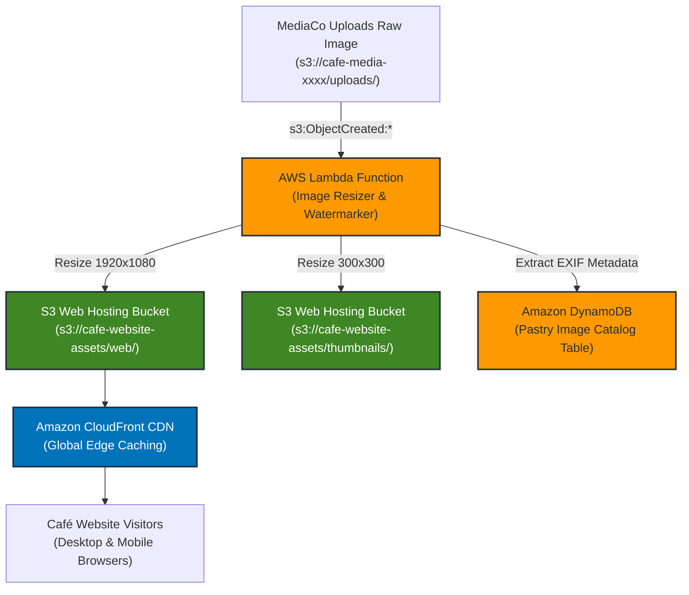

# ☕ Working with Amazon S3: The Café Media Ingestion & Archiving Lab Guide

> **Course**: AWS re/Start  
> **Module**: Storage and Archiving (Module 19 / T19)  
> **Source Document**: `T19-Storage_and_Archiving/T19-0009-STOR_CAFEAMAZONS3_EN.pdf`  
> **Target Audience**: AWS re/Start Learners, Cloud Practitioners, SysOps Administrators, and Solutions Architects  

---

## 🎯 Lab Overview & Context

Welcome to the **Working with Amazon S3** lab guide for **The Café**. As the café’s popularity and artisan reputation grow, founders Frank and Sofía are expanding their product catalog to include wholesale artisan pastries, custom celebration cakes, and specialty seasonal beverages. To market these offerings effectively, Frank commissioned an external commercial photography agency (**MediaCo**) to capture high-resolution product photos.

However, the café faces an immediate operational bottleneck: **how can an external commercial partner securely, reliably, and efficiently transfer gigabytes of high-resolution digital assets into the café’s environment?**

Sending raw digital assets via email is impossible due to strict file size limits. Setting up a legacy FTP server introduces severe security vulnerabilities and maintenance headaches. Consumer cloud storage tools create isolated data silos that do not integrate with the café's cloud-hosted web infrastructure. Furthermore, Frank cannot sit at his computer all day refreshing a folder—he needs an automated alert the moment new pastry photos are uploaded so he and Sofía can review and approve them before they are published to the café’s website.

In this hands-on lab, you act as the café's cloud systems administrator. Guided by **Faythe**, the cloud developer and technical advisor, you will design and implement an end-to-end, event-driven media ingestion and archiving pipeline on **Amazon Simple Storage Service (Amazon S3)** and **Amazon Simple Notification Service (Amazon SNS)**, administered through a secure **Amazon EC2 CLI Host** workstation using **EC2 Instance Connect**.

---

## 📌 Learning Objectives

By completing this hands-on lab and working through this guide, you will be able to:

- [ ] **Analyze Business File-Sharing Requirements**: Evaluate the operational challenges of receiving large multimedia assets from external vendors and contrast Amazon S3 with traditional file transfer mechanisms.
- [ ] **Access Cloud Infrastructure via EC2 Instance Connect**: Securely connect to an administrative Linux bastion/workstation without managing static SSH keys.
- [ ] **Master AWS CLI S3 Tooling**: Differentiate between high-level (`aws s3`) and low-level (`aws s3api`) commands to provision, configure, and manage object storage.
- [ ] **Provision Hardened Amazon S3 Buckets**: Create globally unique S3 buckets, enforce Server-Side Encryption (SSE-S3), and activate comprehensive S3 Block Public Access controls.
- [ ] **Configure Amazon SNS Pub/Sub Messaging**: Create SNS topics, subscribe email recipients, confirm subscriptions, and construct resource-based access policies permitting cross-service publishing from Amazon S3.
- [ ] **Implement Event-Driven Architecture with S3 Event Notifications**: Configure S3 buckets to publish events (`s3:ObjectCreated:*`) to Amazon SNS upon asset ingestion.
- [ ] **Audit IAM Permissions for External Collaborators**: Review and enforce least-privilege IAM policies for partner user groups (`mediaco`), separating bucket discovery from upload permissions.
- [ ] **Simulate End-to-End Partner Ingestion**: Test asset uploads using the AWS CLI and verify automated notification dispatch to business stakeholders.
- [ ] **Automate Long-Term Archival with S3 Lifecycle Policies**: Author JSON lifecycle rules to transition aged assets from S3 Standard to S3 Glacier after 30 days and permanently expire them after 365 days.
- [ ] **Apply Enterprise Security Best Practices**: Implement TLS enforcement (`aws:SecureTransport`), evaluate presigned URLs for ephemeral partner access, and manage access boundaries.

---

## 🎭 Café Business Scenario & File Sharing Challenge

### 1. The Discussion: Faythe and Sofía

```
┌──────────────────────────────────────────────────────────────────────────────┐
│                            Café Scenario Dialogue                            │
├──────────────────────────────────────────────────────────────────────────────┤
│ Faythe: "Sofía, you told me that your product catalog is expanding and that  │
│          Frank hired an external media company to create a portfolio of      │
│          pictures for the new products."                                     │
│                                                                              │
│ Sofía:  "Yes, he would like to receive the pictures from the media company   │
│          electronically in one convenient and secure location. He also wants │
│          to be notified by email when pictures are uploaded so that we can   │
│          review and approve the photos before they are deployed to the café  │
│          website."                                                           │
│                                                                              │
│ Faythe: "Because images are usually large files, storing them on Amazon      │
│          Simple Storage Service, or Amazon S3, is the recommended solution.  │
│          Let me tell you about the benefits of using Amazon S3 for file      │
│          sharing."                                                           │
└──────────────────────────────────────────────────────────────────────────────┘
```

---

### 2. Frank's Business Requirements Breakdown

Frank and Sofía identified four distinct operational requirements for the café's media ingestion pipeline:

1. **Centralized Electronic Dropbox**:
   - The media company must have a single, dedicated location to deliver high-resolution camera raw files, TIFFs, and JPEGs ranging from 15 MB to 100+ MB per image.
   - The solution must support multi-part parallel uploads for large portfolios without timeouts or connection drops.
2. **Automated Event Notification**:
   - Frank cannot spend his workday monitoring directories. The moment the media agency completes an upload batch, an automated email notification must be dispatched to Frank and Sofía containing asset metadata (file names, bucket paths, timestamps).
3. **Approval Workflow Gate**:
   - Photos must not appear directly on the public café website upon upload. They must land in a private staging location where Frank can inspect color balance, framing, and pastry presentation before promoting them to production.
4. **Frugal Cost & Storage Tiering**:
   - High-resolution portfolio images must be preserved for future marketing campaigns, but active promotion on the website only lasts a few weeks. The café should not pay premium S3 Standard storage rates indefinitely for historical master files.

---

### 3. Why Traditional File Sharing Fails

Before selecting Amazon S3, Faythe reviewed legacy file transfer options with Frank and Sofía to demonstrate why cloud object storage is the industry standard:

| Feature / Criteria | Email Attachments | On-Premises FTP/SFTP Server | Consumer Cloud Drives (e.g., Dropbox) | Amazon S3 Ingestion Bucket |
| :--- | :--- | :--- | :--- | :--- |
| **Max File Size** | 25 MB hard cap per message | Limited by disk volume size | Varies by account quota | **5 TB** per individual object |
| **Durability** | Vulnerable to inbox deletion | Single disk / RAID array failure risk | Vendor proprietary | **99.999999999% (11 9's)** across $\ge$ 3 AZs |
| **Access Control** | Unencrypted attachments forwardable | Manual Linux user & credential management | Shared link leakage risk | **Granular IAM policies, Bucket Policies, Presigned URLs** |
| **Event Automation** | Requires custom mail parsing scripts | Requires complex inotify / cron polling daemons | Webhooks require third-party subscription | **Native S3 Event Notifications (SNS, SQS, Lambda)** |
| **Cost Model** | Mailbox storage bloat | 24/7 server hardware, power, bandwidth | Monthly recurring per-seat user licenses | **Pay-as-you-go ($0.023/GB/month)**; fractions of a cent |
| **Lifecycle Archiving** | Manual deletion | Manual tape backup or offsite rsync | Manual cleanup | **Automated Lifecycle transitions to S3 Glacier** |

---

### 4. Architectural Solution Overview

Faythe’s recommended architecture utilizes native, managed AWS services:

1. **Administrative CLI Host**: An Amazon EC2 Linux instance pre-configured with the AWS CLI and IAM Instance Profile, accessed securely via **EC2 Instance Connect** (no public SSH keys to manage or rotate).
2. **Amazon S3 Ingestion Bucket (`cafe-media-xxxx`)**: A private, encrypted object storage container configured with strict Block Public Access settings and dedicated prefix partitioning (`/uploads/`).
3. **Amazon SNS Topic (`cafe-media-notifications`)**: A fully managed publish/subscribe messaging topic with an email subscription delivering real-time alerts to Frank and Sofía.
4. **S3 Event Notifications**: Native asynchronous event hooks attached to the S3 bucket that capture `s3:ObjectCreated:*` API operations and publish structured JSON payloads directly to the SNS topic.
5. **IAM User Group (`mediaco`)**: A segregated IAM permission group for the external media agency granting console visibility to the bucket and upload permissions (`s3:PutObject`), while strictly denying permissions to delete objects or modify bucket settings.
6. **S3 Lifecycle Policy**: An automated rule transitioning images to **Amazon S3 Glacier Flexible Retrieval** after 30 days and permanently expiring them after 365 days.

---

## 🏛️ Architectural Blueprints & Workflows

### 1. End-to-End Café S3 Media Ingestion Architecture



---

### 2. S3 Event Notification & SNS Sequence Diagram



---

### 3. S3 Lifecycle Rule Timeline Flowchart



---

## 🛠️ Technical Hands-On Lab Walkthrough Step-by-Step

### Task 1: Connecting to CLI Host Instance via EC2 Instance Connect

In this lab environment, administrative operations are performed using the **AWS Command Line Interface (AWS CLI)** running on a pre-provisioned Amazon Linux EC2 instance named **CLI Host**. Rather than opening inbound port 22 to the public internet or distributing static PEM key pairs, you connect using **EC2 Instance Connect**, which generates ephemeral SSH keys authenticated through IAM.

```
┌────────────────────────────────────────────────────────────────────────┐
│                      Task 1 Command Execution Flow                     │
├────────────────────────────────────────────────────────────────────────┤
│ 1. AWS Management Console → EC2 → Instances → Select "CLI Host"        │
│ 2. Choose "Connect" → "EC2 Instance Connect" → "Connect"               │
│ 3. Terminal opens in browser with active session as ec2-user           │
│ 4. Verify AWS CLI installation: aws --version                          │
│ 5. Verify pre-configured IAM identity: aws sts get-caller-identity     │
└────────────────────────────────────────────────────────────────────────┘
```

#### Step 1.1: Verify AWS CLI Installation and Environment

Once logged into the CLI Host terminal, verify the AWS CLI version and active caller identity:

```bash
# Verify AWS CLI version (AWS CLI v2 is standard)
aws --version

# Verify IAM role assumed by the instance profile
aws sts get-caller-identity
```

**Expected Output:**
```json
{
    "UserId": "AROAEXAMPLEIDENTITY:i-0123456789abcdef0",
    "Account": "111122223333",
    "Arn": "arn:aws:sts::111122223333:assumed-role/LabInstanceProfileRole/i-0123456789abcdef0"
}
```

> [!NOTE]
> The CLI Host uses an attached **IAM Instance Profile**, eliminating the need to store long-term `AWS_ACCESS_KEY_ID` or `AWS_SECRET_ACCESS_KEY` credentials on the virtual machine disk.

#### Step 1.2: Capture Environment Variables

Set working shell variables to simplify subsequent commands across the lab:

```bash
# Set AWS Region
export AWS_REGION=$(curl -s http://169.254.169.254/latest/meta-data/placement/region)
echo "Current AWS Region: $AWS_REGION"

# Generate a unique 4-digit random string for bucket naming
RAND_ID=$((RANDOM % 9000 + 1000))
export BUCKET_NAME="cafe-media-${RAND_ID}"
echo "Target S3 Bucket Name: $BUCKET_NAME"
```

---

### Task 2: Creating a Private Amazon S3 Bucket (`cafe-media-xxxx`)

Amazon S3 bucket names must be **globally unique** across all AWS accounts worldwide and comply with strict DNS naming conventions (3–63 characters, lowercase letters, numbers, and hyphens only).

#### Step 2.1: Provision the S3 Bucket

You can create an S3 bucket using either the high-level `aws s3 mb` command or the low-level `aws s3api create-bucket` command.

**Option A: High-Level CLI (`aws s3`):**
```bash
# High-level make bucket command
aws s3 mb s3://${BUCKET_NAME} --region ${AWS_REGION}
```

**Option B: Low-Level API (`aws s3api`):**
```bash
# Low-level API command (handles LocationConstraint automatically outside us-east-1)
if [ "$AWS_REGION" == "us-east-1" ]; then
  aws s3api create-bucket \
    --bucket ${BUCKET_NAME} \
    --region ${AWS_REGION}
else
  aws s3api create-bucket \
    --bucket ${BUCKET_NAME} \
    --region ${AWS_REGION} \
    --create-bucket-configuration LocationConstraint=${AWS_REGION}
fi
```

**Expected Output:**
```
make_bucket: cafe-media-4821
```

#### Step 2.2: Enable Default Server-Side Encryption (SSE-S3)

To ensure all stored media assets are automatically encrypted at rest with AES-256, apply the default server-side encryption configuration:

```bash
aws s3api put-bucket-encryption \
  --bucket ${BUCKET_NAME} \
  --server-side-encryption-configuration '{
    "Rules": [
      {
        "ApplyServerSideEncryptionByDefault": {
          "SSEAlgorithm": "AES256"
        },
        "BucketKeyEnabled": true
      }
    ]
  }'
```

#### Step 2.3: Enforce S3 Block Public Access

To prevent accidental public exposure of Frank's unapproved pastry photos, enforce all four S3 Block Public Access controls:

```bash
aws s3api put-public-access-block \
  --bucket ${BUCKET_NAME} \
  --public-access-block-configuration '{
    "BlockPublicAcls": true,
    "IgnorePublicAcls": true,
    "BlockPublicPolicy": true,
    "RestrictPublicBuckets": true
  }'
```

#### Step 2.4: Verify Bucket Settings

Inspect the newly configured bucket properties:

```bash
# Verify encryption
aws s3api get-bucket-encryption --bucket ${BUCKET_NAME}

# Verify Block Public Access settings
aws s3api get-public-access-block --bucket ${BUCKET_NAME}
```

---

### Task 3: Configuring Amazon SNS Topic & Email Subscription

Amazon Simple Notification Service (Amazon SNS) is a fully managed publish/subscribe messaging service. In this task, you create an SNS topic and register Frank’s email address as an endpoint subscriber.

#### Step 3.1: Create the SNS Topic

Create an SNS topic named `cafe-media-notifications`:

```bash
aws sns create-topic --name cafe-media-notifications
```

**Expected Output:**
```json
{
    "TopicArn": "arn:aws:sns:us-east-1:111122223333:cafe-media-notifications"
}
```

Store the returned Topic ARN in an environment variable:
```bash
export SNS_TOPIC_ARN=$(aws sns list-topics --query "Topics[?contains(TopicArn, 'cafe-media-notifications')].TopicArn" --output text)
echo "SNS Topic ARN: $SNS_TOPIC_ARN"
```

#### Step 3.2: Subscribe Frank's Email Endpoint

Register an email address to receive notifications when objects are uploaded:

```bash
# Replace student@example.com with your verified lab email address
export NOTIFICATION_EMAIL="frank.cafe.restart@example.com"

aws sns subscribe \
  --topic-arn ${SNS_TOPIC_ARN} \
  --protocol email \
  --notification-endpoint ${NOTIFICATION_EMAIL}
```

**Expected Output:**
```json
{
    "SubscriptionArn": "pending confirmation"
}
```

> [!IMPORTANT]
> **Email Confirmation Requirement**: When an email subscription is created, Amazon SNS sends a verification email with the subject line `"AWS Notification - Subscription Confirmation"`. The recipient must open the email and click **"Confirm subscription"** before any messages will be delivered. Until confirmed, the subscription status remains `pending confirmation`.

#### Step 3.3: Configure the SNS Topic Access Policy

By default, Amazon S3 does **not** have permission to publish messages to your SNS topic. You must attach a resource-based Access Policy to the SNS topic granting the Amazon S3 service principal (`s3.amazonaws.com`) permission to execute `sns:Publish`, scoped specifically to your café media bucket.

Create the policy JSON file:

```bash
cat <<EOF > sns-policy.json
{
  "Version": "2012-10-17",
  "Id": "AllowS3PublishPolicy",
  "Statement": [
    {
      "Sid": "AllowS3ToPublishNotification",
      "Effect": "Allow",
      "Principal": {
        "Service": "s3.amazonaws.com"
      },
      "Action": "sns:Publish",
      "Resource": "${SNS_TOPIC_ARN}",
      "Condition": {
        "ArnEquals": {
          "aws:SourceArn": "arn:aws:s3:::${BUCKET_NAME}"
        }
      }
    }
  ]
}
EOF
```

Apply the policy to the SNS topic:

```bash
aws sns set-topic-attributes \
  --topic-arn ${SNS_TOPIC_ARN} \
  --attribute-name Policy \
  --attribute-value file://sns-policy.json
```

---

### Task 4: Configuring Amazon S3 Event Notifications

With the bucket and SNS topic ready, you now wire them together using **Amazon S3 Event Notifications**. Whenever an object is created via `PutObject`, `PostObject`, `CopyObject`, or multi-part upload completion, S3 generates an event.

```
┌────────────────────────────────────────────────────────────────────────┐
│                   S3 Event Notification Configuration                  │
├────────────────────────────────────────────────────────────────────────┤
│ Target Bucket:    cafe-media-xxxx                                      │
│ Event Filter:     s3:ObjectCreated:*                                   │
│ Target Service:   Amazon Simple Notification Service (Amazon SNS)      │
│ Target ARN:       arn:aws:sns:us-east-1:111122223333:cafe-media-notif  │
│ Prefix Filter:    uploads/ (optional, isolates partner uploads)        │
└────────────────────────────────────────────────────────────────────────┘
```

#### Step 4.1: Construct the Notification Configuration JSON File

Create a file named `notification.json` defining the SNS topic destination and event triggers:

```bash
cat <<EOF > notification.json
{
  "TopicConfigurations": [
    {
      "TopicArn": "${SNS_TOPIC_ARN}",
      "Events": [
        "s3:ObjectCreated:*"
      ],
      "Filter": {
        "Key": {
          "FilterRules": [
            {
              "Name": "prefix",
              "Value": "uploads/"
            }
          ]
        }
      }
    }
  ]
}
EOF
```

#### Step 4.2: Apply the Notification Configuration to the S3 Bucket

Execute the `put-bucket-notification-configuration` API call:

```bash
aws s3api put-bucket-notification-configuration \
  --bucket ${BUCKET_NAME} \
  --notification-configuration file://notification.json
```

#### Step 4.3: Verify the Notification Configuration

Verify that the notification configuration was successfully registered:

```bash
aws s3api get-bucket-notification-configuration --bucket ${BUCKET_NAME}
```

**Expected Output:**
```json
{
    "TopicConfigurations": [
        {
            "Id": "YTIzYWE4MGQt...",
            "TopicArn": "arn:aws:sns:us-east-1:111122223333:cafe-media-notifications",
            "Events": [
                "s3:ObjectCreated:*"
            ],
            "Filter": {
                "Key": {
                    "FilterRules": [
                        {
                            "Name": "prefix",
                            "Value": "uploads/"
                        }
                    ]
                }
            }
        }
    ]
}
```

---

### Task 5: Testing Simulated Upload from External Media Partner

#### Step 5.1: Review IAM Permissions for the `mediaco` User Group

In a production environment, the external photographer is assigned an IAM user belonging to the **`mediaco`** group. The permissions assigned to this group illustrate the **Principle of Least Privilege**:

```json
{
  "Version": "2012-10-17",
  "Statement": [
    {
      "Sid": "AllowS3ConsoleListBuckets",
      "Effect": "Allow",
      "Action": [
        "s3:ListAllMyBuckets",
        "s3:GetBucketLocation"
      ],
      "Resource": "arn:aws:s3:::*"
    },
    {
      "Sid": "AllowS3BucketWrite",
      "Effect": "Allow",
      "Action": [
        "s3:PutObject",
        "s3:PutObjectAcl"
      ],
      "Resource": "arn:aws:s3:::cafe-media-*/*"
    },
    {
      "Sid": "DenyObjectDeletion",
      "Effect": "Deny",
      "Action": [
        "s3:DeleteObject",
        "s3:DeleteObjectVersion"
      ],
      "Resource": "arn:aws:s3:::cafe-media-*/*"
    }
  ]
}
```

> [!NOTE]
> **Sid Analysis**:
> - `AllowS3ConsoleListBuckets`: Grants permissions required for an external partner using the AWS Management Console to view the list of buckets in the account and navigate into the café bucket without getting a blank screen or permissions error.
> - `AllowS3BucketWrite`: Restricts upload rights exclusively to buckets matching the naming prefix `cafe-media-*`.
> - `DenyObjectDeletion`: Ensures an external partner can never accidentally overwrite or delete existing bakery images.

#### Step 5.2: Create Simulated Test Media Assets

Generate mock image files on the CLI Host to simulate the media company’s photography delivery:

```bash
mkdir -p ~/media-batch
cd ~/media-batch

# Create mock high-resolution pastry images
echo "Binary image header - Artisan Butter Croissants 4K Portfolio" > croissant_01.jpg
echo "Binary image header - Triple Chocolate Mousse Tart 4K Portfolio" > tart_chocolate_02.jpg
echo "Binary image header - Sourdough Boule Artisan Loaf 4K Portfolio" > bread_sourdough_03.jpg

ls -lh ~/media-batch
```

#### Step 5.3: Upload Assets Using the High-Level AWS CLI (`aws s3 cp` and `aws s3 sync`)

Simulate the photographer uploading individual assets and batch synchronizing directories:

```bash
# Upload a single image to the /uploads/ prefix
aws s3 cp ~/media-batch/croissant_01.jpg s3://${BUCKET_NAME}/uploads/croissant_01.jpg

# Synchronize the remaining photos to the bucket
aws s3 sync ~/media-batch/ s3://${BUCKET_NAME}/uploads/
```

**Expected Output:**
```
upload: ./croissant_01.jpg to s3://cafe-media-4821/uploads/croissant_01.jpg
upload: ./tart_chocolate_02.jpg to s3://cafe-media-4821/uploads/tart_chocolate_02.jpg
upload: ./bread_sourdough_03.jpg to s3://cafe-media-4821/uploads/bread_sourdough_03.jpg
```

#### Step 5.4: List Bucket Contents to Confirm Ingestion

Verify that the files reside securely inside the bucket under the `uploads/` prefix:

```bash
aws s3 ls s3://${BUCKET_NAME}/uploads/
```

---

### Task 6: Verifying Automated Email Notification Delivery

When the uploads complete, the S3 Event Notification engine generates an asynchronous event message and pushes it to Amazon SNS. Amazon SNS formats the payload and delivers an email notification to each confirmed subscriber.

#### Step 6.1: Inspect the Email Notification

Frank opens his email client and observes a message from **AWS Notifications** (`no-reply@sns.amazonaws.com`):

```
Subject: AWS Notification Message

{
  "Records": [
    {
      "eventVersion": "2.1",
      "eventSource": "aws:s3",
      "awsRegion": "us-east-1",
      "eventTime": "2026-10-12T18:45:22.145Z",
      "eventName": "ObjectCreated:Put",
      "userIdentity": {
        "principalId": "AWS:AROAEXAMPLE..."
      },
      "requestParameters": {
        "sourceIPAddress": "54.240.196.18"
      },
      "responseElements": {
        "x-amz-request-id": "C3D13FE58DE4C810",
        "x-amz-id-2": "FMyUV-example-key..."
      },
      "s3": {
        "s3SchemaVersion": "1.0",
        "configurationId": "YTIzYWE4MGQt...",
        "bucket": {
          "name": "cafe-media-4821",
          "ownerIdentity": {
            "principalId": "A3NL..."
          },
          "arn": "arn:aws:s3:::cafe-media-4821"
        },
        "object": {
          "key": "uploads/croissant_01.jpg",
          "size": 65,
          "eTag": "d41d8cd98f00b204e9800998ecf8427e",
          "sequencer": "0055AED6DCD90281E5"
        }
      }
    }
  ]
}
```

#### Step 6.2: Stakeholder Triage Runbook

Frank reviews the payload details:
- **`eventName`**: Identifies that an object was created (`ObjectCreated:Put`).
- **`s3.bucket.name`**: Confirms the target bucket (`cafe-media-4821`).
- **`s3.object.key`**: Reveals the specific file path (`uploads/croissant_01.jpg`).
- **`s3.object.size`**: Confirms data payload was received.

Frank can now open the AWS Management Console or run a local download script to inspect the photo, verify lighting and composition, and approve the asset for publication.

---

### Task 7: Configuring S3 Lifecycle Configuration Rules

As months pass, the volume of high-resolution images grows. The café must retain these photos for archival and re-branding purposes, but keeping them in **S3 Standard** ($0.023 per GB/month) indefinitely is wasteful. 

Faythe recommends configuring an **S3 Lifecycle Configuration** rule:
- **Transition to Amazon S3 Glacier Flexible Retrieval** after **30 days** ($0.0036 per GB/month, an 84% cost reduction).
- **Permanently expire (delete)** objects after **365 days** (1 year), purging obsolete draft shots automatically.

#### Step 7.1: Author the Lifecycle Configuration JSON (`lifecycle.json`)

Construct a lifecycle policy JSON definition:

```bash
cat <<EOF > lifecycle.json
{
  "Rules": [
    {
      "ID": "ArchiveAndExpirePastryPhotos",
      "Status": "Enabled",
      "Filter": {
        "Prefix": "uploads/"
      },
      "Transitions": [
        {
          "Days": 30,
          "StorageClass": "GLACIER"
        }
      ],
      "Expiration": {
        "Days": 365
      }
    }
  ]
}
EOF
```

#### Step 7.2: Apply the Lifecycle Configuration to the Bucket

Execute the `put-bucket-lifecycle-configuration` API call:

```bash
aws s3api put-bucket-lifecycle-configuration \
  --bucket ${BUCKET_NAME} \
  --lifecycle-configuration file://lifecycle.json
```

#### Step 7.3: Validate the Active Lifecycle Configuration

Confirm that the lifecycle rule is active:

```bash
aws s3api get-bucket-lifecycle-configuration --bucket ${BUCKET_NAME}
```

**Expected Output:**
```json
{
    "Rules": [
        {
            "Expiration": {
                "Days": 365
            },
            "ID": "ArchiveAndExpirePastryPhotos",
            "Filter": {
                "Prefix": "uploads/"
            },
            "Status": "Enabled",
            "Transitions": [
                {
                    "Days": 30,
                    "StorageClass": "GLACIER"
                }
            ]
        }
    ]
}
```

---

## 🔐 Security, Access Control & Operational Best Practices

### 1. Principle of Least Privilege in S3 Bucket Policies

A defense-in-depth security model pairs IAM policies with **S3 Bucket Policies**. The bucket policy below enforces two critical security controls:
1. **Denies non-HTTPS traffic** to ensure data in transit is encrypted using TLS.
2. **Denies unencrypted object uploads** that do not specify AES256 or KMS headers.

```json
{
  "Version": "2012-10-17",
  "Statement": [
    {
      "Sid": "EnforceTLSRequestsOnly",
      "Effect": "Deny",
      "Principal": "*",
      "Action": "s3:*",
      "Resource": [
        "arn:aws:s3:::cafe-media-xxxx",
        "arn:aws:s3:::cafe-media-xxxx/*"
      ],
      "Condition": {
        "Bool": {
          "aws:SecureTransport": "false"
        }
      }
    }
  ]
}
```

---

### 2. Presigned URLs: Secure Temporary Partner Access without IAM Users

Creating permanent IAM credentials for external contractors introduces credential lifecycle overhead and exposure risks. An architecturally superior alternative is generating **S3 Presigned URLs**.



#### Generating a Presigned Upload URL via AWS CLI

Using the AWS CLI or AWS SDK, Frank can generate a temporary URL that allows the photographer to upload an image within a 60-minute window without needing an AWS account:

```bash
# Generate a presigned URL valid for 3600 seconds (1 hour)
aws s3 presign s3://${BUCKET_NAME}/uploads/pastry_portfolio_batch.zip --expires-in 3600
```

The media company can then upload the file using a simple HTTP PUT request:

```bash
curl -X PUT -T pastry_portfolio_batch.zip "<PRESIGNED_URL>"
```

---

### 3. S3 Block Public Access: The Four Golden Gates

Amazon S3 provides four centralized account-level and bucket-level controls that override all bucket policies and access control lists (ACLs):

| S3 Block Public Access Setting | Technical Behavior | Operational Impact on Café Bucket |
| :--- | :--- | :--- |
| **`BlockPublicAcls`** | Rejects any `PutObject` or `PutBucketAcl` requests that include public ACLs. | Prevents external partners from passing `--acl public-read` during uploads. |
| **`IgnorePublicAcls`** | Causes Amazon S3 to ignore all existing public ACLs on bucket and objects. | Guarantees that public ACLs have zero effect on data exposure. |
| **`BlockPublicPolicy`** | Rejects bucket policies that grant public/anonymous read or write access. | Prevents administrators from accidentally applying public read policies. |
| **`RestrictPublicBuckets`** | Restricts access to a bucket with a public policy to only AWS service principals and authorized users. | Confines bucket access strictly to authenticated café identities. |

---

### 4. Command Reference: High-Level (`aws s3`) vs. Low-Level (`aws s3api`)

| Operational Task | High-Level Command (`aws s3`) | Low-Level API Command (`aws s3api`) |
| :--- | :--- | :--- |
| **Create Bucket** | `aws s3 mb s3://<bucket>` | `aws s3api create-bucket --bucket <bucket>` |
| **List Buckets** | `aws s3 ls` | `aws s3api list-buckets` |
| **List Objects** | `aws s3 ls s3://<bucket>/` | `aws s3api list-objects-v2 --bucket <bucket>` |
| **Upload File** | `aws s3 cp local.jpg s3://<bucket>/` | `aws s3api put-object --bucket <bucket> --key file.jpg --body local.jpg` |
| **Batch Sync** | `aws s3 sync local_dir/ s3://<bucket>/` | *(Not natively supported; requires custom script)* |
| **Delete Bucket** | `aws s3 rb s3://<bucket> --force` | `aws s3api delete-bucket --bucket <bucket>` |
| **Configure Encryption**| *(Not supported in high-level CLI)* | `aws s3api put-bucket-encryption --bucket <bucket> ...` |
| **Configure Notifications**| *(Not supported in high-level CLI)* | `aws s3api put-bucket-notification-configuration ...` |
| **Configure Lifecycle** | *(Not supported in high-level CLI)* | `aws s3api put-bucket-lifecycle-configuration ...` |

> [!TIP]
> Use **`aws s3`** for daily administrative object management (copying, moving, syncing, and listing files). Use **`aws s3api`** for declarative infrastructure configuration (setting encryption, bucket policies, event notifications, lifecycle rules, and CORS).

---

## 🧠 Checkpoint & Review Questions (with In-Depth Answers)

### Official Slide Checkpoint Questions

#### Question 1: What are two benefits of using Amazon S3 to share files?
**Answer:**
1. **Virtually Unlimited Elastic Storage Capacity & High Durability**: Amazon S3 scales automatically from zero bytes to petabytes without capacity provisioning or disk exhaustion. It provides **99.999999999% (11 9's)** of data durability by automatically replicating objects across a minimum of three physical Availability Zones within an AWS Region.
2. **Granular Access Control & Event-Driven Automation**: Amazon S3 supports multi-layered security (IAM policies, resource-based bucket policies, presigned URLs, and Block Public Access) and natively generates automated **event notifications** (to SNS, SQS, or Lambda) when objects are uploaded, modified, or deleted, eliminating manual polling.

---

#### Question 2: Which AWS CLI command creates an S3 bucket?
**Answer:**
- **High-level CLI**: `aws s3 mb s3://<bucket-name>` (where `mb` stands for *make bucket*).
- **Low-level API**: `aws s3api create-bucket --bucket <bucket-name> --region <region-name>`.

---

#### Question 3: For IAM user group permissions, which SID key name defines permissions that allow the user to use the Amazon S3 console to view the list of S3 buckets in the account?
**Answer:**
In the lab's IAM permission policy, the statement identifier (SID) is commonly named **`AllowS3ConsoleListBuckets`** (or `AllowGroupToSeeBucketListInConsole`). This statement grants the actions:
- `s3:ListAllMyBuckets`
- `s3:GetBucketLocation`

On the resource `arn:aws:s3:::*`. Without this specific statement, an IAM user logging into the AWS Management Console will encounter an "Access Denied" banner when accessing the Amazon S3 console home page, preventing them from navigating into individual buckets.

---

#### Question 4: Which Amazon SNS resource sends an email notification to its subscribed users?
**Answer:**
An **Amazon SNS Topic** (configured with an **Email Subscription**). The SNS topic acts as the logical communication channel and pub/sub message router. When the publisher (Amazon S3 Event Notifications) publishes a message to the SNS topic ARN, the topic automatically formats and broadcasts the notification to all confirmed subscriber endpoints, including email addresses, SMS phone numbers, Amazon SQS queues, and AWS Lambda functions.

---

### Advanced Architectural Knowledge Checks

#### Question 5: Why did the initial test notification fail to reach Frank's email even though the S3 notification configuration was correctly applied?
**Answer:**
There are two common causes in this architecture:
1. **Unconfirmed Subscription**: The email subscriber never clicked the confirmation link in the verification email dispatched by Amazon SNS, leaving the subscription in `PendingConfirmation`.
2. **Missing SNS Topic Resource Policy**: Amazon SNS topics deny publishing by default. Unless an SNS Topic Access Policy explicitly permits the `s3.amazonaws.com` service principal to perform `sns:Publish` for the specific bucket ARN (`aws:SourceArn`), Amazon S3’s attempt to publish an event will be silently rejected by SNS.

---

#### Question 6: How does transitioning objects to S3 Glacier after 30 days impact Frank's ability to immediately download photos if he needs an older image?
**Answer:**
Amazon S3 Glacier Flexible Retrieval is an **asynchronous cold storage class**. Unlike S3 Standard (which delivers real-time, millisecond retrievals), objects in Glacier cannot be accessed immediately via `aws s3 cp` or direct HTTPS download. Frank must first initiate an **S3 Restore Request** (using Expedited retrieval in 1–5 minutes, Standard retrieval in 3–5 hours, or Bulk retrieval in 5–12 hours) to hydrate a temporary copy back into S3 Standard before downloading.

---

## 🚀 Next Steps: From Manual Dropbox to Automated Production Pipeline

The architecture implemented in this lab forms the foundational ingestion tier for the café's digital media ecosystem. As the café scales, Faythe and the engineering team plan to evolve this pipeline into a fully serverless media processing architecture:



1. **Automated Asset Processing with AWS Lambda**: Replace the SNS email notification with an **AWS Lambda function** trigger that automatically normalizes high-resolution raw images into optimized WebP formats, generates thumbnails, and stamps promotional watermarks.
2. **Metadata Indexing with Amazon DynamoDB**: Store image metadata (pastry name, baker, price, upload date, camera EXIF data) in a serverless DynamoDB NoSQL table for instant searchability.
3. **Global Content Delivery via Amazon CloudFront**: Distribute optimized pastry photos globally through **Amazon CloudFront** edge locations with an S3 Origin Access Control (OAC), reducing page load latency to milliseconds for customers browsing the café menu.
