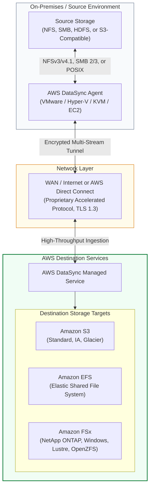
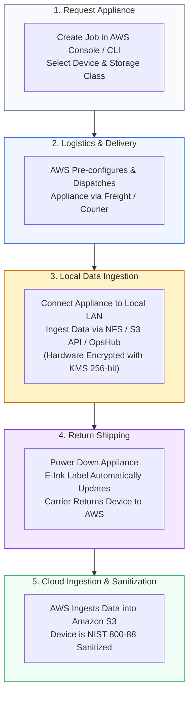
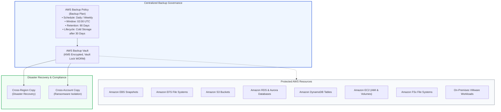

# 🚀 AWS Transfer Family, DataSync, and Hybrid Migration Services

> **Course**: AWS re/Start  
> **Module**: Storage and Archiving  
> **Source Document**: `T19-Storage_and_Archiving/T19-0010-STOR_DATATRANSFERMIGRATION_EN.pdf`  
> **Target Audience**: AWS re/Start Learners, Cloud Practitioners, Solutions Architects, and SysOps Administrators  

---

## 🎯 Module Overview

Data migration is one of the most critical phases in any cloud adoption journey. Whether transitioning legacy on-premises databases, migrating multi-terabyte Network Attached Storage (NAS) archives, ingesting high-throughput sensor telemetry, or establishing recurring business-to-business (B2B) file transfers, organizations face the dual challenges of **network bandwidth constraints** and **operational workflow continuity**.

Transferring hundreds of terabytes or petabytes of data across Wide Area Networks (WAN) introduces fundamental constraints governed by network latency, packet loss, bandwidth saturation, and transit costs. Furthermore, existing enterprise workflows rely heavily on legacy protocols (such as SFTP, FTPS, and AS2) that cannot be refactored overnight to use native cloud APIs like the Amazon S3 REST API.

To solve these diverse ingestion challenges, Amazon Web Services (AWS) provides a purpose-built portfolio of **online** and **offline** data transfer and migration services:
- **AWS Transfer Family**: Provides serverless, fully managed file transfer endpoints supporting SFTP, FTPS, FTP, and AS2 protocols directly integrated with Amazon S3 and Amazon EFS, eliminating the need to modify client-side workflows.
- **AWS DataSync**: A high-performance, automated data transfer service that accelerates online migration between on-premises storage systems and AWS, or between AWS storage services, utilizing a purpose-built network protocol up to 10 times faster than open-source utilities like `rsync`.
- **AWS Snow Family**: Physical, ruggedized edge computing and storage hardware (AWS Snowcone, AWS Snowball Edge, and AWS Snowmobile) designed to bypass network constraints by physically shipping petabytes to exabytes of data into AWS data centers.
- **AWS Backup**: A centralized, policy-driven data protection framework that automates backup orchestration across AWS compute, database, and storage resources, as well as on-premises hybrid hypervisors.

---

## 📌 Learning Objectives

By studying this guide, you will be able to:

- [ ] **Distinguish Online vs. Offline Migration Strategies**: Calculate network transfer durations over WAN connections and determine the exact tipping point where physical data transport (AWS Snow Family) surpasses network transfers (AWS DataSync, Direct Connect).
- [ ] **Architect AWS Transfer Family Endpoints**: Configure fully managed SFTP, FTPS, FTP, and AS2 endpoints with zero client-side modifications, backed by Amazon S3 buckets and Amazon Elastic File System (Amazon EFS).
- [ ] **Implement Identity and Authentication for Transfer Family**: Differentiate service-managed user stores, Microsoft Active Directory integration via AWS Directory Service, and custom identity providers utilizing Amazon API Gateway and AWS Lambda.
- [ ] **Accelerate Online Transfers with AWS DataSync**: Deploy the on-premises DataSync Agent, configure automated end-to-end data integrity validation, preserve POSIX metadata and file attributes, and schedule bandwidth-throttled sync tasks.
- [ ] **Select and Deploy AWS Snow Family Devices**: Compare hardware specifications, compute capabilities, and storage capacities of AWS Snowcone (8 TB / 14 TB), AWS Snowball Edge Storage Optimized (80 TB), AWS Snowball Edge Compute Optimized (42 TB), and AWS Snowmobile (100 PB).
- [ ] **Leverage AWS Backup for Centralized Governance**: Define backup policies, cross-region and cross-account backup copies, cold-storage lifecycle transitions, and immutable WORM-compliant vaults using AWS Backup Vault Lock.
- [ ] **Navigate the Data Transfer Decision Matrix**: Evaluate business requirements across data volume, available bandwidth, network utilization limits, time constraints, and protocol requirements to select the optimal AWS data migration service.

---

## 🌐 1. AWS Data Transfer & Migration Ecosystem Overview

Organizations migrating workloads to AWS must balance three fundamental parameters: **data volume**, **network bandwidth**, and **time constraints**. Understanding the mathematical and physical limits of network transport is vital when designing an ingestion strategy.

```
┌────────────────────────────────────────────────────────────────────────────────────────┐
│                        AWS Data Transfer & Migration Taxonomy                          │
├──────────────────────────────────────────┬─────────────────────────────────────────────┤
│         Online Network Transfer          │          Offline Physical Transport         │
├──────────────────────────────────────────┼─────────────────────────────────────────────┤
│ • Continuous, incremental, or scheduled │ • Bulk, one-time, initial seed migrations   │
│ • Dependent on available WAN bandwidth   │ • Immune to network bandwidth bottlenecks   │
│ • Immediate data availability on arrival │ • Involves transit, logistics, and loading  │
│ • Protocols: SFTP, FTPS, NFS, SMB, REST  │ • Cryptographically sealed hardware devices │
│ • Services: DataSync, Transfer Family,   │ • Services: AWS Snowcone, Snowball Edge,    │
│   Storage Gateway, S3 Transfer Accel.    │   AWS Snowmobile                            │
└──────────────────────────────────────────┴─────────────────────────────────────────────┘
```

### 1.1 The Physics of Data Transfer: Network Transfer Math

A common pitfall in cloud architecture is underestimating the time required to push large volumes of data across the public internet or private WAN links. Network transfer time is governed by the following mathematical formula:

$$\text{Transfer Time (Seconds)} = \frac{\text{Total Data Size (in Bits)}}{\text{Available Bandwidth (in bps)} \times \text{Network Utilization Efficiency}}$$

Where:
- **Total Data Size**: Converted to bits ($1 \text{ Byte} = 8 \text{ bits}$; $1 \text{ TB} \approx 8 \times 10^{12} \text{ bits}$ in decimal, or $8 \times 2^{40} \text{ bits}$ in binary).
- **Available Bandwidth**: Raw interface speed (e.g., $100 \text{ Mbps}$, $1 \text{ Gbps}$, $10 \text{ Gbps}$).
- **Network Utilization Efficiency**: Real-world networks experience protocol overhead (TCP/IP headers, TLS handshake), packet retransmission, latency, and bandwidth sharing with production traffic. Realistic utilization typically ranges from **60% to 80%**.

#### Transfer Duration Calculation Table (Assuming 70% Real-World Network Utilization)

The table below illustrates the theoretical vs. realistic time required to transfer various datasets over dedicated bandwidth:

| Dataset Size | 100 Mbps WAN Pipe | 1 Gbps WAN Pipe / Direct Connect | 10 Gbps Direct Connect | 100 Gbps Direct Connect |
| :--- | :--- | :--- | :--- | :--- |
| **1 TB** | ~32 hours (1.3 days) | ~3.2 hours | ~19 minutes | ~2 minutes |
| **10 TB** | ~13.2 days | ~32 hours (1.3 days) | ~3.2 hours | ~19 minutes |
| **50 TB** | ~66 days | ~6.6 days | ~16 hours | ~1.6 hours |
| **100 TB** | ~132 days (~4.4 months) | ~13.2 days | ~32 hours (1.3 days) | ~3.2 hours |
| **500 TB** | ~1.8 years | ~66 days (~2.2 months) | ~6.6 days | ~16 hours |
| **1 PB (1,000 TB)** | ~3.6 years | ~132 days (~4.4 months) | ~13.2 days | ~32 hours |
| **10 PB** | ~36 years | ~3.6 years | ~132 days (~4.4 months) | ~13.2 days |

> [!IMPORTANT]
> **The 1-Week Rule of Thumb (The Tipping Point)**:
> If an online transfer calculation indicates that moving your dataset over available network bandwidth will take **more than one week (7 days)**—or if the transfer would saturate more than 50% of your business-critical internet connection—an **offline physical transfer using the AWS Snow Family** is almost always faster, more cost-effective, and operationally safer.

---

## 🔀 2. Online vs. Offline Migration Decision Tree

The following decision tree provides a systematic methodology for selecting the appropriate migration tool based on data volume, network throughput, protocol compatibility, and operational requirements:

```mermaid
flowchart TD
    Start["Begin Data Ingestion Assessment"] --> Q_Volume{"What is the total data volume<br/>to be migrated?"}
    
    Q_Volume -->|< 10 TB| Q_Protocol{"What protocol is the<br/>source workload using?"}
    Q_Volume -->|10 TB to 500 TB| Q_Bandwidth{"Is dedicated WAN bandwidth<br/>> 1 Gbps available for migration?"}
    Q_Volume -->|> 500 TB to Exabytes| Offline_Heavy{"Is data scale<br/>in Exabyte range?"}

    Q_Protocol -->|SFTP / FTPS / FTP / AS2| TF["AWS Transfer Family<br/>(Serverless S3 / EFS backend)"]
    Q_Protocol -->|NFS / SMB / POSIX / HDFS| DS_Small["AWS DataSync<br/>(Automated fast sync over WAN)"]
    Q_Protocol -->|Object Storage / REST API| S3_Direct["S3 Multipart Upload /<br/>S3 Transfer Acceleration"]
    Q_Protocol -->|Block Storage / Tape Archiving| SG["AWS Storage Gateway<br/>(Volume / Tape / File Gateway)"]

    Q_Bandwidth -->|Yes (> 1 Gbps)| DS_Large["AWS DataSync over WAN / Direct Connect<br/>(10x accelerated parallel streams)"]
    Q_Bandwidth -->|No (< 1 Gbps or network constrained)| Snow_Edge["AWS Snowball Edge<br/>(Physical shipping, 80 TB / device)"]

    Offline_Heavy -->|Yes (> 10 PB - Exabytes)| Snowmobile["AWS Snowmobile<br/>(45-ft container, 100 PB / truck)"]
    Offline_Heavy -->|No (10 TB - 10 PB)| Snow_Edge_Multi["AWS Snowball Edge Cluster / Parallel Shipping<br/>(Multiple 80 TB appliances)"]

    style Start fill:#1e293b,stroke:#64748b,stroke-width:2px,color:#fff
    style TF fill:#0284c7,stroke:#0369a1,stroke-width:2px,color:#fff
    style DS_Small fill:#0284c7,stroke:#0369a1,stroke-width:2px,color:#fff
    style DS_Large fill:#0284c7,stroke:#0369a1,stroke-width:2px,color:#fff
    style S3_Direct fill:#0284c7,stroke:#0369a1,stroke-width:2px,color:#fff
    style SG fill:#0284c7,stroke:#0369a1,stroke-width:2px,color:#fff
    style Snow_Edge fill:#d97706,stroke:#b45309,stroke-width:2px,color:#fff
    style Snow_Edge_Multi fill:#d97706,stroke:#b45309,stroke-width:2px,color:#fff
    style Snowmobile fill:#dc2626,stroke:#b91c1c,stroke-width:2px,color:#fff
```

---

## 📁 3. AWS Transfer Family Deep Dive

### 3.1 Architectural Foundations

Many enterprise organizations, financial institutions, healthcare providers, and retail supply chains rely on secure, protocol-based file exchange systems. Historically, migrating these workflows to the cloud required architecting, deploying, patching, and maintaining fleets of self-hosted SFTP servers on Amazon EC2 instances backed by Network Load Balancers and auto-scaling groups. This approach introduced significant management overhead, compliance burdens, and high-availability vulnerabilities.

**AWS Transfer Family** solves this challenge by providing a **fully managed, serverless file transfer service** that enables organizations to seamlessly transfer files into and out of AWS storage services over standard protocols.

```mermaid
flowchart LR
    subgraph Clients["External & Enterprise Clients"]
        direction TB
        C1["SFTP Client<br/>(Port 22 / SSH)"]
        C2["FTPS Client<br/>(Port 990 / TLS)"]
        C3["FTP Client<br/>(Port 21 / Plaintext)"]
        C4["AS2 Partner<br/>(HTTP/S B2B EDI)"]
    end

    subgraph TransferFamily["AWS Transfer Family (Fully Managed / Serverless)"]
        direction TB
        Endpoint["Transfer Endpoint<br/>(Public, VPC Internet, or VPC Internal)"]
        
        subgraph Auth["Identity & Access Management"]
            IdP1["Service-Managed<br/>(Built-in Users)"]
            IdP2["AWS Directory Service<br/>(Active Directory)"]
            IdP3["Custom IdP<br/>(API Gateway + Lambda)"]
        end
        
        Endpoint --> Auth
    end

    subgraph Storage["AWS Managed Storage Targets"]
        direction TB
        S3["Amazon S3 Buckets<br/>(Flat Object Storage)"]
        EFS["Amazon EFS<br/>(POSIX Shared File System)"]
    end

    Clients -->|Standard Protocols| Endpoint
    Auth -->|IAM Role Execution| Storage

    style Clients fill:#f8fafc,stroke:#64748b,stroke-width:1px
    style TransferFamily fill:#eff6ff,stroke:#1d4ed8,stroke-width:2px
    style Storage fill:#f0fdf4,stroke:#15803d,stroke-width:2px
```



### 3.2 Supported Protocols

AWS Transfer Family provides native support for four industry-standard file transfer protocols:

1. **SFTP (SSH File Transfer Protocol - Port 22)**:
   - Uses Secure Shell (SSH) encryption over a single TCP connection.
   - Industry standard for automated scripts, financial batch files, and secure data pipelines.
   - Supports authentication via SSH public/private key pairs and passwords.
2. **FTPS (File Transfer Protocol over SSL/TLS - Ports 21, 990, and Passive Ports)**:
   - Encrypts standard FTP commands and data payloads using TLS/SSL cryptographic certificates.
   - Requires custom TLS certificates managed in **AWS Certificate Manager (ACM)**.
3. **FTP (File Transfer Protocol - Port 21)**:
   - Legacy, unencrypted protocol.
   - For security compliance, AWS Transfer Family only allows plain FTP within an **Amazon VPC** (Virtual Private Cloud). FTP endpoints cannot be exposed directly to the public internet.
4. **AS2 (Applicability Statement 2 - Ports 80 / 443 HTTP/S)**:
   - Designed for business-to-business (B2B) Electronic Data Interchange (EDI) transactions across retail, logistics, and healthcare.
   - Provides non-repudiation, payload encryption, digital signatures, and Message Disposition Notifications (MDN) receipts.

### 3.3 Backend Storage Targets

Files ingested through AWS Transfer Family land directly in AWS native storage with zero intermediate conversion:

- **Amazon Simple Storage Service (Amazon S3)**:
  - Files are stored as standard S3 objects.
  - Virtual directory paths presented to SFTP clients map directly to S3 prefixes (`/finance/2026/q1/report.csv` $\rightarrow$ `s3://company-bucket/finance/2026/q1/report.csv`).
  - Supports S3 lifecycle policies, server-side encryption (SSE-S3, SSE-KMS), and automated event-driven triggers (such as S3 Event Notifications triggering AWS Lambda or Amazon SNS).
- **Amazon Elastic File System (Amazon EFS)**:
  - Connects directly to serverless, shared POSIX file systems.
  - Preserves standard POSIX file permissions, user IDs (UID), group IDs (GID), and directory structures.
  - Ideal for workloads where downstream applications running on EC2 or Amazon ECS/EKS mount the EFS file system directly.

### 3.4 Identity and Authentication Architecture

AWS Transfer Family accommodates diverse authentication frameworks:

```
┌────────────────────────────────────────────────────────────────────────────────────────┐
│                     AWS Transfer Family Authentication Frameworks                      │
├──────────────────────────┬─────────────────────────────┬───────────────────────────────┤
│     Service-Managed      │    AWS Directory Service    │      Custom Identity (IdP)    │
├──────────────────────────┼─────────────────────────────┼───────────────────────────────┤
│ • Stored directly inside │ • Integrated with Microsoft │ • Delegated via Amazon API    │
│   the Transfer Family    │   Active Directory (AWS     │   Gateway & AWS Lambda        │
│   service console/API    │   Managed AD or AD Connector│ • Authenticates against Okta, │
│ • SFTP SSH keys stored   │ • Seamless for enterprise   │   Auth0, LDAP, DynamoDB, or   │
│   per user               │   corporate users           │   relational databases        │
│ • Simple, low management │ • Kerberos / AD groups map  │ • Supports dynamic user       │
│   overhead               │   to IAM roles              │   home directory mapping      │
└──────────────────────────┴─────────────────────────────┴───────────────────────────────┘
```

### 3.5 Core Enterprise Benefits

- **Zero Client Modification**: External business partners, vendors, and automated cron jobs continue using existing SFTP/FTPS client software (e.g., FileZilla, WinSCP, OpenSSH, Cyberduck) without modifying their scripts or connection endpoints.
- **Serverless & Fully Managed**: No EC2 instances to provision, patch, monitor, or scale. AWS automatically scales server capacity to match incoming connection concurrency and transfer volumes.
- **Managed Workflows**: Built-in post-upload processing allows users to orchestrate automated file validation, PGP decryption, antivirus scanning, and format transformation steps directly upon file arrival.
- **Enterprise Compliance**: Adheres to strict regulatory frameworks including PCI DSS, HIPAA, SOC 1/2/3, and ISO/IEC certifications.

---

## ⚡ 4. AWS DataSync: High-Performance Online Data Transfer

### 4.1 Architectural Foundations

**AWS DataSync** is an enterprise-grade, online data transfer and replication service designed to automate, accelerate, and verify the moving of massive datasets (petabytes and millions of files) between on-premises storage systems and AWS, or between distinct AWS storage services.

Traditional file transfer tools such as `rsync`, `scp`, or `robocopy` were designed for local area networks or modest datasets. When deployed across high-latency WAN links, these legacy utilities encounter severe bottlenecks: single-threaded execution, high CPU overhead, poor socket utilization, and tedious manual error recovery.

AWS DataSync overcomes these limitations through a purpose-built, multi-threaded **proprietary network protocol** that dramatically accelerates data transfer over the internet or AWS Direct Connect—performing up to **10 times faster** than open-source alternatives.



### 4.2 The AWS DataSync Agent

To transfer data between on-premises environments and AWS, administrators deploy the **AWS DataSync Agent**:
- **Deployment Formats**: Available as a pre-packaged virtual machine image for **VMware ESXi**, **Microsoft Hyper-V**, **Linux Kernel-based Virtual Machine (KVM)**, or as an **Amazon EC2 AMI**. Hardware appliance versions are also available for purchase via AWS.
- **Local Protocol Access**: The agent connects locally to source storage systems using standard protocols: **NFS** (v3, v4.0, v4.1), **SMB** (v2.1, v3.0+), or **POSIX-compliant** file systems.
- **Acceleration Engine**: The agent inspects files, fragments data into parallelized streams, compresses the payload, encrypts it with TLS 1.3, and transmits it across the WAN directly to AWS DataSync endpoints.

### 4.3 Key Features and Capabilities

1. **Automated End-to-End Data Verification**:
   - DataSync performs cryptographic checksums on every file transferred—both in transit and at rest in the destination storage.
   - Prevents silent data corruption and guarantees bit-for-bit file integrity.
2. **Comprehensive Metadata Preservation**:
   - Preserves POSIX file attributes: ownership (UID/GID), modification timestamps (`mtime`, `atime`), read/write/execute permissions, file modes, and Access Control Lists (ACLs).
   - Preserves NTFS metadata and Windows security descriptors when migrating SMB shares to Amazon FSx for Windows File Server.
3. **Bandwidth Throttling & Task Scheduling**:
   - Prevents saturating production network traffic by setting maximum bandwidth limits (e.g., cap at 200 Mbps during business hours, unrestricted on weekends).
   - Built-in cron-based scheduling to execute incremental syncs automatically.
4. **Resiliency and Automatic Healing**:
   - Recovers automatically from transient network disconnects without restarting entire file transfers from scratch.

### 4.4 DataSync Primary Use Cases

- **One-Time Data Migration**: Moving legacy file systems, NAS appliances, and object stores into Amazon S3, Amazon EFS, or Amazon FSx.
- **Cold Data Archival**: Automatically identifying inactive on-premises data and moving it to Amazon S3 Glacier Flexible Retrieval or Glacier Deep Archive.
- **Disaster Recovery (DR) & Replication**: Maintaining an up-to-date secondary copy of critical on-premises data in AWS storage services.
- **Hybrid Data Processing**: Transferring on-premises scientific, media, or IoT data into AWS for high-performance cloud compute (e.g., AWS Batch, Amazon EMR), then returning the processed results.

---

## ❄️ 5. AWS Snow Family: Offline Physical Edge Migration

When data scale reaches hundreds of terabytes or petabytes, network physics make over-the-wire transfers impractical or cost-prohibitive. The **AWS Snow Family** provides purpose-built, secure physical appliances that enable offline data migration and edge computing in remote or bandwidth-constrained environments.



### 5.1 Snow Family Hardware Comparison

The Snow Family comprises three distinct hardware tiers tailored to different volume scales and operational environments:

| Feature / Metric | AWS Snowcone | AWS Snowball Edge Storage Optimized | AWS Snowball Edge Compute Optimized | AWS Snowmobile |
| :--- | :--- | :--- | :--- | :--- |
| **Physical Form Factor** | Ultra-portable, ruggedized (8.9" x 5.8" x 3.2") | Ruggedized tamper-proof case with integrated handles | Ruggedized tamper-proof case with integrated handles | 45-foot ruggedized shipping container (semi-trailer) |
| **Weight** | ~4.5 lbs (2.1 kg) | ~49.7 lbs (22.5 kg) | ~49.7 lbs (22.5 kg) | ~68,000 lbs (30,844 kg) |
| **Usable Storage Capacity** | **8 TB** (HDD) or **14 TB** (SSD) | **80 TB** (HDD) + 1 TB SSD cache (or 210 TB NVMe option) | **42 TB** (HDD/SSD) or 28 TB NVMe | Up to **100 PB** per Snowmobile |
| **Onboard Compute** | 2 vCPUs, 4 GB RAM | 40 vCPUs, 80 GB RAM | **104 vCPUs**, **416 GB RAM**, optional NVIDIA V100 GPU | Dedicated power/cooling infrastructure |
| **Network Interfaces** | 2x 1 GbE Ethernet | 10G / 25G / 40G / 100G QSFP28 fiber | 10G / 25G / 40G / 100G QSFP28 fiber | Multiple 40 Gbps fiber links (aggregate **1 Tbps**) |
| **Power Options** | Standard AC plug or external battery pack | Standard AC (110–240V) | Standard AC (110–240V) | Requires 350 KW dedicated 480V 3-phase power |
| **Edge Computing** | EC2 instances, AWS IoT Greengrass | EC2 instances, AWS IoT Greengrass, S3-compatible API | High-performance EC2, ML inference, video analytics | Pure bulk transport |
| **Online Sync Capability** | Built-in AWS DataSync Agent (can sync online) | Offline transfer / Local processing | Offline transfer / Local processing | Offline bulk transfer |
| **Ideal Use Case** | Tactical edge, drones, healthcare, small offices (< 10 TB) | Enterprise data center migrations (tens to hundreds of TBs) | Heavy edge computing, remote AI/ML, video analytics | Massive data center decommissioning (tens to hundreds of PBs) |

### 5.2 Deep Dive: AWS Snowcone

- **Smallest Member of the Family**: Designed for austere, mobile, and space-constrained environments outside traditional data centers.
- **Physical Specifications**: Weighs only 4.5 lbs (2.1 kg); withstands drops, severe vibrations, and extreme temperatures (MIL-STD-810G rated).
- **Dual Capability (Offline + Online)**: Snowcone can be shipped physically like a traditional Snow device, or it can connect directly to the local network and utilize its **pre-installed AWS DataSync Agent** to stream data online to AWS.

### 5.3 Deep Dive: AWS Snowball Edge

- **Enterprise Workhorse**: Designed for enterprise data centers migrating dozens to hundreds of terabytes.
- **Two Distinct Flavors**:
  1. **Storage Optimized**: Focused on high-capacity block and object storage migrations (80 TB HDD or 210 TB NVMe), with sufficient compute (40 vCPUs) to run data preparation and ingestion scripts.
  2. **Compute Optimized**: Packed with 104 vCPUs, 416 GB RAM, and optional NVIDIA GPU acceleration, enabling local edge machine learning, video transcoding, and real-time sensor processing.
- **Local Clustering**: Up to 16 Snowball Edge devices can be clustered together to create a redundant, highly available local storage pool of multiple petabytes.

### 5.4 Deep Dive: AWS Snowmobile

- **Exabyte-Scale Migration**: A 45-foot ruggedized shipping container pulled by a commercial semi-trailer truck.
- **100 PB per Vehicle**: Capable of moving 100 petabytes in a single deployment. Moving 100 PB over a 1 Gbps internet connection would take over 28 years; Snowmobile completes the physical transit in weeks.
- **High-Throughput Connectivity**: Plugs directly into your data center via a high-speed fiber connection delivering up to **1 Tbps** aggregate throughput.
- **Extreme Physical and Cryptographic Security**: Monitored 24/7 by dedicated security personnel, escort vehicles, biometric authentication checkpoints, video surveillance, and GPS satellite tracking. Data is encrypted using customer-provided 256-bit cryptographic keys before leaving the local facility.

> [!CAUTION]
> **Data Erasure & Sanitization**:
> Once AWS successfully verifies that all data from a Snowball or Snowcone device has been loaded into Amazon S3, AWS sanitizes the hardware following **NIST SP 800-88 Revision 1** guidelines for media sanitation, ensuring zero remnant data persists on the device before it is dispatched to the next customer.

---

## 🛡️ 6. AWS Backup: Centralized Data Protection

As organizations migrate diverse storage repositories into the cloud, managing individual snapshot schedules and backup scripts across disparate services creates governance gaps and compliance risks.

**AWS Backup** provides a fully managed, policy-based backup service that centralizes and automates data protection across AWS services and hybrid workloads.



### 6.1 Core Architectural Capabilities

1. **Policy-Driven Automation**: Backup plans define backup frequency, backup windows, retention periods, and automated transitions from warm storage to low-cost cold storage.
2. **Cross-Region and Cross-Account Backups**: Automatically replicate backups to separate AWS Regions for disaster recovery, or to separate AWS accounts in **AWS Organizations** to guard against accidental deletion or account compromise.
3. **AWS Backup Vault Lock**: Enforces a Write-Once-Read-Many (WORM) compliance framework. Once enabled with a retention period, neither AWS administrators nor root account users can delete or alter backups before the designated expiration period expires, offering comprehensive protection against ransomware attacks.
4. **Hybrid Protection**: Uses the AWS Backup Gateway to protect virtual machines running on **VMware ESXi** environments directly to AWS backup vaults.

---

## 📊 7. Comprehensive AWS Data Transfer Decision Matrix

The following comprehensive matrix summarizes and compares all primary AWS data transfer, migration, and hybrid storage options:

| Service | Migration Type | Supported Protocols / Interfaces | Primary AWS Targets | Transfer Speed / Throughput | Management Model | Best For |
| :--- | :--- | :--- | :--- | :--- | :--- | :--- |
| **AWS Transfer Family** | Online (File-based) | SFTP, FTPS, FTP, AS2 | Amazon S3, Amazon EFS | Network dependent; auto-scales | Serverless & Fully Managed | Integrating external B2B partners and legacy SFTP scripts without changing clients |
| **AWS DataSync** | Online (File & Object) | NFSv3/v4, SMB 2/3, POSIX, Object | Amazon S3, Amazon EFS, Amazon FSx | Up to 10x faster than rsync (multi-threaded) | Managed service + on-prem virtual agent | High-speed active replication, continuous migration, and cold archiving |
| **AWS Storage Gateway** | Hybrid Cloud Storage | NFS, SMB, iSCSI, VTL | Amazon S3, S3 Glacier, EBS Snapshots | Network dependent (local cache buffer) | Managed service + on-prem virtual appliance | Extending on-premises apps to cloud storage with local low-latency cache |
| **S3 Transfer Acceleration** | Online (Object) | HTTP/S REST API | Amazon S3 | Uses AWS CloudFront Edge Locations | Fully Managed (Bucket configuration) | Global end-users uploading large objects over long-distance WAN connections |
| **AWS Direct Connect** | Online Dedicated Link | Dedicated 802.1q VLANs / BGP | All AWS Services (Public & Private) | Dedicated 1 Gbps, 10 Gbps, or 100 Gbps | Physical telecom circuit | Reliable, high-throughput hybrid cloud connectivity bypassing public internet |
| **AWS Snowcone** | Offline / Online Edge | Physical shipping or DataSync online | Amazon S3, Amazon EFS | Physical logistics (or 1 GbE network) | Physical appliance (4.5 lbs) | Harsh, remote edge environments with < 14 TB data volume |
| **AWS Snowball Edge** | Offline Edge Migration | S3 API, NFS, Block, EC2 | Amazon S3, Amazon EBS | Physical freight logistics (10G–100G local LAN) | Physical appliance (50 lbs) | 10 TB to 500 TB bulk migrations; local edge compute and clustering |
| **AWS Snowmobile** | Offline Bulk Transport | Physical 40 Gbps fiber links (1 Tbps aggregate) | Amazon S3, S3 Glacier | Physical logistics (semi-trailer truck) | Fully managed white-glove shipping container | 10 PB to Exabyte-scale data center decommissioning |

---

## 📝 8. Knowledge Check & Review Questions

### 8.1 Official Curriculum Checkpoint Questions (from Slide 15)

#### Question 1
**Which network protocol is used to transfer data securely over the internet?**

> **Correct Answer**: **SFTP (SSH File Transfer Protocol)** and **FTPS (FTP over SSL/TLS)**.
>
> **Technical Explanation**:
> - Standard **FTP** transmits both authentication credentials and data payloads in cleartext, making it inherently insecure across public networks.
> - **SFTP** utilizes the SSH (Secure Shell) protocol on port 22 to encrypt authentication and all data streams.
> - **FTPS** wraps traditional FTP within TLS/SSL encryption certificates.
> - In AWS, **AWS Transfer Family** provides fully managed SFTP and FTPS endpoints that allow clients to transmit data securely over the public internet directly into Amazon S3 or Amazon EFS.

---

#### Question 2
**Which AWS data transfer service automates, and accelerates moving and replicating data between on-premises storage systems and AWS storage services over the internet or through Direct Connect?**

> **Correct Answer**: **AWS DataSync**.
>
> **Technical Explanation**:
> - **AWS DataSync** is purpose-built to accelerate online data transfers between on-premises storage (NFS, SMB, HDFS) and AWS storage services (Amazon S3, Amazon EFS, Amazon FSx).
> - It utilizes an on-premises virtual machine agent and a proprietary multi-threaded protocol that optimizes network utilization, delivering transfer speeds up to **10 times faster** than standard open-source tools like `rsync`.
> - DataSync also handles automatic data verification, retry mechanisms, and metadata preservation natively.

---

#### Question 3
**Which member of the Snow Family is the smallest and is ruggedized, secure, and purpose-built for use outside a traditional data center?**

> **Correct Answer**: **AWS Snowcone**.
>
> **Technical Explanation**:
> - **AWS Snowcone** is the smallest member of the AWS Snow Family, weighing only 4.5 lbs (2.1 kg).
> - It is designed for austere, harsh, and non-traditional environments (such as remote field offices, military applications, maritime vessels, and disaster relief zones).
> - Snowcone provides 8 TB (HDD) or 14 TB (SSD) of usable storage, 2 vCPUs, and 4 GB of memory, and it can operate on battery power. It can be shipped offline or sync data online using its pre-installed AWS DataSync Agent.

---

### 8.2 Supplementary Scenario-Based Practice Questions

#### Question 4
An enterprise organization needs to migrate 180 TB of historical video archives from an on-premises NAS system to Amazon S3. The organization has a single 100 Mbps internet connection that is heavily utilized by day-to-day office operations. Management requires the migration to complete within 3 weeks without impacting production network traffic. Which solution best meets these requirements?

- [ ] A. Deploy AWS DataSync on-premises and configure bandwidth throttling to 80 Mbps.
- [ ] B. Order multiple AWS Snowcone devices and copy the data locally using USB-C cables.
- [ ] C. Request two AWS Snowball Edge Storage Optimized appliances, copy data over the local 10 GbE network, and ship them back to AWS.
- [ ] D. Configure AWS Storage Gateway File Gateway and write directly to an S3 bucket.

> **Correct Answer**: **C**  
> **Explanation**:  
> Over a 100 Mbps connection, transferring 180 TB would take over 190 days under ideal conditions, making online transfer (Option A and Option D) impossible within the 3-week deadline. AWS Snowcone (Option B) only holds 8–14 TB per device, requiring over 13 devices, which is logistically inefficient. Ordering two AWS Snowball Edge Storage Optimized appliances (each holding 80 TB usable) enables high-speed local LAN copying and transit back to AWS well within the 3-week window.

---

#### Question 5
A financial trading firm exchanges daily settlement files with dozens of external banking partners. The banking partners require standard SFTP connectivity and cannot alter their client-side scripts. The trading firm wants to eliminate their self-managed SFTP servers on Amazon EC2 and ingest the files directly into Amazon S3 for analytics. Which architecture represents the most cost-effective and operationally efficient solution?

- [ ] A. Replace EC2 SFTP servers with an Amazon EMR cluster running an SFTP daemon.
- [ ] B. Deploy AWS Transfer Family for SFTP backed by Amazon S3, using Custom Identity Providers or Service-Managed authentication.
- [ ] C. Require banking partners to install the AWS DataSync Agent on their local systems.
- [ ] D. Configure Amazon S3 Transfer Acceleration and instruct partners to use the AWS CLI.

> **Correct Answer**: **B**  
> **Explanation**:  
> AWS Transfer Family provides a fully managed SFTP endpoint that integrates directly with Amazon S3 without requiring any changes to external client software or scripts. Option C and D violate the constraint that partners cannot modify their workflows or software. Option A adds substantial unnecessary management overhead and cost.

---

## 💡 9. Key Takeaways & Summary

1. **AWS Transfer Family**:
   - Serverless, fully managed endpoints for **SFTP**, **FTPS**, **FTP** (VPC only), and **AS2**.
   - Direct integration with **Amazon S3** (object store) and **Amazon EFS** (POSIX file system).
   - Zero client-side changes required; ideal for B2B workflows and legacy migration.
2. **AWS DataSync**:
   - High-throughput online data transfer service up to **10x faster than rsync**.
   - Connects to on-premises NFS, SMB, and POSIX stores via the virtual **DataSync Agent**.
   - Includes automatic end-to-end data integrity validation, metadata preservation, and bandwidth scheduling.
3. **AWS Snow Family**:
   - Solves the network bandwidth bottleneck through **secure physical data transport**.
   - **AWS Snowcone**: 4.5 lbs, 8 TB HDD / 14 TB SSD, battery-operable, dual offline/online sync.
   - **AWS Snowball Edge**: 80 TB Storage Optimized or 42 TB Compute Optimized with 104 vCPUs.
   - **AWS Snowmobile**: 45-foot shipping container transporting up to 100 PB for exabyte-scale migrations.
4. **AWS Backup**:
   - Centralizes and automates policy-driven backups across AWS compute, databases, and hybrid VMware.
   - Enforces ransomware protection using immutable **AWS Backup Vault Lock (WORM)**.
