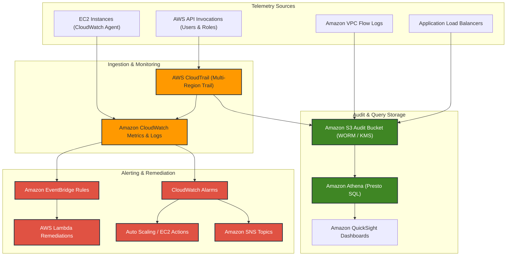

# Module 20: Monitoring and Security

> **Course**: AWS re/Start Curriculum  
> **Module**: 20 — Monitoring and Security  
> **Target Audience**: Cloud Practitioners, Systems Administrators, DevOps Engineers  

---

## 📖 Module Overview

Module 20 focuses on observability, auditing, automated event response, and compliance across AWS infrastructure. It covers real-time metric collection and log ingestion with **Amazon CloudWatch**, deep log analytics using **CloudWatch Logs Insights**, API governance and operational auditing through **AWS CloudTrail**, and serverless SQL forensics over data lake telemetry with **Amazon Athena**.

---

## 📑 Study Guides & Lab Walkthroughs

| Index | Document / Lab | Type | Description |
|---|---|---|---|
| **T20-0001** | [Monitoring and Security Overview](file:///work/tmp/aws-cf/T20-Monitoring_and_Security/T20-0001-RSJAWS_EN-US_SG_M13_MONITORSECURITYOVERVIEW.md) | Study Guide | Foundation of cloud observability, shared responsibility, metric alarms, and audit logs. |
| **T20-0002** | [Amazon CloudWatch](file:///work/tmp/aws-cf/T20-Monitoring_and_Security/T20-0002-RSJAWS_EN-US_SG_M13_AMAZONCLOUDWATCH.md) | Study Guide | Core CloudWatch metrics, alarms, actions, dashboards, and CloudWatch Agent setup. |
| **T20-0003** | [Deep Dive into Amazon CloudWatch](file:///work/tmp/aws-cf/T20-Monitoring_and_Security/T20-0003-RSJAWS_EN-US_SG_M13_DEEPDIVEAMAZONCLOUDWATCH.md) | Study Guide | CloudWatch Logs Insights query syntax, Metric Filters, High-Resolution Metrics, and Cross-Account dashboards. |
| **T20-0004** | [Lab: Monitoring AWS Resources](file:///work/tmp/aws-cf/T20-Monitoring_and_Security/T20-0004-RSJAWS_EN-US_SG_M13_LABOVERVIEWMONITORING.md) | Lab Guide | Hands-on lab configuring CloudWatch alarms, SNS notifications, and testing CPU stress on EC2. |
| **T20-0005** | [AWS CloudTrail](file:///work/tmp/aws-cf/T20-Monitoring_and_Security/T20-0005-RSJAWS_EN-US_SG_M13_AWSCLOUDTRAIL.md) | Study Guide | Governance, compliance, operational auditing, log file integrity validation, and S3 encryption. |
| **T20-0006** | [AWS Service Integration with Amazon Athena](file:///work/tmp/aws-cf/T20-Monitoring_and_Security/T20-0006-RSJAWS_EN-US_SG_M13_AWSSERVICEINTEGRATE.md) | Study Guide | Serverless log analytics over S3, querying CloudTrail and VPC Flow Logs, and cost optimization via Parquet. |

---

## 🗺️ Observability & Auditing Architecture

---

## 🎯 Key Learning Objectives Summary

- [x] Differentiate between **monitoring** (system behavior and health via CloudWatch) and **auditing** (who did what, when, and from where via CloudTrail).
- [x] Configure standard and high-resolution **CloudWatch Metrics**, alarms with thresholds, and multi-action triggers (SNS, Auto Scaling).
- [x] Deploy and configure the **unified CloudWatch Agent** to collect OS-level memory, swap, and disk metrics.
- [x] Analyze log data using **CloudWatch Logs Insights** queries and create **Metric Filters** to convert pattern matches into numerical alarms.
- [x] Create multi-region **AWS CloudTrails**, understand Management vs Data Events, and enforce **Log File Integrity Validation** using cryptographic digests.
- [x] Execute serverless SQL queries using **Amazon Athena** against CloudTrail, VPC Flow Logs, and ALB access logs partitioned in Amazon S3.
