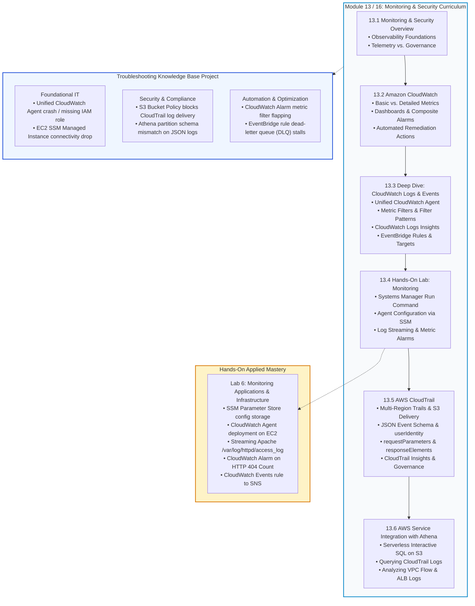
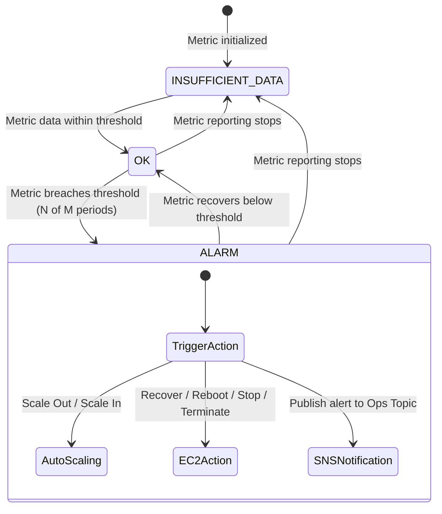
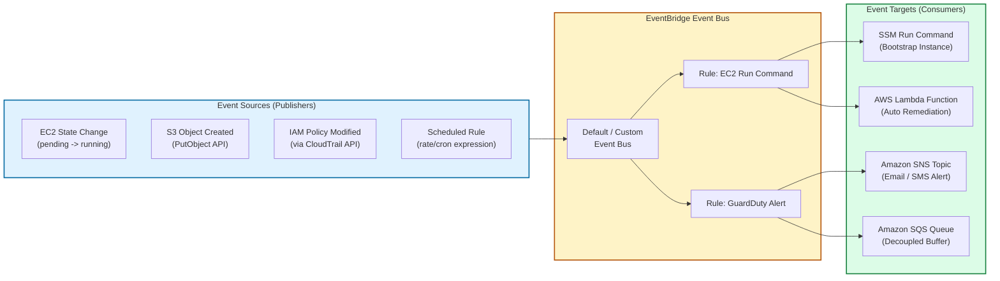
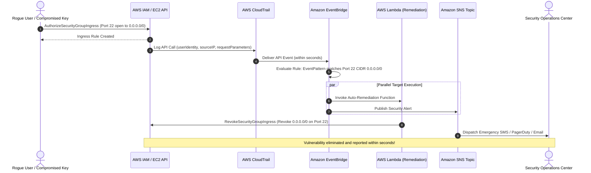
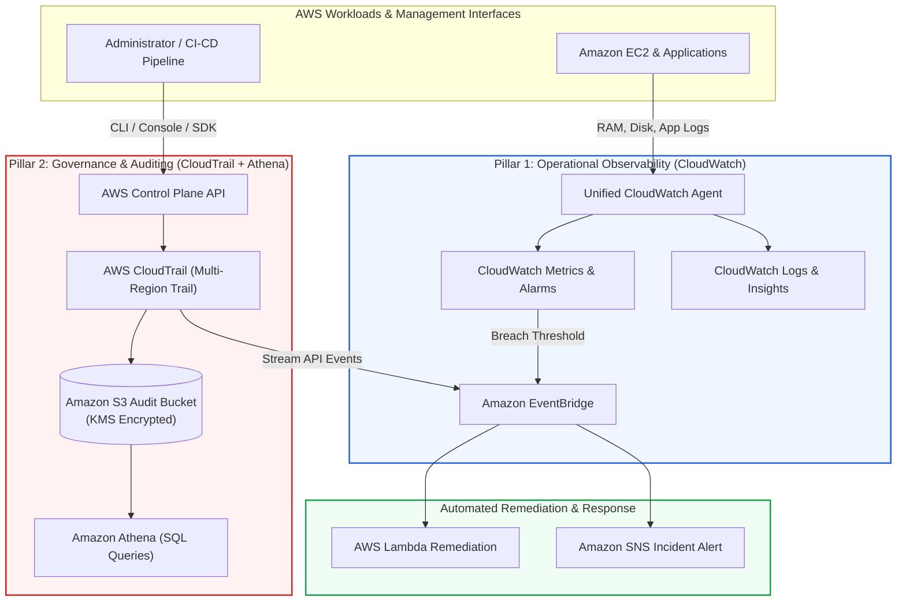

# 🛡️ Module 13 / 16: Monitoring and Security Overview – Study Guide

> **Course**: AWS re/Start  
> **Module**: Monitoring and Security  
> **Source Document**: `T20-0001-RSJAWS_EN-US_SG_M13_MONITORSECURITYOVERVIEW.pdf`  
> **Target Audience**: AWS re/Start Learners / Cloud Practitioners / Solutions Architects / SysOps Administrators / Security Engineers  

---

## 🎯 Unit Overview: Cloud Observability & Security Auditing Foundations

In enterprise IT and cloud environments, **you cannot manage, optimize, or secure what you cannot observe**. In traditional on-premises data centers, infrastructure monitoring and security auditing were fraught with operational friction:
- **Siloed Tooling & Fragmented Visibility**: Network engineers used SNMP pollers, sysadmins logged into physical hosts to tail syslog files, application developers reviewed isolated application logs, and compliance auditors manually scraped spreadsheets. Correlating an incident across these silos during an active outage or breach often took hours or days.
- **Static Capacity & Blind Spots**: Legacy monitoring tools were designed for static physical servers with fixed IP addresses. In elastic cloud architectures—where Amazon Elastic Compute Cloud (EC2) instances, containers, and serverless functions spin up, scale dynamically, and terminate within minutes—static IP monitoring fails completely.
- **Delayed Security Detection**: Without centralized, tamper-evident audit logging, malicious activity (such as unauthorized privilege escalation or covert data exfiltration) frequently went undetected for months.
- **Manual, Reactive Remediation**: Operators spent significant effort manually restarting failed services, adjusting thresholds, and paging on-call engineers for routine operational glitches rather than relying on automated self-healing workflows.

```
┌──────────────────────────────────────────────────────────────────────────────────────────────────┐
│                   The Two Pillars of Cloud Operational Health & Governance                       │
├─────────────────────────────────────────────────┬────────────────────────────────────────────────┤
│      Telemetry & Operational Observability       │        Governance, Risk & Compliance Auditing  │
│              (Amazon CloudWatch)                │                 (AWS CloudTrail)               │
├─────────────────────────────────────────────────┼────────────────────────────────────────────────┤
│ • What is the performance & health of resources?│ • Who performed what action, when, and where?   │
│ • Metrics: CPU, memory, disk I/O, network       │ • API Activity: Console, CLI, SDK, AWS Services │
│ • Logs: OS syslogs, Apache access, app traces   │ • Audit Trail: Tamper-evident JSON logs in S3   │
│ • Events: Near-real-time state transitions      │ • User Identity: IAM user, role, IP address    │
│ • Action: Alarms, Auto Scaling, automated reboot│ • Compliance: Forensic analysis & governance   │
└─────────────────────────────────────────────────┴────────────────────────────────────────────────┘
```

**AWS Monitoring and Security** establishes a unified, cloud-native operational paradigm built on two complementary pillars:
1. **Operational Telemetry (Amazon CloudWatch)**: Continuously observes workload performance, application health, resource utilization, and operational events to ensure system availability and responsiveness.
2. **Auditability & Governance (AWS CloudTrail)**: Continuously logs, monitors, and retains account activity and API requests across the entire AWS infrastructure, providing an unalterable forensic record for security auditing, compliance, and risk management.

By integrating these services with **Amazon EventBridge** (formerly CloudWatch Events) for real-time event routing and **Amazon Athena** for serverless SQL log analytics over Amazon Simple Storage Service (Amazon S3), cloud engineers construct an automated, self-healing, and audit-compliant cloud operating environment.

---

### 📌 Learning Objectives

- [ ] **Define Cloud Observability Primitives**: Articulate the distinction between operational metrics, log aggregation, event-driven routing, and compliance audit trails.
- [ ] **Master Amazon CloudWatch Components**: Differentiate CloudWatch metrics, dashboards, alarms, and automated operational actions (EC2 reboot/recover, Auto Scaling triggers, and SNS notifications).
- [ ] **Implement Amazon CloudWatch Logs**: Explain log groups, log streams, unified CloudWatch Agent deployment, metric filter patterns, and CloudWatch Logs Insights query syntax.
- [ ] **Architect Event-Driven Automation with Amazon EventBridge / CloudWatch Events**: Configure event buses, define rule patterns matching AWS resource state changes, and route payloads to targets (AWS Lambda, Amazon SNS, Amazon SQS, and Systems Manager).
- [ ] **Enforce Governance with AWS CloudTrail**: Analyze CloudTrail JSON event schemas (`userIdentity`, `eventTime`, `eventSource`, `eventName`, `sourceIPAddress`, `requestParameters`, and `responseElements`), configure multi-region trails, and enable CloudTrail Insights.
- [ ] **Execute Serverless SQL Analytics with Amazon Athena**: Query raw CloudTrail audit logs, Amazon VPC Flow Logs, and Application Load Balancer (ALB) access logs stored in Amazon S3 without ETL pipelines.
- [ ] **Differentiate CloudWatch vs. CloudTrail**: Distinguish operational performance monitoring from API governance and identify how they collaborate in security operations.
- [ ] **Synthesize Multi-Service Security Remediations**: Construct end-to-end automated remediation pipelines combining CloudWatch, CloudTrail, EventBridge, Lambda, and SNS.
- [ ] **Populate the Troubleshooting Knowledge Base**: Formulate operational triage runbooks for common monitoring and security failure modes across Foundational IT, Security & Compliance, and Automation & Optimization categories.

---

## 🗺️ Module Curriculum Roadmap & Progression

The diagram below illustrates the structural progression through the **Monitoring and Security** curriculum, showing how foundational telemetry expands into deep log analysis, API governance, serverless querying, and automated triage:



---

## 🔍 Core Module Themes & Architectural Deep-Dive

### 1. Amazon CloudWatch: Operational Telemetry, Metrics, Dashboards, and Alarms

Amazon CloudWatch is AWS's primary telemetry collection, monitoring, and observability platform. It collects raw data from AWS services, applications, and operating systems and processes it into readable, near-real-time metrics.

```
┌────────────────────────────────────────────────────────────────────────────────────────┐
│                        Amazon CloudWatch Operational Architecture                      │
├────────────────────────────────────────────────────────────────────────────────────────┤
│  Data Ingestion           Metric Processing               Evaluation & Action          │
│  ──────────────           ─────────────────               ───────────────────          │
│  • AWS Services    ──┐                                                                 │
│    (EC2, RDS, EBS)   │                               ┌──► Dashboards (Visualization)   │
│  • CloudWatch Agent─┼──► CloudWatch Metric Store ────┼──► Alarms (OK/ALARM/INSUFF)     │
│    (OS RAM, Disk)    │   (Namespace, Metric, Dim)    │      ├──► Auto Scaling Policy   │
│  • Custom Apps / API─┘                               │      ├──► EC2 Reboot / Recover  │
│    (PutMetricData)                                   │      └──► SNS Notification      │
└────────────────────────────────────────────────────────────────────────────────────────┘
```

#### Core Metric Dimensions & Resolution
- **Namespaces**: A container for CloudWatch metrics (e.g., `AWS/EC2`, `AWS/RDS`, `AWS/S3`, or custom namespaces like `CustomApp/Ecommerce`). Namespaces isolate metrics across disparate applications and services.
- **Metrics**: A time-ordered sequence of data points published to CloudWatch (e.g., `CPUUtilization`, `DiskReadOps`, `NetworkIn`). Metrics exist only in the Region in which they are created and cannot be deleted; they expire automatically after 15 months.
- **Dimensions**: Key-value pairs that uniquely identify a metric (e.g., `InstanceId=i-0123456789abcdef0` or `AutoScalingGroupName=web-asg`). You can assign up to 30 dimensions to a single custom metric.
- **Resolution**:
  - **Basic Monitoring (Default)**: Metrics are collected at **5-minute intervals** at no additional charge for Amazon EC2.
  - **Detailed Monitoring**: Metrics are collected at **1-minute intervals** for an additional fee. Essential for workloads requiring rapid Auto Scaling elasticity.
  - **High-Resolution Custom Metrics**: Custom metrics can be stored down to **1-second resolution** (sub-minute intervals: 1s, 5s, 10s, 30s) for time-critical financial or trading applications.

> [!IMPORTANT]
> **EC2 Default Metric Limitations**: Out of the box, Amazon EC2 monitors hypervisor-level metrics: CPU utilization, network traffic (`NetworkIn`, `NetworkOut`), and EBS block storage I/O (`DiskReadBytes`, `DiskWriteBytes`). CloudWatch **cannot** see inside the guest operating system by default. **RAM utilization, free memory, operating system page file usage, and disk space percentage** require installing and configuring the **Unified CloudWatch Agent**.

#### CloudWatch Alarms and Automated Remediation
A CloudWatch Alarm monitors a single metric or the result of a math expression against a user-defined threshold over a specified number of evaluation periods.



An alarm operates across three distinct states:
1. `OK`: The metric is within the defined threshold.
2. `ALARM`: The metric has breached the threshold for the specified evaluation periods.
3. `INSUFFICIENT_DATA`: The alarm has just started, the metric is not available, or not enough data is present to determine the state.

**Automated Alarm Actions**:
- **EC2 Actions**:
  - **Recover**: Re-launches the instance on a new physical AWS hardware host while preserving the instance ID, private/public IP addresses, Elastic IP, and EBS volume attachments if the underlying physical host encounters a hardware degradation (evaluated via `StatusCheckFailed_System`).
  - **Reboot**: Performs an operating system reboot if the instance fails software health checks (evaluated via `StatusCheckFailed_Instance`).
  - **Stop / Terminate**: Shuts down or permanently terminates underutilized or orphan instances to eliminate cloud waste.
- **Auto Scaling Actions**: Executes dynamic step scaling, target tracking, or simple scaling policies to add or remove EC2 instances based on aggregate utilization.
- **Amazon SNS Notifications**: Dispatches real-time alerts to engineers via SMS, email, webhook, or PagerDuty.

---

### 2. Amazon CloudWatch Logs & Logs Insights

Amazon CloudWatch Logs centralizes log management, enabling system administrators and developers to ingest, store, search, and analyze log files from virtually any source.

```
┌────────────────────────────────────────────────────────────────────────────────────────┐
│                        CloudWatch Logs Aggregation Pipeline                            │
├────────────────────────────────────────────────────────────────────────────────────────┤
│  Log Sources                Log Architecture                Analysis & Action          │
│  ───────────                ────────────────                ─────────────────          │
│  • EC2 Operating System  ┐                                                             │
│    (/var/log/messages)   │   Log Group:                    ┌──► Metric Filter          │
│  • Web Server (Apache)   ┼──► "/aws/ec2/production"        │    (Transforms log match  │
│    (/var/log/httpd/)     │      ├── Log Stream: i-01aaa    │     into custom metric)   │
│  • AWS Lambda Functions  │      ├── Log Stream: i-02bbb    ├──► CloudWatch Alarms      │
│  • AWS CloudTrail Trails ┘      └── Log Stream: i-03ccc    └──► Logs Insights Queries  │
└────────────────────────────────────────────────────────────────────────────────────────┘
```

#### Log Architectural Hierarchy
1. **Log Event**: A record of activity recorded by the application or resource. It contains a **timestamp** and the **raw event message**.
2. **Log Stream**: A sequence of log events that share the same emitting source (e.g., all Apache access logs originating from a single specific EC2 instance `i-0123456789abcdef0`).
3. **Log Group**: A logical grouping of log streams that share identical retention policies, access control (IAM), and metric filters (e.g., `/aws/ec2/production-webservers`).

#### Unified CloudWatch Agent
The Unified CloudWatch Agent runs directly inside Linux or Windows operating systems. It is typically deployed and managed at enterprise scale using **AWS Systems Manager (SSM) Run Command** and configured via **SSM Parameter Store**:
- Collects system-level internal metrics: Memory (`mem_used_percent`), swap usage, disk space (`disk_used_percent`), disk I/O, and CPU per-core telemetry.
- Tails and streams flat text files (e.g., `/var/log/secure`, `/var/log/httpd/access_log`) into designated CloudWatch Log Groups.
- Collects Windows Event Logs (Application, System, Security) and ETW trace data.

#### Metric Filters & Filter Pattern Syntax
Metric filters allow administrators to scan incoming log streams in near-real time for specific terms, extraction patterns, or HTTP status codes. When a match occurs, the filter increments a custom CloudWatch metric.

**Filter Pattern Rules**:
- Patterns are **case-sensitive**.
- Space-delimited terms require all terms to match (logical AND): `ERROR Exception 500`.
- Quoted exact string literals: `"Connection refused"`.
- JSON-delimited parsing: `{ $.errorCode = "AccessDenied" }`.
- Space-delimited field extraction (e.g., Apache Common Log Format):

```text
[ip, identity, user, timestamp, request = *html*, status_code = 4*, bytes]
```
*In this pattern, CloudWatch parses the space-delimited log entry, extracts the HTTP status code, and matches any request containing `html` that resulted in a `4xx` client error (e.g., `404 Not Found`). Every matching log entry increments the custom metric (e.g., `404Count`), triggering alarms when thresholds are exceeded.*

#### CloudWatch Logs Insights Query Syntax
CloudWatch Logs Insights is a purpose-built, interactive query engine designed to search and analyze petabytes of log data in seconds.

```text
fields @timestamp, @message
| parse @message "* - * [*] \"*\" * *" as ip, user, time, request, status, bytes
| filter status >= 400 and status <= 499
| stats count(*) as errorCount by ip
| sort errorCount desc
| limit 20
```

**Key Commands**:
- `fields`: Selects which log attributes or generated fields to display.
- `filter`: Filters records using Boolean logic, regular expressions, and comparisons (`=`, `!=`, `<`, `>`, `like`).
- `stats`: Calculates aggregations (`count()`, `avg()`, `sum()`, `min()`, `max()`, `pct()`) grouped by specific dimensions (`by bin(5m)`).
- `sort`: Orders results in ascending (`asc`) or descending (`desc`) order.
- `limit`: Restricts the number of returned records (e.g., `limit 25`).

---

### 3. Amazon EventBridge / CloudWatch Events: Real-Time Event Routing

Amazon EventBridge (built on the foundation of CloudWatch Events) provides a serverless event bus that connects application data, SaaS integrations, and AWS services in near-real time.



#### Core Components
1. **Events**: JSON payloads generated when an AWS resource transitions state (e.g., an EC2 instance terminating, an S3 bucket policy changing) or emitted periodically by a schedule.
2. **Event Buses**: The channel that receives events. AWS provides a **Default Event Bus** (receiving all AWS service events), and allows users to create **Custom Event Buses** or connect to **SaaS Partner Event Buses** (e.g., Datadog, PagerDuty, Zendesk).
3. **Rules**: Evaluate incoming event payloads against JSON filtering patterns. If the event matches the rule pattern, EventBridge routes the payload simultaneously to up to five targets.
4. **Targets**: Endpoints that process the event payload. Examples include AWS Lambda functions, Amazon SNS topics, Amazon SQS queues, AWS Step Functions state machines, Kinesis Data Streams, and AWS Systems Manager Run Command.

#### Event Pattern Example: Detecting EC2 Instance State Changes
```json
{
  "source": ["aws.ec2"],
  "detail-type": ["EC2 Instance State-change Notification"],
  "detail": {
    "state": ["running", "shutting-down", "terminated"]
  }
}
```
*When Auto Scaling launches a new EC2 instance and its state changes to `running`, this rule pattern matches instantly, triggering an AWS Systems Manager Run Command target to automatically configure the host, install security agents, or register the instance with external monitoring systems.*

---

### 4. AWS CloudTrail: Governance, Compliance, and Auditing of API Activity

AWS CloudTrail is the definitive governance, risk auditing, and compliance service for AWS. It records every action taken by a user, IAM role, or AWS service across the AWS Management Console, AWS Command Line Interface (CLI), AWS SDKs, and internal AWS API communications.

```
┌────────────────────────────────────────────────────────────────────────────────────────┐
│                        AWS CloudTrail Auditing Pipeline                                │
├────────────────────────────────────────────────────────────────────────────────────────┤
│  API Activity Ingestion       Processing & Validation         Delivery & Storage       │
│  ──────────────────────       ───────────────────────         ──────────────────       │
│  • AWS Console Sign-in    ┐                                   ┌──► S3 Bucket           │
│  • AWS CLI / SDK Commands ┼──► CloudTrail Trail Engine ───────┤    (Encrypted JSON)    │
│  • Automated Service APIs │    • Multi-Region Logging         ├──► CloudWatch Logs     │
│  • Root Account Actions   ┘    • SHA-256 Digest Validation    │    (Real-time Alarms)  │
│                                • CloudTrail Insights Anomaly  └──► SNS Notifications   │
└────────────────────────────────────────────────────────────────────────────────────────┘
```

#### What CloudTrail Records vs. What It Cannot Record
- **What CloudTrail Records**:
  - API calls made against AWS control plane services (e.g., `RunInstances`, `CreateBucket`, `AttachUserPolicy`, `AuthorizeSecurityGroupIngress`).
  - Management Console sign-in attempts (successful and failed logins, MFA status).
  - Both read-only actions (`DescribeInstances`, `GetBucketPolicy`) and mutate/write actions (`TerminateInstances`, `DeleteTable`).
- **What CloudTrail CANNOT Record**:
  - Internal operating system activities executed inside guest virtual machines. For example, if a user establishes an SSH or RDP connection to an EC2 instance and executes `sudo shutdown -h now` or edits `/etc/passwd`, CloudTrail **does not log** this operating system-level shell activity. (These activities must be captured via the CloudWatch Agent, Linux `auditd`, or AWS Systems Manager Session Manager logging).

#### CloudTrail Event Types
1. **Management Events**: Operations executed on resources within your AWS account (the "control plane"). Examples include creating a VPC, attaching an IAM policy, or setting up a subnet. Enabled by default on all trails.
2. **Data Events**: Operations performed on or within a resource (the "data plane"). Examples include Amazon S3 object-level API operations (`GetObject`, `PutObject`) or AWS Lambda function invocations (`Invoke`). Data events generate massive volume and are disabled by default to control costs.
3. **CloudTrail Insights Events**: Anomaly detection engine that monitors management event volume and error rates (e.g., sudden spikes in `AccessDenied` errors or abnormal bursts of resource provisioning) using machine learning baselines.

#### CloudTrail JSON Event Anatomy
Every CloudTrail log file delivered to Amazon S3 contains one or more JSON event records. Key schema attributes include:

```json
{
  "eventVersion": "1.08",
  "userIdentity": {
    "type": "IAMUser",
    "principalId": "AIDAEXAMPLEUSERID123",
    "arn": "arn:aws:iam::111122223333:user/secadmin",
    "accountId": "111122223333",
    "userName": "secadmin"
  },
  "eventTime": "2026-10-12T14:32:10Z",
  "eventSource": "ec2.amazonaws.com",
  "eventName": "AuthorizeSecurityGroupIngress",
  "awsRegion": "us-east-1",
  "sourceIPAddress": "198.51.100.45",
  "userAgent": "aws-cli/2.15.0 Python/3.11.4 Linux/5.15",
  "requestParameters": {
    "groupId": "sg-0123456789abcdef0",
    "ipPermissions": {
      "items": [
        {
          "ipProtocol": "tcp",
          "fromPort": 22,
          "toPort": 22,
          "ipRanges": {
            "items": [
              {
                "cidrIp": "0.0.0.0/0"
              }
            ]
          }
        }
      ]
    }
  },
  "responseElements": {
    "_return": true
  },
  "requestID": "a1b2c3d4-e5f6-7890-abcd-1234567890ef",
  "eventID": "f8a9b0c1-d2e3-4567-89ab-cdef01234567",
  "readOnly": false,
  "eventType": "AwsApiCall",
  "recipientAccountId": "111122223333"
}
```

**Crucial Event Fields**:
- `userIdentity`: Who initiated the request. Identifies IAM users, federated SSO users, assumed IAM roles, or AWS service principals.
- `eventTime`: Exact ISO-8601 UTC timestamp of the API invocation.
- `eventSource`: The target AWS service endpoint (e.g., `ec2.amazonaws.com`, `signin.amazonaws.com`, `s3.amazonaws.com`).
- `eventName`: The specific action or API call invoked (e.g., `ConsoleLogin`, `AuthorizeSecurityGroupIngress`, `TerminateInstances`).
- `sourceIPAddress`: Originating IPv4 or IPv6 address of the caller. Critical for determining if calls originate from trusted corporate CIDRs or suspicious external locations.
- `requestParameters`: The complete payload and arguments passed into the API request (e.g., specifying that port 22 was opened to `0.0.0.0/0`).
- `responseElements`: The response returned by the AWS service. If the call was rejected by IAM policies or SCPs, `responseElements` will be `null` and an `errorCode` (such as `AccessDenied`) and `errorMessage` will be populated instead.

---

### 5. Amazon Athena: Serverless Interactive SQL Analytics for Logs

Amazon Athena is an interactive query service that makes it easy to analyze structured and semi-structured data directly in Amazon S3 using standard ANSI SQL.

```
┌────────────────────────────────────────────────────────────────────────────────────────┐
│                        Serverless Analytics with Amazon Athena                         │
├────────────────────────────────────────────────────────────────────────────────────────┤
│  Data Producers             S3 Storage Data Lake            Athena SQL Engine          │
│  ──────────────             ────────────────────            ─────────────────          │
│  • AWS CloudTrail Trails ─┐                                 ┌──► Interactive Queries   │
│  • VPC Flow Logs          ┼──► Amazon S3 Bucket ────────────┼──► QuickSight Dashboards │
│  • ALB Access Logs        │    (GZIP JSON / CSV / Parquet)  │    (BI Visualizations)   │
│  • Custom Application Logs┘                                 └──► CSV Query Export      │
└────────────────────────────────────────────────────────────────────────────────────────┘
```

#### Core Architectural Characteristics
- **Serverless & Zero Infrastructure**: No compute clusters to provision, patch, manage, or scale. Athena executes queries using distributed Presto engines behind the scenes.
- **Schema-on-Read**: Data remains in its native raw format in Amazon S3. Schemas are defined in the AWS Glue Data Catalog or Athena metadata store, pointing to the Amazon S3 URI via the `LOCATION` parameter.
- **Standard SQL Compatibility**: Supports ANSI SQL queries, complex joins, nested arrays, window functions, and regular expression extraction.
- **Cost Efficiency**: Athena charges purely on a **pay-per-query model** ($5.00 per terabyte of data scanned). Costs can be reduced by 70–90% by converting logs to columnar formats (Apache Parquet / ORC) and partitioning by year, month, and day.

#### Athena SQL Queries for Operational & Security Auditing

##### 1. Querying AWS CloudTrail Logs for Unauthorized API Calls
```sql
SELECT
    eventtime,
    useridentity.username,
    useridentity.arn,
    sourceipaddress,
    eventsource,
    eventname,
    errorcode,
    errormessage
FROM cloudtrail_logs
WHERE errorcode IN ('AccessDenied', 'UnauthorizedOperation')
  AND eventtime >= '2026-10-01T00:00:00Z'
ORDER BY eventtime DESC
LIMIT 50;
```
*Quickly surfaces attempts by compromised credentials or misconfigured scripts to access unauthorized cloud resources.*

##### 2. Querying Amazon VPC Flow Logs for Suspicious Traffic & Port Scans
```sql
SELECT
    srcaddr,
    dstaddr,
    dstport,
    protocol,
    action,
    COUNT(*) as rejected_count
FROM vpc_flow_logs
WHERE action = 'REJECT'
  AND dstport IN (22, 3389, 445, 1433)
GROUP BY srcaddr, dstaddr, dstport, protocol, action
ORDER BY rejected_count DESC
LIMIT 25;
```
*Identifies malicious external IP addresses performing automated reconnaissance or port scanning against internal private subnets.*

##### 3. Querying Application Load Balancer (ALB) Access Logs for HTTP 5xx Server Errors
```sql
SELECT
    elb_status_code,
    target_status_code,
    client_ip,
    target_ip,
    request_url,
    COUNT(*) AS total_errors
FROM alb_access_logs
WHERE elb_status_code >= '500'
GROUP BY elb_status_code, target_status_code, client_ip, target_ip, request_url
ORDER BY total_errors DESC
LIMIT 20;
```
*Isolates backend EC2/container health failures causing HTTP 502/504 errors on public web endpoints.*

---

### 6. AWS Service Integrations for Security & Operations: Automated Remediation

Modern enterprise cloud engineering moves beyond passive monitoring to construct **active, automated security remediation loops**. By chaining CloudTrail, CloudWatch, EventBridge, Lambda, and SNS, security teams achieve sub-minute response times for critical vulnerabilities.



#### Real-World Operational Remediation Scenarios
1. **Scenario A: Automated Security Group Lockdown**
   - *Detection*: CloudTrail logs an `AuthorizeSecurityGroupIngress` API call opening sensitive ports (SSH 22 or RDP 3389) to the public internet (`0.0.0.0/0`).
   - *Routing*: EventBridge evaluates the event pattern and routes it immediately to an auto-remediation Lambda function.
   - *Action*: The Lambda function calls `ec2:RevokeSecurityGroupIngress`, isolates the affected security group, and dispatches an SNS notification to the Security Operations Center (SOC).
2. **Scenario B: Autonomous Infrastructure Healing (Auto Recovery)**
   - *Detection*: An underlying hypervisor hardware rack experiences hardware failure, causing the EC2 metric `StatusCheckFailed_System` to trigger.
   - *Action*: A CloudWatch Alarm configured with an **EC2 Recover action** migrates the virtual machine instance to healthy physical hardware automatically without changing private or public IP addresses.
3. **Scenario C: Log-Based Anomaly Detection and Ticket Creation**
   - *Detection*: CloudWatch Logs Metric Filter detects a spike in Apache 500 internal server errors exceeding 100 errors/minute.
   - *Action*: CloudWatch Alarm transitions to `ALARM` state, publishing a message to an Amazon SNS topic that invokes an AWS Lambda function to open a high-priority incident ticket in ServiceNow or Jira.

---

## ⚖️ CloudWatch vs. CloudTrail: Deep Comparative Analysis

Understanding the architectural distinction and operational synergy between Amazon CloudWatch and AWS CloudTrail is a core competency for AWS practitioners and system administrators.

| Comparison Dimension | Amazon CloudWatch | AWS CloudTrail |
| :--- | :--- | :--- |
| **Primary Architectural Purpose** | **Operational Observability & Telemetry**: Evaluates performance, utilization, operational health, and system resource metrics. | **Governance & Compliance Auditing**: Records account history, API activity, access requests, and administrative operations. |
| **Primary Question Answered** | *"How are my resources and applications performing right now?"* | *"Who made this API request, when, from where, and with what parameters?"* |
| **Primary Data Types** | Numeric metrics (CPU, RAM, Disk, Network), flat log files (syslog, access logs), and near-real-time state change events. | JSON-formatted API activity audit records (`userIdentity`, `requestParameters`, `responseElements`). |
| **Data Ingestion Point** | Hypervisors, AWS service metrics, Unified CloudWatch Agent on guest OS, or custom `PutMetricData` APIs. | AWS API control plane endpoints (Console clicks, CLI commands, SDK scripts, internal service calls). |
| **Internal OS Visibility** | **Yes** (when the Unified CloudWatch Agent is installed to capture memory, swap, disk space, and application logs). | **No**. Tracks calls made to the AWS API only; cannot record commands run inside an SSH or RDP shell. |
| **Default Retention Period** | Metrics retained up to **15 months** (with automatic downsampling); Log Groups retain logs **indefinitely** by default (configurable). | CloudTrail Event History retained for **90 days** in console; Trails stored in Amazon S3 can be retained **indefinitely** via Lifecycle rules. |
| **Primary Reaction / Actions** | CloudWatch Alarms trigger Auto Scaling policies, EC2 actions (Reboot/Recover), and SNS notifications. | EventBridge rules trigger on CloudTrail API events; CloudTrail Insights alerts on abnormal call volume. |
| **Log Search & Query Engine** | **CloudWatch Logs Insights** (purpose-built query language for fast search over log groups). | **Amazon Athena** (serverless ANSI SQL queries over raw JSON logs stored in Amazon S3). |
| **Target User Personas** | DevOps Engineers, SysOps Administrators, Cloud Site Reliability Engineers (SRE), Application Developers. | Security Architects, Compliance Officers, Forensic Investigators, SOC Analysts. |

### Architectural Synergy: Telemetry vs. Governance Architecture



---

## 🛠️ Troubleshooting Knowledge Base Project Integration

As part of the AWS re/Start curriculum, learners build and maintain a professional **Troubleshooting Knowledge Base**. In this module, the operational focus centers on **Foundational IT**, **Monitoring & Reporting**, and **Security & Compliance**. Below are production-ready triage entries addressing common failure modes encountered in enterprise monitoring environments.

```
┌────────────────────────────────────────────────────────────────────────────────────────┐
│               Troubleshooting Knowledge Base: Incident Triage Schema                   │
├────────────────────────────────────────────────────────────────────────────────────────┤
│  1. Incident ID & Category   ──► Tracking, Taxonomy, and Classification                │
│  2. Problem Statement        ──► Observable symptoms, error messages, and log alerts   │
│  3. Root Cause Analysis      ──► Deep technical explanation of underlying mechanism   │
│  4. Diagnostic Procedures    ──► CLI commands, console paths, and verification steps   │
│  5. Step-by-Step Resolution  ──► Exact commands and configuration changes required     │
│  6. Preventive Measures      ──► Guardrails, SCPs, IaC patterns to prevent recurrence  │
└────────────────────────────────────────────────────────────────────────────────────────┘
```

### Knowledge Base Entry 1: CloudTrail Log Delivery Ingestion Failures & Broken S3 Bucket Policy
- **Category**: Security & Compliance / Storage
- **Severity**: High (Compliance Gap / Unaudited Account Activity)
- **Problem Statement**: CloudTrail status reports `Delivery Failed` or `Access Denied` when attempting to publish gzip log archives to an Amazon S3 log archive bucket. Security teams observe a complete blind spot in API activity.
- **Root Cause Analysis**: The destination Amazon S3 bucket policy lacks the required explicit resource permissions for the `cloudtrail.amazonaws.com` service principal, or the bucket was configured with an Object Ownership setting that rejects the `bucket-owner-full-control` canned ACL supplied by CloudTrail.
- **Diagnostic Procedures**:
  1. Inspect the CloudTrail console under **Trails** > **Trail Status** to identify the delivery error message.
  2. Run the AWS CLI to check the trail status:
     ```bash
     aws cloudtrail get-trail-status --name OrganizationMainTrail
     ```
  3. Verify the existing bucket policy attached to the destination S3 bucket:
     ```bash
     aws s3api get-bucket-policy --bucket my-organization-cloudtrail-bucket
     ```
- **Step-by-Step Resolution**:
  Attach the standard, secure CloudTrail bucket policy granting the `cloudtrail.amazonaws.com` principal both `s3:GetBucketAcl` and `s3:PutObject` with the appropriate prefix conditions:
  ```json
  {
      "Version": "2012-10-17",
      "Statement": [
          {
              "Sid": "AWSCloudTrailAclCheck",
              "Effect": "Allow",
              "Principal": { "Service": "cloudtrail.amazonaws.com" },
              "Action": "s3:GetBucketAcl",
              "Resource": "arn:aws:s3:::my-organization-cloudtrail-bucket"
          },
          {
              "Sid": "AWSCloudTrailWrite",
              "Effect": "Allow",
              "Principal": { "Service": "cloudtrail.amazonaws.com" },
              "Action": "s3:PutObject",
              "Resource": "arn:aws:s3:::my-organization-cloudtrail-bucket/AWSLogs/111122223333/*",
              "Condition": {
                  "StringEquals": {
                      "s3:x-amz-acl": "bucket-owner-full-control"
                  }
              }
          }
      ]
  }
  ```
- **Preventive Measures**:
  - Deploy CloudTrail trails and S3 buckets exclusively through AWS CloudFormation or Terraform templates to ensure verified policy attachment.
  - Implement an AWS Config rule `cloud-trail-enabled` and `cloudtrail-s3-data-events-enabled` to detect and alert on non-compliant configurations.

---

### Knowledge Base Entry 2: Unified CloudWatch Agent Fails to Stream System Logs
- **Category**: Foundational IT / Monitoring & Reporting
- **Severity**: Medium
- **Problem Statement**: An Amazon EC2 instance running Amazon Linux 2023 is not publishing RAM utilization metrics or `/var/log/httpd/access_log` files to Amazon CloudWatch Logs. The target Log Group `/aws/ec2/webservers` remains empty.
- **Root Cause Analysis**: The EC2 instance does not have an IAM Instance Profile attached with the necessary CloudWatch permissions (`CloudWatchAgentServerPolicy`), or the security group/outbound VPC route table blocks HTTPS traffic on port 443 to the Regional CloudWatch endpoints (`logs.<region>.amazonaws.com`).
- **Diagnostic Procedures**:
  1. Connect to the EC2 instance via AWS Systems Manager Session Manager or SSH.
  2. Review the CloudWatch Agent status and local execution logs:
     ```bash
     sudo /opt/aws/amazon-cloudwatch-agent/bin/amazon-cloudwatch-agent-ctl -m ec2 -a status
     sudo tail -n 50 /opt/aws/amazon-cloudwatch-agent/logs/amazon-cloudwatch-agent.log
     ```
  3. Look for explicit HTTP timeout or authorization errors:
     `NoCredentialProviders: no valid providers in chain` or `AccessDenied: User: arn:aws:sts:... is not authorized to perform: logs:PutLogEvents`.
- **Step-by-Step Resolution**:
  1. Open the IAM console and attach the AWS-managed policy `CloudWatchAgentServerPolicy` to the IAM role assigned to the EC2 instance.
  2. If the instance resides in a private subnet without an Internet Gateway or NAT Gateway, verify or create VPC Interface Endpoints for `com.amazonaws.<region>.logs` and `com.amazonaws.<region>.monitoring`.
  3. Restart the CloudWatch Agent daemon on the instance:
     ```bash
     sudo /opt/aws/amazon-cloudwatch-agent/bin/amazon-cloudwatch-agent-ctl \
       -a fetch-config \
       -m ec2 \
       -c ssm:AmazonCloudWatch-linux-config \
       -s
     ```
- **Preventive Measures**:
  - Standardize EC2 launch templates to always attach a baseline IAM instance profile containing `CloudWatchAgentServerPolicy` and `AmazonSSMManagedInstanceCore`.
  - Validate outbound security group egress rules allow TCP port 443.

---

### Knowledge Base Entry 3: CloudWatch Alarm Flapping on Metric Filter Pattern Misconfiguration
- **Category**: Automation and Optimization / Monitoring & Reporting
- **Severity**: Medium
- **Problem Statement**: A CloudWatch Alarm configured on custom metric `404Count` alternates erratically between `OK`, `ALARM`, and `INSUFFICIENT_DATA` every five minutes ("alarm flapping"), flooding the on-call team with false alarm alerts.
- **Root Cause Analysis**:
  1. The metric filter uses a single evaluation period (1 period of 1 minute) with zero data point smoothing.
  2. The metric filter did not define a **Default Metric Value** (leaving it undefined). In CloudWatch, when no matching log entries occur during a period, no data point is emitted.
  3. The alarm is configured with `TreatMissingData = missing` instead of `TreatMissingData = notBreaching`.
- **Diagnostic Procedures**:
  1. Examine the metric graph in the CloudWatch console: observe disjointed single dots instead of a continuous zero line.
  2. Check the alarm configuration via the AWS CLI:
     ```bash
     aws cloudwatch describe-alarms --alarm-names "High-404-Error-Rate"
     ```
- **Step-by-Step Resolution**:
  1. Update the Metric Filter configuration to emit a default value of `0` when no matching log lines are present.
  2. Modify the CloudWatch Alarm evaluation configuration to treat missing data as non-breaching:
     ```bash
     aws cloudwatch put-metric-alarm \
       --alarm-name "High-404-Error-Rate" \
       --treat-missing-data notBreaching \
       --evaluation-periods 3 \
       --datapoints-to-alarm 2 \
       --comparison-operator GreaterThanThreshold \
       --threshold 50
     ```
- **Preventive Measures**:
  - Apply the `M out of N` evaluation rule (e.g., 2 out of 3 periods) for volatile metrics to filter out transient metric spikes.
  - Always configure `TreatMissingData = notBreaching` for error-count metrics where an absence of log lines signifies healthy system operation.

---

### Knowledge Base Entry 4: Athena Query Timeouts and High Scan Costs on CloudTrail S3 Buckets
- **Category**: Security & Compliance / Optimization
- **Severity**: Low to Medium (Cost Inefficiency / Operational Delay)
- **Problem Statement**: Running ad hoc SQL queries in Amazon Athena to investigate security incidents across enterprise CloudTrail logs takes over 10 minutes to execute, times out, and scans hundreds of gigabytes of raw data, incurring substantial query charges.
- **Root Cause Analysis**: The Athena table was created over the root S3 bucket prefix without defining **partitioning**. Because CloudTrail partitions logs hierarchically by account ID, region, year, month, and day (`AWSLogs/<AccountID>/CloudTrail/<Region>/YYYY/MM/DD/`), queries without partitions force Athena to perform a full S3 table scan across all regions and years for every single query.
- **Diagnostic Procedures**:
  1. Review query history in the Athena Query Editor: observe `Data scanned: 450 GB` for a query searching for a single hour of activity.
  2. Inspect the table DDL in Athena:
     ```sql
     SHOW CREATE TABLE cloudtrail_logs;
     ```
- **Step-by-Step Resolution**:
  Re-create the Athena table using **Partition Projection** to instruct Athena to infer partition structure dynamically without needing manual `MSCK REPAIR TABLE` commands:
  ```sql
  CREATE EXTERNAL TABLE cloudtrail_partitioned (
      eventversion STRING,
      useridentity STRUCT<
          type: STRING,
          principalid: STRING,
          arn: STRING,
          accountid: STRING,
          username: STRING>,
      eventtime STRING,
      eventsource STRING,
      eventname STRING,
      awsregion STRING,
      sourceipaddress STRING,
      errorcode STRING,
      errormessage STRING
  )
  PARTITIONED BY (
      region STRING,
      date STRING
  )
  ROW FORMAT SERDE 'org.apache.hive.hcatalog.data.JsonSerDe'
  LOCATION 's3://my-cloudtrail-bucket/AWSLogs/111122223333/CloudTrail/'
  TBLPROPERTIES (
      'projection.enabled'='true',
      'projection.region.type'='enum',
      'projection.region.values'='us-east-1,us-west-2,eu-west-1',
      'projection.date.type'='date',
      'projection.date.range'='2026/01/01,NOW',
      'projection.date.format'='yyyy/MM/dd',
      'storage.location.template'='s3://my-cloudtrail-bucket/AWSLogs/111122223333/CloudTrail/${region}/${date}'
  );
  ```
  Now execute targeted queries restricting the date range:
  ```sql
  SELECT * FROM cloudtrail_partitioned
  WHERE region = 'us-east-1' AND date = '2026/10/12' AND eventname = 'ConsoleLogin';
  ```
- **Preventive Measures**:
  - Always enforce partition filtering (`WHERE date = 'YYYY/MM/DD'`) in team query runbooks.
  - Configure Athena Workgroup data scan limits to terminate queries that exceed budget thresholds (e.g., > 10 GB scanned).

---

## 📝 Knowledge Check & Review

Test your mastery of the concepts covered in this module. Detailed answers and architectural rationales are provided below each question.

### Question 1
A solutions architect must configure automated recovery for a fleet of production Amazon EC2 instances running critical web services. If an underlying physical hardware degradation occurs on the AWS host, the instance must be moved to new physical hardware without altering its IP addresses or instance ID. Which combination of services and actions satisfies this requirement?
- A) An Amazon EventBridge rule listening for EC2 instance termination events that invokes an AWS Lambda function to launch a replacement AMI.
- B) A CloudWatch Alarm monitoring the `StatusCheckFailed_System` metric configured with an EC2 Recover action.
- C) A CloudWatch Alarm monitoring the `StatusCheckFailed_Instance` metric configured with an EC2 Reboot action.
- D) An AWS Systems Manager Automation runbook triggered by an Amazon SNS topic subscribed to CloudTrail API calls.

> **Answer: B**  
> **Explanation**: The `StatusCheckFailed_System` metric monitors the underlying AWS physical host hardware (e.g., loss of power, physical host hardware degradation). When this metric breaches threshold, a CloudWatch Alarm with an **EC2 Recover action** migrates the virtual machine instance to a new healthy physical host. During recovery, the instance ID, private IP addresses, public Elastic IP address, and all EBS volume attachments are preserved. In contrast, `StatusCheckFailed_Instance` indicates guest operating system failure (e.g., kernel panic, corrupted file system), which is resolved by an EC2 Reboot action.

---

### Question 2
A security engineer needs to determine who terminated a specific Amazon EC2 instance yesterday afternoon. The engineer inspects CloudWatch metrics but cannot find the identity of the user. Which service should the engineer consult, and what specific JSON field will identify the person who took the action?
- A) Amazon CloudWatch Logs Insights; inspect the `@message` field for the user string.
- B) AWS CloudTrail; inspect the `userIdentity` field in the `TerminateInstances` event.
- C) Amazon EventBridge; inspect the `resources` array in the default event bus archive.
- D) AWS Systems Manager Inventory; inspect the `InstalledApplications` field for administrative logins.

> **Answer: B**  
> **Explanation**: AWS CloudTrail logs all API calls made against AWS services. When an EC2 instance is terminated via the console, CLI, or SDK, CloudTrail captures the `TerminateInstances` API call and records the identity of the caller (including IAM user name, ARN, and account ID) within the `userIdentity` block of the JSON event record. CloudWatch metrics track numerical utilization telemetry, not user identity.

---

### Question 3
An application team notices that their web servers are experiencing an elevated rate of HTTP 404 (Resource Not Found) errors. They want to create a CloudWatch Alarm that fires if more than 50 HTTP 404 errors occur in any 5-minute period. What sequence of steps must the team implement?
- A) Enable Detailed Monitoring on EC2 -> Create an EventBridge rule matching HTTP 404 -> Trigger SNS.
- B) Stream Apache logs to CloudWatch Logs -> Create a Metric Filter matching status code 404 -> Create a CloudWatch Alarm on the resulting custom metric.
- C) Configure AWS CloudTrail to capture Apache logs -> Run an Athena SQL query every 5 minutes -> Output query results to CloudWatch.
- D) Install the AWS Systems Manager Agent -> Configure SSM Inventory to collect `/var/log/httpd/access_log` -> Set up an SSM compliance alarm.

> **Answer: B**  
> **Explanation**: To convert flat log entries into an actionable metric, the logs must first be streamed to an Amazon CloudWatch Log Group (using the Unified CloudWatch Agent). Next, a **Metric Filter** is created with a pattern such as `[..., status_code = 404, ...]` that increments a custom CloudWatch metric (e.g., `404Count`) each time a matching log line occurs. Finally, a standard CloudWatch Alarm is configured on that custom metric with a threshold of 50 over a 5-minute period.

---

### Question 4
An auditor requests a full forensic query of all AWS Management Console sign-in attempts from the previous six months, including the source IP address and whether MFA was used. CloudTrail is configured with a multi-region trail delivering logs to an Amazon S3 bucket. What is the most cost-effective and scalable way to execute this query without building an ETL pipeline?
- A) Download all S3 log files locally and use `grep` and `jq` to parse the JSON files.
- B) Load the S3 bucket into an Amazon RDS PostgreSQL database using `pg_dump`.
- C) Use Amazon Athena to define an external table pointing to the S3 bucket and run standard SQL queries.
- D) Ingest the S3 bucket into Amazon CloudWatch Logs and run a CloudWatch Logs Insights query.

> **Answer: C**  
> **Explanation**: Amazon Athena is an interactive, serverless SQL query engine designed specifically to analyze structured and semi-structured datasets (such as CloudTrail JSON logs, VPC Flow Logs, and ALB logs) directly in Amazon S3 without ETL pipelines. Users define a schema table in the Athena/Glue catalog pointing to the S3 location and execute standard ANSI SQL queries, paying only for the data scanned.

---

### Question 5
Which of the following events CANNOT be detected or logged by AWS CloudTrail?
- A) A user running `aws ec2 authorize-security-group-ingress` to open port 22 from the command line.
- B) A developer logging into the AWS Management Console with an incorrect password.
- C) A system administrator logging into an EC2 instance via SSH and executing `sudo rm -rf /var/data`.
- D) An automated script invoking `s3:DeleteBucket` via the Python Boto3 SDK.

> **Answer: C**  
> **Explanation**: AWS CloudTrail records calls made to the AWS API control plane (Management Console, AWS CLI, SDKs, and internal AWS service integrations). CloudTrail **does not track internal guest operating system activities** inside an Amazon EC2 instance, such as bash commands run inside an SSH session, local filesystem deletions, or process executions. Those internal activities must be captured via the CloudWatch Agent, OS audit logs (`auditd`), or Systems Manager Session Manager.

---

## 📌 Summary Checklist & Exam Cram

Before proceeding to subsequent modules or sitting for certification exams, ensure you have mastered the following core tenets:

- [ ] **CloudWatch Metrics**: Numeric time-series telemetry; basic monitoring is 5-min, detailed monitoring is 1-min; hypervisor only by default (requires CloudWatch Agent for RAM, swap, and disk metrics).
- [ ] **CloudWatch Alarms**: Three states (`OK`, `ALARM`, `INSUFFICIENT_DATA`); triggers Auto Scaling, EC2 Reboot/Recover, and SNS alerts.
- [ ] **CloudWatch Logs**: Hierarchy = Log Events $\rightarrow$ Log Streams $\rightarrow$ Log Groups; metric filters convert pattern matches into custom numerical metrics.
- [ ] **CloudWatch Logs Insights**: Purpose-built query language (`fields`, `filter`, `stats`, `sort`, `limit`) for fast log group search.
- [ ] **Amazon EventBridge / CloudWatch Events**: Real-time event routing using JSON patterns and scheduled expressions (cron/rate); dispatches to targets (Lambda, SNS, SQS, SSM).
- [ ] **AWS CloudTrail**: Records AWS API control plane actions; essential for governance, auditing, and compliance; delivers JSON logs to Amazon S3 and CloudWatch Logs; does not log internal OS commands.
- [ ] **CloudTrail Key JSON Fields**: `userIdentity`, `eventTime`, `eventSource`, `eventName`, `sourceIPAddress`, `requestParameters`, and `responseElements`.
- [ ] **Amazon Athena**: Serverless interactive SQL query engine over Amazon S3 data; ideal for querying CloudTrail, VPC Flow Logs, and ALB logs without ETL.
- [ ] **Automated Remediation Loop**: CloudTrail / CloudWatch $\rightarrow$ EventBridge $\rightarrow$ Lambda / Systems Manager $\rightarrow$ SNS.
- [ ] **Troubleshooting KB Taxonomy**: Document failure modes under *Foundational IT*, *Monitoring & Reporting*, and *Security & Compliance*.
