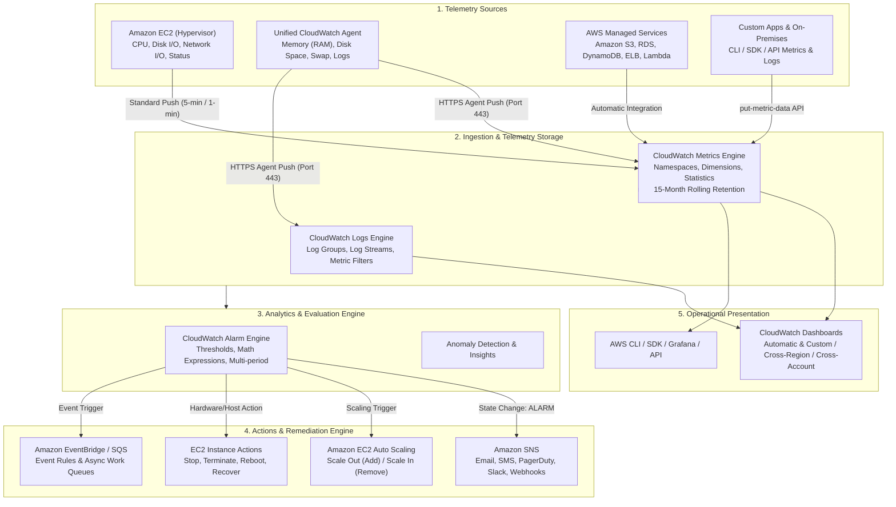
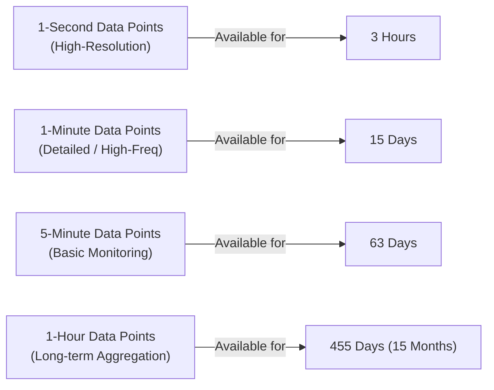
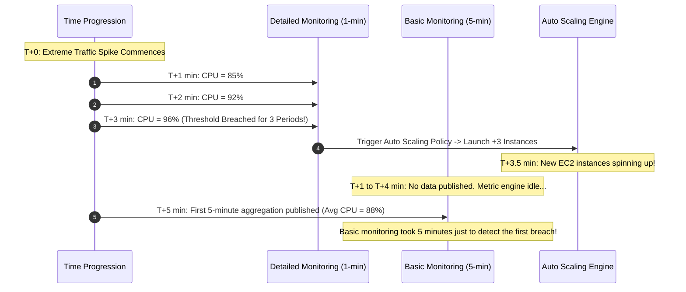
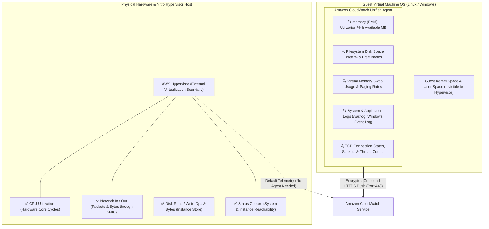
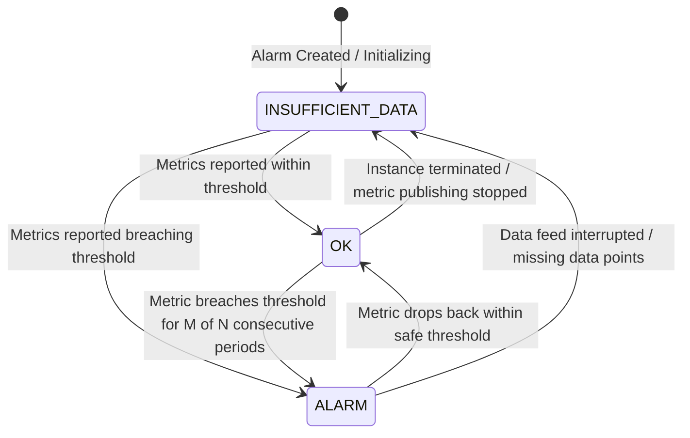
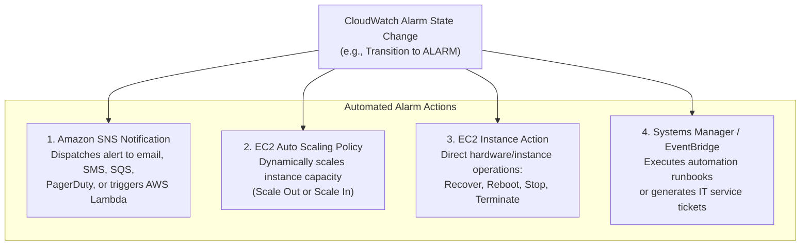
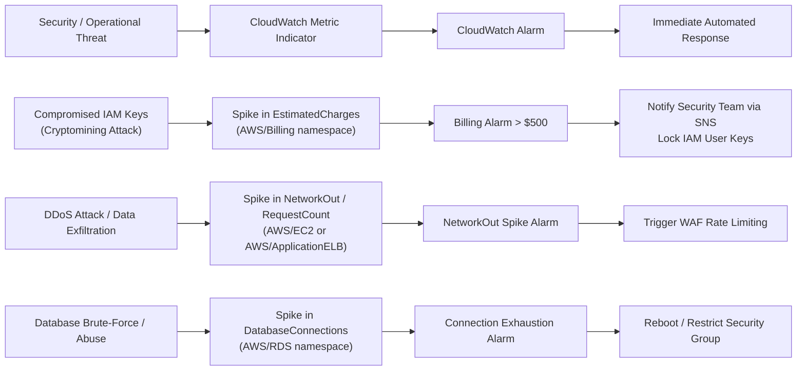

# 📊 Amazon CloudWatch: Unified Observability, Monitoring & Alerting

> **Course**: AWS re/Start  
> **Module**: Monitoring and Security – M13 Amazon CloudWatch  
> **Source**: `T20-0002-RSJAWS_EN-US_SG_M13_AMAZONCLOUDWATCH.pdf`  
> **Target Audience**: AWS re/Start Learners / Cloud Practitioners / SysOps Administrators / DevOps Engineers  

---

## 🎯 Executive Summary & Learning Objectives

Operational excellence in cloud computing demands total visibility into resource utilization, application performance, and operational health. Without continuous instrumentation, systems engineers and administrators operate blind—unable to detect infrastructure bottlenecks, capacity deficits, security anomalies, or cost overruns until user experience degrades or systems fail.

**Amazon CloudWatch** is AWS's native, fully managed observability and monitoring service. Designed for DevOps engineers, site reliability engineers (SREs), system administrators, and IT managers, CloudWatch delivers real-time telemetry collection, metric analysis, proactive alerting, automated remediation, and customizable operational dashboards across AWS resources, hybrid deployments, and on-premises environments.

```
┌──────────────────────────────────────────────────────────────────────────────┐
│                    The Three Pillars of Amazon CloudWatch                    │
├────────────────────────────────┬─────────────────────────────┬──────────────┤
│ 1. Telemetry & Metrics         │ 2. Automated Alarms         │ 3. Dashboards│
│ Time-ordered data streams      │ Threshold evaluation and    │ Unified pane │
│ tracking health, utilization,  │ automatic actions via SNS,  │ of glass for │
│ and system performance.        │ Auto Scaling, and EC2 ops.  │ operations.  │
└────────────────────────────────┴─────────────────────────────┴──────────────┘
```

---

### 📌 Learning Objectives

- [ ] **Define Amazon CloudWatch**: Articulate the purpose, scope, and operational architecture of Amazon CloudWatch in enterprise cloud environments.
- [ ] **Examine the Three Core Pillars**: Analyze the fundamental components of CloudWatch: Metrics, Alarms, and Dashboards.
- [ ] **Deconstruct Metric Anatomy**: Define namespaces (`AWS/<Service>`), metric names, dimensions (filtering key-value pairs), timestamps, units, and aggregation periods.
- [ ] **Evaluate Metric Retention Schedules**: Explain CloudWatch's 15-month rolling data retention tiers (1-second, 1-minute, 5-minute, and 1-hour resolutions).
- [ ] **Contrast Basic vs. Detailed Monitoring**: Differentiate between default 5-minute resolution (Basic) and opt-in 1-minute resolution (Detailed) for Amazon EC2 instances.
- [ ] **Analyze Host vs. Guest OS Metrics**: Identify hypervisor-visible metrics versus internal guest OS telemetry (RAM, disk space, swap, OS logs) requiring the CloudWatch Unified Agent.
- [ ] **Deploy the CloudWatch Unified Agent**: Outline the deployment architecture, IAM role requirements (`CloudWatchAgentServerPolicy`), and JSON configuration files.
- [ ] **Publish Custom & High-Resolution Metrics**: Utilize the AWS CLI (`put-metric-data`) to push custom application metrics down to 1-second intervals.
- [ ] **Configure CloudWatch Alarms & States**: Implement threshold evaluation, analyze the three alarm states (`OK`, `ALARM`, `INSUFFICIENT_DATA`), and handle sequential evaluation periods.
- [ ] **Orchestrate Automated Remediations**: Bind alarm events to Amazon SNS notifications, Amazon EC2 Auto Scaling policies, and EC2 instance actions (Stop, Terminate, Reboot, Recover).
- [ ] **Construct Operational Dashboards**: Build automatic and cross-account/cross-region dashboards to monitor health and detect security/billing anomalies.

---

## 📐 1. Architectural Overview of Amazon CloudWatch

Amazon CloudWatch serves as a centralized telemetry ingestion, aggregation, evaluation, and remediation platform. It bridges the gap between infrastructure state, application runtimes, and automated cloud orchestration.



### Telemetry Lifecycle Stages
1. **Collection**: Raw numeric metrics and structured/unstructured log events are gathered from hypervisors, internal operating systems, AWS APIs, and distributed microservices.
2. **Monitoring & Aggregation**: Telemetry streams are organized into namespaces, indexed by dimensions, and aggregated over defined time periods (from 1 second to 1 day).
3. **Evaluation**: Metrics are continually compared against static thresholds or statistical anomaly models over single or consecutive time periods.
4. **Remediation**: Upon state transitions, CloudWatch immediately dispatches automated control signals to notify human responders or trigger automated self-healing workflows.
5. **Analysis & Visualization**: Visual operational consoles surface system health, correlate errors across microservices, and identify systemic performance trends.

---

## 🧱 2. Core Pillar I: CloudWatch Metrics Deep-Dive

A **metric** is the fundamental atomic concept in Amazon CloudWatch. It represents a time-ordered sequence of published data points. You can think of a metric as a variable to monitor, and data points as the values of that variable over time.

> [!IMPORTANT]
> **Metrics are Region-Bound**: CloudWatch metrics exist only in the AWS Region in which they are created. They cannot be moved between Regions, though cross-Region dashboards can display metrics from multiple Regions in a single consolidated console.

### Anatomical Components of a CloudWatch Metric

Every metric is uniquely identified by its coordinates:

```
┌────────────────────────────────────────────────────────────────────────┐
│                      Anatomy of a CloudWatch Metric                    │
├────────────────────────────────────────────────────────────────────────┤
│  1. Namespace    : Container / Category (e.g., AWS/EC2, AWS/S3)        │
│  2. Metric Name  : Specific measured attribute (e.g., CPUUtilization)  │
│  3. Dimensions   : Key-Value filtering pairs (e.g., InstanceId=i-1234) │
│  4. Timestamp    : Exact date/time data point occurred                 │
│  5. Value & Unit : Numeric value and measurement unit (%, Bytes, Count)│
│  6. Period       : Aggregation window length (e.g., 60s, 300s)         │
└────────────────────────────────────────────────────────────────────────┘
```

#### 1. Namespaces
A **namespace** is an isolated container for CloudWatch metrics. Namespaces prevent metrics with identical names from colliding or being mistakenly aggregated across disparate applications or services.
- **AWS Namespaces**: Follow the strict naming pattern `AWS/<ServiceName>`.
  - `AWS/EC2` (Amazon Elastic Compute Cloud)
  - `AWS/S3` (Amazon Simple Storage Service)
  - `AWS/RDS` (Amazon Relational Database Service)
  - `AWS/ApplicationELB` (Application Load Balancer)
  - `AWS/Billing` (Estimated charges and budget metrics)
- **Custom Namespaces**: User-defined strings that do **not** begin with `AWS/` (e.g., `CustomApp/Ecommerce`, `Production/OrderProcessing`).

#### 2. Dimensions
A **dimension** is a name-value pair that uniquely categorizes and filters a metric. You can assign up to **30 dimensions** to a single metric (historically 10 in earlier revisions).
- **Unique Metric Rule**: **Metric Name + Dimension Set = A Unique Metric**.
  - `CPUUtilization` with dimension `{InstanceId: i-0123456789}` is completely distinct from `CPUUtilization` with dimension `{InstanceId: i-abcdef1234}` or `CPUUtilization` aggregated with `{AutoScalingGroupName: web-asg}`.
- If you publish a metric without dimensions, it can only be retrieved without dimensions.

#### 3. Metric Representation in JSON (AWS CLI Example)
When querying metrics using the AWS CLI:
```bash
aws cloudwatch list-metrics --namespace AWS/S3
```

The returned payload reveals the structural hierarchy:
```json
{
  "Metrics": [
    {
      "Namespace": "AWS/S3",
      "MetricName": "BucketSizeBytes",
      "Dimensions": [
        {
          "Name": "StorageType",
          "Value": "StandardStorage"
        },
        {
          "Name": "BucketName",
          "Value": "doc-example-corporate-bucket"
        }
      ]
    }
  ]
}
```

---

### CloudWatch Metric Statistics

When CloudWatch aggregates data points over a specified **Period** (the duration in seconds, ranging from 1 second up to 86,400 seconds / 1 day), it computes statistical aggregations:

| Statistic | Description | Common Use Case |
| :--- | :--- | :--- |
| **Average** | Sum of all data point values divided by the total count. | General server utilization (e.g., average CPU load). |
| **Sum** | Cumulative total of all values reported during the period. | Network transfer volume, disk bytes transferred, total error counts. |
| **Minimum (Min)** | Lowest individual data point recorded in the window. | Minimum available memory, lowest free disk space. |
| **Maximum (Max)** | Highest individual data point recorded in the window. | Peak CPU spikes, maximum API request latency. |
| **SampleCount** | Total number of discrete data points ingested. | Verifying data publishing frequency and sensor health. |
| **Percentiles ($p50, p90, p95, p99, p99.9$)** | Relative distribution rank of values across the dataset. | Analyzing tail latency and outlier user experience in web applications. |

---

### CloudWatch Metric Retention Lifecycle

Metrics cannot be deleted manually; they automatically expire on a rolling retention schedule. CloudWatch retains historical data points for **15 months** free of charge, with resolution decaying as data ages:



| Time Resolution | Maximum Retention Duration | Typical Application |
| :--- | :--- | :--- |
| **1-second points** | **3 Hours** | High-resolution real-time diagnostics and burst analysis. |
| **1-minute points** | **15 Days** | Detailed operational troubleshooting and dynamic scaling evaluation. |
| **5-minute points** | **63 Days** | Standard infrastructure trend analysis and weekly capacity planning. |
| **1-hour points** | **455 Days (15 Months)** | Year-over-year seasonality comparison and long-term budget forecasting. |

> [!NOTE]
> As time advances, older data points are automatically aggregated into lower-resolution buckets (e.g., sixty 1-minute data points are aggregated into a single 1-hour data point) on a rolling basis.

---

## ⏱️ 3. Basic Monitoring vs. Detailed Monitoring for Amazon EC2

When running virtual machine compute instances on Amazon EC2, Amazon CloudWatch provides two monitoring resolution tiers: **Basic Monitoring** and **Detailed Monitoring**.



### Comprehensive Comparison Matrix

| Feature / Dimension | Basic Monitoring | Detailed Monitoring |
| :--- | :--- | :--- |
| **Metric Resolution** | **5-minute intervals** (300 seconds) | **1-minute intervals** (60 seconds) |
| **Pricing** | **Free of charge** (Included in AWS Free Tier) | **Additional per-metric fee** per month |
| **Default State** | Enabled by default on all EC2 instances | Disabled by default (Requires explicit opt-in) |
| **Status Check Frequency** | 1-minute intervals (for 3 status metrics) | 1-minute intervals |
| **Pre-selected Metrics** | 7 pre-selected hypervisor metrics | All available standard EC2 metrics |
| **Data Aggregation Support** | Limited per-instance metrics | Aggregates by **AMI ID**, **Instance Type**, and ASG |
| **Auto Scaling Reaction Speed** | Slower (5 to 15-minute lag for threshold breaches) | **Rapid response** (1 to 3 minutes to trigger scaling) |
| **CLI Activation Flag** | `--no-monitoring-enabled` | `--monitoring Enabled=true` |

> [!TIP]
> **Auto Scaling Best Practice**: For production web applications with sudden, unpredictable traffic spikes (e.g., e-commerce flash sales or breaking news portals), **Detailed Monitoring is strongly recommended**. The 1-minute metric resolution allows Auto Scaling policies to trigger new capacity in minutes, preventing server overload and HTTP 5xx errors.

### Enabling Detailed Monitoring

#### Via AWS Management Console:
1. Navigate to the **Amazon EC2 console**.
2. Select the target instance $\rightarrow$ choose **Actions** $\rightarrow$ **Monitor and troubleshoot** $\rightarrow$ **Manage detailed monitoring**.
3. Select **Enable** and save changes.

#### Via AWS CLI:
```bash
# Enable Detailed Monitoring on a running instance
aws ec2 monitor-instances --instance-ids i-0123456789abcdef0

# Disable Detailed Monitoring (revert to Basic Monitoring)
aws ec2 unmonitor-instances --instance-ids i-0123456789abcdef0
```

---

## 🔍 4. Host (Hypervisor) vs. Guest Operating System Metrics

A fundamental principle of AWS cloud security and virtualization is the **hypervisor boundary**. Because AWS operates under the Shared Responsibility Model, the underlying hypervisor (whether AWS Nitro or legacy Xen) observes the virtual machine strictly from the outside.



### The Hypervisor Visibility Divide

#### 1. What the Hypervisor CAN Measure (Default CloudWatch Metrics)
Without installing any software inside the virtual machine, CloudWatch natively captures host-level metrics:
- **CPU Utilization**: Physical clock cycles consumed by the guest vCPUs.
- **Network I/O**: Packets in/out, bytes in/out passing through the virtual network interface card (vNIC).
- **Disk I/O**: Read/write bytes and read/write operations for ephemeral instance store volumes (EBS metrics are reported separately under `AWS/EBS`).
- **EC2 Status Checks**:
  - `StatusCheckFailed_System`: Underlying physical host hardware, network routing, or power supply issues (managed by AWS).
  - `StatusCheckFailed_Instance`: Corrupted file system, exhausted kernel memory, or misconfigured guest OS networking (managed by customer).
  - `StatusCheckFailed`: Logical combination of both checks.

#### 2. What the Hypervisor CANNOT See (The Blind Spot)
For customer privacy, tenant isolation, and memory encryption, AWS hypervisors cannot inspect the internal guest OS memory space or filesystem tables:
- ❌ **Memory (RAM) Utilization**: The hypervisor allocates physical RAM pages to the guest VM upon boot. To the hypervisor, that RAM appears permanently allocated. Only the guest OS kernel knows how many memory pages are free, cached, or buffered.
- ❌ **Internal Disk Space Utilization**: The hypervisor manages block storage devices, but does not parse ext4, XFS, or NTFS volume partition tables.
- ❌ **Virtual Memory / Swap Usage**: Page swaps, page faults, and virtual memory exhaustion.
- ❌ **Operating System & Application Logs**: Web server logs (`httpd`, `nginx`), database logs, application exceptions, auth logs (`/var/log/secure`).

> [!CAUTION]
> If a server crashes due to an out-of-memory (OOM) error or an exhausted disk partition (`100% full`), **default CloudWatch metrics will show 0% anomalies**—CPU might sit at 2% while the server is completely unresponsive! You must install the **CloudWatch Unified Agent** to monitor RAM and disk space.

---

## 🛠️ 5. The Amazon CloudWatch Unified Agent

The **Amazon CloudWatch Unified Agent** is a single, lightweight binary that runs natively inside Linux and Windows operating systems. It consolidates metric collection and log ingestion into a single, high-performance daemon.

### Key Capabilities of the Unified Agent
- Collects in-depth guest OS system metrics (Memory, Disk, Swap, Netstat, Processes).
- Aggregates and streams OS and application log files directly into CloudWatch Logs.
- Supports high-resolution metric collection down to 1-second intervals.
- Operates across both Amazon EC2 instances and on-premises physical/virtual servers.
- Centrally manageable via **AWS Systems Manager (SSM)**.

---

### IAM Prerequisites: `CloudWatchAgentServerPolicy`

Before the agent can push metrics or logs, the EC2 instance must assume an IAM role granting write permissions to CloudWatch APIs.

```
┌────────────────────────────────────────────────────────────────────────┐
│                        IAM Policy Architecture                         │
├────────────────────────────────────────────────────────────────────────┤
│  Managed Policy : CloudWatchAgentServerPolicy                          │
│  Target Service : ec2.amazonaws.com                                    │
│  Key Actions    : cloudwatch:PutMetricData                             │
│                   logs:CreateLogGroup, logs:CreateLogStream            │
│                   logs:PutLogEvents, logs:DescribeLogStreams           │
│                   ssm:GetParameter (for remote configuration)          │
└────────────────────────────────────────────────────────────────────────┘
```

---

### Agent Configuration File (`amazon-cloudwatch-agent.json`)

The agent is configured via a structured JSON file defining precisely which telemetry counters and log files to collect:

```json
{
  "agent": {
    "metrics_collection_interval": 60,
    "run_as_user": "cwagent"
  },
  "metrics": {
    "namespace": "CustomSystem/Linux",
    "metrics_collected": {
      "mem": {
        "measurement": [
          "mem_used_percent",
          "mem_available",
          "mem_total"
        ],
        "metrics_collection_interval": 60
      },
      "disk": {
        "measurement": [
          "used_percent",
          "inodes_free"
        ],
        "resources": [
          "/"
        ],
        "metrics_collection_interval": 60
      },
      "swap": {
        "measurement": [
          "swap_used_percent"
        ]
      }
    }
  },
  "logs": {
    "logs_collected": {
      "files": {
        "collect_list": [
          {
            "file_path": "/var/log/httpd/access_log",
            "log_group_name": "/aws/ec2/httpd/access",
            "log_stream_name": "{instance_id}",
            "timezone": "UTC"
          }
        ]
      }
    }
  }
}
```

### Starting the CloudWatch Agent via CLI
```bash
# Start and apply configuration using the agent control utility
sudo /opt/aws/amazon-cloudwatch-agent/bin/amazon-cloudwatch-agent-ctl \
    -a fetch-config \
    -m ec2 \
    -s \
    -c file:/opt/aws/amazon-cloudwatch-agent/etc/amazon-cloudwatch-agent.json
```

---

## 📈 6. Custom Metrics & High-Resolution Metrics

In addition to infrastructure metrics, organizations frequently instrument proprietary business processes and application internals (e.g., active shopping carts, orders processed per second, queue processing latency).

### Publishing Custom Metrics via AWS CLI

Custom metrics are published using the `put-metric-data` command:

```bash
# Publish a custom metric to a custom namespace
aws cloudwatch put-metric-data \
    --namespace "ECommerce/CheckoutService" \
    --metric-name "FailedTransactions" \
    --dimensions PaymentGateway=Stripe,Environment=Production \
    --value 1 \
    --unit Count \
    --timestamp $(date -u +%Y-%m-%dT%H:%M:%SZ)
```

### High-Resolution Metrics (Sub-Minute Precision)

Standard metrics publish at 1-minute or 5-minute resolutions. For ultra-sensitive workloads (such as high-frequency financial trading or sub-second failover systems), CloudWatch supports **High-Resolution Custom Metrics**:

- Supported storage resolutions: **1 second**, **5 seconds**, **10 seconds**, or **30 seconds**.
- Enabling high resolution via CLI: add `--storage-resolution 1`.

```bash
# Publishing a high-resolution 1-second metric
aws cloudwatch put-metric-data \
    --namespace "TradingApp/Latency" \
    --metric-name "OrderExecutionDuration" \
    --dimensions OrderType=Market \
    --value 12 \
    --unit Milliseconds \
    --storage-resolution 1
```

> [!NOTE]
> High-resolution metrics incur higher ingestion charges and are stored at 1-second resolution for **3 hours**. After 3 hours, they are downsampled to 1-minute aggregates.

---

## 🚨 7. Core Pillar II: CloudWatch Alarms & Automated Remediation

A **CloudWatch Alarm** continuously evaluates a single metric (or the result of a mathematical expression combining multiple metrics) against a specified threshold over one or more evaluation periods.



### The Three Alarm States

| Alarm State | Definition & Operational Meaning |
| :--- | :--- |
| **`OK`** | The metric is within the defined acceptable operational threshold. |
| **`ALARM`** | The metric has breached the configured threshold for the designated number of evaluation periods. |
| **`INSUFFICIENT_DATA`** | The alarm has just started, the metric is not available, or insufficient data points exist to evaluate state. |

> [!IMPORTANT]
> **The `ALARM` State Does NOT Equal Disaster**: The name `ALARM` indicates that a specific numerical condition has been met—it does not necessarily represent a catastrophic emergency. For example, an alarm set to trigger when `CPUCreditBalance < 50` can simply alert an automation script to pause background batch jobs until credits regenerate.

---

### Threshold & Period Evaluation Mechanics

To prevent "flapping" (false alarms triggered by brief, temporary metric spikes), CloudWatch alarms evaluate thresholds across **Evaluation Periods** and **Datapoints to Alarm**:

```
Metric Threshold: CPU > 80%
Evaluation Period: 5 minutes (300 seconds)
Datapoints to Alarm: 3 consecutive periods (3 out of 3)
```

```
Period 1 (T+5m)   : CPU = 85% [Breach 1/3]  --> Alarm State: OK (No action)
Period 2 (T+10m)  : CPU = 89% [Breach 2/3]  --> Alarm State: OK (No action)
Period 3 (T+15m)  : CPU = 92% [Breach 3/3]  --> Alarm State: ALARM (Triggers Remediation!)
Period 4 (T+20m)  : CPU = 72% [Safe]        --> Alarm State: OK (Reverts state)
```

If the metric breaches the threshold during Period 1 and Period 2, but dips back to 70% during Period 3, the consecutive counter resets, and no alarm action is invoked.

---

### Automated Remediation Actions

When an alarm transitions between states (typically into `ALARM`, but actions can also be bound to `OK` or `INSUFFICIENT_DATA`), CloudWatch can execute four major categories of automated actions:



#### 1. Amazon Simple Notification Service (SNS)
Publishes messages to an SNS topic, immediately fanning out notifications to:
- Systems engineering on-call rosters via Email, SMS, or Slack/Teams webhooks.
- PagerDuty or Opsgenie on-call incident systems.
- AWS Lambda functions to execute custom serverless remediation scripts.

#### 2. Amazon EC2 Auto Scaling Policies
Invokes dynamic scaling policies on an Auto Scaling Group:
- **Scale Out**: Add 2 EC2 instances when `CPUUtilization > 75%` for 2 consecutive minutes.
- **Scale In**: Remove 1 EC2 instance when `CPUUtilization < 20%` for 15 consecutive minutes.

#### 3. EC2 Instance Actions
Direct hardware-level interventions executed without human intervention:
- **Recover**: Migrates an EC2 instance to a new physical host if an underlying hardware failure occurs (`StatusCheckFailed_System`). The instance preserves its private IP, public IP, Elastic IP, volume attachments, and instance ID!
- **Reboot**: Performs an operating system reboot (useful for clearing memory leaks or unresponsive daemons).
- **Stop**: Shuts down EBS-backed instances (e.g., stopping non-production instances exceeding cost thresholds).
- **Terminate**: Permanently destroys disposable instances.

---

## 📊 8. Core Pillar III: Operational Dashboards & Monitoring for Security

### CloudWatch Dashboards
Amazon CloudWatch dashboards are customizable, interactive visual consoles within the AWS Management Console:
- **Unified Single Pane of Glass**: Combine metrics and alarm status widgets from multiple AWS services in one view.
- **Cross-Account & Cross-Region**: Consolidate telemetry from multiple AWS accounts and multiple geographical Regions into a global operations center.
- **Customizable Widgets**: Line charts, stacked area charts, single numeric values, gauges, and markdown text blocks.
- **CloudWatch Automatic Dashboards**: Prebuilt dashboards automatically generated by AWS best practices for active services. Naming a custom dashboard `CloudWatch-Default` overrides the default overview page.

---

### Monitoring for Security & Cost Anomalies

CloudWatch is a foundational security detection tool used to flag unauthorized access, compromised credentials, and anomalous usage patterns:



#### 1. Account Billing Alerts & Rogue Resource Detection
- Compromised IAM credentials often result in attackers launching massive GPU compute clusters for cryptocurrency mining.
- By enabling **Receive Billing Alerts** in Account Preferences, CloudWatch tracks the `EstimatedCharges` metric in the `AWS/Billing` namespace (aggregated in `us-east-1`).
- Setting alarms on monthly billing thresholds allows administrators to detect unauthorized spending within hours rather than waiting for an invoice at month-end.

#### 2. Infrastructure Anomalies
- Prolonged, abnormal spikes in CPU usage across a cluster during off-peak hours can indicate malware, botnet participation, or looping application code.
- Unprecedented spikes in `NetworkOut` metrics can indicate data exfiltration attacks.

---

## 📝 9. Knowledge Check & Exam Review Questions

### Question 1
An administrator configures an Amazon EC2 instance running a high-traffic Apache web server. After a traffic spike, the server stops responding to HTTP requests, but the CloudWatch `CPUUtilization` metric shows only 15% utilization, and all EC2 status checks show `OK`. Which metric is the administrator missing, and how should it be collected?
- A. `NetworkIn`; enable Detailed Monitoring on the instance.
- B. `MemoryUtilization`; install and configure the Amazon CloudWatch Unified Agent inside the guest OS.
- C. `DiskReadBytes`; attach an Amazon EBS provisioned IOPS volume.
- D. `StatusCheckFailed_System`; configure an automated EC2 Recover action.

> **Answer: B**  
> **Explanation**: The hypervisor can only observe hardware-level resources (CPU, network packets, hypervisor disk, and status checks). Memory (RAM) utilization occurs entirely inside the guest operating system and is invisible to the hypervisor. If Apache exhausted system RAM, the server became unresponsive due to out-of-memory kernel swapping. The CloudWatch Unified Agent must be installed inside the guest OS to publish memory and swap metrics.

---

### Question 2
A DevOps engineer requires an EC2 Auto Scaling group to detect traffic surges and launch additional instances within 2 minutes. With default settings, Auto Scaling is taking over 6 to 10 minutes to react. What change should the engineer implement?
- A. Upgrade the instance type to a compute-optimized instance.
- B. Enable Detailed Monitoring on the EC2 instances in the Auto Scaling group.
- C. Switch from Amazon CloudWatch to AWS CloudTrail.
- D. Create an Amazon SNS topic subscribed to the EC2 instances.

> **Answer: B**  
> **Explanation**: By default, EC2 instances utilize Basic Monitoring, which publishes metric data points every 5 minutes. This causes a delay before CloudWatch alarms evaluate threshold breaches. Enabling Detailed Monitoring increases the publishing frequency to 1-minute intervals, enabling Auto Scaling to react in under 2 minutes.

---

### Question 3
A CloudWatch alarm is configured with an evaluation period of 1 minute and `Datapoints to Alarm` set to `3 out of 3`. Over 5 consecutive minutes, the metric values are: Minute 1: Breached, Minute 2: Breached, Minute 3: Safe, Minute 4: Breached, Minute 5: Breached. At Minute 5, what is the state of the alarm?
- A. `ALARM`
- B. `INSUFFICIENT_DATA`
- C. `OK`
- D. `TERMINATED`

> **Answer: C**  
> **Explanation**: The alarm requires 3 consecutive breaches (`3 out of 3`). At Minute 1 and 2, breaches occurred (2 consecutive). At Minute 3, the metric fell back to Safe, resetting the consecutive breach counter. Minutes 4 and 5 had breaches (only 2 consecutive). Because 3 consecutive breaches were never achieved, the alarm remains in the `OK` state.

---

### Question 4
An Amazon EC2 instance experiences an underlying physical server hardware malfunction in the AWS data center. Which automated CloudWatch alarm action can automatically restore the instance to an operational state on new host hardware while retaining its private IP, public IP, and instance ID?
- A. EC2 Reboot action
- B. EC2 Terminate action
- C. EC2 Stop action
- D. EC2 Recover action

> **Answer: D**  
> **Explanation**: The EC2 `Recover` action is specifically designed for underlying physical host hardware degradation (triggered by `StatusCheckFailed_System`). It migrates the instance to a new physical host, preserving instance ID, private IP, public IP, Elastic IP, and volume attachments. `Reboot` simply restarts the operating system on the degraded physical host.

---

### Question 5
How long does Amazon CloudWatch retain 1-minute metric data points before downsampling them?
- A. 3 hours
- B. 15 days
- C. 63 days
- D. 455 days (15 months)

> **Answer: B**  
> **Explanation**: CloudWatch metric retention follows a tiered schedule: 1-second high-resolution data points are retained for 3 hours; 1-minute data points are retained for 15 days; 5-minute data points are retained for 63 days; and 1-hour data points are retained for 455 days (15 months).

---

## 📚 10. Key Takeaways & Summary Cheat Sheet

| Category | Key Concept | Critical Operational Rule |
| :--- | :--- | :--- |
| **Pillars** | Metrics, Alarms, Dashboards | Telemetry $\rightarrow$ Evaluation & Alerting $\rightarrow$ Visualization. |
| **Metric Anatomy** | Namespace + Name + Dimensions | Adding or changing a dimension creates a completely new, unique metric. |
| **Monitoring Tiers** | Basic vs. Detailed | Basic = 5-minute (Free). Detailed = 1-minute (Paid, essential for fast Auto Scaling). |
| **Visibility Boundary** | Hypervisor vs. Guest OS | Hypervisor sees CPU, Network, Disk I/O, Status. Agent needed for RAM, Disk Space, Logs. |
| **Unified Agent** | `amazon-cloudwatch-agent` | Requires `CloudWatchAgentServerPolicy` IAM role; config in JSON. |
| **Metric Retention** | 15 Months Total | 1-sec = 3 hrs; 1-min = 15 days; 5-min = 63 days; 1-hr = 455 days. |
| **Alarm States** | `OK`, `ALARM`, `INSUFFICIENT_DATA` | `ALARM` indicates threshold met, not necessarily an outage. |
| **Alarm Actions** | SNS, Auto Scaling, EC2 Actions | `Recover` migrates instance to new physical hardware on host failure. |
| **Security Use Case** | Billing & Anomaly Alarms | Track `EstimatedCharges` under `AWS/Billing` to detect stolen credentials/cryptomining. |
