# 📊 Deep Dive: Amazon CloudWatch – Logs & Events / EventBridge

> **Course**: AWS re/Start  
> **Module**: Monitoring and Security (Module 13)  
> **Source Document**: `T20-0003-RSJAWS_EN-US_SG_M13_DEEPDIVEAMAZONCLOUDWATCH.pdf`  
> **Target Audience**: AWS re/Start Learners, Cloud Support Associates, SysOps Administrators, Cloud Practitioners  

---

## 🎯 Module Overview

Modern cloud architectures are dynamic, distributed, and highly ephemeral. Compute resources like Amazon EC2 instances, containers (Amazon ECS/EKS), and serverless functions (AWS Lambda) spin up, scale, and terminate continuously. In this decentralized environment, relying on traditional local server logs or scheduled polling mechanisms is inefficient, costly, and operationally hazardous.

**Amazon CloudWatch Logs** and **Amazon CloudWatch Events** (evolving into **Amazon EventBridge**) represent the operational nervous system of AWS infrastructure:
1. **Amazon CloudWatch Logs** provides a centralized, scalable, and durable management service for ingesting, indexing, searching, monitoring, and storing system and application logs across multi-tier workloads.
2. **Amazon CloudWatch Events / Amazon EventBridge** delivers a near-real-time, event-driven compute routing bus that captures operational state changes across AWS resources, schedules recurring maintenance tasks, and triggers reactive remediation workflows without polling.

This guide provides an end-to-end technical deep dive into both services: architectural log hierarchies, retention lifecycle management, KMS encryption, metric filter syntax, interactive log querying with CloudWatch Logs Insights, real-time subscription streaming, EventBridge event routing, and three real-world automated remediation patterns.

---

### 📌 Learning Objectives

- [ ] Explain the architectural differences between log metrics, raw log events, and operational events in AWS.
- [ ] Diagram the three distinct phases of the log analysis lifecycle: **Configure**, **Collect**, and **Analyze**.
- [ ] Break down the three-tier CloudWatch Logs hierarchy: **Log Events**, **Log Streams**, and **Log Groups**.
- [ ] Configure log retention policies (from 1 day to 10 years or indefinite) and configure at-rest encryption using AWS Key Management Service (AWS KMS).
- [ ] Construct syntax-compliant **Metric Filters** to extract operational indicators (e.g., HTTP 404/500 errors) from unstructured and space-delimited logs to trigger CloudWatch Alarms.
- [ ] Author high-performance queries using the purpose-built **CloudWatch Logs Insights** SQL-like query language.
- [ ] Architect real-time log ingestion pipelines using **CloudWatch Logs Subscription Filters** to Amazon Kinesis Data Streams, Amazon Data Firehose, and AWS Lambda.
- [ ] Contrast traditional polling mechanisms with modern **Event-Driven Architecture (EDA)** principles.
- [ ] Deconstruct EventBridge architecture: **Events (JSON)**, **Event Buses**, **Rules & Event Patterns**, and **Targets**.
- [ ] Configure time-based scheduled rules using standard 6-field **Cron** and **Rate** expressions.
- [ ] Understand the evolutionary path from CloudWatch Events to **Amazon EventBridge**, including SaaS partner integrations and Schema Registries.
- [ ] Implement three production automation scenarios: EBS snapshots on EC2 stop, Slack alerts on IAM access key creation, and automated security group drift remediation.

---

## 📚 Key Terminology

| Term | Definition |
| :--- | :--- |
| **Log Event** | The fundamental record of activity stored by CloudWatch Logs, consisting of a timestamp (milliseconds since epoch) and a UTF-8 encoded raw event message string. |
| **Log Stream** | A sequence of log events originating from the exact same source, such as a specific EC2 instance ID, a container task execution, or a Lambda function runtime instance. |
| **Log Group** | A logical grouping of log streams that share the same access control policies (IAM), retention settings, KMS encryption key, and subscription filters. |
| **Metric Filter** | A pattern-matching engine applied to a log group that evaluates incoming log events, extracts values or counts occurrences, and transforms them into standard numerical CloudWatch metrics. |
| **CloudWatch Logs Insights** | A specialized interactive query engine that allows administrators to search, analyze, aggregate, and visualize high-volume log data using a purpose-built syntax. |
| **Subscription Filter** | A real-time stream pipe that reads log events from a log group upon ingestion and forwards them immediately to AWS Lambda, Amazon Kinesis Data Streams, or Amazon Data Firehose. |
| **CloudWatch Events** | A legacy AWS service that monitors near-real-time system events describing state changes in AWS resources and routes them to target services. |
| **Amazon EventBridge** | A serverless event bus service that builds upon CloudWatch Events, providing advanced routing, SaaS integrations, API destinations, event replay, and schema management. |
| **Event Bus** | A pipeline that receives events. The default bus receives events from AWS services; custom buses receive application events; partner buses receive events from SaaS applications. |
| **Event Rule** | A rule that matches incoming event payloads against a JSON filter pattern and routes matching events to one or more configured target destinations in parallel. |
| **Event Target** | An endpoint or resource invoked when an event rule matches (e.g., AWS Lambda, Amazon SNS, Amazon SQS, AWS Step Functions, SSM Run Command). |
| **Dead-Letter Queue (DLQ)** | An Amazon SQS queue configured on an EventBridge rule target to catch events that fail invocation or delivery after all retry attempts are exhausted. |

---

## 🔄 1. The Three-Phase Log Analysis Lifecycle

Operating production workloads requires moving from reactive fire-fighting to proactive operational intelligence. Logging follows a rigorous three-phase lifecycle:

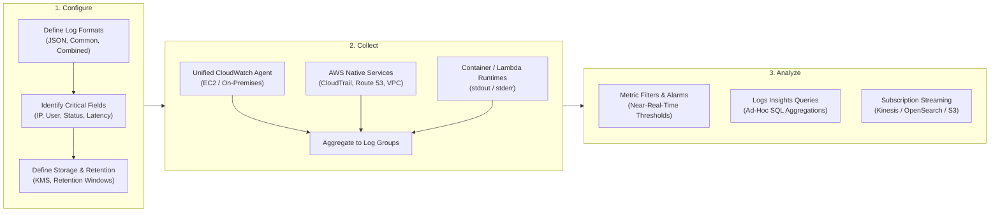

### Phase 1: Configure
Before sending byte streams into the cloud, system architects must decide:
- **What to capture**: System logs (`/var/log/messages`, `/var/log/secure`), access logs (`/var/log/httpd/access_log`, `nginx/access.log`), error logs, database query logs, and application audit trails.
- **Log Structure**: Prefer standardized structured formats (JSON) over arbitrary unstructured plain text to streamline filtering and query performance.
- **Retention & Compliance**: Map regulatory requirements (HIPAA, PCI-DSS, SOC 2, ISO 27001) to log group retention settings and cryptographic keys.

### Phase 2: Collect
In dynamic cloud environments, virtual instances and containers are ephemeral:
- **Decoupled Durability**: Storing log files on local root EBS volumes or instance store disks risks catastrophic data loss when an instance scales in, crashes, or terminates.
- **Unified CloudWatch Agent**: Installed as a background daemon on EC2 instances or on-premises servers. It continuously collects operating system metrics and tails specified log files, securely transmitting log batches over HTTPS to the CloudWatch Logs API.
- **Native AWS Ingestion**: Managed services such as AWS CloudTrail, Amazon Route 53 DNS query logs, VPC Flow Logs, and AWS Lambda automatically deliver log streams into designated log groups without requiring third-party agents.

### Phase 3: Analyze
Raw log data sitting idle yields no business value. Analysis turns bytes into actionable operational telemetry:
- **Continuous Monitoring**: Metric filters watch streams in near-real time to trigger automated remediation or page on-call engineers.
- **Forensic Investigation**: CloudWatch Logs Insights allows security and operations engineers to reconstruct incident timelines within seconds.
- **Historical Long-Term Analytics**: Subscription filters push log groups into Amazon OpenSearch Service for full-text dashboarding or Amazon S3 via Kinesis Data Firehose for Athena/Glue analytics.

---

## 🪵 2. Amazon CloudWatch Logs Deep Dive

### 2.1 Core Architectural Hierarchy

CloudWatch Logs models log data using a strict three-tier hierarchy:

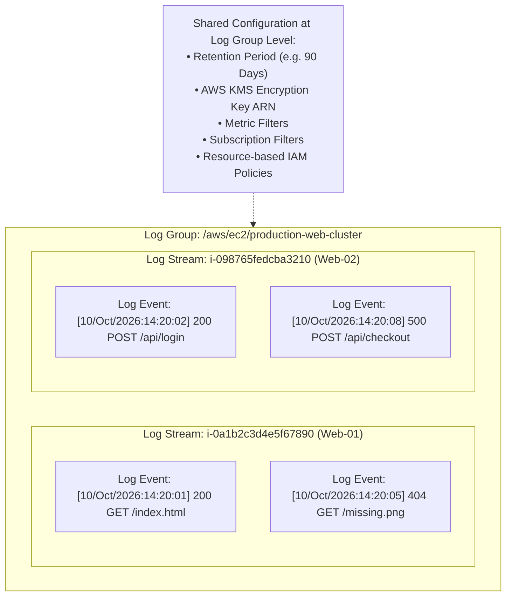

1. **Log Event**:
   - The smallest atom of data.
   - Contains two primary attributes:
     - `timestamp`: Point in time the event occurred, measured as milliseconds since the Unix epoch (`1970-01-01T00:00:00Z`).
     - `message`: The raw log string payload (maximum size: 256 KB per event).
2. **Log Stream**:
   - A sequential series of log events emitted by an individual, identifiable entity.
   - Example sources: An EC2 instance ID (`i-0a1b2c3d4e5f67890`), an ECS container task UUID, or an AWS Lambda execution instance ID.
   - Log streams cannot be configured independently with retention or access policies; they inherit all behaviors from their parent log group.
3. **Log Group**:
   - The administrative boundary and logical container for multiple log streams.
   - All log streams within a log group share the same format, context, access controls, retention lifecycle, and encryption configuration.
   - Example naming convention: `/aws/lambda/ProcessPaymentFunction`, `/aws/ec2/production-apache-access`, `/aws/vpc/flow-logs-vpc-12345`.

---

### 2.2 Retention Policies & AWS KMS Encryption

#### Retention Policies
By default, CloudWatch Logs stores all log data **indefinitely** (`Never Expire`). Storing petabytes of historical logs indefinitely incurs accumulating storage costs ($0.03 per GB per month for standard log storage).

CloudWatch Logs supports granular retention windows:
- **Available Retention Intervals**: 1 day, 3 days, 5 days, 7 days, 14 days, 30 days, 60 days, 90 days, 120 days, 150 days, 180 days, 1 year (365 days), 400 days, 545 days, 2 years (731 days), 3 years (1096 days), 5 years (1827 days), 6 years (2192 days), 7 years (2557 days), 8 years (2922 days), 9 years (3288 days), or 10 years (3653 days).
- **Automated Expiration**: When a retention period expires, CloudWatch Logs automatically and permanently deletes expired log events from all underlying streams without incurring additional compute overhead.

> [!TIP]
> For cost-effective compliance architectures, configure a 30-day or 90-day retention period in CloudWatch Logs for immediate incident triage, and stream logs via Subscription Filters / Firehose to Amazon S3. In S3, apply S3 Lifecycle rules to transition data to S3 Glacier Flexible Deep Archive ($0.00099/GB/month) for long-term audit preservation.

#### AWS KMS Encryption (Encryption at Rest)
While CloudWatch Logs encrypts data at rest by default using AWS owned keys, regulatory frameworks often mandate customer control over cryptographic keys.

You can associate an **AWS Key Management Service (AWS KMS) Customer Managed Key (CMK)** with a log group:
```bash
aws logs associate-kms-key \
    --log-group-name "/aws/ec2/production-apache-access" \
    --kms-key-id "arn:aws:kms:us-east-1:123456789012:key/12345678-1234-1234-1234-123456789012"
```

The KMS Key Policy must explicitly grant the regional CloudWatch Logs service principal permissions to generate data keys and decrypt:

```json
{
  "Version": "2012-10-17",
  "Statement": [
    {
      "Sid": "AllowCloudWatchLogsKMSAccess",
      "Effect": "Allow",
      "Principal": {
        "Service": "logs.us-east-1.amazonaws.com"
      },
      "Action": [
        "kms:Encrypt*",
        "kms:Decrypt*",
        "kms:ReEncrypt*",
        "kms:GenerateDataKey*",
        "kms:DescribeKey"
      ],
      "Resource": "*",
      "Condition": {
        "ArnEquals": {
          "kms:EncryptionContext:aws:logs:arn": "arn:aws:logs:us-east-1:123456789012:log-group:/aws/ec2/production-apache-access"
        }
      }
    }
  ]
}
```

---

### 2.3 Understanding Log Formats & Metric Filters

#### Typical Web Server Log Format (Apache HTTPD)
Application logs typically adhere to standardized schemas. Consider an Apache HTTP server access log configured via `httpd.conf`:

```apache
LogFormat "%h %l %u %t \"%r\" %>s %b" common
```

This yields space-delimited log strings:
```text
127.0.0.1 - marcia [10/Oct/2000:13:55:36 -0700] "GET /apache_pb.gif HTTP/1.0" 200 2326
```

| Token | Meaning | Sample Value in Record | Description |
| :--- | :--- | :--- | :--- |
| `%h` | Remote Host / Client IP | `127.0.0.1` | IP address of the client sending the request. |
| `%l` | Remote Log Name | `-` | RFC 1413 identity of client (often unavailable, represented by `-`). |
| `%u` | Authenticated Remote User | `marcia` | User ID determined by HTTP authentication. |
| `%t` | Timestamp | `[10/Oct/2000:13:55:36 -0700]` | Server time when the request was completed. |
| `\"%r\"` | Request Line | `"GET /apache_pb.gif HTTP/1.0"` | HTTP method, requested resource URI, and protocol version. |
| `%>s` | Final HTTP Status Code | `200` | Return code sent back to client (`200`, `404`, `500`). |
| `%b` | Response Size (Bytes) | `2326` | Size of object returned (excluding HTTP headers). |

#### Metric Filters Mechanics
A **Metric Filter** extracts numerical metric data points from log streams as events arrive.

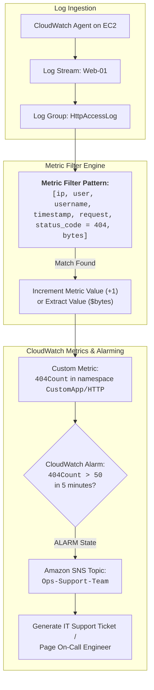

#### Filter Pattern Syntax Rules
Metric filters support powerful pattern matching:
1. **Case-Sensitivity**: Terms in filter patterns are strictly case-sensitive.
2. **Multiple Terms**: All terms must match for the filter to evaluate to true.
3. **Space-Delimited Matching**: Fields in square brackets map positionally to space-separated log tokens.
4. **Wildcards and Operators**:
   - Exact numeric match: `status_code = 404`
   - Numeric range: `status_code >= 400 && status_code < 500`
   - String pattern / prefix match: `request = *html*`
   - Match all client 4xx errors: `status_code = 4*`
5. **JSON Expressions**: For JSON logs, dot-notation query expressions are supported:
   ```text
   { $.eventType = "UpdateTrail" && $.userIdentity.type = "Root" }
   ```

#### The Canonical Course Filter Pattern Example
```text
[ip, user, username, timestamp, request = *html*, status_code = 4*, bytes]
```

This filter breaks down as:
- Position 1 (`ip`): Matches any client host IP.
- Position 2 (`user`): Matches any remote logname identifier.
- Position 3 (`username`): Matches any user ID.
- Position 4 (`timestamp`): Matches the timestamp token.
- Position 5 (`request = *html*`): Filters only HTTP requests containing the substring `html` anywhere in the URI string.
- Position 6 (`status_code = 4*`): Filters all client-side error codes starting with 4 (e.g., 400, 401, 403, 404).
- Position 7 (`bytes`): Matches the byte counter token.

When a log event matches all 7 positional constraints, the filter publishes a data point to the custom metric `404Count`.

---

### 2.4 Amazon CloudWatch Logs Insights

CloudWatch Logs Insights provides an interactive, highly responsive, serverless query engine capable of scanning massive log groups using a specialized SQL-like pipeline syntax.

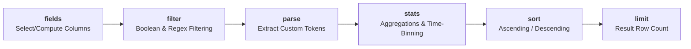

#### Core Syntax Commands

| Command | Purpose | Example |
| :--- | :--- | :--- |
| `fields` | Identifies which fields to retrieve or computes expressions using built-in functions. | `fields @timestamp, @message, @logStream` |
| `filter` | Evaluates boolean expressions, string matches, and regular expressions to filter rows. | `filter @message like /Error/ or status >= 500` |
| `parse` | Extracts transient fields from unstructured log strings using glob matching or regex. | `parse @message "[*] * *" as level, file, msg` |
| `stats` | Computes aggregate metrics (`count()`, `sum()`, `avg()`, `pct()`) grouped by fields or time bins. | `stats count() by bin(5m)` |
| `sort` | Orders the query output by specified fields. | `sort @timestamp desc` |
| `limit` | Caps the number of records returned (maximum: 10,000 records). | `limit 25` |
| `display` | Selects which fields appear in the output presentation table. | `display @timestamp, @message` |

#### Enterprise Query Examples

##### 1. Tracking High-Frequency Application Errors Over Time (5-Minute Windows)
```sql
fields @timestamp, @message
| filter @message like /Error/ or @message like /Exception/
| stats count() as errorCount by bin(5m)
| sort errorCount desc
| limit 20
```

##### 2. AWS Lambda Execution Performance & Memory Utilization (p50, p90, p99)
```sql
filter @type = "REPORT"
| stats count() as invocations,
        avg(@duration) as avgDuration,
        pct(@duration, 50) as p50,
        pct(@duration, 90) as p90,
        pct(@duration, 99) as p99,
        max(@maxMemoryUsed / 1000000) as maxMemoryMB
  by bin(1h)
```

##### 3. Apache Web Server Top 10 Requesting IPs Causing 404 Errors
```sql
parse @message "% % % [%] \"* * *\" % %" as client_ip, ident, user, date, method, uri, proto, status, size
| filter status = 404
| stats count(*) as total404s by client_ip
| sort total404s desc
| limit 10
```

##### 4. VPC Flow Logs Top Rejected Destination Ports
```sql
fields @timestamp, srcAddr, dstAddr, dstPort, protocol, action
| filter action = "REJECT"
| stats count(*) as rejectCount by dstPort, protocol
| sort rejectCount desc
| limit 10
```

---

### 2.5 Real-Time Processing via Subscription Filters

While Metric Filters produce numeric statistics, architectures often require streaming the **entire raw payload** to downstream analytics and storage systems in real time. **CloudWatch Logs Subscriptions** enable this streaming pipeline.

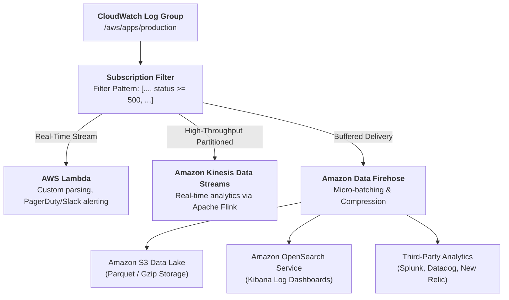

#### Comparison of Subscription Destinations

| Destination | Primary Use Case | Delivery Mechanism | Scaling Model |
| :--- | :--- | :--- | :--- |
| **AWS Lambda** | Immediate event parsing, custom webhook generation (Slack, Opsgenie), instant security alerting. | Synchronous event invocation per log batch. | Automatic concurrency scaling up to regional account limits. |
| **Amazon Kinesis Data Streams** | Complex event processing (CEP), custom consumer fleets, stateful stream windowing. | Record injection into stream shards. | Shard-based provisioned or on-demand stream capacity. |
| **Amazon Data Firehose** | Automated buffering, data transformation, compression, and delivery to S3, OpenSearch, or 3rd-party SaaS. | Buffered micro-batches (e.g. 5 MB / 300 seconds). | Fully managed, zero server administration. |

---

## ⚡ 3. Amazon CloudWatch Events & Amazon EventBridge Deep Dive

### 3.1 Event-Driven Architecture (EDA) Principles

In traditional architectures, systems verify state by **polling**—periodically issuing API calls to ask *"Did this instance change state?"* or *"Did a new file land in S3?"*

```
Polling Architecture:
Client ─────(Poll: Any updates?)─────> Service (Response: No)
Client ─────(Poll: Any updates?)─────> Service (Response: No)
Client ─────(Poll: Any updates?)─────> Service (Response: No)
Client ─────(Poll: Any updates?)─────> Service (Response: YES! Here is state)
Cons: High API overhead, latency delay, API throttling (RateExceeded), wasted compute cost.

Event-Driven Architecture (EDA):
Service ═════════(State Change Event: "Instance Stopped")═════════> Event Bus ──> Target
Pros: Zero polling, sub-second latency, zero compute idle cost, completely decoupled producers and consumers.
```

CloudWatch Events and EventBridge deliver a modern **Event-Driven Architecture**:
- **Elimination of Polling**: Resources publish lightweight state change messages as they occur.
- **Loose Coupling**: Event producers (e.g., Auto Scaling, EC2, IAM) have zero knowledge of consumers (e.g., Lambda, SNS, Step Functions).
- **Parallel Fan-Out**: A single event rule can route simultaneously to up to 5 targets in parallel.

---

### 3.2 Core Architectural Concepts

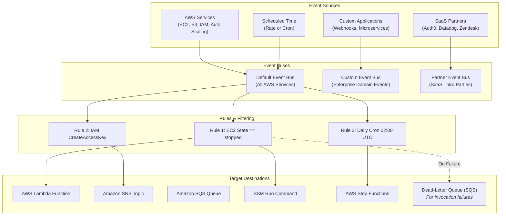

#### 1. The Anatomy of an Event (JSON Structure)
Every event delivered across the bus is a standardized JSON object:

```json
{
  "version": "0",
  "id": "c8f381c8-03f4-4110-8547-123456789abc",
  "detail-type": "EC2 Instance State-change Notification",
  "source": "aws.ec2",
  "account": "123456789012",
  "time": "2026-10-12T18:30:00Z",
  "region": "us-east-1",
  "resources": [
    "arn:aws:ec2:us-east-1:123456789012:instance/i-0123456789abcdef0"
  ],
  "detail": {
    "instance-id": "i-0123456789abcdef0",
    "state": "stopped"
  }
}
```

- `source`: The service or application that generated the event (e.g., `aws.ec2`, `aws.iam`, `mycorp.billing`).
- `detail-type`: Identifies the specific payload schema (e.g., `EC2 Instance State-change Notification`).
- `account`, `region`, `time`: Security and operational metadata identifying tenant origin and execution timestamp.
- `resources`: Array of ARNs identifying affected AWS infrastructure assets.
- `detail`: A freeform JSON object containing the payload specific to the state change.

#### 2. Event Buses
- **Default Bus**: Exists automatically in every AWS account. Receives events from all AWS services.
- **Custom Bus**: Created by engineers to route business events across microservices and internal applications.
- **Partner Bus**: Receives inbound events directly from authorized SaaS partners without custom polling webhooks.

#### 3. Rules and Event Patterns
A rule evaluates incoming JSON events against an **Event Pattern**. If the pattern fields match the incoming event fields, the rule routes the event payload to its configured targets.

Example Event Pattern matching any EC2 instance stopping in `us-east-1`:
```json
{
  "source": ["aws.ec2"],
  "detail-type": ["EC2 Instance State-change Notification"],
  "detail": {
    "state": ["stopped"]
  }
}
```

#### 4. Targets and Resilience (DLQ)
- A single rule can dispatch to up to **5 targets** simultaneously.
- Supported targets include: AWS Lambda, Amazon SNS, Amazon SQS, AWS Step Functions state machines, AWS Systems Manager Run Command, Amazon ECS tasks, AWS CodePipeline, and Amazon Kinesis.
- **Dead-Letter Queues (DLQ)**: If a target endpoint is unreachable (e.g., Lambda concurrency exhaustion or KMS permission error), EventBridge retries delivery for up to 24 hours. A standard Amazon SQS queue can be configured as a DLQ to preserve dropped events for forensic replay.

---

### 3.3 Scheduled Rules (Cron and Rate Expressions)

EventBridge rules can trigger actions based on an internal time scheduler instead of an event source.

#### Rate Expressions
Rate expressions define a simple recurring interval:
```text
rate(Value Unit)
```
- **Value**: Positive integer.
- **Unit**: `minute`, `minutes`, `hour`, `hours`, `day`, `days`.
- Examples: `rate(5 minutes)`, `rate(1 hour)`, `rate(7 days)`.

#### Cron Expressions
Cron expressions provide precise scheduling control using **6 mandatory space-delimited fields**:

```text
cron(Minutes Hours Day-of-month Month Day-of-week Year)
```

| Field | Values | Wildcards Allowed |
| :--- | :--- | :--- |
| **Minutes** | 0–59 | `,` `-` `*` `/` |
| **Hours** | 0–23 (UTC) | `,` `-` `*` `/` |
| **Day-of-month** | 1–31 | `,` `-` `*` `/` `?` `L` `W` |
| **Month** | 1–12 or JAN–DEC | `,` `-` `*` `/` |
| **Day-of-week** | 1–7 or SUN–SAT | `,` `-` `*` `/` `?` `L` `#` |
| **Year** | 1970–2199 | `,` `-` `*` `/` |

> [!IMPORTANT]
> **The `?` (Question Mark) Rule**: In AWS cron expressions, you cannot specify both `Day-of-month` and `Day-of-week` concurrently. If you specify a value (or `*`) for one of these fields, you **MUST** specify `?` (blank/unspecified) for the other.

#### Common Enterprise Cron Examples:
- Trigger at 08:00 AM UTC every Monday through Friday:
  `cron(0 8 ? * MON-FRI *)`
- Trigger at midnight UTC on the 1st of every month:
  `cron(0 0 1 * ? *)`
- Trigger every 15 minutes during business hours (09:00 - 17:00 UTC):
  `cron(0/15 9-17 ? * MON-FRI *)`

---

### 3.4 Evolution: CloudWatch Events $\rightarrow$ Amazon EventBridge

In 2019, AWS introduced **Amazon EventBridge**, which is built on the same underlying architecture and API as CloudWatch Events, providing complete backward compatibility while dramatically expanding capabilities:

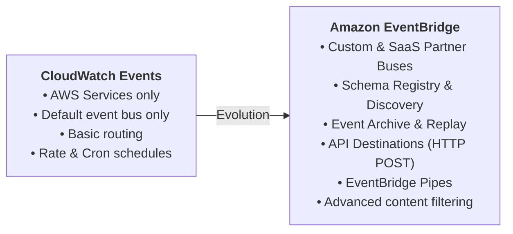

#### Feature Comparison

| Capability | Amazon CloudWatch Events | Amazon EventBridge |
| :--- | :--- | :--- |
| **AWS Service Events** | Yes | Yes (100% backward compatible) |
| **Custom Application Events** | Basic (via PutEvents to default bus) | First-class support via **Custom Event Buses** |
| **3rd-Party SaaS Integrations** | No (requires custom webhook code) | Native **Partner Event Buses** (Datadog, Shopify, etc.) |
| **Schema Registry & Discovery** | No | Yes (Generates code bindings in Java, Python, TS) |
| **Event Archive & Replay** | No | Yes (Replay past events for disaster recovery/testing) |
| **API Destinations** | No (requires Lambda intermediary) | Native routing directly to external HTTP endpoints |
| **EventBridge Pipes** | No | Point-to-point integration with filtering & enrichment |

---

## 🛠️ 4. Real-World Automated Remediation Scenarios

### Scenario 1: Automated EBS Snapshot Creation When EC2 Stops

**Business Objective**: Ensure data durability and disaster recovery by automatically generating an Amazon EBS snapshot of an instance's root volume whenever the instance enters the `stopped` state.

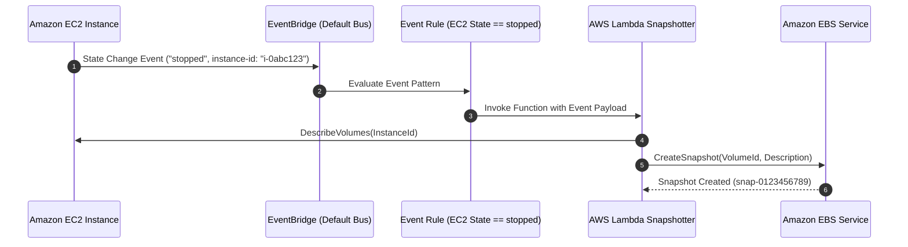

#### 1. EventBridge Event Pattern
```json
{
  "source": ["aws.ec2"],
  "detail-type": ["EC2 Instance State-change Notification"],
  "detail": {
    "state": ["stopped"]
  }
}
```

#### 2. AWS Lambda Remediation Function (Python 3.12 / Boto3)
```python
import boto3
import logging
from datetime import datetime

logger = logging.getLogger()
logger.setLevel(logging.INFO)

ec2_client = boto3.client('ec2')

def lambda_handler(event, context):
    instance_id = event['detail']['instance-id']
    state = event['detail']['state']
    
    logger.info(f"Received state change: Instance {instance_id} transitioned to {state}")
    
    # 1. Retrieve volumes attached to the instance
    response = ec2_client.describe_instances(InstanceIds=[instance_id])
    reservations = response.get('Reservations', [])
    if not reservations:
        logger.warning(f"No reservations found for instance {instance_id}")
        return
        
    instance = reservations[0]['Instances'][0]
    block_devices = instance.get('BlockDeviceMappings', [])
    
    # 2. Iterate through attached EBS volumes and generate snapshots
    for device in block_devices:
        ebs_info = device.get('Ebs')
        if not ebs_info:
            continue
            
        volume_id = ebs_info['VolumeId']
        device_name = device['DeviceName']
        timestamp = datetime.utcnow().strftime('%Y-%m-%d-%H-%M-%S')
        description = f"Auto-Snapshot of {instance_id} ({device_name}) on stop at {timestamp}"
        
        logger.info(f"Creating snapshot for volume {volume_id}...")
        snapshot = ec2_client.create_snapshot(
            VolumeId=volume_id,
            Description=description,
            TagSpecifications=[
                {
                    'ResourceType': 'snapshot',
                    'Tags': [
                        {'Key': 'CreatedBy', 'Value': 'AutomatedEventBridgeRemediation'},
                        {'Key': 'SourceInstance', 'Value': instance_id},
                        {'Key': 'Device', 'Value': device_name}
                    ]
                }
            ]
        )
        logger.info(f"Snapshot created successfully: {snapshot['SnapshotId']}")
```

---

### Scenario 2: Real-Time Slack Alerting on IAM Access Key Creation

**Business Objective**: Detect potential privilege escalation or compliance violations by notifying the security operations team within seconds whenever a new permanent IAM access key is generated.

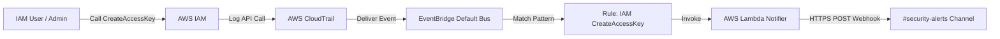

#### 1. EventBridge Event Pattern
```json
{
  "source": ["aws.iam"],
  "detail-type": ["AWS API Call via CloudTrail"],
  "detail": {
    "eventSource": ["iam.amazonaws.com"],
    "eventName": ["CreateAccessKey"]
  }
}
```

#### 2. AWS Lambda Notifier Function (Python 3.12)
```python
import json
import os
import urllib.request
import logging

logger = logging.getLogger()
logger.setLevel(logging.INFO)

SLACK_WEBHOOK_URL = os.environ.get('SLACK_WEBHOOK_URL')

def lambda_handler(event, context):
    detail = event.get('detail', {})
    event_name = detail.get('eventName')
    user_identity = detail.get('userIdentity', {})
    request_params = detail.get('requestParameters', {})
    response_elements = detail.get('responseElements', {})
    
    actor = user_identity.get('arn', 'Unknown Actor')
    target_user = request_params.get('userName', 'Unknown Target')
    access_key_id = response_elements.get('accessKey', {}).get('accessKeyId', 'N/A')
    time = event.get('time')
    
    message = {
        "text": ":warning: *CRITICAL SECURITY ALERT: IAM Access Key Created*",
        "attachments": [
            {
                "color": "#D32F2F",
                "fields": [
                    {"title": "Target IAM User", "value": target_user, "short": True},
                    {"title": "Actor ARN", "value": actor, "short": True},
                    {"title": "Access Key ID", "value": access_key_id, "short": True},
                    {"title": "Timestamp", "value": time, "short": True}
                ]
            }
        ]
    }
    
    req = urllib.request.Request(
        SLACK_WEBHOOK_URL,
        data=json.dumps(message).encode('utf-8'),
        headers={'Content-Type': 'application/json'}
    )
    
    with urllib.request.urlopen(req) as response:
        logger.info(f"Slack notification sent, HTTP status: {response.status}")
```

---

### Scenario 3: Automated Remediation of Insecure Security Group Rules

**Business Objective**: Enforce security posture by detecting any newly opened inbound rule allowing unrestricted internet access (`0.0.0.0/0`) on administrative ports (SSH port 22 or RDP port 3389) and revoking it immediately.

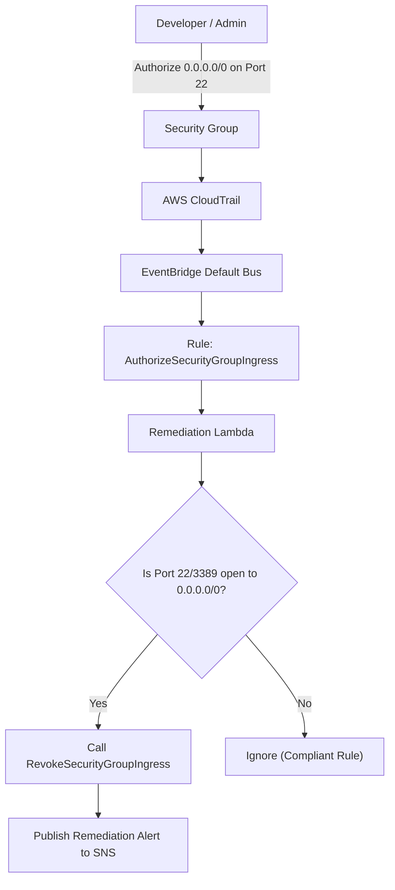

#### 1. EventBridge Event Pattern
```json
{
  "source": ["aws.ec2"],
  "detail-type": ["AWS API Call via CloudTrail"],
  "detail": {
    "eventSource": ["ec2.amazonaws.com"],
    "eventName": ["AuthorizeSecurityGroupIngress"]
  }
}
```

#### 2. Auto-Remediation Function (Python 3.12 / Boto3)
```python
import boto3
import logging

logger = logging.getLogger()
logger.setLevel(logging.INFO)

ec2_client = boto3.client('ec2')
sns_client = boto3.client('sns')
SNS_TOPIC_ARN = "arn:aws:sns:us-east-1:123456789012:SecurityRemediationTopic"

RESTRICTED_PORTS = {22, 3389}

def lambda_handler(event, context):
    detail = event.get('detail', {})
    request_params = detail.get('requestParameters', {})
    group_id = request_params.get('groupId')
    ip_permissions = request_params.get('ipPermissions', {}).get('items', [])
    
    for perm in ip_permissions:
        from_port = perm.get('fromPort')
        to_port = perm.get('toPort')
        ip_ranges = perm.get('ipRanges', {}).get('items', [])
        
        # Check if SSH (22) or RDP (3389) is in range
        is_sensitive_port = any(from_port <= port <= to_port for port in RESTRICTED_PORTS if from_port and to_port)
        
        for ip_range in ip_ranges:
            cidr = ip_range.get('cidrIp')
            if cidr == '0.0.0.0/0' and is_sensitive_port:
                logger.warning(f"Insecure rule detected on {group_id}: Port {from_port}-{to_port} exposed to 0.0.0.0/0. Revoking...")
                
                # Automatically revoke the offending rule
                ec2_client.revoke_security_group_ingress(
                    GroupId=group_id,
                    IpPermissions=[perm]
                )
                
                # Notify SecOps
                sns_client.publish(
                    TopicArn=SNS_TOPIC_ARN,
                    Subject="[AUTO-REMEDIATION] Revoked Insecure Security Group Rule",
                    Message=f"Security Group {group_id} had rule allowing {cidr} on port range {from_port}-{to_port}. Rule was automatically revoked."
                )
```

---

## 🧰 5. Troubleshooting Knowledge Base & Operational Playbook

### Category: Foundational IT & Agent Operations

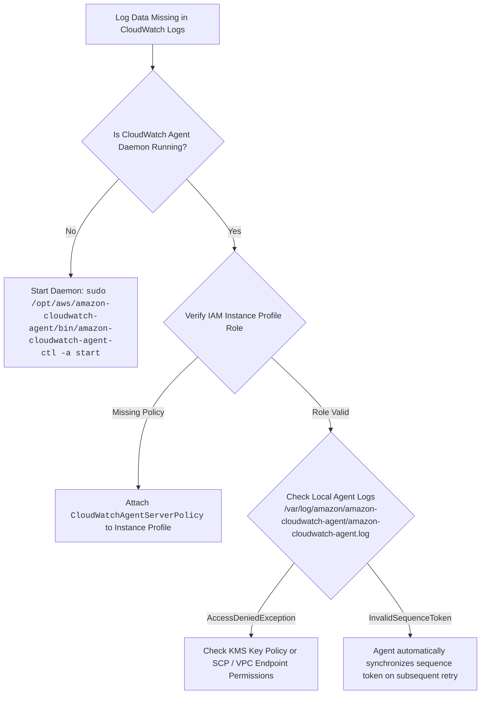

| Symptom | Probable Root Cause | Resolution Strategy |
| :--- | :--- | :--- |
| **`AccessDeniedException` during `PutLogEvents`** | EC2 IAM role lacks permissions or KMS key policy does not allow `kms:GenerateDataKey`. | 1. Ensure the IAM Role includes `CloudWatchAgentServerPolicy`.<br>2. If encrypted via KMS, ensure the KMS Key Policy allows `logs.<region>.amazonaws.com`. |
| **CloudWatch Agent fails to upload in private VPC** | Private subnet lacks route to internet and no VPC interface endpoints exist. | Create AWS PrivateLink VPC Endpoints for `com.amazonaws.<region>.logs` and `com.amazonaws.<region>.monitoring`. |
| **Log Agent buffer overflow / dropping events** | High file I/O rate exceeds agent batch size and local buffer. | Adjust agent configuration: increase `force_flush_interval` and `buffer_size` in `/opt/aws/amazon-cloudwatch-agent/etc/amazon-cloudwatch-agent.json`. |

---

### Category: Monitoring & Reporting Failures

| Symptom | Probable Root Cause | Resolution Strategy |
| :--- | :--- | :--- |
| **Metric Filter produces no metric data points** | 1. Filter pattern syntax mismatch (case-sensitivity or token count mismatch).<br>2. Log format changed at application level. | 1. Validate log string tokens against pattern using the "Test Metric Filter" button in CloudWatch console.<br>2. Remember filter terms are case-sensitive (`ERROR` $\neq$ `error`). |
| **CloudWatch Alarm stuck in `INSUFFICIENT_DATA`** | 1. Zero events received in evaluation period.<br>2. Metric Filter "Default Value" unset. | Configure the Metric Filter to emit a Default Value of `0` instead of `null`, or configure the Alarm's "Treat missing data as" setting to `notBreaching` or `ignore`. |
| **EventBridge Rule not triggering target** | 1. Event pattern does not match incoming JSON payload.<br>2. Target IAM resource-based policy blocks EventBridge invocation.<br>3. CloudTrail trail is disabled (for API call rules). | 1. Check CloudTrail status (must be active for `AWS API Call via CloudTrail`).<br>2. Verify rule pattern against CloudTrail event using EventBridge Sandbox.<br>3. Check CloudWatch metric `FailedInvocations` on the rule and inspect Dead-Letter Queue (DLQ). |
| **Logs Insights query times out on large log groups** | Time window too large or unbounded query scanning hundreds of gigabytes. | Constrain time range to the incident window; use `filter @timestamp` early; use `limit` and narrow targeted log groups instead of querying root `/`. |

---

## ⚖️ 6. Comprehensive Service Comparison Matrices

### CloudWatch Logs vs. CloudWatch Events / EventBridge vs. AWS CloudTrail

| Dimension | Amazon CloudWatch Logs | Amazon EventBridge | AWS CloudTrail |
| :--- | :--- | :--- | :--- |
| **Core Purpose** | Ingest, index, search, and store application and system log streams. | Route near-real-time state changes and events to target compute resources. | Audit and record all AWS API management and data plane calls across an account. |
| **Data Format** | Unstructured text, space-delimited, or structured JSON log lines. | Standardized JSON event envelope with metadata and custom `detail` payload. | Standardized CloudTrail JSON audit records (`userIdentity`, `eventName`, etc.). |
| **Processing Paradigm** | Batch ingestion, interactive queries (Insights), and streaming subscriptions. | Real-time event matching, rules-based pattern filtering, and parallel routing. | Asynchronous delivery to Amazon S3 buckets and optional CloudWatch Logs ingestion. |
| **Primary Consumer** | Developers, DevOps engineers, SIEM systems (OpenSearch, Splunk). | AWS Lambda, Step Functions, SNS, SQS, Systems Manager Run Command. | Security auditors, compliance officers, SecOps incident responders. |
| **Pricing Model** | Ingestion per GB ($0.50/GB), Storage per GB/mo ($0.03/GB), Query scanned per GB ($0.005/GB). | $1.00 per million events published (free for native AWS service events). | Free for first management trail delivery; $2.00 per million data events. |

---

### Polling-Based Monitoring vs. Event-Driven Reactive Automation

| Characteristic | Traditional Polling Model | Event-Driven Reactive Model (EventBridge) |
| :--- | :--- | :--- |
| **Detection Latency** | High (bounded by polling interval, e.g., every 5 to 15 minutes). | Near-instantaneous (sub-second reaction to state changes). |
| **API Overhead & Throttling** | High (frequent calls trigger `RateExceeded` / `ThrottlingException`). | Zero polling calls required. |
| **Compute Cost** | Incurs continuous compute cost for idle polling scripts/daemons. | Zero cost when systems are idle; pay only when events execute. |
| **Coupling & Maintenance** | Tight coupling; poller must authenticate directly to each managed resource. | Decoupled; event emitter has no knowledge of downstream targets. |

---

## 📝 7. Knowledge Verification & Practice Questions

### Question 1
An administrator creates an Apache access log metric filter with the pattern `[ip, user, username, timestamp, request = *html*, status_code = 4*, bytes]`. An incoming log event contains:
`192.168.1.50 - john [12/Oct/2026:10:00:00 -0400] "POST /api/upload.php HTTP/1.1" 403 512`
Will this log event increment the custom CloudWatch metric?
- [ ] A) Yes, because the status code is 403, which matches `status_code = 4*`.
- [ ] B) Yes, because all positional fields are present in the log line.
- [ ] C) No, because the request line contains `upload.php` rather than matching `*html*`.
- [ ] D) No, because POST requests are ignored by CloudWatch metric filters.

> **Answer: C**  
> **Explanation**: Metric filters enforce a logical `AND` across all criteria in the filter pattern. Although the status code `403` matches `status_code = 4*`, the request string does not contain `html`, violating the `request = *html*` constraint. The event is ignored.

---

### Question 2
A Cloud Operations engineer needs to inspect log data for a financial microservice. Requirements specify that raw logs must be accessible for interactive querying in CloudWatch Logs Insights for 30 days. After 30 days, the logs must be retained securely for 7 years for regulatory audits at the lowest possible cost. Which architecture meets these requirements?
- [ ] A) Set the CloudWatch Log Group retention period to 2557 days (7 years).
- [ ] B) Set the CloudWatch Log Group retention period to 30 days. Configure a Subscription Filter to an Amazon Data Firehose delivery stream that archives logs into Amazon S3, with an S3 Lifecycle rule transitioning objects to S3 Glacier Flexible Deep Archive after 30 days.
- [ ] C) Keep CloudWatch retention at "Never Expire" and create an EventBridge rule that runs a daily Lambda function to purge log streams older than 30 days.
- [ ] D) Configure a Metric Filter that converts all log lines into custom metrics with 7-year retention.

> **Answer: B**  
> **Explanation**: Retaining raw log data in CloudWatch Logs for 7 years costs $0.03/GB/month, which is cost-prohibitive compared to S3 Glacier Deep Archive ($0.00099/GB/month). Setting log group retention to 30 days enables high-speed Insights queries for 30 days, while streaming to Firehose and archiving to S3 Glacier Deep Archive ensures compliant, cost-effective 7-year storage.

---

### Question 3
An EventBridge rule is configured to execute an AWS Lambda function when an EC2 instance enters the `shutting-down` state. The Lambda function does not execute when the instance stops. What is the most probable cause?
- [ ] A) EventBridge does not support Amazon EC2 as an event source.
- [ ] B) The instance transitioned from `running` to `stopping` and `stopped`, not `shutting-down` (which is only triggered on instance termination).
- [ ] C) The default event bus was not granted KMS decryption permissions.
- [ ] D) EventBridge rules cannot target AWS Lambda without an Amazon SNS topic in between.

> **Answer: B**  
> **Explanation**: When an EC2 instance is stopped, its lifecycle states are `running` $\rightarrow$ `stopping` $\rightarrow$ `stopped`. The `shutting-down` state occurs only during instance **termination** (`running` $\rightarrow$ `shutting-down` $\rightarrow$ `terminated`).

---

### Question 4
An engineer writes the following cron expression in an EventBridge rule: `cron(0 12 * * 1-5 *)`. The AWS Management Console displays an error stating that the expression is invalid. Why did this expression fail?
- [ ] A) EventBridge only supports rate expressions, not cron expressions.
- [ ] B) In AWS cron expressions, `Day-of-month` and `Day-of-week` cannot both be specified; one must be `?`.
- [ ] C) The year field is unsupported in AWS cron expressions.
- [ ] D) The hour field must be in 12-hour AM/PM format.

> **Answer: B**  
> **Explanation**: AWS cron expressions have 6 mandatory fields. You cannot specify values (or `*`) for both `Day-of-month` (field 3) and `Day-of-week` (field 5). One of them must be the `?` character. The correct syntax for noon UTC Monday–Friday is `cron(0 12 ? * 1-5 *)` or `cron(0 12 ? * MON-FRI *)`.

---

### Question 5
What is the primary difference between a CloudWatch Logs Metric Filter and a CloudWatch Logs Subscription Filter?
- [ ] A) Metric Filters process logs synchronously, whereas Subscription Filters process logs asynchronously with a 24-hour delay.
- [ ] B) Metric Filters extract numerical counts or values to create CloudWatch metrics; Subscription Filters forward the raw log event payloads in real time to external destinations like Lambda, Kinesis, or Firehose.
- [ ] C) Subscription Filters can only stream to Amazon S3, whereas Metric Filters stream to Amazon SNS.
- [ ] D) Metric Filters encrypt logs using AWS KMS; Subscription Filters decrypt them.

> **Answer: B**  
> **Explanation**: Metric Filters monitor log events to extract numerical data points and populate CloudWatch Metrics (e.g. counting occurrences of error strings). Subscription Filters stream complete log event payloads in real time to processing targets such as AWS Lambda, Amazon Kinesis Data Streams, or Amazon Data Firehose.

---

## 📌 Key Takeaways & Summary

- **Separation of Concerns**: CloudWatch Metrics monitors operational numbers; CloudWatch Logs ingests and analyzes operational text; CloudWatch Events / EventBridge routes operational state transitions.
- **Log Hierarchy**: Log Events reside within Log Streams; Log Streams reside within Log Groups. Access control, retention periods, KMS keys, and subscription filters are configured at the **Log Group** level.
- **Log Ingestion**: The Unified CloudWatch Agent collects OS logs from EC2 and on-premises servers. AWS native services (CloudTrail, VPC Flow Logs, Route 53) stream logs directly into Log Groups.
- **Metric Filters**: Transform unstructured or space-delimited text into custom CloudWatch metrics, enabling alerting on application errors (such as HTTP 404 or 500 status codes).
- **CloudWatch Logs Insights**: Delivers interactive, SQL-like query analysis across log groups with commands like `fields`, `filter`, `stats`, `parse`, `sort`, and `limit`.
- **Subscription Streaming**: Streams raw log data in near-real time to AWS Lambda, Amazon Kinesis Data Streams, or Amazon Data Firehose for ingestion into OpenSearch or S3 data lakes.
- **Event-Driven Architecture**: Amazon EventBridge eliminates wasteful, high-latency polling by evaluating JSON state change notifications against event rules and fanning out to up to 5 targets in parallel.
- **Scheduling**: Time-based rules use Rate expressions or 6-field Cron expressions (adhering to the `?` constraint between Day-of-month and Day-of-week).
- **Evolution**: Amazon EventBridge represents the future of CloudWatch Events, adding support for Custom Event Buses, SaaS Partner Integrations, Schema Registries, Event Replay, and API Destinations.
