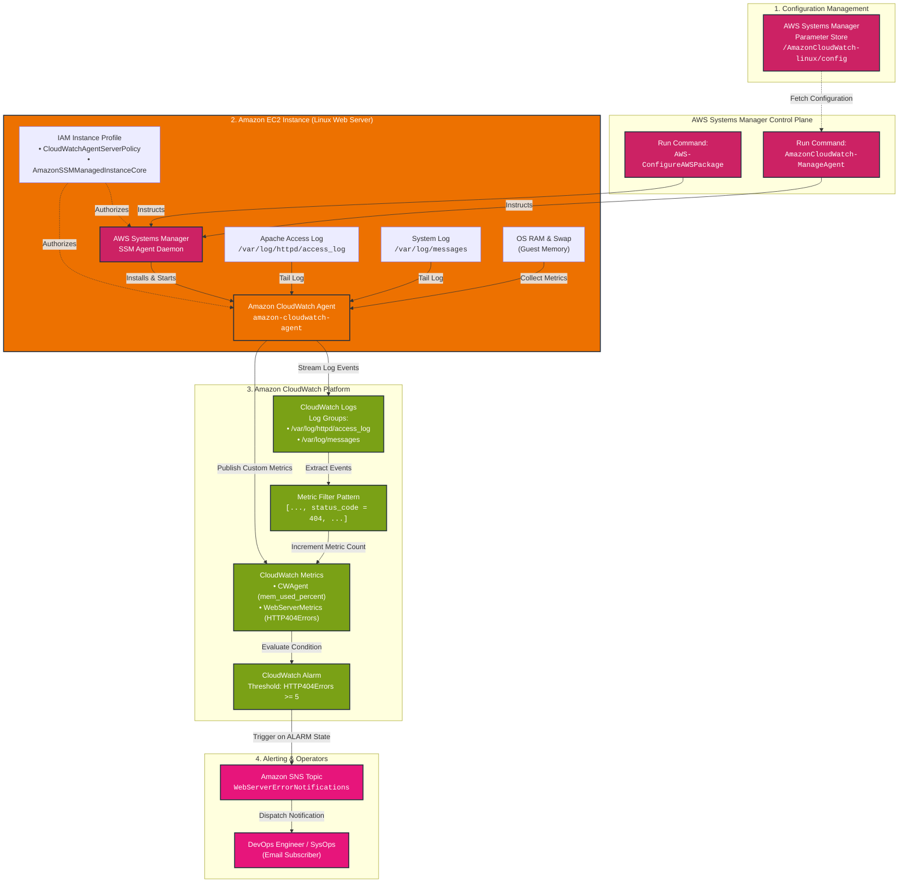
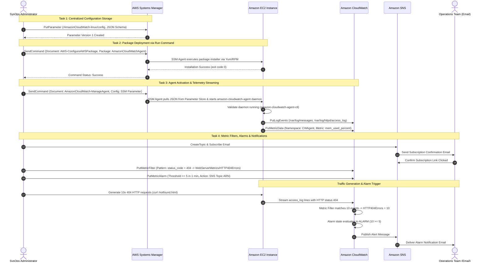

# 🧪 Lab Overview: Monitoring Your Applications and Infrastructure

> **Course**: AWS re/Start  
> **Module**: Monitoring and Security (Module 13)  
> **Source Document**: `T20-0004-RSJAWS_EN-US_SG_M13_LABOVERVIEWMONITORING.pdf`  
> **Target Audience**: Cloud Practitioners, SysOps Administrators, DevOps Engineers, Solutions Architects  

---

## 🎯 Lab Overview & Scenario Architecture

Modern cloud applications require comprehensive operational visibility across both the underlying compute infrastructure and running application processes. By default, Amazon Elastic Compute Cloud (Amazon EC2) provides basic hypervisor-level metrics through Amazon CloudWatch—such as raw CPU utilization, disk read/write operations, and network in/out volume. However, the hypervisor cannot inspect operating system internals (such as volatile memory consumption, swap utilization, or disk space availability) nor can it access guest application log streams (such as Apache web server access logs or OS system messages).

This hands-on lab guides learners through building an enterprise-grade, agent-based monitoring and alerting pipeline across Amazon EC2 instances without requiring direct SSH key management or bastion hosts. By combining **AWS Systems Manager (SSM)**, the **unified Amazon CloudWatch Agent**, **Amazon CloudWatch Logs**, and **Amazon Simple Notification Service (Amazon SNS)**, you establish an automated operational framework capable of streaming logs, collecting OS memory metrics, parsing HTTP errors in real time, and alerting system operators.

```
┌────────────────────────────────────────────────────────────────────────────────────────────────────────┐
│                              Lab Operational Pipeline: End-to-End Architecture                         │
├────────────────────────────────────────────────────────────────────────────────────────────────────────┤
│                                                                                                        │
│  1. Config Storage             2. Fleet Deployment            3. Agent Ingestion       4. Alarm Stream │
│  ┌──────────────────┐          ┌──────────────────┐           ┌──────────────────┐     ┌─────────────┐ │
│  │ AWS Systems Mgr  │ ───────> │ SSM Run Command  │ ────────> │ Amazon EC2 Host  │ ──> │ CloudWatch  │ │
│  │ Parameter Store  │          │ (Package Install │           │ Unified Agent    │     │ Logs/Metrics│ │
│  └──────────────────┘          │  & Agent Manage) │           └──────────────────┘     └──────┬──────┘ │
│                                └──────────────────┘                     │                     │        │
│                                                                         │                     ▼        │
│                                                                Log Files & RAM        Metric Filters   │
│                                                                • /var/log/messages    & Alarms (404s)  │
│                                                                • /var/log/httpd/*             │        │
│                                                                                               ▼        │
│                                                                                       Amazon SNS Alert │
│                                                                                       (Operator Email) │
└────────────────────────────────────────────────────────────────────────────────────────────────────────┘
```

---

### 📌 Learning Objectives

- [ ] **Store Centralized Agent Configuration**: Create and maintain CloudWatch Agent JSON configurations inside AWS Systems Manager Parameter Store under `/AmazonCloudWatch-linux/config`.
- [ ] **Enforce Least-Privilege IAM Instance Profiles**: Attach managed IAM policies (`CloudWatchAgentServerPolicy` and `AmazonSSMManagedInstanceCore`) allowing EC2 instances to communicate with Systems Manager and CloudWatch endpoints securely.
- [ ] **Deploy Software Fleet-Wide Without SSH**: Execute the `AWS-ConfigureAWSPackage` SSM document via Run Command to install the `AmazonCloudWatchAgent` rpm package across Linux targets.
- [ ] **Initialize and Bootstrap the Agent Daemon**: Run the `AmazonCloudWatch-ManageAgent` SSM document to pull the JSON schema from Parameter Store, start the agent service, and verify its local operational status.
- [ ] **Stream Host and Application Logs**: Ingest Linux system messages (`/var/log/messages`) and Apache HTTP server access logs (`/var/log/httpd/access_log`) directly into dedicated CloudWatch Logs log groups.
- [ ] **Collect Operating System Memory Metrics**: Publish custom system-level RAM utilization (`mem_used_percent`) to the `CWAgent` CloudWatch namespace.
- [ ] **Construct Pattern-Based Metric Filters**: Define a CloudWatch Logs metric filter that parses web server access logs for HTTP 404 client error response codes and publishes a count to custom namespace `WebServerMetrics`.
- [ ] **Implement Automated Alerting**: Configure an Amazon CloudWatch Alarm tied to the HTTP 404 metric that evaluates state transitions and publishes email notifications via an Amazon SNS topic.
- [ ] **Perform End-to-End Fault Injection Testing**: Generate simulated 404 HTTP requests with `curl` to trigger alarm state changes from `OK` to `ALARM` and verify SNS notification dispatch.
- [ ] **Troubleshoot Fleet Observability Failures**: Diagnose common operational failure modes, including SSM Agent communication breaks, IAM permission deficiencies, parameter naming typos, and JSON syntax errors.

---

## 🏛️ Comprehensive Architecture & Workflow

The lab demonstrates how AWS managed services interact to decouple configuration management from instance execution. 

### End-to-End System Architecture



---

### Task-by-Task Execution Sequence

The deployment proceeds sequentially across four distinct phases:



---

## 🛠️ The Four Core Lab Tasks: Detailed Hands-On Walkthrough

### Task 1: Storing and Retrieving Logging Configuration in AWS Systems Manager Parameter Store

AWS Systems Manager Parameter Store provides centralized, secure storage for configuration data and secrets management. Instead of manually copying JSON configuration files to individual EC2 instances, you define a single configuration parameter in Parameter Store that can be applied to thousands of instances simultaneously.

#### 1. Configuration Schema Definition

The CloudWatch Agent utilizes a structured JSON document divided into three primary blocks:
1. `agent`: Defines collection intervals and execution user credentials.
2. `logs`: Configures specific log files to monitor, matching log group names, log stream formatting, and multi-line parsing options.
3. `metrics`: Configures OS performance counters unavailable to the EC2 hypervisor (e.g., volatile RAM, swap memory, and mounted disk filesystem usage).

Below is the complete production-grade JSON configuration payload stored during the lab:

```json
{
  "agent": {
    "metrics_collection_interval": 60,
    "run_as_user": "root"
  },
  "logs": {
    "logs_collected": {
      "files": {
        "collect_list": [
          {
            "file_path": "/var/log/messages",
            "log_group_name": "/var/log/messages",
            "log_stream_name": "{instance_id}",
            "timestamp_format": "%b %d %H:%M:%S",
            "timezone": "Local"
          },
          {
            "file_path": "/var/log/httpd/access_log",
            "log_group_name": "/var/log/httpd/access_log",
            "log_stream_name": "{instance_id}",
            "timezone": "Local"
          }
        ]
      }
    }
  },
  "metrics": {
    "namespace": "CWAgent",
    "metrics_collected": {
      "mem": {
        "measurement": [
          "mem_used_percent",
          "mem_available_percent"
        ],
        "metrics_collection_interval": 60
      },
      "swap": {
        "measurement": [
          "swap_used_percent"
        ],
        "metrics_collection_interval": 60
      }
    },
    "append_dimensions": {
      "InstanceId": "${aws:InstanceId}",
      "AutoScalingGroupName": "${aws:AutoScalingGroupName}"
    }
  }
}
```

#### 2. Console Procedure: Creating the Parameter

1. Open the **AWS Systems Manager** console.
2. In the navigation pane under **Application Management**, choose **Parameter Store**.
3. Choose **Create parameter**.
4. In the **Parameter details** section, configure the following:
   - **Name**: `/AmazonCloudWatch-linux/config`  
     > [!IMPORTANT]
     > The naming convention `/AmazonCloudWatch-linux/config` is the standard default path recognized natively by the AWS CloudWatch Agent deployment documents. Do not alter the leading slash or capitalization.
   - **Description**: `Centralized Amazon CloudWatch Agent configuration for Linux web servers collecting system logs, Apache access logs, and memory utilization.`
   - **Tier**: `Standard`
   - **Type**: `String`
   - **Data type**: `text`
5. In the **Value** text area, paste the entire JSON configuration block above.
6. Choose **Create parameter**.

#### 3. AWS CLI Equivalent Command

```bash
aws ssm put-parameter \
  --name "/AmazonCloudWatch-linux/config" \
  --description "CloudWatch Agent Linux configuration" \
  --type "String" \
  --tier "Standard" \
  --overwrite \
  --value '{
    "agent": {
      "metrics_collection_interval": 60,
      "run_as_user": "root"
    },
    "logs": {
      "logs_collected": {
        "files": {
          "collect_list": [
            {
              "file_path": "/var/log/messages",
              "log_group_name": "/var/log/messages",
              "log_stream_name": "{instance_id}"
            },
            {
              "file_path": "/var/log/httpd/access_log",
              "log_group_name": "/var/log/httpd/access_log",
              "log_stream_name": "{instance_id}"
            }
          ]
        }
      }
    },
    "metrics": {
      "namespace": "CWAgent",
      "metrics_collected": {
        "mem": {
          "measurement": ["mem_used_percent"]
        }
      },
      "append_dimensions": {
        "InstanceId": "${aws:InstanceId}"
      }
    }
  }'
```

---

### Task 2: Installing Amazon CloudWatch Agent on Amazon EC2 via AWS Systems Manager Run Command

Traditional server management required opening SSH (port 22) to instances, establishing public bastion hosts, and managing private key pairs. AWS Systems Manager Run Command eliminates these operational overheads by executing commands through the background **SSM Agent** already running inside the Amazon Linux 2 / Amazon Linux 2023 operating system.

#### 1. IAM Instance Profile Prerequisites

For an EC2 instance to execute Run Commands and communicate with CloudWatch, its attached IAM Instance Profile must contain two critical AWS managed policies:

| Managed Policy Name | Purpose / Permissions Granted |
| :--- | :--- |
| `AmazonSSMManagedInstanceCore` | Allows the SSM Agent daemon to connect to the Systems Manager service endpoint, poll for command requests, and return execution logs. |
| `CloudWatchAgentServerPolicy` | Grants permissions required by the CloudWatch Agent: writing metrics to CloudWatch (`cloudwatch:PutMetricData`), creating log groups and log streams (`logs:CreateLogGroup`, `logs:CreateLogStream`), writing log records (`logs:PutLogEvents`), and reading parameters from Systems Manager Parameter Store (`ssm:GetParameter`). |

> [!CAUTION]
> If `CloudWatchAgentServerPolicy` is missing from the IAM role, the instance will accept the installation package, but will fail with `AccessDeniedException` during Task 3 when attempting to read the parameter or upload log streams.

#### 2. Console Procedure: Installing the Agent Package

1. In the **AWS Systems Manager** console, navigate to the **Node Management** section in the left sidebar and select **Run Command**.
2. Choose **Run command**.
3. In the **Command document** search box, enter `AWS-ConfigureAWSPackage` and select the radio button next to it.
4. Under **Command parameters**:
   - **Action**: Select `Install`.
   - **Installation Type**: Select `Uninstall and reinstall` (or leave default `Install`).
   - **Name**: Enter `AmazonCloudWatchAgent`.
   - **Version**: Leave blank (defaults to latest available release).
5. Under **Targets**:
   - Choose **Choose instances manually**.
   - Select the target EC2 web server instance (e.g., `WebServerInstance` or instance in running state).
6. Under **Output options**:
   - Uncheck **Enable an S3 bucket** (for standard lab execution, standard output is displayed directly in the SSM console).
7. Choose **Run**.
8. Refresh the **Commands** screen until the **Overall status** transitions from `InProgress` to `Success`.

```
┌──────────────────────────────────────────────────────────────────────────────────┐
│ Command ID: 7a83d1c9-58df-419b-a01b-8f38bc42f102                                 │
│ Document: AWS-ConfigureAWSPackage                                                │
│ Status: Success                                                                  │
│ Target Instance: i-0a1b2c3d4e5f60718                                             │
├──────────────────────────────────────────────────────────────────────────────────┤
│ Output: Successfully installed AmazonCloudWatchAgent version 1.300030.0b607      │
└──────────────────────────────────────────────────────────────────────────────────┘
```

#### 3. AWS CLI Equivalent Command

```bash
aws ssm send-command \
  --document-name "AWS-ConfigureAWSPackage" \
  --targets '[{"Key":"InstanceIds","Values":["i-0a1b2c3d4e5f60718"]}]' \
  --parameters '{"action":["Install"],"name":["AmazonCloudWatchAgent"]}' \
  --comment "Install unified CloudWatch Agent package"
```

---

### Task 3: Starting the CloudWatch Agent & Streaming Logs to CloudWatch Logs

Installing the package installs the binaries to `/opt/aws/amazon-cloudwatch-agent/`, but does not start the daemon or apply configuration. In this task, you execute the `AmazonCloudWatch-ManageAgent` SSM document to retrieve the configuration from Parameter Store and start the background daemon.

#### 1. Console Procedure: Configuring and Starting the Agent

1. In the **AWS Systems Manager** console, choose **Run Command** > **Run command**.
2. In the search box, filter for `AmazonCloudWatch-ManageAgent` and select the document.
3. Under **Command parameters**, configure:
   - **action**: Choose `configure`.
   - **mode**: Choose `ec2`.
   - **optionalConfigurationSource**: Choose `ssm`.
   - **optionalConfigurationLocation**: Enter `/AmazonCloudWatch-linux/config`.
   - **optionalRestart**: Choose `yes`.
4. Under **Targets**, select your target EC2 instance.
5. Choose **Run**.
6. Monitor the command execution until the status shows **Success**.

#### 2. AWS CLI Equivalent Command

```bash
aws ssm send-command \
  --document-name "AmazonCloudWatch-ManageAgent" \
  --targets '[{"Key":"InstanceIds","Values":["i-0a1b2c3d4e5f60718"]}]' \
  --parameters '{
    "action": ["configure"],
    "mode": ["ec2"],
    "optionalConfigurationSource": ["ssm"],
    "optionalConfigurationLocation": ["/AmazonCloudWatch-linux/config"],
    "optionalRestart": ["yes"]
  }' \
  --comment "Configure and launch CloudWatch Agent from SSM Parameter"
```

#### 3. Verifying Local Agent Daemon Status

If connecting to the instance via **AWS Systems Manager Session Manager** or local terminal, verify the agent status using the control script:

```bash
sudo /opt/aws/amazon-cloudwatch-agent/bin/amazon-cloudwatch-agent-ctl -m ec2 -a status
```

Expected JSON Output:
```json
{
  "status": "running",
  "starttime": "2026-10-12T18:40:12",
  "configstatus": "configured",
  "version": "1.300030.0b607"
}
```

Check the active local agent logs:
```bash
sudo tail -n 20 /opt/aws/amazon-cloudwatch-agent/logs/amazon-cloudwatch-agent.log
```

You should see log entries confirming:
- Configuration retrieved from SSM Parameter Store `/AmazonCloudWatch-linux/config`.
- Metric sink started for namespace `CWAgent`.
- Log file monitors established for `/var/log/messages` and `/var/log/httpd/access_log`.

#### 4. Verifying Ingestion in CloudWatch Management Console

1. Navigate to the **Amazon CloudWatch** console.
2. In the navigation pane, expand **Logs** and select **Log groups**.
3. Verify that two new log groups exist:
   - `/var/log/messages`
   - `/var/log/httpd/access_log`
4. Choose `/var/log/httpd/access_log`. Inside, locate the log stream named after your EC2 Instance ID (e.g., `i-0a1b2c3d4e5f60718`).
5. Click the stream to view streaming access log events.
6. In the navigation pane, expand **Metrics** and select **All metrics**.
7. Locate the **CWAgent** custom namespace. Select `InstanceId` dimension and view the live graph for `mem_used_percent`.

---

### Task 4: Creating Metric Filters, Custom Metrics, and CloudWatch Alarms

Log events contain rich debugging data, but monitoring operational health requires transforming raw text streams into discrete numeric time-series metrics. In this task, you configure a **Metric Filter** to inspect Apache access logs for client HTTP 404 (Not Found) errors, emit a metric, attach an alarm, and notify operators via Amazon SNS.

```
┌────────────────────────────────────────────────────────────────────────────────────────┐
│                        Log Parsing to Alert Trigger Progression                         │
├────────────────────────────────────────────────────────────────────────────────────────┤
│                                                                                        │
│  [Log Record]                                                                          │
│  192.168.1.45 - - [12/Oct/2026:18:42:01 +0000] "GET /missing.php HTTP/1.1" 404 196    │
│                                       │                                                │
│                                       ▼                                                │
│  [Metric Filter Pattern]                                                               │
│  [ip, user, timestamp, request, status_code = 404, size]                               │
│                                       │                                                │
│                                       ▼  Matches condition (status_code == 404)        │
│  [Metric Publishing]                                                                   │
│  Namespace: WebServerMetrics                                                           │
│  Metric Name: HTTP404Errors  ──> Count += 1                                            │
│                                       │                                                │
│                                       ▼                                                │
│  [CloudWatch Alarm Evaluation]                                                         │
│  Condition: HTTP404Errors >= 5 for 1 evaluation period of 1 minute                     │
│                                       │                                                │
│                                       ▼  Threshold Breached                            │
│  [Amazon SNS Topic: WebServerErrorNotifications] ──> Dispatches Email Alert            │
└────────────────────────────────────────────────────────────────────────────────────────┘
```

#### 1. Setting Up Amazon SNS Topic and Email Subscription

Before configuring the CloudWatch Alarm action, provision the notification topic:

1. Open the **Amazon SNS** console.
2. In the left navigation, select **Topics**, then click **Create topic**.
3. Topic configuration:
   - **Type**: `Standard`
   - **Name**: `WebServerErrorNotifications`
   - **Display name**: `WebServerAlerts`
4. Choose **Create topic**.
5. On the topic details page, choose **Create subscription**.
6. Subscription configuration:
   - **Protocol**: Select `Email`.
   - **Endpoint**: Enter your valid recipient email address.
7. Choose **Create subscription**.
8. Check your email inbox for an email titled **AWS Notification - Subscription Confirmation**. Click the **Confirm subscription** link. Verify that subscription status in the SNS console shows **Confirmed**.

#### 2. Creating the Metric Filter on CloudWatch Logs

1. Open the **Amazon CloudWatch** console and select **Logs** > **Log groups**.
2. Select the log group `/var/log/httpd/access_log`.
3. Choose the **Metric filters** tab and click **Create metric filter**.
4. Under **Filter pattern**, define the Apache Combined/Common Log Format schema:
   ```
   [ip, user, timestamp, request, status_code = 404, size]
   ```
   > [!NOTE]
   > CloudWatch Logs pattern matching uses space-delimited tokens in square brackets `[...]`. The syntax `status_code = 404` filters specifically for events where the fifth token equals numeric value 404.
5. In the **Test pattern** section, select the active log stream and click **Test pattern** to verify that matching records are successfully parsed into tokens.
6. Choose **Next**.
7. Under **Metric details**:
   - **Filter name**: `HTTP404MetricFilter`
   - **Metric namespace**: `WebServerMetrics`
   - **Metric name**: `HTTP404Errors`
   - **Metric value**: `1` (each matching event increments the counter by 1)
   - **Default value**: `0` (ensures metric emits zero when no 404s occur, preventing missing data gaps)
   - **Unit**: `Count`
8. Choose **Next**, review the configuration, and choose **Create metric filter**.

#### 3. Creating the CloudWatch Alarm

1. On the Metric Filters tab, locate `HTTP404MetricFilter` and select **Create alarm**.
2. In the **Metric** section:
   - **Metric name**: `HTTP404Errors`
   - **Statistic**: `Sum`
   - **Period**: `1 minute`
3. In the **Conditions** section:
   - **Threshold type**: `Static`
   - **Whenever HTTP404Errors is...**: `Greater/Equal (>= threshold)`
   - **than...**: `5`
4. Expand **Additional configuration**:
   - **Datapoints to alarm**: `1 out of 1`
   - **Missing data treatment**: `Treat missing data as good (not breaching threshold)`
5. Choose **Next**.
6. In the **Configure actions** step:
   - **Alarm state trigger**: `In alarm`
   - **Send a notification to the following SNS topic**: Select `Select an existing SNS topic`.
   - **Send a notification to...**: Select `WebServerErrorNotifications`.
7. Choose **Next**.
8. In the **Name and description** step:
   - **Alarm name**: `High-HTTP-404-Errors-Alarm`
   - **Alarm description**: `Triggers when web server logs encounter 5 or more 404 responses within a 1-minute window.`
9. Choose **Next**, review the alarm settings, and choose **Create alarm**.

#### 4. Generating Synthetic Traffic and Triggering the Alarm

To test the end-to-end alerting pipeline, generate simulated 404 errors against your web server:

1. Obtain the **Public IPv4 Address** or **Public DNS** of your EC2 instance from the EC2 console.
2. In your terminal or workstation shell, run a loop that fires 10 consecutive requests for non-existent resources:

```bash
# Set EC2 Public IP address
EC2_IP="<YOUR_EC2_PUBLIC_IP>"

# Generate 10 consecutive HTTP 404 requests
for i in {1..10}; do
  HTTP_CODE=$(curl -s -o /dev/null -w "%{http_code}" "http://${EC2_IP}/non-existent-resource-${i}.html")
  echo "Request ${i}: HTTP Status Code = ${HTTP_CODE}"
  sleep 1
done
```

Expected output:
```text
Request 1: HTTP Status Code = 404
Request 2: HTTP Status Code = 404
Request 3: HTTP Status Code = 404
Request 4: HTTP Status Code = 404
Request 5: HTTP Status Code = 404
Request 6: HTTP Status Code = 404
Request 7: HTTP Status Code = 404
Request 8: HTTP Status Code = 404
Request 9: HTTP Status Code = 404
Request 10: HTTP Status Code = 404
```

3. Wait 60–90 seconds for:
   - The CloudWatch Agent to tail `/var/log/httpd/access_log` and stream lines to CloudWatch Logs.
   - The Metric Filter to parse 10 events and publish `WebServerMetrics/HTTP404Errors` with value 10.
   - The CloudWatch Alarm to evaluate the 1-minute metric period ($10 \ge 5$).
4. Check the **CloudWatch Alarms** console: observe `High-HTTP-404-Errors-Alarm` transition from **OK** to **In alarm** (red badge).
5. Check your email inbox: open the notification message dispatched by Amazon SNS containing the breach summary, timestamp, metric value, and affected dimension.

---

## 📊 Technical Comparison Reference

### Configuration Storage: SSM Parameter Store vs. Amazon S3 vs. Secrets Manager

| Dimension | AWS SSM Parameter Store | Amazon S3 Bucket | AWS Secrets Manager |
| :--- | :--- | :--- | :--- |
| **Primary Design Target** | Configuration management, flat key-value strings, parameter hierarchies | Unstructured object storage, massive scale data blobs | Cryptographic credentials with automated rotation |
| **CloudWatch Agent Integration** | **Native** via `AmazonCloudWatch-ManageAgent` document | Requires custom scripts or S3 download commands | Not natively integrated with CloudWatch Agent document |
| **Cost Profile** | **Free tier** (Standard parameters incur $0 charge for storage/transactions) | Storage and GET request fees apply | $0.40/secret/month + $0.05 per 10,000 API calls |
| **Hierarchical Namespacing** | Supported (e.g., `/dev/app/config`, `/AmazonCloudWatch-linux/config`) | Supported via prefix paths | Supported via slash naming |
| **Encryption** | Optional AWS KMS integration (`SecureString`) | Server-side encryption (SSE-S3, SSE-KMS) | Enforced mandatory KMS encryption |

---

### Observability Metrics: Basic Hypervisor vs. Unified CloudWatch Agent

| Metric Capability | Default Hypervisor (Basic Monitoring) | Unified CloudWatch Agent (`CWAgent`) |
| :--- | :--- | :--- |
| **CPU Utilization** | Available (Host hypervisor perspective) | Available (OS breakdown: user, system, idle, iowait) |
| **Memory (RAM) Utilization** | **Not Available** (Cannot inspect guest RAM) | **Full Visibility** (`mem_used_percent`, `mem_available`) |
| **Disk Space Utilization** | **Not Available** (Raw EBS volume byte counts only) | **Full Visibility** (`disk_used_percent` per mount point) |
| **Swap File Utilization** | **Not Available** | **Full Visibility** (`swap_used_percent`) |
| **Log Ingestion Engine** | **None** | **Integrated** (`/var/log/*`, custom application files) |
| **Cross-Platform Support** | EC2 Instances only | Amazon EC2, on-premises physical servers, hybrid clouds |
| **Polling Interval** | 5 minutes (Basic) / 1 minute (Detailed) | Down to 1-second high-resolution metrics |

---

## 🔍 Troubleshooting Common Lab Issues

```
┌──────────────────────────────────────────────────────────────────────────────────┐
│                             Troubleshooting Decision Tree                        │
├──────────────────────────────────────────────────────────────────────────────────┤
│ Issue Encountered                                                                │
│  ├── EC2 instance not visible in Systems Manager?                                │
│  │    └── Check SSM Agent status & verify IAM policy: AmazonSSMManagedInstanceCore│
│  ├── SSM Run Command fails with AccessDenied on Parameter Store?                 │
│  │    └── Ensure IAM profile contains: CloudWatchAgentServerPolicy               │
│  ├── CloudWatch Agent fails to start (Exit Code != 0)?                           │
│  │    └── Validate JSON syntax in Parameter Store (missing commas/brackets)      │
│  ├── Log groups not appearing in CloudWatch Logs console?                        │
│  │    └── Verify target log files exist on disk (/var/log/httpd/access_log)      │
│  └── Metric Filter not generating metric counts on 404s?                         │
│       └── Test filter pattern against raw log format tokens                      │
└──────────────────────────────────────────────────────────────────────────────────┘
```

### 1. EC2 Instance Does Not Appear in Systems Manager Managed Nodes List

- **Root Cause**: The instance cannot establish an outbound HTTPS connection to the Systems Manager endpoint (`ssm.<region>.amazonaws.com`), or the SSM Agent is missing permissions.
- **Remediation Steps**:
  1. Inspect the EC2 IAM Instance Profile. Verify that `AmazonSSMManagedInstanceCore` is attached.
  2. Verify that the instance is in a subnet with outbound internet connectivity (via Internet Gateway for public subnets or NAT Gateway for private subnets) or has VPC Interface Endpoints configured for `ssm`, `ssmmessages`, and `ec2messages`.
  3. Restart the SSM Agent on the instance:
     ```bash
     sudo systemctl status amazon-ssm-agent
     sudo systemctl restart amazon-ssm-agent
     ```

### 2. CloudWatch Agent Fails to Retrieve Parameter Store Configuration

- **Root Cause**: The IAM role lacks `ssm:GetParameter` permission, or there is a typographical error in the parameter name.
- **Symptoms**: In the Run Command execution output for `AmazonCloudWatch-ManageAgent`, the step reports:
  ```text
  Error: AccessDeniedException: User is not authorized to perform: ssm:GetParameter on resource: arn:aws:ssm:...
  ```
- **Remediation Steps**:
  1. Attach `CloudWatchAgentServerPolicy` to the IAM instance profile.
  2. Check the spelling of `optionalConfigurationLocation` in the Run Command parameter. It must exactly match `/AmazonCloudWatch-linux/config`.

### 3. CloudWatch Agent Starts but Immediately Crashes or Exits

- **Root Cause**: JSON formatting syntax error within the Parameter Store string value (e.g., trailing comma, unmatched curly bracket, or invalid data type).
- **Remediation Steps**:
  1. Validate the JSON string with a parser:
     ```bash
     python3 -m json.tool < /opt/aws/amazon-cloudwatch-agent/etc/amazon-cloudwatch-agent.json
     ```
  2. Review the agent log for parsing errors:
     ```bash
     sudo cat /opt/aws/amazon-cloudwatch-agent/logs/amazon-cloudwatch-agent.log | grep -E "E!|ERROR"
     ```
  3. Fix the syntax error in Parameter Store, update the parameter, and re-run the `AmazonCloudWatch-ManageAgent` command with `optionalRestart` set to `yes`.

### 4. Apache Web Server Log Group Not Populated in CloudWatch

- **Root Cause**: The Apache HTTP server (`httpd`) has not yet received traffic, or the log file path `/var/log/httpd/access_log` does not exist on disk when the agent starts.
- **Remediation Steps**:
  1. Verify Apache is installed and actively running:
     ```bash
     sudo systemctl status httpd
     ```
  2. Ensure the log file has been created on disk:
     ```bash
     sudo ls -la /var/log/httpd/access_log
     ```
  3. Send an initial HTTP request to generate the log file:
     ```bash
     curl http://localhost/
     ```

### 5. Metric Filter Does Not Increment Metric Count Despite 404 Errors

- **Root Cause**: The log formatting generated by the web server deviates from the filter pattern definition (e.g., non-standard Apache log format or IPv6 address formatting changing token count).
- **Remediation Steps**:
  1. Review an actual line from `/var/log/httpd/access_log`:
     ```text
     127.0.0.1 - - [12/Oct/2026:18:45:10 +0000] "GET /test HTTP/1.1" 404 196
     ```
  2. Test the filter pattern using the CloudWatch Logs console **Test pattern** feature to ensure token alignment matches:
     - Token 1: `ip` (`127.0.0.1`)
     - Token 2: `user` (`-`)
     - Token 3: `timestamp` (`[12/Oct/2026:18:45:10 +0000]`)
     - Token 4: `request` (`"GET /test HTTP/1.1"`)
     - Token 5: `status_code` (`404`)
     - Token 6: `size` (`196`)

---

## 🚀 Production Hardening & Best Practices

1. **Fleet Automation with AWS Systems Manager State Manager**:
   - Rather than executing Run Command ad-hoc, define an **SSM State Manager Association** targeting EC2 tags (e.g., `Environment = Production`). Whenever new instances launch in an Auto Scaling group, State Manager automatically installs and configures the CloudWatch Agent without manual intervention.

2. **CloudWatch Logs Retention Policies**:
   - By default, CloudWatch Logs log groups have a retention setting of **Never Expire**. For high-volume web applications, this leads to unbounded storage cost accumulation. Always configure an explicit retention window (e.g., 30 days, 90 days, or 365 days) or export aged logs to Amazon S3 Standard-IA / Glacier.

3. **High-Resolution Alarms and Metric Math**:
   - For mission-critical APIs, configure 10-second or 30-second high-resolution metrics. Use CloudWatch **Metric Math** expressions to compute error rates as a percentage of total requests (`(HTTP404Errors / TotalRequests) * 100`) rather than relying purely on static request counts.

4. **Composite Alarms**:
   - Prevent alert fatigue during widespread infrastructure failures by grouping individual alarms into a **CloudWatch Composite Alarm** (e.g., trigger critical page only if `HTTP404Errors >= 50` AND `CPUUtilization >= 80%`).

---

## 📝 Knowledge Check & Review Questions

### Question 1
An administrator is configuring the unified Amazon CloudWatch Agent on a fleet of Amazon EC2 instances. Which of the following system performance metrics CANNOT be collected by default hypervisor monitoring and strictly requires the CloudWatch Agent?
- A) CPUUtilization
- B) DiskReadOps
- C) MemoryUtilization (`mem_used_percent`)
- D) NetworkIn

**Answer: C**  
*Explanation*: The EC2 hypervisor monitors hardware virtualization signals including physical CPU scheduling, EBS network block I/O (`DiskReadOps`), and virtual network interface throughput (`NetworkIn`). Memory utilization resides entirely within the operating system guest kernel and page tables, which the hypervisor cannot read due to virtualization boundaries.

---

### Question 2
When installing the Amazon CloudWatch Agent across multiple Amazon EC2 instances without opening inbound SSH access, which AWS Systems Manager feature and document should you utilize?
- A) SSM Session Manager using document `AWS-StartInteractiveSession`
- B) SSM Run Command using document `AWS-ConfigureAWSPackage`
- C) SSM Automation using document `AWS-RestartEC2Instance`
- D) SSM Inventory using document `AWS-GatherSoftwareInventory`

**Answer: B**  
*Explanation*: The predefined SSM document `AWS-ConfigureAWSPackage` installs, uninstalls, or updates AWS-provided application packages (including `AmazonCloudWatchAgent`) across targeted instances via SSM Run Command without requiring open inbound ports or SSH keys.

---

### Question 3
An engineer creates a CloudWatch Logs metric filter to track 404 client errors on web server access logs. What happens if the `Default Value` field in the metric filter configuration is left blank, and no 404 errors occur during a 5-minute period?
- A) CloudWatch automatically emits a value of 0.
- B) The CloudWatch Alarm enters the INSUFFICIENT_DATA state if configured to evaluate missing data.
- C) The CloudWatch Agent crashes due to unhandled null output.
- D) CloudWatch Logs discards the log group.

**Answer: B**  
*Explanation*: If a metric filter does not specify a default value of 0, no datapoint is published when there are no matching log events. In the absence of published datapoints, CloudWatch evaluates the period as missing data, which causes alarms evaluating missing data to transition to `INSUFFICIENT_DATA`.

---

### Question 4
Which IAM managed policy must be attached to an EC2 instance profile to allow the CloudWatch Agent to fetch its JSON configuration from Systems Manager Parameter Store and write metrics to CloudWatch?
- A) `AmazonEC2ReadOnlyAccess`
- B) `AWSCloudTrail_FullAccess`
- C) `CloudWatchAgentServerPolicy`
- D) `AmazonS3ReadOnlyAccess`

**Answer: C**  
*Explanation*: `CloudWatchAgentServerPolicy` grants permissions to write metric data to CloudWatch (`cloudwatch:PutMetricData`), create and update CloudWatch Logs streams (`logs:*`), and read parameters from Parameter Store (`ssm:GetParameter`, `ssm:GetParameters`).

---

### Question 5
What is the proper CLI utility command to verify that the unified Amazon CloudWatch Agent is actively running on a Linux EC2 instance?
- A) `sudo systemctl status cloudwatch`
- B) `sudo /opt/aws/amazon-cloudwatch-agent/bin/amazon-cloudwatch-agent-ctl -m ec2 -a status`
- C) `aws cloudwatch get-agent-status --instance-id $(hostname)`
- D) `sudo service aws-agent healthcheck`

**Answer: B**  
*Explanation*: The CloudWatch Agent includes a control binary `amazon-cloudwatch-agent-ctl`. Executing it with `-m ec2` (mode EC2) and `-a status` queries the local daemon status and returns a JSON payload detailing its running state, startup timestamp, and configuration version.
