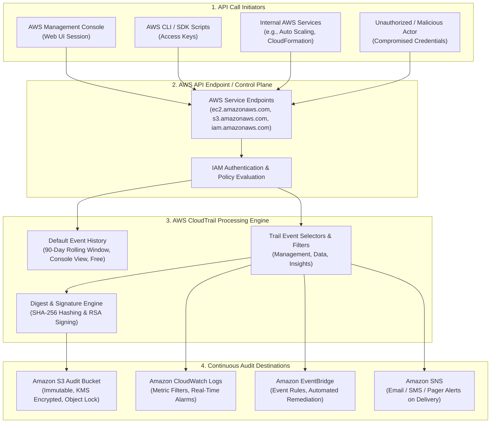
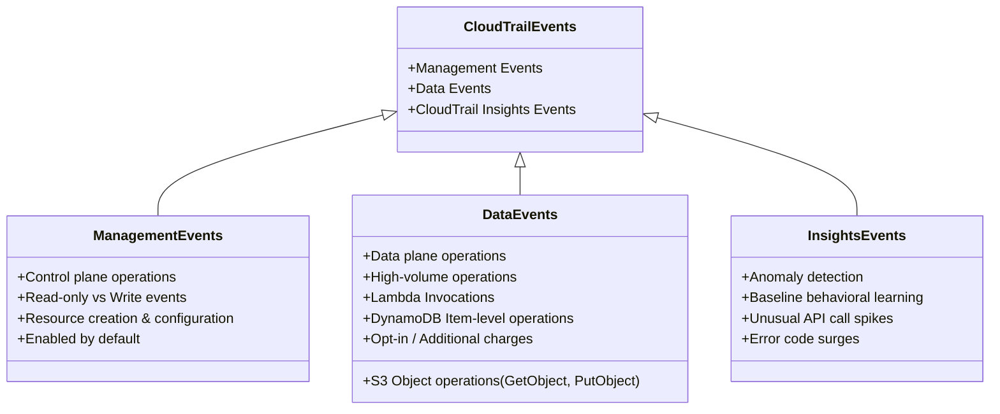
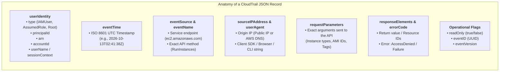
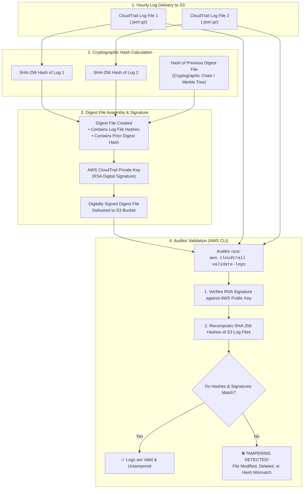
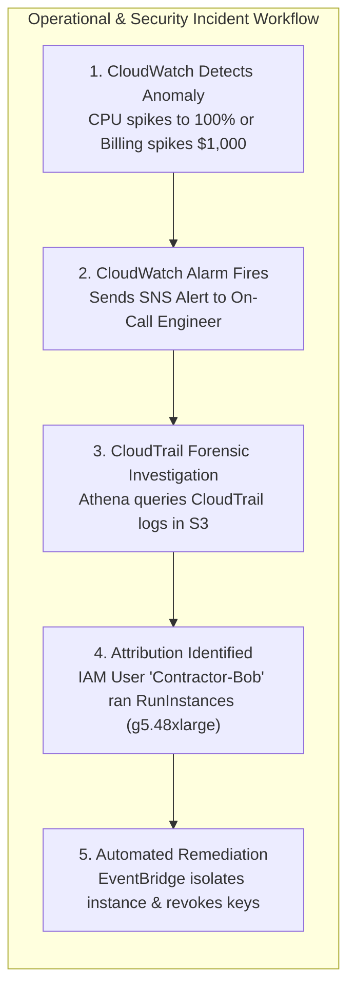

# 🛡️ AWS CloudTrail: Governance, Compliance & API Operational Auditing

> **Course**: AWS re/Start  
> **Module**: Monitoring and Security – M13 AWS CloudTrail  
> **Source**: `T20-0005-RSJAWS_EN-US_SG_M13_AWSCLOUDTRAIL.pdf`  
> **Target Audience**: AWS re/Start Learners / Cloud Practitioners / SysOps Administrators / Security Engineers / Solutions Architects  

---

## 🎯 Executive Summary & Learning Objectives

Enterprise governance, risk management, and regulatory compliance require an immutable, comprehensive audit log of every action taken within a cloud infrastructure. In traditional on-premises data centers, tracking who accessed an asset, modified a firewall rule, or provisioned a server required inspecting disparate operating system logs, physical access badges, and fragmented network appliances.

In Amazon Web Services (AWS), virtually every interaction—whether initiated through the AWS Management Console, the AWS Command Line Interface (AWS CLI), AWS Software Development Kits (SDKs), or internal automation—is an authenticated and authorized call to the **AWS Application Programming Interface (API)**.

**AWS CloudTrail** is the native AWS auditing service that captures, continuously monitors, and retains account activity across your entire AWS infrastructure. By providing deep forensic visibility into *"Who did what, where, when, and from which IP address,"* CloudTrail underpins security analytics, resource change tracking, compliance auditing, and operational troubleshooting.

```
┌────────────────────────────────────────────────────────────────────────────────────────┐
│                        The CloudTrail Governance & Audit Mandate                       │
├──────────────────────────┬───────────────────────────┬─────────────────────────────────┤
│ 1. Complete Visibility   │ 2. Compliance & Audit     │ 3. Security & Forensics         │
│ Records every API call   │ Meets PCI-DSS, HIPAA,     │ Detects unauthorized access,    │
│ across AWS accounts and  │ SOC 1/2/3, and ISO 27001  │ credential abuse, and privilege │
│ supported services.      │ statutory audit mandates. │ escalation in near real-time.   │
└──────────────────────────┴───────────────────────────┴─────────────────────────────────┘
```

---

### 📌 Learning Objectives

- [ ] **Define AWS CloudTrail**: Explain the fundamental purpose, operational scope, and business value of AWS CloudTrail in governance, compliance, operational auditing, and risk management.
- [ ] **Distinguish Event History from Trails**: Contrast the default, free 90-day CloudTrail Event History against customized Single-Region and Multi-Region Trails.
- [ ] **Classify CloudTrail Event Types**: Differentiate between **Management Events** (Control Plane), **Data Events** (Data Plane), and **CloudTrail Insights Events** (Anomaly Detection).
- [ ] **Demarcate the Auditing Visibility Boundary**: Identify actions captured by CloudTrail versus internal operating system commands executed inside Amazon EC2 instances.
- [ ] **Deconstruct CloudTrail JSON Log Records**: Dissect the core anatomy of a log record, including `eventTime`, `eventSource`, `eventName`, `userIdentity`, `sourceIPAddress`, `userAgent`, `requestParameters`, `responseElements`, and `readOnly`.
- [ ] **Implement Log File Integrity Validation**: Explain how SHA-256 cryptographic hashing and digital RSA signatures detect log tampering, modification, or unauthorized deletion.
- [ ] **Enforce Security & Storage Hardening**: Protect audit logs using AWS KMS Customer Managed Keys (CMKs), Amazon S3 Object Lock (Compliance Mode), and MFA Delete.
- [ ] **Synthesize CloudWatch and CloudTrail**: Compare and contrast Amazon CloudWatch and AWS CloudTrail across telemetry type, focus, retention, and incident response workflows.

---

## 📐 1. Architectural Overview & Core Concepts

### What is AWS CloudTrail?

AWS CloudTrail is an AWS service that generates continuous records of calls made to the AWS API. Because the AWS API underlies the AWS Management Console, the AWS CLI, AWS SDKs, and native inter-service automation, CloudTrail provides an exhaustive paper trail of infrastructure activity.



### Critical Operational Boundary: What CloudTrail Does NOT Track

A foundational principle for AWS certification and operational administration is understanding the **boundary of observability**:

> [!CAUTION]
> **Guest OS Boundary**: AWS CloudTrail does **NOT** track commands, scripts, or operational activities executed *inside* an Amazon EC2 operating system.
> 
> - **Logged by CloudTrail**: An API call to `ec2:StopInstances` or `ec2:TerminateInstances` issued via the AWS CLI or AWS Console.
> - **NOT Logged by CloudTrail**: A systems administrator logging into an EC2 instance via SSH/RDP and running `sudo shutdown -h now` or modifying `/etc/passwd`.
> - **Remediation for Guest OS Tracking**: Internal OS events require OS-level audit tooling (e.g., Linux `auditd`, Windows Event Forwarding, AWS Systems Manager Session Manager logging, or the Amazon CloudWatch Unified Agent).

---

## 🔍 2. CloudTrail Delivery Channels & Event Classification

### Event History vs. Configured Trails

AWS CloudTrail operates in two primary tiers: the default **Event History** and user-configured **Trails**.

| Operational Dimension | CloudTrail Event History | User-Configured Trail |
| :--- | :--- | :--- |
| **Setup Required** | None (Enabled by default in all AWS accounts) | Yes (Configured via Console, CLI, or CloudFormation) |
| **Retention Window** | Exactly **90 days** (Rolling window) | **Indefinite** (Governed by Amazon S3 Lifecycle policies) |
| **Scope** | Regional view (Current Region selected in Console) | **Multi-Region** (Recommended) or Single-Region |
| **Logged Event Types** | Management Events only (Create, Modify, Delete, Account activity) | Management Events, **Data Events**, and **Insights Events** |
| **Storage Destination** | Ephemeral CloudTrail console cache | Amazon S3, Amazon CloudWatch Logs, Amazon EventBridge |
| **Cost** | **100% Free** | Free delivery of 1st copy of management events to S3; S3 storage/KMS/Data events apply |
| **Log Integrity** | Not supported | Supported via cryptographic digest files |

---

### CloudTrail Event Types



#### 1. Management Events (Control Plane)
Management events capture operations executed against AWS resources at the administrative and configuration level:
- **Scope**: Configuring security groups (`AuthorizeSecurityGroupIngress`), creating VPC subnets, provisioning EC2 instances (`RunInstances`), configuring IAM policies (`AttachRolePolicy`), or setting up logging.
- **Read vs. Write Split**:
  - *Read-only events*: Operations that query configuration without modifying state (e.g., `DescribeInstances`, `ListBuckets`, `GetAccountSettings`).
  - *Write events*: Operations that mutate state (e.g., `TerminateInstances`, `DeleteBucket`, `CreateUser`).
- **Default State**: Trails log all management events by default.

#### 2. Data Events (Data Plane)
Data events capture resource-level operational interactions with or within a resource:
- **Scope**:
  - **Amazon S3**: Object-level APIs (`GetObject`, `PutObject`, `DeleteObject`).
  - **AWS Lambda**: Function invocations (`Invoke`).
  - **Amazon DynamoDB**: Item-level queries and updates (`PutItem`, `GetItem`, `DeleteItem`).
- **Characteristics**: Extremely high transaction volume.
- **Default State**: Disabled by default to prevent unintended log volume and billing costs. Must be explicitly enabled on a per-resource or per-prefix basis.

#### 3. CloudTrail Insights Events
CloudTrail Insights helps users detect unusual operational and security activity by analyzing CloudTrail management write events:
- **Mechanism**: Establishes a mathematical baseline of typical account API patterns over a rolling window.
- **Trigger Conditions**: Spikes in call volume, sudden surges in error codes (e.g., `Client.UnauthorizedOperation` or `ResourceNotFoundException`), or sudden bursts of compute launches.
- **Output**: Generates an Insights event record identifying the start time, duration, and root cause API.

---

## 🧾 3. Anatomy of a CloudTrail Log Record (JSON Schema)

Every CloudTrail log record is structured as a standardized JavaScript Object Notation (JSON) object. Understanding the schema is essential for security auditing, SIEM ingestion, and Athena SQL queries.



### Key JSON Log Fields

| JSON Field Name | Data Type | Description & Forensic Significance |
| :--- | :--- | :--- |
| `eventVersion` | String | Current version of the CloudTrail record schema (e.g., `"1.08"`). |
| `userIdentity` | Object | Comprehensive identity details of the principal who made the request (Root, IAM user, Assumed Role, Federated, or AWS Service). |
| `eventTime` | String (ISO 8601) | Exact date and time the request was processed in Coordinated Universal Time (UTC). |
| `eventSource` | String | The AWS service endpoint handling the request (e.g., `ec2.amazonaws.com`, `signin.amazonaws.com`, `s3.amazonaws.com`). |
| `eventName` | String | The exact API action executed (e.g., `ConsoleLogin`, `RunInstances`, `DeleteSecurityGroup`). |
| `awsRegion` | String | The AWS Region where the action took place (e.g., `us-east-1`, `eu-west-1`). |
| `sourceIPAddress` | String | The originating public IPv4/IPv6 address of the caller, or the internal DNS name of an AWS service. |
| `userAgent` | String | The client software, CLI version, browser string, or SDK used to initiate the call. |
| `requestParameters` | Object | The precise input parameters provided in the API call (e.g., security group rules, instance types, key names). |
| `responseElements` | Object | The results returned by the service if the call succeeded (e.g., newly generated instance IDs, token responses). `null` if the request did not mutate state or was rejected. |
| `errorCode` | String | The specific error code returned if the action was denied or failed (e.g., `AccessDenied`, `Client.UnauthorizedOperation`, `Failed authentication`). |
| `errorMessage` | String | Human-readable explanation of why the action failed. |
| `readOnly` | Boolean | `true` if the call only read metadata (`Describe*`, `List*`); `false` if it created, modified, or deleted resources. |
| `eventID` | String (UUID) | A globally unique identifier for the specific event record, used for deduplication. |

---

### Real-World Log Examples

#### Example 1: Successful AWS Management Console Login (with MFA)

```json
{
  "eventVersion": "1.08",
  "userIdentity": {
    "type": "IAMUser",
    "principalId": "AIDAEXAMPLEUSERID123",
    "arn": "arn:aws:iam::111122223333:user/secadmin",
    "accountId": "111122223333",
    "userName": "secadmin"
  },
  "eventTime": "2026-10-12T14:22:15Z",
  "eventSource": "signin.amazonaws.com",
  "eventName": "ConsoleLogin",
  "awsRegion": "us-east-1",
  "sourceIPAddress": "198.51.100.42",
  "userAgent": "Mozilla/5.0 (X11; Linux x86_64; rv:124.0) Gecko/20100101 Firefox/124.0",
  "requestParameters": null,
  "responseElements": {
    "ConsoleLogin": "Success"
  },
  "additionalEventData": {
    "MobileVersion": "No",
    "LoginTo": "https://console.aws.amazon.com/console/home",
    "MFAUsed": "Yes"
  },
  "eventID": "c45a86d2-4321-4f8a-9f50-02a8397a6123",
  "readOnly": false,
  "eventType": "AwsConsoleSignIn",
  "recipientAccountId": "111122223333"
}
```

> [!NOTE]
> In this successful login record, observe that `responseElements.ConsoleLogin` is `"Success"` and `additionalEventData.MFAUsed` is `"Yes"`. This confirms that security protocols were adhered to.

---

#### Example 2: Failed Console Login Attempt (Potential Brute-Force)

```json
{
  "eventVersion": "1.08",
  "userIdentity": {
    "type": "IAMUser",
    "principalId": "AIDAEXAMPLEUSERID456",
    "arn": "arn:aws:iam::111122223333:user/finance_auditor",
    "accountId": "111122223333",
    "userName": "finance_auditor"
  },
  "eventTime": "2026-10-12T14:25:01Z",
  "eventSource": "signin.amazonaws.com",
  "eventName": "ConsoleLogin",
  "awsRegion": "us-east-1",
  "sourceIPAddress": "203.0.113.195",
  "userAgent": "Mozilla/5.0 (Windows NT 10.0; Win64; x64)",
  "errorMessage": "Failed authentication",
  "requestParameters": null,
  "responseElements": {
    "ConsoleLogin": "Failure"
  },
  "additionalEventData": {
    "MobileVersion": "No",
    "LoginTo": "https://console.aws.amazon.com/console/home",
    "MFAUsed": "No"
  },
  "eventID": "89eb511a-8c91-4d15-bbf2-8903e1e231bc",
  "readOnly": false,
  "eventType": "AwsConsoleSignIn",
  "recipientAccountId": "111122223333"
}
```

> [!WARNING]
> In this failed record, `responseElements.ConsoleLogin` equals `"Failure"` and `errorMessage` states `"Failed authentication"`. Multiple sequential events matching this pattern from an unrecognized `sourceIPAddress` indicate a brute-force or credential-stuffing attack.

---

#### Example 3: Unauthorized EC2 API Call (`AccessDenied`)

```json
{
  "eventVersion": "1.08",
  "userIdentity": {
    "type": "IAMUser",
    "principalId": "AIDAEXAMPLEROLE789",
    "arn": "arn:aws:iam::111122223333:user/intern_developer",
    "accountId": "111122223333",
    "userName": "intern_developer"
  },
  "eventTime": "2026-10-12T15:04:12Z",
  "eventSource": "ec2.amazonaws.com",
  "eventName": "TerminateInstances",
  "awsRegion": "us-west-2",
  "sourceIPAddress": "192.0.2.77",
  "userAgent": "aws-cli/2.15.15 Python/3.11.6 Linux/6.5.0 botocore/2.4.15",
  "errorCode": "Client.UnauthorizedOperation",
  "errorMessage": "You are not authorized to perform this operation. Encoded authorization failure message: ABC123DEF456...",
  "requestParameters": {
    "instancesSet": {
      "items": [
        {
          "instanceId": "i-0123456789abcdef0"
        }
      ]
    }
  },
  "responseElements": null,
  "readOnly": false,
  "eventType": "AwsApiCall",
  "recipientAccountId": "111122223333"
}
```

---

## 🔒 4. Security, Integrity & Regulatory Compliance

Audit logs are the primary targets of sophisticated attackers seeking to erase evidence of lateral movement or unauthorized privilege escalation. AWS CloudTrail incorporates enterprise security and non-repudiation features.

### Log File Integrity Validation

When log file integrity validation is enabled, CloudTrail automatically creates a **digest file** every hour. The digest file contains cryptographic hashes of all the log files delivered during that hour.



#### What Log File Integrity Proves:
1. **No Modification**: The content of the log files was not altered after CloudTrail wrote them.
2. **No Deletion**: Every log file delivered by CloudTrail exists; if a file was deleted from S3, the digest file reveals a missing file hash.
3. **Non-Repudiation**: Because digest files are digitally signed with an AWS RSA private key, no third party or compromised IAM role can counterfeit valid digest records.

```bash
# Validating CloudTrail log file integrity using the AWS CLI
aws cloudtrail validate-logs \
    --trail-name Security-Audit-Trail \
    --start-time 2026-10-01T00:00:00Z \
    --end-time 2026-10-12T23:59:59Z
```

---

### Audit Storage Hardening Best Practices

```
┌────────────────────────────────────────────────────────────────────────────────────────┐
│                        CloudTrail Storage Hardening Defense-in-Depth                   │
├────────────────────────────────┬─────────────────────────────┬─────────────────────────┤
│ 1. AWS KMS CMK Encryption      │ 2. S3 Object Lock           │ 3. Dedicated Log Account│
│ Envelope encryption using      │ Compliance mode (WORM)      │ Centralized delivery to │
│ Customer Managed Keys with     │ prevents modification or    │ isolated AWS account    │
│ strict key policies.           │ deletion, even by root.     │ with cross-account IAM. │
└────────────────────────────────┴─────────────────────────────┴─────────────────────────┘
```

1. **AWS KMS Customer Managed Keys (CMKs)**:
   - By default, CloudTrail log files are encrypted at rest using Amazon S3-managed encryption keys (SSE-S3).
   - Enterprise security requires using a **Customer Managed Key (CMK)** with AWS Key Management Service (AWS KMS). This allows fine-grained KMS key policies that grant `cloudtrail.amazonaws.com` permission to generate data keys while strictly denying unauthorized principals permission to decrypt audit logs.

2. **Amazon S3 Object Lock (WORM Storage)**:
   - Configure the destination S3 bucket with **Object Lock in Compliance Mode**.
   - Ensures Write Once, Read Many (WORM) compliance. In Compliance mode, no IAM user and **not even the AWS root account** can delete or overwrite audit logs during the retention retention period.

3. **MFA Delete**:
   - Enable S3 Versioning and **MFA Delete** on the destination bucket.
   - Deleting any log version permanently requires hardware or virtual Multi-Factor Authentication token authorization.

4. **Dedicated Security & Logging Account Architecture**:
   - In AWS Organizations multi-account environments, trails should write to an S3 bucket residing in a dedicated **Log Archive** or **Security** AWS account.
   - Production account administrators possess no permissions to modify or delete logs stored in the centralized logging account.

---

## ⚖️ 5. Amazon CloudWatch vs. AWS CloudTrail: Comprehensive Matrix

A frequent point of confusion for cloud practitioners is distinguishing between Amazon CloudWatch and AWS CloudTrail. While both services serve the broader domain of monitoring and observability, their architectural focus, ingestion sources, and use cases are distinct and complementary.

| Evaluation Criterion | Amazon CloudWatch | AWS CloudTrail |
| :--- | :--- | :--- |
| **Primary Domain** | **Performance & Operational Health** | **Governance, Auditing & Compliance** |
| **Fundamental Question** | *"What is happening right now, and how healthy is the infrastructure?"* | *"Who did what, where, when, and from which IP address?"* |
| **Core Telemetry Type** | Numeric time-series **Metrics**, raw operational **Logs**, and **Traces** (X-Ray) | Structured **Audit Event Records** (JSON-formatted API calls) |
| **Ingestion Mechanism** | Hypervisors, CloudWatch Agent, native AWS service status, API `PutMetricData` | Interception of AWS API calls (Console, CLI, SDKs, AWS services) |
| **Operating System Visibility** | **Yes** (via CloudWatch Unified Agent: RAM, Disk Space, Swap, OS logs) | **No** (Stops at AWS API; cannot see internal guest OS commands) |
| **Default Retention** | 15 months (Rolling downsampled tiers) | 90 days (Free Event History); Indefinite in Amazon S3 |
| **Alerting & Automation** | Built-in **Alarms** triggering SNS, Auto Scaling, or EC2 actions | Sends events to **EventBridge** or streams to **CloudWatch Logs** for alarms |
| **Primary End Users** | DevOps Engineers, SREs, System Administrators, Application Developers | Security Operations Centers (SOC), Compliance Auditors, Risk Officers |
| **Forensic Capability** | Shows system impact (e.g., CPU spiked to 100%, memory leak occurred) | Shows root cause identity (e.g., Admin attached an unauthorized policy) |



> [!TIP]
> **Complementary Synergy**: CloudWatch and CloudTrail are engineered to work together. CloudWatch identifies *that* a metric or performance threshold was violated, while CloudTrail identifies *who* altered the environment to cause the violation.

---

## 🛠️ 6. Real-World Forensic Analysis & Hands-On Investigation

CloudTrail logs provide immediate answers to critical administrative and forensic questions.

### Forensic Investigation Scenarios

#### Scenario 1: Investigating Unexpected EC2 Instance Termination
- **The Problem**: A critical production database instance (`i-0a1b2c3d4e5f67890`) was terminated unexpectedly during business hours.
- **Forensic Query**: Search CloudTrail for `eventName = TerminateInstances`.
- **Finding**: The log identifies `userIdentity.arn` as `arn:aws:iam::111122223333:user/build-pipeline-service-account` and `sourceIPAddress` as an internal CI/CD runner. An automated deployment script misidentified the production instance as a staging environment.

#### Scenario 2: Detecting Open Security Group Modification
- **The Problem**: An external vulnerability scan alerts that SSH port 22 is open to the entire internet (`0.0.0.0/0`) on a sensitive bastion host.
- **Forensic Query**: Filter CloudTrail logs by `eventName = AuthorizeSecurityGroupIngress`.
- **Finding**: The `requestParameters` block contains the CIDR `0.0.0.0/0` and port range `22-22`. `userIdentity.userName` identifies a junior developer who temporarily opened access for remote troubleshooting and forgot to revoke it.

#### Scenario 3: Identifying Suspicious Activity from Foreign IP Addresses
- **The Problem**: Security monitoring detects API activity outside corporate VPN CIDR blocks.
- **Forensic Query**: Inspect `sourceIPAddress` across management write events.
- **Finding**: CloudTrail captures API calls (`CreateAccessKey`, `RunInstances`) originating from an unrecognized international IP address using root credentials. This triggers an immediate incident response to rotate root passwords and revoke access keys.

---

### Step-by-Step CLI Walkthrough: Configuring a Multi-Region Trail

```bash
# Step 1: Create a dedicated, private Amazon S3 bucket for audit logs
aws s3api create-bucket \
    --bucket company-central-audit-logs-2026 \
    --region us-east-1

# Step 2: Block all public access on the audit bucket
aws s3api put-public-access-block \
    --bucket company-central-audit-logs-2026 \
    --public-access-block-configuration "BlockPublicAcls=true,IgnorePublicAcls=true,BlockPublicPolicy=true,RestrictPublicBuckets=true"

# Step 3: Apply an S3 Bucket Policy granting CloudTrail write permissions
aws s3api put-bucket-policy \
    --bucket company-central-audit-logs-2026 \
    --policy file://cloudtrail-bucket-policy.json

# Step 4: Create a Multi-Region Trail with Log File Integrity Validation enabled
aws cloudtrail create-trail \
    --name Enterprise-Security-Trail \
    --s3-bucket-name company-central-audit-logs-2026 \
    --is-multi-region-trail \
    --enable-log-file-validation \
    --include-global-service-events

# Step 5: Start logging account activity
aws cloudtrail start-logging \
    --name Enterprise-Security-Trail

# Step 6: Verify trail status
aws cloudtrail get-trail-status \
    --name Enterprise-Security-Trail
```

---

## 📝 7. Knowledge Check & Exam Review Questions

### Question 1
A security analyst discovers that a production Amazon EC2 instance was rebooted via an internal operating system command (`sudo reboot`) executed inside an active SSH terminal session. When inspecting AWS CloudTrail event history, the analyst cannot locate any record of this reboot action. What is the reason for this missing record?
- A. The analyst neglected to enable a Multi-Region Trail.
- B. CloudTrail only records read operations; write operations require CloudWatch.
- C. CloudTrail captures calls to the AWS API and does not track operating system commands executed within an Amazon EC2 instance.
- D. Log file integrity validation was disabled on the trail.

> **Answer: C**  
> **Explanation**: AWS CloudTrail captures actions executed via the AWS API (such as an `ec2:RebootInstances` API call). It does not monitor or record guest operating system activities or shell commands executed inside an EC2 instance. Internal OS activity requires host-based auditing agents (such as Linux `auditd`, SSM Session Manager logging, or the CloudWatch Unified Agent).

---

### Question 2
An organization requires an audit log of all changes made to their AWS infrastructure for statutory compliance. The auditor requests proof that the stored log files have not been modified, replaced, or deleted since CloudTrail delivered them to the Amazon S3 bucket. Which CloudTrail feature fulfills this requirement?
- A. Server-Side Encryption with S3-managed keys (SSE-S3)
- B. CloudTrail Log File Integrity Validation
- C. CloudTrail Insights Events
- D. Amazon CloudWatch Metric Filters

> **Answer: B**  
> **Explanation**: CloudTrail Log File Integrity Validation generates hourly digest files containing SHA-256 cryptographic hashes of delivered log files and signs them with an AWS RSA private key. Auditors can run `aws cloudtrail validate-logs` to mathematically prove that log files have not been modified, overwritten, or deleted.

---

### Question 3
A Solutions Architect wants to track when users download objects (`GetObject`) from a sensitive Amazon S3 financial bucket. The architect opens the CloudTrail Event History console but sees no records of `GetObject` API calls. What configuration is required to log these events?
- A. Enable AWS Config on the S3 bucket.
- B. Create a trail and configure S3 Data Events for the financial bucket.
- C. Enable CloudTrail Insights on management events.
- D. Enable Detailed Monitoring in Amazon CloudWatch.

> **Answer: B**  
> **Explanation**: Default CloudTrail Event History only records Management Events (control plane operations like `CreateBucket` or `DeleteBucket`). High-volume resource operations such as S3 object operations (`GetObject`, `PutObject`) are classified as **Data Events**. Data events must be explicitly configured within a custom Trail.

---

### Question 4
An enterprise maintains an AWS Organization with 50 member accounts. The Chief Information Security Officer (CISO) requires a centralized, tamper-proof record of all API activity across every account and Region. What is the most architecturally sound approach?
- A. Configure a Single-Region Trail in each member account's default Region pointing to local S3 buckets.
- B. Create an Organization Trail in the management account that logs all multi-region management events to an S3 bucket in a dedicated Log Archive account.
- C. Write a custom Python script to poll Event History in every account every 90 days.
- D. Install the Amazon CloudWatch Agent on every instance to capture AWS API transactions.

> **Answer: B**  
> **Explanation**: An Organization Trail created in the management account applies automatically to all member accounts across all AWS Regions. Storing logs in an isolated, dedicated Log Archive account ensures centralized access control and defense against compromised member account administrators.

---

### Question 5
How long does AWS CloudTrail retain management events in the default **Event History** console view without any trail configuration, and what is the cost?
- A. 30 days, free of charge
- B. 90 days, free of charge
- C. 15 months, standard S3 charges
- D. Indefinitely, free of charge

> **Answer: B**  
> **Explanation**: CloudTrail Event History automatically records and retains management events for a rolling **90 days** in all AWS accounts at zero cost. To retain logs beyond 90 days or log data events, an S3-backed Trail must be created.

---

## 📚 8. Key Takeaways & Exam Cheat Sheet

| Topic / Feature | Core Operational Rule | High-Priority Exam / Architecture Fact |
| :--- | :--- | :--- |
| **Core Function** | API Auditing & Governance | Records *"Who did what, where, when, and from which IP"* across the AWS API. |
| **Event History** | Default 90-Day Rolling Window | Available out of the box in every Region; free of charge; limited to management events. |
| **Trails** | Continuous S3 Delivery | Delivers permanent log streams to S3, CloudWatch Logs, and EventBridge. Multi-Region recommended. |
| **Management Events** | Control Plane Operations | Captures creation, modification, and deletion of AWS infrastructure (`RunInstances`, `CreateBucket`). |
| **Data Events** | Data Plane Operations | High volume (`GetObject`, `PutItem`, `Invoke`). Opt-in and incurs additional costs. |
| **Insights Events** | Anomaly Detection | Machine learning baseline detects anomalous bursts of management write calls and API throttling. |
| **OS Boundary** | AWS API vs. Guest OS | CloudTrail does **NOT** log commands executed inside EC2 instances (e.g. `sudo reboot`). |
| **Log Integrity** | SHA-256 + RSA Digests | Proves logs were not modified, overwritten, or deleted in S3 (`aws cloudtrail validate-logs`). |
| **Bucket Hardening** | Defense-in-Depth | Use KMS CMKs, S3 Object Lock (Compliance mode), MFA Delete, and dedicated Log Archive accounts. |
| **CloudWatch vs CloudTrail** | Health vs Auditing | CloudWatch monitors *performance metrics and health*; CloudTrail logs *API activity and identity attribution*. |
