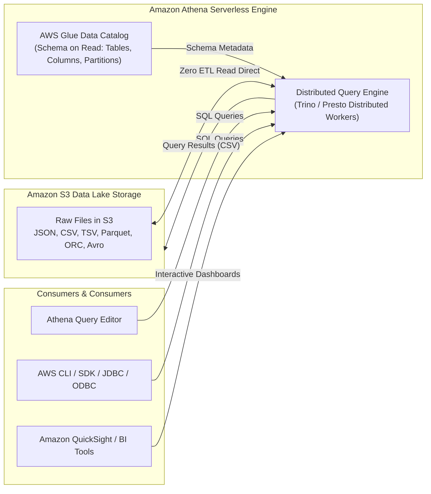
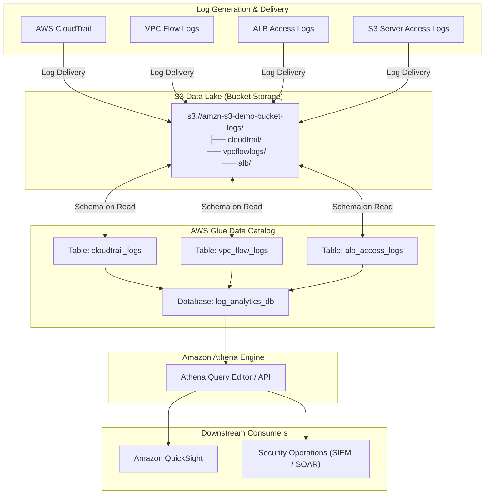
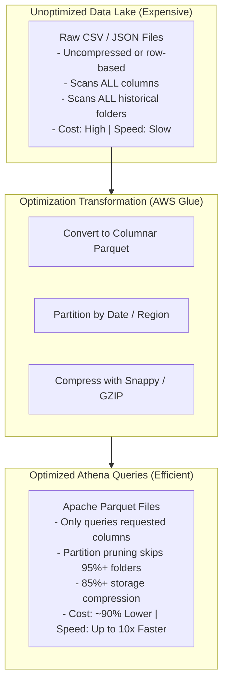
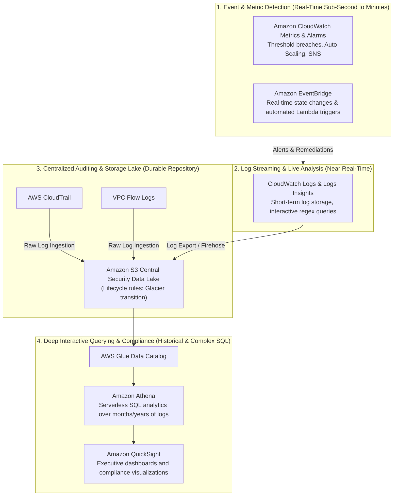

# 🔍 Amazon Athena: Serverless SQL Log Analytics & AWS Service Integrations

> **Course**: AWS re/Start  
> **Module**: Monitoring and Security – M13 AWS Service Integration with Amazon Athena  
> **Source**: `T20-0006-RSJAWS_EN-US_SG_M13_AWSSERVICEINTEGRATE.pdf`  
> **Target Audience**: AWS re/Start Learners / Cloud Practitioners / SysOps Administrators / Security Engineers / Data Engineers  

---

## 🎯 Executive Summary & Learning Objectives

In enterprise cloud infrastructures, monitoring and security systems generate terabytes of unstructured and semi-structured log telemetry daily. Services such as **AWS CloudTrail**, **Amazon VPC Flow Logs**, **Application Load Balancers (ALB)**, and **Amazon S3** record every API call, network packet decision, HTTP request, and object access. However, collecting logs into Amazon S3 solves only half the operational challenge—security and DevOps teams require the ability to rapidly aggregate, parse, filter, and interrogate this telemetry during incident response, threat hunting, compliance auditing, and root-cause analysis.

Traditional log analytics required provisioning, configuring, and maintaining dedicated compute clusters or search clusters (such as Elasticsearch/OpenSearch or Amazon EMR). **Amazon Athena** fundamentally transforms this paradigm by providing an interactive, serverless SQL query engine built directly on top of Amazon Simple Storage Service (Amazon S3). With zero infrastructure to provision or manage, engineers can execute standard ANSI SQL queries against raw log data residing in S3 buckets within seconds.

```
┌────────────────────────────────────────────────────────────────────────────────────────┐
│                        The Amazon Athena Serverless Value Model                        │
├─────────────────────────┬─────────────────────────────┬────────────────────────────────┤
│ 1. Zero Infrastructure  │ 2. Open Standards & Formats │ 3. Pure Pay-Per-Query Economy  │
│ No servers to provision,│ Standard ANSI SQL (Trino),  │ No hourly cluster fees. Pay    │
│ patch, or scale. True   │ queries CSV, JSON, ORC,     │ strictly $5.00 per TB of data  │
│ serverless execution.   │ Avro, and Apache Parquet.   │ scanned from Amazon S3.        │
└─────────────────────────┴─────────────────────────────┴────────────────────────────────┘
```

---

### 📌 Learning Objectives

- [ ] **Define Amazon Athena**: Explain the serverless architecture, underlying query engine (Trino/Presto), and core capabilities of Amazon Athena for interactive data analysis.
- [ ] **Analyze Athena Characteristics & Economics**: Articulate the pay-per-query cost model ($5.00 per TB scanned), absence of ETL overhead, and automated parallel query execution.
- [ ] **Integrate the AWS Glue Data Catalog**: Configure centralized metadata schemas, databases, tables, partitions, and SerDes (Serializer/Deserializers) for Athena.
- [ ] **Construct CloudTrail Log Analytics**: Automatically and manually define CloudTrail tables in Athena, and write SQL queries to detect unauthorized API calls (`AccessDenied`), root credential usage, and critical resource deletions.
- [ ] **Interrogate Amazon VPC Flow Logs**: Query network traffic logs to isolate top rejected IP sources, identify port scanning activity, and uncover suspicious data exfiltration channels.
- [ ] **Audit Application Load Balancer (ALB) Logs**: Parse ALB access logs to evaluate HTTP 5xx error spikes, calculate backend target latencies, and flag anomalous client request volumes.
- [ ] **Investigate S3 Server Access Logs**: Query storage access logs to track 403 Forbidden events, large file extractions, and object-level forensic patterns.
- [ ] **Implement Performance & Cost Optimization**: Dramatically reduce data scanned and query runtimes using columnar storage (Apache Parquet), data partitioning, partition projection, and compression algorithms (Snappy/GZIP).
- [ ] **Synthesize the AWS Observability & Security Blueprint**: Integrate CloudWatch, CloudTrail, EventBridge, S3, Glue, and Athena into an automated, continuous compliance and incident response ecosystem.

---

## 📐 1. Architectural Foundation of Amazon Athena

### What is Amazon Athena?
**Amazon Athena** is an interactive query service that makes it easy to analyze data directly in **Amazon Simple Storage Service (Amazon S3)** using standard structured query language (**ANSI SQL**). 

Unlike traditional relational database management systems (RDBMS) or data warehouses (such as Amazon Redshift) that require data to be extracted, transformed, and loaded (ETL) into proprietary storage engines before analysis can occur, Athena executes queries directly on files stored in S3.



### Core Architectural Pillars

1. **Serverless Execution**:
   - There are no EC2 instances to configure, maintain, scale, or patch.
   - Athena dynamically provisions compute resources behind the scenes, executes queries across a distributed cluster, and deallocates compute upon completion.
2. **Schema-on-Read**:
   - Athena does not modify or reformat the data residing in Amazon S3.
   - Instead, it projects schema definitions onto the raw data at query time using SerDes (Serializer/Deserializers). Raw log files remain unaltered and durable in Amazon S3.
3. **Decoupled Compute and Storage**:
   - Storage is decoupled from compute: Amazon S3 provides 99.999999999% (11 9's) data durability, lifecycle management, and intelligent tiering.
   - Compute is transient and elastic, scaling automatically based on the complexity of the SQL query.
4. **Built on Open Source (Trino / Presto)**:
   - Athena runs on distributed SQL query engines originally developed by open-source communities (Trino and Presto).
   - It supports full ANSI SQL, including complex `JOIN`s, subqueries, window functions, arrays, and JSON parsing operators.

### Key Characteristics & Pricing Model

| Characteristic | Specification / Operational Mechanism |
| :--- | :--- |
| **Pricing Model** | **$5.00 per Terabyte (TB)** of data scanned from Amazon S3. |
| **Minimum Charge** | 10 Megabytes (MB) per query minimum. |
| **DDL Query Cost** | **$0.00 (Free)**. `CREATE`, `ALTER`, `DROP`, and partition management queries are completely free of charge. |
| **Failed Queries** | **$0.00 (Free)**. Queries that fail or are canceled before data is scanned incur no charge. |
| **ETL Requirement** | **Zero ETL required**. Points directly to existing files in S3 buckets. |
| **Query Output** | Every query execution generates a `.csv` result file and a `.csv.metadata` file saved to an S3 query results location. |
| **Concurrency** | Handles multiple parallel queries across large datasets with results returned in seconds. |

> [!IMPORTANT]
> Because Amazon Athena bills strictly based on the **volume of data scanned** from Amazon S3, query performance and cost efficiency are directly tied together. Reducing the number of bytes read from S3 through partitioning, columnar formats, and compression directly reduces query costs and accelerates execution speed.

### Supported Open Data Formats

Athena interfaces with various serialization formats using specialized SerDe implementations:

- **Text / Delimited**: Comma-Separated Values (`CSV`), Tab-Separated Values (`TSV`).
- **Semi-Structured**: JavaScript Object Notation (`JSON`).
- **Columnar**: **Apache Parquet**, **Apache ORC** (Optimized Row Columnar).
- **Binary / Serialization**: Apache Avro, Protocol Buffers.

---

## 🗄️ 2. AWS Glue Data Catalog Integration

Athena uses the **AWS Glue Data Catalog** as its centralized, managed metadata store. The Glue Data Catalog stores table definitions, column data types, and physical Amazon S3 location pointers, providing a unified metastore shared across Athena, Amazon EMR, AWS Lake Formation, and Amazon Redshift Spectrum.



### Key Elements of Athena Table Definitions (DDL)

1. **`EXTERNAL TABLE`**: All tables created in Athena are external tables. Dropping a table in Athena deletes only the metadata in the Glue Data Catalog; the underlying log files in Amazon S3 remain intact.
2. **`ROW FORMAT SERDE`**: Instructs the Athena query engine on which library to use to serialize and deserialize data lines (e.g., `org.apache.hadoop.hive.ql.io.parquet.serde.ParquetHiveSerDe`, `org.openx.data.jsonserde.JsonSerDe`).
3. **`LOCATION`**: The absolute Amazon S3 URI path (e.g., `s3://my-log-bucket/AWSLogs/111122223333/CloudTrail/`) where the files are stored.
4. **`PARTITIONED BY`**: Columns used to logically divide data into directory paths (e.g., `year=2026/month=10/day=13/`), eliminating the need to scan irrelevant files during queries.

---

## 🛡️ 3. Querying AWS CloudTrail Logs with Athena

AWS CloudTrail records AWS Management Console actions and API calls made within an AWS account. Delivering CloudTrail logs to an Amazon S3 bucket allows security analysts to perform historical compliance audits, detect account compromises, and investigate unauthorized infrastructure changes.

### Generating Tables: Console vs. Custom DDL

AWS simplifies CloudTrail log analysis by offering a one-click automated table generator directly inside the **AWS CloudTrail console**:
1. Navigate to the **CloudTrail** console, select **Event history**.
2. Click **Create Athena table**.
3. Select the S3 bucket where CloudTrail logs are delivered. CloudTrail automatically generates an optimized Athena DDL statement with built-in partition projections.

Alternatively, administrators can manually define the table in the Athena Query Editor:

```sql
CREATE EXTERNAL TABLE cloudtrail_logs (
    eventVersion STRING,
    userIdentity STRUCT<
        type: STRING,
        principalId: STRING,
        arn: STRING,
        accountId: STRING,
        invokedBy: STRING,
        accessKeyId: STRING,
        userName: STRING,
        sessionContext: STRUCT<
            attributes: STRUCT<
                mfaAuthenticated: STRING,
                creationDate: STRING>,
            sessionIssuer: STRUCT<
                type: STRING,
                principalId: STRING,
                arn: STRING,
                accountId: STRING,
                userName: STRING>>>,
    eventTime STRING,
    eventSource STRING,
    eventName STRING,
    awsRegion STRING,
    sourceIpAddress STRING,
    userAgent STRING,
    errorCode STRING,
    errorMessage STRING,
    requestParameters STRING,
    responseElements STRING,
    additionalEventData STRING,
    requestId STRING,
    eventId STRING,
    resources ARRAY<STRUCT<
        arn: STRING,
        accountId: STRING,
        type: STRING>>,
    eventType STRING,
    recipientAccountId STRING,
    serviceEventDetails STRING,
    sharedEventID STRING,
    vpcEndpointId STRING
)
ROW FORMAT SERDE 'org.apache.hive.hcatalog.data.JsonSerDe'
STORED AS INPUTFORMAT 'com.amazon.emr.cloudtrail.CloudTrailInputFormat'
OUTPUTFORMAT 'org.apache.hadoop.hive.ql.io.HiveIgnoreKeyTextOutputFormat'
LOCATION 's3://amzn-s3-demo-bucket-logs/AWSLogs/111122223333/CloudTrail/us-east-1/';
```

---

### High-Value Security Queries for AWS CloudTrail

#### 1. Isolating Unauthorized API Calls (`AccessDenied`)
Attackers who obtain compromised credentials often probe account permissions, generating bursts of access-denied errors across various services.

```sql
SELECT
    eventTime,
    userIdentity.arn AS user_arn,
    sourceIpAddress,
    eventSource,
    eventName,
    errorCode,
    errorMessage
FROM cloudtrail_logs
WHERE errorCode IN ('AccessDenied', 'UnauthorizedOperation')
  AND eventTime >= '2026-10-01T00:00:00Z'
ORDER BY eventTime DESC
LIMIT 50;
```

#### 2. Auditing Root Account Logins and Activity
AWS best practices mandate that the root user account should not be used for daily administrative operations. Any activity originating from the root user must be investigated immediately.

```sql
SELECT
    eventTime,
    userIdentity.type AS identity_type,
    userIdentity.arn AS root_arn,
    eventName,
    awsRegion,
    sourceIpAddress,
    userAgent,
    additionalEventData
FROM cloudtrail_logs
WHERE userIdentity.type = 'Root'
  AND eventTime >= '2026-10-01T00:00:00Z'
ORDER BY eventTime DESC;
```

#### 3. Tracking Critical Resource Deletions
Malicious actors or accidental operational errors often involve dropping production assets (databases, S3 buckets, security groups, or VPC routes).

```sql
SELECT
    eventTime,
    userIdentity.userName AS operator,
    eventSource,
    eventName,
    awsRegion,
    sourceIpAddress,
    requestParameters
FROM cloudtrail_logs
WHERE eventName LIKE 'Delete%' 
   OR eventName LIKE 'Terminate%'
   OR eventName LIKE 'Drop%'
ORDER BY eventTime DESC
LIMIT 100;
```

#### 4. Console Logins Without Multi-Factor Authentication (MFA)
Identify console logins where MFA was not utilized, exposing the account to credential stuffing or phishing threats.

```sql
SELECT
    eventTime,
    userIdentity.userName,
    sourceIpAddress,
    additionalEventData
FROM cloudtrail_logs
WHERE eventName = 'ConsoleLogin'
  AND json_extract_scalar(additionalEventData, '$.MFAUsed') = 'No'
ORDER BY eventTime DESC;
```

---

## 🌐 4. Querying Amazon VPC Flow Logs with Athena

Amazon VPC Flow Logs capture detailed telemetry regarding IP traffic flowing to and from elastic network interfaces (ENIs), subnets, transit gateways, and entire VPCs.

### VPC Flow Log Format & Fields

A standard VPC Flow Log record contains space-delimited fields:

```
<version> <account-id> <interface-id> <srcaddr> <dstaddr> <srcport> <dstport> <protocol> <packets> <bytes> <start> <end> <action> <log-status>
```

```
2 111122223333 eni-0123456789abcdef0 198.51.100.5 10.0.1.25 44123 22 6 1 40 1697193600 1697193660 REJECT OK
```

### Table DDL with Date Partitioning

```sql
CREATE EXTERNAL TABLE IF NOT EXISTS vpc_flow_logs (
    version INT,
    account_id STRING,
    interface_id STRING,
    srcaddr STRING,
    dstaddr STRING,
    srcport INT,
    dstport INT,
    protocol BIGINT,
    packets BIGINT,
    bytes BIGINT,
    start_time BIGINT,
    end_time BIGINT,
    action STRING,
    log_status STRING
)
PARTITIONED BY (`date` STRING)
ROW FORMAT DELIMITED
FIELDS TERMINATED BY ' '
LOCATION 's3://amzn-s3-demo-bucket-logs/AWSLogs/111122223333/vpcflowlogs/us-east-1/'
TBLPROPERTIES ("skip.header.line.count"="1");
```

---

### High-Value Network & Threat Analysis Queries

#### 1. Top Rejected External Traffic Sources (Potential Scanners / Attackers)
Detect external IP addresses attempting to establish unauthorized connections blocked by Security Groups or Network ACLs.

```sql
SELECT
    srcaddr,
    dstport,
    COUNT(*) AS rejected_attempts,
    SUM(bytes) AS total_bytes_blocked
FROM vpc_flow_logs
WHERE action = 'REJECT'
  AND NOT (
      srcaddr LIKE '10.%' OR 
      srcaddr LIKE '172.16.%' OR 
      srcaddr LIKE '192.168.%'
  )
GROUP BY srcaddr, dstport
ORDER BY rejected_attempts DESC
LIMIT 20;
```

#### 2. Identifying Internal Port Scans (Lateral Movement)
If an internal host is compromised, the attacker often conducts port sweeps across internal subnets to identify vulnerable services.

```sql
SELECT
    srcaddr AS suspected_internal_host,
    COUNT(DISTINCT dstport) AS targeted_ports_count,
    COUNT(DISTINCT dstaddr) AS targeted_internal_hosts,
    COUNT(*) AS total_connection_attempts
FROM vpc_flow_logs
WHERE action = 'REJECT'
  AND (srcaddr LIKE '10.%' OR srcaddr LIKE '172.16.%')
GROUP BY srcaddr
HAVING COUNT(DISTINCT dstport) > 50
ORDER BY targeted_ports_count DESC;
```

#### 3. High-Volume Egress Data Exfiltration Patterns
Detect unexpected spikes in outbound data transfer to external IP destinations.

```sql
SELECT
    srcaddr AS internal_source,
    dstaddr AS external_destination,
    dstport,
    SUM(bytes) / (1024 * 1024 * 1024.0) AS total_gigabytes_exfiltrated,
    SUM(packets) AS total_packets
FROM vpc_flow_logs
WHERE action = 'ACCEPT'
  AND NOT (
      dstaddr LIKE '10.%' OR 
      dstaddr LIKE '172.16.%' OR 
      dstaddr LIKE '192.168.%'
  )
GROUP BY srcaddr, dstaddr, dstport
ORDER BY total_gigabytes_exfiltrated DESC
LIMIT 10;
```

---

## ⚖️ 5. Querying Application Load Balancer (ALB) Access Logs

Elastic Load Balancing provides access logs that record detailed information about every HTTP/HTTPS request processed by the load balancer. Telemetry includes client IP addresses, latencies, request paths, user agents, SSL ciphers, and HTTP response status codes.

### ALB Access Log Table DDL

```sql
CREATE EXTERNAL TABLE IF NOT EXISTS alb_access_logs (
    type STRING,
    time STRING,
    elb STRING,
    client_ip STRING,
    client_port INT,
    target_ip STRING,
    target_port INT,
    request_processing_time DOUBLE,
    target_processing_time DOUBLE,
    response_processing_time DOUBLE,
    elb_status_code INT,
    target_status_code STRING,
    received_bytes BIGINT,
    sent_bytes BIGINT,
    request_verb STRING,
    request_url STRING,
    request_proto STRING,
    user_agent STRING,
    ssl_cipher STRING,
    ssl_protocol STRING,
    target_group_arn STRING,
    trace_id STRING,
    domain_name STRING,
    chosen_cert_arn STRING,
    matched_rule_priority INT,
    request_creation_time STRING,
    actions_executed STRING,
    redirect_url STRING,
    error_reason STRING,
    target_port_list STRING,
    target_status_code_list STRING,
    classification STRING,
    classification_reason STRING
)
ROW FORMAT SERDE 'org.apache.hadoop.hive.serde2.RegexSerDe'
WITH SERDEPROPERTIES (
    'input.regex' = '([^ ]*) ([^ ]*) ([^ ]*) ([^ ]*):([0-9]*) ([^ ]*)[:-]([0-9]*) ([-.0-9]*) ([-.0-9]*) ([-.0-9]*) (|[-0-9]*) (-|[-0-9]*) ([-0-9]*) ([-0-9]*) \"([^ ]*) (.*) (- |[^ ]*)\" \"([^\"]*)\" ([A-Z0-9-_]+) ([A-Za-z0-9.-]*) ([^ ]*) \"([^\"]*)\" \"([^\"]*)\" \"([^\"]*)\" ([-.0-9]*) ([^ ]*) \"([^\"]*)\" \"([^\"]*)\" \"([^ ]*)\" \"([^\s]+?)\" \"([^\s]+?)\" \"([^ ]*)\" \"([^ ]*)\"'
)
LOCATION 's3://amzn-s3-demo-bucket-logs/AWSLogs/111122223333/elasticloadbalancing/us-east-1/';
```

---

### High-Value Operational Queries for ALB Logs

#### 1. Isolating HTTP 5xx Server Errors & Failing Targets
Differentiate between errors generated by the load balancer itself (e.g., `504 Gateway Timeout`) and errors originating from backend target EC2/container instances (`500 Internal Server Error`).

```sql
SELECT
    elb_status_code,
    target_status_code,
    target_ip,
    request_url,
    COUNT(*) AS error_count
FROM alb_access_logs
WHERE elb_status_code >= 500
GROUP BY elb_status_code, target_status_code, target_ip, request_url
ORDER BY error_count DESC
LIMIT 20;
```

#### 2. Investigating High-Latency Client Endpoints
Identify endpoints where `target_processing_time` (backend processing delay) exceeds expected service level objectives (SLOs).

```sql
SELECT
    request_url,
    AVG(target_processing_time) AS avg_backend_latency_seconds,
    MAX(target_processing_time) AS max_backend_latency_seconds,
    COUNT(*) AS total_requests
FROM alb_access_logs
WHERE target_processing_time >= 0
GROUP BY request_url
HAVING COUNT(*) > 100
ORDER BY avg_backend_latency_seconds DESC
LIMIT 15;
```

#### 3. Identifying Aggressive Client IP Addresses (DDoS & Scrapers)
Uncover clients generating an excessive volume of requests within short time intervals.

```sql
SELECT
    client_ip,
    COUNT(*) AS total_requests,
    COUNT(DISTINCT request_url) AS unique_endpoints_requested,
    user_agent
FROM alb_access_logs
GROUP BY client_ip, user_agent
ORDER BY total_requests DESC
LIMIT 25;
```

---

## 🗃️ 6. Querying Amazon S3 Server Access Logs

Amazon S3 Server Access Logging provides detailed records for the requests that are made to an S3 bucket. Each log record provides details about a single access request, such as requester identity, target bucket name, request time, action, response status, and error code.

### Table DDL for S3 Server Access Logs

```sql
CREATE EXTERNAL TABLE IF NOT EXISTS s3_access_logs (
    bucket_owner STRING,
    bucket_name STRING,
    request_datetime STRING,
    remote_ip STRING,
    requester STRING,
    request_id STRING,
    operation STRING,
    key STRING,
    request_uri STRING,
    http_status STRING,
    error_code STRING,
    bytes_sent BIGINT,
    object_size BIGINT,
    total_time STRING,
    turn_around_time STRING,
    referrer STRING,
    user_agent STRING,
    version_id STRING,
    host_id STRING,
    sig_version STRING,
    cipher_suite STRING,
    auth_type STRING,
    host_header STRING,
    tls_version STRING
)
ROW FORMAT SERDE 'org.apache.hadoop.hive.serde2.RegexSerDe'
WITH SERDEPROPERTIES (
    'input.regex' = '([^ ]*) ([^ ]*) \\[(.*?)\\] ([^ ]*) ([^ ]*) ([^ ]*) ([^ ]*) ([^ ]*) (\"[^\"]*\"|-) (-|[0-9]*) ([^ ]*) ([^ ]*) ([^ ]*) ([^ ]*) ([^ ]*) ([^ ]*) (\"[^\"]*\"|-) ([^ ]*)(?: ([^ ]*) ([^ ]*) ([^ ]*) ([^ ]*) ([^ ]*) ([^ ]*))?.*'
)
LOCATION 's3://amzn-s3-demo-bucket-logs/s3accesslogs/';
```

### Forensic Query: Identifying 403 Forbidden / Access Denied Events

```sql
SELECT
    request_datetime,
    remote_ip,
    requester,
    operation,
    key,
    http_status,
    error_code
FROM s3_access_logs
WHERE http_status = '403' OR error_code = 'AccessDenied'
ORDER BY request_datetime DESC
LIMIT 50;
```

---

## ⚡ 7. Performance & Cost Optimization in Amazon Athena

Because Amazon Athena charges **$5.00 per TB scanned**, query optimization is simultaneously an **operational performance optimization** and a **cost governance mandate**. Unoptimized queries that scan entire multi-terabyte raw CSV or JSON buckets cost significant money and run slowly.



---

### The Three Pillars of Athena Optimization

#### 1. Columnar Storage Formats (Apache Parquet & ORC)
- **Row-Oriented Formats (CSV / JSON)**: When Athena queries a row-oriented file, it must scan every single line and every single column from start to finish, even if the SQL query only requests two specific columns (e.g., `SELECT srcaddr, dstport FROM vpc_flow_logs`).
- **Columnar Formats (Apache Parquet / ORC)**: Columnar formats store values of each column contiguously. When querying specific columns, Athena reads **only the byte ranges** associated with those target columns, skipping irrelevant data entirely.
- **Conversion Workflow**: Use **AWS Glue ETL jobs** or **Amazon EMR** to automatically ingest raw JSON/CSV logs and write them out as partitioned Apache Parquet files.

#### 2. Partitioning & Partition Projection
- Partitioning groups data logically based on specific column values, creating separate S3 folder hierarchies (e.g., `s3://bucket/logs/year=2026/month=10/day=13/`).
- When a query includes a `WHERE` clause matching partition keys (e.g., `WHERE year = '2026' AND month = '10'`), Athena performs **partition pruning**, reading only files in that specific S3 directory prefix and ignoring all other years, months, and days.
- **Partition Projection**: Traditionally, adding new partitions required running `MSCK REPAIR TABLE` or running an AWS Glue Crawler. With **Athena Partition Projection**, Athena calculates partition locations in-memory using predefined rules (ranges and formats), accelerating execution and eliminating partition catalog limits.

#### 3. Data Compression
- Compressing files with **Snappy**, **GZIP**, or **Zstandard** significantly reduces the byte size of files stored in S3.
- Because Athena charges by raw bytes read from S3 storage, a 4:1 compression ratio directly lowers query scanning fees by ~75%.
- Parquet files default to **Snappy compression**, which delivers an optimal balance between fast decompression speed and compression ratio.

---

### 📊 Performance & Cost Comparison Chart

The following table demonstrates a real-world benchmark comparing queries across a 1 Terabyte uncompressed log dataset:

| Storage Format & Configuration | Data Stored in S3 | Data Scanned per Query | Query Execution Time | Query Cost (at $5/TB scanned) | Cost Reduction |
| :--- | :--- | :--- | :--- | :--- | :--- |
| **Uncompressed CSV / JSON** | 1,000 GB (1.00 TB) | 1,000 GB (1.00 TB) | ~240 seconds | **$5.00** | Baseline (0%) |
| **GZIP-Compressed CSV** | 250 GB (0.25 TB) | 250 GB (0.25 TB) | ~110 seconds | **$1.25** | **75% Savings** |
| **Parquet (Unpartitioned)** | 130 GB (0.13 TB) | 26 GB (Selected columns) | ~25 seconds | **$0.13** | **97.4% Savings** |
| **Parquet + Partitioned by Date** | 130 GB (0.13 TB) | 0.85 GB (1 day scanned) | **~3.2 seconds** | **$0.0042** | **99.9% Savings** |

```
┌──────────────────────────────────────────────────────────────────────────────┐
│                    Athena Query Cost Comparison (1 TB Raw Data)              │
├──────────────────────────────────────────────────────────────────────────────┤
│ Uncompressed CSV/JSON : [████████████████████████████████████████] $5.000    │
│ GZIP-Compressed CSV   : [██████████] $1.250                                  │
│ Apache Parquet        : [█] $0.130                                           │
│ Parquet + Partitioned : [.] $0.004 (< 1/2 cent!)                             │
└──────────────────────────────────────────────────────────────────────────────┘
```

> [!TIP]
> **Best Practice for Athena Query Writing**:
> - Never execute `SELECT *` across large unpartitioned datasets. Specify only the explicit columns needed.
> - Always restrict queries using partition keys in the `WHERE` clause (e.g., `WHERE year = '2026' AND month = '10'`).
> - Use **Athena Workgroups** to enforce data usage limits per query or per workgroup to prevent runaway analyst queries from incurring surprise expenses.

---

## 🏛️ 8. The End-to-End AWS Observability & Security Blueprint

Enterprise monitoring and security require a layered defense and observability architecture. No single AWS service fulfills every operational requirement; instead, AWS provides specialized tools that operate together:



### Roles and Complementary Functions

1. **Amazon CloudWatch**: Real-time operational health, threshold alarms, high-frequency metrics (1-sec to 5-min intervals), and automated operational triggers (Auto Scaling, EC2 recovery).
2. **Amazon EventBridge**: Real-time event routing for immediate security remediation (e.g., detecting an unauthorized IAM policy change and triggering an AWS Lambda function within milliseconds).
3. **AWS CloudTrail**: Immutable record of all account governance, identity actions, and API events.
4. **Amazon S3**: Centralized, cost-effective data lake storage providing 11 9's durability with lifecycle policies (Standard $\rightarrow$ Infrequent Access $\rightarrow$ Glacier Flexible / Deep Archive).
5. **Amazon Athena**: In-depth, ad-hoc forensic analysis across massive historical log sets spanning months or years, answering complex compliance questions and multi-factor threat investigations that exceed real-time buffer limits.

---

## 📝 9. Knowledge Check & Exam Review Questions

### Question 1
A solutions architect must implement a security analytics solution to inspect historical AWS CloudTrail logs stored in Amazon S3 over the past 12 months. The security team needs to run occasional, ad hoc SQL queries to identify which IAM users invoked specific API actions. The solution must minimize operational overhead and infrastructure costs. What should the architect recommend?
- A. Provision a multi-node Amazon EMR cluster running Apache Spark with HDFS storage.
- B. Deploy an Amazon OpenSearch Service domain and write a Lambda function to index all historical logs.
- C. Use Amazon Athena to query the CloudTrail log files directly in Amazon S3 via the AWS Glue Data Catalog.
- D. Load the CloudTrail log files into an Amazon RDS PostgreSQL Multi-AZ instance using AWS DMS.

> **Answer: C**  
> **Explanation**: Amazon Athena is serverless, requires no infrastructure management, and queries data directly in Amazon S3 using standard ANSI SQL. For occasional, ad hoc querying, Athena is far more cost-effective than provisioning running clusters (EMR, OpenSearch, RDS), where charges accumulate 24/7 regardless of query activity.

---

### Question 2
A DevOps team is experiencing high costs when running Amazon Athena queries against Amazon VPC Flow Logs stored in Amazon S3. The logs are currently stored in raw text format. Which combination of strategies will yield the greatest cost reduction and performance acceleration in Athena? (Select TWO.)
- A. Convert the raw flow log files to Apache Parquet format using an AWS Glue ETL job.
- B. Increase the number of concurrent Athena queries to utilize parallel processing.
- C. Partition the data in Amazon S3 by year, month, and day, and include partition filters in SQL `WHERE` clauses.
- D. Store the log files in Amazon S3 Glacier Deep Archive storage.
- E. Run queries using `SELECT *` to allow Athena to cache all columns simultaneously.

> **Answer: A and C**  
> **Explanation**: Athena charges $5.00 per TB of data scanned from S3. Converting raw text files to Apache Parquet (columnar storage) allows Athena to read only the columns referenced in the query. Partitioning the data by date (`year/month/day`) enables partition pruning, so Athena scans only files matching the queried date range, skipping up to 99% of total files. Storing active data in Glacier Deep Archive prevents Athena from accessing it directly without restoring it first.

---

### Question 3
A security engineer detects that an unauthorized actor may have obtained valid IAM credentials. The engineer opens the Amazon Athena Query Editor to investigate CloudTrail events. Which SQL query filter is most appropriate for detecting attempts by the unauthorized actor to probe permissions across AWS services?
- A. `WHERE eventName = 'ConsoleLogin' AND additionalEventData LIKE '%Success%'`
- B. `WHERE errorCode IN ('AccessDenied', 'UnauthorizedOperation')`
- C. `WHERE responseElements IS NOT NULL`
- D. `WHERE readOnly = 'true'`

> **Answer: B**  
> **Explanation**: When attackers acquire compromised credentials, they typically probe permissions by executing various API calls across multiple services to see what actions they can perform. This generates a high frequency of `AccessDenied` or `UnauthorizedOperation` error codes in CloudTrail logs.

---

### Question 4
An Application Load Balancer (ALB) access log table is configured in Amazon Athena. Customers are reporting occasional HTTP 504 Gateway Timeout errors. The operations team wants to identify whether the timeouts are caused by sluggish backend application targets or network disconnects. Which field in the ALB access log table should the team analyze to measure backend target response duration?
- A. `request_processing_time`
- B. `target_processing_time`
- C. `response_processing_time`
- D. `elb_status_code`

> **Answer: B**  
> **Explanation**: In ALB access logs, `target_processing_time` measures the total time elapsed (in seconds) from the moment the load balancer sent the request to the target backend instance until the target began sending response headers. A high `target_processing_time` indicates that the backend application is overloaded or experiencing database connection delays, leading to an ALB 504 timeout.

---

### Question 5
How does the AWS Glue Data Catalog integrate with Amazon Athena when defining data schemas?
- A. AWS Glue copies all underlying data from Amazon S3 into local SSDs attached to Athena.
- B. AWS Glue acts as an external metastore, storing schema definitions, tables, and partition metadata that Athena references during query execution.
- C. AWS Glue executes the SQL queries and sends the completed result sets back to Athena.
- D. AWS Glue encrypts the Athena query results before they are written back to Amazon S3.

> **Answer: B**  
> **Explanation**: The AWS Glue Data Catalog functions as a centralized metadata repository (metastore). It stores table definitions, column types, SerDe properties, and partition schemas. When a user runs a query in Athena, Athena queries the Glue Data Catalog to retrieve the schema metadata and then reads the actual underlying data directly from Amazon S3.

---

## 📚 10. Key Takeaways & Summary Cheat Sheet

| Feature / Domain | Concept | Technical Definition & Operational Best Practice |
| :--- | :--- | :--- |
| **Engine Architecture** | Serverless SQL (Trino/Presto) | Interactive querying directly against S3 objects; no infrastructure or cluster management. |
| **Pricing** | $5.00 / TB Scanned | $0.00 for DDL statements (`CREATE`, `ALTER`, `DROP`); $0.00 for failed queries; 10 MB minimum scan per query. |
| **Metastore** | AWS Glue Data Catalog | Centralized repository storing schemas, data types, SerDes, and partition mappings for Athena tables. |
| **Table Types** | `EXTERNAL TABLE` | Athena tables are always external; dropping an Athena table deletes metadata only, never S3 source files. |
| **CloudTrail Integration** | One-Click Table Creation | Generate tables directly from the CloudTrail console; query for `AccessDenied`, Root logins, and resource deletions. |
| **VPC Flow Logs** | Network Threat Hunting | Query space-delimited flow logs to isolate `REJECT` traffic, internal port scans, and high-volume egress anomalies. |
| **ALB Access Logs** | Web Traffic & Latency Audit | Inspect client IPs, identify backend vs. ELB errors (`elb_status_code` vs `target_status_code`), and isolate high latencies. |
| **Format Optimization** | Apache Parquet / ORC | Columnar format allows Athena to read only requested columns, reducing data scanned by up to 90%+. |
| **Partitioning** | Partition Pruning | Organize S3 folder structures by date/region (`year/month/day`) to skip reading irrelevant historical files. |
| **Partition Projection** | Dynamic In-Memory Partitions | Avoids manual `MSCK REPAIR TABLE` commands or recurring Glue Crawlers for high-frequency logs. |
| **Cost Controls** | Athena Workgroups | Set hard data scan thresholds (e.g., maximum 50 GB per query) to prevent accidental runaway query bills. |
| **Unified Blueprint** | Defense in Depth | CloudWatch for real-time alerting $\rightarrow$ EventBridge for instant remediation $\rightarrow$ Athena for deep historical forensics. |
