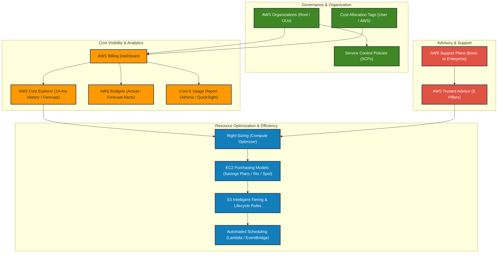

# Module 21: Managing Resource Consumption

> **Course**: AWS re/Start Curriculum  
> **Module**: 21 — Managing Resource Consumption  
> **Target Audience**: Cloud Practitioners, Systems Administrators, FinOps Practitioners  

---

## 📖 Module Overview

Module 21 explores Cloud Financial Management (FinOps) and resource governance across AWS environments. It details organizational hierarchy and consolidated billing with **AWS Organizations**, cost allocation and governance via **Tagging Strategies**, financial visibility and forecasting using **AWS Billing & Cost Management Tools** (Cost Explorer, Budgets, CUR), best practices for eliminating waste and optimizing compute purchasing models (Savings Plans, RIs, Spot), evaluating operational health with **AWS Trusted Advisor**, navigating **AWS Support Plans**, and hands-on optimization in the **Café and Bakery Project**.

---

## 📑 Study Guides, Video Demos & Lab Walkthroughs

| Index | Document / Lab | Type | Description |
|---|---|---|---|
| **T21-0001** | [Managing Resource Consumption Overview](file:///work/tmp/aws-cf/T21-Managing_Resource_Consumption/T21-0001-RSJAWS_EN-US_SG_M13_MANAGERESOURCECONSUMPTION.md) | Study Guide | Cloud economics, CapEx vs OpEx, FinOps lifecycle, and course module roadmap. |
| **T21-0002** | [AWS Organizations](file:///work/tmp/aws-cf/T21-Managing_Resource_Consumption/T21-0002-RSJAWS_EN-US_SG_M13_AWSORGANIZATIONS.md) | Study Guide | Multi-account governance, OU hierarchies, Consolidated Billing, and Service Control Policies (SCPs). |
| **T21-0003** | [Tagging Strategies & Governance](file:///work/tmp/aws-cf/T21-Managing_Resource_Consumption/T21-0003-RSJAWS_EN-US_SG_M13_TAGGING.md) | Study Guide | Technical, automation, and cost allocation tags, IAM enforcement, and AWS Config compliance. |
| **T21-0004** | [Video Demo: AWS Billing Dashboard Walkthrough](file:///work/tmp/aws-cf/T21-Managing_Resource_Consumption/T21-0004-RSSCHAB_EN-US_Video_M14_Billing_Dashboard_Demo.md) | Hands-on Demo | Console navigation, Cost Explorer trends, and configuring AWS Budget alerts with verbatim transcript. |
| **T21-0005** | [Cost Management Best Practices](file:///work/tmp/aws-cf/T21-Managing_Resource_Consumption/T21-0005-RSJAWS_EN-US_SG_COSTMGMTBESTPRACTICES.md) | Study Guide | Right-sizing, EC2 purchasing models (On-Demand, Savings Plans, RIs, Spot), and automated scheduling. |
| **T21-0006** | [AWS Support Services](file:///work/tmp/aws-cf/T21-Managing_Resource_Consumption/T21-0006-RSJAWS_EN-US_SG_M13_AWSSUPPORTSVCS.md) | Study Guide | Detailed comparative analysis of Basic, Developer, Business, and Enterprise support plans & Trusted Advisor pillars. |
| **T21-0007** | [Lab: Café Project — Optimizing AWS Resource Utilization](file:///work/tmp/aws-cf/T21-Managing_Resource_Consumption/T21-0007-RSJAWS_EN-US_SG_M13_CAFEOPTIMIZERESOURCEUTILIZATION.md) | Lab Guide | Hands-on optimization: decommissioning MariaDB, downsizing EC2 from t2.small to t2.micro, and modeling savings. |

---

## 🗺️ Cloud Financial Management (FinOps) Architecture

---

## 🎯 Key Learning Objectives Summary

- [x] Implement multi-account governance using **AWS Organizations**, hierarchical OUs, and guardrail enforcement via **Service Control Policies (SCPs)**.
- [x] Benefit from **Consolidated Billing** for single invoicing, aggregated volume discounts across accounts, and shared commitment coverage.
- [x] Design and enforce comprehensive **Tagging Strategies** (technical, business, automation) and activate **Cost Allocation Tags** for departmental chargeback.
- [x] Navigate the **AWS Billing Dashboard**, visualize spending patterns and forecasts in **AWS Cost Explorer**, and configure proactive threshold alerts with **AWS Budgets**.
- [x] Compare compute purchasing options (**On-Demand**, **Compute/EC2 Savings Plans**, **Standard/Convertible RIs**, **Spot Instances**) to maximize cost savings while maintaining availability.
- [x] Leverage **AWS Trusted Advisor** across its 5 pillars (Cost Optimization, Performance, Security, Fault Tolerance, Service Limits) to identify idle and unutilized resources.
- [x] Compare **AWS Support Plans** (Basic, Developer, Business, Enterprise On-Ramp, Enterprise) regarding SLAs, Technical Account Manager (TAM) coverage, and tooling.
- [x] Apply FinOps principles to hands-on customer scenarios in the **Café and Bakery Project**, decommissioning redundant services and right-sizing EC2 instances.
