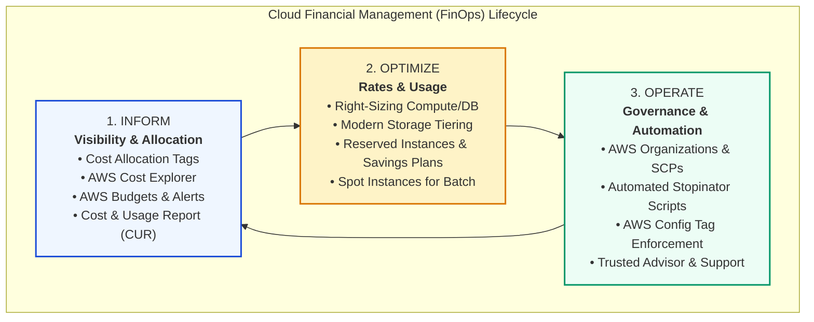
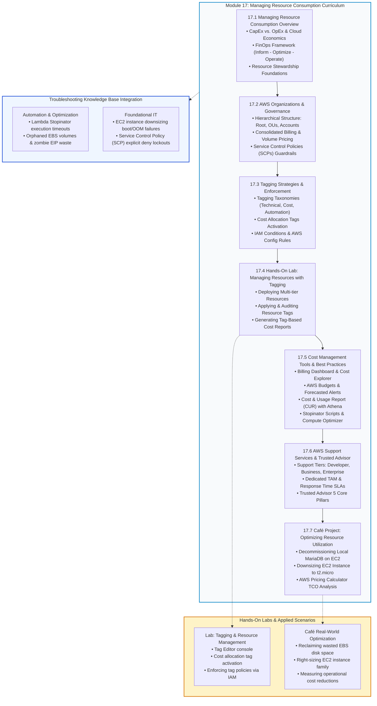

# 💰 Module 13 / 17: Managing Resource Consumption Overview – Study Guide

> **Course**: AWS re/Start  
> **Module**: Managing Resource Consumption  
> **Source Document**: `T21-0001-RSJAWS_EN-US_SG_M13_MANAGERESOURCECONSUMPTION.pdf`  
> **Target Audience**: AWS re/Start Learners / Cloud Practitioners / Solutions Architects / SysOps Administrators / FinOps Practitioners  

---

## 🎯 Unit Overview: Cloud Financial Management (FinOps) & Resource Stewardship

In traditional on-premises IT environments, infrastructure acquisition requires capital expenditure (**CapEx**) planning. Organizations procure physical servers, network switches, storage arrays, and uninterruptible power supplies months in advance, forecasting peak utilization years into the future. This rigid model frequently results in severe over-provisioning—where expensive hardware sits idle at 10–15% CPU utilization—or catastrophic under-provisioning, leading to system outages during unexpected business traffic spikes.

The AWS Cloud fundamentally shifts infrastructure economics to variable operational expenditure (**OpEx**). Organizations pay only for the compute cycles, storage gigabytes, and network bandwidth they actually consume. However, this frictionless ability to provision resources on demand introduces a critical governance challenge known as **cloud sprawl**. Without robust financial visibility, architectural stewardship, and automated policies, organizations can accumulate significant waste:
- **Idle & Zombie Resources**: Compute instances running 24/7 for development or testing workloads that are only used during business hours; Amazon Elastic Block Store (EBS) volumes left unattached after EC2 instances are terminated; unassociated Elastic IP addresses incurring hourly idle penalties.
- **Suboptimal Architecture & Sizing**: Instances provisioned with 8 vCPUs and 32 GiB RAM for simple web services operating at less than 5% average CPU; legacy databases hosted directly on compute instances when fully managed database engines offer lower administrative overhead and automated scaling.
- **Lack of Cost Attribution & Tagging**: Cloud bills delivered as monolithic line items with zero visibility into which department, business unit, environment, or project generated specific expenses.
- **Default On-Demand Pricing**: Running steady-state production workloads entirely on On-Demand pricing without taking advantage of Savings Plans, Reserved Instances, or Spot capacity.

```
┌──────────────────────────────────────────────────────────────────────────────────────────────────┐
│                   The Cloud Financial Management (FinOps) Operational Paradigm                   │
├─────────────────────────────────────────────────┬────────────────────────────────────────────────┤
│         Traditional On-Premises IT (CapEx)      │           AWS Cloud Economics (OpEx)           │
├─────────────────────────────────────────────────┼────────────────────────────────────────────────┤
│ • Multi-year hardware procurement cycles        │ • Instant, API-driven on-demand provisioning   │
│ • Sized for theoretical 3-5 year peak capacity  │ • Elastic scaling matching real-time demand    │
│ • High fixed capital investment upfront         │ • Pay-as-you-go variable operational expense   │
│ • Sunk costs: idle servers incur same expense   │ • Turn off unused resources to stop billing    │
│ • Centralized, slow purchasing gatekeepers      │ • Decentralized engineering velocity + guardrails│
└─────────────────────────────────────────────────┴────────────────────────────────────────────────┘
```

### The FinOps Framework: Culture, Collaboration, and Stewardship

**FinOps** (Cloud Financial Management) is an evolving cloud operating model that combines systems engineering, financial rigor, and business governance. It enables cross-functional teams—finance leaders, DevOps engineers, solutions architects, and executive stakeholders—to make data-driven decisions that balance speed, quality, and cost.

FinOps is organized around three continuous, iterative lifecycle phases:



1. **Inform (Visibility and Allocation)**: Empower engineers and business units with near-real-time visibility into their cloud spend. By implementing standardized **tagging taxonomies** and **AWS Organizations consolidated billing**, organizations attribute every dollar of expenditure to specific cost centers, projects, and environments using the **AWS Billing Dashboard**, **AWS Cost Explorer**, and **AWS Budgets**.
2. **Optimize (Rate and Usage Reduction)**: Eliminate architectural waste. Identify oversized instances using **AWS Compute Optimizer** and downsize them; migrate object storage across **Amazon S3 lifecycle tiers**; power down non-production resources during off-hours; and commit to predictable usage patterns via **Savings Plans** and **Reserved Instances** while leveraging **Spot Instances** for stateless workloads.
3. **Operate (Governance and Continuous Automation)**: Institutionalize cost efficiency into daily operations. Enforce mandatory tagging through **AWS Identity and Access Management (IAM)** condition keys and **AWS Config rules**; implement organizational guardrails with **Service Control Policies (SCPs)**; automate instance management using serverless **Stopinator** scripts; and monitor cloud operational health with **AWS Trusted Advisor** and tailored **AWS Support Plans**.

---

### 📌 Learning Objectives

- [ ] **Explain AWS Cloud Economic Principles**: Articulate how trading capital expense for variable operational expense, massive economies of scale, and elasticity enable proactive resource consumption management.
- [ ] **Govern Multi-Account Environments with AWS Organizations**: Configure organizational units (OUs), master/management accounts, member accounts, consolidated billing, volume discount aggregation, and Service Control Policies (SCPs).
- [ ] **Architect Robust Tagging Taxonomies**: Distinguish between technical, business, cost allocation, and automation tags; activate user-defined cost allocation tags in the Billing Console; and parse tag metadata.
- [ ] **Enforce Governance via IAM and AWS Config**: Write IAM JSON policies utilizing `Condition` keys (`aws:RequestTag` and `aws:TagKeys`) to restrict resource creation without required tags, and monitor tag compliance with AWS Config rules.
- [ ] **Leverage AWS Cost Management Tooling**: Contrast the capabilities of the AWS Billing Dashboard, AWS Cost Explorer (historical analysis and forecasting), AWS Budgets (actual vs. forecasted threshold alerts and actions), and the AWS Cost and Usage Report (CUR).
- [ ] **Implement Proven Cost Optimization Strategies**: Execute compute right-sizing, apply modern Amazon S3 storage lifecycle tiering, eliminate orphaned EBS volumes/snapshots/Elastic IPs, and design serverless "Stopinator" automation workflows.
- [ ] **Analyze Cloud Purchasing Models**: Compare On-Demand Instances, Reserved Instances (Standard vs. Convertible), Savings Plans (Compute vs. EC2 Instance), and Spot Instances based on workload longevity, commitment, and interruption tolerance.
- [ ] **Evaluate AWS Trusted Advisor Core Pillars**: Audit environments across Cost Optimization, Performance, Security, Fault Tolerance, and Service Limits; differentiate the 6 free core checks from full Trusted Advisor inspection available with Business and Enterprise Support.
- [ ] **Compare AWS Technical Support Plans**: Evaluate Basic, Developer, Business, Enterprise On-Ramp, and Enterprise Support plans across architectural guidance, case SLAs, Technical Account Manager (TAM) access, and pricing structures.
- [ ] **Apply Frugal Architecture to the Café Project**: Decommission legacy uninstalled databases, downsize Amazon EC2 instance families (`t2.small` $\rightarrow$ `t2.micro`), and model financial savings using AWS pricing estimation tools.
- [ ] **Populate the Troubleshooting Knowledge Base**: Formulate operational triage runbooks for common financial management and automation failure modes across *Automation & Optimization* and *Foundational IT* categories.

---

## 🗺️ Module 17 FinOps Curriculum Roadmap & Progression

The diagram below maps the pedagogical sequence of the **Managing Resource Consumption** module within the AWS re/Start curriculum, demonstrating how foundational organizational governance flows into tagging, financial tooling, architectural right-sizing, operational support, and real-world project execution:



---

## 🔍 Core Module Themes & Architectural Deep-Dive

### 1. AWS Organizations: Multi-Account Governance, Consolidated Billing, and SCPs

When enterprises adopt AWS at scale, managing all workloads within a single AWS account introduces operational bottlenecks, shared blast radiuses, and complex billing attributions. **AWS Organizations** provides an account management service that consolidates multiple AWS accounts into an organization that you create and centrally manage.

```
┌────────────────────────────────────────────────────────────────────────────────────────┐
│                        AWS Organizations Hierarchical Tree Topology                    │
├────────────────────────────────────────────────────────────────────────────────────────┤
│                                     Root Container                                     │
│                                    (Master Account)                                    │
│                                           │                                            │
│                    ┌──────────────────────┴──────────────────────┐                     │
│                    ▼                                             ▼                     │
│           Core / Infrastructure OU                         Workloads OU                │
│            (Shared Services, Log Archive)            (Business Applications)           │
│                    │                                             │                     │
│          ┌─────────┴─────────┐                         ┌─────────┴─────────┐           │
│          ▼                   ▼                         ▼                   ▼           │
│    Network Account     Security Account          Non-Prod OU            Prod OU        │
│    (Transit Gateway)   (CloudTrail S3)                 │                   │           │
│                                                  ┌─────┴─────┐             │           │
│                                                  ▼           ▼             ▼           │
│                                               Dev Acct   Test Acct     Prod Acct       │
└────────────────────────────────────────────────────────────────────────────────────────┘
```

#### Multi-Account Architecture Components
- **Management (Master) Account**: The foundational account that creates the organization. It pays the consolidated bill, sets organizational policies, and manages invitations and member accounts. 
  > [!WARNING]
  > Never deploy operational application workloads inside the Management Account. Keep it strictly dedicated to administrative oversight, consolidated billing, and SCP enforcement.
- **Member Accounts**: Standard AWS accounts that belong to the organization. All account-level charges roll up to the Management Account.
- **Root**: The top-level parent container for all accounts and Organizational Units in the organization.
- **Organizational Units (OUs)**: Logical containers for accounts within a root or parent OU. OUs allow administrators to structure accounts hierarchically (e.g., by environment such as `Production` vs. `Non-Production`, or by department such as `Finance` vs. `Engineering`).
- **Upside-Down Tree Structure**: An OU can contain other OUs, forming a tree hierarchy. An OU has exactly one parent, and each account can reside in only one OU at a time.

#### Consolidated Billing & Financial Pooling
Consolidated billing is a foundational feature of AWS Organizations that simplifies payment and optimizes cloud costs:
1. **Single Monthly Bill & Centralized Invoicing**: The Management Account receives a single consolidated bill and statement for all member accounts, eliminating the administrative overhead of managing separate credit cards and invoices.
2. **Volume Tier Aggregation**: AWS provides volume pricing discounts for services such as Amazon S3, Amazon EC2, and AWS Data Transfer. Consolidated billing aggregates usage across **all member accounts**. For instance, if S3 storage pricing drops after 50 TB, usage across twenty individual accounts is combined, allowing the organization to achieve higher discount tiers significantly faster.
3. **Commitment Sharing (Reserved Instances & Savings Plans)**: By default, the billing engine shares unused Reserved Instance (RI) and Savings Plan capacity across all accounts within the organization. If Account A purchases an EC2 Savings Plan but underutilizes it during a given hour, Account B's eligible EC2 usage automatically absorbs the discount.
   > [!TIP]
   > Consolidated billing allows administrators to disable RI and Savings Plan discount sharing for specific member accounts if internal accounting requires strict cost isolation.

#### Service Control Policies (SCPs)
**Service Control Policies (SCPs)** are organization-level governance guardrails that specify the maximum permissions available to IAM users and roles across member accounts.
- **Boundary, Not Identity Policy**: SCPs do not grant permissions; they define an impenetrable permission boundary. An IAM entity can only perform an action if it is permitted by **both** an IAM identity policy and every SCP attached in its account hierarchy.
- **Inheritance Flow**: Policies attached to the Root flow down through intermediate OUs and apply to all leaf accounts.
- **Evaluation Logic**:
  - An explicit `Deny` in any applicable SCP overrides any `Allow`.
  - By default, AWS Organizations attaches the AWS-managed `FullAWSAccess` SCP to all roots, OUs, and accounts.
  - To restrict access, administrators either use a **Deny-List Strategy** (retaining `FullAWSAccess` and adding targeted `Deny` blocks for unapproved regions or costly instance sizes) or an **Allow-List Strategy** (removing `FullAWSAccess` and explicitly declaring permitted services).

```json
{
  "Version": "2012-10-17",
  "Statement": [
    {
      "Sid": "RestrictExpensiveInstanceTypes",
      "Effect": "Deny",
      "Action": "ec2:RunInstances",
      "Resource": "arn:aws:ec2:*:*:instance/*",
      "Condition": {
        "StringNotLike": {
          "ec2:InstanceType": ["t2.*", "t3.*", "m5.large"]
        }
      }
    },
    {
      "Sid": "PreventLeavingOrganization",
      "Effect": "Deny",
      "Action": "organizations:LeaveOrganization",
      "Resource": "*"
    }
  ]
}
```

---

### 2. Tagging Strategies: Cost Allocation, Automation, and Governance

A **tag** is a customizable metadata label consisting of a developer-defined **Key** and an optional **Value**. Tags assign context to AWS resources that would otherwise appear only as generic hexadecimal IDs (e.g., `vol-0a1b2c3d4e5f67890`).

#### Tag Taxonomy & Key Categories

| Category | Typical Keys | Sample Values | Operational Purpose |
| :--- | :--- | :--- | :--- |
| **Technical Tags** | `Name`<br>`Environment`<br>`Version`<br>`Application` | `web-frontend-01`<br>`Production`, `Staging`, `Development`<br>`v2.4.1`<br>`CustomerPortal` | Architectural identification, CI/CD deployment tracking, and server inventory management. |
| **Business / Cost Allocation** | `CostCenter`<br>`Department`<br>`Project`<br>`Owner` | `CC-8420`<br>`Marketing`, `PlatformEngineering`<br>`Apollo`<br>`jane.doe@example.com` | Internal showback/chargeback accounting, finance reconciliation, and resource ownership. |
| **Automation & Operational** | `AutoStop`<br>`BackupPlan`<br>`MaintenanceWindow` | `true`, `false`<br>`Daily-7Year-Retention`<br>`Sunday-0200-UTC` | Triggering automated Lambda Stopinator scripts, AWS Backup schedules, and patch management. |
| **Security & Compliance** | `DataClassification`<br>`ComplianceScheme`<br>`Confidentiality` | `Public`, `Internal`, `Confidential`, `Restricted`<br>`PCI-DSS`, `HIPAA`, `SOC2`<br>`High` | Scoping auditing boundaries, enforcing KMS encryption, and evaluating data retention policies. |

#### Activating Cost Allocation Tags
Tags do not appear on AWS billing reports automatically. To associate tag values with financial accounting, administrators must explicitly activate them in the **AWS Billing and Cost Management Console**:
1. **AWS-Generated Tags**: Prefixed with `aws:` (e.g., `aws:createdBy`). Created automatically by AWS services to record resource creators.
2. **User-Defined Tags**: Custom tags created by users (e.g., `CostCenter`, `Environment`).
3. **Activation & Processing**: Once marked as active in the Cost Allocation Tags console, AWS begins tracking costs against those tags.
   > [!NOTE]
   > Tag activation is not retroactive. Tags only track costs from the date and time they are activated forward. It can take up to 24 hours for activated tags to populate in AWS Cost Explorer and the AWS Cost and Usage Report (CUR).

#### Enforcing Tagging via IAM Policies and AWS Config
To prevent untagged "orphan" resources from being created, cloud architects combine preventative IAM policies with detective AWS Config rules:

```
┌────────────────────────────────────────────────────────────────────────────────────────┐
│                          Tag Enforcement & Remediation Architecture                    │
├────────────────────────────────────────────────────────────────────────────────────────┤
│   Developer / CI/CD Pipeline                                                           │
│               │                                                                        │
│               ▼                                                                        │
│      [ IAM Policy Evaluation ]                                                         │
│               │                                                                        │
│       Does Request Contain Required Tags?                                              │
│          ├── NO  ──► [ Explicit Deny / 403 Forbidden ] (Resource Creation Blocked)     │
│          └── YES ──► [ Allow: Resource Provisioned ]                                   │
│                            │                                                           │
│                            ▼                                                           │
│               [ AWS Config Managed Rule ] ──(Continuous Audit)                         │
│                            │                                                           │
│                     Is Resource Compliant?                                             │
│                       ├── YES ──► [ Compliance Status: COMPLIANT ]                     │
│                       └── NO  ──► [ NON_COMPLIANT Alert ] ──► SSM Automation Remediation│
└────────────────────────────────────────────────────────────────────────────────────────┘
```

##### Preventative Enforcement: IAM Policy with Condition Keys
The following IAM policy enforces that whenever a user creates an Amazon EBS volume, they **must** attach both a `costcenter` tag with the value `115` and a `department` tag with the value `632`:

```json
{
  "Version": "2012-10-17",
  "Statement": [
    {
      "Sid": "EnforceRequiredTagsOnEBSCreation",
      "Effect": "Deny",
      "Action": "ec2:CreateVolume",
      "Resource": "arn:aws:ec2:*:*:volume/*",
      "Condition": {
        "Null": {
          "aws:RequestTag/costcenter": "true",
          "aws:RequestTag/department": "true"
        }
      }
    },
    {
      "Sid": "EnforceSpecificTagValuesOnEBSCreation",
      "Effect": "Deny",
      "Action": "ec2:CreateVolume",
      "Resource": "arn:aws:ec2:*:*:volume/*",
      "Condition": {
        "StringNotEquals": {
          "aws:RequestTag/costcenter": "115",
          "aws:RequestTag/department": "632"
        }
      }
    }
  ]
}
```

##### Detective Enforcement: AWS Config Rules
- **Managed Rule `required-tags`**: Evaluates whether active resources possess mandatory tag keys (e.g., verifying that all EC2 instances, S3 buckets, and RDS databases have the `CostCenter` and `Environment` tags).
- **Remediation Actions**: When a resource is flagged as `NON_COMPLIANT`, AWS Config can trigger an **AWS Systems Manager (SSM) Automation runbook** or dispatch an Amazon EventBridge event to notify the resource owner or apply default tags automatically.

---

### 3. AWS Billing & Cost Management Tools

AWS provides a cohesive suite of financial management tools tailored for different operational depths, ranging from executive dashboards to petabyte-scale raw telemetry.

```
┌──────────────────────────────────────────────────────────────────────────────────────────────────┐
│                      AWS Billing & Cost Management Tooling Spectrum                              │
├──────────────────────────────────────────────────────────────────────────────────────────────────┤
│ High-Level Summary                  Interactive Visual Analytics           Granular Raw Telemetry│
│ ──────────────────                  ────────────────────────────           ───────────────────── │
│                                                                                                  │
│ [ AWS Billing Dashboard ]           [ AWS Cost Explorer ]                  [ AWS Cost & Usage ]  │
│ • Current month spend summary       • 12-14 month historical trends        [ Report (CUR)     ]  │
│ • Month-over-month variances        • 3-month ML predictive forecast       • Hourly/daily line   │
│ • Top 5 spending services           • Slice & dice by Tag, Region, Usage   • S3 delivery (Parquet│
│ • Direct invoice payment portal     • RI & Savings Plans recommendations   • Athena/QuickSight   │
│                                                                                                  │
│                     ┌───────────────────────────────────────────────┐                            │
│                     │             AWS Budgets & Alarms              │                            │
│                     │ • Custom cost, usage, RI/SP coverage budgets  │                            │
│                     │ • Actual vs. Forecasted threshold breaches    │                            │
│                     │ • SNS, Email alerts & Budget Action runbooks  │                            │
│                     └───────────────────────────────────────────────┘                            │
└──────────────────────────────────────────────────────────────────────────────────────────────────┘
```

#### Detailed Tool Comparison Matrix

| Feature / Dimension | AWS Billing Dashboard | AWS Cost Explorer | AWS Budgets | AWS Cost & Usage Report (CUR) |
| :--- | :--- | :--- | :--- | :--- |
| **Primary Persona** | Billing Administrators, Executive Leadership | FinOps Analysts, Solutions Architects | Cloud Operations, Project Managers | Data Engineers, Enterprise FinOps Teams |
| **Data Granularity** | Monthly aggregated service totals | Daily or Monthly historical and forecasted | Daily, Monthly, Quarterly, or Annual tracking | Hourly, Daily, or Monthly resource-level line items |
| **Historical Range** | Current and prior months | Up to 14 months of historical data | Current billing periods | Full historical archive retained in Amazon S3 |
| **Predictive Capabilities**| Estimated end-of-month spend | 3-month predictive machine learning forecast | Alerts on forecasted budget breaches | Raw historical baseline for external ML modeling |
| **Alerting Mechanisms** | CloudWatch Billing Alarm integration | Ad-hoc anomaly detection alerts | Amazon SNS topics, email, automated Budget Actions | Downstream EventBridge notifications on S3 object drop |
| **Integration Method** | AWS Console | AWS Console, Cost Explorer API, CSV Export | AWS Console, Budgets API, SSM, Service Control Policies | Amazon Athena, Amazon QuickSight, Amazon Redshift |

#### Key Capabilities Deep-Dive

##### 1. AWS Billing Dashboard
The Billing Dashboard provides an immediate overview of cloud consumption. It displays your current month-to-date estimated charges, compares them to the prior month's balance, highlights the highest spending services, and displays active payment profiles.

##### 2. AWS Cost Explorer
Cost Explorer is an interactive visualization tool that enables users to query, graph, and analyze cloud expenditure.
- **Multidimensional Filtering**: Group and filter costs by Service, Linked Account, Region, Availability Zone, Usage Type, Instance Type, and Cost Allocation Tag.
- **Forecasting Engine**: Uses machine learning over your historical spend patterns to model estimated costs for the next 1-3 months.
- **Commitment Analysis**: Provides native recommendations for purchasing Reserved Instances and Savings Plans based on past hourly utilization profiles.

##### 3. AWS Budgets
AWS Budgets allows organizations to establish financial guardrails and alerts:
- **Budget Types**:
  - *Cost Budgets*: Set a financial ceiling (e.g., Alert if monthly spend exceeds $1,000).
  - *Usage Budgets*: Track resource usage metrics (e.g., Alert if S3 data transfer exceeds 10 TB).
  - *RI & Savings Plans Utilization/Coverage Budgets*: Track whether committed discounts are being utilized efficiently.
- **Actual vs. Forecasted Alerts**:
  - *Actual Threshold*: Fires an alert when actual spend crosses 80% of the budget.
  - *Forecasted Threshold*: Fires proactively midway through the month if AWS projects that spend will exceed 100% of the budget by month-end.
- **Automated Budget Actions**: If a budget threshold is breached, AWS Budgets can execute an automated remediation action via IAM policies, SCPs, or target EC2/RDS instances (e.g., revoking `ec2:RunInstances` permissions in a sandbox account).

##### 4. AWS Cost and Usage Report (CUR)
The CUR is the most comprehensive, detailed cost dataset available in AWS. It delivers raw CSV or Parquet files to an Amazon S3 bucket, logging every single billable line item across the organization:
- Records specific resource ARNs, operational hours, API operations, and all applied tags.
- Direct integration with **Amazon Athena** enables serverless SQL queries across billions of billing records:
  ```sql
  SELECT line_item_resource_id, sum(line_item_unblended_cost) AS total_cost
  FROM my_cur_table
  WHERE line_item_usage_start_date >= date '2026-10-01'
    AND resource_tags_user_environment = 'Development'
  GROUP BY line_item_resource_id
  ORDER BY total_cost DESC
  LIMIT 10;
  ```

---

### 4. Cost Management Best Practices

Achieving high operational efficiency in AWS requires deliberate architecture, continuous waste elimination, and strategic purchasing commitments.

```
┌────────────────────────────────────────────────────────────────────────────────────────┐
│                        The Five Pillars of AWS Cloud Cost Optimization                 │
├────────────────────────────────────────────────────────────────────────────────────────┤
│  1. Waste Elimination      Terminate idle EC2/RDS, delete orphaned EBS & zombie EIPs   │
│  2. Compute Right-Sizing   Align instance CPU/RAM to actual workloads via ML analytics │
│  3. Elastic Scaling        Turn off dev/test off-hours; use dynamic Auto Scaling       │
│  4. Modern Storage Tiering Lifecycle S3 across Standard, Intelligent, IA, and Glacier │
│  5. Pricing Models         Blend On-Demand, Savings Plans, RIs, and Spot capacity      │
└────────────────────────────────────────────────────────────────────────────────────────┘
```

#### Finding and Eliminating Architectural Waste
- **Orphaned Amazon EBS Volumes**: When an EC2 instance is terminated, attached EBS volumes created without the `DeleteOnTermination=true` attribute remain active in the `available` state. AWS continues to bill for the allocated gigabytes and provisioned IOPS indefinitely until the volume is deleted.
- **Zombie Elastic IP Addresses (EIPs)**: AWS provides static public IPv4 addresses at no charge when they are associated with a running EC2 instance. However, to prevent IP address hoarding, AWS charges an hourly fee for every Elastic IP that is allocated to an account but **unassociated** or attached to a stopped instance.
- **Stale EBS Snapshots**: Incremental snapshots of decommissioned volumes accumulated over years incur ongoing S3 storage costs.
- **Idle Load Balancers**: Classic, Application, and Network Load Balancers incur an hourly baseline operational fee regardless of whether traffic is being routed to backend targets.

#### Right-Sizing Compute & AWS Compute Optimizer
Right-sizing is the practice of matching instance types and sizes to actual workload performance requirements.
- Rather than leaving an EC2 instance running at an average of 4% CPU utilization on an expensive `m5.2xlarge`, right-sizing scales it down to an `m5.large` or shifts it to a modern burstable `t4g.medium` instance.
- **AWS Compute Optimizer**: Uses machine learning to analyze Amazon CloudWatch telemetry (CPU utilization, memory usage, network throughput, local storage I/O) over a 14-day trailing period. It delivers explicit recommendations to downsize, upgrade, or change instance families, quantifying the projected monthly dollar savings and performance risk.

#### The "Stopinator" Automation Concept
Development and testing environments rarely need to run outside of standard business hours. An environment running 24/7 consumes 744 hours per month. Running the same environment only during business hours (Monday–Friday, 8:00 AM – 6:00 PM = 50 hours/week) consumes approximately 215 hours per month—yielding an immediate **71% reduction in compute spend**.

```
┌────────────────────────────────────────────────────────────────────────────────────────┐
│                        Serverless "Stopinator" Architecture                            │
├────────────────────────────────────────────────────────────────────────────────────────┤
│                                                                                        │
│   [ Amazon EventBridge ] ──(Cron: 18:00 UTC M-F)──► [ AWS Lambda Function ]            │
│                                                               │                        │
│                                                     1. Query EC2 Instances             │
│                                                        with Tag: AutoStop=true         │
│                                                     2. Invoke ec2:StopInstances        │
│                                                               │                        │
│                                                               ▼                        │
│                                                     [ Target EC2 Fleet ]               │
│                                                        (Transitions to STOPPED)        │
│                                                                                        │
│   [ Amazon EventBridge ] ──(Cron: 08:00 UTC M-F)──► [ AWS Lambda Function ]            │
│                                                               │                        │
│                                                     Invokes ec2:StartInstances         │
│                                                               ▼                        │
│                                                     [ Target EC2 Fleet ]               │
│                                                        (Transitions to RUNNING)        │
└────────────────────────────────────────────────────────────────────────────────────────┘
```

#### EC2 Purchasing Models: Deep Comparison

```
┌────────────────────────────────────────────────────────────────────────────────────────┐
│                        Amazon EC2 Purchasing Models Spectrum                           │
├────────────────────────────────────────────────────────────────────────────────────────┤
│ Flexibility                                                            Cost Discount   │
│ ───────────                                                            ─────────────   │
│                                                                                        │
│ [ On-Demand ] ───────────────────────────────────────────────────────► Baseline Cost   │
│ • Maximum flexibility, no long-term commitment                         (0% Discount)   │
│ • Unpredictable, short-term, or development workloads                                  │
│                                                                                        │
│ [ Savings Plans / Reserved Instances ] ──────────────────────────────► Up to 72% Off   │
│ • 1-year or 3-year commitment ($/hr or instance type)                                  │
│ • Steady-state, predictable, core production workloads                                 │
│                                                                                        │
│ [ Spot Instances ] ──────────────────────────────────────────────────► Up to 90% Off   │
│ • Unused spare AWS compute capacity                                                    │
│ • Subject to 2-minute interruption notification                                        │
│ • Stateless, containerized, batch, and CI/CD workloads                                 │
└────────────────────────────────────────────────────────────────────────────────────────┘
```

| Purchasing Option | Commitment Duration | Payment Options | Discount Level | Workload Fit & Characteristics | Interruption Risk |
| :--- | :--- | :--- | :--- | :--- | :--- |
| **On-Demand** | None (per-second or per-hour billing) | No Upfront (Billed as incurred) | 0% (Standard list price) | Short-term, spiky, unpredictable workloads; initial application development and testing. | None |
| **Compute Savings Plans** | 1 Year or 3 Years | All Upfront, Partial Upfront, No Upfront | Up to 66% | Flexible commitment ($/hour) applying automatically across EC2, AWS Fargate, and AWS Lambda regardless of Region, family, OS, or AZ. | None |
| **EC2 Instance Savings Plans** | 1 Year or 3 Years | All Upfront, Partial Upfront, No Upfront | Up to 72% | Commitment to an instance family within a specific Region (e.g., `c6g` in `us-east-1`). Automatically applies regardless of AZ, OS, or size. | None |
| **Standard Reserved Instances (RI)** | 1 Year or 3 Years | All Upfront, Partial Upfront, No Upfront | Up to 72% | Steady-state workloads with static infrastructure requirements. Cannot modify instance family or OS. | None |
| **Convertible Reserved Instances** | 1 Year or 3 Years | All Upfront, Partial Upfront, No Upfront | Up to 54% | Steady-state workloads requiring future flexibility to exchange for different instance families, OS, or tenancy. | None |
| **Spot Instances** | None | No Upfront (Dynamic market pricing) | Up to 90% off On-Demand | Fault-tolerant, stateless, batch processing, big data (EMR), rendering, and containerized architectures. | Yes (2-minute termination warning via EventBridge/metadata) |

---

### 5. AWS Trusted Advisor: The Five Core Pillars

**AWS Trusted Advisor** functions as an automated cloud consultant, continuously inspecting your AWS environment against best practice recommendations developed from servicing millions of AWS customers.

```
┌────────────────────────────────────────────────────────────────────────────────────────┐
│                        AWS Trusted Advisor: Five Core Pillars                          │
├────────────────────────────────────────────────────────────────────────────────────────┤
│                                                                                        │
│    💰 Cost Optimization          ⚡ Performance            🔒 Security                 │
│    • Idle EC2 instances          • High utilization rules  • Open Security Groups      │
│    • Unattached EBS volumes      • CloudFront caching      • Public S3 bucket policies │
│    • Unassociated Elastic IPs    • EBS throughput limits   • Root account MFA missing  │
│    • RI & Savings Plan coverage  • Route 53 latency routing• IAM password policy gaps │
│                                                                                        │
│                 🛡️ Fault Tolerance             📈 Service Limits                       │
│                 • Missing EBS volume snapshots • VPC quota utilization (>80%)          │
│                 • RDS Multi-AZ resilience      • EC2 instance vCPU limits              │
│                 • Auto Scaling health checks   • Elastic IP allocation thresholds      │
│                 • S3 Cross-Region Replication  • EBS volume capacity limits            │
│                                                                                        │
└────────────────────────────────────────────────────────────────────────────────────────┘
```

#### Trusted Advisor Check Tiers: Free Core vs. Full Inspection

All AWS customers receive access to core security and limit checks, while full multi-pillar inspection requires higher support tiers:

```
┌────────────────────────────────────────────────────────────────────────────────────────┐
│                 Trusted Advisor Tier Inspection Comparison                             │
├────────────────────────────────────────────────────────────────────────────────────────┤
│  Basic & Developer Support:                                                            │
│  ─────────────────────────                                                             │
│  Access to 6 Core Checks:                                                              │
│  1. S3 Bucket Permissions (Open/Public Access detection)                               │
│  2. Security Groups - Specific Ports Unrestricted (Port 22/3389 open to 0.0.0.0/0)      │
│  3. IAM Use (Validates that IAM users/roles are used instead of root)                  │
│  4. MFA on Root Account (Verifies hardware/virtual MFA activation)                     │
│  5. EBS Public Snapshots (Detects unencrypted publicly accessible snapshots)          │
│  6. RDS Public Snapshots (Detects public database snapshots)                           │
│  + Service Limits (Checks usage nearing 80%+ of account service quotas)                │
├────────────────────────────────────────────────────────────────────────────────────────┤
│  Business & Enterprise Support:                                                        │
│  ─────────────────────────────                                                         │
│  Full Trusted Advisor Access:                                                          │
│  • Hundreds of automated checks across ALL 5 Pillars:                                  │
│    - Exhaustive Cost Optimization (Idle DB instances, unattached EBS, RI utilization)  │
│    - Deep Performance & Throughput tuning                                              │
│    - Complete Security posture & IAM compliance checks                                 │
│    - Advanced Fault Tolerance & Disaster Recovery audits                               │
│    - Real-time programmatic alerts via AWS Support API and Amazon EventBridge          │
└────────────────────────────────────────────────────────────────────────────────────────┘
```

---

### 6. AWS Support Plans: Architectural Alignment and SLAs

AWS provides four distinct commercial Technical Support Plans (plus the enterprise-grade Enterprise On-Ramp) structured to accommodate organizations ranging from individual students experimenting with cloud services to global enterprises operating mission-critical digital banking applications.

```
┌────────────────────────────────────────────────────────────────────────────────────────┐
│                        AWS Technical Support Plan Hierarchy                            │
├────────────────────────────────────────────────────────────────────────────────────────┤
│                                                                                        │
│  [ Basic Support ] ─────────────────────────────────────────────────► Included Free   │
│  • Customer service & billing access; 24/7 documentation; 6 core checks                │
│                                                                                        │
│  [ Developer Support ] ─────────────────────────────────────────────► Starts at $29/mo│
│  • Non-production testing; business hours email support; 12-24h SLAs                   │
│                                                                                        │
│  [ Business Support ] ──────────────────────────────────────────────► Starts at $100/mo│
│  • Production workloads; 24/7 phone/chat/email; 1-hour critical down SLA; Full TA      │
│                                                                                        │
│  [ Enterprise On-Ramp ] ────────────────────────────────────────────► Starts at $5,500 │
│  • Business-critical workloads; 30-min SLA; pool of Technical Account Managers (TAMs) │
│                                                                                        │
│  [ Enterprise Support ] ────────────────────────────────────────────► Starts at $15,000│
│  • Mission-critical enterprise; 15-min SLA; dedicated TAM; IEM event management        │
│                                                                                        │
└────────────────────────────────────────────────────────────────────────────────────────┘
```

#### Comprehensive AWS Support Plans Matrix

| Support Plan | Monthly Pricing Formula | Case Access & Communication Channels | Authorized Contacts | Response Time SLAs | Architectural & Operational Benefits |
| :--- | :--- | :--- | :--- | :--- | :--- |
| **Basic** | **$0 / month** (Included for all AWS accounts) | **No technical support cases**.<br>24/7 access to Customer Service (billing/account) and documentation. | Unlimited | N/A (No technical case creation permitted) | • 6 core Trusted Advisor checks<br>• AWS Personal Health Dashboard<br>• AWS Whitepapers and documentation |
| **Developer** | Greater of **$29/month** or **3% of monthly AWS usage** | Technical cases via web console / email.<br>Business hours access (8:00 AM – 6:00 PM local customer time). | 1 primary contact | • General guidance: **< 24 business hours**<br>• System impaired: **< 12 business hours** | • Building-block architectural guidance<br>• Recommended for testing and non-production sandboxes |
| **Business** | Greater of **$100/month** or sliding scale:<br>• 10% of first $0–$10k<br>• 7% of $10k–$80k<br>• 5% of $80k–$250k<br>• 3% of >$250k | **24/7/365** access to Cloud Support Engineers via **Phone, Live Chat, and Web Cases**. | **Unlimited** contacts | • General guidance: **< 24 hours**<br>• System impaired: **< 12 hours**<br>• Production system impaired: **< 4 hours**<br>• Production system down: **< 1 hour** | • **Full AWS Trusted Advisor checks**<br>• Contextual architectural guidance for use cases<br>• Support for third-party software (OS, Apache, MySQL)<br>• Infrastructure Event Management (IEM) available for purchase |
| **Enterprise On-Ramp** | Greater of **$5,500/month** or **10% of monthly AWS usage** | **24/7/365** access via Phone, Chat, and Web Cases. | **Unlimited** contacts | • General guidance: **< 24 hours**<br>• System impaired: **< 12 hours**<br>• Production system impaired: **< 4 hours**<br>• Production system down: **< 1 hour**<br>• Business-critical down: **< 30 minutes** | • Pool of **Technical Account Managers (TAMs)**<br>• Cost optimization & architecture reviews<br>• 1 Infrastructure Event Management (IEM) per year included |
| **Enterprise** | Greater of **$15,000/month** or sliding scale:<br>• 10% of first $0–$150k<br>• 7% of $150k–$500k<br>• 5% of $500k–$1M<br>• 3% of >$1M | **24/7/365** access via Phone, Chat, and Web Cases. | **Unlimited** contacts | • General guidance: **< 24 hours**<br>• System impaired: **< 12 hours**<br>• Production system impaired: **< 4 hours**<br>• Production system down: **< 1 hour**<br>• Business-critical down: **< 15 minutes** | • **Designated Technical Account Manager (TAM)**<br>• Proactive Well-Architected operational reviews<br>• **Infrastructure Event Management (IEM)** included for product launches<br>• Executive operational business reviews |

---

### 7. Café Project Scenario: Optimizing Café Resource Consumption

In the hands-on **Café and Bakery** project scenario, learners step into the role of cloud consulting engineers assisting business owners **Frank and Martha**, along with their IT staff **Sofía and Olivia**.

```
┌────────────────────────────────────────────────────────────────────────────────────────┐
│                        Café Application Architectural Transformation                   │
├────────────────────────────────────────────────────────────────────────────────────────┤
│ BEFORE OPTIMIZATION:                                                                   │
│                                                                                        │
│ [ Internet Client ] ──► [ Internet Gateway ] ──► [ Cafe Public Subnet ]                │
│                                                             │                          │
│                                               ┌─────────────▼─────────────┐            │
│                                               │  CafeInstance (t2.small)  │            │
│                                               │  • Web Application (PHP)  │            │
│                                               │  • Decommissioned MariaDB │ (Wasteful) │
│                                               │    Database (Legacy Host) │            │
│                                               └─────────────┬─────────────┘            │
│                                                             │ (SQL Connection)         │
│                                                             ▼                          │
│                                               [ Amazon RDS: cafe_db ]                  │
├────────────────────────────────────────────────────────────────────────────────────────┤
│ AFTER OPTIMIZATION:                                                                    │
│                                                                                        │
│ [ Internet Client ] ──► [ Internet Gateway ] ──► [ Cafe Public Subnet ]                │
│                                                             │                          │
│                                               ┌─────────────▼─────────────┐            │
│                                               │  CafeInstance (t2.micro)  │ (Frugal!)  │
│                                               │  • Web Application Only   │            │
│                                               │  • MariaDB Uninstalled    │            │
│                                               │  • Storage Reclaimed      │            │
│                                               └─────────────┬─────────────┘            │
│                                                             │                          │
│                                                             ▼                          │
│                                               [ Amazon RDS: cafe_db ]                  │
└────────────────────────────────────────────────────────────────────────────────────────┘
```

#### Business Challenge & Architectural Analysis
1. **The Migration Baseline**: In earlier modules, the café team successfully migrated their operational relational database from a local MariaDB instance hosted directly on an EC2 instance to a managed **Amazon RDS MySQL** instance (`cafe_db`).
2. **The Discovered Inefficiency**:
   - Despite the database running in RDS, the local MariaDB database server was still installed and running on the EC2 instance, consuming memory and disk capacity.
   - The instance was provisioned as a **`t2.small`** (1 vCPU, 2 GiB RAM) to support both the web server and the database engine.
   - Because the database workload had shifted to Amazon RDS, the EC2 instance experienced an average memory consumption of less than 35% and CPU utilization of less than 5%.

#### Optimization Engineering Steps
1. **Decommissioning Local Services**:
   - Connect to `CafeInstance` via SSH.
   - Stop and disable the local database service:
     ```bash
     sudo systemctl stop mariadb
     sudo systemctl disable mariadb
     ```
   - Uninstall the local MariaDB package to reclaim filesystem storage and eliminate background daemons:
     ```bash
     sudo yum remove -y mariadb-server mariadb
     sudo rm -rf /var/lib/mysql
     ```
2. **Right-Sizing the Compute Instance**:
   - Safely stop `CafeInstance` via the Amazon EC2 console or AWS CLI:
     ```bash
     aws ec2 stop-instances --instance-ids i-0a1b2c3d4cafe001
     ```
   - Modify the instance type from **`t2.small`** to **`t2.micro`** (1 vCPU, 1 GiB RAM):
     ```bash
     aws ec2 modify-instance-attribute \
       --instance-id i-0a1b2c3d4cafe001 \
       --instance-type "{\"Value\": \"t2.micro\"}"
     ```
   - Restart the instance and verify that the PHP web application successfully connects to the remote Amazon RDS endpoint.
3. **Financial Impact Modeling**:
   - Using the **AWS Pricing Calculator**, Sofía demonstrates to Frank and Martha that downsizing from `t2.small` to `t2.micro` reduces their monthly EC2 compute bill by **50%**, while separating the stateless web tier from the stateful database tier aligns with AWS Well-Architected principles.

---

## 🛠️ Troubleshooting Knowledge Base Project Integration

As part of the re/Start systems operations training, learners maintain a production-grade **Troubleshooting Knowledge Base**. Below are four authoritative runbooks addressing critical failure modes in cloud resource consumption, automation, and governance.

---

### Category: Automation and Optimization

#### KB-FIN-001: AWS Lambda "Stopinator" Execution Timeout or Insufficient Permissions Failing to Stop Instances

- **Issue ID**: `KB-FIN-001`
- **Category**: Automation and Optimization
- **Severity**: High (Causes non-production instances to run over weekends, generating unexpected multi-thousand dollar billing overruns)
- **Problem Statement**: An automated Python-based AWS Lambda function triggered by an Amazon EventBridge cron rule (`cron(0 19 ? * MON-FRI *)`) fails to stop marked development instances, leaving instances running in the `running` state.
- **Root Cause**:
  1. The Lambda execution role lacks the `ec2:DescribeInstances` and `ec2:StopInstances` IAM permissions.
  2. The Lambda function timeout is set to the default value of 3 seconds, which is insufficient to query and initiate stop calls across dozens of instances across multiple regions.
- **Diagnostic Procedures**:
  1. Check Amazon CloudWatch Logs for the Lambda log group `/aws/lambda/StopinatorFunction`:
     ```text
     Task timed out after 3.00 seconds
     An error occurred (UnauthorizedOperation) when calling the StopInstances operation: 
     You are not authorized to perform this operation.
     ```
  2. Inspect the IAM role attached to the Lambda function:
     ```bash
     aws iam get-role-policy --role-name StopinatorRole --policy-name StopinatorPolicy
     ```
- **Step-by-Step Resolution**:
  1. Attach an IAM policy granting targeted EC2 permissions to the Lambda execution role:
     ```json
     {
       "Version": "2012-10-17",
       "Statement": [
         {
           "Effect": "Allow",
           "Action": [
             "ec2:DescribeInstances",
             "ec2:DescribeRegions"
           ],
           "Resource": "*"
         },
         {
           "Effect": "Allow",
           "Action": "ec2:StopInstances",
           "Resource": "arn:aws:ec2:*:*:instance/*",
           "Condition": {
             "StringEquals": {
               "aws:ResourceTag/AutoStop": "true"
             }
           }
         }
       ]
     }
     ```
  2. Update the Lambda function configuration to increase the timeout to **60 seconds** and set memory to **256 MB**:
     ```bash
     aws lambda update-function-configuration \
       --function-name StopinatorFunction \
       --timeout 60 \
       --memory-size 256
     ```
- **Preventive Measures**:
  - Configure a dead-letter queue (Amazon SQS DLQ) on the Lambda function to capture failed execution invocations.
  - Implement a CloudWatch Alarm monitoring the `Errors` metric of `StopinatorFunction` with Amazon SNS notifications sent to the SysOps on-call team.

---

#### KB-FIN-002: Unexpected AWS Cost Spike from Orphaned Unattached EBS Volumes and Zombie Elastic IPs

- **Issue ID**: `KB-FIN-002`
- **Category**: Automation and Optimization
- **Severity**: Medium (Cumulative silent financial waste)
- **Problem Statement**: The monthly AWS Cost Explorer report indicates sustained charges for Amazon EBS volume gigabytes and Elastic IP hours despite development EC2 instances being terminated three weeks ago.
- **Root Cause**:
  1. Developers terminated EC2 instances without enabling the `DeleteOnTermination` flag on secondary EBS data volumes, leaving gigabytes of Provisioned IOPS SSD (`io2`) storage in the `available` state.
  2. Elastic IP addresses allocated to temporary EC2 instances were left unassociated after instance termination, incurring idle hourly charges.
- **Diagnostic Procedures**:
  1. List all unattached Amazon EBS volumes across the Region:
     ```bash
     aws ec2 describe-volumes \
       --filters Name=status,Values=available \
       --query "Volumes[*].{ID:VolumeId,Size:Size,Type:VolumeType,Created:CreateTime}" \
       --output table
     ```
  2. List all unassociated Elastic IP addresses:
     ```bash
     aws ec2 describe-addresses \
       --query "Addresses[?AssociationId==null].{IP:PublicIp,AllocationId:AllocationId}" \
       --output table
     ```
- **Step-by-Step Resolution**:
  1. Take snapshots of critical unattached volumes if archival retention is required, then delete the orphaned volumes:
     ```bash
     # Take snapshot for archival safety
     aws ec2 create-snapshot --volume-id vol-0123456789abcdef0 --description "Pre-deletion backup"
     
     # Delete volume to eliminate ongoing hourly charges
     aws ec2 delete-volume --volume-id vol-0123456789abcdef0
     ```
  2. Release all unassociated Elastic IP addresses back to the AWS pool:
     ```bash
     aws ec2 release-address --allocation-id eipalloc-0123456789abcdef0
     ```
- **Preventive Measures**:
  - Enable the **AWS Trusted Advisor** checks for *Underutilized Amazon EBS Volumes* and *Unassociated Elastic IP Addresses*.
  - Deploy an AWS Config rule (`ec2-volume-inuse-check`) that triggers an SSM Automation runbook to delete unattached volumes after a 7-day grace period.

---

### Category: Foundational IT

#### KB-FIN-003: EC2 Instance Downsizing Failure Causing Boot Failure or Out of Memory (OOM) Panic

- **Issue ID**: `KB-FIN-003`
- **Category**: Foundational IT
- **Severity**: High (Application downtime following cost optimization activity)
- **Problem Statement**: Following an EC2 right-sizing exercise from `t2.small` (2 GiB RAM) to `t2.micro` (1 GiB RAM), the EC2 instance passes `StatusCheckFailed_System` but fails `StatusCheckFailed_Instance`. The web application fails to respond to HTTP requests.
- **Root Cause**:
  1. The guest operating system services (PHP-FPM, Apache, system daemons) exceed 1 GiB of resident memory upon initialization.
  2. The Linux kernel's Out-Of-Memory (OOM) killer terminates critical web service processes or triggers a kernel panic because no swap file was provisioned on the instance.
- **Diagnostic Procedures**:
  1. Retrieve the EC2 instance system console output:
     ```bash
     aws ec2 get-console-output --instance-id i-0a1b2c3d4cafe001 --output text
     ```
  2. Look for memory allocation failures:
     ```text
     Out of memory: Kill process 1420 (httpd) score 284 or sacrifice child
     Killed process 1420 (httpd) total-vm:458212kB, anon-rss:98420kB
     ```
- **Step-by-Step Resolution**:
  1. Temporarily upsize the instance back to `t2.small` to restore administrative access:
     ```bash
     aws ec2 stop-instances --instance-ids i-0a1b2c3d4cafe001
     aws ec2 modify-instance-attribute --instance-id i-0a1b2c3d4cafe001 --instance-type "{\"Value\": \"t2.small\"}"
     aws ec2 start-instances --instance-ids i-0a1b2c3d4cafe001
     ```
  2. Log into the instance, verify processes consuming memory, and configure a **1 GiB swap space** on the root EBS volume:
     ```bash
     sudo dd if=/dev/zero of=/swapfile bs=128M count=8
     sudo chmod 600 /swapfile
     sudo mkswap /swapfile
     sudo swapon /swapfile
     echo '/swapfile swap swap defaults 0 0' | sudo tee -a /etc/fstab
     ```
  3. Tune Apache/PHP-FPM worker concurrency (`MaxRequestWorkers`) to prevent excessive memory allocation under load.
  4. Stop the instance, downsize to `t2.micro`, and restart. Verify that memory usage remains stable with swap space acting as a safety buffer.
- **Preventive Measures**:
  - Deploy the **Unified Amazon CloudWatch Agent** to collect the `mem_used_percent` metric prior to downsizing, ensuring memory utilization never regularly exceeds 60% of the target instance's capacity.

---

#### KB-FIN-004: Service Control Policy (SCP) Deny Lockout Preventing Valid AWS Service Provisioning in Member Accounts

- **Issue ID**: `KB-FIN-004`
- **Category**: Foundational IT / Governance
- **Severity**: High (Developers in member accounts receive unexpected `AccessDeniedException` despite possessing full `AdministratorAccess` IAM permissions)
- **Problem Statement**: An engineer in the `Development` member account attempts to provision an Amazon S3 bucket for a new project, but the AWS Management Console displays:
  ```text
  You do not have permissions to perform this operation (AccessDenied).
  Contact your administrator to add permissions.
  ```
- **Root Cause**:
  An administrator attached an SCP to the `Workloads` parent OU with an overly broad `Deny` statement or a restrictive `StringNotEquals` region condition that omitted the AWS global service control plane or blocked non-production accounts.
- **Diagnostic Procedures**:
  1. Review AWS CloudTrail in the member account for the `CreateBucket` event. Inspect the `errorMessage`:
     ```json
     {
       "eventSource": "s3.amazonaws.com",
       "eventName": "CreateBucket",
       "errorCode": "Client.AccessDenied",
       "errorMessage": "User: arn:aws:iam::111122223333:user/dev-admin is not authorized to perform: s3:CreateBucket with an explicit deny in a service control policy"
     }
     ```
  2. From the **Management Account**, inspect the SCPs attached to the member account and its parent OUs:
     ```bash
     aws organizations list-policies-for-target \
       --target-id ou-ab12-cdef3456 \
       --filter SERVICE_CONTROL_POLICY
     ```
- **Step-by-Step Resolution**:
  1. Inspect the offending policy content:
     ```bash
     aws organizations describe-policy --policy-id p-0123456789policy
     ```
  2. Identify if a region restriction SCP denies global services like S3, CloudFront, Route 53, or IAM:
     ```json
     {
       "Version": "2012-10-17",
       "Statement": [
         {
           "Sid": "DenyUnapprovedRegionsExcludingGlobals",
           "Effect": "Deny",
           "NotAction": [
             "iam:*",
             "organizations:*",
             "route53:*",
             "cloudfront:*",
             "support:*"
           ],
           "Resource": "*",
           "Condition": {
             "StringNotEquals": {
               "aws:RequestedRegion": ["us-east-1", "us-west-2"]
             }
           }
         }
       ]
     }
     ```
  3. Update the SCP in the Management Account to properly whitelist required regions and exclude global AWS services.
- **Preventive Measures**:
  - Test SCP modifications in a dedicated `Sandbox` OU before applying them to production or workload OUs.
  - Establish automated SCP syntax and policy linting using CI/CD pipelines before deployment.

---

## 📝 Knowledge Check & Review

Test your mastery of the concepts covered in this module. Detailed answers and architectural rationales are provided below each question.

### Question 1
A multinational company operates dozens of AWS accounts managed under AWS Organizations. The enterprise has individual accounts for Development, Testing, and Production across five departments. How can the company maximize volume discounts for Amazon S3 storage across all accounts while maintaining independent departmental cost tracking?
- A) Consolidate all S3 buckets into a single AWS account and create separate IAM users for each department.
- B) Enable Consolidated Billing under AWS Organizations, activate User-Defined Cost Allocation Tags for `Department`, and tag all S3 buckets.
- C) Create separate Organizations for each department and purchase individual Reserved Capacity agreements.
- D) Use AWS Cost Explorer API to manually calculate discounts and issue internal refund vouchers to departmental accounts.

> **Answer: B**  
> **Explanation**: Consolidated Billing in AWS Organizations aggregates usage across all member accounts, allowing the organization to combine S3 usage volume and qualify for lower tiered pricing thresholds faster. Concurrently, activating and applying Cost Allocation Tags (such as `Department`) enables the company to segment and attribute exact expenditures to individual business units in AWS Cost Explorer and the AWS Cost and Usage Report (CUR).

---

### Question 2
An enterprise cloud engineer wants to prevent developers in a specific sandbox AWS account from launching expensive EC2 GPU and compute-optimized instances (`p4d`, `g5`, `c6i.32xlarge`). Which mechanism allows the administrator to enforce this boundary centrally across the entire sandbox account without modifying individual IAM user permissions?
- A) An Amazon CloudWatch Alarm that terminates instances exceeding $5/hour.
- B) A Service Control Policy (SCP) attached to the Sandbox Organizational Unit denying `ec2:RunInstances` for unauthorized instance types.
- C) An IAM Permission Boundary attached to the root user of the member account.
- D) An AWS Budgets action configured to stop instances when monthly spend exceeds $500.

> **Answer: B**  
> **Explanation**: Service Control Policies (SCPs) in AWS Organizations establish centralized maximum permission boundaries on member accounts and Organizational Units (OUs). An SCP with a `Deny` effect on `ec2:RunInstances` with a condition evaluating `ec2:InstanceType` prevents anyone—even the account root user or an IAM administrator—within that OU from launching unapproved instance types.

---

### Question 3
A media processing company runs batch transcoding jobs every weekend. The jobs are fault-tolerant, take approximately 4 hours to complete, and can be stopped and restarted without corrupting data. Which Amazon EC2 purchasing model provides the highest cost savings for this workload?
- A) On-Demand Instances
- B) Standard Reserved Instances with a 3-year commitment
- C) Spot Instances
- D) Compute Savings Plans with Partial Upfront payment

> **Answer: C**  
> **Explanation**: Spot Instances offer discounts up to **90% off** standard On-Demand pricing by leveraging spare AWS compute capacity. Because Spot Instances can be interrupted with a 2-minute notice when AWS reclaims capacity, they are ideally suited for workloads that are fault-tolerant, stateless, flexible, and capable of resuming progress, such as batch transcoding jobs.

---

### Question 4
An infrastructure lead needs an automated solution that provides real-time alerts when the company's monthly cloud spend is projected to exceed its allocated $10,000 threshold before the billing cycle ends. Which tool directly satisfies this requirement?
- A) AWS Billing Dashboard with monthly invoice export
- B) AWS Budgets configured with a Forecasted Spend threshold alert
- C) AWS Trusted Advisor running a weekly service limits check
- D) AWS Cost and Usage Report (CUR) queried via Amazon Athena

> **Answer: B**  
> **Explanation**: AWS Budgets allows users to configure alerts based on both **Actual spend** and **Forecasted spend**. A forecasted budget alert uses AWS machine learning projections to notify stakeholders midway through the month if current consumption trajectories indicate that spend will breach the threshold by the end of the billing cycle.

---

### Question 5
A financial trading platform is architecting its production environment on AWS and requires 24/7 technical support access, a guaranteed 15-minute response time SLA for business-critical outages, and a dedicated Technical Account Manager (TAM) who coordinates operational reviews. Which AWS Support Plan is required?
- A) Developer Support
- B) Business Support
- C) Enterprise On-Ramp Support
- D) Enterprise Support

> **Answer: D**  
> **Explanation**: The **Enterprise Support Plan** includes a designated, dedicated **Technical Account Manager (TAM)**, 24/7 phone/chat/case access, Infrastructure Event Management (IEM), and a **< 15-minute response SLA** for business-critical system down scenarios. In contrast, Enterprise On-Ramp provides a 30-minute SLA and access to a shared pool of TAMs, while Business Support provides a 1-hour SLA with no TAM access.

---

## 📌 Summary Checklist & Exam Cram

Before taking AWS certification examinations (such as AWS Certified Cloud Practitioner or AWS Certified Solutions Architect Associate), ensure you have mastered the following core tenets:

- [ ] **CapEx vs. OpEx**: Cloud computing replaces large fixed capital investments with pay-as-you-go variable operational expenses.
- [ ] **FinOps Lifecycle**: The continuous tripartite cycle of **Inform** (visibility, tagging, CUR) $\rightarrow$ **Optimize** (right-sizing, storage tiers, Savings Plans, Spot) $\rightarrow$ **Operate** (automation, Stopinator, SCPs, governance).
- [ ] **AWS Organizations**: Hierarchical structure (Root $\rightarrow$ OUs $\rightarrow$ Accounts); consolidated billing combines usage across all member accounts to reach volume discount tiers faster and pools unused RI/Savings Plan discounts.
- [ ] **Service Control Policies (SCPs)**: Centralized organization guardrails that define the maximum permissions boundary; explicit `Deny` overrides all `Allow`s; cannot be bypassed by IAM administrators or root users in member accounts.
- [ ] **Tagging Best Practices**: Case-sensitive key-value pairs (up to 50 per resource); User-Defined Cost Allocation Tags must be activated manually in the Billing Console to populate in reports; enforced via IAM `Condition` keys (`aws:RequestTag`) and AWS Config.
- [ ] **Billing Dashboard vs. Cost Explorer**: Dashboard provides monthly macro overviews; Cost Explorer provides interactive visual filtering (up to 14 months historical, 3 months ML forecast).
- [ ] **AWS Budgets**: Tracks Cost, Usage, and RI/SP Coverage; supports proactive **Forecasted** alerts as well as reactive **Actual** alerts; executes automated Budget Actions.
- [ ] **AWS Cost & Usage Report (CUR)**: Most comprehensive raw billing dataset; delivers hourly/daily metadata to Amazon S3 for Athena SQL analytics and QuickSight dashboards.
- [ ] **Compute Right-Sizing**: Using **AWS Compute Optimizer** (14-day CloudWatch telemetry ML) to downsize over-provisioned instances to match actual workload profiles.
- [ ] **Purchasing Model Hierarchy**:
  - *On-Demand*: Highest hourly rate, zero commitment, maximum flexibility.
  - *Savings Plans*: 1 or 3-year commitment ($/hr); Compute SP offers broadest flexibility (EC2, Fargate, Lambda); EC2 Instance SP offers deeper discounts for specific families/regions.
  - *Reserved Instances*: 1 or 3-year commitment (Standard vs. Convertible).
  - *Spot Instances*: Up to 90% discount on spare AWS compute; subject to 2-minute interruption notification.
- [ ] **AWS Trusted Advisor**: 5 core pillars (*Cost Optimization*, *Performance*, *Security*, *Fault Tolerance*, *Service Limits*); 6 core checks are free for Basic/Developer; full checks require Business or Enterprise Support.
- [ ] **AWS Support Plans**:
  - *Basic*: $0/mo; 24/7 customer service, documentation, 6 core TA checks, no case support.
  - *Developer*: $29/mo or 3%; business hours email cases; 12h/24h SLAs.
  - *Business*: $100/mo or sliding scale; 24/7 phone/chat/cases; 1h production down SLA; full Trusted Advisor.
  - *Enterprise On-Ramp*: $5,500/mo or 10%; 30-min business-critical SLA; pool of TAMs.
  - *Enterprise*: $15,000/mo or sliding scale; 15-min business-critical SLA; dedicated TAM; IEM included.
