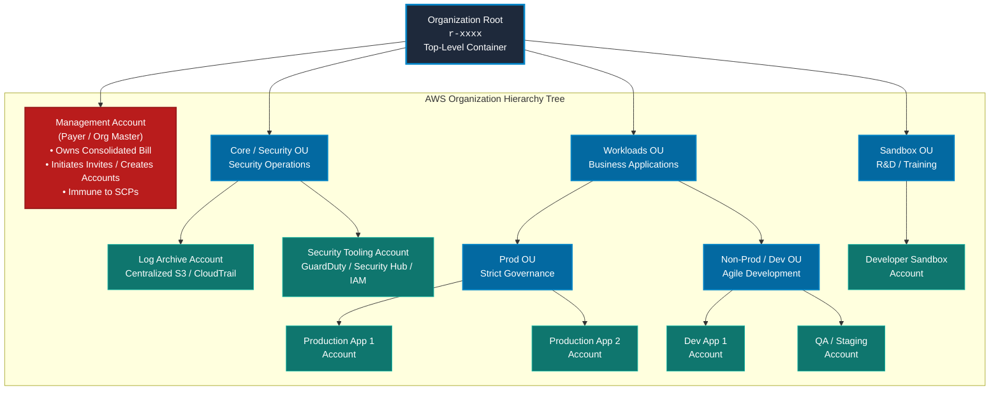
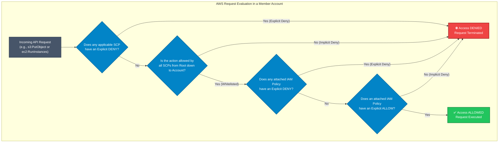
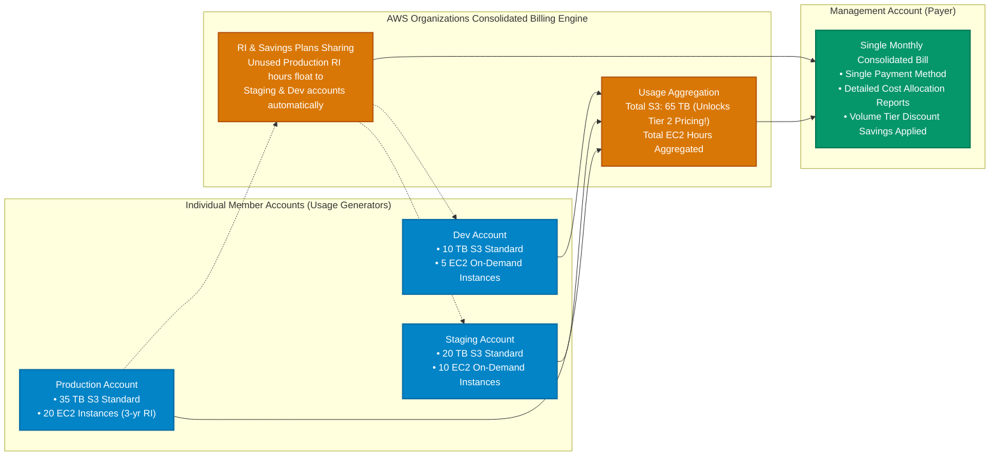
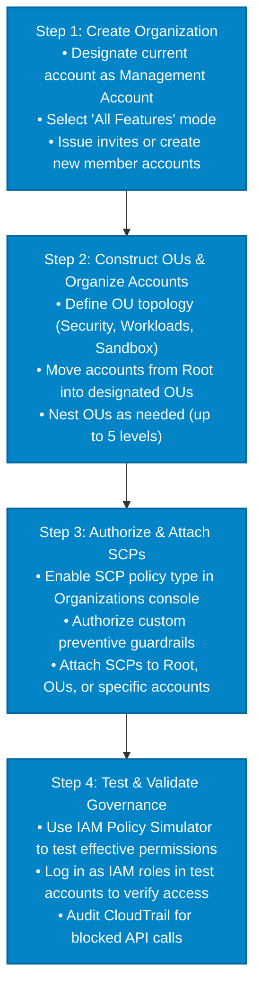

# 🏢 AWS Organizations: Centralized Governance, Consolidated Billing & Multi-Account Architecture

> **Course**: AWS re/Start  
> **Module**: Managing Resource Consumption  
> **Source Document**: `T21-0002-RSJAWS_EN-US_SG_M13_AWSORGANIZATIONS.pdf`  
> **Target Audience**: AWS re/Start Learners / Cloud Practitioners / Solutions Architects / SysOps Administrators / Security Engineers  

---

## 🎯 Executive Summary & Learning Objectives

As enterprises expand their footprint in Amazon Web Services (AWS), managing cloud infrastructure inside a single AWS account quickly becomes unmanageable. A single-account model introduces catastrophic blast-radius risks, administrative bottlenecks, conflicting security requirements across teams, and complex cost attribution challenges. 

**AWS Organizations** is AWS's foundational, fully managed account management and governance service that enables organizations to consolidate, structure, and centrally govern multiple AWS accounts into an organized, hierarchical tree. AWS Organizations provides:
- **Centralized Governance & Security Boundaries**: Enforce preventive security guardrails using Service Control Policies (SCPs) across hundreds of accounts.
- **Consolidated Billing & Cost Optimization**: Aggregate usage across member accounts to unlock higher volume pricing tiers, share commitments (Savings Plans and Reserved Instances), and consolidate invoices into a single payment stream.
- **Automated Provisioning & Scalability**: Automate account vending, lifecycle management, and integration with landing zone orchestrators such as AWS Control Tower.
- **Unified Identity & Access**: Seamlessly integrate with AWS IAM Identity Center (formerly AWS Single Sign-On) for centralized workforce access.

```
┌────────────────────────────────────────────────────────────────────────────────────────┐
│                        The Four Pillars of AWS Organizations                          │
├────────────────────────────┬────────────────────────────┬─────────────────────────────┤
│ 1. Hierarchical Governance │ 2. Policy Guardrails       │ 3. Consolidated Billing     │
│ Organize accounts into     │ Enforce maximum permission │ Single monthly invoice with │
│ Organizational Units (OUs) │ boundaries via Service     │ aggregated volume discounts │
│ reflecting company domains │ Control Policies (SCPs).   │ and shared RI/Savings Plans.│
├────────────────────────────┴────────────────────────────┴─────────────────────────────┤
│ 4. Automated Account Lifecycle & Programmatic Integration (APIs / SDKs / CLI / SSO)   │
└────────────────────────────────────────────────────────────────────────────────────────┘
```

---

### 📌 Learning Objectives

- [ ] **Define AWS Organizations**: Explain the purpose, architecture, and core business benefits of AWS Organizations for enterprise governance.
- [ ] **Deconstruct the Organizational Hierarchy**: Identify the Organization Root, Management Account (formerly Master Account), Member Accounts, and Organizational Units (OUs).
- [ ] **Analyze Account Roles & Isolation**: Differentiate the operational responsibilities and security postures of the Management Account versus Member Accounts.
- [ ] **Understand OU Nesting & Structure**: Apply multi-tier OU structuring (up to 5 levels deep) following AWS multi-account best practices (Core/Security, Infrastructure, Workloads, Sandbox).
- [ ] **Master Service Control Policies (SCPs)**: Describe how SCPs define maximum allowed permission guardrails without granting permissions directly, and analyze how explicit denies override allows.
- [ ] **Evaluate SCP Inheritance & Evaluation Logic**: Trace how policies flow downward through the hierarchy tree and intersect with IAM identity-based and resource-based policies.
- [ ] **Contrast SCPs vs. IAM Policies**: Articulate differences in target scope, permission granting vs. filtering, and impact on the AWS account root user.
- [ ] **Architect Consolidated Billing**: Detail how centralized billing simplifies invoicing, aggregates tiered volume pricing discounts (S3, EC2, data transfer), and shares Reserved Instances / Savings Plans.
- [ ] **Integrate Identity & Landing Zones**: Explain how AWS Organizations integrates with AWS IAM Identity Center, AWS Control Tower, and Service Catalog.
- [ ] **Review Quotas, Limits & Naming Rules**: Recall critical system limits (nesting depth, SCP byte limits, concurrent account creation, invitation quotas).
- [ ] **Execute Setup & Verification Workflows**: Follow the 4-step deployment framework and use the AWS CLI, SDKs, and IAM Policy Simulator to validate multi-account security boundaries.

---

## 🏛️ 1. Multi-Account Strategy: Why Multiple AWS Accounts?

In early cloud adoption, organizations often place multiple projects, environments, and business units inside a single AWS account. While simple initially, this approach breaks down at enterprise scale:

```
Single Account Anti-Pattern                 Multi-Account Best Practice
┌───────────────────────────────────────┐   ┌─────────────────────────────────────────────────────────┐
│           Single AWS Account          │   │                    AWS Organization                     │
│  ┌───────────┐ ┌───────────────────┐  │   │  ┌─────────────────┐ ┌────────────────┐ ┌────────────┐  │
│  │ Dev Team  │ │ Production Web    │  │   │  │ Dev Workload    │ │ Staging        │ │ Production │  │
│  │ Sandbox   │ │ Critical Database │  │   │  │ Account         │ │ Account        │ │ Account    │  │
│  └───────────┘ └───────────────────┘  │   │  └─────────────────┘ └────────────────┘ └────────────┘  │
│  ┌─────────────────────────────────┐  │   │  ┌─────────────────┐ ┌────────────────┐ ┌────────────┐  │
│  │ Shared IAM Users & Default VPC  │  │   │  │ Security Tooling│ │ Log Archive    │ │ Network Hub│  │
│  │ Conflicting Quotas & Invoices   │  │   │  │ Account         │ │ Account        │ │ Account    │  │
│  └─────────────────────────────────┘  │   │  └─────────────────┘ └────────────────┘ └────────────┘  │
│  ⚠️ High Blast Radius & Weak Audit    │   │  🛡️ Strong Isolation, Guardrails & Clear Cost Tracking  │
└───────────────────────────────────────┘   └─────────────────────────────────────────────────────────┘
```

### Strategic Benefits of Multi-Account Architecture

1. **Isolation of Blast Radius**:
   - A security compromise, credential leak, or catastrophic misconfiguration in a development or sandbox account is physically isolated from production workloads and sensitive customer data.
2. **Distinct Security & Compliance Boundaries**:
   - Workloads governed by stringent compliance regimes (e.g., PCI-DSS, HIPAA, FedRAMP) can be quarantined into dedicated accounts subject to strict auditing and minimal access, reducing compliance scope and audit costs.
3. **Independent Resource Limits and Service Quotas**:
   - AWS service quotas (e.g., EC2 vCPU limits, API rate limits, VPC peering limits) are scoped at the account level. Isolating environments ensures that a developer running stress tests in Dev cannot exhaust API quotas or compute capacity required by Production.
4. **Transparent Cost Allocation and Chargeback**:
   - With dedicated accounts for specific cost centers, projects, or business units, cost attribution requires zero complex tagging heuristics—the account bill directly represents the project's spend.
5. **Decentralized Innovation with Centralized Guardrails**:
   - Developers receive broad permissions within their sandbox and development accounts to innovate rapidly, while automated organization guardrails (SCPs) prevent high-risk actions (e.g., opening S3 buckets publicly or launching unapproved instance types).

---

## 🌳 2. Organizational Hierarchy & Entities

AWS Organizations structures accounts into an inverted tree hierarchy consisting of four fundamental entities:



### 1. Organization Root
- The top-level parent container for all accounts and Organizational Units within the organization.
- Every organization has **exactly one root**.
- Attaching a policy directly to the root causes the policy to propagate downward and apply to **all** accounts and OUs across the entire organization (with the exception of the Management Account).

### 2. Management Account (Formerly Master Account)
- The AWS account used to initially create the organization.
- **Sole Payer Account**: Responsible for paying all charges incurred by all member accounts under Consolidated Billing.
- **Administrative Hub**: Possesses administrative authority to:
  - Create new member accounts.
  - Send and cancel invitations to existing AWS accounts.
  - Remove member accounts from the organization.
  - Authorize and attach policies (SCPs, Tag Policies, Backup Policies) across the tree.
  - Enable integration with trusted AWS services (e.g., AWS Control Tower, AWS IAM Identity Center, AWS GuardDuty).
- **Immunity from SCPs**: Service Control Policies **never** restrict actions taken in the Management Account.

> [!CAUTION]
> **Management Account Best Practice**: Never deploy production workloads, applications, or day-to-day resources inside the Management Account. Because the Management Account is immune to SCP guardrails and possesses global organizational root authority, a compromise of this account compromises the entire multi-account fleet. Restrict access to a minimal set of audited administrators protected with multi-factor authentication (MFA).

### 3. Member Accounts
- Standard AWS accounts that belong to an organization and contain operational workloads, data stores, compute resources, and application infrastructure.
- Every member account:
  - Can belong to **exactly one** Organizational Unit (or reside directly in the Root).
  - Can belong to **only one** organization at any given time.
  - Contains its own independent AWS Identity and Access Management (IAM) identities (users, groups, roles) and resources.
  - Has its maximum permissible actions constrained by attached SCPs.

### 4. Organizational Units (OUs)
- Logical group containers inside the organization used to organize accounts for policy application and governance.
- **Nesting Capabilities**: OUs can contain member accounts or other child OUs, enabling a hierarchical branch structure.
  - OUs can be nested up to **5 levels deep** beneath the root.
  - An OU can have **only one parent** (either the Root or a parent OU).
- **Inheritance**: Any policy attached to an OU automatically cascades down to all subordinate OUs and member accounts inside that branch.

---

### ⚖️ Comparison: Management Account vs. Member Account

| Architectural Dimension | Management Account | Member Account |
| :--- | :--- | :--- |
| **Primary Function** | Organization administration, account vending, consolidated billing | Hosting application workloads, data stores, security tooling |
| **Billing Responsibility** | Pays the single consolidated bill for all accounts in the organization | Generates individual itemized usage; does not pay AWS directly |
| **Subject to SCPs?** | **No** (Never constrained by SCPs; guardrails do not apply) | **Yes** (Strictly constrained by SCPs applied to Root, OUs, or Account) |
| **Account Creation / Invites**| Can create new accounts and issue invitations | Cannot invite or create accounts for the organization |
| **Organization Management** | Full programmatic and console control over the organization tree | View-only organizational metadata (or no access to org hierarchy) |
| **Recommended Deployment** | Strict administrative isolation; zero workload resources | Workload deployment (Dev, Test, Prod, Shared Services, Logging) |

---

## 🛡️ 3. Service Control Policies (SCPs) & Security Guardrails

### What is a Service Control Policy (SCP)?

A **Service Control Policy (SCP)** is an organization-level JSON policy document that specifies the maximum permissions that identity-based policies (IAM user policies and role policies) can grant to entities in affected accounts.

> [!IMPORTANT]
> **SCPs Do Not Grant Permissions!**  
> An SCP functions as an **access filter / permission guardrail**, not a permission grantor. Even if an SCP includes an `"Allow": "*"`, an IAM user or role still cannot perform any action until an IAM policy explicitly grants permission (`"Effect": "Allow"`) within that account.

```
                    How SCPs Establish Permission Boundaries
┌──────────────────────────────────────────────────────────────────────────────┐
│                                                                              │
│    ┌──────────────────────────────────────────────┐                          │
│    │  Service Control Policy (SCP) Boundary       │                          │
│    │  (Defines Maximum Allowed Actions)           │                          │
│    │                                              │                          │
│    │          ┌────────────────────────┐          │                          │
│    │          │  IAM Policy Allowance  │          │                          │
│    │          │                        │          │                          │
│    │          │    ★ Effective         │          │                          │
│    │          │      Permission        │          │                          │
│    │          │      (The Overlap)     │          │                          │
│    │          └────────────────────────┘          │                          │
│    │                                              │                          │
│    └──────────────────────────────────────────────┘                          │
│                                                                              │
│   ❌ Actions outside SCP boundary are BLOCKED, even if IAM allows them!      │
│   ❌ Actions allowed by SCP are NOT permitted until an IAM policy grants them!│
└──────────────────────────────────────────────────────────────────────────────┘
```



---

### Core Rules of SCP Evaluation

1. **Explicit Deny Overrides Everything**: If an SCP at any level in the hierarchy contains an explicit `Deny`, that action is permanently blocked for all affected accounts, regardless of what other SCPs or IAM policies allow.
2. **Inheritance & Hierarchy Propagation**: When a policy is attached to an OU, it flows downward to all sub-OUs and member accounts. An account is subject to every SCP attached to:
   - The Organization Root
   - Every parent OU in its path
   - The member account itself
3. **The Account Root User is Restricted**: Unlike IAM policies (which cannot restrict the root user of an individual AWS account), **SCPs restrict all users and roles in a member account, including the member account's root user**.
4. **Management Account Immunity**: SCPs have zero effect on the Management Account. IAM users and roles in the Management Account are governed strictly by IAM policies.

---

### ⚖️ Comparison: IAM Policies vs. Service Control Policies (SCPs)

| Feature | IAM Policies | Service Control Policies (SCPs) |
| :--- | :--- | :--- |
| **Scope of Application** | Users, Groups, Roles, or Resources inside a single account | Entire AWS Accounts or Organizational Units across an organization |
| **Primary Purpose** | **Grant** permissions to perform specific API operations | **Set boundaries** / restrict maximum permissions across accounts |
| **Can Grant Permissions?**| **Yes** (`"Effect": "Allow"` enables access) | **No** (Defines an outer boundary; cannot grant standalone access) |
| **Affects Account Root?** | **No** (Cannot restrict the local AWS account root user) | **Yes** (Strictly restricts the member account root user) |
| **Affects Management Account?**| **Yes** (Governs identities inside the Management Account) | **No** (Management Account is completely immune to SCPs) |
| **Resource-Level Control**| Supports resource ARNs (e.g., `arn:aws:s3:::my-bucket/*`) | Historically service/action level; condition keys supported |
| **Document Size Limit** | Up to 10 KB (Managed) / 2 KB (Inline) | **5,120 bytes** (5 KB) |

---

### 📝 SCP Strategies & Practical JSON Examples

Organizations can implement SCPs using two architectural strategies:
- **Allow-List Strategy (Default)**: Keep the default AWS-managed policy `FullAWSAccess` attached at all levels and attach custom SCPs with explicit `Deny` statements to block prohibited actions. This is the simplest and recommended strategy.
- **Deny-List Strategy**: Carefully specify only the explicitly permitted services using `Allow` statements and remove `FullAWSAccess`. Any unlisted service is implicitly denied.

#### Example 1: Prevent Disabling AWS CloudTrail (Audit Integrity)
Prevents any user or role in member accounts from stopping CloudTrail logging or deleting audit trails:

```json
{
  "Version": "2012-10-17",
  "Statement": [
    {
      "Sid": "ProtectCloudTrailLogging",
      "Effect": "Deny",
      "Action": [
        "cloudtrail:StopLogging",
        "cloudtrail:DeleteTrail",
        "cloudtrail:UpdateTrail"
      ],
      "Resource": "*"
    }
  ]
}
```

#### Example 2: Geographic Region Restriction (Data Sovereignty & Compliance)
Blocks resources from being provisioned outside authorized AWS Regions, while permitting global services (such as IAM, Route 53, CloudFront, and Support):

```json
{
  "Version": "2012-10-17",
  "Statement": [
    {
      "Sid": "DenyUnauthorizedRegions",
      "Effect": "Deny",
      "NotAction": [
        "iam:*",
        "organizations:*",
        "route53:*",
        "cloudfront:*",
        "support:*",
        "waf:*",
        "shield:*"
      ],
      "Resource": "*",
      "Condition": {
        "StringNotEquals": {
          "aws:RequestedRegion": [
            "us-east-1",
            "us-west-2"
          ]
        }
      }
    }
  ]
}
```

#### Example 3: Prevent Member Accounts from Leaving the Organization
Guarantees that member accounts cannot unilaterally detach from corporate oversight:

```json
{
  "Version": "2012-10-17",
  "Statement": [
    {
      "Sid": "PreventLeavingOrganization",
      "Effect": "Deny",
      "Action": [
        "organizations:LeaveOrganization"
      ],
      "Resource": "*"
    }
  ]
}
```

---

## 💰 4. Consolidated Billing & Cost Optimization

**Consolidated Billing** is a core capability of AWS Organizations that aggregates the billing and payment processing of all member accounts into the single Management Account.



### Key Financial & Operational Benefits

1. **One Bill Across All Accounts**:
   - Instead of managing hundreds of individual credit cards or vendor purchase orders across departments, AWS issues a single monthly invoice to the Management Account.
2. **Aggregated Volume Pricing Discounts**:
   - AWS offers tiered volume discounts for services such as Amazon Simple Storage Service (S3), Amazon CloudFront, and data transfer out.
   - Under consolidated billing, AWS pools usage across **all** member accounts to calculate the tier threshold:
     - *Example*: S3 Standard pricing charges \$0.023/GB for the first 50 TB, and \$0.022/GB for the next 450 TB. If Account A uses 30 TB and Account B uses 35 TB, neither would reach the 50 TB discount tier individually. Consolidated, total usage is 65 TB, meaning 15 TB is billed at the lower \$0.022/GB tier.
3. **Sharing Reserved Instances (RIs) and Savings Plans**:
   - If an account purchases a compute Savings Plan or Reserved Instance but does not use all available commitment hours during a billing hour, AWS automatically applies the unused discount to eligible compute usage in any other member account in the organization.
   - *Configurable*: Organizations can disable RI and Savings Plan discount sharing for specific accounts if strict financial isolation between subsidiaries is mandated.
4. **Centralized Cost Allocation & Cost Categories**:
   - Integrate with AWS Cost Explorer, AWS Budgets, and AWS Cost and Usage Reports (CUR) to track spending trends, forecast budgets, and generate department-specific chargeback reports from the Management Account.

---

## ⚙️ 5. Feature Sets: Consolidated Billing Only vs. All Features

When establishing an AWS Organization, administrators select between two operational feature sets:

```
                          Feature Set Hierarchy
┌────────────────────────────────────────────────────────────────────────┐
│                      Consolidated Billing Only                         │
│   • Single Invoicing across accounts                                   │
│   • Aggregated Volume Tier Pricing                                     │
│   • RI & Savings Plans Discount Sharing                                │
│                                                                        │
│                                  ▲                                     │
│                                  │ (Upgrade path requires approval     │
│                                  │  from all existing member accounts) │
│                                  ▼                                     │
│                                                                        │
│                             All Features                               │
│   • Everything in Consolidated Billing Only, PLUS:                     │
│   • Service Control Policies (SCPs)                                    │
│   • Organizational Units (OUs) & Hierarchical Policy Inheritance       │
│   • Tag Policies & Backup Policies                                     │
│   • AWS IAM Identity Center (SSO) Integration                          │
│   • AWS Control Tower, GuardDuty & Security Hub Fleet Governance       │
└────────────────────────────────────────────────────────────────────────┘
```

### ⚖️ Detailed Comparison of Feature Sets

| Operational Feature | Consolidated Billing Only | All Features (Recommended) |
| :--- | :--- | :--- |
| **Primary Use Case** | Financial consolidation for independent business units | Enterprise governance, compliance, and security guardrails |
| **Combined Invoicing** | **Yes** | **Yes** |
| **Aggregated Tiered Pricing** | **Yes** | **Yes** |
| **Service Control Policies (SCPs)** | ❌ Not Available | **Yes** (Full enforcement) |
| **OU Hierarchy & Inheritance** | ❌ Not Available | **Yes** (Up to 5 levels deep) |
| **Tag & Backup Policies** | ❌ Not Available | **Yes** |
| **AWS Control Tower / SSO**| ❌ Not Supported | **Yes** |
| **Member Account Autonomy**| High (Member accounts can leave org without permission) | Controlled (Can prevent accounts from leaving via SCP) |
| **Enabling Process** | Default when creating simple billing organization | Requires all invited accounts to approve invitation |

> [!NOTE]
> Organizations created with "Consolidated Billing Only" can be migrated to "All Features" at any time. When initiating the migration, the management account sends a feature upgrade request that must be accepted by all member accounts that were invited to the organization.

---

## 🔐 6. Centralized Identity, Access & Landing Zones

AWS Organizations serves as the backbone for advanced enterprise governance services:

### 1. AWS IAM Identity Center (Successor to AWS Single Sign-On)
- Directly integrates with AWS Organizations to provide centralized single sign-on (SSO) across all member accounts.
- Connects to enterprise identity providers (IdPs) such as Microsoft Active Directory, Okta, Azure AD (Entra ID), or Google Workspace via SAML 2.0.
- Administrators assign multi-account permission sets to workforce users and groups without provisioning local IAM users inside each individual account.

### 2. AWS Control Tower & Landing Zones
- **Automated Account Vending**: Uses the **Account Factory** (powered by AWS Service Catalog and Organizations APIs) to automatically provision standardized, pre-configured accounts with standard VPCs, security baselines, and logging agents in minutes.
- **Guardrails (Controls)**: Deploys preventive guardrails (via Organizations SCPs) and detective guardrails (via AWS Config rules) across the organization.
- **Predefined Architecture**: Automatically sets up the Core/Security OUs containing the `Log Archive` and `Audit` accounts.

### 3. Delegated Administrator
- Allows the Management Account to delegate management of specific AWS services to dedicated member accounts without granting full organization management permissions.
- **Examples**:
  - Delegate **AWS IAM Identity Center** to an Identity account.
  - Delegate **Amazon GuardDuty**, **AWS Security Hub**, and **AWS Inspector** to the Security Tooling account.
  - Delegate **AWS CloudFormation StackSets** to a DevOps deployment account.

---

## 🛠️ 7. Step-by-Step Setup & Deployment Walkthrough

Setting up AWS Organizations follows a structured four-step lifecycle:



### Step 1: Create Organization & Designate Management Account
Using the AWS Management Console or AWS CLI, initialize the organization from your primary administrative account:

```bash
# Create an organization with All Features enabled
aws organizations create-organization --feature-set ALL
```

Output:
```json
{
  "Organization": {
    "Id": "o-abcdef1234",
    "Arn": "arn:aws:organizations::111122223333:organization/o-abcdef1234",
    "FeatureSet": "ALL",
    "MasterAccountId": "111122223333",
    "MasterAccountEmail": "admin@example.com",
    "AvailablePolicyTypes": [
      {
        "Type": "SERVICE_CONTROL_POLICY",
        "Status": "ENABLED"
      }
    ]
  }
}
```

### Step 2: Create Organizational Units (OUs) and Move Accounts
Construct the logical tree structure:

```bash
# Obtain the Root ID (e.g., r-exampleroot)
ROOT_ID=$(aws organizations list-roots --query "Roots[0].Id" --output text)

# Create the Security and Workloads OUs under Root
SEC_OU=$(aws organizations create-organizational-unit \
  --parent-id $ROOT_ID \
  --name "Security_OU" \
  --query "OrganizationalUnit.Id" --output text)

WORK_OU=$(aws organizations create-organizational-unit \
  --parent-id $ROOT_ID \
  --name "Workloads_OU" \
  --query "OrganizationalUnit.Id" --output text)

# Create a Production child OU nested inside Workloads OU
PROD_OU=$(aws organizations create-organizational-unit \
  --parent-id $WORK_OU \
  --name "Production_OU" \
  --query "OrganizationalUnit.Id" --output text)
```

Create a new member account programmatically:

```bash
# Create a new member account
aws organizations create-account \
  --email "cloud-prod@example.com" \
  --account-name "Production-App-Account" \
  --role-name "OrganizationAccountAccessRole"
```

### Step 3: Create and Attach Service Control Policies (SCPs)

```bash
# Create an SCP document that prevents detaching from organization
aws organizations create-policy \
  --content file://prevent-leave-org.json \
  --description "Prevents member accounts from leaving the organization" \
  --name "DenyLeaveOrganization" \
  --type SERVICE_CONTROL_POLICY

# Attach the policy to an OU
aws organizations attach-policy \
  --policy-id p-examplepolicyid \
  --target-id $WORK_OU
```

### Step 4: Validate and Test Policies
1. **IAM Policy Simulator**: Verify that simulated requests to restricted APIs (e.g., `s3:DeleteBucket` or `cloudtrail:StopLogging`) evaluate to `Deny` due to Organization SCP boundaries.
2. **Role Verification**: Assume the `OrganizationAccountAccessRole` in the member account and attempt to invoke the blocked action via the AWS CLI:
   ```bash
   aws organizations leave-organization
   ```
   *Expected Error*: `AccessDeniedException: User is not authorized to perform: organizations:LeaveOrganization with an explicit deny in a service control policy.`

---

## 📊 8. System Quotas, Naming Rules & Constraints

AWS Organizations enforces specific operational constraints and service quotas designed to maintain organizational integrity:

| Entity / Dimension | Limit / Quota | Behavior & Notes |
| :--- | :--- | :--- |
| **Naming Rules** | Unicode characters; up to 250 characters | Applies to names of accounts, OUs, roots, and policies |
| **Number of Roots** | **1** per organization | An organization can have exactly one root container |
| **OU Nesting Depth** | **5 levels deep** under root | Maximum depth of parent-to-child nested OUs |
| **Maximum Size of SCP Document** | **5,120 bytes** (5 KB) | Character/byte limit for a single policy JSON document |
| **Total Policies in Organization**| **1,000** | Maximum number of policies of each type in an organization |
| **Entity Attachment Limit** | **Unlimited** | A policy can be attached to an unlimited number of roots, OUs, or accounts |
| **Invitations Sent Per Day** | **20** invitations / day | Prevents invitation spam; expires after 15 days if unanswered |
| **Concurrent Account Creation** | **5** in progress concurrently | Up to 5 `CreateAccount` API requests can execute simultaneously |
| **Member Account Membership** | **1** OU and **1** Organization | An account cannot belong to multiple OUs or multiple orgs simultaneously |

---

## 💻 9. Management Interfaces & Programmatic Access

AWS Organizations provides full functionality across multiple management interfaces at **no additional service charge**:

```
┌────────────────────────────────────────────────────────────────────────────────────────┐
│                        AWS Organizations Management Interfaces                         │
├────────────────────────────┬────────────────────────────┬─────────────────────────────┤
│ 1. AWS Management Console  │ 2. AWS CLI                 │ 3. AWS SDKs & HTTPS APIs    │
│ Graphical web interface    │ Command-line automation    │ Programmatic integration in │
│ for drag-and-drop tree     │ for shell scripts, CI/CD,  │ Python (Boto3), Java, Go,   │
│ visualization and testing. │ and quick administration.  │ .NET, and direct HTTPS query│
└────────────────────────────┴────────────────────────────┴─────────────────────────────┘
```

### Programmatic SDK Integration (Python / Boto3 Example)

```python
import boto3

# Initialize the AWS Organizations client
org_client = boto3.client('organizations')

def list_organization_accounts():
    """List all accounts in the AWS Organization with pagination support."""
    paginator = org_client.get_paginator('list_accounts')
    for page in paginator.paginate():
        for account in page['Accounts']:
            print(f"Account ID: {account['Id']} | "
                  f"Name: {account['Name']} | "
                  f"Status: {account['Status']} | "
                  f"Email: {account['Email']}")

def get_ou_tree(parent_id):
    """Recursively list child OUs under a given parent container."""
    response = org_client.list_organizational_units_for_parent(ParentId=parent_id)
    for ou in response['OrganizationalUnits']:
        print(f"OU ID: {ou['Id']} | Name: {ou['Name']} (Parent: {parent_id})")
        get_ou_tree(ou['Id'])

if __name__ == "__main__":
    list_organization_accounts()
```

---

## 💡 10. Architectural Best Practices

To ensure maximum security and efficiency, adhere to these battle-tested AWS multi-account principles:

> [!TIP]
> **Best Practice Checklist**:
> 1. **Isolate the Management Account**: Store no application workloads or pipelines in the Management Account. Protect root credentials with hardware MFA and restrict IAM role access.
> 2. **Apply Deny Guardrails at the OU Level**: Attach common security baselines (such as region restrictions, preventing audit log disruption, and disabling root login) at high-level OUs so all subordinate accounts inherit them automatically.
> 3. **Keep `FullAWSAccess` Attached**: Rely on targeted `Deny` statements in custom SCPs rather than removing `FullAWSAccess` and attempting to allow-list every single AWS API. Deny-listing is far more resilient to new AWS service rollouts.
> 4. **Use Centralized Logging**: Establish a dedicated `Log Archive` account that aggregates Amazon CloudTrail, Amazon VPC Flow Logs, and AWS Config logs across all member accounts into an immutable S3 bucket protected with Object Lock.
> 5. **Automate Account Vending**: Use AWS Control Tower or custom CloudFormation StackSets to deploy standardized VPCs, security groups, and IAM roles into newly created accounts instantly.

---

## ❓ 11. Review Questions & Knowledge Check

Test your understanding of AWS Organizations, SCPs, and multi-account architectures:

### Question 1
**An enterprise has configured an AWS Organization with a Management Account and 15 Member Accounts. A junior administrator attempts to attach a Service Control Policy (SCP) to the Management Account to restrict access to Amazon S3. What happens?**
- A) The SCP applies immediately and blocks S3 access for all users in the Management Account.
- B) The SCP only restricts IAM users in the Management Account, but not the root user.
- C) SCPs cannot be attached to or restrict the Management Account; the Management Account is immune to SCPs.
- D) The AWS CLI returns a validation error stating that S3 cannot be restricted by SCPs.

> **Correct Answer: C**  
> **Explanation**: Service Control Policies (SCPs) never apply to or restrict the Management Account (formerly Master Account). SCPs only restrict member accounts within the organization. To control permissions in the Management Account, administrators must use IAM policies.

---

### Question 2
**A developer in a member account has an IAM policy attached granting `"Effect": "Allow"`, `"Action": "dynamodb:*"`, `"Resource": "*"`. However, an SCP attached to the developer's Organizational Unit contains `"Effect": "Deny"`, `"Action": "dynamodb:DeleteTable"`, `"Resource": "*"`. What happens when the developer attempts to delete a DynamoDB table?**
- A) The table is deleted because local IAM policies take precedence over organization policies.
- B) The action is denied because an explicit Deny in an SCP overrides any IAM Allow statement.
- C) The table is deleted if the developer is authenticated as the member account root user.
- D) The table is placed in a pending deletion state for 24 hours.

> **Correct Answer: B**  
> **Explanation**: In AWS evaluation logic, an explicit `Deny` in an SCP permanently overrides any `Allow` granted by IAM policies. Furthermore, SCPs restrict all users in a member account, including the member account root user.

---

### Question 3
**How does Consolidated Billing provide cost savings across multiple AWS accounts?**
- A) By applying a flat 20% discount on all compute resources across the organization.
- B) By waiving all data transfer costs between AWS Regions for member accounts.
- C) By pooling usage across all member accounts to qualify for tiered volume pricing discounts and sharing unused Reserved Instances / Savings Plans.
- D) By automatically shutting down idle EC2 instances at midnight across all accounts.

> **Correct Answer: C**  
> **Explanation**: Consolidated Billing aggregates the usage of all member accounts into a single bill. This aggregated volume allows the organization to reach higher volume discount tiers faster (e.g., for S3 storage and data transfer) and automatically shares unused Reserved Instance (RI) and Savings Plans discounts across all member accounts.

---

### Question 4
**What is the maximum nesting depth for Organizational Units (OUs) beneath an Organization Root?**
- A) 3 levels deep
- B) 5 levels deep
- C) 10 levels deep
- D) Unlimited nesting

> **Correct Answer: B**  
> **Explanation**: AWS Organizations supports nesting OUs up to a maximum of 5 levels deep below the organization root container.

---

### Question 5
**An organization needs to transition from "Consolidated Billing Only" to "All Features" to enable Service Control Policies. What is required before the transition is finalized?**
- A) The organization must be deleted and recreated from scratch.
- B) All invited member accounts must approve the invitation to enable all features.
- C) The organization must upgrade to an AWS Enterprise Support plan.
- D) All member accounts must terminate active EC2 instances during the transition window.

> **Correct Answer: B**  
> **Explanation**: Upgrading from Consolidated Billing Only to All Features requires that an invitation request be sent to all existing invited member accounts. Each member account must explicitly approve the invitation before All Features can be activated, because All Features grants the Management Account the ability to apply restrictive SCP guardrails.

---

## 📚 12. Key Takeaways & Summary

- **Centralized Account Management**: AWS Organizations transforms multi-account environments from isolated silos into an organized, centrally governed hierarchy.
- **Hierarchy Structure**: A single **Organization Root** branches into **Organizational Units (OUs)** (up to 5 levels deep), which contain **Member Accounts**.
- **Management Account Role**: Serves as the administrative owner and sole payer for the consolidated invoice; it is **immune** to SCPs and should never host application workloads.
- **Service Control Policies (SCPs)**: Define maximum allowed permission guardrails; they do **not** grant permissions, and an explicit **Deny** always overrides an Allow. SCPs affect all IAM identities and the root user in member accounts.
- **Consolidated Billing Benefits**: Consolidates multiple invoices into a single bill, aggregates tiered volume usage for cost savings (S3, data transfer), and shares Reserved Instances / Savings Plans across the account fleet.
- **Enterprise Ecosystem**: Seamlessly integrates with AWS IAM Identity Center for enterprise SSO, AWS Control Tower for automated account vending, and AWS CloudFormation StackSets for multi-account infrastructure deployment.
