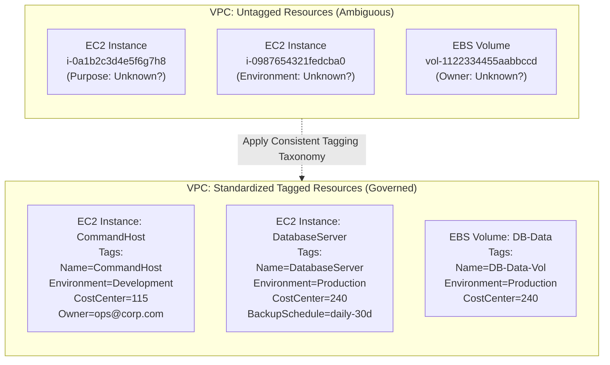
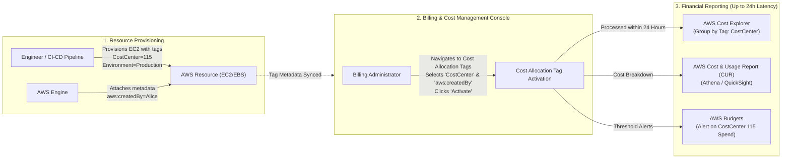
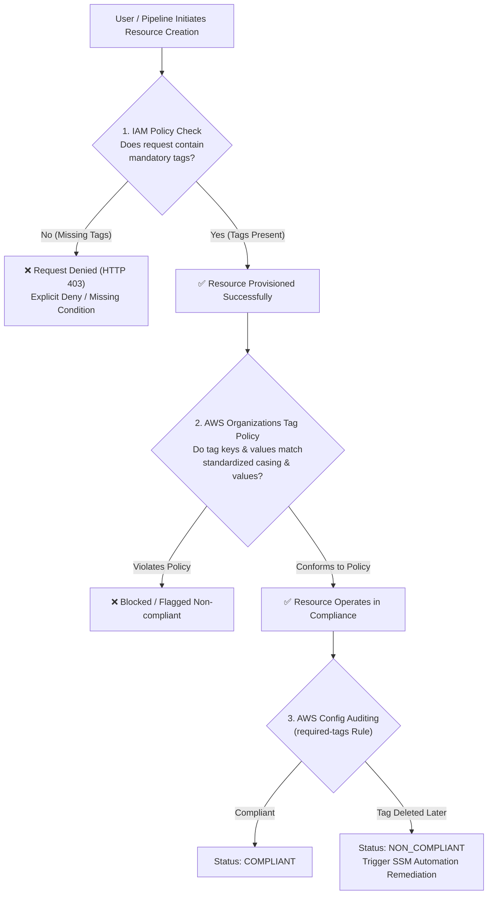
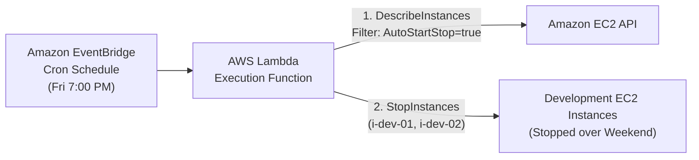
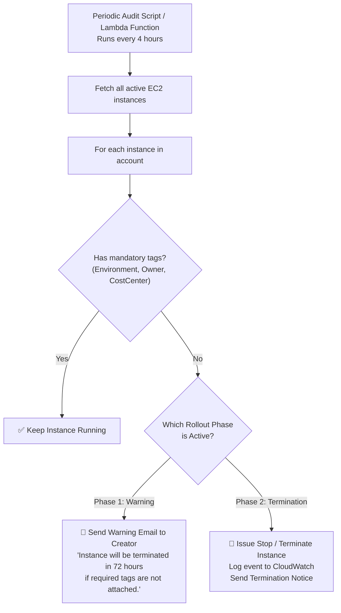

# 🏷️ AWS Resource Tagging: Governance, Cost Allocation & Automation Strategies

> **Course**: AWS re/Start  
> **Module**: Managing Resource Consumption – M13 Tagging  
> **Source Document**: `T21-0003-RSJAWS_EN-US_SG_M13_TAGGING.pdf`  
> **Target Audience**: AWS re/Start Learners / Cloud Practitioners / Solutions Architects / SysOps Administrators  

---

## 🎯 Module Overview

In modern cloud environments, enterprises provision thousands of heterogeneous resources across multiple AWS accounts, Regions, and virtual private clouds (VPCs). Without an effective categorization strategy, tracking ownership, controlling infrastructure spending, automating routine operations, and ensuring regulatory compliance becomes virtually impossible.

**AWS Resource Tagging** provides the foundational metadata layer required to organize, govern, and optimize cloud infrastructure. A tag is a custom key-value pair attached to an AWS resource. By designing and implementing a standardized tagging taxonomy, organizations can:
- Attribute infrastructure costs accurately to specific business units, projects, or cost centers.
- Implement fine-grained access control using AWS Identity and Access Management (IAM) attribute-based access control (ABAC).
- Automate lifecycle actions such as scheduled start/stop of non-production environments and automated snapshot backups.
- Continuously audit and enforce compliance across enterprise-scale multi-account environments.

---

### 📌 Learning Objectives

- [ ] **Define AWS Resource Tags**: Articulate the structure, characteristics, naming constraints, and lifecycle of key-value tags across AWS resources.
- [ ] **Categorize Tag Taxonomies**: Differentiate and implement the four primary tagging dimensions: **Technical**, **Automation**, **Business/Financial**, and **Security/Compliance**.
- [ ] **Master Cost Allocation Tagging**: Differentiate AWS-generated tags from user-defined tags, activate tags in the AWS Billing and Cost Management console, and configure cost allocation reports for showback and chargeback accounting.
- [ ] **Enforce Tagging Policies via IAM**: Author IAM policies utilizing condition keys (`aws:RequestTag`, `aws:TagKeys`, `ForAllValues`, `ForAnyValue`) to mandate tags during resource creation and prevent unauthorized tag modifications.
- [ ] **Audit Compliance with AWS Config**: Deploy and customize the `required-tags` managed rule to detect non-compliant resources and trigger automated remediation.
- [ ] **Implement AWS Organizations Tag Policies**: Standardize tag keys, allowed values, and casing across multi-account AWS Organizations.
- [ ] **Leverage the AWS CLI & Tagging APIs**: Create, query, and filter resources programmatically using the AWS Command Line Interface and the AWS Resource Groups Tagging API.
- [ ] **Execute Operational Automation Patterns**: Implement automated instance scheduling and analyze phased governance workflows such as the "Tag or Terminate" compliance pattern.

---

## 🏷️ 1. Fundamentals of AWS Resource Tagging

### What is an AWS Resource Tag?

A **tag** is a metadata label assigned to an AWS resource. Each tag consists of a user-defined **Key** and an optional **Value**.

```
┌─────────────────────────────────────────────────────────────┐
│                          AWS Tag                            │
├──────────────────────────────┬──────────────────────────────┤
│         Tag Key              │          Tag Value           │
│    (Required, Name)          │     (Optional, Data/State)   │
├──────────────────────────────┼──────────────────────────────┤
│         Environment          │          Production          │
│          CostCenter          │             115              │
│          OwnerEmail          │       devops@example.com     │
│         AutoStartStop        │             true             │
└──────────────────────────────┴──────────────────────────────┘
```

Tags act as metadata filters and descriptors. They do not alter the runtime behavior of the resource itself unless external scripts, IAM policies, or automation services evaluate that metadata.

---

### Tag Characteristics, Rules, and Limitations

| Characteristic | Specification / Constraint | Architectural Best Practice |
| :--- | :--- | :--- |
| **Key Length Limit** | 1 to 128 Unicode characters | Keep keys concise, standardized, and descriptive (e.g., `Environment`, `CostCenter`). |
| **Value Length Limit** | 0 to 256 Unicode characters (values can be empty strings) | Use controlled vocabularies (e.g., `prod`, `stage`, `dev`) instead of free-form text. |
| **Resource Tag Limit** | Up to **50 user-defined tags** per resource | Allocate tags across technical, financial, automation, and security dimensions. |
| **Case Sensitivity** | **Strictly case-sensitive** (`CostCenter`, `costcenter`, and `Costcenter` are 3 distinct keys) | Enforce standardized casing (e.g., PascalCase or camelCase) across the entire organization. |
| **Allowed Characters** | UTF-8 letters, numbers, spaces, and the following symbols: `_ . : / = + - @` | Avoid spaces and special characters that require URL-encoding or shell escaping. |
| **Reserved Prefix** | Keys beginning with `aws:` are reserved for internal AWS use | **Never** prefix custom tags with `aws:`. AWS will reject API requests attempting to create them. |
| **Built-in Tags** | Automatically applied by AWS (e.g., `aws:createdBy`, `aws:cloudformation:stack-name`) | AWS-generated tags **do not** count toward the 50 user-defined tag limit. |
| **Tagging on Creation** | Most core services (EC2, EBS, RDS, S3) support tagging at creation time | Mandate tagging upon creation to prevent untagged "orphan" resources from ever running. |
| **Tag Propagation** | Stacks and parent services can pass tags down to generated child resources | Enable tag propagation in AWS CloudFormation, Auto Scaling Groups, and AWS Elastic Beanstalk. |



> [!IMPORTANT]
> **Case Sensitivity Hazard**: Because AWS treats `Environment` and `environment` as distinct tag keys, queries or billing reports filtering for `Environment=production` will fail to match resources tagged with `environment=production`. Enforcing a single casing convention across all teams is critical.

---

## 🗂️ 2. The Four Primary Tag Categories

An effective enterprise cloud tagging strategy organizes tags into four primary functional categories:

```mermaid
flowchart TD
    Root["Enterprise Tagging Taxonomy"] --> Tech["1. Technical Tags"]
    Root --> Auto["2. Automation Tags"]
    Root --> Fin["3. Business / Financial Tags"]
    Root --> Sec["4. Security / Compliance Tags"]

    Tech --> T1["Name: Logical resource name"]
    Tech --> T2["Environment: prod / stage / dev / test"]
    Tech --> T3["Version: v2.4.1 / release identifier"]
    Tech --> T4["ApplicationID: APP-4091 / Workload ID"]

    Auto --> A1["AutoStartStop: true / false"]
    Auto --> A2["BackupSchedule: daily-30d / weekly-1yr"]
    Auto --> A3["PatchGroup: Windows-Ring-1 / Linux-Prod"]
    Auto --> A4["OptOut: true / false"]

    Fin --> F1["CostCenter: 115 / Finance-CC-90"]
    Fin --> F2["ProjectID: PRJ-ALPHA-2026"]
    Fin --> F3["BusinessUnit: Retail / Marketing / Logistics"]
    Fin --> F4["Owner: devops-lead@company.com"]

    Sec --> S1["DataClassification: Public / Internal / Confidential"]
    Sec --> S2["ConfidentialityLevel: High / Moderate / Low"]
    Sec --> S3["ComplianceScope: HIPAA / PCI-DSS / SOC2"]
    Sec --> S4["SecurityCheck: 2026-10-12T18:00:00Z"]
```



### Detailed Taxonomy Breakdown

| Dimension | Primary Tag Keys | Sample Values | Operational Purpose & Consumers |
| :--- | :--- | :--- | :--- |
| **Technical** | `Name`<br>`Environment`<br>`Version`<br>`ApplicationID` | `WebServer-Prod-01`<br>`prod`, `dev`, `stage`, `test`<br>`1.4.2`<br>`APP-ORDERS-01` | Identifies resource function, separates deployment tiers, tracks deployed application builds, and groups related infrastructure components. |
| **Automation** | `AutoStartStop`<br>`BackupSchedule`<br>`PatchGroup`<br>`DisasterRecoveryTier` | `true`, `false`<br>`daily-30d`, `weekly-90d`<br>`Linux-Batch-A`, `Prod-Group-1`<br>`Tier-1-ActiveActive` | Consumed by automation daemons, EventBridge schedules, AWS Backup plans, and AWS Systems Manager (SSM) Patch Manager to perform scheduled tasks. |
| **Business / Financial** | `CostCenter`<br>`ProjectID`<br>`BusinessUnit`<br>`Owner` | `115`, `GL-98042`<br>`PRJ-CLOUD-MIGRATE`<br>`Marketing`, `Logistics`<br>`alice@example.com` | Allocated to cost centers in AWS Billing, enabling accurate department showback, chargeback accounting, and clear individual ownership. |
| **Security / Compliance** | `DataClassification`<br>`ConfidentialityLevel`<br>`ComplianceRequirement`<br>`SecurityCheck` | `confidential`, `public`, `restricted`<br>`Tier-1-Secret`<br>`PCI-DSS`, `HIPAA`, `SOC2`<br>`2026-10-12T18:00Z` | Governs automated data protection, backup retention mandates, vulnerability scanning workflows, and ABAC authorization policies. |

---

## 💰 3. Cost Allocation Tags in AWS Billing

One of the most critical applications of resource tagging is financial governance. AWS Billing allows organizations to activate specific tag keys as **Cost Allocation Tags**, enabling granular tracking of resource spend in **AWS Cost Explorer**, **AWS Budgets**, and the **AWS Cost and Usage Report (CUR)**.

### AWS-Generated vs. User-Defined Cost Allocation Tags

AWS categorizes cost allocation tags into two distinct types:

| Feature / Dimension | AWS-Generated Cost Allocation Tags | User-Defined Cost Allocation Tags |
| :--- | :--- | :--- |
| **Prefix** | `aws:` (e.g., `aws:createdBy`) | `user:` (e.g., `user:CostCenter`, `user:Environment`) |
| **Creation Mechanism** | Generated automatically by AWS when supported resources are provisioned. | Created and assigned manually or programmatically by users and automation scripts. |
| **Editing & Deletion** | **Cannot** be modified, overwritten, or deleted by any user or IAM role. | Fully manageable, modifiable, and deletable by authorized IAM principals. |
| **Quota Impact** | Does **not** count toward the 50 tags per resource limit. | Counts directly toward the 50 tags per resource limit. |
| **Console Activation** | Must be manually activated in the Billing console to appear in reports. | Must be manually activated in the Billing console to appear in reports. |
| **Primary Examples** | `aws:createdBy` (records the IAM identity or role that created the resource), `aws:cloudformation:stack-name`. | `user:CostCenter`, `user:Department`, `user:ProjectID`, `user:Owner`. |



### Activation Workflow in the Billing Console

1. **Sign in** to the AWS Management Console as an administrator or IAM principal with billing permissions (`billing:*`, `ce:*`).
2. Navigate to **AWS Billing and Cost Management** $\rightarrow$ **Cost Allocation Tags**.
3. View the two tabs:
   - **AWS-Generated Cost Allocation Tags**: Displays `aws:createdBy` and other AWS internal tags.
   - **User-Defined Cost Allocation Tags**: Displays all custom tag keys currently attached to resources across the account or AWS Organization.
4. Select the target tag keys (e.g., `CostCenter`, `Environment`, `ProjectID`, `aws:createdBy`).
5. Choose **Activate**.

> [!CAUTION]
> **24-Hour Propagation Latency & No Retroactivity**:
> - After activating a cost allocation tag, it takes **up to 24 hours** for the tag to appear as an active filtering/grouping dimension in AWS Cost Explorer and Cost and Usage Reports.
> - **Cost allocation tags are strictly prospective**: AWS **does not** apply activated tags retroactively to billing data accumulated prior to activation. Activating tags on day 15 of a month will only categorize spend incurred from that point forward.

### Financial Chargebacks and Showbacks

By utilizing cost allocation tags, organizations implement mature financial operating models (FinOps):
- **Showback**: Reporting resource expenditure directly to business units and project managers to drive awareness of cloud spend without cross-charging department budgets.
- **Chargeback**: Automatically attributing line-item AWS costs to internal departmental ledger accounts (Cost Centers) for direct internal billing transfer.

---

## 🛡️ 4. Enforcing Tagging Policies

Relying on manual tagging inevitably leads to compliance gaps. Organizations must enforce tagging through a multi-layered defense strategy:
1. **Preventive Enforcement**: IAM policies blocking untagged resource creation.
2. **Detective Auditing**: AWS Config continuously identifying non-compliant resources.
3. **Multi-Account Governance**: AWS Organizations Tag Policies preventing inconsistent casing and values.



---

### Strategy 1: Preventive Enforcement Using IAM Policies

IAM policies can evaluate tag keys and values passed in the API creation request using condition keys:
- `aws:RequestTag/${TagKey}`: Verifies the value of a specific tag key being passed in the creation request.
- `aws:TagKeys`: Verifies which tag keys are present in the request.
- `ForAllValues:StringEquals`: Evaluates that **every** key in the request matches an approved set.
- `ForAnyValue:StringEquals`: Evaluates whether **at least one** key in the request matches.

#### Example 1: Enforcing Specific Tag Keys and Exact Values on EBS Volume Creation

The following policy permits `ec2:CreateVolume` **only** if the request includes both `costcenter` (with value `"115"`) and `department` (with value `"Accounting"`), and strictly restricts the request to only those two tag keys:

```json
{
  "Version": "2012-10-17",
  "Statement": [
    {
      "Sid": "EnforceEBSVolumeTagging",
      "Effect": "Allow",
      "Action": "ec2:CreateVolume",
      "Resource": "arn:aws:ec2:us-east-1:123456789012:volume/*",
      "Condition": {
        "StringEquals": {
          "aws:RequestTag/costcenter": "115",
          "aws:RequestTag/department": "Accounting"
        },
        "ForAllValues:StringEquals": {
          "aws:TagKeys": [
            "costcenter",
            "department"
          ]
        }
      }
    }
  ]
}
```

#### Detailed Policy Breakdown:
1. `"Action": "ec2:CreateVolume"`: Targets the EBS volume creation API call.
2. `"Resource": "arn:aws:ec2:us-east-1:123456789012:volume/*"`: Applies the permission to volume creation in account `123456789012`.
3. `"StringEquals"`:
   - `"aws:RequestTag/costcenter": "115"`: Requires the incoming API call to set the `costcenter` tag key to `"115"`.
   - `"aws:RequestTag/department": "Accounting"`: Requires the `department` tag key to equal `"Accounting"`.
4. `"ForAllValues:StringEquals"` with `"aws:TagKeys"`:
   - Ensures that the user **only** submits `"costcenter"` and `"department"` tags. If the user includes any third tag not in this array, the call fails.

---

#### Example 2: Denying EC2 Launch if Required Tags are Missing

To prevent untagged EC2 instances, a policy can explicitly deny `ec2:RunInstances` if mandatory tag keys (`Environment` and `Owner`) are omitted:

```json
{
  "Version": "2012-10-17",
  "Statement": [
    {
      "Sid": "DenyEC2WithoutMandatoryTags",
      "Effect": "Deny",
      "Action": "ec2:RunInstances",
      "Resource": [
        "arn:aws:ec2:*:*:instance/*",
        "arn:aws:ec2:*:*:volume/*"
      ],
      "Condition": {
        "Null": {
          "aws:RequestTag/Environment": "true",
          "aws:RequestTag/Owner": "true"
        }
      }
    }
  ]
}
```

> [!TIP]
> **Preventing Tag Tampering**:
> To stop developers from removing governance tags after provisioning, add an IAM statement denying `ec2:DeleteTags` on critical tags:
> ```json
> {
>   "Effect": "Deny",
>   "Action": "ec2:DeleteTags",
>   "Resource": "*",
>   "Condition": {
>     "ForAnyValue:StringEquals": {
>       "aws:TagKeys": ["CostCenter", "Environment", "Owner"]
>     }
>   }
> }
> ```

---

### Strategy 2: Detective Auditing with AWS Config

While IAM policies provide preventive controls, **AWS Config** provides continuous detective monitoring to identify resources that are missing mandatory tags or whose tags have been altered.

#### The `required-tags` Managed Rule

AWS Config provides the `required-tags` managed rule. Administrators configure parameters specifying mandatory tag keys and allowable values:

| Parameter Name | Data Type | Description | Example Value |
| :--- | :--- | :--- | :--- |
| `tag1Key` | String | Key of the first mandatory tag. | `Environment` |
| `tag1Value` | String (Optional) | Comma-separated list of allowed values for `tag1Key`. | `prod,stage,dev,test` |
| `tag2Key` | String (Optional) | Key of the second mandatory tag. | `CostCenter` |
| `tag2Value` | String (Optional) | Comma-separated list of allowed values for `tag2Key`. | `115,240,300` |
| `tag3Key` | String (Optional) | Key of the third mandatory tag. | `Owner` |
| `tag3Value` | String (Optional) | Optional allowed values. | *(Empty - allows any email)* |

#### Evaluation Triggers:
- **Configuration Changes**: AWS Config evaluates the resource immediately whenever a supported resource is created, modified, or tagged.
- **Periodic Evaluation**: Evaluates resources at scheduled intervals (e.g., every 1, 3, 6, 12, or 24 hours).

```
┌────────────────────────────────────────────────────────────────────────┐
│                        AWS Config Rule Execution                       │
├────────────────────────────────────────────────────────────────────────┤
│  1. Event Trigger       EC2 instance i-abc1234 provisioned             │
│  2. Rule Evaluation     `required-tags` checks for `Environment` tag   │
│  3. Compliance Result   - If Tag Present: State = COMPLIANT            │
│                         - If Tag Missing: State = NON_COMPLIANT        │
│  4. Auto-Remediation    Triggers AWS Systems Manager Automation        │
│                         document to apply default tag or notify owner  │
└────────────────────────────────────────────────────────────────────────┘
```

---

### Strategy 3: Enterprise Governance with AWS Organizations Tag Policies

In enterprise environments with hundreds of AWS accounts managed via **AWS Organizations**, individual account policies can become fragmented. **Tag Policies** allow administrators to define tag rules at the Organization Root, Organizational Unit (OU), or Account level.

#### Tag Policy Capabilities:
- **Case Standardization**: Enforces exact letter casing (e.g., mandates `CostCenter` and flags `costcenter` as non-compliant).
- **Permitted Value Lists**: Specifies acceptable values (e.g., `Environment` must be one of `["prod", "stage", "dev"]`).
- **Enforcement Mode**: Optionally blocks non-compliant tag operations across member accounts.
- **Organization-wide Compliance Reports**: Generates central CSV reports listing all non-compliant resources across all accounts and Regions.

---

## 💻 5. Tagging Operations with the AWS CLI & APIs

### AWS CLI Commands

The AWS CLI allows administrators to manage and inspect tags across resources rapidly.

#### 1. Creating Tags on an Existing Resource
The following command applies a tag named `SecurityCheck` containing the current system timestamp to an EC2 instance:

```bash
# Capture the current timestamp
export TIMESTAMP=`date`

# Apply the tag to the target instance
aws ec2 create-tags \
  --resources i-1234567890abcdef0 \
  --tags "Key=SecurityCheck,Value=$TIMESTAMP"
```

#### 2. Querying and Filtering Instances by Tag
To query and display instance IDs alongside their tag values for all instances with the `SecurityCheck` tag:

```bash
aws ec2 describe-instances \
  --filters "Name=tag-key,Values=SecurityCheck" \
  --query "Reservations[].Instances[].[InstanceId,Tags[?Key=='SecurityCheck'].Value]" \
  --output table
```

#### 3. Filtering by Specific Tag Key and Value
To list instances running in the `Development` environment:

```bash
aws ec2 describe-instances \
  --filters "Name=tag:Environment,Values=Development" \
  --query "Reservations[].Instances[].[InstanceId,InstanceType,State.Name]" \
  --output table
```

---

### The AWS Resource Groups Tagging API

Standard service-specific CLI commands (e.g., `aws ec2 create-tags`, `aws s3api put-bucket-tagging`) only work on a single service type. The **Resource Groups Tagging API** provides a unified, cross-service interface for programmatic tag management across all supported AWS services.

| API Action | CLI Equivalent | Operational Capability |
| :--- | :--- | :--- |
| `GetResources` | `aws resourcegroupstaggingapi get-resources` | Searches and filters resources across multiple services using tag-based criteria. |
| `TagResources` | `aws resourcegroupstaggingapi tag-resources` | Applies tags to up to 20 resources across different AWS services in a single API call. |
| `UntagResources` | `aws resourcegroupstaggingapi untag-resources` | Removes tags from multiple resources across diverse services simultaneously. |
| `GetTagKeys` | `aws resourcegroupstaggingapi get-tag-keys` | Lists all unique tag keys currently used within the AWS account and Region. |
| `GetTagValues` | `aws resourcegroupstaggingapi get-tag-values` | Returns all distinct values associated with a specific tag key. |

---

## ⚙️ 6. Automation Patterns & Common Use Cases

### Pattern 1: Scheduled Instance Start and Stop (Cost Reduction)

Non-production environments (development, testing, QA) rarely need to run 24 hours a day, 7 days a week. Running a development instance 24/7 incurs 168 hours of EC2 charges per week. Shutting it down outside business hours (running 50 hours per week) saves **up to 70%** on compute costs.

#### Implementation Architecture:
1. **Tag Resources**: Tag development instances with `AutoStartStop=true` and `Environment=dev`.
2. **EventBridge Scheduler**: Generates a cron trigger on Friday at 7:00 PM and Monday at 6:00 AM.
3. **AWS Lambda**: Queries EC2 instances matching `--filters "Name=tag:AutoStartStop,Values=true"` and issues `ec2:StopInstances` or `ec2:StartInstances`.



---

### Pattern 2: "Tag or Terminate" Compliance Pattern (Conformity Monkey)

Pioneered by Netflix's Simian Army ("Conformity Monkey"), the **Tag or Terminate** strategy guarantees that untagged resources cannot remain active in an AWS account.

#### Compliance Pseudocode:

```python
# Periodic Conformity Check Script
instances = describe_instances()
for instance in instances:
    if not instance.tags.member_of("Required_Tag"):
        terminate_instance(instance)
```



#### Enterprise Best Practice: Phased Rollout
Sudden termination of non-compliant instances can cause accidental outages if teams are unprepared. Enterprises execute a staggered, phased rollout over several weeks:

1. **Phase 1 (Audit & Warning - Weeks 1 to 3)**:
   - The compliance script scans all resources.
   - Non-compliant resources are **not** stopped or terminated.
   - The script determines the creator (using the `aws:createdBy` tag or CloudTrail `RunInstances` event) and sends an automated warning email giving 72 hours to remediate.
2. **Phase 2 (Stop with Notification - Weeks 4 to 6)**:
   - Non-compliant resources that have exceeded their grace period are **stopped** (preserving volume data).
   - An explanatory notification is sent to the resource creator with instructions on how to tag and restart the instance.
3. **Phase 3 (Enforce & Terminate - Week 7+)**:
   - Any untagged instance is terminated automatically after notification.
   - IAM policies enforcing tagging upon creation are activated to prevent untagged resources permanently.

---

## 🏆 7. Enterprise Tagging Best Practices

```
┌────────────────────────────────────────────────────────────────────────┐
│                      Core Tagging Best Practices                       │
├────────────────────────────────────────────────────────────────────────┤
│  1. Business-Relevant Groupings                                        │
│     Organize tags across Technical, Business, Security, and            │
│     Automation dimensions simultaneously.                              │
│                                                                        │
│  2. Lean Towards More Tags Rather Than Fewer                           │
│     It is far easier to ignore surplus metadata than to reconstruct    │
│     historical ownership or purpose for an untagged asset.             │
│                                                                        │
│  3. Standardized, Strict Casing Rules                                  │
│     Enforce PascalCase (e.g., `CostCenter`) or kebab-case across all   │
│     teams using AWS Organizations Tag Policies.                        │
│                                                                        │
│  4. Tag at Creation Time                                               │
│     Require tags during the initial API call (`RunInstances`,          │
│     `CreateVolume`) to ensure no resource exists in an untagged state. │
│                                                                        │
│  5. Automate Tag Governance and Auditing                               │
│     Use AWS Config `required-tags` and the Resource Groups Tagging     │
│     API rather than relying on manual console actions.                 │
│                                                                        │
│  6. Implement Immutable Protection for Critical Tags                   │
│     Use IAM policies to deny `ec2:DeleteTags` on governance tags.      │
└────────────────────────────────────────────────────────────────────────┘
```

---

## 📝 8. Interactive Self-Coaching & Taxonomy Worksheet

### Exercise: Design an Enterprise Tag Taxonomy

Use the template below to design an organizational tagging policy for a multi-tier e-commerce web application running in AWS:

| Category | Recommended Tag Key | Sample Permitted Values | Enforcement Level (Mandatory / Optional) | Consuming Service or Team |
| :--- | :--- | :--- | :--- | :--- |
| **Technical** | `Name` | `Ecommerce-API-Prod-01` | Mandatory | Operations / EC2 Console |
| **Technical** | `Environment` | `[prod, stage, dev, test]` | Mandatory | Architecture / Security |
| **Technical** | `ApplicationID` | `APP-ECOM-101` | Mandatory | Enterprise Architecture |
| **Financial** | `CostCenter` | `[115-Finance, 240-Ecom]` | Mandatory | Finance / FinOps (Billing) |
| **Financial** | `BusinessUnit` | `[Retail, Logistics]` | Mandatory | Executive Leadership |
| **Financial** | `Owner` | `user@company.com` | Mandatory | System Administrators |
| **Automation** | `AutoStartStop` | `[true, false]` | Mandatory (Dev only) | EventBridge / Lambda |
| **Automation** | `BackupSchedule` | `[daily-30d, weekly-1yr, none]`| Mandatory | AWS Backup |
| **Security** | `DataClassification`| `[public, internal, restricted]` | Mandatory | Compliance / Infosec |

---

## ❓ 9. Checkpoint Review Questions & Answers

### Question 1: What is an AWS tag, and what are its core components?
**Answer**:  
An AWS tag is a metadata label assigned to an AWS resource consisting of a user-defined **Key** and an optional **Value**. Tags enable resource categorization, cost allocation, inventory search, automated scheduling, and access control without modifying the resource's underlying code or architecture.

---

### Question 2: What are the differences between AWS-generated cost allocation tags and user-defined cost allocation tags?
**Answer**:  
- **AWS-Generated Tags**: Prefix begins with `aws:` (e.g., `aws:createdBy`). They are automatically created by AWS when resources are provisioned, cannot be modified or deleted by users, and do not count toward the 50 tags per resource limit.
- **User-Defined Tags**: Prefix begins with `user:` once activated in billing (e.g., `user:CostCenter`). They are defined, assigned, and managed directly by users/automation and count toward the 50 tags per resource limit.
- Both types must be explicitly activated in the AWS Billing and Cost Management console to appear in Cost Explorer and Cost & Usage Reports.

---

### Question 3: After activating a user-defined cost allocation tag in the Billing console, how long does it take to appear in AWS Cost Explorer, and are past expenses categorized retroactively?
**Answer**:  
It takes **up to 24 hours** for activated cost allocation tags to appear in AWS Cost Explorer and billing reports. Cost allocation tags are **never applied retroactively**; they categorize costs only from the activation timestamp forward.

---

### Question 4: How does an IAM policy use condition keys to mandate tags when an EBS volume is created?
**Answer**:  
The IAM policy includes the `ec2:CreateVolume` action and applies conditions:
- `aws:RequestTag/${TagKey}` checks that the specific tag key and its required value are passed in the API creation request.
- `aws:TagKeys` combined with `ForAllValues:StringEquals` ensures that only authorized tag keys are submitted, preventing untagged requests or requests with unauthorized tags.

---

### Question 5: How does AWS Config differ from IAM policies in enforcing tagging compliance?
**Answer**:  
- **IAM Policies** act as **preventive controls**: they evaluate API requests in real time and reject non-compliant creation calls (`HTTP 403 Access Denied`), preventing untagged resources from ever being created.
- **AWS Config** acts as a **detective control**: using managed rules like `required-tags`, it continuously evaluates existing resources against compliance standards after creation, flags non-compliant resources in dashboards, and can trigger automated remediation via AWS Systems Manager.

---

### Question 6: What is the primary purpose of AWS Organizations Tag Policies?
**Answer**:  
AWS Organizations Tag Policies standardize tag keys, allowed values, and letter casing across all accounts within an AWS Organization. They prevent inconsistencies caused by case sensitivity (e.g., preventing one team from using `costcenter` while another uses `CostCenter`) and generate centralized compliance audit reports.

---

### Question 7: Describe the phased rollout approach for the "Tag or Terminate" operational pattern.
**Answer**:  
Rather than abruptly terminating resources, a phased rollout prevents accidental production outages:
- **Phase 1 (Audit & Warn)**: Identify untagged resources and send automated warning emails to the resource creators without interrupting workloads.
- **Phase 2 (Stop with Notice)**: Stop non-compliant instances after a grace period, preserving volume data and allowing owners to tag and restart them.
- **Phase 3 (Terminate & Prevent)**: Terminate unowned instances and enforce mandatory tagging upon creation via IAM policies.

---

## 🔑 Key Takeaways & Exam Quick Reference

- **Key-Value Pairs**: Tags consist of a case-sensitive Key (max 128 characters) and an optional Value (max 256 characters).
- **Resource Quotas**: Up to 50 user-defined tags per resource. AWS-generated tags (`aws:`) do not count toward this quota.
- **Reserved Prefix**: Keys starting with `aws:` are reserved for AWS internal use and cannot be created, modified, or deleted by users.
- **Four Primary Dimensions**:
  1. **Technical**: `Name`, `Environment`, `Version`, `ApplicationID`
  2. **Automation**: `AutoStartStop`, `BackupSchedule`, `PatchGroup`
  3. **Financial / Business**: `CostCenter`, `ProjectID`, `BusinessUnit`, `Owner`
  4. **Security / Compliance**: `DataClassification`, `ConfidentialityLevel`, `ComplianceRequirement`
- **Cost Allocation Tags**:
  - `aws:createdBy` tracks the IAM principal that created the resource.
  - User tags appear with `user:` prefix in billing reports once activated.
  - Takes up to **24 hours** to appear in Cost Explorer; **never retroactive**.
- **IAM Tag Enforcement**: Use `Condition` with `aws:RequestTag/<key>` and `aws:TagKeys` with `ForAllValues:StringEquals` to enforce tags upon resource creation.
- **AWS Config**: Managed rule `required-tags` audits resources periodically and on configuration changes to flag non-compliant resources.
- **Tag Policies (AWS Organizations)**: Enforce standardized casing and permitted values across multi-account environments.
- **Unified Tag API**: The Resource Groups Tagging API (`TagResources`, `GetResources`, `UntagResources`) operates across multiple AWS services in a single API call.
- **Cost Reduction Automation**: Tagging non-production instances with `AutoStartStop=true` and shutting them down off-hours saves up to 70% in compute costs.
