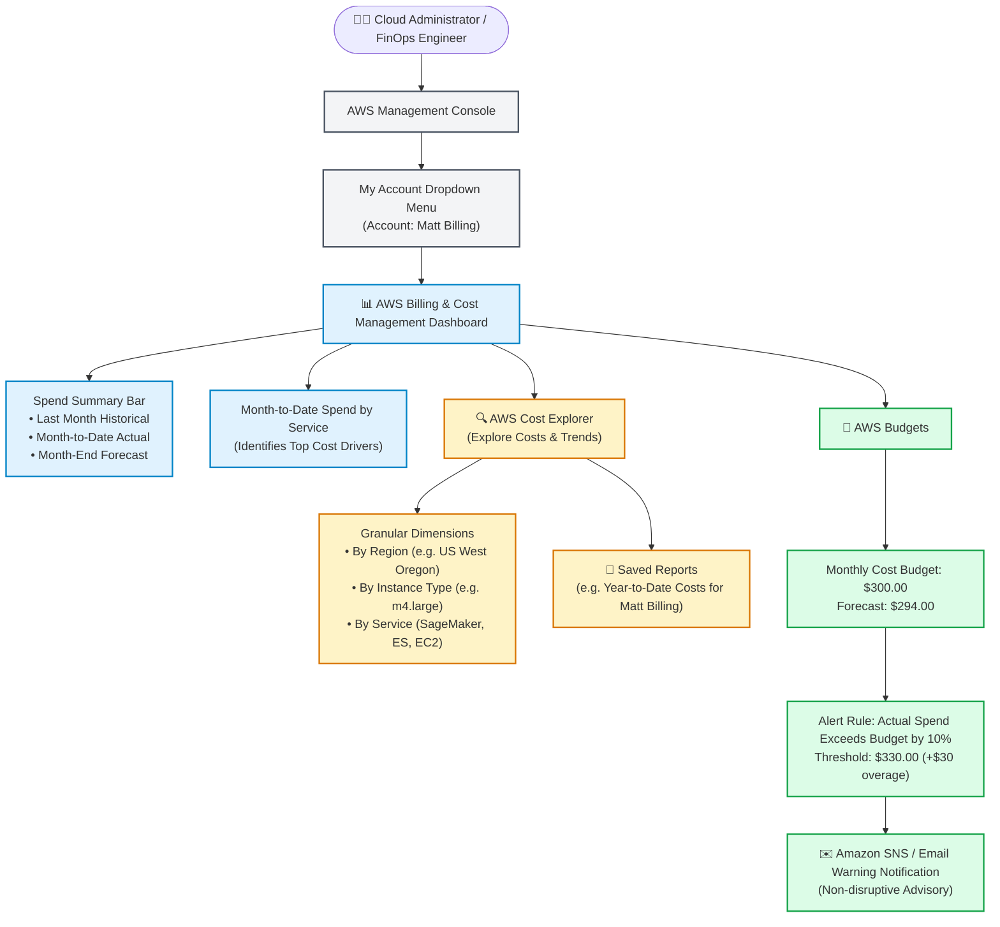
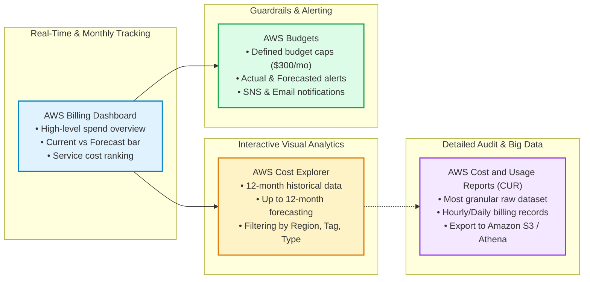
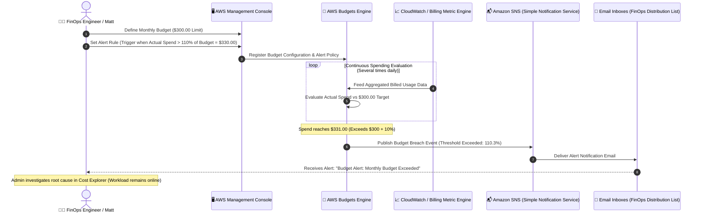
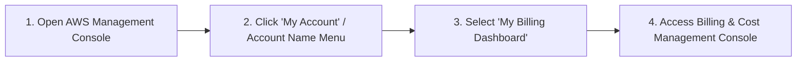
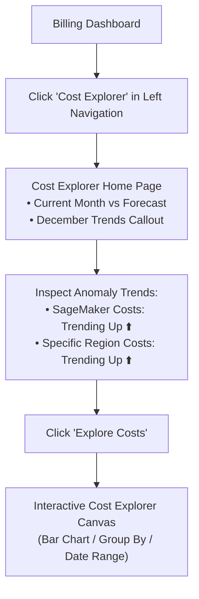
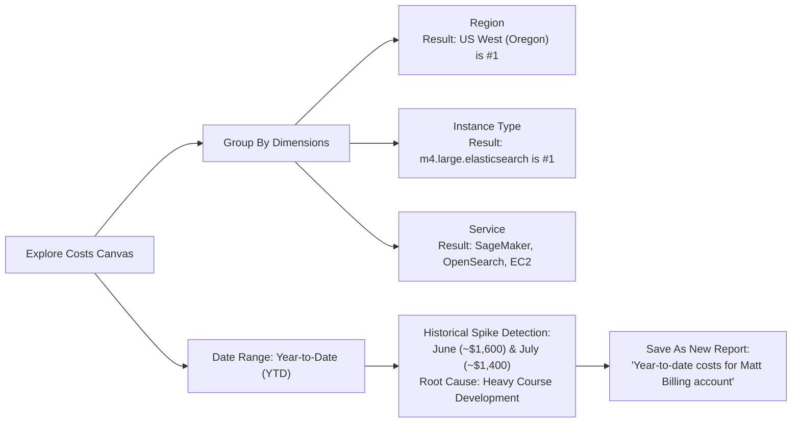
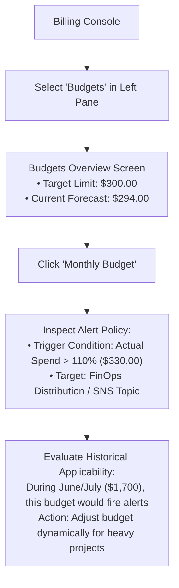

# 🎥 AWS Technical Demonstration: Navigating AWS Billing & Cost Management, Cost Explorer, and AWS Budgets

> **Course**: AWS re/Start  
> **Module**: Managing Resource Consumption (M14 – Billing & Cost Management)  
> **Source Media**: `T21-Managing_Resource_Consumption/T21-0004-RSSCHAB_EN-US_Video_M14_Billing_Dashboard_Demo.mp4`  
> **Format**: Video Audio Transcription & Comprehensive Hands-On Lab Walkthrough  
> **Target Audience**: AWS re/Start Learners, Cloud Practitioners, FinOps Practitioners, Solutions Architects, and SysOps Administrators  

---

## 🎯 Demonstration Overview

In this comprehensive hands-on technical demonstration, the instructor walks through navigating and leveraging the **AWS Billing and Cost Management Dashboard**, diving deep into granular cost analytics using **AWS Cost Explorer**, generating customized **Cost and Usage Reports**, and configuring proactive alerting thresholds using **AWS Budgets**.

Effective cloud financial management (FinOps) requires real-time visibility into resource consumption, spend velocity, and historical anomalies. By examining an active training account (**"Matt Billing"**), the walkthrough demonstrates how cloud practitioners identify primary cost drivers (such as Amazon SageMaker, Amazon OpenSearch/Elasticsearch Service, and high-memory EC2 instance families), analyze regional spend concentrations (e.g., `us-west-2` Oregon), contextualize workload spikes ($1,500 – $1,700 spikes during heavy course curriculum development in June and July), and set automated budget alerts against a target monthly spending cap ($300.00).

```
┌────────────────────────────────────────────────────────────────────────────────────────┐
│                              CORE LAB & FinOps OBJECTIVE                                │
│                                                                                        │
│  Spend Visibility  : AWS Billing Dashboard ──> High-Level Summary & MTD Actuals        │
│                                           │                                            │
│  Granular Analysis : AWS Cost Explorer     ──> Multi-Dimensional Filters (Region/Svc)  │
│                                           │                                            │
│  Reporting Engine  : Cost & Usage Reports  ──> YTD Breakdown & Spikes (June/July)       │
│                                           │                                            │
│  Guardrail Alerts  : AWS Budgets           ──> 10% Spend Overrun Warning Threshold     │
└────────────────────────────────────────────────────────────────────────────────────────┘
```

---

## 📌 Learning Objectives

By completing this tutorial and studying the architectural patterns demonstrated, you will be able to:

- [ ] **Access the AWS Billing Console**: Navigate securely from the AWS Management Console top bar menu into the Billing & Cost Management Dashboard.
- [ ] **Interpret Month-to-Date (MTD) Metrics**: Analyze current actual spend, month-end forecasted expenditure, and historical comparisons against previous billing cycles.
- [ ] **Identify Leading Cost Drivers**: Utilize "Spend by Service" breakdown charts to isolate top expenditure contributors (e.g., Machine Learning, compute, managed search clusters).
- [ ] **Launch and Configure AWS Cost Explorer**: Enable Cost Explorer to inspect multi-month historical trends, usage patterns, and predictive forecasting models.
- [ ] **Slice and Dice Cost Dimensions**: Filter and group expenditures by Service, AWS Region (e.g., US West Oregon), Instance Type (e.g., `m4.large.elasticsearch`), Usage Type, and Cost Allocation Tags.
- [ ] **Generate Custom Historical Reports**: Build, customize, and save Year-to-Date (YTD) Cost and Usage Reports to audit seasonal or project-driven workload spikes.
- [ ] **Establish Budget Guardrails**: Configure an AWS Cost Budget with defined dollar thresholds (e.g., $300.00 monthly training/lab baseline).
- [ ] **Implement Proactive Notification Triggers**: Set up automated budget alert notifications (e.g., triggering at 10% over-budget or forecasted overrun) routed via Amazon SNS and email.
- [ ] **Distinguish Alert Notifications vs. Automated Actions**: Understand the operational difference between passive budget alerts (warnings) versus active enforcement scripts (stopping instances or applying SCPs).

---

## 🏗️ Architectural Topology & Cost Governance Workflow

### 1. AWS Billing and Cost Management Navigation Flow

The following diagram illustrates how an administrator navigates through the AWS management interface to access high-level billing summaries, deep-dive analytics, and alerting services.



---

### 2. Comparison of AWS Cost Management Tools

AWS provides multiple dedicated tools tailored for different stages of financial governance, from daily tracking to historical data warehousing.



---

### 3. AWS Cost Management Tool Comparison Matrix

| Evaluation Dimension | AWS Billing Dashboard | AWS Cost Explorer | AWS Budgets | AWS Cost & Usage Reports (CUR) |
| :--- | :--- | :--- | :--- | :--- |
| **Primary Purpose** | High-level summary of monthly bills and payment status | Interactive visual analysis, trend discovery, and forecasting | Proactive tracking against predefined financial/usage caps | Comprehensive, raw, line-item billing data delivery |
| **Data Granularity** | Service-level aggregates | Daily and monthly aggregations by service, tag, region, API operation | Monthly, quarterly, or annual budget intervals; daily/monthly alerts | Hourly, daily, or monthly raw records with detailed resource IDs |
| **Historical Range** | Current month and past invoices | Up to 12 months historical data | Tracks performance across active budget periods | Complete history delivered to Amazon S3 buckets |
| **Predictive Modeling** | Simple month-end projection bar | Statistical forecasting with confidence intervals up to 12 months | Evaluates forecasted spend against budget thresholds | None (Requires external Athena/QuickSight analysis) |
| **Alerting Capabilities** | AWS Free Tier usage alerts | None (visual analytics only) | Automated SNS and email alerts; optional AWS Budgets Actions | Event notifications on S3 object delivery |
| **Default Pricing** | Free of charge | Free to view via Console (API queries: $0.01 per query) | First 2 action-enabled budgets free; standard budgets free | Free (standard Amazon S3 storage and API fees apply) |

---

### 4. AWS Budget Alert Notification Flow

The following sequence diagram details how AWS Budgets monitors account spend velocity and delivers an automated email warning when expenditures breach the pre-configured threshold.



---

## 🛠️ Step-by-Step Hands-On Implementation Guide

### Phase 1: Accessing the Billing & Cost Management Dashboard

To inspect the financial state of an AWS account, start by accessing the Billing Dashboard from the AWS Management Console.



#### Step 1: Open the AWS Console and Identify the Account
1. Open your web browser and navigate to the **AWS Management Console** (`https://console.aws.amazon.com/`).
2. Log in using your IAM user credentials, IAM Identity Center (SSO), or Root user credentials with multi-factor authentication (MFA) enabled.
3. Observe the upper-right corner of the navigation bar. In this demonstration, the active account name is **`Matt Billing`**.

#### Step 2: Open the Account Menu
1. Click the account dropdown menu located in the top-right header (displaying your account alias or 12-digit AWS Account ID).
2. Review the available options:
   - *Account*
   - *Organization*
   - *Service Quotas*
   - *Billing Dashboard* (or *My Billing Dashboard*)

#### Step 3: Launch the Billing Dashboard
1. Click **Billing Dashboard** from the dropdown menu.
2. The browser redirects to the unified **AWS Billing and Cost Management** console (`https://console.aws.amazon.com/billing/home`).

> [!NOTE]
> **IAM User Access to Billing Information:**  
> By default, IAM users and roles do not have permission to access the AWS Billing Dashboard, even if they have Administrator access policies attached. To allow IAM access, the account root user must first activate **IAM User and Role Access to Billing Information** under **Account Settings**. Once enabled, appropriate IAM permissions (such as `AWSBillingReadOnlyAccess` or `arn:aws:iam::aws:policy/job-function/Billing`) can be attached.

---

### Phase 2: Analyzing Month-to-Date Spend & Spend Summary

The main landing page of the AWS Billing Dashboard consolidates essential financial health indicators into a clean visual dashboard.

```
┌────────────────────────────────────────────────────────────────────────────────────────┐
│                      BILLING & COST MANAGEMENT DASHBOARD SUMMARY                       │
├─────────────────────────────────────────────────┬──────────────────────────────────────┤
│               SPEND SUMMARY (USD)               │     MONTH-TO-DATE SPEND BY SERVICE    │
│                                                 │                                      │
│  Last Month:        $ [████████████████] $412   │  1. Amazon SageMaker        (Top)    │
│  Month-to-Date:     $ [██████████]       $218   │  2. Amazon OpenSearch / ES  (High)   │
│  Forecasted Spend:  $ [█████████████]    $294   │  3. Amazon Elastic Compute Cloud     │
│                                                 │  4. Amazon Relational Database Svc   │
│                                                 │  5. Amazon Simple Storage Service    │
└─────────────────────────────────────────────────┴──────────────────────────────────────┘
```

#### Step 1: Review Month-to-Date Spend by Service
1. Look at the right-hand panel: **Month-to-date spend by service**.
2. This widget ranks AWS services in descending order of cost impact for the current billing cycle.
3. Notice which services are incurring the highest expenditures:
   - Specialized machine learning and AI workloads (e.g., **Amazon SageMaker**)
   - Managed distributed search infrastructure (e.g., **Amazon OpenSearch Service / Elasticsearch Service**)
   - Core compute instances (e.g., **Amazon EC2**)
4. **Key Takeaway**: This pane immediately highlights runaway workloads without requiring manual query construction.

#### Step 2: Evaluate the Spend Summary Comparison Bar
1. In the center of the dashboard, locate the **Spend Summary** widget.
2. The interface presents a 3-tier comparative bar chart:
   - **Historical Baseline (Last Month)**: Shows total incurred costs from the previous finalized billing cycle (e.g., approximately **$412.00**).
   - **Month-to-Date Actual (Current)**: Represents accumulated charges up to the current day of the month (e.g., approximately **$218.00**).
   - **Month-End Forecast**: A predictive estimate calculated by AWS machine learning models based on current daily consumption velocity (e.g., projected to close at approximately **$294.00**).
3. Compare the **Month-End Forecast** against **Last Month's Total**:
   - If the forecasted bar is shorter than the historical baseline, your current burn rate is decelerating.
   - If the forecasted bar exceeds historical levels, immediate investigation into recent resource launches is warranted.

| Metric | Displayed Value | FinOps Interpretation |
| :--- | :--- | :--- |
| **Last Month Spend** | ~$412.00 | Baseline cost representing previous finalized billing cycle |
| **Month-to-Date (MTD) Spend** | ~$218.00 | Actual cumulative spend incurred up to the current date |
| **Month-End Forecasted Spend**| ~$294.00 | Projected end-of-month spend if current usage velocity continues |
| **Trajectory Status** | Favorable (Under baseline) | Projected to spend ~28% less than the prior billing month |

---

### Phase 3: Deep Dive Analytics with AWS Cost Explorer

When you need granular visibility into specific resources, regions, or cost increases, launch **AWS Cost Explorer**.



#### Step 1: Launch AWS Cost Explorer
1. In the left navigation pane of the Billing console, click **Cost Explorer**.
2. If Cost Explorer has not been activated previously in your account, click **Enable Cost Explorer** (allow up to 24 hours for AWS to ingest and index historical billing data).
3. The Cost Explorer landing page loads, presenting:
   - Current monthly costs alongside forecasted month-end totals.
   - Percentage changes indicating month-over-month increases or decreases.

#### Step 2: Review Anomaly Callouts and Trends
1. Examine the right-hand panel under **Trends** (e.g., **December trends**):
   - **Service Trend**: Flags that **Amazon SageMaker** costs have increased significantly.
   - **Regional Trend**: Flags that spending within specific AWS regions has increased compared to the previous month.
2. Note that automated trend detection provides early warning indicators before bills finalize.

#### Step 3: Enter the Interactive Cost Explorer Canvas
1. Click the **Explore Costs** button.
2. The console displays the full-featured interactive visualization canvas featuring:
   - Configurable date range selectors (Last 3 months, Last 6 months, Year-to-date, Custom).
   - Grouping dimensions along the top toolbar.
   - Advanced filters in the right sidebar.

---

### Phase 4: Slicing Cost Drivers & Generating Custom Reports

In this phase, dissect expenditures across multiple technical dimensions and generate a historical report detailing workload spikes.



#### Step 1: Analyze Costs by Region
1. Along the top **Group by** toolbar, select the **Region** tab.
2. The bar chart updates to display color-coded regional segments.
3. Observe the breakdown:
   - **US West (Oregon) / `us-west-2`**: Accounts for the vast majority of incurred costs in this account.
   - Secondary regions (e.g., `us-east-1` N. Virginia) represent minimal residual spend.
4. **Actionable Insight**: Resource governance and cleanup efforts should focus primarily on `us-west-2`.

#### Step 2: Analyze Costs by Instance Type
1. Select the **Instance Type** grouping dimension.
2. Observe the breakdown across compute instances:
   - **`m4.large.elasticsearch`**: Generating the highest operational compute cost within the account.
   - **`t2.micro` / `t1.micro`**: Negligible costs (consistent with small test servers or Free Tier eligibility).
3. **Actionable Insight**: Managed cluster instance sizes (like Elasticsearch nodes) remain running 24/7 unless explicitly stopped or scaled down when labs conclude.

#### Step 3: Analyze Costs by Service
1. Select the **Service** grouping dimension.
2. Confirm the top services:
   - **Amazon SageMaker**: High training and notebook instance charges.
   - **Amazon OpenSearch Service / Elasticsearch Service**: Ongoing cluster hosting fees.
   - **Amazon Elastic Compute Cloud (EC2)**: Compute, EBS volume storage, and Elastic IP allocations.

#### Step 4: Build a Year-to-Date (YTD) Cost Report
A common real-world scenario occurs when management requests an audit:
> *"Matt, I need a report showing our total costs incurred year-to-date in this account."*

1. In the top navigation or reports section, click **Reports** or **New Report**.
2. Under report templates, select **Cost and Usage Reports**. Click **Create Report**.
3. In the time range drop-down menu (defaulting to *Last 3 months*), explore the pre-configured intervals:
   - *Last 12 months*
   - *Last 6 months*
   - *Last 3 months*
   - *Year-to-date (YTD)*
   - *Custom date range*
4. Select **Year-to-date**.
5. Click **Apply**.

#### Step 5: Uncover Historical Workload Spikes
1. Examine the monthly spending bars generated across the calendar year:
   - **Normal Baseline Months**: Spend typically fluctuates between **$200 and $400**.
   - **June**: Incurred approximately **$1,600.00 – $1,700.00**.
   - **July**: Incurred approximately **$1,400.00 – $1,500.00**.
2. **Contextualizing the Spike**:
   - As explained by the instructor, during June and July, the training team was actively developing and authoring a new hands-on technical curriculum.
   - Developing and testing heavy machine learning algorithms, provisioning multi-node Elasticsearch clusters, and running iterative batch test jobs produced legitimate, temporary workload spikes.
3. **FinOps Takeaway**: Spikes are not always waste; understanding business project lifecycles is essential to distinguishing legitimate research and development costs from accidental cloud leakage.

#### Step 6: Save the Custom Report
1. Click the **Save as** button in the upper-right corner.
2. Enter the report title:
   ```text
   Year-to-date costs for Matt Billing account
   ```
3. Enter an optional description (e.g., *"Auditing YTD monthly spend and curriculum development spikes"*).
4. Click **Save Report**.
5. In the left navigation pane under **Saved reports**, observe your newly saved report alongside pre-built standard AWS reports. You can revisit, schedule, or export this report as a CSV at any time.

| Report Parameter | Selected Value | Purpose / Operational Context |
| :--- | :--- | :--- |
| **Report Template** | Cost and Usage | Standard cost explorer aggregation |
| **Date Range** | Year-to-date (YTD) | Spans January 1st through the current active billing cycle |
| **Granularity** | Monthly | Highlights macro spending shifts across calendar months |
| **Report Name** | `Year-to-date costs for Matt Billing account` | Persisted for executive review and compliance auditing |

---

### Phase 5: Configuring AWS Budgets & Alert Thresholds

While Cost Explorer allows retrospective investigation, **AWS Budgets** provides prospective guardrails that proactively warn administrators before spending spirals out of control.



#### Step 1: Navigate to the AWS Budgets Console
1. In the left navigation pane of the Billing & Cost Management console, click **Budgets**.
2. The Budgets dashboard lists all currently active financial and operational budgets.
3. Review the primary budget configured for this environment:
   - **Budget Name**: `Monthly Budget`
   - **Budget Type**: Cost Budget
   - **Budgeted Amount**: **$300.00**
   - **Forecasted Spend**: **$294.00** (Currently pacing safely under the $300 cap)
   - **Status**: OK (Healthy)

#### Step 2: Inspect Budget Parameters and Details
1. Click the **Monthly Budget** link to inspect its internal configuration.
2. Review the core dimensions:
   - **Period**: Monthly recurring (resets on the first day of each calendar month).
   - **Budget Scope**: All AWS services across the entire account.
   - **Budget Limit**: **$300.00 Fixed**.

#### Step 3: Review Alert Thresholds and Notification Routing
1. Click the **Alerts** tab within the budget details.
2. Observe the configured alert rule:
   - **Alert Type**: Actual Spend Exceeded.
   - **Threshold**: **10% above budgeted amount** (Evaluating at 110% of $300.00 = **$330.00**).
   - **Overage Margin**: Allows a $30.00 variance buffer before triggering high-priority notifications.
   - **Notification Recipients**: Configured email addresses / Amazon SNS topic subscribers.

#### Step 4: Understand Alert Mechanics (Warning vs. Action)
1. **Advisory Nature of Default Alerts**:
   - As emphasized in the demonstration, a standard AWS Budget alert **does not shut down EC2 instances, stop RDS databases, or terminate resources**.
   - It functions as an early warning advisory mechanism, empowering administrators to log in, evaluate the cause, and take appropriate remediation actions.
2. **AWS Budgets Actions (Advanced Governance)**:
   - For environments requiring hard enforcement, AWS Budgets can attach automated **Budgets Actions**.
   - These actions can execute IAM policies (e.g., applying `Deny` rules on new resource launches), stop specific EC2 or RDS instances via AWS Systems Manager (SSM), or apply a Service Control Policy (SCP) across an AWS Organization.

#### Step 5: Dynamic Budget Adjustments for Workload Lifecycle
1. Consider the historical context identified in Phase 4:
   - During normal testing months, a **$300.00** budget provides adequate headroom.
   - During June and July, when resource-heavy curriculum development occurred, spending reached **$1,500 – $1,700**.
2. If the budget had remained fixed at $300 during those heavy development months, team members would have received continuous, repetitive alert emails ("alert fatigue").
3. **FinOps Best Practice**: When launching high-intensity R&D or load testing phases, communicate with stakeholders to temporarily scale up the budget cap, or create project-specific tag-based budgets (e.g., `Project = Curriculum-Dev`) to separate experimental workloads from baseline lab testing.

| Budget Attribute | Configuration Value | Rationale |
| :--- | :--- | :--- |
| **Budget Name** | `Monthly Budget` | Primary cost guardrail for the training account |
| **Budget Type** | Cost Budget | Tracks financial outlay in USD |
| **Budgeted Cap** | `$300.00` | Baseline operating envelope for normal monthly testing |
| **Forecasted Current** | `$294.00` | Indicates normal monthly operations remain within target |
| **Alert Trigger** | Actual > 110% of Budget | Fires when spend reaches `$330.00` (10% / $30.00 overage) |
| **Alert Channel** | Email / SNS | Alerts engineers without interrupting production operations |

---

## 🔍 FinOps Best Practices & Troubleshooting Guide

### 1. Common Cost Management Misconfigurations

```
┌───────────────────────────────────────────────┬────────────────────────────────────────────────────────┐
│             COMMON MISTAKE                    │                 RECOMMENDED REMEDIATION                │
├───────────────────────────────────────────────┼────────────────────────────────────────────────────────┤
│ 1. Forgetting to enable Cost Allocation Tags  │ Activate user-defined cost allocation tags in Billing   │
│                                               │ console; enforce tags via AWS Organizations SCPs.      │
│ 2. Ignoring idle managed services             │ OpenSearch clusters and SageMaker endpoints charge     │
│                                               │ continuously even when no queries or inferences occur. │
│ 3. Relying solely on retrospective billing    │ Configure AWS Budgets with both Actual (>80%) and       │
│                                               │ Forecasted (>100%) alerting triggers.                  │
│ 4. Alert fatigue from static budgets          │ Adjust budgets to match planned workload sprints or    │
│                                               │ segment budgets by cost-center tags.                   │
│ 5. Assuming Budget alerts stop workloads      │ Attach AWS Budgets Actions or AWS Lambda automation if │
│                                               │ hard enforcement and auto-shutdown are required.       │
└───────────────────────────────────────────────┴────────────────────────────────────────────────────────┘
```

### 2. Troubleshooting Steps

#### Issue 1: "Access Denied" when attempting to view the Billing Dashboard
- **Root Cause**: IAM User / Role access to billing has not been enabled at the root account level, or the IAM identity lacks billing permissions.
- **Resolution**:
  1. Sign in as the **AWS Root User**.
  2. Navigate to **Account Settings** -> scroll to **IAM User and Role Access to Billing Information** -> click **Edit** -> check **Activate IAM Access** -> click **Update**.
  3. Attach the managed IAM policy `AWSBillingReadOnlyAccess` or custom permissions (`ce:*`, `budgets:*`, `cur:*`) to the user's IAM group or role.

#### Issue 2: Cost Explorer shows no data or displays "Enabling Cost Explorer"
- **Root Cause**: Cost Explorer is not turned on by default in brand new AWS accounts.
- **Resolution**:
  1. Click **Enable Cost Explorer** on the Cost Explorer landing page.
  2. Note that AWS requires up to 24 hours to backfill and index billing records before charts will render.

#### Issue 3: OpenSearch Service / Elasticsearch Service costs continue accruing after testing stops
- **Root Cause**: Managed cluster instances (`m4.large.elasticsearch`) are stateful cluster nodes billed on an hourly instance-running basis, not on request volume.
- **Resolution**:
  1. Unlike serverless databases, provisioned Elasticsearch domains must be explicitly deleted or scaled down to a single small instance (e.g., `t3.small.search`) when testing is paused.
  2. Use automated cleanup scripts (via AWS Lambda or EventBridge) to tear down transient lab environments after hours.

---

## 🔬 Self-Assessment & Review Questions

Test your comprehension of the AWS Billing Dashboard, AWS Cost Explorer, and AWS Budgets concepts demonstrated in this tutorial:

### Question 1
**In the demonstration, Matt navigated to the Billing and Cost Management Dashboard using which primary navigation route?**
- A) Through the AWS Systems Manager console under Quick Setup.
- B) From the top-right header via the "My Account" dropdown menu and selecting "My Billing Dashboard".
- C) By issuing the `aws billing get-account-summary` command in the AWS CloudShell.
- D) By opening the Amazon CloudWatch console and navigating to Billing Alarms.

> [!TIP]
> **Correct Answer: B**  
> *Explanation*: In the AWS Management Console, clicking the account alias/ID dropdown menu in the upper-right navigation bar reveals the "My Billing Dashboard" (Billing Dashboard) link, which directs administrators immediately to the AWS Billing and Cost Management console.

---

### Question 2
**What information does the Spend Summary comparison bar on the Billing Dashboard communicate to an administrator?**
- A) Total CPU utilization across all Amazon EC2 instances compared to memory allocation.
- B) A comparison between last month's historical baseline, the current month-to-date actual spend, and the projected month-end forecasted spend.
- C) An audit of Free Tier limits versus paid Tier limits for storage services only.
- D) A breakdown of AWS Support plan charges versus data egress bandwidth fees.

> [!TIP]
> **Correct Answer: B**  
> *Explanation*: The Spend Summary bar displays three vital data points in a single comparative view: historical spend from the previous finalized month, actual accumulated charges month-to-date, and an algorithmically forecasted spend for the close of the current billing cycle.

---

### Question 3
**During the Cost Explorer deep dive, which resource was identified as incurring the highest compute costs within the Matt Billing account?**
- A) `t2.micro` web server instances.
- B) `m4.large.elasticsearch` instances used for Amazon Elasticsearch Service clusters.
- C) `c5.xlarge` batch computing nodes.
- D) `t1.micro` legacy instances.

> [!TIP]
> **Correct Answer: B**  
> *Explanation*: When grouping costs by Instance Type in Cost Explorer, `m4.large.elasticsearch` was revealed as the highest cost driver. General test instances like `t2.micro` and `t1.micro` incurred minimal or negligible costs.

---

### Question 4
**Why did the account experience significant spending spikes reaching $1,500 – $1,700 during June and July?**
- A) The account suffered a cryptographic malware infection that spawned unapproved mining instances.
- B) An Amazon S3 bucket was accidentally configured as public, generating massive data egress fees.
- C) The team was actively authoring and testing a new, resource-intensive hands-on curriculum/class that required heavy infrastructure usage.
- D) An enterprise AWS Support contract was retroactively billed to the account.

> [!TIP]
> **Correct Answer: C**  
> *Explanation*: Matt explained that during June and July, the training team was actively developing a new class with resource-intensive workloads (such as machine learning training jobs and distributed clusters), which generated higher legitimate utilization before normalizing back down.

---

### Question 5
**What action occurs by default when an AWS Budgets threshold alert rule is triggered (e.g., actual spending exceeds the $300 budget by 10%)?**
- A) AWS immediately shuts down all Amazon EC2 instances and terminates Elasticsearch clusters.
- B) The account is suspended by AWS Trust & Safety until an administrator pays the balance.
- C) An email/SNS warning notification is dispatched to designated administrators; resources continue running without interruption.
- D) AWS automatically purchases Savings Plans to cover the overage amount.

> [!TIP]
> **Correct Answer: C**  
> *Explanation*: Standard AWS Budget alerts are non-disruptive notifications. They send warning alerts via email or Amazon SNS to notify administrators that an actual or forecasted threshold has been reached. They do not stop or delete running workloads unless explicit AWS Budgets Actions are configured.

---

## 📚 Key Technical Terms & FinOps Glossary

| Term / Acronym | Definition & Operational Context |
| :--- | :--- |
| **AWS Billing Dashboard** | The centralized management portal within the AWS console providing high-level month-to-date spending summaries, invoices, and service breakdowns. |
| **AWS Cost Explorer** | A visual analytics tool that enables users to view, analyze, filter, and forecast their AWS costs and usage data over a 12-month timeline. |
| **AWS Budgets** | A governance tool allowing organizations to set custom cost and usage limits, triggering automated alerts when actual or forecasted metrics breach defined thresholds. |
| **Month-to-Date (MTD)** | The accumulated spend or usage recorded from the first day of the current calendar month up to the present moment. |
| **Month-End Forecast** | A machine-learning projection computed by AWS estimating the final bill amount at the end of the month based on current consumption velocity. |
| **Cost Allocation Tags** | Key-value metadata labels applied to AWS resources allowing costs to be categorized and assigned to specific cost centers, projects, departments, or environments. |
| **Cost and Usage Report (CUR)** | The most granular dataset available in AWS, delivering hourly or daily raw billing line items and resource IDs directly to an Amazon S3 bucket. |
| **Amazon SNS** | **Simple Notification Service**: A fully managed publish/subscribe messaging service utilized by AWS Budgets to distribute email, SMS, or webhook alert notifications. |
| **AWS Budgets Actions** | Automated governance policies attached to AWS Budgets that can stop EC2/RDS instances or attach restrictive IAM/SCP policies when a budget threshold is exceeded. |
| **FinOps** | **Cloud Financial Operations**: An operational framework and cultural practice that brings financial accountability to the variable spend model of cloud computing. |

---

## 🎬 Verbatim Video Demonstration Transcript

<details>
<summary><strong>Click to expand the full verbatim transcript of the video demonstration (Matt Billing Account Walkthrough)</strong></summary>

```text
[00:00] Matt: Welcome, today we will look at the AWS Billing Dashboard.
[00:02] Matt: You can reach the Billing Dashboard from the AWS homepage by using the My Account drop-down menu.
[00:04] Matt: In this case, we've created a temporary account for me called Matt Billing.
[00:05] Matt: As I scroll down, it's My Billing Dashboard, click on the link, and it opens up the Billing and Cost Management Dashboard, which shows a summary in a single view of my costs associated with this particular account.
[00:08] Matt: In this case, on the right-hand side, we have the month-to-date spend by service, so it gives you a nice overview to see which particular services are incurring the most costs.
[00:10] Matt: In the middle, it also gives you the spend summary, so the middle bar here is the month-to-date, and then I have a forecast based upon the current usage this month, and I also have a historical perspective where I can look and see what happened last month to see where we're at.
[00:13] Matt: If I'd like to dive deeper into the costs associated with this account, I click Cost Explorer.
[00:14] Matt: Cost Explorer brings up the current costs in the month, along with forecasted month and costs.
[00:15] Matt: It shows me how much it's increased or decreased over the month, and I can go ahead and click Explore Costs.
[00:17] Matt: By exploring costs, it drops down.
[00:18] Matt: By the way, before I do that, look on the right-hand side.
[00:19] Matt: It shows the December trends, so SageMaker costs are up, and so we can go ahead also see by region that costs are up.
[00:21] Matt: As I click Explore Costs, I now have the ability along the top to categorize and drive down deeper into the costs, so for example, I can look at Costs per region.
[00:23] Matt: Here it shows that US West Oregon is where we're incurring the most costs.
[00:24] Matt: I can go ahead and look at an instance type, for example.
[00:25] Matt: M4 Large Elastic Search is incurring the most costs within this account.
[00:26] Matt: T2 Micro, T1 Micro, not as much.
[00:27] Matt: So you can look at it by instance type.
[00:28] Matt: I can also click Service to see how I'm incurring costs per service.
[00:29] Matt: The nice thing is, if my boss came to me and said, Matt, I need a report. Can you give me a report on how much our costs have been over the year-to-date within this account?
[00:32] Matt: I can click New Report.
[00:33] Matt: That would be a Cost and Usage Reports.
[00:34] Matt: I have other options in terms of reports.
[00:35] Matt: I click Create Report.
[00:36] Matt: Drop-down menu under last three months gives me the option here for year-to-date, along with one year, six months, or I can do a custom.
[00:38] Matt: So I'm going to do year-to-date.
[00:39] Matt: I click Apply and now it does show me the costs incurred here per month.
[00:40] Matt: It does show on the bottom here that June and July, we incurred a high amount of costs.
[00:41] Matt: July 1400 and in June 1600, almost $1,700 in costs.
[00:42] Matt: Those were busy months.
[00:43] Matt: In this case, I happen to know that we are developing a new class.
[00:44] Matt: That's why we incurred those types of usage within June and July in this particular account.
[00:45] Matt: I can go ahead and click Save as I can title the report, so year-to-date costs.
[00:46] Matt: I happen to already create this one.
[00:47] Matt: Year-to-date costs for matte billing account, let's say.
[00:48] Matt: I can click Save Report and now that report has been saved.
[00:49] Matt: Over here on the left-hand side are the saved reports, so there are a whole bunch of different reports that I can go ahead and look at.
[00:51] Matt: I can go ahead and even create reports from here, so here's my report that I did create.
[00:52] Matt: And of course, it's the same view we saw earlier.
[00:53] Matt: The last thing to look at is budgets.
[00:54] Matt: Budgets allow us to go in from a cost perspective or from a usage perspective to go ahead and set up a budget that will allow us to trigger an alert when we exceed that budget.
[00:56] Matt: So we can set the parameters.
[00:57] Matt: In this case, there's a monthly budget.
[00:58] Matt: It's associated with cost.
[00:59] Matt: It gives us the current cost and it's budgeted to $300.
[01:00] Matt: Forecasted 294 and then it tells us overview where we're at.
[01:01] Matt: If I click on this monthly budget, it gives me an overview of what's actually incurred and it shows the alert.
[01:03] Matt: So the alert that was set up when this budget was created was at the actual cost exceed by 10% the budgeted amount.
[01:05] Matt: In this case, the budgeted amount is $300.
[01:06] Matt: The actual costs, if they exceed by 10%, which is $30, then this particular Amazon account or email account will be notified.
[01:08] Matt: And when that's notified, then you can go ahead and you know that something's occurring and you can go in and handle it.
[01:70] Matt: It doesn't shut off anything or stop anything.
[01:71] Matt: It just gives you a warning.
[01:72] Matt: You can also do it by usage.
[01:73] Matt: So you can look at the usage of different services within your AWS account.
[01:74] Matt: So there's a lot of granularity here that you can go ahead and set up so that you can make sure that you're within your budgets.
[01:76] Matt: For example, this accounts used to create classes.
[01:77] Matt: So we can make sure that in creating a particular class in testing the labs that we don't exceed a particular budget, in this case $300.
[01:79] Matt: That changes.
[01:80] Matt: Obviously, you saw earlier in the year that we incurred a lot more costs because it was a different kind of class that was more resource intensive.
[01:82] Matt: And so that would obviously require us to change the budget or we would constantly be getting alerts because as you saw before, back in June and July, it was $1,700, $1,500 incurred of costs and the budget here.
[01:85] Matt: It's just set for $300.
[01:86] Matt: So budgets allow you to go in and actually keep track and get a better overview of the costs you're incurring within your AWS account.
[01:88] Matt: Thank you and have a great day.
```

</details>
