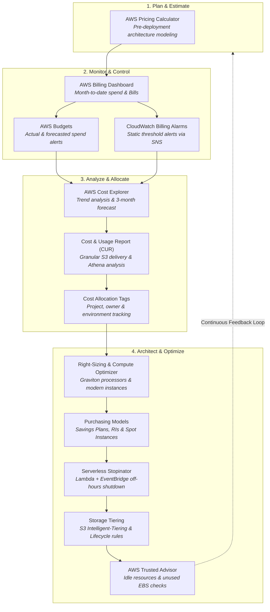
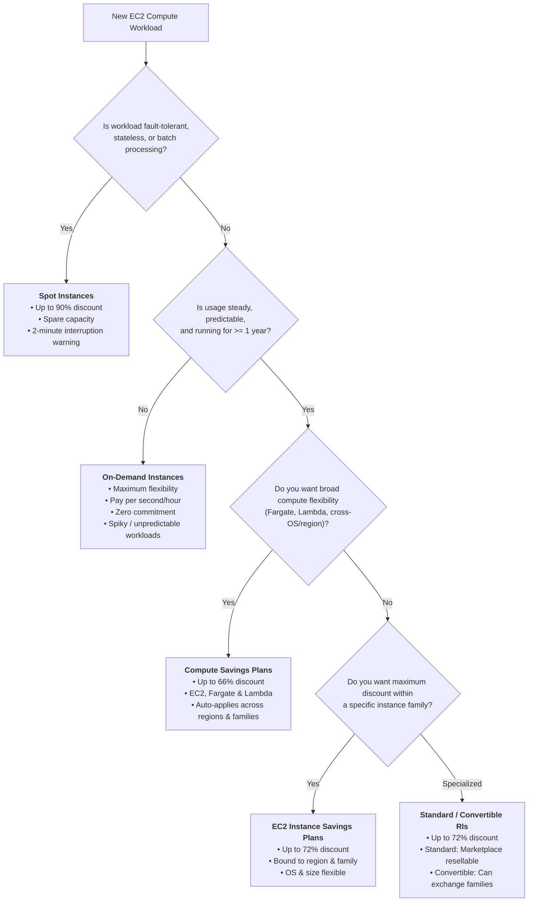
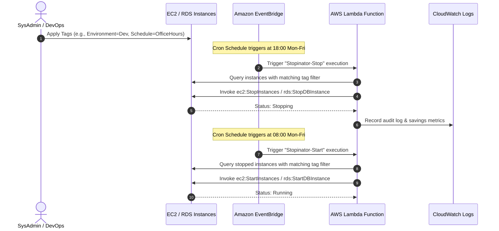
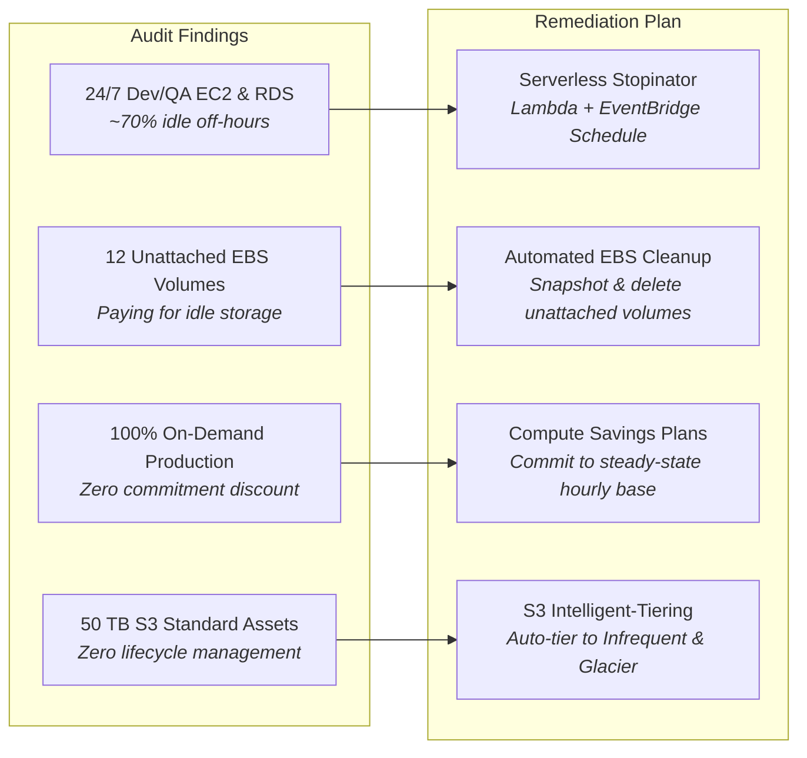

# 💰 AWS Cost Management and Best Practices

> **Course**: AWS re/Start  
> **Module**: Managing Resource Consumption  
> **Source Document**: `T21-0005-RSJAWS_EN-US_SG_COSTMGMTBESTPRACTICES.pdf`  
> **Target Audience**: AWS re/Start Learners, Solutions Architects & Cloud Practitioners  

---

## 🎯 Module Overview

One of the foundational value propositions of cloud computing is the paradigm shift from massive capital investments to flexible operational expenditures. In traditional on-premises data centers, organizations are forced to predict compute, storage, and networking requirements years in advance—frequently leading to over-provisioning, idle capacity, and wasted capital. 

The AWS Cloud replaces upfront capital commitments with a flexible **pay-as-you-go** model, where organizations pay only for what they consume, when they consume it. However, because resource provisioning in the cloud is virtually frictionless, unmanaged infrastructure can lead to unexpected cloud spend.

Mastering AWS cost management requires a disciplined approach combining:
1. **Economic Awareness**: Understanding how cloud financial models transform balance sheets and unit economics.
2. **Cost Governance & Analytics Tooling**: Using the native AWS billing and cost management suite to forecast, monitor, allocate, and budget spend.
3. **Optimized Purchasing Models**: Selecting the appropriate procurement mechanisms across On-Demand, Savings Plans, Reserved Instances, and Spot Instances.
4. **Architectural Cost Optimization**: Proactively right-sizing infrastructure, eliminating idle waste, modernizing processor architectures, and enforcing automated lifecycle policies.

---

### 📌 Learning Objectives

- [ ] Explain the economic value of cloud computing, including the transition from CapEx to OpEx, variable consumption, and economies of scale.
- [ ] Differentiate between pre-deployment cost modeling tools (AWS Pricing Calculator) and post-deployment analytical tooling (AWS Cost Explorer, AWS Budgets, AWS Cost and Usage Reports).
- [ ] Configure and evaluate Amazon CloudWatch billing alarms within `us-east-1` for threshold alerting via Amazon SNS.
- [ ] Compare the four core Amazon EC2 purchasing models (On-Demand, Savings Plans, Reserved Instances, and Spot Instances) across cost, flexibility, and workload suitability.
- [ ] Distinguish between Compute Savings Plans, EC2 Instance Savings Plans, and SageMaker Savings Plans.
- [ ] Implement architectural best practices for cost optimization, including compute right-sizing, AWS Compute Optimizer recommendations, and AWS Graviton processor upgrades.
- [ ] Design automated waste-elimination mechanisms such as serverless "stopinator" scripts leveraging AWS Lambda and Amazon EventBridge.
- [ ] Leverage AWS Trusted Advisor to discover underutilized EBS volumes, unattached Elastic IPs, and idle compute resources.

---

## 📚 Key Terminology

| Term | Definition |
| :--- | :--- |
| **Capital Expenditures (CapEx)** | Upfront financial investments in physical assets (such as servers, networking switches, cooling, and real estate data centers) depreciated over time. |
| **Operational Expenditures (OpEx)** | Ongoing operational expenses incurred while conducting business operations (such as utility services, software subscriptions, and cloud pay-as-you-go usage). |
| **AWS Pricing Calculator** | A web-based planning tool used to model architectures and estimate pre-deployment costs across AWS services without an active deployment. |
| **AWS Cost Explorer** | A visualization and reporting tool used to inspect historical cost and usage data (up to 13 months), identify spend trends, and project forecasts (up to 3 months). |
| **AWS Budgets** | A governance tool used to define custom cost, usage, RI, or Savings Plans thresholds that trigger notifications when actual or forecasted metrics breach targets. |
| **AWS Cost and Usage Report (CUR)** | The most granular and detailed billing dataset available in AWS, delivering hourly or daily raw metadata files directly to an Amazon S3 bucket. |
| **On-Demand Instances** | Amazon EC2 purchasing model providing immediate compute capacity charged on a per-second or per-hour basis with zero upfront cost or commitment. |
| **Savings Plans** | A commitment-based pricing model offering savings of up to 72% in exchange for committing to a consistent dollar-per-hour compute spend for a 1- or 3-year term. |
| **Reserved Instances (RIs)** | A discounted compute reservation model (up to 72% savings) based on 1- or 3-year commitments to specific instance configurations or families. |
| **Spot Instances** | Spare Amazon EC2 compute capacity offered at steep discounts of up to 90% that can be reclaimed by AWS with a 2-minute interruption notice. |
| **AWS Compute Optimizer** | A machine learning service that analyzes historical CloudWatch resource utilization metrics to recommend optimal instance types, EBS volumes, and Lambda functions. |
| **AWS Graviton** | Custom 64-bit ARM-based processors built by AWS delivering up to 40% better price-performance over comparable x86 processors at up to 20% lower cost. |
| **Serverless Stopinator** | An automated architecture combining AWS Lambda and Amazon EventBridge (CloudWatch Events) to schedule the routine stopping and starting of non-production environments. |
| **AWS Trusted Advisor** | An automated online inspection tool providing real-time guidance and checks across five pillars: Cost Optimization, Performance, Security, Fault Tolerance, and Service Limits. |

---

## 🔄 The Cloud Cost Optimization Lifecycle

Effective cloud cost management is not a one-time project; it is an iterative lifecycle that spans pre-deployment architecture through real-time governance and operational optimization.



---

## 💡 1. Economic Value of Cloud Computing

The economic model of the cloud provides fundamental financial advantages over traditional on-premises IT procurement.

### 1.1 Capital Expenditures (CapEx) vs. Operational Expenditures (OpEx)

In a legacy data center model, organizations must invest substantial capital before running a single workload. These purchases include physical servers, rack enclosures, network routers, uninterpretable power supply (UPS) systems, cooling units, physical real estate, and long-term data center leases.

```
┌────────────────────────────────────────────────────────────────────────┐
│                        CapEx vs. OpEx Transformation                   │
├────────────────────────────────────────────────────────────────────────┤
│ On-Premises (CapEx Model):                                             │
│   • Huge upfront cash outlays depreciated over 3 to 5 years             │
│   • Requires capacity forecasting months or years ahead                │
│   • Inflexibility: Idle hardware represents stranded capital           │
│                                                                        │
│ AWS Cloud (OpEx Model):                                                │
│   • Zero upfront hardware procurement; pay as you go                   │
│   • Variable utility billing treated as operating expenses             │
│   • Elasticity: Spin up and terminate capacity in seconds              │
└────────────────────────────────────────────────────────────────────────┘
```

| Dimension | On-Premises Data Center (CapEx) | AWS Cloud Computing (OpEx) |
| :--- | :--- | :--- |
| **Financial Nature** | Capital asset investment; amortized over time | Operating expense; accounted for in current operating period |
| **Upfront Investment** | High initial commitment (servers, facilities, power) | Zero upfront infrastructure investment |
| **Capacity Sizing** | Scaled to peak estimated demand (idle during off-peak) | Scaled elastically with immediate demand |
| **Procurement Cycle** | Weeks or months for hardware procurement and racking | Minutes to provision virtual instances via API or console |
| **Depreciation Risk** | High; hardware ages out and becomes obsolete | Non-existent; AWS regularly introduces newer hardware tiers |
| **Financial Agility** | Fixed cost structure; difficult to adjust during downturns | Variable cost structure; dynamically scales down to zero |

### 1.2 Trading Fixed Costs for Variable Costs
With AWS, organizations pay only for the resources consumed and only for the duration they run. This changes unit economics:
- Startups and enterprise project teams can launch experiments without long-term contracts.
- Costs scale linearly with business revenue and user demand rather than creating high fixed barriers to entry.
- Development and testing environments can be spun down when not in active use, eliminating unnecessary spend.

### 1.3 Massive Economies of Scale
Because AWS aggregates the compute, storage, and networking needs of hundreds of thousands of customers globally, AWS can purchase hardware at unprecedented volumes. 
- These massive economies of scale translate into lower procurement, power, and operational overhead.
- Historically, AWS has systematically passed these efficiency gains back to customers through dozens of proactive, unilateral price reductions.

---

## 🛠️ 2. AWS Cost Management Tools Ecosystem

AWS provides a cohesive suite of native tools spanning pre-deployment planning, active monitoring, historical trend analysis, and granular billing reporting.

```
┌────────────────────────────────────────────────────────────────────────┐
│                   AWS Cost Management Tool Ecosystem                   │
├────────────────────────────────────────────────────────────────────────┤
│ Planning Phase:                                                        │
│   [AWS Pricing Calculator]  ─── Pre-deployment architecture modeling   │
│                                                                        │
│ Operational Phase:                                                     │
│   [AWS Billing Dashboard]   ─── High-level month-to-date tracking      │
│   [Amazon CloudWatch]       ─── Real-time threshold alarms (us-east-1) │
│   [AWS Budgets]             ─── Custom target tracking & alerts        │
│                                                                        │
│ Analytical Phase:                                                      │
│   [AWS Cost Explorer]       ─── 13-mo trends, forecasting, right-size  │
│   [Cost & Usage Report]     ─── Raw granular line items in Amazon S3   │
└────────────────────────────────────────────────────────────────────────┘
```

### 2.1 AWS Pricing Calculator (Pre-Deployment Planning)
- **Role**: Replaces the legacy Simple Monthly Calculator as the primary architectural budgeting tool.
- **Functionality**:
  - Allows engineers and architects to model expected workloads before provisioning resources.
  - Generates transparent cost breakdowns per service, region, instance family, and storage tier.
  - Supports configuration of payment terms (On-Demand, Savings Plans, Reserved Instances).
  - Generates shareable estimation links and CSV/PDF export summaries for financial stakeholders.

### 2.2 AWS Billing Dashboard & AWS Bills
- **Role**: The centralized administrative hub for viewing month-to-date expenditures.
- **Key Features**:
  - **Spend Summary**: Displays costs incurred last month, month-to-date running costs, and an end-of-month projected spend forecast.
  - **Month-to-Date Spend by Service**: Visual breakdown of the highest spending service categories (e.g., EC2, RDS, S3).
  - **AWS Bills Page**: Complete historical breakdown of charges incurred during previous billing cycles, grouped by AWS service, AWS Region, and individual linked accounts (when using AWS Organizations consolidated billing).

### 2.3 Amazon CloudWatch Billing Alarms
- **Role**: Low-latency threshold alerting on estimated aggregate charges.
- **Architectural Rules**:
  - **Region Restriction**: Billing metrics and alarms **must be created in the `us-east-1` (US East - N. Virginia) Region**. All global billing metric data is aggregated and stored centrally in Northern Virginia.
  - **Actual Charges Only**: CloudWatch billing alarms evaluate actual estimated charges calculated several times daily. They do **not** trigger on predictive forecasts.
  - **Notification Delivery**: Integrates natively with **Amazon Simple Notification Service (Amazon SNS)** to dispatch email alerts or trigger automated endpoints when spend crosses a fixed dollar threshold.

### 2.4 AWS Cost Explorer (Post-Deployment Analytics)
- **Role**: Deep-dive historical visualization and predictive analytics engine.
- **Core Capabilities**:
  - **Historical Window**: Tracks up to **13 months** of historical cost and usage metrics.
  - **Forecasting Engine**: Uses machine learning to project spending trends up to **3 months** into the future based on past usage patterns.
  - **Multidimensional Filtering**: Group and filter data by Service, Instance Type, AWS Region, Availability Zone, Cost Allocation Tag, and Linked Account.
  - **Default Reports**:
    - *Cost and Usage Reports*: Monthly or daily aggregate spend by service.
    - *Reserved Instance (RI) Reports*: Utilization and coverage tracking.
    - *Savings Plans Reports*: Coverage and utilization analysis with recommendation engines for optimal purchases.
  - **Consolidated Billing Integration**: Seamlessly aggregates and isolates individual member account spending across AWS Organizations.

### 2.5 AWS Budgets (Proactive Governance)
- **Role**: Setting custom financial and usage guardrails with automated alerts.
- **Four Core Budget Types**:
  1. **Cost Budgets**: Monitor aggregate or service-specific dollar expenditures against target caps.
  2. **Usage Budgets**: Monitor specific resource quantities (e.g., S3 storage gigabytes, data transfer GBs, EC2 vCPU hours).
  3. **Reservation Budgets (RI Budgets)**: Track utilization and coverage percentages of Reserved Instances to prevent idle reservations.
  4. **Savings Plans Budgets**: Track utilization and coverage percentages for active Savings Plans commitments.
- **Threshold Triggers**:
  - **Actual**: Alerts when actual expenditure reaches a percentage threshold (e.g., 80% of budget).
  - **Forecasted**: Alerts proactively when AWS machine learning projects that your month-end spend is on track to exceed 100% of the budgeted target.
- **Alert Channels & Actions**: Notifications sent via email, Amazon SNS, or automated **AWS Budget Actions** (which can automatically attach restrictive IAM policies or stop EC2/RDS instances upon breach).

### 2.6 AWS Cost and Usage Report (CUR)
- **Role**: The single most comprehensive, granular source of raw billing data available.
- **Key Characteristics**:
  - Generates line-item metadata for every unique AWS product, usage type, operation, and resource tag across all accounts.
  - Aggregated on an **hourly** or **daily** level.
  - Published automatically to a designated **Amazon S3 bucket** once per day.
  - Optimized for downstream big data analytics using **Amazon Athena** (SQL querying) and visual BI dashboarding via **Amazon QuickSight** or third-party FinOps platforms.

---

### Comparison of AWS Cost Management Tools

| Tool | Primary Purpose | Timing | Granularity | Alerting Capability |
| :--- | :--- | :--- | :--- | :--- |
| **AWS Pricing Calculator** | Pre-deployment architecture estimation | Pre-Provisioning | High-level service estimates | No |
| **AWS Billing Dashboard** | Month-to-date overview & invoice access | Real-time / Daily | High-level service breakdown | No |
| **Amazon CloudWatch Billing Alarms** | Static dollar threshold notification | Real-time / Daily | Aggregate / Service level | Yes (via Amazon SNS; `us-east-1` only) |
| **AWS Cost Explorer** | Historical analysis, trends & forecasting | Post-Provisioning | Dimensional (Tag, Service, Type) | Recommendations only |
| **AWS Budgets** | Custom tracking & threshold governance | Active / Predictive | Cost, Usage, RI, Savings Plans | Yes (Email, SNS, Automated Budget Actions) |
| **AWS Cost & Usage Report (CUR)** | Raw line-item billing data extract | Continuous / Daily | Hourly / Line-item resource data | No (Ingested into Athena/QuickSight) |

---

## ⚖️ 3. The Four Core Purchasing Models for Amazon EC2

Amazon EC2 offers four distinct purchasing models designed to balance architectural flexibility, workload characteristics, and cost optimization.



---

### 3.1 On-Demand Instances

- **Definition**: Compute capacity provisioned instantly, billed per second (minimum 60 seconds) or per hour with zero upfront commitment.
- **Key Characteristics**:
  - Highest flexibility; lowest long-term financial risk.
  - Can be launched, stopped, resized, or terminated at any time without penalty.
  - Paid at full list price with no volume discounts applied automatically.
- **Ideal Use Cases**:
  - Short-term, unpredictable, or spiky workloads.
  - Applications undergoing initial development, testing, and performance benchmarking.
  - Workloads that cannot be interrupted and do not yet have established usage baselines.

### 3.2 Savings Plans

- **Definition**: A flexible, hourly commitment-based pricing model offering savings of up to **72%** over On-Demand rates in exchange for committing to a consistent compute spend (measured in `$/hour`, e.g., $10.00/hour) for a **1-year or 3-year term**.
- **Three Flavors**:

```
┌────────────────────────────────────────────────────────────────────────┐
│                        Savings Plans Flavors                           │
├────────────────────────────────────────────────────────────────────────┤
│ 1. Compute Savings Plans:                                              │
│    • Highest flexibility; up to 66% savings                            │
│    • Automatically applies across EC2, AWS Fargate, and AWS Lambda     │
│    • Agnostic of instance family, size, OS, Region, or tenancy         │
│                                                                        │
│ 2. EC2 Instance Savings Plans:                                         │
│    • Deepest EC2 discount; up to 72% savings                           │
│    • Committed to a specific instance family within a specific Region  │
│    • Flexible across size (e.g., m5.xlarge -> m5.2xlarge), OS, and AZ  │
│                                                                        │
│ 3. SageMaker Savings Plans:                                            │
│    • Dedicated machine learning discount; up to 64% savings            │
│    • Applies automatically to Amazon SageMaker ML instance usage       │
└────────────────────────────────────────────────────────────────────────┘
```

- **Payment Options**:
  - **All Upfront**: Full commitment paid on day one; yields the maximum possible discount.
  - **Partial Upfront**: At least 50% paid upfront; remainder billed monthly at a slightly lower discount.
  - **No Upfront**: Zero initial payment; 100% of the committed hourly rate is billed monthly.

### 3.3 Reserved Instances (RIs)

- **Definition**: A capacity and billing reservation providing significant discounts (up to 72%) compared to On-Demand pricing for steady-state usage over a **1-year or 3-year term**.
- **RI Types**:
  - **Standard RIs**: Deliver the highest discount (up to 72%). Cannot change instance family, operating system, or tenancy. Can be sold or purchased on the secondary **AWS Reserved Instance Marketplace** if requirements change.
  - **Convertible RIs**: Deliver slightly lower discounts (up to 54%) but allow exchanging for different instance families, operating systems, tenancies, or payment options throughout the term.
- **Scoping Options**:
  - **Regional RIs**: Applies discount across any Availability Zone in the Region and provides instance size flexibility within the family. Does not reserve physical capacity.
  - **Zonal RIs**: Reserves dedicated physical capacity within a specific Availability Zone (`e.g., us-east-1a`). Guarantees capacity availability during peak demand.

> [!NOTE]
> **Savings Plans vs. Reserved Instances**: For most modern architectures, AWS recommends **Savings Plans** over Reserved Instances because Savings Plans apply automatically without requiring manual administration or capacity matching across instance sizes, operating systems, and services (such as AWS Fargate and AWS Lambda).

### 3.4 Spot Instances

- **Definition**: Amazon EC2 spare compute capacity available at steep discounts of up to **90%** compared to On-Demand prices.
- **Operating Model & Interruption Mechanism**:
  - AWS maintains excess physical capacity to satisfy On-Demand spikes. When this capacity is idle, it is auctioned as Spot capacity.
  - If AWS requires the capacity back for On-Demand customers, Spot instances are reclaimed.
  - AWS delivers a **2-minute interruption notice** via Amazon CloudWatch Events / Amazon EventBridge and the EC2 Instance Metadata Service (`http://169.254.169.254/latest/meta-data/spot/instance-action`).
  - Upon interruption, the instance can be **terminated**, **stopped**, or **hibernated**.
- **Ideal Workloads**:
  - Fault-tolerant, stateless web front-ends behind an Application Load Balancer.
  - Batch processing, video rendering, genomic data sequencing, and big data clusters (e.g., Amazon EMR, Apache Spark).
  - Continuous integration and automated test runners (CI/CD pipelines).

---

### Purchasing Models Comparison Matrix

| Purchasing Model | Max Discount | Commitment Term | Flexibility | Interruption Risk | Typical Workload Profile |
| :--- | :--- | :--- | :--- | :--- | :--- |
| **On-Demand** | 0% (Baseline) | None (per-sec/hr) | Maximum | None | Unpredictable, short-term, initial prototyping |
| **Compute Savings Plans** | Up to 66% | 1 or 3 Years | Very High (EC2, Fargate, Lambda) | None | Steady-state baseline with evolving architectures |
| **EC2 Instance Savings Plans**| Up to 72% | 1 or 3 Years | Medium (Family & Region locked) | None | Predictable workloads committed to an instance family |
| **Standard RIs** | Up to 72% | 1 or 3 Years | Low (Fixed family, OS, Region) | None | Steady-state enterprise workloads; resellable |
| **Convertible RIs** | Up to 54% | 1 or 3 Years | Medium (Exchangeable families) | None | Steady-state with planned future upgrades |
| **Spot Instances** | Up to 90% | None | Dynamic | High (2-min notice) | Fault-tolerant, stateless, batch processing |

---

## 🏗️ 4. Architectural Cost Optimization Best Practices

Achieving long-term cost efficiency requires implementing proactive architectural principles into the operational fabric of your cloud workloads.

```
┌────────────────────────────────────────────────────────────────────────┐
│                   Architectural Optimization Pillars                   │
├────────────────────────────────────────────────────────────────────────┤
│ 1. Right-Sizing Compute        ─── AWS Compute Optimizer & T3 Burstable│
│ 2. Automated Waste Elimination ─── Serverless Stopinator & Scheduler   │
│ 3. Storage Tiering             ─── S3 Intelligent-Tiering & Lifecycle  │
│ 4. Modern Processor Families   ─── AWS Graviton3/Graviton4 Migration   │
│ 5. Managed Services Adoption   ─── Amazon RDS & DynamoDB vs Self-Hosted│
└────────────────────────────────────────────────────────────────────────┘
```

### 4.1 Right-Sizing Compute & AWS Compute Optimizer
- **Principle**: Over-provisioning is the leading cause of cloud waste. Right-sizing ensures that provisioned compute directly matches actual workload demand.
- **Burstable Performance (T2 / T3 / T4g Instances)**:
  - Designed for workloads that do not continuously utilize 100% of the CPU but periodically require bursting to full performance (e.g., internal web applications, low-volume databases, microservices).
  - T3 instances feature high-performance Intel Xeon or AMD EPYC processors, providing up to a **30% better price-to-performance** ratio over legacy T2 instances.
- **AWS Compute Optimizer**:
  - Leverages machine learning algorithms trained on millions of workloads.
  - Ingests Amazon CloudWatch metrics (CPU utilization, memory usage, network I/O, local storage I/O).
  - Identifies over-provisioned instances running at low utilization and under-provisioned instances bottlenecked by hardware constraints.
  - Recommends optimal instance types, Amazon EBS volume configurations, and AWS Lambda function memory allocations.

### 4.2 Eliminating Waste & Automating Shutdowns (The "Stopinator")

A significant portion of cloud spending in non-production environments (development, testing, staging, sandbox) is wasted when instances run idle overnight and over weekends.

```
┌────────────────────────────────────────────────────────────────────────┐
│              Non-Production Waste Reduction Calculation                │
├────────────────────────────────────────────────────────────────────────┤
│ Total hours in a 7-day week: 7 days × 24 hours = 168 hours             │
│ Office hours schedule: 5 days × 10 hours (08:00 to 18:00) = 50 hours   │
│ Idle off-hours (evenings & weekends): 168 - 50 = 118 hours             │
│                                                                        │
│ Potential Cost Reduction: 118 / 168 = ~70.2% Savings!                  │
└────────────────────────────────────────────────────────────────────────┘
```

#### The Serverless Stopinator Architecture

Rather than running an expensive EC2 instance 24/7 to execute cron shutdown scripts, AWS recommends a completely **serverless architecture** combining **Amazon EventBridge** and **AWS Lambda**.



- **AWS Instance Scheduler**: For enterprise environments, AWS provides the official *AWS Instance Scheduler* solution, an automated reference deployment utilizing DynamoDB schedules, EventBridge, and Lambda to manage complex cross-account, cross-region scheduling rules.

### 4.3 Storage Tiering & Lifecycle Management
- **Amazon S3 Storage Classes**:
  - **S3 Standard**: High-frequency active access.
  - **S3 Intelligent-Tiering**: Automatically moves objects between three access tiers (Frequent, Infrequent, and Archive Instant Access) based on changing access patterns with **zero operational overhead and zero retrieval fees**.
  - **S3 Standard-IA / One Zone-IA**: Lower storage cost with a per-GB retrieval fee for rarely accessed files.
  - **S3 Glacier Flexible / Deep Archive**: Ultra-low-cost archival tiers designed for long-term compliance storage.
- **S3 Lifecycle Policies**: Define rules to automatically transition older objects to Glacier after 30/90 days and permanently delete expired objects after a mandated retention period.
- **EBS Hygiene**: Regularly identify and delete unattached Elastic Block Store (EBS) volumes left behind after EC2 instance termination, and delete redundant or obsolete EBS snapshots.

### 4.4 Modern Hardware Generations & AWS Graviton Processors
- **AWS Graviton Evolution**: Custom silicon developed by Annapurna Labs (an Amazon company) built on 64-bit Arm Neoverse cores.
- **Benefits**:
  - Up to **20% lower raw compute cost** compared to equivalent current-generation x86 instances.
  - Up to **40% higher price-performance** for compute-intensive, memory-bound, and containerized workloads.
  - Broad support across modern managed services including Amazon RDS, Amazon Aurora, Amazon OpenSearch Service, Amazon ElastiCache, and AWS Lambda.

```
┌────────────────────────────────────────────────────────────────────────┐
│                   EC2 Architecture Upgrade Path                        │
├────────────────────────────────────────────────────────────────────────┤
│ Legacy x86:        m4.xlarge   ─── $0.200 / hr (Intel Broadwell)       │
│ Current x86:       m5.xlarge   ─── $0.192 / hr (Intel Skylake/Cascade) │
│ Modern Graviton:   m6g.xlarge  ─── $0.154 / hr (AWS Graviton2 ARM)     │
│ Next-Gen Graviton: m7g.xlarge  ─── $0.163 / hr (AWS Graviton3 ARM)     │
│                                                                        │
│ Result: 20%+ immediate hourly savings with significant performance gain│
└────────────────────────────────────────────────────────────────────────┘
```

### 4.5 Managed Services vs. Self-Managed Servers
- Deploying databases, queues, and caches on self-managed EC2 instances incurs hidden operational expenses:
  - OS patching, maintenance windows, and security hardening.
  - Engineering overhead required to configure Multi-AZ high availability and automated failovers.
  - Backup retention and disaster recovery engineering.
- Shifting to fully managed services like **Amazon RDS**, **Amazon DynamoDB**, **Amazon SQS**, and **AWS Lambda** reduces the Total Cost of Ownership (TCO) and frees engineering teams to focus on revenue-generating application logic.

---

## 🛡️ 5. AWS Trusted Advisor: Real-Time Optimization Engine

AWS Trusted Advisor is an online inspection service that analyzes customer AWS environments in real time and provides automated recommendations across **five core pillars**:

```
┌────────────────────────────────────────────────────────────────────────┐
│                   AWS Trusted Advisor 5 Core Pillars                   │
├────────────────────────────────────────────────────────────────────────┤
│ 1. 💰 Cost Optimization   ─── Unused resources & commitment advice     │
│ 2. ⚡ Performance         ─── Service limits, overutilized instances   │
│ 3. 🔒 Security            ─── Open S3 buckets, IAM MFA, security groups│
│ 4. 🛡️ Fault Tolerance     ─── Multi-AZ, backup health, Auto Scaling    │
│ 5. 📈 Service Limits      ─── Usage approaching 80% of account limits │
└────────────────────────────────────────────────────────────────────────┘
```

### 5.1 Key Cost Optimization Checks

AWS Trusted Advisor continuously scans for idle resources and configuration inefficiencies:

1. **Idle Amazon EC2 Instances**: Highlights instances that have experienced low CPU utilization (< 10%) and low network I/O over a 14-day evaluation period.
2. **Underutilized Amazon EBS Volumes**: Identifies EBS volumes with extremely low daily read/write activity, estimating monthly dollar savings if minimized or removed.
3. **Unassociated Elastic IP Addresses (EIPs)**: AWS charges an hourly fee for Elastic IPs that are allocated to an account but not associated with a running EC2 instance.
4. **Idle Amazon RDS DB Instances**: Detects relational databases that have received zero database connections over an extended multi-day period.
5. **Underutilized Load Balancers**: Flags Classic and Application Load Balancers with zero active traffic or targets.
6. **Amazon EC2 Reserved Instance Optimization**: Evaluates historical On-Demand usage and calculates specific RI purchase recommendations to maximize savings.

### 5.2 Support Tier Access Comparison

| Check Level | Available Checks | Included Support Plans |
| :--- | :--- | :--- |
| **Core Checks** | 7 core security and service limit checks (including basic S3 permissions and service quotas) | Basic Support & Developer Support |
| **Full Checks** | All 100+ checks across Cost Optimization, Performance, Security, Fault Tolerance, and Service Limits; AWS Support API integration | Business Support & Enterprise Support |

---

## 📋 6. Practical Scenario & Architecture Blueprint

### Scenario: Startup Cloud Migration & Cost Overhaul
A medium-sized software company migrated an enterprise application suite to AWS. After three months in production, the CTO receives an unexpected monthly bill of $18,500—significantly higher than the on-premises estimate. 

An architecture audit reveals:
- 15 development and QA EC2 instances run 24 hours a day, 7 days a week.
- Development database servers on Amazon RDS run continuously over weekends with zero active connections.
- 12 unattached EBS volumes remain in `available` state following historical instance terminations.
- All production workloads are running on On-Demand `m5.2xlarge` instances with continuous, steady baseline usage.
- 50 TB of static image assets are stored in standard S3 without lifecycle rules, though 80% are never accessed after 30 days.



### Action Plan & Estimated Savings:
1. **Implement Serverless Stopinator**: Configure EventBridge rules to stop development EC2 and RDS instances at 18:00 and start them at 08:00 on weekdays, saving **~70%** on non-production compute.
2. **Purge Idle Storage**: Use AWS Trusted Advisor to locate and delete the 12 unattached EBS volumes, recovering wasted provisioned IOPS and gigabyte-month fees.
3. **Commit to Compute Savings Plans**: Purchase a 3-year Compute Savings Plan covering the steady-state production baseline, reducing production compute costs by up to **66%**.
4. **Transition to S3 Intelligent-Tiering**: Enable S3 Intelligent-Tiering on asset buckets to automatically transition unaccessed objects to Infrequent Access and Archive Instant Access, saving up to **40-60%** on storage costs.

---

## ❓ 7. Knowledge Check & Practice Questions

### Question 1
**A solutions architect wants to receive an immediate email notification whenever the estimated monthly AWS account charges exceed $2,500. Which service combination and configuration must be used?**
- A) Create an Amazon CloudWatch billing alarm in the Region closest to the company's headquarters and link it to AWS Systems Manager.
- B) Create an Amazon CloudWatch billing alarm in the `us-east-1` Region that triggers an Amazon SNS topic.
- C) Export the AWS Cost and Usage Report (CUR) to Amazon QuickSight and configure a weekly threshold alert.
- D) Create an AWS Cost Explorer report filtered by region and configure an email distribution list.

<details>
<summary>👉 Click to view Answer & Explanation</summary>

**Correct Answer**: **B**  
**Explanation**: Amazon CloudWatch billing metrics are aggregated globally and stored exclusively in the `us-east-1` (US East - N. Virginia) Region. To monitor total estimated account charges, billing alarms must be created in `us-east-1` and configured to send notifications to an Amazon Simple Notification Service (Amazon SNS) topic subscribed to the recipient's email address.
</details>

---

### Question 2
**An engineering team is running a batch processing job that converts video files every evening. The workload is completely fault-tolerant, stateless, can be resumed easily if interrupted, and needs to be completed at the lowest possible compute cost. Which Amazon EC2 purchasing model is best suited for this requirement?**
- A) On-Demand Instances
- B) Dedicated Hosts
- C) Spot Instances
- D) Reserved Instances (All Upfront)

<details>
<summary>👉 Click to view Answer & Explanation</summary>

**Correct Answer**: **C**  
**Explanation**: Spot Instances offer spare Amazon EC2 compute capacity at steep discounts of up to 90% compared to On-Demand prices. Because the video conversion workload is stateless, batch-oriented, and fault-tolerant, it can easily tolerate the 2-minute interruption notification, making Spot Instances the most cost-effective choice.
</details>

---

### Question 3
**An enterprise has predictable, steady-state compute workloads across multiple AWS Regions and intends to modernize parts of its application stack to AWS Fargate and AWS Lambda over the next two years. Which purchasing model offers the best balance of flexibility and cost reduction?**
- A) Standard Reserved Instances
- B) Zonal Reserved Instances
- C) EC2 Instance Savings Plans
- D) Compute Savings Plans

<details>
<summary>👉 Click to view Answer & Explanation</summary>

**Correct Answer**: **D**  
**Explanation**: Compute Savings Plans offer up to 66% savings and provide unmatched architectural flexibility. They apply automatically across Amazon EC2, AWS Fargate, and AWS Lambda regardless of instance family, size, operating system, tenancy, or AWS Region. Standard RIs and EC2 Instance Savings Plans are constrained to specific EC2 configurations or regions.
</details>

---

### Question 4
**A company wants to set up automated governance to receive an alert if their month-end AWS bill is projected to exceed their allocated budget of $10,000, even though their current actual spend is only $3,000. Which tool supports this capability?**
- A) Amazon CloudWatch billing alarm
- B) AWS Budgets with a forecasted threshold alert
- C) AWS Trusted Advisor Core Checks
- D) AWS Billing Dashboard Spend Summary

<details>
<summary>👉 Click to view Answer & Explanation</summary>

**Correct Answer**: **B**  
**Explanation**: AWS Budgets allows organizations to configure alerts based on both actual spend and *forecasted* spend. By selecting a forecasted alert, AWS Budgets evaluates historical spend patterns using predictive modeling and dispatches an alert before the threshold is breached. CloudWatch billing alarms only evaluate actual accrued charges.
</details>

---

### Question 5
**What is the primary benefit of deploying a serverless "stopinator" architecture using AWS Lambda and Amazon EventBridge rather than hosting an automation script on a dedicated EC2 instance?**
- A) Lambda scripts execute faster than bash scripts on an EC2 instance.
- B) Dedicated EC2 instances cannot invoke AWS API calls to stop other instances.
- C) The serverless architecture incurs compute costs only during the brief seconds the script runs, avoiding the 24/7 cost of running an EC2 management server.
- D) EventBridge automatically purchases Reserved Instances for all stopped workloads.

<details>
<summary>👉 Click to view Answer & Explanation</summary>

**Correct Answer**: **C**  
**Explanation**: Running an EC2 instance 24/7 solely to execute a scheduled stop/start script incurs continuous compute, storage, and operational costs. AWS Lambda executes code only when triggered by EventBridge cron events and bills only for the execution duration (milliseconds), resulting in virtually zero operational cost.
</details>

---

## 📌 8. Key Takeaways

- **Economic Paradigm Shift**: Cloud computing replaces heavy, upfront capital expenditures (CapEx) with flexible, pay-as-you-go operational expenditures (OpEx), enabling organizations to benefit from massive economies of scale and avoid over-provisioning.
- **Cost Tooling Continuum**:
  - *Pre-Deployment*: Use **AWS Pricing Calculator** to model and estimate architecture costs.
  - *Active Governance*: Use **AWS Budgets** for actual and forecasted alerts, and **Amazon CloudWatch billing alarms** (created in `us-east-1` via Amazon SNS) for static threshold triggers.
  - *Analytical Retrospective*: Use **AWS Cost Explorer** for multidimensional 13-month trend visualization and 3-month forecasting, and **AWS Cost and Usage Reports (CUR)** for granular hourly line-item data in Amazon S3.
- **EC2 Purchasing Models**:
  - **On-Demand**: Best for unpredictable, spiky, or unprofiled workloads with maximum flexibility and zero commitment.
  - **Savings Plans**: The modern standard for commitment discounts (up to 72%); Compute Savings Plans offer broad cross-service flexibility across EC2, Fargate, and Lambda.
  - **Reserved Instances (RIs)**: Standard and Convertible options for steady-state workloads (up to 72% discount). Standard RIs can be sold on the RI Marketplace.
  - **Spot Instances**: Spare compute capacity at up to 90% savings for fault-tolerant, stateless batch workloads subject to a 2-minute interruption notice.
- **Architectural Waste Elimination**:
  - Right-size workloads using **AWS Compute Optimizer** and upgrade to burstable **T3** or modern **AWS Graviton** instances (up to 20% lower cost, 40% higher price-performance).
  - Implement a **serverless stopinator** (AWS Lambda + Amazon EventBridge) to shut down non-production environments during off-hours, saving ~70% on idle compute.
  - Enable **S3 Intelligent-Tiering** and automated lifecycle policies to eliminate storage waste, and use **AWS Trusted Advisor** to clean up unattached EBS volumes and unassociated Elastic IPs.
