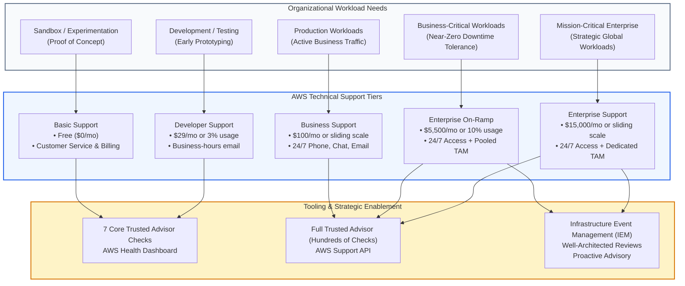
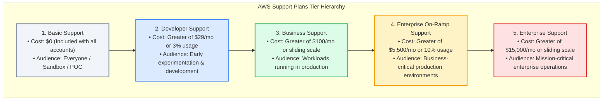
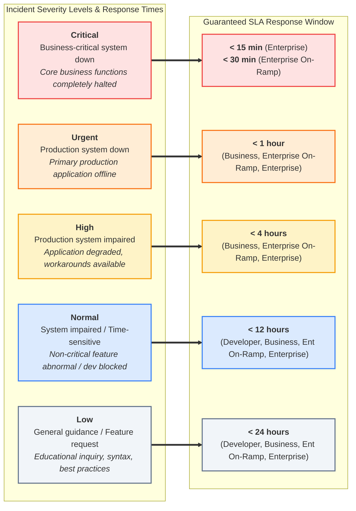
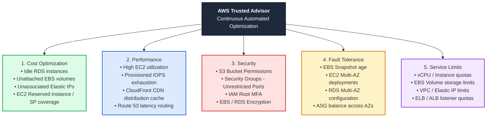
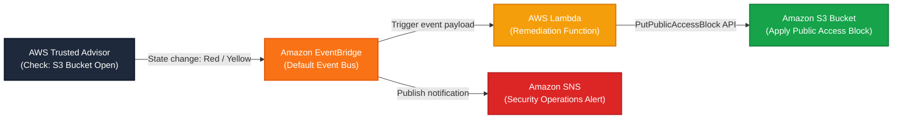

# 🤝 Module 13 / 21: AWS Support Services & Technical Support Plans – Study Guide

> **Course**: AWS re/Start  
> **Module**: Managing Resource Consumption  
> **Source Document**: `T21-0006-RSJAWS_EN-US_SG_M13_AWSSUPPORTSVCS.pdf`  
> **Target Audience**: AWS re/Start Learners / Cloud Practitioners / Solutions Architects / SysOps Administrators / DevOps Engineers  

---

## 🎯 Executive Summary & Unit Overview

In modern cloud computing, operational excellence and workload resiliency require more than just scalable compute and robust storage—they demand a proactive, dependable technical support structure. System outages, architectural anti-patterns, misconfigured security perimeters, and unexpected capacity exhaustion can result in catastrophic downtime, financial hemorrhage, and irreparable brand erosion.

AWS Support provides a comprehensive blend of **tools, technology, people, and specialized programs** designed to proactively assist organizations in optimizing operational performance, lowering total cost of ownership (TCO), mitigating security risks, and accelerating cloud innovation.

```
┌──────────────────────────────────────────────────────────────────────────────────────────────────┐
│                                   The AWS Support Ecosystem                                     │
├────────────────────────────────┬────────────────────────────────┬───────────────────────────────┤
│        People & Experts        │     Technology & Tooling       │      Strategic Programs       │
├────────────────────────────────┼────────────────────────────────┼───────────────────────────────┤
│ • Customer Service & Billing   │ • AWS Trusted Advisor          │ • Infrastructure Event        │
│ • Cloud Support Associates     │ • AWS Health Dashboard         │   Management (IEM)            │
│ • Cloud Support Engineers      │ • AWS Health API               │ • AWS Well-Architected        │
│ • Support Concierge            │ • AWS Support API              │   Workload Reviews            │
│ • Technical Account Mgrs (TAM) │ • Automated EventBridge Alarms │ • Proactive Operations Review │
└────────────────────────────────┴────────────────────────────────┴───────────────────────────────┘
```

AWS structures its technical support offerings into tiered plans tailored to every phase of cloud adoption: from learners experimenting in sandbox accounts, to early-stage development teams, to high-growth production applications, and ultimately to mission-critical global enterprises.

---

### 📌 Learning Objectives

- [ ] **Define the Scope and Purpose of AWS Support**: Articulate how AWS Support assists customers across architecture, operations, security, and troubleshooting.
- [ ] **Differentiate the AWS Technical Support Plans**: Compare the five support plans (**Basic**, **Developer**, **Business**, **Enterprise On-Ramp**, and **Enterprise**) across pricing, eligibility, contact allowances, and communication channels.
- [ ] **Analyze Support Case Severities and SLA Guarantees**: Master the five official case severity levels (**Low**, **Normal**, **High**, **Urgent**, **Critical**) and their guaranteed response timeframes.
- [ ] **Examine Specialized Support Personnel**: Differentiate between Customer Service Representatives, Cloud Support Associates (CSAs), Cloud Support Engineers (CSEs), Support Concierge agents, and Technical Account Managers (TAMs).
- [ ] **Deconstruct AWS Trusted Advisor**: Analyze the five core pillars (**Cost Optimization**, **Performance**, **Security**, **Fault Tolerance**, **Service Limits**), distinguishing between the 7 core checks and the full check suite.
- [ ] **Architect Event-Driven Remediation**: Detail how AWS Trusted Advisor events trigger automated alerts and self-healing remediations via Amazon EventBridge, AWS Lambda, and Amazon SNS.
- [ ] **Evaluate Strategic AWS Programs**: Explain the operational mechanics of AWS Infrastructure Event Management (IEM), Well-Architected Framework reviews, and Proactive Services.
- [ ] **Navigate the AWS Knowledge Ecosystem**: Leverage AWS Whitepapers, the AWS Knowledge Center, AWS Documentation, and AWS re:Post for self-service technical guidance.

---

## 🗺️ AWS Support Hierarchy & Engagement Roadmap

The following diagram illustrates how organizational needs map to AWS Technical Support tiers, personnel escalation paths, and automated tooling:



---

## 🔍 Section 1: Overview of AWS Support Services

AWS Support assists organizations in planning, deploying, managing, and optimizing workloads across their entire cloud journey.

### 1.1 The Four Pillars of AWS Support Assistance

AWS Support assistance is categorized into four primary operational areas:

```
┌────────────────────────────────────────────────────────────────────────────────────────┐
│                        The Four Pillars of AWS Support Assistance                      │
├─────────────────────┬─────────────────────┬─────────────────────┬──────────────────────┤
│    Architecture     │     Operations      │      Security       │   Troubleshooting    │
├─────────────────────┼─────────────────────┼─────────────────────┼──────────────────────┤
│ • Well-Architected  │ • Proactive health  │ • IAM & root audit  │ • API & SDK bugs     │
│   design guidance   │   monitoring        │ • Security Group    │ • EC2 health check   │
│ • Migration roadmap │ • Infrastructure    │   misconfiguration  │   failures           │
│ • Resilient design  │   Event Management  │ • Unrestricted S3   │ • Service outages &  │
│   patterns          │ • Performance tuning│   bucket alerts     │   abnormal behavior  │
└─────────────────────┴─────────────────────┴─────────────────────┴──────────────────────┘
```

1. **Architecture & Solution Design**: AWS experts guide customers on best practices to build secure, fault-tolerant, high-performing, and cost-optimized cloud architectures using the AWS Well-Architected Framework.
2. **Operations & Scaling**: Ongoing operational oversight helps organizations monitor infrastructure health, prepare for high-traffic operational events (e.g., Prime Day, Black Friday), and optimize resource capacity.
3. **Security & Governance**: Support provides continuous automated checks and expert guidance to detect unencrypted storage, exposed public ports, missing multi-factor authentication (MFA), and compliance anomalies.
4. **Troubleshooting & Issue Resolution**: Highly trained engineers assist with technical snags, operating system bugs, API errors, SDK integration issues, and console anomalies.

---

### 1.2 Scope of Support: What AWS Covers vs. Customer Responsibility

Understanding the boundaries of AWS Support is essential. Under the **AWS Shared Responsibility Model**, AWS manages the security *of* the cloud, while the customer manages security and applications *in* the cloud. A similar boundary applies to support:

| Support Domain | Covered by AWS Technical Support | Customer Responsibility |
| :--- | :--- | :--- |
| **AWS Core Infrastructure** | Physical hardware, virtualization hypervisor, AWS global network, core service availability. | Application code, proprietary algorithms, database schemas, local data backups. |
| **AWS APIs and SDKs** | Troubleshooting official AWS SDKs (Boto3, Java SDK, JS SDK, etc.), CLI syntax, and service API errors. | Custom application code writing, third-party library maintenance. |
| **Third-Party Software on EC2** | Installation, configuration, and troubleshooting of common operating systems (Amazon Linux, Ubuntu, RHEL, Windows Server) and common web servers/databases (Apache, Nginx, MySQL, PHP). | Custom third-party proprietary software debugging, custom source code compilation. |
| **Network & Connectivity** | VPC routing table logic, Internet Gateways, NAT Gateways, Direct Connect circuit validation, Transit Gateway configs. | Customer on-premises router configuration, ISP fiber line failures, local corporate firewall policies. |
| **Resource Health** | Hypervisor-level EC2 health check diagnostics (`StatusCheckFailed_System`), disk hardware recovery. | Operating system filesystem corruption (`StatusCheckFailed_Instance`), OS kernel panics caused by custom drivers. |

> [!NOTE]
> **Third-Party Software Support**: Business, Enterprise On-Ramp, and Enterprise Support include guidance on operating system configurations and common third-party packages (e.g., configuring an Apache virtual host or troubleshooting an OS-level DNS resolution failure on an Amazon EC2 instance). However, AWS Support will not rewrite application source code.

---

### 1.3 Key Support Roles and Personnel

AWS provides several tiers of personnel to support customer needs:

```
┌────────────────────────────────────────────────────────────────────────────────────────┐
│                          AWS Support Personnel Architecture                            │
├────────────────────────────┬───────────────────────────────────────────────────────────┤
│ Customer Service / Billing │ Handles invoice disputes, payment methods, account access, │
│                            │ and service quota limit increases. Free for all accounts. │
├────────────────────────────┼───────────────────────────────────────────────────────────┤
│ Cloud Support Associate    │ Front-line technical engineer answering Developer-tier   │
│ (CSA)                      │ queries during business hours.                            │
├────────────────────────────┼───────────────────────────────────────────────────────────┤
│ Cloud Support Engineer     │ Advanced technical specialist solving production-tier     │
│ (CSE)                      │ issues 24/7 via phone, chat, and email tickets.           │
├────────────────────────────┼───────────────────────────────────────────────────────────┤
│ Support Concierge          │ Senior billing and account operations specialist assigned │
│                            │ to Enterprise customers for complex billing structures.   │
├────────────────────────────┼───────────────────────────────────────────────────────────┤
│ Technical Account Manager  │ Dedicated/pooled strategic advisor providing proactive     │
│ (TAM)                      │ architectural reviews, operational guidance, and IEM.     │
└────────────────────────────┴───────────────────────────────────────────────────────────┘
```

- **Customer Service & Billing Representatives**: Accessible to all AWS users 24/7/365 at no cost. They resolve billing inquiries, account closures, consolidated billing questions, and quota increases.
- **Cloud Support Associates (CSAs)**: Entry-level to intermediate technical support specialists who handle basic technical troubleshooting, configuration validation, and documentation navigation.
- **Cloud Support Engineers (CSEs)**: Senior subject-matter experts possessing deep domain proficiency across systems administration, networking, distributed databases, security, and DevOps tooling. They handle complex break-fix and architectural debugging.
- **AWS Support Concierge**: A designated billing and account specialist available exclusively to **Enterprise On-Ramp** and **Enterprise Support** customers. The Concierge helps manage billing across large multi-account organizations, interprets complex Cost and Usage Reports (CUR), and facilitates enterprise procurement.
- **Technical Account Manager (TAM)**: A designated AWS advocate embedded into the customer's technical operations. The TAM provides continuous architectural guidance, coordinates AWS subject-matter experts, conducts regular operational reviews, and oversees high-stakes operational events.

---

## 📊 Section 2: Deep Comparative Analysis of the Five AWS Support Plans

AWS provides five distinct Technical Support plans designed to accommodate varying organizational scales, operational risks, and budgetary constraints.



---

### 2.1 Basic Support Plan

- **Target Audience**: All AWS account holders, students, hobbyists, evaluators, and sandbox environments.
- **Pricing**: Included automatically at **no additional cost ($0/month)**.
- **Support Scope**:
  - **24/7/365 access** to Customer Service and Billing support via web ticketing and chat.
  - Access to full AWS technical documentation, developer guides, and whitepapers.
  - Access to the **AWS re:Post** community discussion forum.
  - Access to the **AWS Health Dashboard** (Personal Health Dashboard and Service Health Dashboard) for service status and maintenance alerts.
  - Access to **7 Core AWS Trusted Advisor checks** (cost, performance, and security checks).
- **Limitations**:
  - **Zero technical case support**: Cannot open technical support cases with Cloud Support Engineers.

---

### 2.2 Developer Support Plan

- **Target Audience**: Developers, small teams, and engineers experimenting with AWS or testing early-stage prototypes where downtime does not impact business operations.
- **Pricing**: Greater of **$29.00/month** or **3% of monthly AWS usage**.
- **Support Scope**:
  - All benefits of Basic Support.
  - **Technical Support Access**: Business-hours access to Cloud Support Associates via **1-to-1 email / web-based ticketing**.
  - **Authorized Contacts**: **1 primary contact** allowed to open unlimited technical support cases.
  - **Architectural Guidance**: General architectural guidance (high-level advice on how services fit together).
  - **SLA Response Times**:
    - **General Guidance (Low)**: `< 24 hours`
    - **System Impaired (Normal)**: `< 12 hours`
- **Limitations**:
  - No 24/7 technical support (business hours only).
  - No phone or live chat support.
  - No production system down response levels.
  - Limited to 1 authorized user contact.

---

### 2.3 Business Support Plan

- **Target Audience**: Organizations running **production workloads** on AWS that require continuous availability and rapid break-fix response.
- **Pricing**: Greater of **$100.00/month**, or a sliding scale based on monthly AWS gross usage:
  - 10% of monthly AWS usage for the first $0–$10,000
  - 7% of monthly AWS usage from $10,001–$80,000
  - 5% of monthly AWS usage from $80,001–$250,000
  - 3% of monthly AWS usage over $250,000
- **Support Scope**:
  - All benefits of Developer Support.
  - **24/7/365 Technical Support Access**: Direct access to senior Cloud Support Engineers via **phone, live web chat, and email ticketing**.
  - **Authorized Contacts**: **Unlimited contacts** with **unlimited cases** (managed via IAM permissions).
  - **Third-Party Software Support**: Assistance with common operating systems, web servers, and databases running on EC2.
  - **Full AWS Trusted Advisor Suite**: Access to all hundreds of checks across all 5 pillars.
  - **AWS Support API**: Programmatic creation, management, and tracking of support tickets and Trusted Advisor recommendations.
  - **SLA Response Times**:
    - **General Guidance (Low)**: `< 24 hours`
    - **System Impaired (Normal)**: `< 12 hours`
    - **Production System Impaired (High)**: `< 4 hours`
    - **Production System Down (Urgent)**: `< 1 hour`
- **Limitations**:
  - No dedicated Technical Account Manager (TAM).
  - No included Infrastructure Event Management (IEM) (available as a paid add-on).
  - No sub-1-hour critical response SLA.

---

### 2.4 Enterprise On-Ramp Support Plan

- **Target Audience**: Growing companies running **business-critical workloads** who require proactive guidance and fast response times, but do not yet require a dedicated, full-time TAM.
- **Pricing**: Greater of **$5,500.00/month** or **10% of monthly AWS gross usage**.
- **Support Scope**:
  - All benefits of Business Support.
  - **24/7/365 Technical Support**: Priority routing to Cloud Support Engineers.
  - **Technical Account Management**: Access to a **pool of Technical Account Managers (TAMs)**.
  - **Support Concierge**: Access to specialized billing and account concierge agents.
  - **Infrastructure Event Management (IEM)**: **1 included IEM engagement per year** at no additional charge.
  - **Consultative Architecture Guidance**: Semi-annual Well-Architected reviews and proactive operational evaluations.
  - **SLA Response Times**:
    - **Business-Critical System Down (Critical)**: `< 30 minutes`
    - **Production System Down (Urgent)**: `< 1 hour`
    - **Production System Impaired (High)**: `< 4 hours`
    - **System Impaired (Normal)**: `< 12 hours`
    - **General Guidance (Low)**: `< 24 hours`

---

### 2.5 Enterprise Support Plan

- **Target Audience**: Large enterprises, regulated institutions, and global organizations running **mission-critical workloads** where any downtime causes catastrophic loss.
- **Pricing**: Greater of **$15,000.00/month**, or a sliding scale based on monthly AWS gross usage:
  - 10% of monthly AWS usage for the first $0–$150,000
  - 7% of monthly AWS usage from $150,001–$500,000
  - 5% of monthly AWS usage from $500,001–$1,000,000
  - 3% of monthly AWS usage over $1,000,000
- **Support Scope**:
  - All benefits of Enterprise On-Ramp Support.
  - **Dedicated Technical Account Manager (TAM)**: An assigned, named senior advisor embedded in your team.
  - **Designated Support Concierge**: Dedicated billing specialist for account auditing, procurement, and billing hierarchy.
  - **Infrastructure Event Management (IEM)**: **Unlimited included IEM engagements** for major product launches, migrations, and peak events.
  - **Well-Architected Reviews & Deep Dives**: Regular operational reviews, security evaluations, and executive cloud roadmaps.
  - **Proactive Services**: Hands-on operational health workshops, disaster recovery simulations, and game days delivered by AWS subject-matter experts.
  - **SLA Response Times**:
    - **Business-Critical System Down (Critical)**: `< 15 minutes` (fastest available response)
    - **Production System Down (Urgent)**: `< 1 hour`
    - **Production System Impaired (High)**: `< 4 hours`
    - **System Impaired (Normal)**: `< 12 hours`
    - **General Guidance (Low)**: `< 24 hours`

---

### 2.6 Support Case Severity Levels and SLA Escalation

AWS categorizes support ticket urgency into five distinct severity levels. The response time clock begins the instant a customer submits a ticket through the AWS Support Console, CLI, or Support API:



> [!WARNING]
> **Severity Selection Integrity**: While customers select their initial case severity level during ticket creation, AWS Support engineers review case descriptions. If a customer on Business Support submits a feature request marked as "Urgent (Production system down)", AWS Support may reclassify the ticket to "Low" or "Normal" in accordance with actual operational impact.

---

### 2.7 Comprehensive Support Plans Comparison Matrix

The table below provides a comprehensive comparison across all five AWS Support tiers:

| Feature / Metric | Basic | Developer | Business | Enterprise On-Ramp | Enterprise |
| :--- | :--- | :--- | :--- | :--- | :--- |
| **Monthly Cost** | Free ($0) | Greater of $29 or 3% usage | Greater of $100 or sliding 10%–3% | Greater of $5,500 or 10% usage | Greater of $15,000 or sliding 10%–3% |
| **Intended Workload** | Experimentation & Sandbox | Prototyping & Development | Active Production Workloads | Business-Critical Workloads | Mission-Critical Enterprise |
| **Billing & Account Support** | 24/7 web & chat | 24/7 web & chat | 24/7 web, chat, phone | 24/7 + Support Concierge | 24/7 + Dedicated Concierge |
| **Technical Support Hours** | None | Business hours (local) | 24/7/365 | 24/7/365 | 24/7/365 |
| **Communication Channels** | N/A (Billing only) | Web / Email ticket | Phone, Live Chat, Email | Phone, Live Chat, Email | Phone, Live Chat, Email |
| **Authorized Contacts** | Unlimited (Billing) | 1 primary contact | Unlimited contacts | Unlimited contacts | Unlimited contacts |
| **Case Allowance** | N/A | Unlimited cases | Unlimited cases | Unlimited cases | Unlimited cases |
| **Response SLA: General Guidance** | N/A | `< 24 hours` | `< 24 hours` | `< 24 hours` | `< 24 hours` |
| **Response SLA: System Impaired** | N/A | `< 12 hours` | `< 12 hours` | `< 12 hours` | `< 12 hours` |
| **Response SLA: Production Impaired** | N/A | Not available | `< 4 hours` | `< 4 hours` | `< 4 hours` |
| **Response SLA: Production Down** | N/A | Not available | `< 1 hour` | `< 1 hour` | `< 1 hour` |
| **Response SLA: Critical Down** | N/A | Not available | Not available | `< 30 minutes` | `< 15 minutes` |
| **Technical Account Manager (TAM)** | None | None | None | **Pooled TAM team** | **Dedicated named TAM** |
| **AWS Trusted Advisor** | 7 core checks | 7 core checks | Full suite (hundreds) | Full suite (hundreds) | Full suite (hundreds) |
| **AWS Support API Access** | None | None | Included | Included | Included |
| **Infrastructure Event Mgmt (IEM)** | None | None | Available for fee | **1 event included / year** | **Unlimited events included** |
| **Well-Architected Reviews** | Self-service tool | Self-service tool | Self-service tool | Semi-annual reviews | Continuous / Dedicated |
| **Proactive Services & Game Days** | None | None | None | Limited | Fully included |

---

## 🛠️ Section 3: AWS Support Programs & Enterprise Enablement

For organizations running complex multi-account infrastructures, reactive troubleshooting is insufficient. AWS provides advanced operational programs to optimize workloads before incidents occur.

```
┌────────────────────────────────────────────────────────────────────────────────────────────────┐
│                             Strategic Enterprise Support Programs                              │
├───────────────────────────────┬───────────────────────────────┬────────────────────────────────┤
│ Infrastructure Event Mgmt     │ Well-Architected Reviews      │ Support Concierge              │
├───────────────────────────────┼───────────────────────────────┼────────────────────────────────┤
│ • Pre-event capacity planning │ • 6 Pillars architectural     │ • Billing structure billing    │
│ • Runbook & escalation review │   evaluations                 │ • Cost allocation & tagging    │
│ • Real-time war room presence │ • Identifying High Risk Issues│ • Service quota management     │
│ • Post-event operational debrief│ • Milestone roadmap tracking│ • Enterprise agreement support │
└───────────────────────────────┴───────────────────────────────┴────────────────────────────────┘
```

### 3.1 Technical Account Manager (TAM)

The Technical Account Manager is a senior technical advisor who acts as the customer's primary point of contact inside AWS:
- **Architectural Guidance**: Proactively reviews cloud deployments against AWS best practices.
- **Operational Health**: Conducts regular business reviews (Monthly/Quarterly Business Reviews), examining billing patterns, support case trends, and service limits.
- **Incident Escalation**: Serves as the executive escalation path during severe outages, mobilizing AWS engineering teams worldwide.
- **Enterprise On-Ramp vs. Enterprise Support**:
  - *Enterprise On-Ramp*: Customers interact with a shared **pool of TAMs** through a specialized queue.
  - *Enterprise Support*: Customers are assigned a **dedicated, named TAM** who develops deep institutional knowledge of the customer's internal culture, applications, and architecture.

---

### 3.2 AWS Infrastructure Event Management (IEM)

AWS Infrastructure Event Management (IEM) is a structured operational program designed to prepare organizations for high-stakes business events:
- **Common Use Cases**: E-commerce shopping holidays (Black Friday, Cyber Monday), streaming media broadcasts (Super Bowl, World Cup), product launches, and massive data center migrations.
- **Four Phases of IEM**:
  1. **Planning & Architecture Assessment (Weeks prior)**: AWS engineers analyze architecture diagrams, verify Auto Scaling policies, and benchmark capacity demands.
  2. **Readiness Preparation & Quota Verification**: AWS coordinates with internal service teams to pre-warm Elastic Load Balancers (ELBs) and temporarily increase service quotas (e.g., EC2 vCPU limits).
  3. **Event Execution (Live War Room)**: AWS technical resources monitor system telemetry in real time alongside customer operations engineers, providing immediate triage if an anomaly emerges.
  4. **Post-Event Debrief**: A structured retrospective evaluating operational telemetry, peak load thresholds, and architectural improvements for future events.

> [!TIP]
> **IEM Availability**: Enterprise Support includes unlimited IEM engagements. Enterprise On-Ramp includes one event per year. Business Support customers can purchase IEM engagements on a standalone, fee-per-event basis.

---

### 3.3 AWS Well-Architected Reviews and Tool

The **AWS Well-Architected Framework** provides a consistent approach for customers and partners to evaluate architectures and implement scalable designs across six pillars:
1. **Operational Excellence**: Running and monitoring systems to deliver business value.
2. **Security**: Protecting information, systems, and assets through risk assessments and mitigation strategies.
3. **Reliability**: Recovering from infrastructure or service disruptions and dynamically acquiring computing resources.
4. **Performance Efficiency**: Using computing resources efficiently to meet requirements.
5. **Cost Optimization**: Avoiding unneeded spending and understanding spending over time.
6. **Sustainability**: Minimizing the environmental impacts of running cloud workloads.

Enterprise Support customers receive hands-on architectural reviews conducted directly by AWS Solutions Architects and TAMs to remediate **High Risk Issues (HRIs)** and **Medium Risk Issues (MRIs)**.

---

### 3.4 AWS Health Dashboard and AWS Health API

The **AWS Health Dashboard** provides transparency into service health and account-specific operational status:
- **Service Health View (Global)**: Displays the general operational status of all AWS services across all commercial and GovCloud regions (historically called the *AWS Service Health Dashboard*).
- **Account Health View (Personalized)**: Displays targeted alerts, scheduled maintenance events (e.g., underlying hardware retirement for an EC2 instance, RDS maintenance windows), and API disruptions directly impacting *your* specific AWS account (historically called the *AWS Personal Health Dashboard*).
- **AWS Health API**: Available under Business, Enterprise On-Ramp, and Enterprise Support plans, enabling organizations to programmatically stream health alerts into enterprise ITSM platforms like ServiceNow, Jira, PagerDuty, or Slack.

---

## 🧭 Section 4: AWS Trusted Advisor Deep Dive

**AWS Trusted Advisor** is an automated cloud optimization engine built directly into the AWS Management Console. It functions as an automated cloud consultant, continuously inspecting an organization's resources against AWS best practices and providing actionable remediation guidance.



---

### 4.1 The Five Core Pillars of AWS Trusted Advisor

Trusted Advisor inspects environments across five fundamental categories:

#### Pillar 1: Cost Optimization
Eliminates waste and reduces monthly cloud expenditures by identifying underutilized, unattached, or orphaned resources:
- **Unassociated Elastic IP Addresses**: Elastic IPs allocated to an account that are not associated with a running EC2 instance incur hourly charges.
- **Idle RDS DB Instances**: Database instances with zero database connections over the past 7 days.
- **Underutilized Amazon EBS Volumes**: Volumes with extremely low read/write IOPS (< 1 IOPS/day over 7 days).
- **Amazon EC2 Reserved Instance / Savings Plans Optimization**: Recommends commitment plans based on historical steady-state usage.

#### Pillar 2: Performance
Improves workload responsiveness and operational speed:
- **High EC2 Instance Utilization**: Highlights instances running at sustained near-100% CPU capacity that may drop requests or degrade latency.
- **CloudFront Content Delivery Network**: Validates whether static assets stored in S3 are served through CloudFront to reduce origin latency.
- **Overutilized EBS Magnetic / gp2 Volumes**: Detects when storage volumes exhaust IOPS burst buckets or hit throughput ceilings.

#### Pillar 3: Security
Hardens your cloud environment against unauthorized access, leaks, and vulnerabilities:
- **Amazon S3 Bucket Permissions**: Detects buckets configured with open list/read/write permissions for the global public.
- **Security Groups - Specific Ports Unrestricted**: Identifies security group rules that allow unrestricted inbound access (`0.0.0.0/0`) to sensitive management ports:
  - Port `22` (SSH)
  - Port `3389` (RDP)
- **MFA on Root Account**: Verifies whether the AWS account root user is protected by multi-factor authentication.
- **IAM Access Key Rotation**: Identifies active access keys that have not been rotated within the past 90 days.

#### Pillar 4: Fault Tolerance
Increases system resilience, redundancy, and disaster recovery readiness:
- **Amazon RDS Multi-AZ**: Verifies whether relational production databases have automated synchronous standby replicas in an alternate Availability Zone.
- **Amazon EBS Snapshots**: Flags volumes that do not have automated backup snapshots created within the preceding 30 days.
- **Auto Scaling Group Multi-AZ Distribution**: Identifies whether Auto Scaling groups span multiple AZs to survive a single datacenter failure.
- **Amazon S3 Cross-Region Replication (CRR)**: Checks critical buckets for replication redundancy across disparate AWS regions.

#### Pillar 5: Service Limits (Service Quotas)
Prevents unexpected deployment failures and outages caused by hitting default soft limits:
- Monitors usage against account quotas for resources such as:
  - EC2 On-Demand vCPUs
  - Amazon VPCs per Region (default: 5)
  - Internet Gateways per Region
  - Elastic IP addresses per Region (default: 5)
- Displays warning indicators when usage exceeds **80% of the provisioned quota** and critical alerts when usage reaches **100%**.

---

### 4.2 Core 7 Free Checks vs. Full Suite

A crucial distinction for certification exams and operational planning is the availability of Trusted Advisor checks across tiers:

```
┌────────────────────────────────────────────────────────────────────────────────────────┐
│                        Trusted Advisor Check Availability                              │
├──────────────────────────────────────────┬─────────────────────────────────────────────┤
│ Basic & Developer Plans                  │ Business & Enterprise Plans                 │
│ (7 Core Checks Only)                     │ (Full Suite: 100+ Comprehensive Checks)     │
├──────────────────────────────────────────┼─────────────────────────────────────────────┤
│ 1. S3 Bucket Permissions (Security)      │ • All checks across all 5 pillars           │
│ 2. Security Groups - Unrestricted Ports  │ • Automated API programmatic querying       │
│ 3. MFA on Root Account (Security)        │ • Automated EventBridge rule triggers       │
│ 4. IAM Access Key Rotation (Security)    │ • Underutilized EBS volume detection        │
│ 5. RDS Public Snapshots (Security)       │ • Idle RDS DB instance detection            │
│ 6. Service Limits (50+ core quotas)      │ • EC2 Reserved Instance / SP recommendations│
│ 7. Amazon EBS Public Snapshots (Security)│ • AWS Well-Architected alignment checks     │
└──────────────────────────────────────────┴─────────────────────────────────────────────┘
```

> [!IMPORTANT]
> **Free Tier Check Focus**: The **7 free core checks** available to Basic and Developer support focus predominantly on **Security** (protecting your account from critical public exposure) and **Service Limits** (preventing sudden resource launch failures). Broad automated **Cost Optimization, Performance, and Fault Tolerance** checks require upgrading to **Business Support** or higher.

---

### 4.3 Automated Remediation via Amazon EventBridge

Organizations subscribed to Business, Enterprise On-Ramp, or Enterprise Support can automate responses to Trusted Advisor status changes using **Amazon EventBridge**:



#### Sample EventBridge Rule Pattern for Trusted Advisor
```json
{
  "source": ["aws.trustedadvisor"],
  "detail-type": ["Trusted Advisor Check Item Refresh Notification"],
  "detail": {
    "status": ["WARN", "ERROR"],
    "check-name": [
      "Amazon S3 Bucket Permissions",
      "Security Groups - Specific Ports Unrestricted"
    ]
  }
}
```

When an engineer accidentally opens port `22` to `0.0.0.0/0`, Trusted Advisor transitions from `OK` to `ERROR`. EventBridge evaluates the event, publishes an alert to an **Amazon SNS** topic to page the security team, and simultaneously triggers an **AWS Lambda function** that modifies the security group ingress rule to revoke unrestricted CIDR access.

---

## 📚 Section 5: Knowledge Ecosystem & Self-Service Resources

When immediate engineering support is not required, AWS maintains a comprehensive ecosystem of technical documentation, architectural guides, and community knowledge bases.

```
┌────────────────────────────────────────────────────────────────────────────────────────┐
│                              AWS Knowledge Ecosystem                                  │
├─────────────────────┬─────────────────────┬─────────────────────┬──────────────────────┤
│  AWS Whitepapers    │  AWS Documentation  │  Knowledge Center   │     AWS re:Post      │
├─────────────────────┼─────────────────────┼─────────────────────┼──────────────────────┤
│ Deep technical      │ Authoritative API,  │ Official solutions  │ Community Q&A forum  │
│ architecture guides │ CLI, SDK references │ to top customer     │ with vetted expert   │
│ written by AWS      │ and service user    │ issues and FAQs     │ answers and AWS      │
│ principal engineers │ manuals             │ with step-by-step   │ employee moderation  │
│ and architects      │                     │ instructions        │                      │
└─────────────────────┴─────────────────────┴─────────────────────┴──────────────────────┘
```

### 5.1 AWS Whitepapers & Guides
- **What they are**: Comprehensive, peer-reviewed technical documents authored by AWS Solutions Architects, product teams, and principal consultants.
- **Primary Topics**:
  - Cloud Economics & TCO Analysis
  - Well-Architected Framework Pillar Guides
  - Serverless Application Patterns
  - Hybrid Cloud Connectivity & Direct Connect Architectures
  - Security, Governance, and Regulatory Compliance (HIPAA, PCI-DSS, SOC 2)
- **Access**: Free and publicly accessible at [AWS Whitepapers & Guides](https://aws.amazon.com/whitepapers/).

---

### 5.2 AWS Documentation
- **What it is**: The official, authoritative reference library for every AWS service.
- **Includes**:
  - Getting Started Guides and quick-start tutorials
  - Service Developer Guides and User Guides
  - Complete API references with request/response schemas
  - AWS CLI and SDK code samples across Python, Java, Go, TypeScript, and .NET.

---

### 5.3 AWS Knowledge Center
- **What it is**: An indexed repository of frequently asked questions and troubleshooting guides created directly from real customer support tickets.
- **Features**:
  - Provides direct, step-by-step resolution runbooks for common operational stumbling blocks (e.g., *"Why can't I connect to my EC2 instance using SSH?"* or *"How do I restore an accidentally deleted S3 object with versioning enabled?"*).
  - Includes explanatory video walkthroughs.

---

### 5.4 AWS re:Post
- **What it is**: An AWS-managed community forum that succeeded the legacy AWS Discussion Forums.
- **Features**:
  - Designed specifically for cloud developers, architects, and administrators to crowd-source troubleshooting advice.
  - Answers are peer-reviewed, vetted, and badged by AWS Community Builders, AWS Heroes, and AWS internal support engineers.

---

## 🎯 Section 6: Real-World Scenario Analysis & Decision Matrix

To apply these support concepts effectively, review how different organization profiles select support tiers:

```
┌─────────────────────────────────────────────────────────────────────────────────────────────────────────┐
│                                 Support Tier Selection Scenarios                                        │
├──────────────────────┬────────────────────────────────┬─────────────────┬───────────────────────────────┤
│ Company Profile      │ Workload Context               │ Recommended Tier│ Justification                 │
├──────────────────────┼────────────────────────────────┼─────────────────┼───────────────────────────────┤
│ Early-stage Startup  │ Building proof-of-concept;     │ Developer       │ Low cost ($29/mo); business-  │
│ (2 Developers)       │ no live paying customers.      │ Support         │ hours email guidance suffices.│
├──────────────────────┼────────────────────────────────┼─────────────────┼───────────────────────────────┤
│ Growing SaaS Firm    │ Live production app generating │ Business        │ 24/7 phone/chat access; 1-hr  │
│ (24/7 Web Platform)  │ $50K/mo revenue; paying users. │ Support         │ down SLA; full Trusted Advisor│
├──────────────────────┼────────────────────────────────┼─────────────────┼───────────────────────────────┤
│ High-Growth Unicorn  │ Peak launch in 2 months;       │ Enterprise      │ 30-min SLA; included IEM for  │
│ ($60K/mo AWS spend)  │ needs event scaling guidance.  │ On-Ramp         │ launch; pooled TAM guidance.  │
├──────────────────────┼────────────────────────────────┼─────────────────┼───────────────────────────────┤
│ Global Retail Bank   │ Regulated, multi-account       │ Enterprise      │ 15-min SLA; dedicated named   │
│ ($300K/mo AWS spend) │ mission-critical workloads.    │ Support         │ TAM; unlimited IEM; Concierge.│
└──────────────────────┴────────────────────────────────┴─────────────────┴───────────────────────────────┘
```

### Detailed Scenario Walkthroughs

#### Scenario A: The University Lab Project
- **Context**: A student team is building an experimental machine learning model using spot EC2 instances.
- **Decision**: **Basic Support**.
- **Reasoning**: The project has zero commercial urgency. If an instance terminates, the students can troubleshoot via documentation and AWS re:Post. Budget should be allocated to compute rather than support fees.

#### Scenario B: The Mid-Market E-Commerce Store
- **Context**: An online retailer with $20,000 monthly AWS spend operates an active Magento/WordPress storefront. An outage directly halts incoming customer checkouts.
- **Decision**: **Business Support**.
- **Reasoning**: If the production database fails at 2:00 AM on a Sunday, the team cannot wait for Developer business-hours email support. They require 24/7 phone/chat access with a guaranteed `< 1 hour` response SLA for "Production system down".

#### Scenario C: The Black Friday Retail Giant
- **Context**: An enterprise retailer prepares for holiday traffic expected to spike 800% above baseline.
- **Decision**: **Enterprise Support** (or Business Support with add-on IEM).
- **Reasoning**: The organization needs an assigned Technical Account Manager to coordinate Infrastructure Event Management (IEM), pre-warm load balancers, verify service limits across accounts, and staff a live war room during peak traffic.

---

## 📝 Section 7: Knowledge Check & Exam Review Questions

Test your mastery of AWS Support Services, Support Plans, and Trusted Advisor.

### Question 1
**An organization is planning to migrate a mission-critical financial application to AWS. The company's CTO mandates that AWS engineers must be available 24/7 via phone, chat, and email, with a guaranteed response time of less than 15 minutes for critical incidents where the business is at risk. Which support plan meets these requirements?**

- A) Developer Support
- B) Business Support
- C) Enterprise On-Ramp Support
- D) Enterprise Support

> [!TIP]
> **Answer: D**  
> **Explanation**: **Enterprise Support** provides 24/7 phone, chat, and email access with a guaranteed SLA of **`< 15 minutes`** for "Business-critical system down" tickets. Enterprise On-Ramp provides a 30-minute SLA for critical incidents. Business Support provides a 1-hour SLA for "Production system down", but does not include the 15-minute Critical response tier.

---

### Question 2
**A startup running test workloads wants to ensure that its Amazon S3 buckets are not inadvertently exposed to the public internet. The startup is currently on the Basic Support plan. Can the startup use AWS Trusted Advisor to detect public S3 bucket policies without upgrading its support plan?**

- A) No, AWS Trusted Advisor is only available to customers on Business or Enterprise Support plans.
- B) No, AWS Trusted Advisor only checks Cost Optimization and Performance on the Basic Support plan.
- C) Yes, Amazon S3 Bucket Permissions is one of the 7 core Trusted Advisor checks available at no cost to all AWS accounts.
- D) Yes, but only if they configure AWS Organizations and enable Service Control Policies (SCPs).

> [!TIP]
> **Answer: C**  
> **Explanation**: All AWS accounts—including those on the free **Basic Support plan**—have access to **7 core Trusted Advisor checks**. These include **Amazon S3 Bucket Permissions**, **Security Groups - Specific Ports Unrestricted**, **MFA on Root Account**, **IAM Access Key Rotation**, **Amazon RDS Public Snapshots**, **Amazon EBS Public Snapshots**, and **Service Limits**.

---

### Question 3
**Which of the following resources or benefits is uniquely provided to customers on Enterprise Support, but NOT included in the Business Support plan? (Select TWO)**

- A) 24/7 access to Cloud Support Engineers via phone, chat, and email
- B) A dedicated Technical Account Manager (TAM)
- C) Programmatic access to the AWS Support API
- D) Included Infrastructure Event Management (IEM) engagements
- E) Access to all AWS Trusted Advisor checks

> [!TIP]
> **Answers: B and D**  
> **Explanation**: A **dedicated Technical Account Manager (TAM)** and **included Infrastructure Event Management (IEM)** are hallmarks of Enterprise Support (Enterprise On-Ramp includes a *pooled* TAM and 1 IEM/year). Business Support includes 24/7 phone/chat/email (A), AWS Support API (C), and full Trusted Advisor checks (E), but does not include a TAM or free IEM.

---

### Question 4
**An engineering team is running a continuous integration pipeline on AWS. A non-critical build worker is failing intermittently due to an operating system library mismatch. The team files a support ticket categorized as "Normal (System impaired)". On the Developer Support plan, what is the guaranteed SLA response time?**

- A) Less than 15 minutes
- B) Less than 1 hour
- C) Less than 12 business hours
- D) Less than 24 business hours

> [!TIP]
> **Answer: C**  
> **Explanation**: On the Developer Support plan, **"System impaired" (Normal)** cases carry a response guarantee of **`< 12 business hours`**. "General guidance" (Low) cases carry a response guarantee of `< 24 business hours`. Developer Support operates exclusively during customer business hours.

---

### Question 5
**An enterprise with dozens of AWS accounts needs assistance analyzing its complex consolidated billing invoice and resolving an account access dispute across multiple business units. Which role or service is specifically designated to assist with these non-technical billing and account inquiries?**

- A) Technical Account Manager (TAM)
- B) Cloud Support Associate (CSA)
- C) AWS Support Concierge
- D) AWS Solutions Architect

> [!TIP]
> **Answer: C**  
> **Explanation**: The **AWS Support Concierge** is a specialized billing and account operations team available to Enterprise On-Ramp and Enterprise Support customers. The Concierge specializes in complex enterprise billing, invoice structures, consolidated account setups, and account-level operational inquiries.

---

## 📌 Key Takeaways & Summary Reference Card

```
┌────────────────────────────────────────────────────────────────────────────────────────────────────────┐
│                                 AWS Support Quick-Reference Card                                       │
├────────────────────────────────────────────────────────────────────────────────────────────────────────┤
│ • Support Plans: Basic ($0), Developer ($29+), Business ($100+), Enterprise On-Ramp ($5.5k+),          │
│   Enterprise ($15k+).                                                                                  │
│ • Critical Down (< 15 min): Exclusively available on Enterprise Support.                               │
│ • Critical Down (< 30 min): Exclusively available on Enterprise On-Ramp Support.                       │
│ • Production Down (< 1 hr): Available on Business, Enterprise On-Ramp, and Enterprise Support.         │
│ • 24/7 Phone & Chat: Starts at Business Support. Developer is email-only during business hours.       │
│ • Support API & Full Trusted Advisor: Starts at Business Support.                                      │
│ • Dedicated TAM: Exclusively on Enterprise Support. Enterprise On-Ramp provides a Pooled TAM.          │
│ • Concierge Billing Service: Included with Enterprise On-Ramp and Enterprise Support.                  │
│ • Trusted Advisor Pillars (5): Cost Optimization, Performance, Security, Fault Tolerance, Limits.     │
│ • Trusted Advisor Free Checks: 7 Core checks (Security & Service Limits focus).                        │
│ • AWS Infrastructure Event Management (IEM): Capacity planning and live event war-room monitoring.     │
│ • AWS Health Dashboard: Personalized alerts for maintenance and outages affecting your resources.       │
│ • Knowledge Bases: AWS Documentation, Whitepapers & Guides, Knowledge Center (Q&A), AWS re:Post.       │
└────────────────────────────────────────────────────────────────────────────────────────────────────────┘
```
