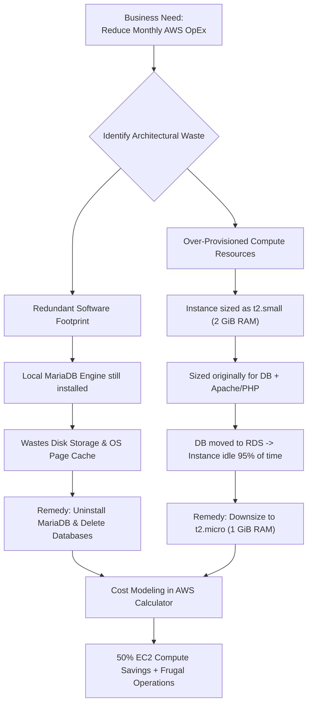
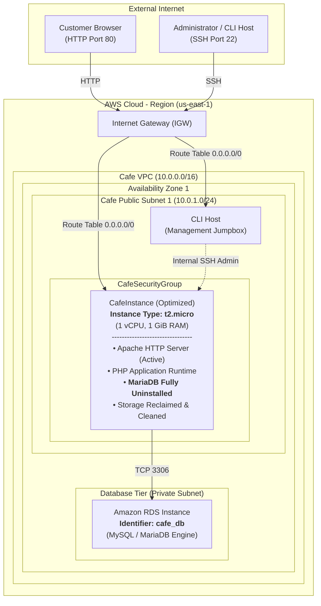
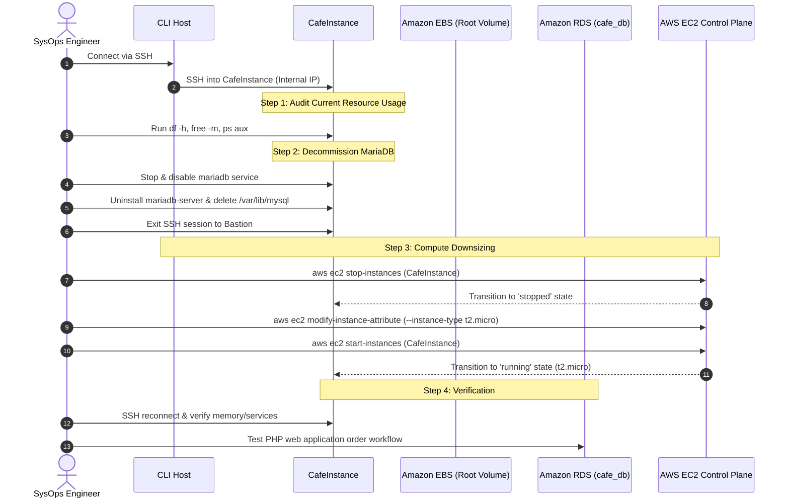

# ☕ Café and Bakery: Optimizing AWS Resource Utilization

> **Course**: AWS re/Start  
> **Module**: Managing Resource Consumption (Module 13)  
> **Source Document**: `T21-0007-RSJAWS_EN-US_SG_M13_CAFEOPTIMIZERESOURCEUTILIZATION.pdf`  
> **Target Audience**: AWS re/Start Learners, Cloud Practitioners, Solutions Architects & SysOps Administrators  

---

## 🎯 Executive Summary & Lab Overview

Welcome to the **Café and Bakery: Optimizing AWS Resource Utilization** lab guide. In this hands-on project, you continue your role as an AWS Cloud Consulting Systems Engineer advising **Sofía** (Café Owner & Manager) and **Martha & Frank** (Café Founders), working alongside **Olivia** (Lead Cloud Solutions Architect).

In preceding architecture phases, the Café successfully modernized its stateful relational data layer by migrating from a self-hosted MariaDB database on a local Amazon Elastic Compute Cloud (Amazon EC2) instance to a fully managed **Amazon Relational Database Service (Amazon RDS)** MySQL database (`cafe_db`). While this database migration decoupled compute from database persistence—elevating data resilience, automated backups, and multi-availability zone readiness—the Café's underlying infrastructure still incurs unnecessary operational expenses.

Specifically, the Café web application server (`CafeInstance`) is currently provisioned on a **`t2.small`** instance (1 vCPU, 2 GiB RAM) with a legacy local database daemon still residing on disk. Because the heavy transactional database processing now executes on Amazon RDS, the `CafeInstance` suffers from substantial resource underutilization. 

This guide delivers a systematic optimization and right-sizing workflow:
1. Reclaiming wasted local disk storage by safely decommissioning and uninstalling the local MariaDB database service.
2. Sizing and optimizing attached Amazon Elastic Block Store (Amazon EBS) volumes based on real-world consumption patterns and calculated headroom.
3. Downsizing the EC2 instance type from **`t2.small`** to **`t2.micro`** (1 vCPU, 1 GiB RAM), effectively halving the compute footprint without degrading application performance.
4. Projecting financial savings using the **AWS Simple Monthly Calculator** and **AWS Pricing Calculator**.
5. Documenting repeatable runbooks into the organizational **Troubleshooting Knowledge Base** under the **Automation and Optimization** category.

```
┌────────────────────────────────────────────────────────────────────────────────────────┐
│                      CAFÉ RESOURCE OPTIMIZATION VALUE PROPOSITION                      │
├───────────────────────────────────┬────────────────────────────────────────────────────┤
│ Unoptimized Legacy Footprint      │ Right-Sized Frugal Architecture                    │
├───────────────────────────────────┼────────────────────────────────────────────────────┤
│ • Over-provisioned `t2.small`     │ • Downsized `t2.micro` (50% compute cost savings)  │
│ • Dormant local MariaDB on disk   │ • Decommissioned local packages, zero disk clutter │
│ • Excess EBS allocation & I/O     │ • Right-sized EBS storage capacity & burst baseline│
│ • Unmanaged technical debt        │ • Decoupled web tier connected to Amazon RDS       │
│ • Guesswork in monthly billing    │ • Deterministic pricing models via AWS Calculator  │
└───────────────────────────────────┴────────────────────────────────────────────────────┘
```

---

## 📌 Learning Objectives

By reading this guide and executing the hands-on lab exercises, learners will be able to:

- [ ] **Translate Business Frugality into Technical Action**: Evaluate business requirements for operational cost reduction and map them directly to cloud resource optimization strategies according to the AWS Well-Architected Cost Optimization Pillar.
- [ ] **Analyze Compute & Memory Utilization Metrics**: Inspect Linux operating system utilization (`top`, `htop`, `free -m`, `vmstat`) and Amazon CloudWatch metrics to establish baseline memory and CPU profiles.
- [ ] **Decommission Dormant Database Services**: Safely stop, disable, and uninstall orphaned database packages (`mariadb-server`, `mariadb`), flush lingering socket files, and reclaim local EBS disk storage.
- [ ] **Apply the Two Core Methods of EC2 Optimization**:
  1. *Storage Sizing*: Calculate accurate EBS volume allocations based on current storage usage plus reasonable headroom for seasonal pastry menu updates.
  2. *Compute Sizing*: Select the optimal EC2 instance family and size based on observed CPU and memory demands, leveraging AWS Compute Optimizer insights.
- [ ] **Execute Safe EC2 Instance Right-Sizing**: Perform an end-to-end instance downsizing workflow via both the AWS Management Console and AWS CLI (`aws ec2 stop-instances`, `aws ec2 modify-instance-attribute`, `aws ec2 start-instances`).
- [ ] **Model Cloud Financial Savings**: Formulate side-by-side cost comparisons using the AWS Simple Monthly Calculator and AWS Pricing Calculator, projecting monthly and annual reductions in operational expenditure (OpEx).
- [ ] **Validate End-to-End Application Integrity**: Verify that the café web application successfully processes customer pastry orders and maintains active persistent database connectivity to `cafe_db` on Amazon RDS following instance modification.
- [ ] **Standardize Operational Runbooks**: Contribute production-grade failure isolation workflows and post-mortems to the Troubleshooting Knowledge Base under the **Automation and Optimization** category.

---

## ☕ Business Need & Customer Scenario

### 1. Customer Meeting Preparation

As cloud practitioners, technical proficiency must be paired with effective stakeholder communication. Technology serves business objectives; in this project, the primary objective is **operational frugality**.

```
┌────────────────────────────────────────────────────────────────────────────────────────┐
│                         STAKEHOLDER ALIGNMENT MATRIX                                  │
├───────────────────┬──────────────────────────────┬─────────────────────────────────────┤
│ Stakeholder       │ Role & Primary Concern       │ Strategic Alignment                 │
├───────────────────┼──────────────────────────────┼─────────────────────────────────────┤
│ **Sofía**         │ Café Business Owner/Operator │ Reducing fixed monthly AWS bills;   │
│                   │ • Monthly OpEx predictability│ maximizing net operating margin     │
│                   │ • Zero disruption to orders  │ during bakery expansion.            │
├───────────────────┼──────────────────────────────┼─────────────────────────────────────┤
│ **Olivia**        │ Lead Solutions Architect     │ Ensuring Well-Architected compliance│
│                   │ • Architectural elegance     │ (Right-sizing, loose coupling,      │
│                   │ • Frugal, resilient design   │ eliminating zombie resources).      │
├───────────────────┼──────────────────────────────┼─────────────────────────────────────┤
│ **Cloud Engineer**│ Technical Implementation     │ Executing non-destructive downsizing│
│ (Learner)         │ • Safe maintenance windows   │ and establishing verifiable runbooks│
│                   │ • Verifiable cost governance │ in the Knowledge Base.              │
└───────────────────┴──────────────────────────────┴─────────────────────────────────────┘
```

---

### 2. Stakeholder Dialogue Transcript

The following dialogue took place during the weekly cloud review between **Sofía** and **Olivia**:

> **Sofía (Café Owner)**:  
> *"Olivia, I would like to reduce the cost of the AWS services that we use. Can you identify some opportunities where we can optimize resource utilization?"*
>
> **Olivia (Solutions Architect)**:  
> *"The database migration to Amazon Relational Database Service (Amazon RDS) is complete. You could uninstall the decommissioned local database from the café instance, which would reduce its storage requirements. You could also downsize the instance to a smaller instance type because the database no longer runs on it. These actions should result in some cost savings."*
>
> **Sofía (Café Owner)**:  
> *"Can we estimate the amount that we would save?"*
>
> **Olivia (Solutions Architect)**:  
> *"You could use the AWS Simple Monthly Calculator to project the savings from these changes."*

---

### 3. Business Problem Breakdown



Prior to database migration, the Café instance had to run:
1. **Linux OS Kernel and Daemons** (~200 MiB RAM)
2. **Apache HTTP Web Server (`httpd`)** (~250 MiB RAM under load)
3. **PHP-FPM / Mod-PHP Runtime** (~250 MiB RAM)
4. **MariaDB RDBMS Server (`mysqld`)** (~600–900 MiB RAM with buffer pools and connections)

Because these four workloads ran concurrently on a single virtual server, a `t2.micro` instance (1 GiB RAM) would have suffered from out-of-memory (OOM) kernel panics and aggressive swap paging. Therefore, provisioning a `t2.small` (2 GiB RAM) was an architectural necessity.

**However, once MariaDB was migrated to Amazon RDS**, the local EC2 server became a purely stateless web frontend. Running an oversized instance when the database processing has moved elsewhere violates the **Cost Optimization Pillar** of the AWS Well-Architected Framework.

---

## 🏗️ Before & After Architecture & Topologies

### 1. Before Optimization Architecture

In the initial environment:
- **VPC & Subnet**: Single Availability Zone (`Availability Zone 1`), `Cafe VPC`, `Cafe Public Subnet 1`.
- **Ingress/Egress**: Internet Gateway routing traffic to the internet.
- **Bastion / Management**: `CLI Host` accessed via SSH client.
- **Firewall**: `CafeSecurityGroup` permitting HTTP (port 80) and SSH (port 22) inbound.
- **Compute Instance**: `CafeInstance` running as **`t2.small`** (1 vCPU, 2.0 GiB Memory).
- **Installed Software**: Both the Café PHP Web Application and the decommissioned **MariaDB Database Server**.
- **External Database**: `cafe_db` hosted on an Amazon RDS instance.


---

### 2. After Optimization Architecture

In the right-sized, optimized environment:
- **Compute Instance**: Downsized to **`t2.micro`** (1 vCPU, 1.0 GiB Memory).
- **Disk Storage**: Local MariaDB packages and legacy database files are uninstalled, eliminating background daemons and reclaiming file storage.
- **Operational Alignment**: Compute and memory capacity match the actual demands of the Apache/PHP web tier.
- **Database Connectivity**: Unchanged. The application continues to transact with the managed Amazon RDS `cafe_db` instance.



---

### 3. Architectural Comparison Matrix

| Architectural Dimension | Before Optimization | After Optimization | Optimization Benefit |
| :--- | :--- | :--- | :--- |
| **Instance Type** | `t2.small` | `t2.micro` | **50% reduction in hourly EC2 compute cost** |
| **vCPU Allocation** | 1 vCPU | 1 vCPU | Compute allocation matches web frontend load |
| **Memory (RAM)** | 2.0 GiB | 1.0 GiB | Eliminates 1.0 GiB of unused, idle RAM |
| **Local Database Engine** | MariaDB Server installed & dormant | Uninstalled & removed from filesystem | Reclaims disk capacity; eliminates vulnerability surface |
| **Attached EBS Footprint** | Bloated with old database tables | Cleaned root volume, minimal filesystem churn | Eliminates disk bloat, reduces snapshot backup sizes |
| **Database Tier** | Amazon RDS (`cafe_db`) | Amazon RDS (`cafe_db`) | Preserves managed database high availability & durability |
| **Security Posture** | Port 3306 local listener open | Only remote egress to RDS allowed | Hardened instance profile with minimal attack surface |

---

## ⚙️ Two Core Methods of EC2 Resource Optimization

Optimizing Amazon EC2 instances centers on two fundamental dimensions: **Storage Sizing** and **Compute Sizing**.

```
┌────────────────────────────────────────────────────────────────────────────────────────┐
│                      TWO CORE METHODS OF EC2 RESOURCE OPTIMIZATION                     │
├───────────────────────────────────┬────────────────────────────────────────────────────┤
│ METHOD 1: STORAGE SIZING          │ METHOD 2: COMPUTE SIZING                           │
├───────────────────────────────────┼────────────────────────────────────────────────────┤
│ • Analyze EBS utilization + growth│ • Observe historical CPU and Memory utilization    │
│ • Select correct volume tier (gp3)│ • Leverage AWS Compute Optimizer recommendations   │
│ • Reclaim unallocated disk space  │ • Choose matching instance family and size         │
│ • Right-size IOPS & throughput    │ • Eliminate idle capacity without bottlenecking    │
└───────────────────────────────────┴────────────────────────────────────────────────────┘
```

---

### Method #1: Storage Sizing (Amazon EBS Optimization)

Choosing the correct size and performance profile for attached storage volumes requires evaluating both capacity (gigabytes) and I/O performance (IOPS and throughput).

#### Principles of Storage Sizing
1. **Estimate Current Storage Requirements**:
   - Inspect the current file system usage using standard Linux administrative utilities (`df -h`, `du -sh`).
   - Identify obsolete application artifacts, temporary files, legacy local databases, log archives, and rotated dumps.
2. **Calculate Headroom for Growth**:
   - Provision capacity to accommodate foreseeable business expansion (e.g., product image uploads, access logs, OS updates) over a 3- to 6-month horizon.
   - Recommended rule of thumb: Maintain **20% to 30% unallocated headroom** to prevent root partition exhaustion and file fragmentation.
3. **Select Volume Types & Optimize IOPS**:
   - **General Purpose SSD (`gp3`) vs. Legacy `gp2`**:
     - `gp2` links baseline IOPS directly to provisioned storage volume size (3 IOPS per GiB). To obtain higher IOPS, administrators were historically forced to over-provision disk volume size.
     - `gp3` decouples IOPS and throughput from volume capacity. A `gp3` volume provides a baseline of **3,000 IOPS and 125 MB/s throughput** included at no extra cost, regardless of volume size, while being up to 20% cheaper per gigabyte than `gp2`.
4. **Purge Dormant Packages Before Volume Snapshots**:
   - Removing decommissioned database binaries and tables (`/var/lib/mysql`) prevents unused data from being backed up into EBS snapshots, lowering S3 snapshot storage costs.

---

### Method #2: Compute Sizing (Instance Family & Size Selection)

Selecting the appropriate instance family and size based on actual workload performance prevents paying for idle hardware.

#### Principles of Compute Sizing
1. **Analyze CPU and Memory Telemetry**:
   - Cloud workloads often exhibit asymmetric resource demands. A database engine requires abundant memory for buffer pooling, while a lightweight PHP web frontend primarily consumes modest CPU during page rendering and minimal RAM per worker process.
   - Memory utilization is **not** collected by default CloudWatch metrics (which report CPU utilization, Disk I/O, and Network I/O). Installing the **Amazon CloudWatch Agent** provides granular RAM metrics (`mem_used_percent`).
2. **Utilize AWS Compute Optimizer**:
   - AWS Compute Optimizer uses machine learning algorithms to analyze historical CloudWatch metrics over a 14-day evaluation window.
   - It identifies three operational states:
     - **Over-provisioned**: Instance specifications significantly exceed workload demand; candidates for downsizing.
     - **Under-provisioned**: Instance specifications constrain workload performance; candidates for upsizing.
     - **Optimized**: Specifications match workload demand within cost-effective thresholds.
3. **Match Instance Families to Workload Profiles**:
   - **General Purpose (`T` family, e.g., `t3`, `t4g`, `t2`)**: Burstable performance designed for variable workloads with low baseline CPU utilization and occasional spikes (ideal for the Café web application).
   - **Compute Optimized (`C` family)**: High CPU-to-memory ratio designed for batch rendering, scientific computing, and dedicated gaming servers.
   - **Memory Optimized (`R` family)**: High memory-to-CPU ratio designed for in-memory caches (Redis/Memcached) and enterprise databases.

---

## 🛠️ Step-by-Step Optimization Workflow

Follow this hands-on procedure to optimize the Café web application environment.



---

### Step 1: Inspect System Resources and Service State

1. Open your terminal and connect to the **CLI Host** using your lab credentials:
   ```bash
   ssh -i ~/.ssh/cafe-key.pem ec2-user@<CLI_HOST_PUBLIC_IP>
   ```

2. From the CLI Host, connect to the internal private IP address of the **CafeInstance**:
   ```bash
   ssh -i ~/.ssh/cafe-key.pem ec2-user@<CAFE_INSTANCE_PRIVATE_IP>
   ```

3. Audit the current block storage allocation and file system consumption:
   ```bash
   df -h /
   lsblk
   ```
   *Expected Output Highlights:*
   ```text
   Filesystem      Size  Used Avail Use% Mounted on
   /dev/xvda1      8.0G  3.1G  4.9G  39% /
   ```

4. Audit memory utilization and running daemons:
   ```bash
   free -m
   systemctl status mariadb
   ```
   *Observation*: The local MariaDB daemon is active and holding memory in the Linux buffer cache, even though all web traffic connects to RDS:
   ```text
   ● mariadb.service - MariaDB database server
      Loaded: loaded (/usr/lib/systemd/system/mariadb.service; enabled; vendor preset: disabled)
      Active: active (running) since Mon 2026-10-12 10:14:22 UTC; 4h 22min ago
   ```

---

### Step 2: Decommission and Uninstall the Local Database

Because the Café application database was migrated to Amazon RDS (`cafe_db`), the local MariaDB instance is an unneeded zombie service.

1. **Stop the MariaDB Service**:
   ```bash
   sudo systemctl stop mariadb
   ```

2. **Disable the Service from System Boot**:
   ```bash
   sudo systemctl disable mariadb
   ```
   *Output confirmation:*
   ```text
   Removed symlink /etc/systemd/system/multi-user.target.wants/mariadb.service.
   ```

3. **Uninstall MariaDB Packages**:
   Remove the MariaDB server and client packages to reclaim disk space:
   ```bash
   sudo yum remove -y mariadb-server mariadb
   ```

4. **Purge Legacy Database Files and Directories**:
   Remove legacy database records, binary logs, and transaction tables from disk:
   ```bash
   sudo rm -rf /var/lib/mysql
   sudo rm -f /var/log/mariadb/mariadb.log
   ```

5. **Verify Reclaimed Storage Space**:
   ```bash
   df -h /
   ```
   Notice that unneeded database binaries, indices, and runtime state files have been deleted, freeing several hundred megabytes on the root volume.

6. Close your SSH connection to `CafeInstance` and return to the CLI Host prompt:
   ```bash
   exit
   ```

---

### Step 3: Downsize the EC2 Instance Type (t2.small → t2.micro)

Now that the local database is decommissioned, `CafeInstance` only hosts Apache and PHP. A **`t2.micro`** (1 vCPU, 1 GiB RAM) provides ample compute capacity.

> [!IMPORTANT]
> To change the instance type of an Amazon EBS-backed instance, the instance **must be in the `stopped` state**. Changing the instance type cannot be done while the instance is running.

#### Option A: Execution via AWS CLI (from CLI Host)

1. Obtain the instance ID for `CafeInstance`:
   ```bash
   aws ec2 describe-instances \
     --filters "Name=tag:Name,Values=CafeInstance" \
     --query "Reservations[*].Instances[*].[InstanceId,State.Name,InstanceType]" \
     --output table
   ```

2. Stop the `CafeInstance`:
   ```bash
   CAFE_ID=$(aws ec2 describe-instances \
     --filters "Name=tag:Name,Values=CafeInstance" \
     --query "Reservations[0].Instances[0].InstanceId" \
     --output text)

   echo "Stopping CafeInstance: $CAFE_ID..."
   aws ec2 stop-instances --instance-ids $CAFE_ID
   ```

3. Wait for the instance to transition to the `stopped` state:
   ```bash
   aws ec2 wait instance-stopped --instance-ids $CAFE_ID
   echo "Instance $CAFE_ID is now stopped."
   ```

4. Modify the instance type attribute from `t2.small` to `t2.micro`:
   ```bash
   aws ec2 modify-instance-attribute \
     --instance-id $CAFE_ID \
     --instance-type "{\"Value\": \"t2.micro\"}"
   ```

5. Restart the optimized instance:
   ```bash
   aws ec2 start-instances --instance-ids $CAFE_ID
   aws ec2 wait instance-running --instance-ids $CAFE_ID
   echo "Instance $CAFE_ID is now running as t2.micro!"
   ```

6. Confirm the updated instance configuration:
   ```bash
   aws ec2 describe-instances \
     --instance-ids $CAFE_ID \
     --query "Reservations[*].Instances[*].[InstanceId,InstanceType,State.Name]" \
     --output table
   ```

---

#### Option B: Execution via AWS Management Console

1. Navigate to the **Amazon EC2 Console** at `https://console.aws.amazon.com/ec2/`.
2. In the navigation pane, choose **Instances**.
3. Select **CafeInstance** (verify its current type is `t2.small`).
4. Choose **Instance state** → **Stop instance**. Confirm when prompted.
5. Wait for the **Instance state** column to display **Stopped**.
6. With `CafeInstance` selected, choose **Actions** → **Instance settings** → **Change instance type**.
7. In the **Change instance type** dialog:
   - In the **Instance type** dropdown, select **t2.micro**.
   - Choose **Apply**.
8. Choose **Instance state** → **Start instance**.
9. Refresh the console and confirm that the instance state shows **Running** and the instance type displays **t2.micro**.

---

### Step 4: Validate Application Functionality & Performance

1. Connect to the downsized `CafeInstance` via SSH:
   ```bash
   ssh -i ~/.ssh/cafe-key.pem ec2-user@<CAFE_INSTANCE_PRIVATE_IP>
   ```

2. Verify that the Apache web server daemon automatically started:
   ```bash
   sudo systemctl status httpd
   ```

3. Inspect real-time memory distribution on the new `t2.micro` hardware:
   ```bash
   free -m
   ```
   *Expected Output Highlights:*
   ```text
                 total        used        free      shared  buff/cache   available
   Mem:            982         315         420          12         247         545
   Swap:             0           0           0
   ```
   *Key Takeaway*: The system operates cleanly within 982 MiB of total memory, utilizing only ~315 MiB and leaving over 500 MiB free for page caching and HTTP worker spikes.

4. Open a web browser and access the café application URL:
   ```text
   http://<CAFE_INSTANCE_PUBLIC_IP>/cafe
   ```
5. Place a test order for a pastry and beverage. Confirm that the order confirmation screen displays successfully and persists the transaction to the remote Amazon RDS database.

---

## 💰 Financial Modeling: AWS Pricing Calculator Analysis

To present the business value of this technical optimization to Sofía, we construct a cost savings model using the **AWS Pricing Calculator** (and legacy AWS Simple Monthly Calculator).

```
┌────────────────────────────────────────────────────────────────────────────────────────┐
│                        MONTHLY COMPUTE COST COMPARISON (US-EAST-1)                     │
├──────────────────────────┬─────────────────────────────┬───────────────────────────────┤
│ Metric                   │ Before Optimization         │ After Optimization            │
├──────────────────────────┼─────────────────────────────┼───────────────────────────────┤
│ Instance Name            │ `CafeInstance`              │ `CafeInstance`                │
│ Instance Type            │ **`t2.small`**              │ **`t2.micro`**                │
│ vCPU / RAM               │ 1 vCPU / 2.0 GiB RAM        │ 1 vCPU / 1.0 GiB RAM          │
│ On-Demand Hourly Rate    │ $0.0230 per hour            │ $0.0116 per hour              │
│ Monthly Running Hours    │ 730 hours                   │ 730 hours                     │
│ Monthly Compute Subtotal │ **$16.79**                  │ **$8.47**                     │
│ Annual Compute Cost      │ **$201.48**                 │ **$101.62**                   │
├──────────────────────────┼─────────────────────────────┼───────────────────────────────┤
│ **Net Dollar Savings**   │ —                           │ **$8.32 / month ($99.86 / yr)**│
│ **Percentage Savings**   │ —                           │ **~ 49.6% Compute Reduction** │
└──────────────────────────┴─────────────────────────────┴───────────────────────────────┘
```

> [!TIP]
> While $8.32 per month may appear modest for a single small café server, **cost optimization is a matter of scale and compounding efficiency**:
> - For a chain of **50 café franchise branches**, this single adjustment saves **~$5,000 annually**.
> - Pairing compute right-sizing with a **1-Year or 3-Year Compute Savings Plan** or **Reserved Instance (RI)** yields up to an additional **35%–60% discount**, lowering the effective monthly cost per node to approximately **$3.50–$5.00**.

---

## 🛠️ Troubleshooting Knowledge Base Project Integration

> **Category**: **Automation and Optimization**  
> **Repository**: Centralized Cloud Operations Runbook Index  

Below are four enterprise-grade troubleshooting runbooks created during this lab for integration into the team's operational knowledge repository.

---

### Runbook KB-OPT-001: EC2 Instance Downsizing Failure or State Stalls

```
┌────────────────────────────────────────────────────────────────────────────────────────┐
│ RUNBOOK ENTRY: KB-OPT-001                                                              │
├─────────────────────────┬──────────────────────────────────────────────────────────────┤
│ Category                │ Automation and Optimization                                  │
│ Severity                │ Medium (Blocks maintenance window execution)                 │
│ Title                   │ Failure to Modify EC2 Instance Type Due to State or Driver   │
└─────────────────────────┴──────────────────────────────────────────────────────────────┘
```

#### Problem Description
When executing `aws ec2 modify-instance-attribute` or attempting to change the instance type via the AWS Console, the operation fails with one of the following errors:
- `Client.IncorrectInstanceState: The instance 'i-xxxxxx' is not in the 'stopped' state.`
- `Client.UnsupportedInstanceAttribute: The requested instance type's architecture or virtualization type is incompatible.`

#### Root Causes
1. **Instance Not Stopped**: The modification API was invoked while the instance was still shutting down (`stopping`) or running.
2. **Virtualization Type Incompatibility**: Attempting to move from a Paravirtual (PV) AMI to a Hardware Virtual Machine (HVM) instance type (all modern `T` instances require HVM).
3. **Architecture Mismatch**: Attempting to switch an x86_64 AMI to an AWS Graviton ARM64 type (e.g., `t4g.micro`) without recompiling software or using an ARM-compatible AMI.
4. **Enhanced Networking / ENA Incompatibility**: Moving to modern 5th/6th generation instances (`t3`, `m5`) without installing the AWS Elastic Network Adapter (ENA) Linux kernel module.

#### Step-by-Step Remediation Procedure
1. Verify the current operational state:
   ```bash
   aws ec2 describe-instances \
     --instance-ids <INSTANCE_ID> \
     --query "Reservations[0].Instances[0].State.Name" \
     --output text
   ```
2. Wait until the output explicitly returns `stopped`. Use the CLI waiter:
   ```bash
   aws ec2 wait instance-stopped --instance-ids <INSTANCE_ID>
   ```
3. Verify that the architecture of the source instance matches the target:
   ```bash
   aws ec2 describe-instances \
     --instance-ids <INSTANCE_ID> \
     --query "Reservations[0].Instances[0].Architecture" \
     --output text
   ```
   *Note*: `t2.small` and `t2.micro` both run `x86_64` on HVM virtualization, ensuring complete drop-in compatibility.
4. Execute the attribute change and verify success:
   ```bash
   aws ec2 modify-instance-attribute \
     --instance-id <INSTANCE_ID> \
     --instance-type "{\"Value\": \"t2.micro\"}"
   aws ec2 start-instances --instance-ids <INSTANCE_ID>
   ```

---

### Runbook KB-OPT-002: Orphaned Database Artifacts and Port 3306 Socket Conflicts

```
┌────────────────────────────────────────────────────────────────────────────────────────┐
│ RUNBOOK ENTRY: KB-OPT-002                                                              │
├─────────────────────────┬──────────────────────────────────────────────────────────────┤
│ Category                │ Automation and Optimization                                  │
│ Severity                │ Low to Medium (Causes disk exhaustion & port collision risks)│
│ Title                   │ Residual MariaDB/MySQL Sockets and Locked Storage Reclaim    │
└─────────────────────────┴──────────────────────────────────────────────────────────────┘
```

#### Problem Description
After running `yum remove mariadb-server`, the administrator observes that storage space has not increased as expected, or background processes continue attempting to bind to UNIX domain socket `/var/lib/mysql/mysql.sock`.

#### Root Causes
1. **Package Managers Preserve Data**: `rpm` and `yum` deliberately do not delete `/var/lib/mysql` upon package removal to prevent accidental data loss.
2. **Zombie Processes**: If `systemctl stop mariadb` was skipped prior to `yum remove`, the `mysqld` process may continue running in memory as an unmanaged daemon.
3. **Open File Descriptors**: If a lingering process holds open file descriptors to deleted table files, the Linux VFS kernel layer does not release the blocks until the process terminates.

#### Step-by-Step Remediation Procedure
1. Check for lingering database processes:
   ```bash
   ps aux | grep -i -E "mysql|mariadb" | grep -v grep
   ```
2. If running processes are found, terminate them:
   ```bash
   sudo pkill -9 -f mysqld
   ```
3. Check for unlinked open files holding disk blocks:
   ```bash
   sudo lsof +L1 /
   ```
4. Purge the lingering data directory and log files:
   ```bash
   sudo rm -rf /var/lib/mysql /var/log/mariadb
   ```
5. Confirm storage reclaim:
   ```bash
   df -h /
   ```

---

### Runbook KB-OPT-003: Post-Optimization Application Database Connection Failure

```
┌────────────────────────────────────────────────────────────────────────────────────────┐
│ RUNBOOK ENTRY: KB-OPT-003                                                              │
├─────────────────────────┬──────────────────────────────────────────────────────────────┤
│ Category                │ Automation and Optimization                                  │
│ Severity                │ High (Production Application Outage)                         │
│ Title                   │ Web Application Cannot Connect to Amazon RDS Post-Downsizing  │
└─────────────────────────┴──────────────────────────────────────────────────────────────┘
```

#### Problem Description
Following instance reboot and right-sizing to `t2.micro`, end users navigate to the Café website and encounter:
`Error establishing database connection` or `HTTP 500 Internal Server Error`.

#### Root Causes
1. **Dynamic Public IP Change**: When an EC2 instance without an Elastic IP (EIP) is stopped and started, AWS releases its public IPv4 address and assigns a new one. If external systems or DNS records relied on the old public IP, connectivity fails.
2. **Localhost Fallback in Application Config**: The application configuration file (`db.php` or `config.php`) was inadvertently set to connect to `localhost` / `127.0.0.1` instead of the RDS endpoint hostname (`cafe-db.xxxx.us-east-1.rds.amazonaws.com`). Once local MariaDB was removed, connections to `localhost:3306` fail immediately (`Connection refused`).
3. **RDS Security Group Ingress Rule Misconfiguration**: The Security Group guarding the RDS instance only authorized incoming TCP port 3306 from a specific private IP address rather than the `CafeSecurityGroup` ID (`sg-xxxxxx`).

#### Step-by-Step Remediation Procedure
1. Verify the application database configuration:
   ```bash
   cat /var/www/html/cafe/db-config.php
   ```
   Ensure the DB hostname points to the Amazon RDS DNS endpoint:
   ```php
   define('DB_SERVER', 'cafe-db.c12345678901.us-east-1.rds.amazonaws.com');
   define('DB_DATABASE', 'cafe_db');
   ```
2. Test network layer connectivity to the RDS instance on TCP port 3306:
   ```bash
   nc -zv <RDS_ENDPOINT_ADDRESS> 3306
   ```
   - If `Connection refused`: The RDS instance is stopped or restarting.
   - If `Connection timed out`: Security Group ingress rules are blocking traffic.
3. Validate RDS Security Group authorization:
   ```bash
   aws rds describe-db-instances \
     --db-instance-identifier cafe-db \
     --query "DBInstances[0].VpcSecurityGroups"
   ```
   Ensure the RDS Security Group authorizes ingress on port 3306 with the source set to the `CafeSecurityGroup` (`sg-xxxxxx`), not an individual private IP.

---

### Runbook KB-OPT-004: Preventing Zombie AWS Billing Overruns (EBS & Snapshots)

```
┌────────────────────────────────────────────────────────────────────────────────────────┐
│ RUNBOOK ENTRY: KB-OPT-004                                                              │
├─────────────────────────┬──────────────────────────────────────────────────────────────┤
│ Category                │ Automation and Optimization                                  │
│ Severity                │ Low to Medium (Creeping monthly expenditure leak)            │
│ Title                   │ Identification and Pruning of Zombie EBS Volumes & Snapshots │
└─────────────────────────┴──────────────────────────────────────────────────────────────┘
```

#### Problem Description
Organizations often notice that after downsizing or terminating compute instances, monthly AWS storage costs remain stagnant or climb over time due to "zombie" resources.

#### Root Causes
1. **Unattached EBS Volumes**: When an EC2 instance is terminated without the `DeleteOnTermination` flag set to `true`, its root or secondary EBS volumes remain in the `available` state. AWS bills for EBS volume provisioned capacity regardless of whether an instance is attached or running.
2. **Abandoned EBS Snapshots**: Automated lifecycle scripts or ad-hoc manual backups create point-in-time EBS snapshots that persist in Amazon S3 indefinitely.
3. **Idle Elastic IP Addresses**: Elastic IPs allocated to an account that are not associated with a running instance incur an hourly non-attachment fee.

#### Step-by-Step Remediation Procedure
1. Query for unattached EBS volumes in the current region:
   ```bash
   aws ec2 describe-volumes \
     --filters Name=status,Values=available \
     --query "Volumes[*].[VolumeId,Size,VolumeType,CreateTime]" \
     --output table
   ```
2. Delete unneeded orphaned volumes:
   ```bash
   for vol in $(aws ec2 describe-volumes --filters Name=status,Values=available --query "Volumes[*].VolumeId" --output text); do
     echo "Deleting orphan volume: $vol"
     aws ec2 delete-volume --volume-id $vol
   done
   ```
3. Audit unassociated Elastic IP addresses:
   ```bash
   aws ec2 describe-addresses \
     --query "Addresses[?AssociationId==null].[PublicIp,AllocationId]" \
     --output table
   ```
4. Release unassociated Elastic IPs:
   ```bash
   aws ec2 release-address --allocation-id <ALLOCATION_ID>
   ```

---

## 💡 Checkpoint Review Questions & Knowledge Verification

Test your mastery of the concepts covered in this lab guide:

### Question 1
**Why was it technically safe to downsize `CafeInstance` from `t2.small` (2 GiB RAM) to `t2.micro` (1 GiB RAM) in this project?**
- A) Because the Linux kernel automatically compresses RAM when instances are downsized.
- B) Because the transactional database engine was offloaded to Amazon RDS, reducing the instance's memory footprint to only what Apache and PHP require.
- C) Because `t2.micro` supports unlimited CPU burst credits without any pricing surcharge.
- D) Because AWS automatically moves excess web requests to Amazon S3.

> **Correct Answer: B**  
> *Explanation*: In earlier phases, `CafeInstance` required 2 GiB of RAM because it hosted both the Apache web server and the memory-hungry local MariaDB database server. Once MariaDB was migrated to Amazon RDS (`cafe_db`), the local server only executed PHP and web rendering tasks, consuming less than 350 MiB of RAM. Downsizing to `t2.micro` (1 GiB RAM) aligns compute capacity with actual workload demands.

---

### Question 2
**What must an administrator do to an EBS-backed Amazon EC2 instance prior to modifying its instance type via the AWS CLI or Console?**
- A) Detach the root EBS volume and attach it to a new instance.
- B) Create an Amazon Machine Image (AMI) and delete the original instance.
- C) Stop the instance (`aws ec2 stop-instances`).
- D) Convert the instance to a Spot Instance.

> **Correct Answer: C**  
> *Explanation*: Modifying the hardware profile (CPU and memory specifications) of an EBS-backed instance requires the instance to be in the `stopped` state. Invoking `modify-instance-attribute` on a running instance returns an `IncorrectInstanceState` exception.

---

### Question 3
**What are the two core methods for optimizing an Amazon EC2 instance's resource utilization?**
- A) Modifying the VPC CIDR block and increasing the MTU packet size.
- B) Choosing the correct size and IOPS tier for attached storage volumes, and selecting the appropriate instance type based on observed CPU/memory demand.
- C) Disabling CloudWatch logs and running instances exclusively in private subnets.
- D) Converting all security groups into stateless Network ACLs.

> **Correct Answer: B**  
> *Explanation*: EC2 resource optimization focuses on **Storage Sizing** (allocating adequate EBS volume capacity plus headroom and choosing efficient volume tiers like `gp3`) and **Compute Sizing** (right-sizing CPU and RAM families to match application utilization metrics).

---

### Question 4
**Which AWS tool provides machine learning-driven recommendations to identify over-provisioned or under-provisioned EC2 instances based on historical CloudWatch metrics?**
- A) AWS Simple Monthly Calculator
- B) AWS Trusted Advisor
- C) AWS Compute Optimizer
- D) AWS Cost Explorer Budget Alerts

> **Correct Answer: C**  
> *Explanation*: **AWS Compute Optimizer** analyzes CloudWatch telemetry over a multi-day observation window and uses machine learning to classify workloads as Over-provisioned, Under-provisioned, or Optimized, recommending ideal target instance types and families.

---

### Question 5
**What financial benefit did the Café realize by downsizing from `t2.small` to `t2.micro`?**
- A) 100% elimination of all AWS bills.
- B) An approximate 50% reduction in hourly On-Demand EC2 compute charges.
- C) Free Amazon RDS Multi-AZ replication.
- D) Automatic conversion of all EBS volumes to provisioned IOPS (`io2`).

> **Correct Answer: B**  
> *Explanation*: In `us-east-1`, a `t2.small` costs approximately $0.023 per hour (~$16.79/month), whereas a `t2.micro` costs approximately $0.0116 per hour (~$8.47/month). Downsizing cuts the instance compute bill by approximately 50%.

---

## 🏁 Summary & Well-Architected Best Practices

In this project, you implemented core cloud optimization methodologies to improve the efficiency and cost-effectiveness of the Café architecture:

```
┌────────────────────────────────────────────────────────────────────────────────────────┐
│                        SUMMARY OF OPTIMIZATION ACHIEVEMENTS                            │
├───────────────────────────────────┬────────────────────────────────────────────────────┤
│ Architectural Cleanliness         │ Decommissioned and uninstalled local MariaDB       │
│                                   │ binaries, freeing disk space and stopping daemons. │
├───────────────────────────────────┼────────────────────────────────────────────────────┤
│ Compute Right-Sizing              │ Transitioned `CafeInstance` from `t2.small` to     │
│                                   │ `t2.micro`, reducing compute costs by ~50%.        │
├───────────────────────────────────┼────────────────────────────────────────────────────┤
│ Financial Predictability          │ Modeled OpEx savings using the AWS Pricing         │
│                                   │ Calculator to provide clear business visibility.   │
├───────────────────────────────────┼────────────────────────────────────────────────────┤
│ Operational Excellence            │ Added standardized runbooks to the Troubleshooting │
│                                   │ Knowledge Base under Automation and Optimization.  │
└───────────────────────────────────┴────────────────────────────────────────────────────┘
```

### Key Well-Architected Takeaways
1. **Decouple and Right-Size**: Whenever an architectural component is offloaded (such as migrating a database to RDS or media storage to S3), immediately re-evaluate the source server. Failing to downsize after architectural decoupling leaves stranded capacity and unnecessary cost.
2. **Observe Before Altering**: Always measure CPU, memory, and disk utilization during normal and peak business cycles before modifying instance sizes or storage allocations.
3. **Automate Continuous Optimization**: Implement tools like **AWS Compute Optimizer**, **AWS Cost Anomaly Detection**, and **AWS Budgets** to receive actionable alerts whenever cloud resources drift from optimal utilization.
