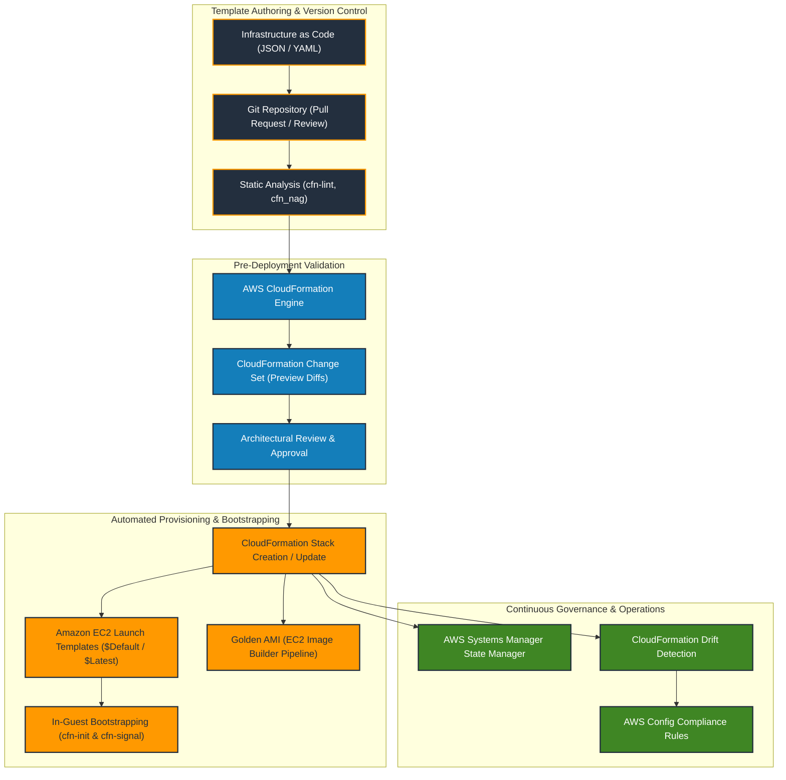

# Module 22: Automated and Repeatable Deployments

> **Course**: AWS re/Start Curriculum  
> **Module**: 22 — Automated and Repeatable Deployments  
> **Target Audience**: Cloud Practitioners, Systems Administrators, DevOps & Cloud Architects  

---

## 📖 Module Overview

Module 22 explores the architectural principles and operational tooling required to achieve automated, repeatable, and consistent cloud infrastructure deployments. It covers the imperatives of eliminating snowflake configurations and drift through **Configuration Management in the Cloud**, building optimized machine images with **AMI Building Strategies**, standardizing compute definitions with **Amazon EC2 Launch Templates**, mastering **Infrastructure as Code (IaC)** declarative modeling, serialization with **JSON and YAML**, deep-dive template and stack orchestration with **AWS CloudFormation**, and systematic diagnosis of stack failure states with **Troubleshooting AWS CloudFormation**.

---

## 📑 Study Guides, Video Demos & Lab Walkthroughs

| Index | Document / Lab | Type | Description |
|---|---|---|---|
| **T22-0001** | [Automated & Repeatable Deployments Overview](file:///work/tmp/aws-cf/T22-Automated_and_Repeatable_Deployments/T22-0001-RSJAWS_EN-US_SG_M13_AUTOMATEREPEATDEPLOYOVERVIEW.md) | Study Guide | Foundations of cloud automation, repeatability, cattle vs pets, and curriculum roadmap. |
| **T22-0002** | [Configuration Management in the Cloud](file:///work/tmp/aws-cf/T22-Automated_and_Repeatable_Deployments/T22-0002-JAWS_AUTOMATEREPEATDEPLOYMENTS_310_EN.md) | Study Guide | Eliminating snowflake servers, AWS Systems Manager (State Manager, Run Command), OpsWorks, and AWS Config. |
| **T22-0003** | [AMI Building Strategy](file:///work/tmp/aws-cf/T22-Automated_and_Repeatable_Deployments/T22-0003-RSJAWS_EN-US_SG_M13_AMIBUILDINGSTRATEGY.md) | Study Guide | Full (Golden) vs Hybrid vs OS-Only AMI tradeoffs, EC2 Image Builder pipelines, and Linux/Windows sysprep sanitization. |
| **T22-0004** | [Amazon EC2 Launch Templates](file:///work/tmp/aws-cf/T22-Automated_and_Repeatable_Deployments/T22-0004-RSJAWS_EN-US_SG_M13_AMAZONEC2LAUNCHTEMP.md) | Study Guide | Launch Templates vs deprecated Launch Configurations, native versioning ($Default/$Latest), and Auto Scaling integration. |
| **T22-0005** | [Video Demo: EC2 Launch Template Walkthrough](file:///work/tmp/aws-cf/T22-Automated_and_Repeatable_Deployments/T22-0005-RSSCHAB_EN-US_Video_M14_EC2_Launch_Template_Demo.md) | Hands-on Demo | Hands-on console walkthrough creating and versioning launch templates with verbatim transcript. |
| **T22-0006** | [Infrastructure as Code (IaC)](file:///work/tmp/aws-cf/T22-Automated_and_Repeatable_Deployments/T22-0006-RSJAWS_EN-US_SG_M13_INFRASTRUCTUREASCODE.md) | Study Guide | Principles of declarative vs imperative provisioning, environment parity, GitOps pipelines, and drift detection. |
| **T22-0007** | [Introduction to JSON and YAML](file:///work/tmp/aws-cf/T22-Automated_and_Repeatable_Deployments/T22-0007-RSJAWS_EN-US_SG_M13_JSONYAML.md) | Study Guide | Serialization formats, syntax rules, CloudFormation intrinsic function mapping, and side-by-side template examples. |
| **T22-0008** | [AWS CloudFormation](file:///work/tmp/aws-cf/T22-Automated_and_Repeatable_Deployments/T22-0008-RSJAWS_EN-US_SG_AWSCLOUDFORMATION.md) | Study Guide | Template anatomy (all 9 sections), Stacks, StackSets, Change Sets, helper scripts (cfn-init/signal), and best practices. |
| **T22-0009** | [Troubleshooting AWS CloudFormation](file:///work/tmp/aws-cf/T22-Automated_and_Repeatable_Deployments/T22-0009-RSJAWS_EN-US_SG_M13_TROUBLESHOOTAWSCLOUDFORMATION.md) | Study Guide | Rollback state machines, root cause triage (IAM, dependencies, naming, quotas), disabling rollback, and drift remediation. |

---

## 🗺️ Automated Deployment & Infrastructure as Code Lifecycle

---

## 🎯 Key Learning Objectives Summary

- [x] Describe the business and operational value of **Infrastructure as Code (IaC)** in achieving consistency, speed, and eliminating configuration drift.
- [x] Compare **Configuration Management** tools and strategies across AWS Systems Manager, AWS OpsWorks, and AWS Config.
- [x] Evaluate **AMI Building Strategies** (Full vs Hybrid vs OS-Only) and establish automated golden image release pipelines using **EC2 Image Builder**.
- [x] Standardize compute parameters using versioned **Amazon EC2 Launch Templates** and integrate them into Auto Scaling Groups.
- [x] Author declarative templates using **YAML and JSON**, leveraging intrinsic functions (`!Ref`, `!GetAtt`, `!Sub`, `!FindInMap`).
- [x] Manage full infrastructure lifecycles atomically using **AWS CloudFormation Stacks**, multi-region **StackSets**, and safety previews via **Change Sets**.
- [x] Bootstrap EC2 workloads reliably using `cfn-init`, `cfn-signal`, `cfn-hup`, and `CreationPolicy` / `WaitCondition`.
- [x] Rapidly diagnose and troubleshoot stack failures (`CREATE_FAILED`, `UPDATE_ROLLBACK_FAILED`, circular dependencies, IAM permission gaps) using `--disable-rollback` and event logs.
