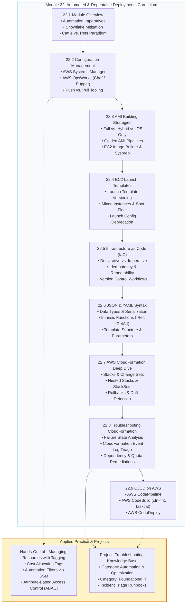
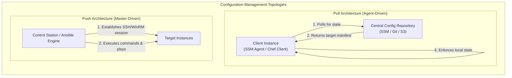
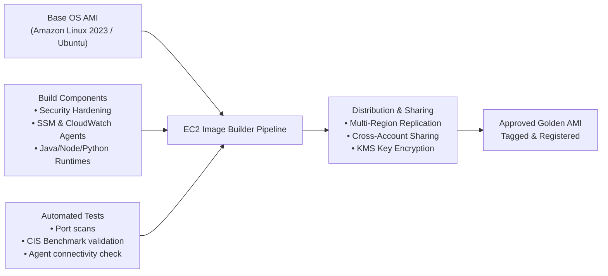
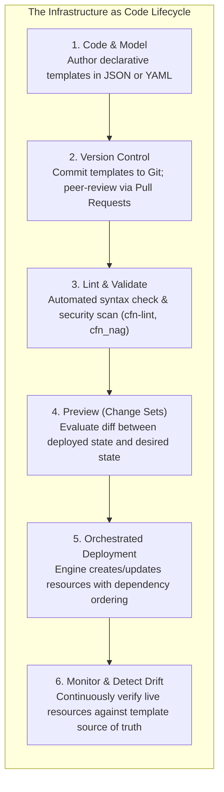
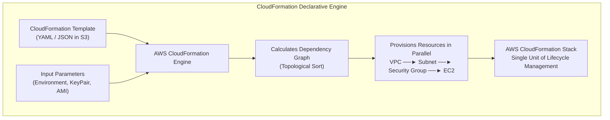
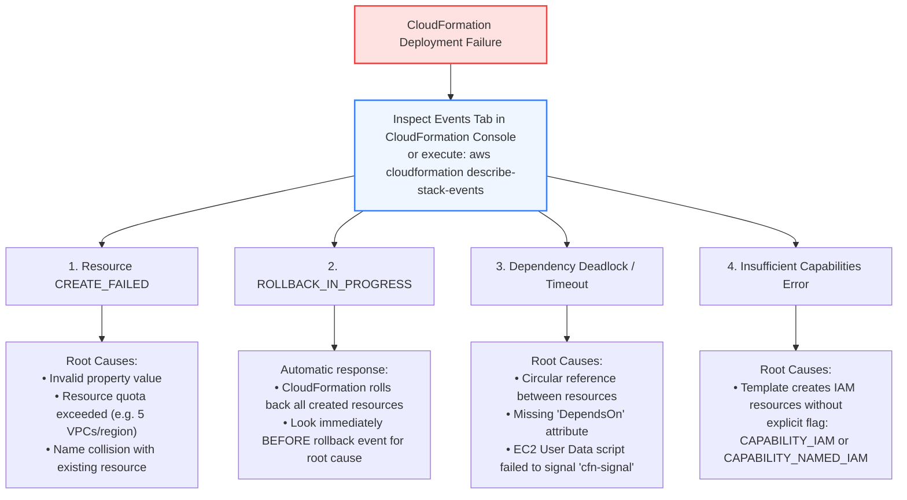

# 🚀 Module 13 / 22: Automated and Repeatable Deployments Overview – Study Guide

> **Course**: AWS re/Start  
> **Module**: Automated and Repeatable Deployments  
> **Source Document**: `T22-0001-RSJAWS_EN-US_SG_M13_AUTOMATEREPEATDEPLOYOVERVIEW.pdf`  
> **Target Audience**: AWS re/Start Learners / Cloud Practitioners / DevOps Engineers / SysOps Administrators / Solutions Architects  

---

## 🎯 Module Overview: The Imperatives of Automation in Cloud Infrastructure

In traditional on-premises data centers, infrastructure deployment was notoriously manual, error-prone, and slow. Systems administrators manually racked physical chassis, cabled network switches, installed operating systems from physical media, and hand-crafted system configuration files across individual servers. This manual approach fostered severe architectural challenges:

- **Snowflake Servers**: Every server acquired unique, undocumented configurations, custom patches, and subtle environmental drift over time. No two production instances were identical.
- **Configuration Drift**: Over weeks and months, manual updates and emergency hotfixes applied directly to production hosts caused the actual state of running servers to diverge from written architectural documentation.
- **Human Error & High Blast Radius**: Fat-fingered commands, missing deployment steps, and typo-ridden shell scripts led to unexpected service outages and prolonged downtime.
- **Crippled Deployment Velocity & Disastrous Recovery Time**: Provisioning new environments took weeks or months, and restoring services following an Availability Zone or data center outage was agonizingly slow and risky.

```
┌────────────────────────────────────────────────────────────────────────────────────────────────────────┐
│                              The Cloud Paradigm Shift: Cattle vs. Pets                                 │
├─────────────────────────────────────────────────┬──────────────────────────────────────────────────────┤
│               Traditional "Pets" Model          │               Cloud-Native "Cattle" Model            │
├─────────────────────────────────────────────────┼──────────────────────────────────────────────────────┤
│ • Servers are given unique, bespoke names       │ • Servers are ephemeral, identical, numbered nodes   │
│ • Hand-crafted, nursed back to health on failure│ • Automatically replaced when unhealthy or degraded  │
│ • Long lifespans (months to years)              │ • Short lifespans (hours to days; auto-scaled)       │
│ • Manual changes made directly in production    │ • Immutable infrastructure: rebuild rather than patch│
│ • High risk during disaster recovery            │ • Deterministic, code-driven disaster recovery       │
└─────────────────────────────────────────────────┴──────────────────────────────────────────────────────┘
```

Modern cloud engineering demands **automated, repeatable, and consistent deployments**. By treating infrastructure as software—governed by source control, automated testing pipelines, and declarative template engines—cloud architects eliminate manual toil and achieve **operational excellence**, **elastic scalability**, and **rapid mean time to recovery (MTTR)**.

AWS provides a robust suite of native services and frameworks designed to turn infrastructure provisioning and configuration management into deterministic, code-driven processes. This module synthesizes the core principles, tooling, and operational runbooks required to build and maintain production-grade automated deployment pipelines on Amazon Web Services.

---

### 📌 Learning Objectives

- [ ] **Analyze Cloud Deployment Challenges**: Contrast manual infrastructure provisioning with automated deployment models; evaluate the risks of configuration drift, human error, and snowflake servers.
- [ ] **Identify AWS Configuration Management Services**: Evaluate the capabilities and architectural roles of AWS Systems Manager, AWS OpsWorks, Amazon CloudWatch, and AWS CloudFormation.
- [ ] **Formulate Amazon Machine Image (AMI) Strategies**: Compare Full AMIs, Hybrid AMIs, and OS-only AMIs across build duration, boot velocity, maintenance overhead, and operational resilience.
- [ ] **Architect Amazon EC2 Launch Templates**: Configure version-controlled, reusable launch parameters, mixed instance policies, and spot instance integrations for Amazon EC2 Auto Scaling groups.
- [ ] **Define Infrastructure as Code (IaC) Fundamentals**: Explain declarative vs. imperative modeling, idempotency, version control integration, and infrastructure lifecycle automation.
- [ ] **Master JSON and YAML for AWS CloudFormation**: Construct syntactically valid CloudFormation templates, parse complex nested structures, and apply intrinsic functions (`!Ref`, `!GetAtt`, `!Sub`, `!Join`, `!FindInMap`).
- [ ] **Execute CloudFormation Stacks & Change Sets**: Author modular CloudFormation templates, deploy single and nested stacks, preview infrastructure modifications with Change Sets, and detect out-of-band drift.
- [ ] **Troubleshoot CloudFormation Failure Modes**: Diagnose stack execution states (`CREATE_FAILED`, `ROLLBACK_IN_PROGRESS`, `ROLLBACK_COMPLETE`), inspect stack event streams, and remediate dependency deadlocks, quota limits, and IAM permission deficits.
- [ ] **Construct Cloud-Native CI/CD Pipelines**: Orchestrate automated infrastructure delivery pipelines using AWS CodePipeline, AWS CodeBuild, and AWS CodeDeploy alongside automated linters (`cfn-lint`) and integration test suites.
- [ ] **Integrate the Troubleshooting Knowledge Base**: Formulate concrete, enterprise-grade incident runbooks for the **Automation & Optimization** and **Foundational IT** categories.

---

## 🗺️ Module 22 Curriculum Roadmap & Progression

The following flowchart outlines the structural progression through the **Automated and Repeatable Deployments** curriculum, showing how foundational configuration concepts evolve into automated image pipelines, declarative template authoring, robust error triage, and automated CI/CD pipelines:



---

## 🔍 Core Module Roadmap & Themes

```
┌──────────────────────────────────────────────────────────────────────────────────────────────────┐
│                           Core Module Pillars & Architectural Coverage                           │
├───────────────────────┬────────────────────────┬────────────────────────┬────────────────────────┤
│ 1. Configuration Mgmt │ 2. Machine Images      │ 3. Template Definition │ 4. Delivery Pipelines  │
├───────────────────────┼────────────────────────┼────────────────────────┼────────────────────────┤
│ • Systems Manager     │ • Full / Golden AMI    │ • JSON & YAML Syntax   │ • AWS CodePipeline     │
│ • AWS OpsWorks        │ • Hybrid AMI           │ • CloudFormation Stacks│ • AWS CodeBuild        │
│ • CloudWatch & SSM    │ • OS-Only / Bootstrap  │ • Launch Templates     │ • AWS CodeDeploy       │
│ • Configuration Drift │ • Image Builder        │ • Change Sets & Drift  │ • cfn-lint & taskcat   │
└───────────────────────┴────────────────────────┴────────────────────────┴────────────────────────┘
```

---

### 1. Configuration Management in the Cloud

**Configuration Management (CM)** is the systems engineering practice of establishing and maintaining the consistency of a product's performance, functional, and physical attributes with its requirements, design, and operational information throughout its lifecycle.

In cloud environments, configuration management solves three fundamental problems:
1. **Manual Snowflake Architectures**: Without CM, individual servers receive ad-hoc hotfixes, making them impossible to clone or recreate during an outage.
2. **Configuration Drift**: Over time, software packages, security patches, environment variables, and daemon settings diverge across servers that are supposed to be identical.
3. **Audit and Compliance Blind Spots**: Security teams cannot verify whether all servers comply with baseline security benchmarks (e.g., CIS benchmarks, patch levels) without automated state validation.



#### AWS Configuration Management Services

| AWS Service | Operating Model | Primary Use Cases | Key Differentiators |
| :--- | :--- | :--- | :--- |
| **AWS Systems Manager (SSM)** | Agent-based (Pull / Event-driven via SSM Agent) | OS patching, fleet-wide configuration management, remote command execution, secrets management | Native AWS integration; requires no open inbound SSH/RDP ports; includes State Manager, Run Command, and Parameter Store. |
| **AWS OpsWorks** | Managed Chef Automate and Puppet Enterprise | Enterprise configuration management using existing Chef cookbooks or Puppet manifests | Fully managed Chef/Puppet servers; ideal for migrating existing on-premises Chef/Puppet recipes to AWS. |
| **AWS CloudFormation** | Cloud-native declarative engine | Resource provisioning and orchestration of AWS cloud infrastructure | Manages the lifecycle of AWS resources (VPCs, EC2, RDS, IAM); delegates in-guest OS configuration to SSM or user data. |
| **Amazon CloudWatch** | Telemetry agent and event orchestrator | Monitoring instance metrics, log streaming, and triggering automated remediation | Pairs with Systems Manager Automation runbooks to self-heal degraded instances based on CloudWatch Alarms. |

> [!NOTE]
> Modern cloud architecture strongly favors **AWS Systems Manager State Manager** and **SSM Run Command** over traditional SSH-bastion access. SSM uses an outbound HTTPS channel (TCP port 443) to communicate with the Systems Manager service endpoint, completely eliminating the need for public IP addresses or open inbound security group rules.

---

### 2. AMI Building Strategies: Full vs. Hybrid vs. OS-Only

An **Amazon Machine Image (AMI)** provides the blueprint required to launch an EC2 instance. It packages the root volume template (operating system, packages, and architecture), launch permissions, and block device mapping. Choosing an AMI building strategy dictates the balance between **instance boot time** and **maintenance agility**.

```
┌──────────────────────────────────────────────────────────────────────────────────────────────────┐
│                                 AMI Architectural Strategy Spectrum                             │
├───────────────────────────────┬──────────────────────────────────┬───────────────────────────────┤
│       1. Full (Golden) AMI    │          2. Hybrid AMI           │       3. OS-Only (Vanilla)    │
├───────────────────────────────┼──────────────────────────────────┼───────────────────────────────┤
│ • OS, runtime, and app baked  │ • OS, runtimes, agents baked     │ • Bare AWS base OS only       │
│ • Zero launch-time installs   │ • Application pulled at boot     │ • Everything installed via    │
│ • Blazing launch speed (<2m)  │ • Balanced launch speed (2–5m)   │   User Data / bootstrap script│
│ • Frequent rebuilds required  │ • Rebuilt only on OS/runtime upd │ • Slowest launch speed (>10m) │
└───────────────────────────────┴──────────────────────────────────┴───────────────────────────────┘
```

#### Comprehensive Strategy Comparison

| Evaluation Metric | Full AMI ("Golden AMI") | Hybrid AMI | OS-Only AMI ("Vanilla") |
| :--- | :--- | :--- | :--- |
| **Launch Speed (Boot Velocity)** | **Fastest** (~1–2 minutes). No external dependencies or package downloads at launch. | **Moderate** (~3–5 minutes). Base runtime is ready; downloads only the latest code artifact. | **Slowest** (~8–15+ minutes). Must download OS updates, language runtimes, libraries, and application. |
| **Build & Pipeline Complexity** | **Highest**. Requires continuous CI/CD pipelines to build, test, and distribute AMIs on every code commit. | **Moderate**. Base AMIs built monthly; application artifacts deployed dynamically via CI/CD. | **Lowest**. No AMI build pipeline required; relies entirely on bash/PowerShell user data scripts. |
| **External Dependency Risk** | **Zero at launch**. Fully self-contained. Cannot fail due to an external apt/yum repository outage. | **Low**. Dependent only on internal code repositories (e.g., Amazon S3 or CodeArtifact). | **High**. Vulnerable to external repository downtime, network timeouts, or breaking upstream package changes. |
| **Auto Scaling Responsiveness** | **Superior**. Rapid scale-out allows immediate reaction to sudden traffic spikes. | **Good**. Acceptable for most predictable workloads. | **Poor**. Slow instance readiness can cause traffic saturation during sudden scale events. |
| **Maintenance Cadence** | High rebuild frequency (every deployment creates a new AMI). | Moderate rebuild frequency (monthly for security/OS patches). | Low AMI maintenance; high bootstrap script maintenance. |

#### Automated Golden AMI Pipelines: EC2 Image Builder

In enterprise environments, manual AMI generation via the AWS Management Console is forbidden due to human error and lack of traceability. Instead, organizations deploy **EC2 Image Builder** or open-source tools like HashiCorp Packer:



> [!IMPORTANT]
> When building **Microsoft Windows AMIs**, administrators must execute **Sysprep** (`EC2Launch` or `EC2Launch v2`) prior to capturing the AMI. Sysprep strips unique machine security identifiers (SIDs), computer names, and driver bindings, ensuring that every EC2 instance launched from the resulting AMI receives a unique SID and avoids network identifier collisions in Active Directory.

---

### 3. Amazon EC2 Launch Templates

An **Amazon EC2 Launch Template** is an AWS resource that specifies instance configuration parameters in a single, reusable, and version-controlled definition.

#### Why Launch Templates Replaced Launch Configurations

Historically, Amazon EC2 Auto Scaling utilized **Launch Configurations**. Launch Configurations were **immutable** (they could not be edited or versioned) and lacked support for modern EC2 innovations. AWS officially deprecated Launch Configurations in favor of Launch Templates.

| Feature / Capability | Launch Templates (Current Standard) | Launch Configurations (Deprecated) |
| :--- | :--- | :--- |
| **Versioning & Inheritance** | **Yes** (supports multiple numeric versions, default/latest pointers, and template inheritance). | **No** (immutable; any change required authoring an entirely new configuration). |
| **Mixed Instances & Spot Fleets** | **Supported** (mix instance types, On-Demand, and Spot within a single Auto Scaling group). | **Not Supported** (restricted to a single instance type and purchasing model). |
| **T2/T3 Unlimited Burstable Credits** | **Supported** | **Not Supported** |
| **Elastic Graphics & Dedicated Hosts** | **Supported** | **Not Supported** |
| **EBS Volume Tagging at Creation** | **Supported** (tags applied atomically at launch). | **Limited** (tags often applied post-launch). |
| **Standalone Launching** | **Yes** (can launch standalone EC2 instances directly via Console, CLI, or SDK). | **No** (only usable within Auto Scaling groups). |

#### Launch Template Versioning Mechanics

```
┌────────────────────────────────────────────────────────────────────────────────────────┐
│                        Launch Template Versioning Architecture                         │
├────────────────────────────────────────────────────────────────────────────────────────┤
│  Template ID: lt-0a1b2c3d4e5f6g7h8                                                    │
│                                                                                        │
│  Version 1: t3.micro | ami-11111111 | UserData v1                                      │
│  Version 2: t3.small | ami-22222222 | UserData v2  ◄─── $Default (Production Stable)   │
│  Version 3: t3.medium| ami-33333333 | UserData v3  ◄─── $Latest  (Staging / Dev)       │
│                                                                                        │
│  Auto Scaling Policy Pointer:                                                          │
│  • Production ASG ──► Configured to use "$Default" version (V2)                        │
│  • Canary / Dev ASG ──► Configured to use "$Latest" version (V3)                       │
└────────────────────────────────────────────────────────────────────────────────────────┘
```

- **Immutable Iterations**: Once created, a version of a launch template cannot be edited. To update a parameter, you create a new version based on an existing version.
- **`$Default` vs. `$Latest`**: You can explicitly designate which version serves as the default. Auto Scaling groups can reference `$Default` (ensuring production stability) or `$Latest` (ensuring automatic adoption of newly published template versions).

---

### 4. Infrastructure as Code (IaC) Foundations

**Infrastructure as Code (IaC)** is the architectural paradigm of defining, provisioning, configuring, and managing computing infrastructure through machine-readable definition files, rather than through physical hardware configuration or interactive configuration tools.



#### Declarative vs. Imperative Infrastructure Modeling

| Dimension | Declarative (e.g., AWS CloudFormation, Terraform) | Imperative (e.g., AWS CLI, Python Boto3, Bash) |
| :--- | :--- | :--- |
| **Core Concept** | Defines **WHAT** the end-state infrastructure should look like. | Defines **HOW** to build the infrastructure step-by-step. |
| **Execution Responsibility** | The orchestration engine determines the dependency graph, provisioning order, and API calls. | The engineer writes the exact procedural logic, error handling, retries, and ordering. |
| **Idempotency** | **Guaranteed**. Applying the same template multiple times results in the exact same infrastructure state. | **Manual**. Scripts must be painstakingly coded with logic checks (e.g., `if bucket exists, skip creation`). |
| **State Tracking** | Automated state management and rollback capabilities. | Manual state tracking; partial failures leave orphaned resources. |
| **Skill Requirement** | Focuses on domain modeling, schema structure, and parameters. | Requires full procedural programming proficiency and API error handling. |

> [!TIP]
> The fundamental tenet of IaC is **idempotency**: executing an operation multiple times produces the exact same result as executing it once. Declarative IaC engines like AWS CloudFormation automatically guarantee idempotency by calculating the delta between the requested state and the active environment.

---

### 5. Data Serialization: JSON and YAML for CloudFormation

AWS CloudFormation supports templates authored in two data serialization languages: **JSON (JavaScript Object Notation)** and **YAML (YAML Ain't Markup Language)**.

#### Comparative Evaluation: JSON vs. YAML

```
┌────────────────────────────────────────────────────────────────────────────────────────┐
│                                 Syntax Comparison Overview                             │
├───────────────────────────────────────┬────────────────────────────────────────────────┤
│       JSON (Data-Interchange)         │             YAML (Human-Optimized)             │
├───────────────────────────────────────┼────────────────────────────────────────────────┤
│ {                                     │ Resources:                                     │
│   "Resources": {                      │   AppBucket:                                   │
│     "AppBucket": {                    │     Type: AWS::S3::Bucket                      │
│       "Type": "AWS::S3::Bucket",      │     Properties:                                │
│       "Properties": {                 │       BucketName: !Sub "${AWS::StackName}-data"│
│         "BucketName": {               │       VersioningConfiguration:                 │
│           "Fn::Sub":                  │         Status: Enabled                        │
│             "${AWS::StackName}-data"  │                                                │
│         }                             │                                                │
│       }                               │                                                │
│     }                                 │                                                │
│   }                                   │                                                │
│ }                                     │                                                │
└───────────────────────────────────────┴────────────────────────────────────────────────┘
```

| Criteria | JSON | YAML |
| :--- | :--- | :--- |
| **Human Readability** | Moderate. Cluttered by verbose brackets (`{}`), quotes, and commas. | **High**. Clean, minimalist syntax using whitespace indentation. |
| **Comments Support** | **No**. Standard JSON strictly forbids comments. | **Yes**. Supports inline comments (`#`), essential for documentation. |
| **Intrinsic Function Syntax** | Requires verbose dictionary syntax (e.g., `{"Fn::GetAtt": ["Server", "PublicIp"]}`). | Supports concise short-form notation (e.g., `!GetAtt Server.PublicIp` or `!Ref MyVPC`). |
| **Formatting Sensitivity** | Whitespace-insensitive; strict matching of brackets and commas. | Strictly indentation-sensitive (spaces only; tabs are illegal). |
| **Tooling & Programmatic Parsing** | Universal support across all programming languages and CLI tools. | Supported across modern languages; easier for human authoring. |

#### CloudFormation Intrinsic Functions Reference

Intrinsic functions enable template authors to dynamically assign values to properties that are not known until runtime:

| Function | Standard (Full) Syntax | YAML Short-Form | Purpose & Architectural Example |
| :--- | :--- | :--- | :--- |
| **Ref** | `{"Ref": "LogicalId"}` | `!Ref LogicalId` | Returns the value of a parameter or the physical ID of a resource (e.g., `!Ref VPCID` or `!Ref WebServerInstance`). |
| **Fn::GetAtt** | `{"Fn::GetAtt": ["Resource", "Attribute"]}` | `!GetAtt Resource.Attribute` | Retrieves an attribute value from a resource (e.g., `!GetAtt WebServer.PublicIp` or `!GetAtt LoadBalancer.DNSName`). |
| **Fn::Sub** | `{"Fn::Sub": "String ${Var}"}` | `!Sub "String ${Var}"` | Substitutes variables inside a string (e.g., `!Sub "arn:aws:s3:::${AWS::AccountId}-${Env}-bucket"`). |
| **Fn::Join** | `{"Fn::Join": [":", ["a", "b"]]}` | `!Join [":", ["a", "b"]]` | Appends a set of values delimited by a specified separator. |
| **Fn::FindInMap** | `{"Fn::FindInMap": ["Map", "Top", "Sub"]}` | `!FindInMap [Map, Top, Sub]` | Looks up static configuration data mapped by Region, environment, or instance type. |
| **Fn::Select** | `{"Fn::Select": ["Index", ["a", "b"]]}` | `!Select [0, !GetAZs ""]` | Returns a single item from a list of objects by index number. |
| **Fn::ImportValue** | `{"Fn::ImportValue": "ExportedName"}` | `!ImportValue ExportedName` | Imports a cross-stack output value exported by another stack in the same Region. |

---

### 6. AWS CloudFormation Deep Dive

AWS CloudFormation gives you an easy way to model a collection of related AWS and third-party resources, provision them quickly and consistently, and manage them throughout their lifecycles.



#### The Anatomical Sections of a CloudFormation Template

A CloudFormation template consists of nine top-level sections. **`Resources` is the only mandatory section**:

```yaml
AWSTemplateFormatVersion: "2010-09-09" # Capabilities version (currently only 2010-09-09)
Description: "Production Multi-Tier Web Application Infrastructure"

Metadata: # Arbitrary JSON/YAML objects providing supplemental info (e.g., AWS::CloudFormation::Interface)
  AWS::CloudFormation::Interface:
    ParameterGroups:
      - Label: { default: "Network Configuration" }
        Parameters: [ VpcCIDR, EnvironmentType ]

Parameters: # Dynamic input values supplied at stack creation/update time (max 200 parameters)
  EnvironmentType:
    Type: String
    Default: "production"
    AllowedValues: ["development", "staging", "production"]
    Description: "Deployment stage environment"

Mappings: # Static lookup tables matching key-value pairs (e.g., AMI mappings per region)
  RegionMap:
    us-east-1:
      HVM64: "ami-0c55b159cbfafe1f0"
    us-west-2:
      HVM64: "ami-0cb72367e98845d43"

Conditions: # Boolean evaluation rules determining whether specific resources are created
  IsProduction: !Equals [ !Ref EnvironmentType, "production" ]

Transform: # Macros or AWS Serverless Application Model (SAM) declarations
  - "AWS::Serverless-2016-10-31"

Resources: # MANDATORY: Declares the actual AWS resources to provision (max 500 resources)
  ProductionBucket:
    Type: "AWS::S3::Bucket"
    Properties:
      BucketName: !Sub "${AWS::StackName}-storage-${AWS::AccountId}"
      VersioningConfiguration:
        Status: !If [ IsProduction, "Enabled", "Suspended" ]

Outputs: # Exported values available in Console, CLI, or for cross-stack references
  BucketARN:
    Description: "ARN of the S3 storage bucket"
    Value: !GetAtt ProductionBucket.Arn
    Export:
      Name: !Sub "${AWS::StackName}-BucketARN"
```

#### Stacks, Change Sets, and Governance Features

- **Stacks**: A single unit of management. Creating, updating, or deleting a stack provisions, updates, or destroys all resources defined within the stack.
- **Nested Stacks**: Stacks created as part of other stacks using the `AWS::CloudFormation::Stack` resource. Enables modular, reusable infrastructure components (e.g., a shared VPC stack referenced by separate application stacks).
- **AWS CloudFormation StackSets**: Extends stack management across multiple AWS accounts and multiple AWS Regions with a single template and deployment operation. Essential for enterprise organization-wide baselines (e.g., security guardrails, IAM roles).
- **Change Sets**: A dry-run preview of proposed changes. Generating a Change Set allows engineers to view which resources will be added, modified, or deleted—and whether modifications will trigger **resource replacement** (which destroys and recreates the resource, causing downtime or data loss)—before executing the update.
- **Drift Detection**: CloudFormation detects out-of-band modifications made directly to resources via the AWS Management Console, CLI, or SDK, identifying divergence between active resource state and template state.
- **Termination Protection**: Prevents accidental stack deletion. If enabled, a stack cannot be deleted until termination protection is explicitly disabled.

---

### 7. Troubleshooting AWS CloudFormation

Deploying complex distributed infrastructure through CloudFormation can encounter errors during creation, updating, or deletion. Rapid resolution requires understanding the CloudFormation state engine and its event logging mechanisms.

```
┌────────────────────────────────────────────────────────────────────────────────────────┐
│                        CloudFormation Failure State Machine Flow                       │
├────────────────────────────────────────────────────────────────────────────────────────┤
│                                                                                        │
│   [CREATE_IN_PROGRESS] ───► Resource Fails ───► [CREATE_FAILED]                       │
│                                                        │                               │
│                                                        ▼                               │
│   [ROLLBACK_COMPLETE] ◄── All Cleaned Up ◄─── [ROLLBACK_IN_PROGRESS]                   │
│          ▲                                                                             │
│          └─ Stack cannot be updated; must be deleted and recreated!                   │
│                                                                                        │
│   [UPDATE_IN_PROGRESS] ───► Resource Fails ───► [UPDATE_ROLLBACK_IN_PROGRESS]          │
│                                                        │                               │
│                                                        ▼                               │
│                                                 [UPDATE_ROLLBACK_COMPLETE]             │
│                                                        │                               │
│                                                        └─ Reverts to prior stable state│
└────────────────────────────────────────────────────────────────────────────────────────┘
```

#### Common Error Manifestations & Root Cause Analysis



#### Step-by-Step Triage Methodology

1. **Locate the First Failure in the Events Stream**:
   - In the CloudFormation Console or CLI, sort events in chronological order.
   - Do **not** look at the top event (`ROLLBACK_COMPLETE`); scroll down to find the **very first `CREATE_FAILED` or `UPDATE_FAILED` status reason**.
2. **Examine the Resource Status Reason**:
   - The `Status Reason` field provides the exact API failure message returned by the underlying AWS service (e.g., `The CIDR '10.0.0.0/16' is invalid` or `Account has exceeded maximum number of Elastic IPs`).
3. **Check IAM Role & Permissions**:
   - Verify whether the deployment entity (the user, CLI identity, or CloudFormation Service Role) has permission to invoke `ec2:RunInstances`, `s3:CreateBucket`, etc.
   - If the template defines IAM roles, policies, or users, ensure the deployment command includes `--capabilities CAPABILITY_IAM CAPABILITY_NAMED_IAM`.
4. **Inspect User Data & WaitCondition Signals**:
   - If an EC2 instance fails with `WaitCondition timed out. Received 0 conditions when expecting 1`:
     - SSH/SSM into the instance and inspect `/var/log/cloud-init-output.log` and `/var/log/cfn-wire.log`.
     - Verify whether `/opt/aws/bin/cfn-signal` was executed successfully within the allotted timeout window.
5. **Disable Rollback for Interactive Debugging**:
   - When deploying via the AWS CLI or Console for troubleshooting, configure `--disable-rollback` (or select "Preserve successfully provisioned resources").
   - This keeps the failed stack and its active resources running, allowing engineers to connect to instances, view OS logs, and analyze the failure state directly.

> [!CAUTION]
> If a stack is created with default settings and fails, it enters `ROLLBACK_COMPLETE`. In `ROLLBACK_COMPLETE`, the stack **cannot be updated**. You must delete the stack and deploy a new one after fixing the template error. If an update fails, it enters `UPDATE_ROLLBACK_COMPLETE`, returning to its previous working state—allowing you to fix the template and update again.

---

### 8. Continuous Integration and Continuous Delivery (CI/CD) on AWS

Automating infrastructure deployment requires wrapping IaC templates in a continuous integration and continuous delivery (CI/CD) pipeline. Instead of running `aws cloudformation deploy` from an administrator workstation, changes are committed to a Git repository, tested automatically, and deployed through managed stages.

```mermaid
sequenceDiagram
    autonumber
    actor Dev as Cloud Engineer
    participant Git as AWS CodeCommit / GitHub
    participant Pipe as AWS CodePipeline
    participant Build as AWS CodeBuild (Lint & Test)
    participant Staging as AWS CloudFormation (Staging Stack)
    participant Prod as AWS CloudFormation (Production Stack)

    Dev->>Git: git push feature/add-database
    Git->>Pipe: Webhook triggers pipeline execution
    Pipe->>Build: Execute cfn-lint, cfn_nag & taskcat
    alt Lint / Security Test Fails
        Build-->>Pipe: Build Status: FAILED
        Pipe-->>Dev: Pipeline halted; notification sent via SNS
    else Tests Pass
        Build-->>Pipe: Build Status: SUCCESS
        Pipe->>Staging: Deploy Staging Stack & run integration tests
        Staging-->>Pipe: Staging Validation Passed
        Pipe->>Prod: Create Change Set on Production Stack
        Note over Pipe,Prod: Manual Approval Gate / Production Smoke Test
        Pipe->>Prod: Execute Change Set (Atomic Update)
        Prod-->>Dev: Deployment COMPLETE
    end
```

#### AWS Developer Tools Suite for Infrastructure CI/CD

- **AWS CodeCommit**: Secure, highly scalable source control service hosting private Git repositories (or integration with GitHub/GitLab).
- **AWS CodeBuild**: Fully managed continuous integration service that compiles code, runs static analysis tests, and generates deployment packages:
  - `cfn-lint`: Lints CloudFormation YAML/JSON against the official AWS Resource Specification to catch syntax and property errors before deployment.
  - `cfn_nag`: Scans templates for security vulnerabilities (e.g., overly permissive security groups with `0.0.0.0/0`, unencrypted S3 buckets).
  - `taskcat`: Tests CloudFormation templates across multiple AWS Regions simultaneously.
- **AWS CodeDeploy**: Automates application deployments to Amazon EC2, AWS Fargate, AWS Lambda, or on-premises servers, supporting rolling, blue/green, and canary deployments.
- **AWS CodePipeline**: Orchestrates the workflow steps (Source $\rightarrow$ Build/Test $\rightarrow$ Staging $\rightarrow$ Approval $\rightarrow$ Production Deploy), ensuring that infrastructure changes pass through automated quality gates.

---

## 🧪 Lab Integration: Managing Resources with Tagging

The hands-on lab in this module focuses on **Managing Resources with Tagging**. Tagging is the bedrock of cloud automation, governance, and cost management.

```
┌────────────────────────────────────────────────────────────────────────────────────────┐
│                               The Four Pillars of Cloud Tagging                        │
├───────────────────────┬────────────────────────┬───────────────────────┬───────────────┤
│    Cost Allocation    │   Automation & Ops     │   Security & Access   │   Governance  │
├───────────────────────┼────────────────────────┼───────────────────────┼───────────────┤
│ • CostCenter: 1042    │ • BackupPlan: Daily    │ • DataClass: Confid.  │ • Owner: team │
│ • Environment: Prod   │ • AutoStop: 1900UTC    │ • ABAC Policies       │ • AppID: 8821 │
│ • Project: Redshift   │ • PatchGroup: Linux-01 │ • ComplScope: PCI-DSS │ • Version: 2.1│
└───────────────────────┴────────────────────────┴───────────────────────┴───────────────┘
```

### Strategic Value of Tagging in Automated Deployments

1. **Targeting by Configuration Management**: Tools like AWS Systems Manager State Manager and Maintenance Windows target instances using resource tags (e.g., `PatchGroup=Linux-Web-Prod`), rather than hardcoding instance IDs.
2. **Attribute-Based Access Control (ABAC)**: IAM policies evaluate resource tags using condition keys like `aws:ResourceTag/Environment == aws:PrincipalTag/Environment`, allowing fine-grained permissions without policy bloat.
3. **Automated Resource Lifecycles**: Lambda functions and Systems Manager Automation runbooks parse tags to automatically stop development instances overnight or invoke Amazon Data Lifecycle Manager (DLM) backup snapshots.
4. **CloudFormation Propagation**: CloudFormation stacks automatically propagate stack-level tags down to all supported resources created within the stack, ensuring complete cost tracking.

---

## 🛠️ Troubleshooting Knowledge Base Project Integration

As part of the ongoing course project, learners populate **The Troubleshooting Knowledge Base**. This module focuses on entries under the **Automation & Optimization** and **Foundational IT** categories.

### Knowledge Base Incident Triage Matrix

```
┌──────────────────────────────────────────────────────────────────────────────────────────────────────────────────────┐
│                                 Troubleshooting Knowledge Base: Quick Reference                                      │
├──────────────────────────┬─────────────────────────────┬─────────────────────────────────────────────────────────────┤
│ Category                 │ Incident Scenario           │ Primary Root Cause & Remediation                            │
├──────────────────────────┼─────────────────────────────┼─────────────────────────────────────────────────────────────┤
│ Automation & Optimization│ CloudFormation Stack Rollback│ Subnet CIDR collision; verify VPC CIDR and delete/redeploy  │
│ Automation & Optimization│ EC2 WaitCondition Timeout   │ cfn-signal failed or missing; check cloud-init-output.log   │
│ Automation & Optimization│ Out-of-Band Config Drift    │ Manual console edit; run Drift Detection & update template  │
│ Foundational IT          │ Systems Manager Agent Stalled│ Missing IAM instance profile role (AmazonSSMManagedInstance) │
│ Foundational IT          │ Sysprep Generalize Failure  │ BitLocker enabled or Windows store apps; clean appx packages│
└──────────────────────────┴─────────────────────────────┴─────────────────────────────────────────────────────────────┘
```

#### Incident Runbook 1: CloudFormation Stack Creation Failure & Rollback

- **Category**: Automation & Optimization
- **Problem Statement**: Executing `aws cloudformation create-stack` fails after 4 minutes with `ROLLBACK_IN_PROGRESS` and leaves the stack in `ROLLBACK_COMPLETE`.
- **Symptoms**:
  - The stack status displays `ROLLBACK_COMPLETE`.
  - Underlying resources (VPC, Subnets) were created and then deleted automatically.
- **Diagnostic Triage**:
  ```bash
  # 1. Retrieve the exact failure event from the stack event history
  aws cloudformation describe-stack-events \
    --stack-name ProductionAppStack \
    --query 'StackEvents[?ResourceStatus==`CREATE_FAILED`].[LogicalResourceId,ResourceType,ResourceStatusReason]' \
    --output table
  ```
- **Root Cause**: The subnet resource attempted to allocate CIDR `10.0.1.0/24`, but collided with an existing route table association in a peered VPC, triggering `InvalidSubnet.Conflict`.
- **Remediation**:
  1. Fix the IP CIDR block parameter in the template or parameter file.
  2. Because the stack is in `ROLLBACK_COMPLETE`, execute `aws cloudformation delete-stack --stack-name ProductionAppStack`.
  3. Reissue `aws cloudformation create-stack` with corrected parameters.
- **Prevention Best Practice**: Implement an automated pre-deployment check using `cfn-lint` and reserve subnet address allocations through an IP Address Management (IPAM) solution or VPC IPAM.

---

#### Incident Runbook 2: EC2 Instance Fails to Signal CloudFormation (`WaitCondition Timeout`)

- **Category**: Automation & Optimization
- **Problem Statement**: CloudFormation stack creation hangs on resource `ApplicationWaitCondition` for 15 minutes before timing out with `WaitCondition timed out. Received 0 conditions when expecting 1`.
- **Symptoms**:
  - EC2 instance is in `running` state in EC2 console, but CloudFormation rolls back.
  - Instance is terminated during rollback, erasing local log files.
- **Diagnostic Triage**:
  1. Re-deploy the stack with `--disable-rollback` flag to preserve the failed EC2 instance for inspection.
  2. Connect to the running instance via AWS Systems Manager Session Manager.
  3. Review the cloud initialization logs:
     ```bash
     sudo cat /var/log/cloud-init-output.log
     sudo cat /var/log/cfn-wire.log
     ```
- **Root Cause**: The bash script inside the `UserData` section encountered a 403 Forbidden error when downloading an application dependency from Amazon S3, halting script execution before reaching the `/opt/aws/bin/cfn-signal` command.
- **Remediation**:
  1. Grant the EC2 Instance Profile IAM role read permissions to the target S3 bucket (`s3:GetObject`).
  2. Add error trapping and ensure `cfn-signal` sends an explicit exit code status:
     ```bash
     /opt/aws/bin/cfn-signal -e $? --stack ${AWS::StackName} --resource ApplicationWaitCondition --region ${AWS::Region}
     ```
- **Prevention Best Practice**: Always set `set -e` or capture exit codes in User Data scripts, and configure the EC2 instance profile with least-privilege IAM permissions before provisioning.

---

#### Fillable Student Runbook Template

```markdown
### 📝 Knowledge Base Entry: [Incident Title]

- **Date / Author**: [YYYY-MM-DD / Name]
- **Category**: [ ] Automation & Optimization  |  [ ] Foundational IT  |  [ ] Security & Compliance
- **Affected Services**: [e.g., CloudFormation / Systems Manager / EC2 / CodePipeline]
- **Severity**: [ ] Low  |  [ ] Medium  |  [ ] High  |  [ ] Critical

#### 1. Symptom & Impact Description
[Describe what failed, error codes observed, and business impact]

#### 2. Diagnostic Steps & CLI Verification Commands
```bash
# Diagnostic commands executed:
[Insert commands here]
```

#### 3. Root Cause Analysis (RCA)
[Detail why the failure occurred]

#### 4. Remediation Action Taken
[Step-by-step fix applied to resolve the issue]

#### 5. Long-Term Preventative Controls
[Template linting rules, IAM guardrails, or architectural changes implemented to prevent recurrence]
```

---

## 🧠 Checkpoint Review Questions & In-Depth Explanations

### Question 1: AMI Architecture Selection
An enterprise workload requires sudden scale-out events where hundreds of EC2 instances must be ready to serve production HTTP traffic in under 90 seconds. Downloading and compiling the application runtime takes 12 minutes. Which AMI strategy must the solutions architect select?
- A) OS-only AMI with bootstrap user data scripts
- B) Hybrid AMI with base runtimes and code fetched from GitHub at launch
- C) Full (Golden) AMI containing the pre-installed OS, runtime, and compiled application
- D) Docker containers launched manually via SSH on bare instances

> **Correct Answer: C**  
> **Explanation**: A Full (Golden) AMI has all operating system packages, dependencies, and application binaries baked directly into the image. When an EC2 instance launches from a Full AMI, it requires zero external downloads or installations, reaching operational readiness in 1–2 minutes. Options A and B require downloading dependencies at boot, which violates the 90-second SLA. Option D requires manual intervention, violating automation principles.

---

### Question 2: CloudFormation Rollback Behavior
A junior engineer launches a CloudFormation stack. Midway through provisioning, an Amazon RDS DB instance fails to create due to an invalid subnet group. What will CloudFormation do by default?
- A) Pause and wait indefinitely for the engineer to fix the subnet group via the console
- B) Delete only the failed RDS instance and leave all other resources running
- C) Halt deployment, trigger `ROLLBACK_IN_PROGRESS`, delete all previously created resources in the stack, and terminate in `ROLLBACK_COMPLETE`
- D) Automatically convert the template to JSON and retry the operation

> **Correct Answer: C**  
> **Explanation**: By default, CloudFormation guarantees stack atomicity. If any single resource fails to create during stack creation, CloudFormation rolls back the entire stack (`ROLLBACK_IN_PROGRESS`), deleting all resources provisioned during that execution, and leaves the stack in `ROLLBACK_COMPLETE`. To preserve resources for debugging, the engineer must explicitly enable `--disable-rollback`.

---

### Question 3: Launch Templates vs. Launch Configurations
Why does AWS recommend migrating from Amazon EC2 Launch Configurations to Amazon EC2 Launch Templates?
- A) Launch Templates are cheaper to run per hour than Launch Configurations.
- B) Launch Templates support versioning, template inheritance, and mixed instance policies (On-Demand and Spot) within a single Auto Scaling group.
- C) Launch Configurations can only launch Windows instances, whereas Launch Templates support Linux.
- D) Launch Configurations do not support User Data.

> **Correct Answer: B**  
> **Explanation**: Launch Templates offer significant advantages over deprecated Launch Configurations, including native versioning (`$Default`, `$Latest`), parameter inheritance, standalone EC2 launching, and the ability to configure Auto Scaling groups with mixed instance types and Spot purchasing options. Both support User Data and multiple operating systems, and neither incurs a direct cost (you pay only for underlying EC2 resources).

---

### Question 4: Intrinsic Functions in CloudFormation
You are writing a CloudFormation YAML template and need to reference the Public DNS Name of an Application Load Balancer created earlier in the same template under the logical ID `PublicALB`. Which intrinsic function syntax is valid?
- A) `!Ref PublicALB.DNSName`
- B) `!GetAtt PublicALB.DNSName`
- C) `!Sub "${PublicALB.Value}"`
- D) `!FindInMap [PublicALB, DNSName, Value]`

> **Correct Answer: B**  
> **Explanation**: `!GetAtt` (or `Fn::GetAtt`) is used to retrieve specific attribute values from resources declared in the template. For an Application Load Balancer (`AWS::ElasticLoadBalancingV2::LoadBalancer`), `!GetAtt PublicALB.DNSName` retrieves its public DNS name. `!Ref` on an ALB returns only its ARN, not its DNS name.

---

### Question 5: Infrastructure as Code Pipeline Governance
In an enterprise CI/CD pipeline for CloudFormation, which tool should be run during the AWS CodeBuild stage to identify unencrypted S3 buckets and overly permissive security groups before stack deployment?
- A) `cfn-lint`
- B) `taskcat`
- C) `cfn_nag`
- D) AWS CodeDeploy

> **Correct Answer: C**  
> **Explanation**: `cfn_nag` is an open-source static security analysis tool that scans CloudFormation templates for insecure configurations (such as open ingress security group rules `0.0.0.0/0` and unencrypted storage volumes/buckets). `cfn-lint` validates CloudFormation schema syntax and property types. `taskcat` tests templates across multiple regions. `AWS CodeDeploy` handles application deployments.

---

### Question 6: Configuration Drift Remediation
A security auditor notices that an Amazon EC2 security group has an open SSH port (22) that is not declared in the authoring CloudFormation template. How did this happen, and what CloudFormation feature identifies this mismatch?
- A) A CloudFormation bug; detected by Change Sets
- B) Out-of-band manual configuration drift; detected by CloudFormation Drift Detection
- C) The stack was deployed using an imperative script; detected by `cfn-lint`
- D) Insufficient IAM permissions; detected by AWS CloudTrail

> **Correct Answer: B**  
> **Explanation**: When administrators or scripts modify cloud resources directly through the AWS Management Console, CLI, or SDK rather than updating the CloudFormation template, the live environment diverges from the template definition. This phenomenon is known as **configuration drift**. CloudFormation **Drift Detection** compares the active state of resources against the template's expected properties and reports any discrepancies.

---

## 💡 Key Takeaways & Exam / Interview Readiness

```
┌────────────────────────────────────────────────────────────────────────────────────────────────────────┐
│                                  Top Exam & Interview Concepts Summary                                 │
├─────────────────────────────────┬──────────────────────────────────────────────────────────────────────┤
│ Concept                         │ Core Rule / Architecture Decision                                    │
├─────────────────────────────────┼──────────────────────────────────────────────────────────────────────┤
│ Cattle vs. Pets                 │ Treat cloud instances as disposable cattle; rebuild rather than patch│
│ Golden AMI vs. Bootstrap        │ Golden AMI = fastest boot; Vanilla + Bootstrap = lowest build effort │
│ Launch Templates                │ Supersedes Launch Configurations; supports versioning & mixed fleets │
│ Declarative vs. Imperative      │ Declarative describes WHAT; Imperative scripts HOW                   │
│ CloudFormation Atomicity        │ Stack creation failure triggers full rollback by default             │
│ CloudFormation Change Sets      │ Preview diff & replacement risk before applying stack modifications  │
│ Intrinsic Functions             │ !Ref for resource ID / parameter; !GetAtt for specific attributes    │
│ CI/CD Quality Gates             │ cfn-lint for syntax; cfn_nag for security; taskcat for multi-region │
└─────────────────────────────────┴──────────────────────────────────────────────────────────────────────┘
```

1. **Automation Eliminates Snowflakes**: Standardizing deployments through AMIs, Launch Templates, and CloudFormation guarantees that all production environments are identical, testable, and deterministic.
2. **Always Evaluate Replacement Risk**: In CloudFormation updates, modifying certain properties (such as the name of an S3 bucket or the DB engine of an RDS instance) requires resource replacement. Always generate and inspect a **Change Set** prior to updating production stacks.
3. **Automate Quality Gates**: Never deploy raw CloudFormation templates directly to production without automated linting (`cfn-lint`) and security scanning (`cfn_nag`) within an AWS CodePipeline workflow.
