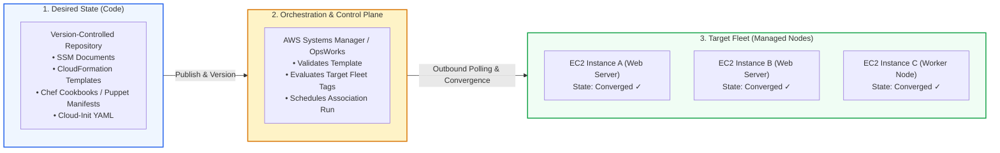
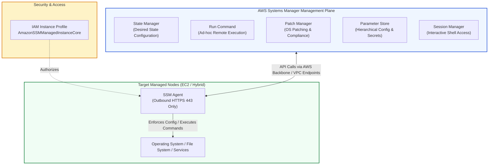
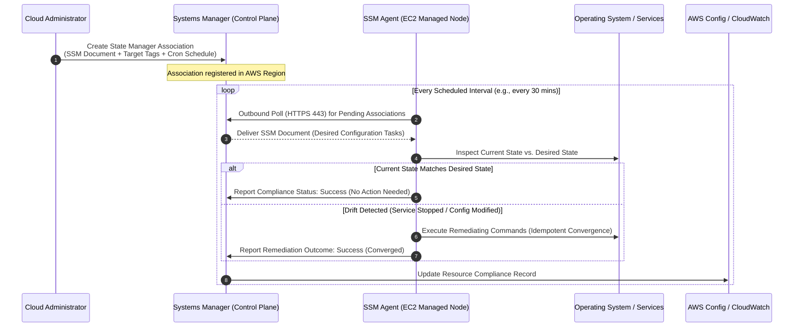

# ⚙️ Configuration Management in the Cloud: Automated, Repeatable Deployments & Fleet State Governance

> **Course**: AWS re/Start  
> **Module**: Automated and Repeatable Deployments  
> **Source Document**: `T22-Automated_and_Repeatable_Deployments/T22-0002-JAWS_AUTOMATEREPEATDEPLOYMENTS_310_EN.pdf`  
> **Target Audience**: AWS re/Start Learners / Cloud Practitioners / SysOps Administrators / DevOps Engineers  

---

## 🎯 Executive & Architectural Overview

In traditional enterprise IT environments, managing physical servers and virtual machines was overwhelmingly manual, reactive, and fragmented. System administrators routinely logged into individual operating systems via Secure Shell (SSH) or Remote Desktop Protocol (RDP) to install patches, edit configuration files, start system services, and tune runtime parameters. Over time, each server accumulated unique hotfixes, local customizations, and undocumented package versions, transforming homogeneous fleets into fragile, unpredictable collections of systems known as **"snowflake servers."**

When cloud computing emerged, it drastically simplified resource provisioning—allowing teams to instantiate hundreds of Amazon Elastic Compute Cloud (EC2) instances within minutes. However, launching virtual machines quickly does not automatically solve the challenge of maintaining their internal configuration, software consistency, and operational compliance. 

```
┌────────────────────────────────────────────────────────────────────────────────────────┐
│               Traditional Manual Operations vs. Automated Cloud Fleet Governance       │
├─────────────────────────────────────────────────┬──────────────────────────────────────┤
│  TRADITIONAL MANUAL ADMINISTRATION              │  AUTOMATED CLOUD CONFIGURATION MGMT  │
├─────────────────────────────────────────────────┼──────────────────────────────────────┤
│ • Interactive SSH/RDP logins per machine        │ • Centralized, zero-touch fleet orchestration│
│ • Unrecorded hotfixes & "snowflake servers"     │ • Declarative Desired State Configuration    │
│ • Silent, unmonitored configuration drift       │ • Continuous compliance auditing & drift roll│
│ • Fragile deployments with high error rates     │ • Idempotent templates applied deterministically│
│ • Manual troubleshooting & tribal knowledge     │ • Version-controlled configuration in Git    │
│ • Slow disaster recovery & instance recreation  │ • Fast, repeatable instance bootstrapping   │
└─────────────────────────────────────────────────┴──────────────────────────────────────┘
```

**Configuration Management in the Cloud** is the disciplined engineering practice of establishing, maintaining, and enforcing the functional and physical consistency of infrastructure resources throughout their entire lifecycle. In AWS, configuration management bridges the gap between infrastructure provisioning (e.g., creating VPCs, subnets, and EC2 instances with **AWS CloudFormation**) and operational software governance (e.g., managing packages, services, OS baselines, and security compliance with **AWS Systems Manager**, **AWS OpsWorks**, and **AWS Config**).

---

## 📌 Learning Objectives

By studying this guide and mastering its architectural frameworks, learners will be able to:

- [ ] **Define Cloud Configuration Management**: Articulate the core concepts of configuration management, system state tracking, fleet integrity, and idempotency.
- [ ] **Analyze the Hazards of Manual Configuration**: Identify the root causes and business risks of "snowflake servers," configuration drift, tribal knowledge dependency, and security compliance gaps.
- [ ] **Evaluate the Benefits of Automation**: Quantify the operational advantages of automated configuration management, including speed, deterministic repeatability, version control, audit trails, and automated compliance.
- [ ] **Deconstruct the AWS Configuration Management Ecosystem**:
  - [ ] **AWS Systems Manager (SSM)**: Master State Manager, Run Command, Patch Manager, Parameter Store, and Session Manager.
  - [ ] **AWS OpsWorks**: Understand managed Chef Automate and Puppet Enterprise for declarative recipe- and manifest-based automation.
  - [ ] **AWS CloudFormation**: Define infrastructure state declaratively and detect infrastructure-level drift.
  - [ ] **AWS Config**: Implement continuous configuration tracking, resource relationship mapping, automated compliance rules, and event-driven remediation.
  - [ ] **EC2 User Data & Cloud-Init**: Author boot-time shell and cloud-config bootstrapping scripts.
- [ ] **Design Cloud Configuration Management Strategies**: Architect balanced deployment strategies across **Baking (AMIs)**, **Bootstrapping (User Data)**, and **Dynamic Fleet Governance (State Manager / Chef)**.
- [ ] **Troubleshoot Fleet Configuration Failures**: Formulate diagnostic runbooks for bootstrapping failures, SSM Agent offline states, and compliance drift events.

---

## 🏗️ 1. Configuration Management in the Cloud

### 1.1 Defining Configuration Management
At its core, **configuration management (CM)** is a systems engineering discipline for establishing and maintaining consistency of a product's performance, functional, and physical attributes with its requirements, design, and operational information throughout its life.

In cloud computing, configuration management encompasses:
1. **Operating System Configuration**: Kernel parameters, user accounts, file permissions, environment variables, security hardening baselines (e.g., CIS benchmarks), and network interface settings.
2. **Software & Application State**: Installed package versions, runtime dependencies, web server configs (Apache, NGINX), database client tools, and container runtimes.
3. **Operational Agent Management**: Ensuring telemetry, security, and management agents (e.g., AWS Systems Manager Agent, Amazon CloudWatch unified agent, antivirus software) are installed, running, and updated.
4. **Security & Cryptographic Credentials**: Distributing TLS certificates, authorized SSH public keys, and securely injecting database connection strings without embedding secrets in plaintext code.



### 1.2 Maintaining System Integrity Across the Fleet
In a fleet of tens, hundreds, or thousands of instances, system integrity cannot be validated by logging into machines one by one. Integrity requires:
- **Baseline Standardization**: Every node performing a specific role (e.g., front-end web server) must start from an identical, well-defined baseline.
- **Continuous State Verification**: Rather than assuming systems remain unchanged after launch, the control plane periodically re-examines the actual state of running nodes against their prescribed desired state.
- **Automated Rollback & Remediation**: When discrepancies occur—whether due to manual tampering, unauthorized changes, or failed updates—the system automatically restores the desired state.

### 1.3 The Core Principle: Idempotency
A cornerstone concept in automated configuration management is **idempotency**.

> [!IMPORTANT]
> **Definition of Idempotency**: An operation is **idempotent** if applying it once produces the exact same result as applying it multiple times consecutively:
> $$\text{Apply}(f, x) = \text{Apply}(f, \text{Apply}(f, x))$$
> In configuration management, an idempotent tool checks the current system state before executing actions. If the desired condition is already satisfied (e.g., the `httpd` package is already installed and running), the tool takes no action and reports success. If the condition is not met, the tool performs only the specific changes needed to reach the desired state.

Idempotency guarantees that:
- Re-running configuration scripts during automated retries does **not** corrupt application state, create duplicate configuration files, or disrupt running services unnecessarily.
- Ad-hoc, out-of-band manual changes made by operators are automatically detected and rolled back to the defined baseline.

---

## ❄️ 2. The Perils of Manual Configuration & The Anti-Pattern Spectrum

### 2.1 The "Snowflake Server" Anti-Pattern
A **snowflake server** is an architecture anti-pattern where a server becomes uniquely customized through undocumented manual adjustments, one-off command executions, manual software patches, and local configuration tweaks over a long operational lifespan.

Like an actual snowflake, no two snowflake servers are identical.

```
       Manual Tweak (DevOps Eng A)
           ┌──────────────────────┐
           │ "Quick patch for     │
           │  OpenSSL bug"        │
           └──────────┬───────────┘
                      ▼
┌──────────────────────────────────────────────┐
│             SNOWFLAKE SERVER                 │
│  • Unique library versions                   │
│  • Undocumented iptables firewall rules      │
│  • Custom config files in /etc/              │
│  • Unverified cron jobs running as root      │
│  • High operational fear ("Don't touch it!") │
└──────────────────────▲───────────────────────┘
                      │
           ┌──────────┴───────────┐
           │ "Temporary hotfix    │
           │  for memory leak"    │
           └──────────────────────┘
       Emergency Hotfix (SysAdmin B)
```

**The Core Dangers of Snowflake Servers:**
- **Fear of Modification**: System administrators become terrified of rebooting, patching, or scaling the server because nobody fully understands everything running on it.
- **Impossible Re-creation**: If the underlying hardware fails or the instance is terminated, rebuilding an exact replacement takes days or weeks of painful reverse-engineering.
- **Incompatible Horizontal Scaling**: Auto Scaling groups cannot function properly if newly launched instances cannot faithfully reproduce the operational capabilities of older running instances.

### 2.2 Configuration Drift
**Configuration drift** occurs when the actual runtime state of an environment gradually and silently diverges from the officially documented, intended, or provisioned baseline state.

Drift typically occurs via:
1. **Emergency Production Hotfixes**: A production outage occurs at 2:00 AM; an on-call engineer SSHs into the primary server, alters a configuration file to restore traffic, but forgets to commit the change to the central repository.
2. **Local Package Updates**: An operator runs `sudo yum update -y` or `apt upgrade` on a subset of nodes, introducing newer package minor versions that differ from the rest of the fleet.
3. **Shadow Configurations**: Unauthorized services, debugging tools, or lingering test cron jobs left behind by developers.

```mermaid
graph TD
    subgraph DriftTimeline["The Path of Configuration Drift (Manual Operations)"]
        T0["Day 0: Identical Launch<br/>Fleet deployed from Baseline AMI"]
        --> T30["Day 30: Ad-hoc Hotfix<br/>Engineer SSHs into Node 2 to edit config"]
        --> T60["Day 60: Partial Patching<br/>Node 1 updated via terminal; Node 2 & 3 skipped"]
        --> T90["Day 90: Production Incident<br/>Node 3 crashes due to missing dependency;<br/>Snowflake state causes catastrophic MTTR"]
    end

    subgraph ConvergenceTimeline["The Path of Automated Convergence (Desired State Configuration)"]
        C0["Day 0: Identical Launch<br/>Fleet deployed via CloudFormation"]
        --> C30["Day 30: Unintended Change Detected<br/>Manual edit on Node 2 flagged by SSM State Manager"]
        --> C30b["Day 30: Automated Rollback<br/>SSM reapplies desired state; Node 2 converged"]
        --> C60["Day 60: Fleet-wide Automated Patch<br/>SSM Patch Manager updates all nodes via Maintenance Window"]
        --> C90["Day 90: Deterministic Stability<br/>100% Fleet Consistency, Zero Drift, Verified Compliance"]
    end

    style DriftTimeline fill:#fff1f2,stroke:#e11d48,stroke-width:2px
    style ConvergenceTimeline fill:#f0fdf4,stroke:#16a34a,stroke-width:2px
```



### 2.3 Business & Operational Impacts of Manual Configuration

| Operational Factor | Manual Server Administration | Automated Configuration Management |
| :--- | :--- | :--- |
| **Mean Time to Repair (MTTR)** | **High (Hours to Days)**: Requires manual investigation, log scraping, and forensic triage. | **Low (Minutes)**: Failed nodes are terminated and automatically replaced with verified baselines. |
| **Traceability & Auditability** | **Near Zero**: Shell histories can be wiped, overwritten, or obscured. | **Complete**: Every change originates from a Git commit, pull request, and CloudTrail event. |
| **Fleet Scalability** | **Inverse**: Management complexity grows linearly with fleet size ($O(N)$). | **Constant**: Managing 10,000 nodes requires the same effort as managing 10 nodes ($O(1)$). |
| **Security & Compliance** | **Vulnerable**: Rogue ports, unpatched CVEs, and outdated libraries remain undetected. | **Enforced**: Continuous compliance rules actively scan and automatically remediate non-compliant nodes. |
| **Knowledge Transfer** | **Tribal Knowledge**: Critical system knowledge is locked inside senior administrators' heads. | **Self-Documenting Code**: System state is completely expressed in readable, shared templates. |

---

## 🚀 3. Benefits of Automated Configuration Management

Automating configuration management transforms cloud infrastructure from a collection of fragile physical-like boxes into a programmable, resilient, and elastic software system:

1. **Velocity and Agility**:
   - New instances, staging environments, and entire disaster recovery (DR) regions can be provisioned in minutes without manual human intervention.
   - Developers and operations teams can rapidly test new application versions and configuration parameters in isolated staging environments that are guaranteed to be identical to production.

2. **Repeatability and Determinism**:
   - Eliminates the classic developer excuse: *"It worked on my machine."*
   - Deploying configuration through declarative templates guarantees that staging, user acceptance testing (UAT), and production environments behave with absolute consistency.

3. **Version Control & "Configuration as Code" (CaC)**:
   - Configuration files (such as SSM Documents, CloudFormation templates, Chef cookbooks, and Ansible playbooks) are stored directly in source control systems (e.g., AWS CodeCommit, GitHub, GitLab).
   - Teams gain code review workflows (pull requests), automated syntax linting, branch protection, tag-based releases, and instant rollback capabilities via `git revert`.

4. **Auditability, Governance, and Accountability**:
   - Every change pushed to the fleet is tracked in source control and logged through AWS CloudTrail and Systems Manager audit histories.
   - Security teams can instantly verify who approved a change, who executed it, what parameters were passed, and the exact timestamps of execution.

5. **Cost Optimization & Resource Lifecycle Management**:
   - Automated tools detect and remove orphaned configuration files, unattached volumes, lingering test packages, and decommissioned instances.
   - Transient test environments can be torn down completely every evening and rebuilt from scratch the next morning with zero manual configuration effort.

---

## 🛠️ 4. The AWS Configuration Management Tool Ecosystem

AWS provides a comprehensive, defense-in-depth suite of native tools and managed services tailored for configuration management across infrastructure provisioning, OS-level governance, continuous auditing, and boot-time bootstrapping.

```
┌────────────────────────────────────────────────────────────────────────────────────────┐
│                        AWS Configuration Management Tool Matrix                        │
├──────────────────────┬─────────────────────────┬───────────────────────────────────────┤
│ SERVICE / TOOL       │ OPERATIONAL LAYER       │ PRIMARY RESPONSIBILITY                │
├──────────────────────┼─────────────────────────┼───────────────────────────────────────┤
│ AWS CloudFormation   │ Cloud Infrastructure    │ Declarative provisioning of AWS       │
│                      │ (IaaS / PaaS)           │ resources (VPCs, Subnets, EC2, RDS)   │
├──────────────────────┼─────────────────────────┼───────────────────────────────────────┤
│ AWS Systems Manager  │ OS, Application &       │ Node management, desired state        │
│ (SSM)                │ Fleet Operations        │ enforcement, patching, remote command │
├──────────────────────┼─────────────────────────┼───────────────────────────────────────┤
│ AWS OpsWorks         │ Application & OS Stack  │ Managed Chef Automate & Puppet        │
│                      │ (Config Management)     │ Enterprise for recipe/manifest fleet  │
├──────────────────────┼─────────────────────────┼───────────────────────────────────────┤
│ AWS Config           │ Governance, Compliance  │ Continuous resource recording, rule   │
│                      │ & Auditing              │ evaluation & automated drift remediation│
├──────────────────────┼─────────────────────────┼───────────────────────────────────────┤
│ EC2 User Data &      │ Boot-Time Host          │ Initial bootstrap script execution    │
│ Cloud-Init           │ Initialization          │ on instance launch                    │
└──────────────────────┴─────────────────────────┴───────────────────────────────────────┘
```

---

### 4.1 AWS Systems Manager (SSM)
AWS Systems Manager is the central operational hub for AWS, hybrid, and multi-cloud environments. It uses a lightweight, secure agent—the **SSM Agent**—installed on target operating systems to execute tasks without opening inbound firewall ports (such as TCP 22 for SSH or 3389 for RDP).



#### 1. State Manager
- **Function**: Defines and automates the process of keeping managed nodes in a defined state (Desired State Configuration).
- **Associations**: Creates a binding between an **SSM Document** (containing configuration scripts or tasks), a schedule (cron or rate expression), and a target group of instances (identified by tags, resource groups, or instance IDs).
- **Drift Remediation**: If an administrator manually stops a critical service or uninstalls a required package, State Manager detects the discrepancy during its scheduled evaluation cycle and automatically re-executes the configuration document to restore compliance.

#### 2. Run Command
- **Function**: Enables administrators to remotely and securely execute scripts (Bash, PowerShell) across any number of managed instances simultaneously without logging into them interactively.
- **Security Posture**: Eliminates the need for bastion hosts, jump boxes, and open inbound SSH/RDP ports. All communication flows over outbound TLS port 443.
- **Controls**: Supports rate control (concurrency limit) and error thresholds (stopping execution if a specific percentage of instances fail).

#### 3. Patch Manager
- **Function**: Automates the scanning and deployment of security patches and operating system updates across fleets of Linux and Windows instances.
- **Patch Baselines**: Defines rules for auto-approving patches (e.g., approve all critical security patches 7 days after vendor release), blacklisting problematic patches, and establishing compliance thresholds.
- **Maintenance Windows**: Integrates with Systems Manager Maintenance Windows to schedule patching operations during designated off-peak hours without impacting production traffic.

#### 4. Parameter Store
- **Function**: Provides centralized, secure, hierarchical storage for configuration data, database connection strings, license codes, and secrets.
- **Data Types**: Supports `String`, `StringList`, and `SecureString` (encrypted at rest using **AWS Key Management Service (AWS KMS)**).
- **Integration**: Dynamic parameters can be directly referenced by SSM Run Command, State Manager, CloudFormation templates, and Lambda functions, preventing hard-coded credentials in source files.

#### 5. Session Manager
- **Function**: Fully managed interactive browser-based shell and CLI access for EC2 instances and on-premises servers.
- **Governance**: Every session is authenticated via AWS IAM. Keystrokes, commands, and terminal output can be logged directly to Amazon S3 buckets and Amazon CloudWatch Logs for comprehensive audit compliance.

---

### 4.2 AWS OpsWorks: Managed Chef and Puppet
AWS OpsWorks is a configuration management service that provides managed instances of **Chef** and **Puppet**.

```
┌────────────────────────────────────────────────────────────────────────┐
│                    AWS OpsWorks Service Offerings                      │
├───────────────────────────────────┬────────────────────────────────────┤
│  AWS OpsWorks for Chef Automate   │  AWS OpsWorks for Puppet Enterprise│
├───────────────────────────────────┼────────────────────────────────────┤
│ • Managed Chef Automate server    │ • Managed Puppet Master server     │
│ • Uses Chef Cookbooks and Recipes │ • Uses Puppet Manifests & Modules  │
│ • Ruby-based DSL                  │ • Declarative Puppet DSL           │
│ • Community Supermarket support   │ • Puppet Forge module support      │
│ • Automatic backups & OS patching │ • Automated node registration      │
└───────────────────────────────────┴────────────────────────────────────┘
```

#### Operational Mechanics:
1. **Declarative Architecture**: Infrastructure and software stacks are modeled as code. Administrators author **recipes** (Chef) or **manifests** (Puppet) describing the desired packages, configuration files, directories, and user accounts.
2. **Server-Client Model**: Managed EC2 nodes run a Chef client or Puppet agent that periodically connects to the central OpsWorks server, pulls down the latest compiled catalogs, and applies them locally.
3. **Enterprise Transition**: Ideal for organizations that have already invested heavily in existing on-premises Chef or Puppet codebases and want a fully managed AWS control plane without re-architecting their configuration tooling.

---

### 4.3 AWS CloudFormation
AWS CloudFormation is AWS’s flagship native **Infrastructure as Code (IaC)** service. While tools like Systems Manager and OpsWorks focus primarily on the operating system and application software layer, CloudFormation governs the **infrastructure provisioning layer**.

- **Declarative Templates**: Infrastructure stacks are written in JSON or YAML. CloudFormation parses dependencies, provisions resources in the correct mathematical order, and cleans up resources deterministically upon stack deletion.
- **Resource Stacks as Single Units**: Rather than managing individual EC2 instances, security groups, route tables, and load balancers independently, CloudFormation treats the entire collection as a single manageable stack (`AWS::CloudFormation::Stack`).
- **CloudFormation Drift Detection**: CloudFormation features native drift detection that compares the live configuration of provisioned AWS resources (e.g., security group ingress rules modified out-of-band in the AWS Management Console) against the original stack template.
- **Helper Scripts (`cfn-init`, `cfn-signal`, `cfn-hup`)**: CloudFormation provides native daemon utilities installed on EC2 instances that read metadata from the CloudFormation template, fetch files, run installation commands, notify the CloudFormation service of successful provisioning, and listen for configuration updates.

---

### 4.4 AWS Config: Continuous Auditing & Automated Remediation
AWS Config is a fully managed service that provides resource inventory, configuration history tracking, and compliance evaluation against desired configurations.

```mermaid
flowchart LR
    subgraph ResourceChanges["AWS Environment Activity"]
        EC2["EC2 Instance Security Group Changed"]
    end

    subgraph AWS_Config["AWS Config Engine"]
        Recorder["Configuration Recorder<br/>Captures CI (Configuration Item)"]
        Rules["AWS Config Rules<br/>Evaluates Compliance<br/>(e.g., restricted-ssh)"]
    end

    subgraph Remediation["Automated Remediation"]
        SSM_Auto["Systems Manager Automation Runbook<br/>(e.g., AWS-DisablePublicAccessForSecurityGroup)"]
        Status["Resource Restored to Compliant State ✓"]
    end

    EC2 -->|API Event Captured| Recorder
    Recorder -->|Evaluates State| Rules
    Rules -->|NON_COMPLIANT Alert| SSM_Auto
    SSM_Auto -->|Executes Action| Status

    style ResourceChanges fill:#fff1f2,stroke:#e11d48,stroke-width:2px
    style AWS_Config fill:#fef3c7,stroke:#d97706,stroke-width:2px
    style Remediation fill:#f0fdf4,stroke:#16a34a,stroke-width:2px
```



#### Core Components of AWS Config:
1. **Configuration Items (CIs)**: Point-in-time records of the attributes of an AWS resource, including relationships to other resources (e.g., which subnets and security groups are attached to an EC2 instance).
2. **Configuration History & Timeline**: A searchable timeline showing every change made to a resource since creation, answering *"What did this security group look like two weeks ago?"*
3. **AWS Config Rules**: Managed or custom AWS Lambda-based rules that continuously evaluate whether resources adhere to corporate policies (e.g., `ec2-managedinstance-association-compliance`, `encrypted-volumes`, `restricted-ssh`).
4. **Automated Remediation**: Integrates directly with **Systems Manager Automation Runbooks**. When an unapproved configuration is detected (e.g., a port 22 rule opened to `0.0.0.0/0`), AWS Config can immediately trigger an SSM Automation runbook to revoke the rule and alert security teams.

---

### 4.5 EC2 User Data and Cloud-Init
When an Amazon EC2 instance launches, it can execute initialization scripts passed to it during launch via the **User Data** parameter.

- **Cloud-Init Framework**: Modern Linux AMIs (Amazon Linux 2023, Ubuntu, RHEL) include the industry-standard `cloud-init` package. At boot time, `cloud-init` fetches metadata and user data from the instance metadata service (IMDS: `http://169.254.169.254/latest/user-data`).
- **Execution Lifecycle**: By default, shell scripts passed as User Data execute **only once** during the very first boot cycle of the instance with root administrative privileges.
- **Dual Formats**:
  1. **Shell Scripts**: Standard bash scripts starting with a shebang (`#!/bin/bash`).
  2. **Cloud-Config Directives**: Structured YAML directives (`#cloud-config`) used to install packages, configure users, write arbitrary files, and mount file systems before custom scripts run.
- **Log Inspection**: Output from User Data scripts is logged on the instance at `/var/log/cloud-init-output.log`, serving as the primary diagnostic file when boot-time configurations fail.

---

## 🏛️ 5. Systems Manager State Manager Architecture & Workflow

AWS Systems Manager State Manager provides continuous enforcement of desired configurations. The diagram below illustrates how an SSM Association continuously audits and converges a fleet of EC2 instances:



### Key Elements of State Manager Associations:
1. **Targeting Flexibility**: Targets can be selected dynamically by AWS tags (e.g., `Environment=Production`, `Role=WebServer`), ensuring that newly auto-scaled instances automatically inherit and enforce the association upon launch.
2. **SSM Document Library**: State Manager can execute Amazon-managed documents (e.g., `AWS-ApplyAnsiblePlaybooks`, `AWS-ConfigureAWSPackage`, `AWS-RunShellScript`) or custom, organization-defined JSON/YAML documents.
3. **Execution Safety**: If an association fails on a target instance, the failure is reported to the Systems Manager console and CloudWatch metrics without terminating or destabilizing the instance.

---

## ⚖️ 6. Designing a Cloud Configuration Management Strategy

When designing an enterprise cloud deployment architecture, engineers must choose where on the **Configuration Spectrum** their workloads belong: between pre-baking, bootstrapping, and dynamic fleet governance.

```
┌────────────────────────────────────────────────────────────────────────────────────────┐
│                        The Cloud Configuration Management Spectrum                     │
├──────────────────────────┬─────────────────────────────┬───────────────────────────────┤
│    BAKING (Golden AMIs)  │  BOOTSTRAPPING (User Data)  │  DYNAMIC FLEET GOVERNANCE     │
├──────────────────────────┼─────────────────────────────┼───────────────────────────────┤
│ • Pre-installed OS       │ • Clean base OS image       │ • Centralized agent (SSM/Chef)│
│ • Pre-installed software │ • User Data bash scripts    │ • Continuous state convergence│
│ • Zero boot installation │ • Dynamic package fetching  │ • Periodic compliance checks  │
│ • Fast instance boot     │ • Moderate launch latency   │ • High operational control    │
└──────────────────────────┴─────────────────────────────┴───────────────────────────────┘
```

### 6.1 The Three Core Approaches

#### 1. Baking ("Golden AMIs")
- **Mechanism**: A virtual machine image is pre-built using tools like **EC2 Image Builder** or HashiCorp Packer. The operating system, runtime dependencies, patches, and static application assets are pre-installed and baked into the Amazon Elastic Block Store (EBS) snapshot of the AMI.
- **Pros**:
  - **Fastest Launch Time**: Instances become healthy and ready to serve traffic almost immediately upon boot.
  - **Immunity to External Repository Outages**: Does not rely on public package repositories (`yum`, `apt`, `npm`) being reachable during scaling events.
- **Cons**:
  - **Image Sprawl & Maintenance Overhead**: Every patch or minor configuration change requires rebuilding, testing, and distributing a brand-new AMI.
  - **Storage Costs**: Storing dozens of historical AMI snapshots across multiple AWS Regions increases EBS snapshot storage costs.

#### 2. Bootstrapping (Just-In-Time User Data)
- **Mechanism**: Launching a completely stock, clean base operating system (e.g., standard Amazon Linux 2023 AMI) and executing shell scripts or cloud-init directives via User Data during the first boot.
- **Pros**:
  - **Extreme Flexibility**: Always fetches the freshest packages and dynamic environment configurations from Parameter Store or S3.
  - **Zero Image Maintenance**: No custom AMIs to build, update, or deregister.
- **Cons**:
  - **Slower Launch Times**: Auto Scaling events take several minutes while the instance downloads, installs, and compiles packages.
  - **Fragility**: If an external software repository is down, or if a package repository updates a dependency with breaking changes, newly launched instances will fail to bootstrap.

#### 3. Dynamic Fleet Configuration (Continuous Convergence)
- **Mechanism**: Combining a stable base or lightly baked AMI with a continuous configuration management agent (AWS Systems Manager State Manager or Chef/Puppet).
- **Pros**:
  - **Continuous Drift Remediation**: Unlike User Data (which only runs once at initial launch), dynamic agents enforce desired state throughout the multi-month operational lifespan of the instance.
  - **Decoupled Configuration**: Software configurations can be updated across thousands of live instances without rebooting or recreating them.
- **Cons**:
  - Requires maintaining agent health, IAM permissions, and network connectivity to the management control plane.

### 6.2 The Hybrid / Golden Baseline Best Practice
Most mature enterprise architectures adopt a **Hybrid Strategy (Bake what is slow; bootstrap what is dynamic)**:
1. **Bake Foundational Components**: Create a company-wide Golden AMI containing foundational security tooling, logging agents, kernel hardening, and slow-to-compile runtimes.
2. **Bootstrap Identity & Secrets**: Use EC2 User Data to pass instance-specific parameters (e.g., environment tags, region-specific S3 bucket names).
3. **Govern Dynamically**: Use AWS Systems Manager State Manager and Patch Manager to enforce ongoing compliance, patch management, and configuration drift prevention across the running fleet.

---

## 📊 7. AWS Configuration Management Tools Comparison Matrix

| Evaluation Dimension | AWS Systems Manager (SSM) | AWS OpsWorks | AWS CloudFormation | AWS Config | EC2 User Data |
| :--- | :--- | :--- | :--- | :--- | :--- |
| **Primary Scope** | OS, applications, fleet maintenance, operational tasks | Full application stack, middleware, OS configuration | AWS cloud resource provisioning & orchestration | Audit, compliance, and resource relationship tracking | Boot-time host initialization & simple scripts |
| **Operational Layer** | In-guest OS / Fleet control plane | In-guest OS / Application stack | Cloud infrastructure & resource plane | Cloud governance & audit plane | In-guest OS (Init phase) |
| **Underlying Mechanism** | SSM Agent (outbound HTTPS 443 polling) | Chef Client / Puppet Agent connecting to server | CloudFormation engine calling AWS service APIs | AWS Config recorder evaluating API event stream | Cloud-Init daemon parsing IMDS metadata |
| **Idempotency Support** | High (native in State Manager documents) | Native & central to Chef recipes / Puppet manifests | High (engine computes resource diffs and updates) | N/A (observes and evaluates; triggers remediation) | Low (scripts must be manually written to be idempotent) |
| **Drift Management** | Automatic scheduled re-application of state | Automatic periodic convergence via client run | CloudFormation Drift Detection (ad-hoc / API) | Continuous automated compliance detection | None (runs once at launch; does not monitor drift) |
| **Infrastructure Overhead** | Zero (fully serverless AWS managed service) | Requires managing OpsWorks server instance | Zero (fully serverless AWS managed service) | Zero (fully serverless AWS managed service) | Zero (native EC2 hypervisor/metadata feature) |
| **Best Used For** | Fleet-wide patching, remote runbooks, desired state | Complex legacy Chef/Puppet enterprise migrations | Defining complete environments as code | Regulatory compliance auditing and auto-remediation | Quick package installs and initial agent bootstrapping |

---

## 💻 8. Step-by-Step Implementation Scenarios & Practical Code

### Scenario A: Bootstrapping an EC2 Web Server via User Data
The following bash script demonstrates a robust, production-ready User Data script. It installs the Apache web server, configures a dynamic landing page querying the EC2 Instance Metadata Service (IMDSv2), and starts the service.

```bash
#!/bin/bash
# ==============================================================================
# Script: user_data.sh
# Purpose: Production EC2 Bootstrapping Script with IMDSv2 and Idempotent Logic
# ==============================================================================

# Exit immediately if a command exits with a non-zero status
set -e

# Update installed packages
yum update -y

# Install Apache Web Server and AWS CLI
yum install -y httpd aws-cli

# Start Apache and enable it to launch at boot
systemctl start httpd
systemctl enable httpd

# Retrieve IMDSv2 Token (Session duration: 21600 seconds)
TOKEN=$(curl -s -X PUT "http://169.254.169.254/latest/api/token" \
  -H "X-aws-ec2-metadata-token-ttl-seconds: 21600")

# Fetch instance metadata using IMDSv2
INSTANCE_ID=$(curl -s -H "X-aws-ec2-metadata-token: $TOKEN" \
  http://169.254.169.254/latest/meta-data/instance-id)
AVAILABILITY_ZONE=$(curl -s -H "X-aws-ec2-metadata-token: $TOKEN" \
  http://169.254.169.254/latest/meta-data/placement/availability-zone)

# Author dynamic HTML response
cat <<EOF > /var/www/html/index.html
<!DOCTYPE html>
<html lang="en">
<head>
    <meta charset="UTF-8">
    <title>Automated Fleet Node</title>
    <style>
        body { font-family: Arial, sans-serif; background: #0f172a; color: #f8fafc; padding: 40px; }
        .card { background: #1e293b; border-radius: 8px; padding: 24px; max-width: 600px; box-shadow: 0 4px 6px rgba(0,0,0,0.3); }
        h1 { color: #38bdf8; }
        .metric { font-size: 1.1em; margin: 10px 0; }
        .highlight { color: #4ade80; font-weight: bold; }
    </style>
</head>
<body>
    <div class="card">
        <h1>Cloud Configuration Management: Active Node</h1>
        <p class="metric">Instance ID: <span class="highlight">${INSTANCE_ID}</span></p>
        <p class="metric">Availability Zone: <span class="highlight">${AVAILABILITY_ZONE}</span></p>
        <p class="metric">Status: <span class="highlight">Converged & Serving Traffic</span></p>
    </div>
</body>
</html>
EOF

# Ensure appropriate file permissions
chown -R apache:apache /var/www/html
chmod 644 /var/www/html/index.html

echo "Bootstrapping completed successfully at $(date)" >> /var/log/bootstrapping.log
```

---

### Scenario B: AWS Systems Manager State Manager Association Document
The following YAML document defines an SSM Document (`schemaVersion: '2.2'`) that enforces desired state on managed Linux nodes. It verifies that Apache is installed, running, and that unauthorized remote debugging ports are closed.

```yaml
schemaVersion: '2.2'
description: 'Enforce Desired State: Ensure Apache is Active and Audit Drift'
mainSteps:
  - action: aws:runShellScript
    name: EnforceWebServerState
    inputs:
      runCommand:
        - |
          #!/bin/bash
          # 1. Verify and enforce httpd package installation
          if ! rpm -q httpd &>/dev/null; then
              echo "httpd is missing. Installing package..."
              yum install -y httpd
          else
              echo "httpd package already installed. Desired state verified."
          fi

          # 2. Verify and enforce httpd service status
          if ! systemctl is-active --quiet httpd; then
              echo "httpd is inactive. Starting service..."
              systemctl start httpd
              systemctl enable httpd
          else
              echo "httpd service is running. Desired state verified."
          fi

          # 3. Ensure configuration file integrity
          if [ ! -f /var/www/html/index.html ]; then
              echo "Index page missing! Re-generating baseline page..."
              echo "<h1>Enforced by AWS Systems Manager State Manager</h1>" > /var/www/html/index.html
          fi

          echo "State Manager compliance audit completed successfully."
```

---

### Scenario C: CloudFormation Template Defining Managed EC2 Fleet
This declarative CloudFormation template provisions an IAM Role granting Systems Manager permissions, an EC2 Instance configured with User Data, and tags enabling automated targeting by State Manager:

```yaml
AWSTemplateFormatVersion: '2010-09-09'
Description: 'Automated and Repeatable Deployment: Managed EC2 Instance with SSM'

Parameters:
  LatestAmiId:
    Type: 'AWS::SSM::Parameter::Value<AWS::EC2::Image::Id>'
    Default: '/aws/service/ami-amazon-linux-latest/al2023-ami-kernel-default-x86_64'
    Description: 'Parameter Store path for latest Amazon Linux 2023 AMI'

  InstanceType:
    Type: String
    Default: 't3.micro'
    AllowedValues:
      - 't3.micro'
      - 't3.small'
      - 't3.medium'
    Description: 'EC2 instance compute size'

Resources:
  # IAM Role for Systems Manager Management
  SSMManagedInstanceRole:
    Type: 'AWS::IAM::Role'
    Properties:
      RoleName: 'SSM-Managed-Instance-Role'
      AssumeRolePolicyDocument:
        Version: '2012-10-17'
        Statement:
          - Effect: Allow
            Principal:
              Service:
                - 'ec2.amazonaws.com'
            Action:
              - 'sts:AssumeRole'
      ManagedPolicyArns:
        - 'arn:aws:iam::aws:policy/AmazonSSMManagedInstanceCore'

  # Instance Profile to attach IAM Role to EC2
  SSMInstanceProfile:
    Type: 'AWS::IAM::InstanceProfile'
    Properties:
      Roles:
        - !Ref SSMManagedInstanceRole

  # Target EC2 Instance
  WebServerInstance:
    Type: 'AWS::EC2::Instance'
    Properties:
      ImageId: !Ref LatestAmiId
      InstanceType: !Ref InstanceType
      IamInstanceProfile: !Ref SSMInstanceProfile
      UserData:
        Fn::Base64: !Sub |
          #!/bin/bash
          yum update -y
          yum install -y httpd
          systemctl start httpd
          systemctl enable httpd
          echo "<h1>Provisioned by AWS CloudFormation</h1>" > /var/www/html/index.html
      Tags:
        - Key: 'Name'
          Value: 'Managed-Web-Node-01'
        - Key: 'Environment'
          Value: 'Production'
        - Key: 'Role'
          Value: 'WebServer'

Outputs:
  InstanceId:
    Description: 'Instance ID of the provisioned node'
    Value: !Ref WebServerInstance
```

---

## 🩺 9. Troubleshooting Knowledge Base & Operational Runbooks

When automated deployments or configuration enforcement routines fail, follow these structured triage workflows:

### Runbook 1: EC2 User Data Bootstrapping Failure
- **Symptom**: The EC2 instance reaches the `running` state in the AWS Management Console, but the web server is inaccessible, and custom software is not installed.
- **Root Causes**:
  - Syntax error in the User Data bash script causing early exit.
  - Failure to retrieve packages due to missing outbound Internet connectivity (e.g., instance in a private subnet without a NAT Gateway).
  - Race condition where package manager locks (`yum.pid` or `apt/lists/lock`) were held by another background process.
- **Diagnostic Triage Steps**:
  1. Connect to the instance securely using **AWS Systems Manager Session Manager**.
  2. Inspect the cloud-init execution log:
     ```bash
     sudo cat /var/log/cloud-init-output.log
     ```
  3. Check the cloud-init status:
     ```bash
     cloud-init status --long
     ```
  4. Verify internet/NAT route reachability:
     ```bash
     curl -I https://amazonlinux-2-repos-us-east-1.s3.amazonaws.com
     ```
  5. Manually re-run the User Data script in a test directory to observe stdout/stderr.

---

### Runbook 2: Managed Node Fails to Register with AWS Systems Manager
- **Symptom**: The EC2 instance is running, but it does **not** appear in the Systems Manager **Fleet Manager** or Managed Nodes console.
- **Root Causes**:
  1. Missing or misconfigured IAM Instance Profile (must contain policy `AmazonSSMManagedInstanceCore`).
  2. Outbound traffic on port 443 blocked by security group or Network ACL.
  3. Instance located in a private subnet lacking VPC Endpoints for Systems Manager (`ssm`, `ssmmessages`, and `ec2messages`).
  4. SSM Agent service crashed or not installed.
- **Diagnostic Triage Steps**:
  1. Check the IAM role attached to the instance:
     ```bash
     aws ec2 describe-instances --instance-ids <INSTANCE_ID> \
       --query "Reservations[].Instances[].IamInstanceProfile"
     ```
  2. If accessible via serial console or local shell, check the agent status:
     ```bash
     sudo systemctl status amazon-ssm-agent
     ```
  3. Review the SSM Agent error log:
     ```bash
     sudo tail -n 100 /var/log/amazon/ssm/amazon-ssm-agent.log
     ```
  4. For private subnets, verify that the following VPC Interface Endpoints exist and have security groups allowing inbound port 443 from the instance subnet:
     - `com.amazonaws.<region>.ssm`
     - `com.amazonaws.<region>.ssmmessages`
     - `com.amazonaws.<region>.ec2messages`

---

### Runbook 3: Configuration Drift & Failed State Manager Association
- **Symptom**: State Manager reports an Association status of `Failed` or `Non-Compliant` for one or more target instances.
- **Root Causes**:
  - The script defined inside the SSM Document returned a non-zero exit code.
  - A required parameter in Parameter Store does not exist or the instance IAM role lacks `ssm:GetParameter` permission.
  - File system disk space full (`100% full on /`), preventing package installation.
- **Diagnostic Triage Steps**:
  1. In the Systems Manager Console, navigate to **State Manager** $\rightarrow$ select the Association $\rightarrow$ **Execution History**.
  2. Select the failed execution $\rightarrow$ click on the specific **Instance ID** $\rightarrow$ view **Output**.
  3. Review the exact command step that returned non-zero exit code.
  4. Verify disk space on the target instance:
     ```bash
     df -h
     ```
  5. Verify Parameter Store access by executing a test query via AWS CLI on the instance:
     ```bash
     aws ssm get-parameter --name "/app/prod/db_url" --with-decryption
     ```

---

## 📝 10. Checkpoint Review Questions & Answers

### Question 1
**A company operates an Auto Scaling group of EC2 instances running a mission-critical web application. Currently, new instances use an EC2 User Data script that downloads 4 GB of dependencies and compiles packages during launch, taking 14 minutes before instances can pass load balancer health checks. During sudden traffic spikes, users experience errors before new instances can spin up. What architectural change should the company implement to resolve this issue?**

- **A)** Increase the Auto Scaling group cooldown period.
- **B)** Switch to a Golden AMI strategy using EC2 Image Builder to pre-bake the dependencies and application runtime into the image.
- **C)** Migrate the bootstrapping scripts from bash to a Python script in User Data.
- **D)** Configure AWS Config to trigger an SSM Run Command whenever traffic spikes occur.

> **Correct Answer: B**  
> **Detailed Explanation**: The primary disadvantage of relying exclusively on extensive boot-time User Data scripts is launch latency (14 minutes). In an elastic auto-scaling workload, high launch latency leads to dropped traffic and degraded performance during traffic surges. Pre-baking dependencies, operating system patches, and application binaries into a **Golden AMI** reduces instance launch time from 14 minutes down to under 60 seconds, allowing newly scaled instances to immediately pass target group health checks and handle traffic. Option A increases cooldown time, which would further delay scaling responses. Option C does not eliminate package download latency. Option D is an incorrect use of AWS Config.

---

### Question 2
**An administrator needs to execute a configuration update across a fleet of 250 EC2 instances across three Availability Zones. The security policy strictly prohibits opening inbound TCP port 22 (SSH) in security groups, and bastion hosts cannot be used. Furthermore, execution must automatically stop if more than 5 instances fail the update. Which AWS service and feature satisfies these requirements?**

- **A)** AWS CloudFormation with StackSets and RetainResources
- **B)** Amazon EC2 User Data with cloud-init retry policies
- **C)** AWS Systems Manager Run Command with Concurrency and Error Thresholds
- **D)** AWS OpsWorks Stacks with custom JSON attributes

> **Correct Answer: C**  
> **Detailed Explanation**: **AWS Systems Manager Run Command** allows administrators to execute shell or PowerShell scripts across large fleets of managed instances without requiring inbound open ports (such as SSH port 22) or bastion hosts. The SSM Agent communicates via outbound HTTPS port 443. Run Command includes native operational safeguards: **Concurrency limits** (controlling how many instances execute simultaneously) and **Error Thresholds** (which immediately halts further executions if a specified number or percentage of targets fail). CloudFormation (A) is designed for resource provisioning, not ad-hoc command execution. User Data (B) runs only at initial boot. OpsWorks (D) requires Chef/Puppet infrastructure and does not provide native error-threshold halting across raw ad-hoc scripts.

---

### Question 3
**A systems engineer notices that several production EC2 instances have divergent security settings because junior administrators occasionally log in and manually alter configuration files to test hotfixes. Which combination of AWS services should be implemented to automatically detect and remediate this configuration drift?**

- **A)** AWS Systems Manager State Manager and AWS Config
- **B)** Amazon CloudWatch Logs Insights and Amazon Simple Notification Service (Amazon SNS)
- **C)** AWS Trusted Advisor and AWS Systems Manager Parameter Store
- **D)** EC2 Instance Metadata Service (IMDSv2) and AWS CloudFormation

> **Correct Answer: A**  
> **Detailed Explanation**: **AWS Systems Manager State Manager** enforces Desired State Configuration on managed instances. By associating an SSM Document with target instances on a recurring schedule, State Manager continuously checks the actual OS/application configuration against the desired baseline and automatically re-executes remediation commands to converge the system when drift is detected. Concurrently, **AWS Config** continuously audits resource-level configurations, maps relationships, flags non-compliant resources against Config Rules, and can trigger automated Systems Manager Automation runbooks. CloudWatch Logs Insights (B) analyzes log text but does not enforce configuration. Parameter Store (C) stores config strings and secrets. IMDSv2 (D) is a local metadata retrieval mechanism.

---

### Question 4
**Why is idempotency considered a mandatory property for automated configuration management scripts and tools?**

- **A)** It guarantees that scripts run faster by bypassing the operating system kernel.
- **B)** It ensures that executing a script multiple times produces the same intended system state without causing errors, unintended duplicate configurations, or downtime.
- **C)** It encrypts all configuration parameters using AWS KMS customer managed keys.
- **D)** It allows shell scripts to execute simultaneously on both Windows and Linux operating systems.

> **Correct Answer: B**  
> **Detailed Explanation**: In configuration management, **idempotency** is the attribute wherein an operation can be applied multiple times without changing the result beyond the initial application. In automated environments where scripts may retry due to network blips or run on continuous schedules (e.g., every 30 minutes via SSM State Manager), non-idempotent scripts would append duplicate lines to configuration files, attempt to re-create existing user accounts, or repeatedly restart services unnecessarily. Idempotent tools inspect the current state first and execute only the minimal state-changing actions necessary.

---

### Question 5
**An enterprise with a large investment in existing Chef cookbooks and recipes wants to migrate its fleet management to AWS. They want to avoid managing the underlying infrastructure, operating system patching, and backup storage of their primary Chef server. Which AWS service directly addresses this requirement?**

- **A)** AWS Systems Manager Session Manager
- **B)** AWS OpsWorks for Chef Automate
- **C)** AWS CloudFormation Registry
- **D)** AWS Config Aggregator

> **Correct Answer: B**  
> **Detailed Explanation**: **AWS OpsWorks for Chef Automate** provides a fully managed Chef Automate server. AWS automatically handles provisioning, software updates, OS patching, and automated backups of the Chef server while allowing the customer to use their existing Chef cookbooks, recipes, and knife tooling. Session Manager (A) is an interactive shell tool. CloudFormation Registry (C) manages private IaC extensions. Config Aggregator (D) collects compliance data across multiple accounts and regions.

---

## 📚 11. Study Summary & Key Takeaways

1. **Configuration Management is Continuous Governance**: It is not a one-time launch event, but an ongoing operational lifecycle that establishes, verifies, and enforces consistency across compute fleets.
2. **Eliminate Snowflake Servers & Drift**: Relying on manual terminal sessions (SSH/RDP) creates fragile snowflake servers and unmonitored configuration drift. All configuration should be treated as code (CaC) and maintained in version control.
3. **Idempotency is Essential**: Every configuration tool or script must be designed to be safely executable multiple times without adverse side effects.
4. **AWS Service Specialization**:
   - **AWS CloudFormation**: Provisions the underlying cloud infrastructure (IaaS/PaaS).
   - **AWS Systems Manager (SSM)**: Manages OS-level configuration, patching, remote commands, and desired state without open inbound ports.
   - **AWS OpsWorks**: Provides managed Chef Automate and Puppet Enterprise servers.
   - **AWS Config**: Audits cloud resource compliance and triggers automated remediation.
   - **EC2 User Data**: Handles simple, one-time initial bootstrapping during the very first instance boot.
5. **Balance the Strategy**: High-scale cloud architectures combine the speed of **Golden AMIs (baking)** with the flexibility of **User Data (bootstrapping)** and the continuous governance of **Systems Manager State Manager (dynamic fleet convergence)**.
