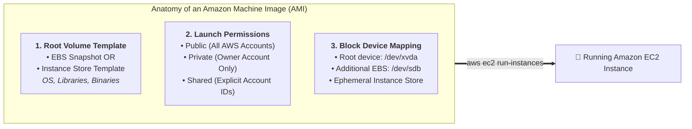
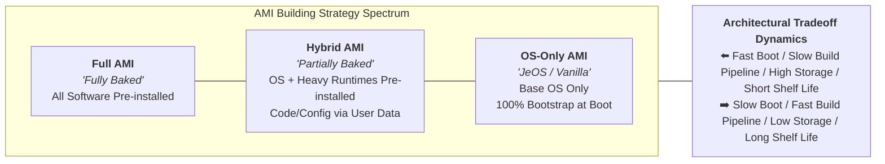
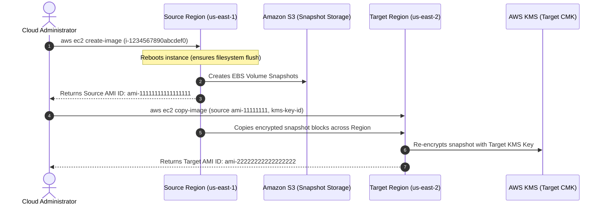
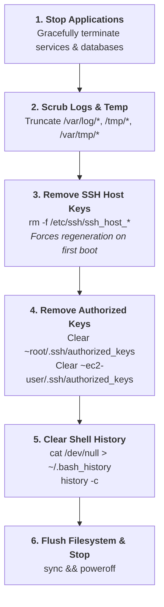
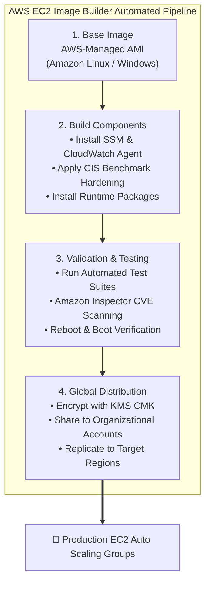

# 🏗️ Amazon Machine Image (AMI) Building Strategies: Architecture, Image Lifecycle, & Golden AMI Pipelines

> **Course**: AWS re/Start  
> **Module**: Automated and Repeatable Deployments (Module 13)  
> **Source Document**: `T22-Automated_and_Repeatable_Deployments/T22-0003-RSJAWS_EN-US_SG_M13_AMIBUILDINGSTRATEGY.pdf`  
> **Target Audience**: AWS re/Start Learners, Cloud Practitioners, DevOps Engineers, and Solutions Architects  

---

## 🎯 Module Overview

In modern cloud engineering, repeatability, consistency, and automated deployment are fundamental requirements for building resilient and scalable architectures. Manually installing software, configuring dependencies, and applying security patches to virtual machines on a per-instance basis introduces configuration drift, lengthens provisioning times, and exposes production workloads to unexpected runtime failures.

An **Amazon Machine Image (AMI)** serves as the packaged template for deploying Amazon Elastic Compute Cloud (Amazon EC2) instances. It encapsulates the operating system, initial runtime environment, application dependencies, and foundational configuration into a bootable image.

However, selecting how and when software is packaged into an AMI is a crucial architectural decision:
- Should an engineering team pre-install and configure all software into a **Full AMI ("Fully Baked")** for near-instant boot times?
- Should they maintain a **Hybrid AMI ("Partially Baked")** combining a pre-packaged base stack with dynamic launch-time configuration?
- Or should they rely on an **OS-only AMI ("Just Enough OS" / JeOS)** and configure instances dynamically at boot time using bootstrap scripts and automation tools?

This study guide provides a comprehensive architectural deep dive into **AMI Building Strategies**, examining AMI anatomy, block device mappings, regional scoping and cross-region replication, snapshot encryption mechanisms, OS-specific preparation workflows for Linux and Microsoft Windows (including Sysprep and EC2Launch), automated Golden AMI pipelines via **EC2 Image Builder**, and enterprise compliance governance.

---

## 📌 Learning Objectives

- [ ] Describe the core value proposition, architecture, and operational advantages of using Amazon Machine Images (AMIs).
- [ ] Explain the structural characteristics of an AMI: root volume templates (EBS snapshot vs. instance store), block device mappings, and launch permissions.
- [ ] Differentiate between the Three AMI Building Strategies: Full AMI ("Fully Baked"), Hybrid AMI ("Partially Baked"), and OS-only AMI ("Just Enough OS" / JeOS).
- [ ] Evaluate architectural tradeoffs between boot speed, build pipeline duration, image shelf life, security vulnerability exposure, and storage costs.
- [ ] Execute AMI creation, management, and cross-Region copy workflows via the AWS Management Console and the AWS CLI (`create-image`, `register-image`, `copy-image`).
- [ ] Understand cryptographic snapshot handling during AMI cross-Region replication and KMS key re-encryption.
- [ ] Implement operating system preparation and sanitization procedures for Linux (log truncation, shell history removal, SSH host key regeneration).
- [ ] Master Microsoft Windows AMI preparation using the System Preparation (**Sysprep**) tool across its three phases (Generalize, Specialize, Out-of-Box Experience) with **EC2Launch** and **EC2Config**.
- [ ] Architect an end-to-end **Golden AMI Pipeline** using **AWS EC2 Image Builder** to automate building, testing, securing, and distributing compliant images across AWS accounts and Regions.
- [ ] Establish enterprise AMI governance, compliance scanning, and automated remediation policies using AWS Config and IAM.

---

## 📚 Key Terminology

| Term | Definition |
| :--- | :--- |
| **Amazon Machine Image (AMI)** | A pre-configured machine template that provides the information (OS, applications, permissions, block device mapping) required to launch an Amazon EC2 instance. |
| **Root Device Volume** | The primary storage volume containing the image used to boot an EC2 instance; backed either by an Amazon EBS snapshot or an instance store template. |
| **Block Device Mapping** | A configuration defining the block devices (EBS volumes and instance store volumes) attached to an instance upon launch. |
| **Full AMI ("Fully Baked")** | An image where the operating system, runtimes, utilities, dependencies, and application binaries are 100% pre-installed and configured at image build time. |
| **Hybrid AMI ("Partially Baked")** | An image where the OS and heavy, slow-to-install dependencies are pre-installed, while dynamic code and runtime configurations are injected at boot time. |
| **OS-Only AMI ("JeOS")** | "Just Enough Operating System"; a minimal, vanilla OS image that installs all dependencies and applications at instance launch time via bootstrap scripts. |
| **User Data** | Script-based configuration parameters (Bash or PowerShell) passed into an EC2 instance at launch and executed automatically during startup (via `cloud-init` or `EC2Launch`). |
| **Sysprep** | Microsoft Windows System Preparation tool used to generalize an OS installation by stripping machine-specific identifiers (SIDs, drivers, computer names) before creating an AMI. |
| **EC2Launch / EC2Config** | AWS service agents for Windows Server that manage startup tasks, execute user data scripts, generate administrator passwords, and orchestrate Sysprep execution. |
| **Security Identifier (SID)** | A unique string assigned by Windows to identify security principals (users, groups, computer accounts); duplicate SIDs on an Active Directory domain cause critical security and communication failures. |
| **Golden AMI** | A hardened, standardized, pre-approved machine image that complies with enterprise security, operational, and regulatory baselines. |
| **EC2 Image Builder** | A fully managed AWS service that automates the creation, testing, hardening, and global distribution of virtual machine and container images. |
| **AMI Regional Anchoring** | The architectural reality that AMIs are tied to the specific AWS Region where they were created; image IDs are unique per Region and cannot be launched directly across regional boundaries without copying. |

---

## 🧩 1. Value Proposition & Anatomy of an Amazon Machine Image (AMI)

### What is an AMI?

An **Amazon Machine Image (AMI)** is an immutable packaged machine template required to launch an Amazon EC2 instance. An AMI contains everything needed to instantiate a virtual server in the cloud, functioning identically to a master disk image or virtual appliance template in virtualization platforms like VMware or Hyper-V.



### Core Components of an AMI

Every AMI encapsulates three essential architectural components:

1. **Root Volume Template**:
   - Contains the guest operating system, device drivers, installed runtimes, configuration files, and initial applications.
   - For **EBS-backed AMIs**, this is an Amazon EBS snapshot stored durably across multiple Availability Zones in Amazon Simple Storage Service (Amazon S3).
   - For **Instance store-backed AMIs**, this is an image template stored in Amazon S3 composed of compressed volume chunks and an XML manifest file.

2. **Launch Permissions**:
   - Determines who has authorization to launch EC2 instances from the AMI:
     - **Private**: The default state. Accessible solely by the AWS account that created it.
     - **Explicit (Shared)**: Shared securely with specific AWS Account IDs or AWS Organizations without making the underlying image public.
     - **Public**: Available to all AWS customers worldwide (e.g., standard base distributions, AWS Marketplace offerings).

3. **Block Device Mapping (BDM)**:
   - A configuration declaration that specifies the block devices to attach to the instance when it launches.
   - Outlines the mount points (e.g., `/dev/xvda`, `/dev/sdb`), volume types (`gp3`, `io2`), volume sizes, IOPS, and whether volumes should persist or delete upon instance termination (`DeleteOnTermination`).

### Core Operational Advantages

Deploying workloads via custom AMIs provides three critical operational benefits:

```
┌────────────────────────────────────────────────────────────────────────┐
│                   The "3 R's" of Amazon Machine Images                 │
├────────────────────────────────────────────────────────────────────────┤
│ 1. REPEATABILITY:                                                      │
│    Guarantees 100% configuration consistency across hundreds of        │
│    instances. Eliminates human error and "it works on my machine" bugs.│
├────────────────────────────────────────────────────────────────────────┤
│ 2. REUSABILITY:                                                        │
│    Serves as a standardized foundation across multiple projects,       │
│    environments (Dev, Stage, Prod), and application teams.             │
├────────────────────────────────────────────────────────────────────────┤
│ 3. RECOVERABILITY:                                                     │
│    Enables rapid disaster recovery and blue/green rollbacks by         │
│    re-launching known-good image versions in any target Region.       │
└────────────────────────────────────────────────────────────────────────┘
```

> [!NOTE]
> When instances are launched within an **Amazon EC2 Auto Scaling** group, the speed of AMI initialization directly determines how fast your infrastructure responds to sudden traffic spikes. Fast-booting AMIs prevent application starvation during scaling events.

---

## ⚖️ 2. The Three AMI Building Strategies: Deep Dive & Tradeoffs

When designing an AMI strategy, engineers choose where along the configuration spectrum to perform software installations. The spectrum ranges from baking everything ahead of time to configuring everything dynamically at boot time.



---

### Strategy 1: Full AMI ("Fully Baked")

In a **Full AMI** model, every component—the operating system, security tooling, runtime dependencies (e.g., Java runtime, Node.js, Python), third-party monitoring agents (e.g., CloudWatch Agent, Datadog), application binaries, and static configuration files—is installed, compiled, and baked into the image during the build phase.

```
┌────────────────────────────────────────────────────────────────────────┐
│                        Full AMI ("Fully Baked")                        │
├────────────────────────────────────────────────────────────────────────┤
│  [ Application Code & Compiled Assets ]  ◀── Baked into Image          │
│  [ Application Runtimes & Libraries   ]  ◀── Baked into Image          │
│  [ Security Agents & Logging Tools    ]  ◀── Baked into Image          │
│  [ Hardened Operating System Kernel   ]  ◀── Baked into Image          │
└────────────────────────────────────────────────────────────────────────┘
   Instance Boot Time: ~30 to 60 seconds (Near-Instantaneous Readiness)
```

#### Advantages
- **Ultra-Fast Launch and Scaling Times**: When Auto Scaling triggers a scale-out event, instances boot in seconds because no compilation, package downloads, or configuration scripts need to execute.
- **Deterministic and Predictable Execution**: The instance state is immutable and identical. There is zero risk of an instance failing to launch due to external network timeouts, repository downtime, or upstream package repository changes.
- **Offline Resilience**: Instances can boot successfully inside air-gapped or private subnets without requiring Internet gateways, NAT gateways, or VPC endpoints to fetch packages.

#### Disadvantages & Tradeoffs
- **Long Build Times**: The continuous integration and deployment (CI/CD) pipeline must bake, snapshot, and register a new AMI for every software release or patch, adding minutes or hours to the build cycle.
- **Shorter Image Shelf Life**: AMIs age quickly. As new operating system security vulnerabilities (CVEs) and library updates emerge, images must be frequently re-baked to remain compliant.
- **Higher Storage Costs**: Storing dozens of full EBS snapshots in Amazon S3 incurs ongoing storage fees unless aggressive snapshot lifecycle policies are enforced.

---

### Strategy 2: Hybrid AMI ("Partially Baked")

A **Hybrid AMI** strikes an architectural compromise between static pre-packaging and runtime flexibility. The base operating system, enterprise security baseline (antivirus, CIS benchmarks), monitoring agents, and large or slow-to-install software packages (e.g., database drivers, JDK, large application frameworks) are baked into the AMI. 

At launch, **EC2 User Data** scripts or **AWS Systems Manager (SSM)** pull the lightweight, rapidly changing application code, environment-specific properties, and feature flags from Amazon S3, AWS Secrets Manager, or an artifact repository.

```
┌────────────────────────────────────────────────────────────────────────┐
│                       Hybrid AMI ("Partially Baked")                   │
├────────────────────────────────────────────────────────────────────────┤
│  [ Application Code / Config Artifact ]  ◀── Dynamic at Launch (S3/SSM)│
│  ────────────────────────────────────────────────────────────────────  │
│  [ Heavy Frameworks, Runtimes, JDK    ]  ◀── Baked into Image          │
│  [ Security Agents & Logging Daemons  ]  ◀── Baked into Image          │
│  [ Hardened Operating System Kernel   ]  ◀── Baked into Image          │
└────────────────────────────────────────────────────────────────────────┘
   Instance Boot Time: ~2 to 4 minutes (Balanced Velocity)
```

#### Advantages
- **Balanced Launch Velocity**: Heavy dependencies are already on disk, so instance startup requires only seconds to download and deploy the application bundle.
- **Longer Image Shelf Life**: The base AMI only needs to be rebuilt when foundational runtimes, agents, or the OS kernel require updating (e.g., monthly or quarterly), while application developers can deploy code multiple times per day.
- **Simplified Rollback Strategy**: Rolling back an application deployment does not require registering and propagating a new AMI across AWS accounts; it only requires pointing the User Data or deployment agent to the previous application artifact version in Amazon S3.

#### Disadvantages & Tradeoffs
- **Moderate Boot Delay**: Noticeably slower than a fully baked image during rapid scaling events.
- **Launch Dependency on External Services**: If Amazon S3, AWS Systems Manager Parameter Store, or the local NAT gateway experiences connectivity degradation during boot, the instance configuration script may fail, leaving the instance in an unhealthy state.

---

### Strategy 3: OS-Only AMI ("Just Enough OS" / JeOS)

In an **OS-only AMI** (also referred to as "Just Enough OS" or "Vanilla AMI"), the AMI contains only the bare operating system kernel and minimal system utilities provided by AWS (such as the standard Amazon Linux 2023 or Ubuntu official image).

All software installation, dependency resolution, directory creation, runtime compilation, security agent configuration, and application code deployment happen dynamically after the virtual machine powers on, driven entirely by **EC2 User Data** bootstrap scripts, `cloud-init`, or configuration management agents (e.g., Ansible, Chef, Puppet, SaltStack).

```
┌────────────────────────────────────────────────────────────────────────┐
│                        OS-Only AMI ("JeOS")                            │
├────────────────────────────────────────────────────────────────────────┤
│  [ Application Code & Config          ]  ◀── Dynamic (User Data Script)│
│  [ Runtimes, Libraries, & Compilers   ]  ◀── Dynamic (yum / apt install│
│  [ Security Agents & Monitoring Tools ]  ◀── Dynamic (curl / bash)     │
│  ────────────────────────────────────────────────────────────────────  │
│  [ Minimal Vanilla Operating System   ]  ◀── Official AWS Base AMI     │
└────────────────────────────────────────────────────────────────────────┘
   Instance Boot Time: ~5 to 15+ minutes (Slowest, Dependent on Network)
```

#### Advantages
- **Minimal Image Maintenance**: Organizations do not need to maintain complex AMI baking pipelines or pay for custom snapshot storage. They can directly consume official AWS-managed AMIs.
- **Instant CI/CD Build Times**: The build stage does not spend time creating snapshots or registering AMIs; deployment pipelines simply update the user data script or artifact repository.
- **Always Latest Packages**: Bootstrap scripts can fetch the latest patched packages directly from upstream package repositories upon boot.

#### Disadvantages & Tradeoffs
- **Very Slow Boot and Scaling Speed**: Instances can take 10 to 20 minutes to become healthy and pass Application Load Balancer (ALB) health checks, making this approach unsuitable for dynamic, traffic-sensitive Auto Scaling groups.
- **High Fragility and Failure Risk**: An external package repository outage, broken dependency upstream (e.g., npm, PyPI, yum mirror), or expired SSL certificate can cause every new EC2 instance to fail during startup.
- **Loss of Immutability**: Two instances launched from the same script hours apart might install slightly different package versions, introducing configuration drift.

---

### Strategy Comparison Matrix

| Architectural Dimension | Full AMI ("Fully Baked") | Hybrid AMI ("Partially Baked") | OS-Only AMI ("JeOS") |
| :--- | :--- | :--- | :--- |
| **Instance Boot Speed** | ⚡ **Ultra-Fast** (30–60 sec) | ⏱️ **Moderate** (2–4 min) | 🐢 **Slow** (5–15+ min) |
| **Build Pipeline Time** | 🐢 **Slow** (10–30 min baking) | ⏱️ **Moderate** (Periodic baking) | ⚡ **Instant** (Zero baking) |
| **AMI Shelf Life** | 🗓️ **Short** (Rebuild on every deploy) | 📅 **Medium** (Weeks to Months) | 📆 **Long** (Consumes AWS base) |
| **Auto Scaling Suitability** | 🏆 **Excellent** (Immediate capacity) | 👍 **Good** (Predictable latency) | ❌ **Poor** (Slow scale-out response) |
| **Offline / Air-Gapped Readiness** | 🔒 **Complete** (Zero internet required) | ⚠️ **Partial** (Requires S3/SSM VPC Endpoints) | ❌ **None** (Requires active package mirrors) |
| **Storage & Snapshot Costs** | 💰 **Highest** (Frequent snapshots in S3) | 💵 **Moderate** (Fewer base snapshots) | 🪙 **Lowest** (AWS public images free) |
| **Risk of Launch Failure** | 🟢 **Near Zero** (Immutable disk) | 🟡 **Low** (Dependent on internal S3) | 🔴 **High** (Dependent on external repos) |
| **Configuration Drift Risk** | 🟢 **None** (Bit-identical images) | 🟡 **Low** (Consistent runtime base) | 🔴 **High** (Dynamic package resolution) |

---

## 🔁 3. AMI Creation, Storage, and Regional Scope Lifecycle

### AMI Regional Scope & Anchoring

One of the most crucial architectural characteristics of an AMI is that **an AMI is anchored to the specific AWS Region where it was created**. 

- An AMI ID (e.g., `ami-0123456789abcdef0`) exists solely within its parent Region (e.g., `us-east-1`).
- Attempting to launch an instance in `us-east-2` using an AMI ID created in `us-east-1` results in an `InvalidAMIID.NotFound` error.
- To deploy instances across multiple AWS Regions, you must explicitly execute an **AMI Copy** operation.



---

### Creating an AMI via AWS CLI

To capture an existing EC2 instance into a reusable custom AMI, execute `aws ec2 create-image`:

```bash
aws ec2 create-image \
    --instance-id i-1234567890abcdef0 \
    --name "Base-GoldenImage-2026-10-12" \
    --description "Hardened Ubuntu 22.04 Golden Image with Monitoring Agents" \
    --reboot
```

#### Automatic Reboot Behavior
- **Default Behavior**: When creating an AMI from an instance, Amazon EC2 reboots the instance by default.
- **Why Reboot?** Rebooting cleanly flushes dirty filesystem caches, stops volatile I/O operations, and ensures file system integrity before capturing the underlying EBS block snapshot.
- **Overriding Reboot (`--no-reboot`)**: You can specify `--no-reboot` to avoid downtime for a running server. 

> [!CAUTION]
> Using `--no-reboot` can result in file system inconsistencies or corrupted database files if active writes were occurring when the snapshot was initialized. Never use `--no-reboot` on transactional database instances.

---

### Creating Linux AMIs Directly from EBS Snapshots

You can also construct an AMI directly from an EBS root snapshot without an active running instance using `aws ec2 register-image`:

```bash
aws ec2 register-image \
    --name "Custom-Linux-From-Snapshot" \
    --root-device-name "/dev/sda1" \
    --block-device-mappings '[{"DeviceName":"/dev/sda1","Ebs":{"SnapshotId":"snap-0123456789abcdef0","VolumeSize":30,"VolumeType":"gp3","DeleteOnTermination":true}}]' \
    --architecture x86_64 \
    --virtualization-type hvm
```

---

### Copying AMIs Across AWS Regions

To replicate an AMI to another AWS Region for disaster recovery or global expansion:

```bash
aws ec2 copy-image \
    --source-image-id ami-1234567890abcdef0 \
    --source-region us-east-1 \
    --region ap-northeast-1 \
    --name "Base-GoldenImage-ap-northeast-1" \
    --description "Cross-region copy for Tokyo workloads"
```

#### Snapshot Encryption & AWS KMS Considerations
- **Default vs. Custom Keys**: If the source AMI snapshot is encrypted using the default AWS-managed KMS key for EBS (`aws/ebs`), that key cannot be shared across accounts.
- **Re-encryption on Copy**: When copying an encrypted AMI, you can specify `--kms-key-id` in the target Region. Amazon EC2 decrypts the data in transit using the source key permissions and re-encrypts the target snapshot with the specified target KMS key.
- **Single Key Constraint**: The `CopyImage` API accepts only one target KMS key per execution and encrypts all snapshots (root volume and attached data volumes) to that single key.
- **Amazon Kernel Image (AKI)**: If working with legacy paravirtual (PV) AMIs, copying might fail if a matching AKI is unavailable in the target Region. Modern HVM instances do not suffer from this limitation.

---

### Storage Costs & Deregistration Lifecycle

When you create an AMI:
1. Amazon EC2 takes a snapshot of each attached EBS volume.
2. Snapshot blocks are stored durably in **Amazon S3** and billed based on gigabyte-months of delta data stored.
3. If you no longer need the AMI, you must complete **two distinct steps** to stop storage charges:

```bash
# Step 1: Deregister the AMI (deletes image metadata, not snapshots!)
aws ec2 deregister-image --image-id ami-1234567890abcdef0

# Step 2: Delete the underlying EBS snapshots
aws ec2 delete-snapshot --snapshot-id snap-0123456789abcdef0
```

> [!IMPORTANT]
> Deregistering an AMI does **not** delete the underlying Amazon EBS volume snapshots! You must explicitly delete the snapshots using `aws ec2 delete-snapshot` to stop incurring Amazon S3 snapshot storage costs.

---

## 🛠️ 4. Operating System Preparation Best Practices

Before capturing an instance into an AMI, you must sanitize and generalize the operating system. Capturing an uncleaned instance embeds unique cryptographic credentials, host keys, security identifiers, and temporary logs into every child instance created from that template.

### Linux AMI Sanitization Checklist

When creating a Linux AMI from a running instance, execute the following preparation steps:



#### Essential Linux Sanitization Commands

```bash
# 1. Stop logging daemons
sudo systemctl stop rsyslog auditd

# 2. Truncate log files to zero length
sudo find /var/log -type f -exec truncate -s 0 {} \;

# 3. Remove persistent SSH host keys so child instances generate unique keys
sudo rm -f /etc/ssh/ssh_host_*

# 4. Remove injected SSH authorized keys (ensures new key pairs work at launch)
sudo rm -f /root/.ssh/authorized_keys
sudo rm -f /home/ec2-user/.ssh/authorized_keys
sudo rm -f /home/ubuntu/.ssh/authorized_keys

# 5. Remove persistent udev network rules (prevents eth0/eth1 interface renaming)
sudo rm -f /etc/udev/rules.d/70-persistent-net.rules

# 6. Clear bash history
cat /dev/null > ~/.bash_history
history -c
```

---

### Microsoft Windows AMI Preparation: Sysprep & EC2Launch

Duplicating a Windows installation without proper generalization creates catastrophic conflicts in enterprise networks, such as **duplicate Security Identifiers (SIDs)** and identical computer names joined to Microsoft Active Directory.

AWS strongly mandates using the Microsoft **System Preparation (Sysprep)** tool combined with AWS Windows launch agents before capturing an AMI.

```
┌────────────────────────────────────────────────────────────────────────┐
│                        The Three Phases of Sysprep                     │
├────────────────────────────────────────────────────────────────────────┤
│ 1. GENERALIZE:                                                         │
│    • Strips machine-specific identities, unique SIDs, computer names.  │
│    • Clears Event Logs, system restore points, and driver bindings.    │
│    • Prepares the operating system disk for cloning.                   │
├────────────────────────────────────────────────────────────────────────┤
│ 2. SPECIALIZE:                                                         │
│    • Runs upon first boot of the newly launched instance.              │
│    • Plug and Play (PnP) scans underlying hypervisor virtual hardware. │
│    • Generates a brand new, unique computer SID and machine name.      │
├────────────────────────────────────────────────────────────────────────┤
│ 3. OUT-OF-BOX EXPERIENCE (OOBE):                                       │
│    • Executes abbreviated Windows setup wizard.                        │
│    • Configures language, time zone, and system locales.               │
│    • Automated silently in AWS using an unattend answer file           │
│      (unattend.xml) orchestrated by EC2Launch/EC2Config.               │
└────────────────────────────────────────────────────────────────────────┘
```

#### Windows Management Agents: EC2Launch vs. EC2Config

AWS provides purpose-built helper services that start during boot to execute startup tasks, format disks, stream console logs, generate random local Administrator passwords, and trigger Sysprep:

| Windows Server Version | AWS Helper Agent | Service Executable / Architecture |
| :--- | :--- | :--- |
| **Windows Server 2016, 2019, 2022, 2025** | **EC2Launch** (or EC2Launch v2) | Windows service written in Go / PowerShell; automated modular tasks. |
| **Windows Server 2012 R2 and earlier** | **EC2Config** | `.NET` Windows service (`EC2Config.exe`); GUI & service management. |

> [!CAUTION]
> **Never use Sysprep to create an EC2 instance backup!**  
> Sysprep removes system-specific configuration, user accounts, and unique identities. Running Sysprep on an active production instance alters its identity and can break Active Directory trusts and local services. For backups, take native **Amazon EBS Snapshots** or use **AWS Backup**.

---

## 🏭 5. Automated Golden AMI Pipelines with EC2 Image Builder

### What is a Golden AMI?

A **Golden AMI** is an enterprise-standard, hardened, pre-configured machine image that has passed rigorous security scanning, vulnerability assessments, and compliance audits. All application teams within the organization must use the Golden AMI as their parent template.



### Core Architecture of EC2 Image Builder

**AWS EC2 Image Builder** eliminates the need for manual scripting or managing third-party tools like HashiCorp Packer by providing a managed image pipeline framework:

1. **Image Recipe**:
   - Specifies the base source image (e.g., Amazon Linux 2023).
   - Defines declarative build and test **components** (YAML documents specifying commands to execute, files to download, and configuration parameters).

2. **Infrastructure Configuration**:
   - Defines the temporary AWS infrastructure spun up to build and test the AMI: EC2 instance type, VPC subnet, security group, and IAM instance profile.

3. **Distribution Configuration**:
   - Defines target AWS Regions, cross-account sharing rules (via AWS Resource Access Manager or account IDs), KMS encryption keys, and automatic launch template updates.

4. **Image Pipeline**:
   - The scheduling mechanism (cron schedule, CloudWatch Event, or manual trigger) that automates the continuous building and refreshing of AMIs when new base images or CVE patches appear.

---

## 🛡️ 6. Enterprise AMI Governance & Compliance

To enforce that developers launch instances exclusively from approved, compliant Golden AMIs, enterprise organizations deploy multi-layered governance:

### 1. AWS Config Rules
- Deploy the managed rule `ec2-instance-managed-by-systems-manager` and custom rules evaluating the `ImageId` attribute of running instances against an approved list of Golden AMIs.
- Trigger automated remediation actions (e.g., AWS Systems Manager Automation document to stop or terminate unauthorized instances).

### 2. IAM Policy Restrictions
Organizations can enforce AMI compliance directly at the IAM layer by constraining the `ec2:RunInstances` API call:

```json
{
    "Version": "2012-10-17",
    "Statement": [
        {
            "Sid": "EnforceGoldenAMIs",
            "Effect": "Deny",
            "Action": "ec2:RunInstances",
            "Resource": "arn:aws:ec2:*:*:image/ami-*",
            "Condition": {
                "StringNotEquals": {
                    "ec2:Owner": "123456789012"
                }
            }
        }
    ]
}
```
*This policy strictly denies launching EC2 instances from any AMI not owned by the centralized enterprise security account (`123456789012`).*

---

## ❓ Checkpoint Review Questions & Answers

### Question 1
**What is an Amazon Machine Image (AMI)?**

> **Answer:**  
> An Amazon Machine Image (AMI) is a packaged, pre-configured machine template that provides the information required to launch an Amazon EC2 instance. It contains a root volume template (operating system, runtimes, and applications), launch permissions that control which AWS accounts can access the image, and a block device mapping that specifies the storage volumes to attach upon boot. Multiple instances with identical configurations can be launched from a single AMI.

---

### Question 2
**What is the purpose of the User Data option?**

> **Answer:**  
> The User Data option allows cloud administrators to pass configuration scripts (such as Bash scripts on Linux or PowerShell scripts on Windows) into an EC2 instance at launch. These scripts are executed automatically during the initial boot sequence by initialization agents (such as `cloud-init` or `EC2Launch`) to perform dynamic setup tasks, update configuration files, download application binaries, and register instances with management tools.

---

### Question 3
**A new AMI is created in the `us-east-1` Region and copied to the `us-east-2` Region. A script that was used to launch EC2 instances in `us-east-1` is then used to launch instances in `us-east-2`. When the script is run in `us-east-2`, it fails. What is the cause of this failure?**

> **Answer:**  
> AMIs are anchored to the specific AWS Region where they are created, and **AMI IDs are globally unique per Region**. When the AMI was copied to `us-east-2`, AWS assigned it a brand-new AMI ID (e.g., `ami-abcdef01234567890`) distinct from the original ID in `us-east-1` (e.g., `ami-1234567890abcdef0`). The launch script failed because it referenced the hardcoded `us-east-1` AMI ID, which does not exist in `us-east-2`. To resolve this, update the script to reference the new target Region's AMI ID or query the ID dynamically using AWS Systems Manager Parameter Store.

---

### Question 4 (Exam-Style Deep Dive)
**An architect is designing an Auto Scaling infrastructure for a retail platform expected to experience sudden, violent traffic spikes during flash sales. The application relies on a 4 GB runtime stack. Which AMI strategy should be selected, and why?**

> **Answer:**  
> The architect should select the **Full AMI ("Fully Baked")** strategy. During flash sales, the Auto Scaling group must spin up additional instances and add them to the Application Load Balancer target group in under a minute to prevent existing instances from being overwhelmed. A Full AMI has all 4 GB of runtimes and code pre-baked on disk, eliminating the need to download large dependencies over the network at boot time and avoiding launch failures due to repository bottlenecks.

---

### Question 5 (Windows Deep Dive)
**Why is it critical to run Sysprep with EC2Launch before creating a custom Windows AMI, and why should Sysprep never be used for standard system backups?**

> **Answer:**  
> Sysprep generalizes the Windows operating system by removing machine-specific configurations, including computer names and unique Security Identifiers (SIDs). If duplicate SIDs exist on a Windows network or Active Directory domain, severe authentication, domain join, and permission collisions occur. Sysprep must never be used for standard backups because it strips identity and security settings from the machine, altering the active server and breaking existing domain memberships and localized configurations. Standard backups should be performed using EBS snapshots or AWS Backup instead.

---

## ⚡ Practical CLI Command Reference

```bash
# -----------------------------------------------------------------------------
# 1. Capture a Running Instance into a Custom AMI
# -----------------------------------------------------------------------------
aws ec2 create-image \
    --instance-id i-0a1b2c3d4e5f67890 \
    --name "WebServer-Base-2026-Q4" \
    --description "Production Apache WebServer Base AMI" \
    --reboot

# -----------------------------------------------------------------------------
# 2. Replicate the AMI to Another Region with KMS Re-encryption
# -----------------------------------------------------------------------------
aws ec2 copy-image \
    --source-region us-east-1 \
    --source-image-id ami-0123456789abcdef0 \
    --region eu-west-1 \
    --name "WebServer-Base-2026-Q4-eu-west-1" \
    --kms-key-id "arn:aws:kms:eu-west-1:123456789012:key/target-cmk-id" \
    --encrypted

# -----------------------------------------------------------------------------
# 3. Share AMI Permissions with Another AWS Account
# -----------------------------------------------------------------------------
aws ec2 modify-image-attribute \
    --image-id ami-0123456789abcdef0 \
    --launch-permission "Add=[{UserId='111122223333'}]"

# -----------------------------------------------------------------------------
# 4. Clean Up: Deregister AMI & Delete Orphaned EBS Snapshots
# -----------------------------------------------------------------------------
# Step A: Deregister the AMI
aws ec2 deregister-image \
    --image-id ami-0123456789abcdef0

# Step B: Delete the underlying EBS Snapshot to stop S3 storage billing
aws ec2 delete-snapshot \
    --snapshot-id snap-0987654321fedcba0
```

---

## 📌 Key Takeaways & Summary

- **AMIs are Foundational**: Every EC2 instance requires an AMI template containing the root volume image, launch permissions, and block device mapping.
- **Architectural Tradeoff Spectrum**:
  - **Full AMI**: Ultra-fast boot, deterministic, immutable, higher build time and storage cost.
  - **Hybrid AMI**: Best balance of agility and boot speed; static runtimes baked, dynamic code pulled at boot.
  - **OS-Only AMI**: Minimal image maintenance, but slowest boot time and vulnerable to boot-time failures.
- **Regional Anchoring**: AMIs are scoped to a single AWS Region. To use an image in another Region, copy it via `aws ec2 copy-image` and update launch scripts with the new regional AMI ID.
- **Automatic Reboot**: By default, `aws ec2 create-image` reboots instances to ensure file system caches flush cleanly to disk before snapshots are created.
- **Storage Billing Reality**: Deregistering an AMI leaves the underlying Amazon EBS snapshot intact in Amazon S3. Both the AMI must be deregistered and the snapshot deleted to eliminate storage costs.
- **Platform Preparation**:
  - **Linux**: Truncate logs, wipe bash history, and remove `/etc/ssh/ssh_host_*` so instances generate fresh host keys.
  - **Windows**: Run **Sysprep** (Generalize, Specialize, OOBE) using **EC2Launch** or **EC2Config** to avoid duplicate SID collisions. Never use Sysprep for backups.
- **Automation at Scale**: Use **AWS EC2 Image Builder** to establish a repeatable, secure Golden AMI pipeline that automatically patches, tests, and distributes hardened AMIs globally.
