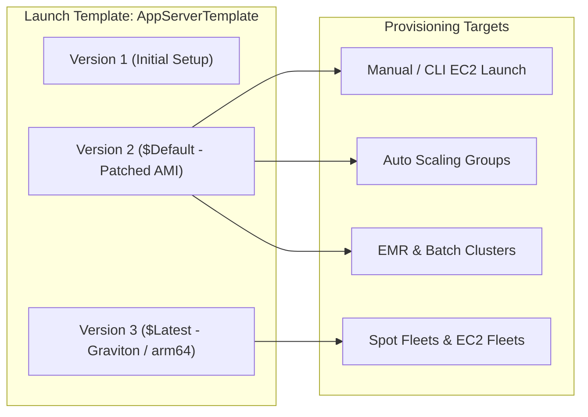
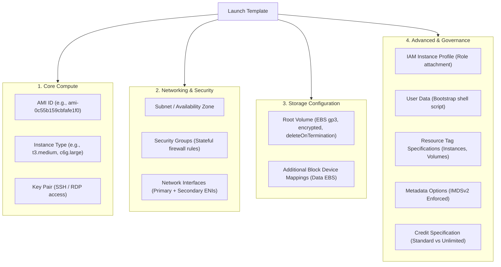
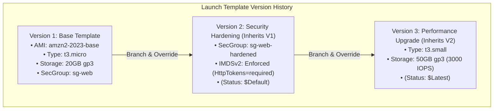
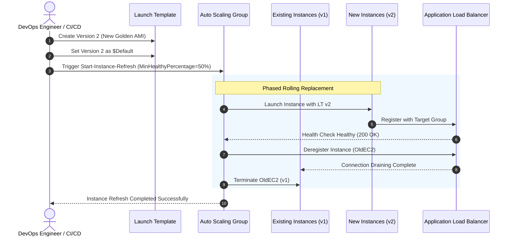

# 🚀 Module 13: Amazon EC2 Launch Templates – Study Guide

> **Course**: AWS re/Start  
> **Module**: Automated and Repeatable Deployments  
> **Source Document**: `T22-0004-RSJAWS_EN-US_SG_M13_AMAZONEC2LAUNCHTEMP.pdf`  
> **Target Audience**: AWS re/Start Learners, Cloud Practitioners, Solutions Architects, and DevOps/SysOps Engineers  

---

## 🎯 Module Overview

Deploying compute infrastructure at scale requires speed, repeatability, and consistency. When launching Amazon Elastic Compute Cloud (Amazon EC2) instances manually through the AWS Management Console or ad-hoc scripts, system administrators must repeatedly specify dozens of parameters: Amazon Machine Image (AMI) IDs, instance types, key pairs, virtual private cloud (VPC) subnets, security groups, block device mappings, IAM instance profiles, and bootstrap user data scripts. Manual entry invites human error, configuration drift, security misconfigurations, and operational friction.

**Amazon EC2 Launch Templates** address these challenges by providing a standardized, reusable, and version-controlled capability for capturing EC2 launch parameters in a single managed resource. A launch template acts as an architectural blueprint, decoupling the definition of compute configurations from their actual provisioning.

Beyond manual launches, launch templates serve as the foundational configuration engine for modern automated deployment services across AWS, including **Amazon EC2 Auto Scaling groups**, **EC2 Fleet**, and **Spot Fleets**. With native support for versioning, parameter inheritance, advanced networking, mixed-instance purchase models, and strict IAM governance, launch templates form an essential building block of immutable infrastructure and Infrastructure as Code (IaC) workflows.

This study guide provides an exhaustive exploration of Amazon EC2 Launch Templates: their architectural purpose, evolutionary comparison with legacy Launch Configurations, internal anatomy and parameter structure, native versioning mechanics, Auto Scaling deployment integration, security policies, and real-world implementation best practices.

---

### 📌 Learning Objectives

- [ ] **Define Amazon EC2 Launch Templates**: Articulate the purpose, core architecture, and operational advantages of launch templates for repeatable compute provisioning.
- [ ] **Compare Launch Templates vs. Launch Configurations**: Understand why Launch Configurations are deprecated and detail the technical superiority of Launch Templates across versioning, Spot/On-Demand flexibility, and modern hardware features.
- [ ] **Deconstruct the Anatomy of a Launch Template**: Master all configuration parameters, including AMI IDs, instance types, storage mappings (EBS volumes), network interfaces (ENIs), IAM profiles, resource tags, and User Data scripts.
- [ ] **Manage Launch Template Versioning**: Differentiate between `$Default` and `$Latest` version pointers, create derived versions with parameter overrides, and manage lifecycle version limits.
- [ ] **Architect Auto Scaling Integrations**: Implement zero-downtime rolling updates and instance refreshes using Auto Scaling groups linked to dynamic launch template versions.
- [ ] **Enforce IAM Governance & Least Privilege**: Restrict compute provisioning by configuring IAM policies that require users to launch instances strictly via approved launch templates (`ec2:LaunchTemplate`).
- [ ] **Standardize Security & Metadata Baselines**: Enforce Instance Metadata Service Version 2 (IMDSv2), automated resource tagging, and encrypted storage baselines through launch template definitions.

---

## 📚 Key Terminology

| Term | Definition |
| :--- | :--- |
| **Launch Template** | An AWS resource that captures all instance configuration parameters (AMI, instance type, keys, networking, storage, tags, user data) into a reusable, versioned specification. |
| **Launch Template Version** | An immutable, sequentially numbered iteration (v1, v2, v3...) of a launch template containing specific parameter values or delta overrides. |
| **Default Version (`$Default`)** | The designated baseline version of a launch template used automatically when an instance or Auto Scaling group launches without explicitly requesting a version number. |
| **Latest Version (`$Latest`)** | A dynamic pointer referencing the most recently created version of a launch template. |
| **Launch Configuration** | The legacy, immutable EC2 instance configuration mechanism used exclusively with Auto Scaling groups; deprecated in favor of Launch Templates. |
| **Amazon Machine Image (AMI)** | A pre-configured template containing the operating system, application server, and software packages required to launch an EC2 virtual machine. |
| **User Data** | A bootstrap script (shell script or cloud-init directives) passed to an EC2 instance at launch to perform automated initial software installation and configuration. |
| **IAM Instance Profile** | A container for an IAM role that attaches temporary security credentials directly to an EC2 instance, eliminating the need for hardcoded API keys. |
| **Instance Refresh** | An Amazon EC2 Auto Scaling capability that orchestrates a gradual, phased replacement of instances within an Auto Scaling group to apply an updated launch template version. |
| **IMDSv2** | Instance Metadata Service Version 2; a session-oriented, defense-in-depth method for accessing instance metadata that mitigates open reverse proxies and SSRF vulnerabilities. |

---

## 🏗️ 1. Purpose & Core Value of Amazon EC2 Launch Templates

### 1.1 The Challenge of Ad-Hoc Instance Provisioning

Launching an EC2 instance requires defining a large matrix of interdependent parameters:

```
┌────────────────────────────────────────────────────────────────────────┐
│                   Manual Instance Launch Pitfalls                      │
├──────────────────────────┬─────────────────────────────────────────────┤
│ Human Configuration Error│ Selecting the wrong subnet or security group│
│ Configuration Drift      │ Instances diverge from corporate baselines  │
│ Security Gaps            │ Unencrypted EBS volumes, missing IMDSv2     │
│ Deployment Latency       │ Repetitive manual input slows down scale-out│
│ Lack of Auditing         │ Difficult to track who changed what parameter│
└──────────────────────────┴─────────────────────────────────────────────┘
```

When operations teams launch instances manually through the AWS console or unmanaged scripts, the potential for error increases exponentially with fleet size. 

### 1.2 The Launch Template Solution

An Amazon EC2 Launch Template consolidates all launch parameters into a single, centralized, versioned AWS resource. Instead of re-entering 20+ configuration settings for every virtual machine, users and automation tools simply reference the template name and version:

```
aws ec2 run-instances --launch-template LaunchTemplateName=AppServerTemplate,Version=2
```



### 1.3 Strategic Business and Technical Benefits

1. **Deployment Speed & Consistency**:
   - Reduces the instance launch process from a multi-step form to a single command or API call.
   - Eliminates human typos and ensures every instance meets organizational benchmarks.
2. **Cost Management & Resource Optimization**:
   - Pre-configures cost-saving instance families, T2/T3 Unlimited bursting settings, and Spot Fleet purchase options.
   - Prevents accidental provisioning of expensive, oversized instance types by unauthorized staff.
3. **Enhanced Security & Compliance Posture**:
   - Mandates encrypted EBS storage volumes by default.
   - Standardizes least-privilege security groups and pre-approved IAM instance profiles.
   - Enforces IMDSv2 (`HttpTokens=required`) to protect against Server-Side Request Forgery (SSRF) vulnerabilities.
4. **Lifecycle & Audit Governance**:
   - Supports change management through explicit version numbers and version descriptions.
   - Integrates seamlessly with AWS CloudTrail to record who created, modified, or launched instances from specific template versions.

---

## 🔄 2. The Evolution: Launch Templates vs. Launch Configurations

Prior to the introduction of Launch Templates, Amazon EC2 Auto Scaling relied on **Launch Configurations**. AWS has officially deprecated Launch Configurations, recommending immediate migration to Launch Templates.

### 2.1 Why Launch Configurations Are Obsolete

- **Immutability without Versioning**: A Launch Configuration cannot be modified. If an AMI ID or instance type changes, engineers must build an entirely new Launch Configuration with a new name and update the Auto Scaling group to reference it. Over time, accounts accumulated hundreds of orphaned launch configurations.
- **Auto Scaling Group Lock-In**: Launch Configurations could only be consumed by Auto Scaling groups. They could not be used for standalone manual launches, Spot Fleets, or EC2 Fleets.
- **No Support for Modern AWS Innovations**: AWS stopped adding support for new compute capabilities to Launch Configurations after December 31, 2021. Modern hardware generations, mixed instance policies, and advanced networking features are strictly exclusive to Launch Templates.

### 2.2 Feature Comparison Matrix

| Feature / Capability | Launch Configuration (Deprecated) | Launch Template (Modern Standard) |
| :--- | :--- | :--- |
| **Native Versioning** | ❌ None (Must create a new resource) | ✅ Full native versioning (v1, v2, v3... up to 10,000) |
| **Parameter Inheritance** | ❌ None (Re-enter all parameters) | ✅ Create new versions based on previous versions |
| **Default & Latest Pointers** | ❌ Unsupported | ✅ `$Default` and `$Latest` dynamic pointers |
| **Usage Scope** | ❌ EC2 Auto Scaling groups only | ✅ Manual launch, ASG, Spot Fleet, EC2 Fleet, Batch |
| **Mixed Instance Policies** | ❌ Single instance type only | ✅ Multiple instance types & Spot/On-Demand mix |
| **T2 / T3 / T4g Unlimited** | ❌ Not supported | ✅ Native credit specification configuration |
| **Dedicated Hosts & Tenancy** | ⚠️ Limited host tenancy support | ✅ Dedicated hosts, host resource groups, placement groups |
| **Multiple Network Interfaces** | ❌ Single ENI only | ✅ Multiple ENIs across separate subnets/security groups |
| **Elastic Fabric Adapter (EFA)** | ❌ Not supported | ✅ Full EFA support for high-performance computing (HPC) |
| **Resource Tag Propagation** | ⚠️ Limited (ASG tags only) | ✅ Automatic propagation to instances, volumes, & ENIs |
| **IMDSv2 Enforcement** | ⚠️ Limited configuration | ✅ Direct control (`HttpTokens`, `HttpPutResponseHopLimit`) |
| **Capacity Reservations** | ❌ Not supported | ✅ On-Demand Capacity Reservation (ODCR) targeting |

> [!WARNING]
> **AWS Deprecation Notice**: AWS does not add support for new EC2 instance types or modern features to Launch Configurations. All enterprise production architectures must standardize exclusively on Launch Templates.

---

## 🧩 3. Anatomy of a Launch Template

A launch template consists of modular configuration sections that define the operational profile of an EC2 instance.



### 3.1 Core Compute Parameters

1. **Amazon Machine Image (AMI) ID**:
   - Identifies the base operating system image, pre-installed software, and filesystem architecture.
   - Supports Amazon Linux 2023, Ubuntu, Red Hat Enterprise Linux, Windows Server, and custom Golden AMIs.
2. **Instance Type**:
   - Specifies the compute capacity: vCPUs, memory, network performance, and storage throughput (e.g., `t3.micro`, `m6i.large`, `c7g.xlarge`).
   - Launch templates can also leave the instance type blank or override it within an Auto Scaling group using mixed instance policies.
3. **Key Pair**:
   - The cryptographic public key stored on the instance to authenticate SSH (Linux) or retrieve initial administrative passwords (Windows).
   - Can be omitted if using AWS Systems Manager (SSM) Session Manager for passwordless, keyless shell access.

### 3.2 Networking and Security Parameters

1. **Subnet Selection**:
   - Specifies the default VPC subnet and Availability Zone for the instance.
   - *Best Practice*: When using Auto Scaling groups, leave the subnet unspecified in the launch template, allowing the ASG to distribute instances evenly across multiple availability zones.
2. **Security Groups**:
   - Defines the virtual firewalls controlling inbound and outbound traffic at the instance interface level.
   - Can specify security group IDs (`sg-xxxxxxxxx`) or security group names (default VPC only).
3. **Elastic Network Interfaces (ENIs)**:
   - Supports multiple network interfaces on boot, attaching instances to dual networks (e.g., a management network and a public-facing network).
   - Allows configuration of primary and secondary private IPv4 addresses, IPv6 addresses, and Elastic IPs.

### 3.3 Storage Configuration (Block Device Mappings)

- **Root Volume**:
  - Defines the primary volume containing the operating system boot partition.
  - Sizing, volume type (e.g., `gp3`, `io2`), baseline IOPS, and throughput (MB/s).
- **Additional EBS Volumes**:
  - Automatically provisions and mounts secondary data volumes on launch.
- **Storage Encryption**:
  - Enforces AWS KMS encryption keys (`kms:KeyId`) for all attached block devices at launch time.
- **Delete on Termination**:
  - Flag specifying whether EBS volumes persist or terminate when the virtual machine terminates.

### 3.4 Advanced Configuration & Governance

1. **IAM Instance Profile**:
   - Attaches an IAM role containing AWS managed or inline policies.
   - Delivers temporary STS credentials to the instance metadata service, allowing applications to securely interact with Amazon S3, Amazon DynamoDB, AWS Secrets Manager, and AWS CloudWatch without hardcoded credentials.
2. **User Data Bootstrap Scripts**:
   - Executes shell commands (e.g., `#!/bin/bash`) or cloud-init YAML directives during the very first boot cycle.
   - Used to install security agents, pull application source code, mount network filesystems, or join Active Directory domains.
3. **Resource Tag Specifications (`TagSpecifications`)**:
   - Unlike legacy configurations, launch templates allow administrators to define tags that are **automatically applied directly to newly launched instances AND their attached EBS volumes** at the exact moment of creation.
   - Critical for cost allocation, FinOps billing, and automated backup schedules.
4. **Metadata Options (IMDSv2)**:
   - Sets `HttpTokens=required` to mandate session tokens for instance metadata retrieval, preventing SSRF exploits.
   - Sets `HttpPutResponseHopLimit` to prevent metadata access from within containerized workloads running on the host.

---

## 🏷️ 4. Launch Template Versioning & Management

Versioning is the distinguishing architectural superpower of Amazon EC2 Launch Templates.

### 4.1 How Versioning Works

- Every launch template starts with **Version 1 (v1)**.
- Each time a template is edited or updated, AWS creates a **new immutable version number** (v2, v3, v4...).
- A single launch template can contain up to **10,000 versions**.
- An AWS account can host up to **5,000 launch templates per region**.
- Existing versions cannot be modified in-place; they are immutable to guarantee deployment auditability.



### 4.2 Parameter Inheritance & Delta Overrides

When creating a new launch template version, engineers do not need to re-enter all parameters from scratch. The AWS console and API allow selecting a **Source Version** as a baseline:

1. **Inheritance**: All configuration settings from the source version are automatically copied into the new draft.
2. **Delta Overrides**: Engineers only specify the values they wish to change (e.g., bumping an AMI ID to apply monthly security patches).
3. **Parameter Deletion**: Parameters can be explicitly cleared or overridden with null values.

### 4.3 Understanding `$Default` vs. `$Latest`

| Version Pointer | Description | Use Cases & Operational Impact |
| :--- | :--- | :--- |
| **`$Default`** | A static pointer pointing to a specifically designated version. Defaults to `v1` upon creation, but can be reassigned to any version at any time. | **Production Stability**: Recommended for production Auto Scaling groups. Updates to `$Default` require deliberate administrative action, preventing untested draft templates from accidentally breaking production clusters. |
| **`$Latest`** | A dynamic pointer that automatically and immediately resolves to the highest numbered version in existence. | **Dev/Test Automation & CI/CD**: Useful in development and continuous integration environments where every newly built AMI or template version should be deployed immediately without updating ASG configurations. |
| **Explicit Version (e.g., `3`)** | A hardcoded reference to a specific version number. | **Strict Immutability**: Guarantees that the launch target will never change configuration, even if new versions are added or `$Default` is re-pointed. |

> [!NOTE]
> **Changing the Default Version**: Reassigning the default version of a launch template is a zero-downtime metadata operation. It does not terminate or reboot running EC2 instances. Existing instances continue running undisturbed until a new launch or refresh is triggered.

---

## 📈 5. Integration with Auto Scaling Groups & Rolling Updates

Launch templates integrate seamlessly with Amazon EC2 Auto Scaling to enable automated scale-out, self-healing, and zero-downtime application deployments.

### 5.1 Auto Scaling Group Version Binding

When an Auto Scaling group (ASG) is attached to a Launch Template, it can reference:
1. **The `$Default` version**: The ASG provisions instances using the current default version. When administrators update the default version, subsequent scale-out events use the new version.
2. **The `$Latest` version**: The ASG automatically picks up new template versions as soon as CI/CD creates them.
3. **A Fixed Version number**: Locks the ASG to a verified snapshot.



### 5.2 Zero-Downtime Instance Refresh

When a new launch template version is published, the Auto Scaling group does not automatically terminate running instances immediately. To update an existing fleet without service interruption, AWS provides the **Auto Scaling Instance Refresh**:

- **Rolling Deployment**: Replaces instances incrementally in batches.
- **Minimum Healthy Percentage**: Ensures that a specified percentage of instances (e.g., 80% or 90%) remain healthy and processing requests in the Application Load Balancer target group throughout the deployment.
- **Warm-Up Period**: Allows bootstrap User Data scripts to finish executing before the load balancer routes production traffic to the new instance.
- **Automated Rollback**: If CloudWatch alarms detect error spikes during the refresh, the operation cancels automatically and rolls back to the previous template version.

### 5.3 Mixed Instances & Spot Fleet Policies

Unlike Launch Configurations, Launch Templates allow Auto Scaling groups to leverage **Mixed Instances Policies**:
- Launch a combination of **On-Demand** and **Spot Instances** within the same Auto Scaling group.
- Specify multiple instance types (e.g., `c5.large`, `c5a.large`, `c6i.large`) to maximize Spot instance availability and achieve massive cost reductions.
- Allocate compute based on lowest price or capacity-optimized allocation strategies.

---

## 🔒 6. Security, Governance, and IAM Permissions

A major architectural advantage of Launch Templates is the ability to enforce strict **separation of duties** and organizational governance through AWS Identity and Access Management (IAM).

### 6.1 Principle of Least Privilege: Authoring vs. Launching

In enterprise environments, infrastructure administrators who define secure instance baselines should be separated from developers who launch virtual machines:

```
┌─────────────────────────────────┐       ┌─────────────────────────────────┐
│     Cloud Security / Platform   │       │      Application Developers     │
├─────────────────────────────────┤       ├─────────────────────────────────┤
│ • Permissions:                  │       │ • Permissions:                  │
│   ec2:CreateLaunchTemplate      │       │   ec2:RunInstances              │
│   ec2:CreateLaunchTemplateVersion│      │ • Constraints:                  │
│   ec2:ModifyLaunchTemplate      │       │   Must use approved template    │
│ • Responsibilities:             │       │ • Cannot:                       │
│   Enforce approved AMIs, tags,  │       │   Pick unauthorized AMIs, open  │
│   encryption keys, and IMDSv2   │       │   security groups, bypass tags  │
└─────────────────────────────────┘       └─────────────────────────────────┘
```

### 6.2 IAM Policy: Restricting Launches to Approved Templates

The following IAM policy allows an IAM user or role to launch EC2 instances **only if they reference an approved launch template**:

```json
{
  "Version": "2012-10-17",
  "Statement": [
    {
      "Sid": "AllowRunInstancesWithSpecificTemplate",
      "Effect": "Allow",
      "Action": "ec2:RunInstances",
      "Resource": "arn:aws:ec2:us-east-1:123456789012:instance/*",
      "Condition": {
        "ArnEquals": {
          "ec2:LaunchTemplate": "arn:aws:ec2:us-east-1:123456789012:launch-template/lt-0123456789abcdef0"
        }
      }
    },
    {
      "Sid": "AllowSupportingEC2Actions",
      "Effect": "Allow",
      "Action": [
        "ec2:RunInstances"
      ],
      "Resource": [
        "arn:aws:ec2:us-east-1:123456789012:network-interface/*",
        "arn:aws:ec2:us-east-1:123456789012:volume/*",
        "arn:aws:ec2:us-east-1:123456789012:key-pair/*",
        "arn:aws:ec2:us-east-1:123456789012:security-group/*",
        "arn:aws:ec2:us-east-1::image/*"
      ]
    }
  ]
}
```

### 6.3 Enforcing IMDSv2 via Launch Templates

Launch templates provide native configuration flags to harden instances against metadata theft:

```json
"MetadataOptions": {
  "HttpTokens": "required",
  "HttpPutResponseHopLimit": 1,
  "HttpEndpoint": "enabled"
}
```

- `HttpTokens: required` mandates the use of a secure token issued via a `PUT` request with a time-to-live header, completely blocking standard SSRF attacks.
- `HttpPutResponseHopLimit: 1` ensures metadata requests cannot traverse IP network hops (preventing containers from reading the host instance role credentials).

---

## 🛠️ 7. Hands-on Walkthrough: AWS CLI Implementation

### 7.1 Creating a Baseline Launch Template (v1)

Create a configuration file `template-data.json`:

```json
{
  "ImageId": "ami-0c55b159cbfafe1f0",
  "InstanceType": "t3.micro",
  "KeyName": "admin-keypair",
  "SecurityGroupIds": [
    "sg-0123456789abcdef0"
  ],
  "IamInstanceProfile": {
    "Arn": "arn:aws:iam::123456789012:instance-profile/AppServerRoleProfile"
  },
  "TagSpecifications": [
    {
      "ResourceType": "instance",
      "Tags": [
        { "Key": "Environment", "Value": "Production" },
        { "Key": "ManagedBy", "Value": "DevOpsTeam" }
      ]
    },
    {
      "ResourceType": "volume",
      "Tags": [
        { "Key": "Environment", "Value": "Production" }
      ]
    }
  ],
  "MetadataOptions": {
    "HttpTokens": "required",
    "HttpPutResponseHopLimit": 1,
    "HttpEndpoint": "enabled"
  }
}
```

Execute the AWS CLI command to create the launch template:

```bash
aws ec2 create-launch-template \
    --launch-template-name "AppServer-Template" \
    --version-description "v1 - Initial baseline production configuration" \
    --launch-template-data file://template-data.json
```

### 7.2 Creating a New Version (v2) with Overrides

To update the instance type from `t3.micro` to `t3.small` while keeping all other settings identical:

```bash
aws ec2 create-launch-template-version \
    --launch-template-name "AppServer-Template" \
    --source-version 1 \
    --version-description "v2 - Upgraded instance type to t3.small" \
    --launch-template-data '{"InstanceType":"t3.small"}'
```

### 7.3 Setting the Default Version to v2

```bash
aws ec2 modify-launch-template \
    --launch-template-name "AppServer-Template" \
    --default-version 2
```

### 7.4 Launching an Instance Using the Template

To launch an instance using the `$Default` version:

```bash
aws ec2 run-instances \
    --launch-template LaunchTemplateName=AppServer-Template,Version='$Default' \
    --min-count 1 \
    --max-count 1
```

To launch an instance overriding a specific subnet at launch time:

```bash
aws ec2 run-instances \
    --launch-template LaunchTemplateName=AppServer-Template,Version=2 \
    --subnet-id subnet-0987654321fedcba0 \
    --min-count 1 \
    --max-count 1
```

---

## 📋 8. Architectural Best Practices & Antipatterns

### ✅ Architectural Best Practices

1. **Decouple Subnets from the Template for ASGs**:
   - Leave the VPC subnet blank in the launch template if the template is intended for Auto Scaling groups. Define the subnets at the ASG level across multiple Availability Zones to ensure high availability.
2. **Combine Golden AMIs with Dynamic User Data**:
   - Pre-install core runtime binaries into a custom Golden AMI to minimize boot times.
   - Use User Data strictly for lightweight environment bootstrapping (fetching environment configs, secrets, or joining orchestration clusters).
3. **Always Enforce Resource Tagging**:
   - Configure `TagSpecifications` in the launch template so both instances and newly created EBS volumes receive financial cost-center and environment tags automatically upon launch.
4. **Mandate IMDSv2**:
   - Set `HttpTokens=required` across all launch templates to meet enterprise compliance standards and protect IAM role credentials.
5. **Pin ASG to `$Default` in Production**:
   - Keep production Auto Scaling groups bound to `$Default`. Test new versions in staging using explicit version numbers before promoting them to `$Default`.

### ❌ Antipatterns to Avoid

| Antipattern | Risk / Impact | Correction |
| :--- | :--- | :--- |
| **Embedding Hardcoded Credentials in User Data** | Secret leakage via AWS CloudTrail, metadata inspection, or console logs. | Attach an IAM Instance Profile and fetch credentials securely from AWS Secrets Manager or Parameter Store. |
| **Using Deprecated Launch Configurations** | Prevents adopting modern instance families, Spot Fleets, and IMDSv2 controls. | Migrate all Auto Scaling groups to Launch Templates. |
| **Hardcoding Ephemeral Subnet IDs** | Instances cannot scale into other Availability Zones if that specific subnet exhausts IP capacity. | Define subnets in the Auto Scaling group across multiple Availability Zones. |
| **Manually Modifying Running Instances** | Creates configuration drift and makes scale-out instances inconsistent with running machines. | Adhere to immutable infrastructure: update the Launch Template and trigger an Instance Refresh. |

---

## 🧠 9. Knowledge Check & Review Questions

### Question 1
**An organization needs to update the AMI ID for an Auto Scaling group that deploys a fleet of customer-facing web servers. What is the AWS-recommended approach to achieve this with zero downtime?**

A. Manually terminate each instance in the Auto Scaling group and let the group launch new instances using the old launch configuration.  
B. Create a new launch template version with the updated AMI ID, set it as the default version, and initiate an Auto Scaling Instance Refresh with a minimum healthy percentage.  
C. Edit the existing launch template version 1 in-place to update the AMI ID.  
D. Delete the Auto Scaling group and recreate it with a new Launch Configuration referencing the new AMI.  

*Answer:* **B**  
*Explanation:* Launch template versions are immutable and cannot be edited in-place (eliminating C). Launch configurations are deprecated (eliminating D). Option A would cause an outage and still use the old AMI. Option B creates a new immutable version, points the ASG or default pointer to it, and leverages Instance Refresh to safely perform a rolling zero-downtime deployment.

---

### Question 2
**A cloud security engineer wants to ensure that junior developers can launch EC2 instances for development testing, but strictly prevents them from launching unapproved AMIs or creating unencrypted EBS storage volumes. How should this be implemented?**

A. Grant developers full `ec2:RunInstances` permissions and run a weekly script to terminate non-compliant instances.  
B. Create a pre-approved Launch Template that specifies encrypted EBS volumes and approved AMIs, then grant developers IAM permissions to execute `ec2:RunInstances` only when referencing that specific launch template ARN.  
C. Disable developer access to the AWS Management Console and require all instances to be deployed via AWS Support tickets.  
D. Store the approved AMI ID in an Amazon S3 bucket and use bucket policies to restrict launches.  

*Answer:* **B**  
*Explanation:* Launch Templates enable fine-grained IAM governance. By applying IAM condition keys (`ec2:LaunchTemplate`), security teams allow developers to launch instances while restricting all parameter choices to the vetted, approved blueprint.

---

### Question 3
**Which of the following compute features can be configured in an Amazon EC2 Launch Template but CANNOT be configured in a legacy Launch Configuration? (Select THREE)**

- [ ] A. T3 Unlimited credit bursting specification  
- [ ] B. Multiple Elastic Network Interfaces (ENIs)  
- [ ] C. Mixed On-Demand and Spot instances within an Auto Scaling group  
- [ ] D. Amazon Machine Image (AMI) ID  
- [ ] E. User Data bootstrap script  
- [ ] F. EC2 Key Pair  

*Answer:* **A, B, C**  
*Explanation:* Legacy Launch Configurations do not support T2/T3/T4g Unlimited bursting configuration, multiple network interfaces, or mixed instance policies (combining Spot and On-Demand). AMIs, User Data, and Key Pairs were supported in Launch Configurations.

---

### Question 4
**What happens to currently running EC2 instances when an administrator updates the `$Default` version of an Amazon EC2 Launch Template?**

A. The running instances are terminated immediately and replaced with new instances.  
B. The running instances are automatically rebooted to apply the new template parameters.  
C. The running instances continue operating without interruption; only new instances launched after the update will use the new default version.  
D. The running instances are paused until an administrator confirms the version change.  

*Answer:* **C**  
*Explanation:* Updating a launch template or its `$Default` pointer is a control-plane metadata operation. It has no direct or automatic impact on running instances. To apply the new version to existing Auto Scaling instances, an Instance Refresh or rolling replacement must be initiated.

---

## 📌 Summary & Key Takeaways

1. **Standardized Blueprint**: An Amazon EC2 Launch Template captures all compute, network, storage, security, and governance parameters in a centralized, repeatable specification.
2. **Version-Controlled & Immutable**: Each update produces a discrete, numbered version. Versions can inherit settings from older versions and apply delta overrides.
3. **Superior to Launch Configurations**: Launch Configurations are deprecated. Launch Templates provide native versioning, dynamic `$Default`/`$Latest` pointers, and support modern features like mixed Spot/On-Demand fleets, T2/T3 unlimited bursting, and multi-ENI networking.
4. **Auto Scaling & Rolling Deployments**: Auto Scaling groups leverage Launch Templates and Instance Refreshes to execute automated, zero-downtime rolling upgrades.
5. **Enterprise Governance**: IAM policies can mandate that instances only be launched using approved Launch Templates, ensuring consistent compliance, encryption, tagging, and IMDSv2 security baselines.
