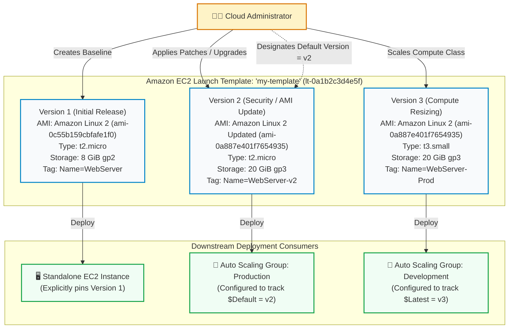
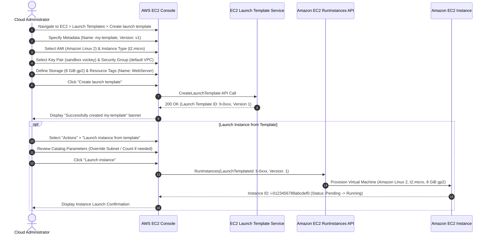

# 🎥 AWS Technical Demonstration: Creating and Managing Amazon EC2 Launch Templates

> **Course**: AWS re/Start  
> **Module**: Automated and Repeatable Deployments (M14 / M13 – Automated and Repeatable Deployments)  
> **Source Media**: `T22-Automated_and_Repeatable_Deployments/T22-0005-RSSCHAB_EN-US_Video_M14_EC2_Launch_Template_Demo.mp4` (6 min 55 sec)  
> **Format**: Video Audio Transcription & Comprehensive Hands-On Lab Walkthrough  
> **Target Audience**: AWS re/Start Learners, Cloud Practitioners, Solutions Architects, and SysOps Administrators  

---

## 🎯 Demonstration Overview

In this technical demonstration, the instructor navigates the **Amazon Elastic Compute Cloud (Amazon EC2)** management console within the **AWS Academy sandbox environment** to build, configure, inspect, and deploy reusable **Amazon EC2 Launch Templates**.

Standard manual provisioning of compute infrastructure introduces operational friction, human error, configuration drift, and compliance risks. Administrators frequently face challenges when onboarding development teams, ensuring baseline security groups and IAM roles are applied consistently, or provisioning identical virtual machines across multiple Availability Zones. 

An **Amazon EC2 Launch Template** addresses these operational hurdles by decoupling instance configuration parameters—such as the Amazon Machine Image (AMI), instance type, key pair, network interfaces, security groups, block device mappings, user data scripts, and resource tags—from the runtime provisioning command. Launch templates introduce robust **versioning**, allowing engineering teams to iterate on operating system updates, package installations, and security baselines without overwriting existing production standards or breaking downstream automation.

```
┌──────────────────────────────────────────────────────────────────────────────────────────────────┐
│                                   LAUNCH TEMPLATE WORKFLOW                                       │
│                                                                                                  │
│  Phase 1: Template Specification (Console / IaC / CLI)                                           │
│  AWS Console ──> EC2 Dashboard ──> Launch Templates ──> Create Launch Template                   │
│                   ├── Metadata: Name ('my-template'), Description, Version ('v1')                │
│                   ├── Compute & OS: Amazon Linux 2 AMI, t2.micro, Sandbox Key Pair               │
│                   ├── Network & Firewall: Default VPC, Security Group                            │
│                   └── Storage & Governance: 8 GiB gp2 EBS Root Volume, Tag (Name: WebServer)     │
│                                                                                                  │
│  Phase 2: Template Catalog & Version Management                                                  │
│  Version v1 (Baseline) ──> Version v2 (Patched / Updated) ──> Set Default Version                │
│                                                                                                  │
│  Phase 3: Repeatable Downstream Deployment                                                       │
│  Launch Template ──┬──> Standalone EC2 Instance ("Launch instance from template")                │
│                    ├──> Amazon EC2 Auto Scaling Group (Dynamic Fleet Scaling)                    │
│                    └──> EC2 Fleet / Spot Fleet (Multi-Instance Type & Purchase Options)          │
└──────────────────────────────────────────────────────────────────────────────────────────────────┘
```

---

## 📌 Learning Objectives

By completing this tutorial and studying the architectural patterns demonstrated, you will be able to:

- [ ] **Explain the Purpose and Architectural Benefits of Launch Templates**: Articulate how launch templates ensure consistency, reduce configuration drift, enforce organization-wide governance, and streamline multi-instance deployments.
- [ ] **Compare Launch Templates, Launch Configurations, and Manual Provisioning**: Explain why AWS deprecated Amazon EC2 Launch Configurations in favor of Launch Templates, highlighting versioning, parameter overrides, and Spot/On-Demand mixing.
- [ ] **Navigate the Amazon EC2 Console in AWS Academy**: Access the Launch Templates console under the Instances navigation panel within the AWS Academy learner sandbox.
- [ ] **Configure Core Launch Template Parameters**: Define template metadata, select Amazon Machine Images (Amazon Linux 2), choose instance types (`t2.micro` Free Tier eligible), and attach EC2 key pairs.
- [ ] **Define Networking and Stateful Security Controls**: Assign Virtual Private Cloud (VPC) network targets, select subnets, and attach VPC security groups.
- [ ] **Configure Block Storage and Resource Tagging Policies**: Specify Elastic Block Store (EBS) volume parameters (8 GiB General Purpose SSD `gp2`) and enforce automatic tagging (`Name: WebServer`) on instances and storage volumes upon launch.
- [ ] **Manage Launch Template Lifecycle and Versioning**: Track template revisions, configure initial versions (`v1`), create updated iterations (`v2`), and switch the designated default template version.
- [ ] **Deploy Instances from a Launch Template**: Provision consistent EC2 instances using the template catalog, evaluate parameter override capabilities at launch time, and integrate templates with Auto Scaling Groups.

---

## 🏗️ Architectural Deep Dive: Amazon EC2 Launch Templates

### 1. Evolution of EC2 Provisioning Mechanisms

Historically, AWS offered two primary methods to automate and standardize EC2 instance launches: manual step-by-step console/CLI launches and **Amazon EC2 Launch Configurations**. 

| Architectural Dimension | Manual EC2 Launch | Launch Configuration (Legacy / Deprecated) | Amazon EC2 Launch Template (Current Standard) |
| :--- | :--- | :--- | :--- |
| **Repeatability** | Low; prone to human error and configuration drift. | High; captures complete launch specification. | Maximum; provides strict parameter standardization. |
| **Versioning Support** | None; parameters must be re-entered each launch. | None; immutable. Updates require creating an entirely new configuration. | **Native Versioning**: Multiple versions (`v1`, `v2`, `v3`) under a single template ID. |
| **Parameter Overrides** | Full manual control. | No overrides permitted at launch time. | **Selective Overrides**: Users can override specific settings (e.g., subnet or instance type) if permitted. |
| **Fleet & ASG Features** | Not applicable. | Limited to single instance type and purchase model. | Supports mixed instances, On-Demand and Spot allocation strategies in ASG. |
| **AWS T2/T3 Unlimited** | Supported. | Not supported. | Fully supported. |
| **Elastic Graphics / Inferentia** | Supported. | Not supported. | Fully supported. |
| **Deprecation Status** | Active (ad-hoc use). | **Deprecated** by AWS; no new feature support since 2021. | **Active & Recommended** for all EC2 and Auto Scaling workloads. |

> [!IMPORTANT]
> **AWS Deprecation Advisory**: AWS officially deprecated Launch Configurations. Modern AWS services—including Amazon EC2 Auto Scaling, AWS Batch, Amazon EKS managed node groups, and AWS Elastic Beanstalk—require or strongly recommend Amazon EC2 Launch Templates. Launch templates provide access to modern EC2 features, including mixed-instance policies, Spot allocations, Graviton instance types, and Systems Manager parameter references.

---

### 2. Versioning Mechanics and Lifecycle Management

A critical differentiator of Launch Templates is native **versioning**. Each launch template has:
1. **Template ID & Name**: A unique identifier (e.g., `lt-0123456789abcdef0`) and user-friendly name (`my-template`).
2. **Version Number**: An integer that increments sequentially (`1`, `2`, `3`...).
3. **Default Version**: The specific version deployed by default when no version is explicitly passed by an API caller or downstream Auto Scaling Group. Administrators can change the default version at any time.
4. **Latest Version**: The highest numerical version created. Downstream services like Auto Scaling Groups can be configured to automatically track `$Latest`, ensuring instances always launch with the newest template revision without requiring manual ASG updates.



---

### 3. Creation & Deployment Workflow Diagram

The complete administrative workflow demonstrated in the video spans template specification, resource tagging, and instance deployment.



---

## 🛠️ Comprehensive Hands-On Lab Walkthrough

### Prerequisites & Laboratory Environment

In the **AWS Academy sandbox environment**, credentials and base networking infrastructure are pre-provisioned:
- **AWS Region**: Assigned sandbox region (e.g., `us-east-1` N. Virginia or `us-west-2` Oregon).
- **Default VPC**: Pre-existing Virtual Private Cloud with public subnets across multiple Availability Zones.
- **Default Key Pair**: Pre-generated sandbox key pair (typically named `vockey`).
- **IAM Role**: Student learner role with appropriate EC2 permissions.

---

### Step 1: Navigating to Launch Templates in the EC2 Console

1. Log in to the **AWS Management Console** using your AWS Academy sandbox credentials.
2. In the top search bar or under **Recently visited services**, search for and select **EC2** to open the **Amazon EC2 Management Console**.
3. In the left-hand navigation pane, locate the **Instances** section.
4. Click on **Launch Templates**.
5. Observe the Launch Templates landing page. If no templates have been created previously, the console displays an introductory banner describing template capabilities.
6. Click the orange **Create launch template** button in the upper-right corner.

> [!NOTE]
> Until at least one launch template is created in the AWS account, the option **Launch instance from template** under the primary **Launch instances** dropdown in the EC2 Instances dashboard remains grayed out or inactive.

---

### Step 2: Defining Template Metadata and Versioning

In the **Launch template name and description** section, configure the administrative identification parameters:

| Configuration Field | Demo Setting | Operational Rationale |
| :--- | :--- | :--- |
| **Launch template name** | `my-template` | A clear, human-readable name identifying the application or workload role (e.g., `web-server-template`, `api-worker-prod`). Must be unique per Region within your account. |
| **Template version description** | `Version 1` or `Initial baseline template` | Descriptive notes explaining the purpose of this revision, installed dependencies, or release commit tags. |
| **Auto Scaling guidance** | *Unchecked (Optional)* | When checked, the console provides real-time guidance and validation rules tailored specifically for templates intended for EC2 Auto Scaling groups. |

```
┌──────────────────────────────────────────────────────────────────────────────────┐
│  Launch template name and description                                            │
│                                                                                  │
│  Launch template name *                                                          │
│  [ my-template                                                                 ] │
│                                                                                  │
│  Template version description                                                    │
│  [ Version 1 - Baseline Amazon Linux 2 Configuration                           ] │
│                                                                                  │
│  [ ] Provide guidance to help me set up a template that I can use with EC2 Auto  │
│      Scaling                                                                     │
└──────────────────────────────────────────────────────────────────────────────────┘
```

> [!TIP]
> **Best Practice for Template Naming**: Use standardized naming conventions incorporating environment and tier identifiers—such as `app-<tier>-<environment>-lt` (e.g., `app-frontend-prod-lt`). This makes identifying appropriate templates straightforward when multiple teams share an AWS account.

---

### Step 3: Selecting Core Infrastructure Parameters (AMI, Compute & Key Pair)

Scroll down to configure the foundational virtual machine attributes:

#### 1. Amazon Machine Image (AMI)
- Under **Application and OS Images (Amazon Machine Image)**, select **Quick Start**.
- Select **Amazon Linux**.
- From the dropdown, select **Amazon Linux 2 AMI (HVM) - Kernel 5.10, SSD Volume Type** (Free tier eligible).
- Note the AMI ID (e.g., `ami-0c55b159cbfafe1f0` or current regional ID).

#### 2. Instance Type
- Under **Instance type**, click the dropdown menu.
- Search for and select **`t2.micro`** (1 vCPU, 1 GiB Memory).
- Confirm that `t2.micro` shows the badge **Free tier eligible**.

#### 3. Key Pair (Login)
- Under **Key pair (login)**, locate the key pair dropdown.
- Select the pre-configured key pair provided by the AWS Academy sandbox environment (e.g., `vockey`).
- This ensures that any instance provisioned from this template can be accessed via SSH using the learner's downloaded private key.

> [!NOTE]
> If a template is intended strictly for immutable, headless worker nodes managed entirely via **AWS Systems Manager Session Manager** (SSM), the key pair field can be left blank (`Proceed without a key pair`), eliminating the need to distribute and rotate private SSH keys.

---

### Step 4: Networking & Security Group Configuration

Under the **Network settings** panel, establish network connectivity and firewall parameters:

#### 1. Networking Platform
- The console provides options to specify VPC networking.
- In modern AWS accounts, the platform defaults to **Virtual Private Cloud (VPC)**. The instructor highlights that older AWS accounts supported "EC2-Classic" (a flat, non-VPC network topology used prior to 2013), but all modern workloads run inside an Amazon VPC.

#### 2. Subnet and Auto-assign Public IP
- In a launch template, **specifying a subnet is optional**.
- **Architectural Recommendation**: Leave the Subnet field as **"Don't include in launch template"**. This allows the template to remain reusable across any subnet or Availability Zone in the VPC, letting the Auto Scaling Group or the administrator choose the target subnet at runtime.

#### 3. Firewall (Security Groups)
- Under **Firewall (security groups)**, select **Select existing security group**.
- In the **Security groups** dropdown, choose the default security group for the VPC (e.g., `default` or `launch-wizard-1`).
- Ensure the associated security group includes inbound rules tailored for your workload (such as TCP port 80 for HTTP or TCP port 22 for SSH management).

```
┌──────────────────────────────────────────────────────────────────────────────────┐
│  Network settings                                                                │
│                                                                                  │
│  Subnet                                                                          │
│  [ Don't include in launch template                                            ] │
│                                                                                  │
│  Firewall (security groups)                                                      │
│  ( ) Create security group       (•) Select existing security group              │
│                                                                                  │
│  Security groups                                                                 │
│  [ default (sg-0123456789abcdef0)                                              ] │
└──────────────────────────────────────────────────────────────────────────────────┘
```

> [!CAUTION]
> If you assign a security group by **Name** rather than **Security Group ID**, the template can only launch instances in the default VPC. Always reference security groups by their immutable **ID** (`sg-xxxxxxxxxxxxxxxxx`) to ensure compatibility with custom VPCs.

---

### Step 5: Storage and Resource Tagging

#### 1. Storage (Volumes)
- Under **Configure storage**, observe the default block device mapping attached to the Amazon Linux 2 AMI:
  - **Volume 1 (AMI Root)**: `8 GiB`
  - **Volume Type**: `gp2` (General Purpose SSD)
  - **Device Name**: `/dev/xvda`
  - **Delete on Termination**: `Yes`
- You have the option to add additional EBS data volumes (e.g., secondary `/dev/sdb` EBS volume for database files or logs) or adjust the volume type to `gp3` for higher baseline throughput. For this demonstration, retain the default 8 GiB gp2 root volume.

#### 2. Resource Tags
- Scroll down to the **Resource tags** section and click **Add tag**.
- Configure the metadata key-value pair:
  - **Key**: `Name`
  - **Value**: `WebServer` (or `my-template`)
  - **Resource types**: Check **Instances** and **Volumes**.
- **Why Tagging Matters**: 
  - AWS allows assigning up to **50 tags** per resource.
  - Tags enable targeted patch baselines in AWS Systems Manager.
  - Tags facilitate detailed cost allocation tracking in AWS Cost Explorer.
  - Tags enable attribute-based access control (ABAC) via IAM policies.

```
┌──────────────────────────────────────────────────────────────────────────────────┐
│  Resource tags                                                                   │
│                                                                                  │
│  Key                 Value                  Resource types                       │
│  [ Name            ] [ WebServer          ] [✔] Instances   [✔] Volumes          │
│                                                                                  │
│  [ + Add tag ]                                                                   │
└──────────────────────────────────────────────────────────────────────────────────┘
```

---

### Step 6: Reviewing and Creating the Launch Template

1. Scroll to the bottom of the creation screen.
2. In the right-hand **Summary** pane, verify all configured parameters:
   - **Template Name**: `my-template`
   - **Version**: `1`
   - **AMI**: Amazon Linux 2 AMI
   - **Instance Type**: `t2.micro`
   - **Key Pair**: Default sandbox key pair (`vockey`)
   - **Security Group**: Default VPC security group
   - **Storage**: 1 volume (8 GiB gp2)
   - **Tags**: `Name: WebServer`
3. Click the orange **Create launch template** button.
4. The console displays a green success confirmation banner:  
   *`Successfully created launch template my-template.`*
5. Click **View launch templates** to return to the catalog listing.

---

### Step 7: Managing Versions and Deploying Instances

Once created, administrators can view template details, create updated versions (`v2`), and launch instances.

#### 1. Inspecting Template Details
- Select `my-template` from the list.
- Under the **Template details** tab, review the configured specifications.
- Under the **Versions** tab, confirm that Version 1 is currently marked as both the **Latest** and **Default** version.

```
┌──────────────────────────────────────────────────────────────────────────────────┐
│  my-template (lt-0a1b2c3d4e5f)                                                  │
│                                                                                  │
│  Default version: 1                Latest version: 1                             │
│                                                                                  │
│  [ Details ]  [ Versions ]  [ Actions ▼ ]                                        │
│                                                                                  │
│  Version   Created At           Description           Default?                   │
│  1         2026-10-12 14:00 UTC Baseline Amazon Linux 2  Yes                     │
└──────────────────────────────────────────────────────────────────────────────────┘
```

#### 2. Creating a Newer Version (`v2`)
To demonstrate how administrators iterate on templates without disrupting existing deployments:
1. Select the template `my-template`.
2. Click the **Actions** dropdown menu and select **Modify template (Create new version)**.
3. The console prepopulates all parameters from Version 1.
4. Under **Template version description**, enter: `Version 2 - Updated AMI and Root Volume`.
5. Under **Configure storage**, modify the volume size from `8 GiB` to `20 GiB`, or change the volume type from `gp2` to `gp3`.
6. Click **Create launch template version**.
7. Navigate back to the **Versions** tab. You now observe:
   - Version 1 (Default: Yes)
   - Version 2 (Default: No, Latest: Yes)
8. To set Version 2 as the new production standard:
   - Select **Actions** > **Set default version**.
   - Choose `Version 2` from the dropdown and click **Save**.

#### 3. Deploying an EC2 Instance from the Template
There are two distinct entry points in the AWS Management Console to deploy an instance using a launch template:

##### Method A: Direct Launch from Template Actions
1. Navigate to **Launch Templates** in the left navigation pane.
2. Select `my-template`.
3. Click the **Actions** menu and select **Launch instance from template**.

##### Method B: Launch via the EC2 Instances Dashboard
1. Navigate to **Instances** in the left navigation pane.
2. Click the arrow next to the orange **Launch instances** button and select **Launch instance from template**.
3. In the **Launch template** catalog dropdown, select `my-template`.
4. In the **Source template version** dropdown, choose whether to launch `1`, `2`, or `$Default`.

```
┌──────────────────────────────────────────────────────────────────────────────────┐
│  Launch an instance from a template                                              │
│                                                                                  │
│  Launch template                                                                 │
│  [ my-template                                                                 ] │
│                                                                                  │
│  Source template version                                                         │
│  [ 1 (Default)                                                                 ] │
│                                                                                  │
│  Number of instances                                                             │
│  [ 1                                                                           ] │
│                                                                                  │
│  Network settings (Overrides)                                                    │
│  Subnet: [ subnet-0a1b2c3d (us-east-1a)                                       ] │
│                                                                                  │
│  [ Launch instance from template ]                                               │
└──────────────────────────────────────────────────────────────────────────────────┘
```

5. **Parameter Flexibility & Runtime Overrides**:
   - The template prepopulates the AMI, instance type (`t2.micro`), key pair, security group, and storage.
   - The administrator can choose the target **Subnet** (e.g., select Availability Zone `us-east-1a`).
   - If workload demands vary, individual settings (such as the number of instances or instance type) can be overridden at launch time without altering the base template definition.
6. Click **Launch instance from template**.
7. Under **Instances**, verify that the new virtual machine transitions to `Running` status with the pre-configured tag `Name = WebServer`.

---

## 💻 Programmatic Administration: AWS CLI Reference

While the console provides an intuitive visual interface, production enterprise architectures deploy and manage launch templates programmatically using the **AWS Command Line Interface (AWS CLI)** or Infrastructure as Code (AWS CloudFormation / Terraform).

### 1. Creating Launch Template v1 via AWS CLI

```bash
# Create Launch Template v1 with Amazon Linux 2, t2.micro, and WebServer tag
aws ec2 create-launch-template \
    --launch-template-name my-template \
    --version-description "Version 1 - Baseline Amazon Linux 2" \
    --launch-template-data '{
        "ImageId": "ami-0c55b159cbfafe1f0",
        "InstanceType": "t2.micro",
        "KeyName": "vockey",
        "SecurityGroupIds": ["sg-0123456789abcdef0"],
        "BlockDeviceMappings": [
            {
                "DeviceName": "/dev/xvda",
                "Ebs": {
                    "VolumeSize": 8,
                    "VolumeType": "gp2",
                    "DeleteOnTermination": true
                }
            }
        ],
        "TagSpecifications": [
            {
                "ResourceType": "instance",
                "Tags": [
                    {"Key": "Name", "Value": "WebServer"}
                ]
            }
        ]
    }'
```

### 2. Creating an Iterative Version (`v2`) via AWS CLI

```bash
# Create Version 2 updating the root volume to 20 GiB gp3
aws ec2 create-launch-template-version \
    --launch-template-name my-template \
    --source-version 1 \
    --version-description "Version 2 - Upgraded to 20 GiB gp3" \
    --launch-template-data '{
        "BlockDeviceMappings": [
            {
                "DeviceName": "/dev/xvda",
                "Ebs": {
                    "VolumeSize": 20,
                    "VolumeType": "gp3",
                    "DeleteOnTermination": true
                }
            }
        ]
    }'
```

### 3. Modifying the Default Template Version

```bash
# Set Version 2 as the new default version for all downstream deployments
aws ec2 modify-launch-template \
    --launch-template-name my-template \
    --default-version 2
```

### 4. Launching an EC2 Instance from the Template

```bash
# Launch a single instance in a specific subnet using the default template version
aws ec2 run-instances \
    --launch-template LaunchTemplateName=my-template,Version='$Default' \
    --subnet-id subnet-0123456789abcdef0 \
    --count 1
```

### 5. Attaching Launch Template to an Auto Scaling Group

```bash
# Create an Auto Scaling Group using my-template Version $Latest
aws autoscaling create-auto-scaling-group \
    --auto-scaling-group-name webserver-asg \
    --launch-template LaunchTemplateName=my-template,Version='$Latest' \
    --min-size 1 \
    --max-size 5 \
    --desired-capacity 2 \
    --vpc-zone-identifier "subnet-0123456789abcdef0,subnet-0fedcba9876543210"
```

---

## 📊 Comprehensive Parameter Reference

The following table summarizes all core parameters configured during the creation and deployment of the launch template:

| Parameter Category | Configuration Attribute | Video Demonstration Value | Production Recommendation |
| :--- | :--- | :--- | :--- |
| **Metadata** | Launch Template Name | `my-template` | Use descriptive role and tier prefixes (`app-web-prod-lt`). |
| **Metadata** | Initial Version | `1` | Increment sequentially; record change rationale in description. |
| **Operating System** | AMI | Amazon Linux 2 AMI (`x86_64`) | Use hardened golden AMIs or current Amazon Linux 2023 SSM parameters. |
| **Compute** | Instance Type | `t2.micro` (1 vCPU, 1 GiB RAM) | Right-size based on workload CPU and memory requirements (`t3`, `m6i`, `c6g`). |
| **Authentication** | Key Pair | Sandbox key pair (`vockey`) | Prefer AWS Systems Manager Session Manager; omit SSH keys where possible. |
| **Networking** | Platform | Amazon VPC | Always deploy within private subnets in an Amazon VPC. |
| **Networking** | Subnet Binding | Unspecified (*"Don't include"*) | Keep unassigned in template to allow multi-AZ deployment via ASG. |
| **Firewall** | Security Group | Default VPC Security Group | Create dedicated security group allowing only necessary ports (HTTP 80, HTTPS 443). |
| **Storage** | Root Volume Size | `8 GiB` | Size adequately for application binaries and OS logs (minimum 20–30 GiB recommended). |
| **Storage** | Root Volume Type | `gp2` (General Purpose SSD) | Migrate to `gp3` for consistent baseline 3,000 IOPS and 125 MB/s throughput at lower cost. |
| **Governance** | Resource Tags | `Name: WebServer` | Apply mandatory governance tags: `Environment`, `Owner`, `CostCenter`, `Project`. |

---

## 🛡️ Best Practices & Production Architecture Guidelines

### 1. Decouple Subnet Selection from Launch Templates
> [!TIP]
> **Subnet Flexibility**: Avoid hardcoding a specific Subnet ID inside your launch template. If a template specifies a single subnet in Availability Zone `us-east-1a`, an Auto Scaling Group utilizing that template will be constrained to that single AZ, undermining high availability. Leaving the subnet unassigned allows the ASG or launch orchestrator to distribute instances dynamically across all target subnets.

### 2. Leverage Systems Manager (SSM) Parameter Aliasing for AMIs
> [!IMPORTANT]
> **Dynamic AMI Tracking**: Rather than hardcoding static AMI IDs (which become outdated when AWS releases OS kernel patches), configure launch templates using **AWS Systems Manager Parameter Store** paths:
> ```
> resolve:ssm:/aws/service/ami-amazon-linux-latest/al2023-ami-kernel-default-x86_64
> ```
> This ensures that creating a new template version automatically pulls the latest security-hardened Amazon Linux AMI without manual AMI ID lookups.

### 3. Implement Automated Bootstrapping via User Data Scripts
> [!NOTE]
> **Instance Bootstrapping**: Under **Advanced details**, launch templates support **User data** shell scripts executed by `cloud-init` at first instance boot. Use user data to automate software installations, pull application assets from Amazon S3, and configure environment variables:
> ```bash
> #!/bin/bash
> yum update -y
> yum install -y httpd
> systemctl start httpd
> systemctl enable httpd
> echo "<h1>Deployed via Amazon EC2 Launch Template v1</h1>" > /var/www/html/index.html
> ```

### 4. Enforce Least-Privilege IAM Roles via Instance Profiles
> [!CAUTION]
> **Never Embed Credentials in Templates**: Never store AWS access keys, secret keys, or API tokens inside template parameters or user data scripts. Instead, attach an **IAM Instance Profile** in the launch template's advanced details, granting temporary role credentials via the EC2 Instance Metadata Service (IMDSv2).

---

## 🎙️ Verbatim Audio Transcript

The following transcript represents the exact spoken dialogue from the demonstration video, transcribed with speaker callouts and chronological progression.

<details>
<summary><b>Click to expand full video demonstration audio transcript</b></summary>

```text
[00:00] Instructor: Welcome. In this demonstration, we're in the AWS Management Console in the AWS Academy sandbox environment, and we're going to look at launch templates.

[00:15] Instructor: So to get to launch templates, I'm going to go ahead and highlight EC2, click on that link, which will take me to the EC2 console.

[00:26] Instructor: On the left-hand side, under instances is launch templates. I'm going to go ahead and click launch templates.

[00:34] Instructor: Now, what is the benefit of a launch template? I can configure an EC2 instance just the way I want it and create this template so that whoever deploys from this template will have a consistent machine.

[00:48] Instructor: So in this case, I can decide what Amazon machine image we're using. I can go ahead and define things like security groups.

[00:56] Instructor: I can tag the instance—all of this and more can be set up. So we'll go ahead and look at that.

[01:05] Instructor: So let's jump into creating a launch template. And it brings up the create launch template window.

[01:14] Instructor: Now, I need to give the name of my template. In this case, I'm just going to choose the default which is my template.

[01:23] Instructor: And you could give this the name of the application that is in that machine. You can give it whatever the specifics are so that your administrators know what this particular template is.

[01:36] Instructor: And then I'm going to choose that it's the template version one. So I can make changes to templates. And in making those changes, then I can ensure that people use the latest and greatest template.

[01:52] Instructor: I'm going to scroll down and look under the Amazon machine image. I'm going to go ahead and we're going to choose the Amazon Linux 2 AMI.

[02:08] Instructor: And then I can choose the instance type. And in this case, I'm going to choose the T2 micro which is free tier eligible for this particular demonstration.

[02:22] Instructor: And then I'm going to select key pair login. Now, there's a login key pair that's created when this sandbox environment is created. So I'm just going to go ahead and choose the default.

[02:37] Instructor: For the networking platform, I can go ahead and use the VPC, the virtual private cloud, or the older EC2 classic network for backwards compatibility if you've been an Amazon customer for a while.

[02:54] Instructor: I can then choose the security group. So in this case, default VPC. I'm going to go ahead and choose that. But again, I can choose the VPC, whether that VPC is public or private.

[03:12] Instructor: And then it has the storage volumes. In this case, that AMI, that Amazon machine image that I chose comes with one volume, it's eight gigabyte, and it's a general purpose SSD or a gp2 drive.

[03:29] Instructor: So I can add additional volumes depending upon how I wanted to structure this particular machine, whatever the needs happen to be.

[03:39] Instructor: And then I can go ahead and set up a resource tag. I have the ability to set up 50. In this case, just going to set up one and call that the name: my-template.

[03:55] Instructor: Tags are good for organizing and for using targeting what particular EC2 instances are being used. And you can search on tags. You can go ahead and apply patches based on tags. You apply software updates based on tags. So there's a whole host of different things that you can do with tags.

[04:22] Instructor: I can add a network interface if I'd like. And in this case, I'm not going to, I'm just going to go ahead and click create launch template.

[04:36] Instructor: Now it's gone ahead. It says it successfully completed my template. So I'm going to go ahead and look at that template. It shows up and I have all the details.

[04:50] Instructor: And of course, no surprise here in terms of what we see because this is what we configured when we created the template.

[05:00] Instructor: Notice I have my launch template here called my template and I can go ahead and launch an instance from the template.

[05:12] Instructor: I can also, if I'm on the instances, I can go ahead and again, from launch instance, launch instance from template. So until you create a template, this is grayed out. But after you create your first template, it's available.

[05:31] Instructor: And in this case, I can give a source template. So I can, if I have multiple templates, a catalog shows up and allows your users to go ahead and pick the particular template they need.

[05:46] Instructor: I can define the number of instances. In this case, we only have one version of the template, but if I had multiple versions, they would be there.

[05:58] Instructor: So depending upon the software, maybe my software that we install on this particular template works with a particular OS with a certain set of patches, I can go ahead and test that out.

[06:14] Instructor: I have my Amazon machine image. By the way, I'm just going to create one instance, the instance type again, the key pair. Again, I can go ahead and choose that.

[06:27] Instructor: I can choose the network as well as the subnet if I choose multiple subnets here. I'm going to go ahead and choose the top one.

[06:36] Instructor: My security group. Again, I can choose, we just have one, but if I had multiple, I could change that.

[06:44] Instructor: So there is flexibility when you have the template. You can use it to guide your users in the creation of EC2 instances, which you can also have it rigid or have it flexible in terms of what they need.

[07:02] Instructor: So again, I just have the one volume. I could add additional volumes here and click the resource tags.

[07:12] Instructor: And then it's simply launch the instance from the template.

[07:18] Instructor: That's going to take a little bit, but this concludes our particular demonstration. And I hope you learned how you can effectively use launch templates in your environment. Thank you.
```

</details>

---

## 🔬 Self-Assessment & Checkpoint Review Questions

Reinforce your comprehension of Amazon EC2 Launch Templates, versioning mechanisms, governance, and deployment architectures:

### Question 1
**Why does AWS strongly recommend using Amazon EC2 Launch Templates instead of the legacy Amazon EC2 Launch Configurations for Auto Scaling groups?**
- A) Launch configurations require a paid commercial license, whereas launch templates are free of charge.
- B) Launch templates support native versioning, parameter overrides, mixed instance policies (combining Spot and On-Demand instances), and modern EC2 features, whereas launch configurations are immutable and deprecated.
- C) Launch configurations can only provision Microsoft Windows instances, while launch templates only support Linux.
- D) Launch templates bypass security group evaluations to accelerate instance boot time.

> [!TIP]
> **Correct Answer: B**  
> *Explanation*: Amazon EC2 Launch Configurations are immutable; updating an AMI or instance type required creating a brand-new configuration from scratch. Launch Templates introduce native versioning, allow partial parameter overrides at launch time, support mixed-instance types and Spot allocations within Auto Scaling Groups, and provide access to modern AWS compute features like T2/T3 Unlimited and Graviton processors. Launch Configurations are deprecated by AWS.

---

### Question 2
**An engineering team configures an Auto Scaling Group (ASG) to use a Launch Template with the version set to `$Default`. The team subsequently creates Version 2 and Version 3 of the template. Which version will the ASG deploy when scaling out, assuming no other modifications were made?**
- A) Version 3, because it is the latest created version.
- B) Version 1, unless an administrator explicitly sets a newer version as the Default version.
- C) The ASG terminates because it cannot determine which version to use.
- D) The ASG alternates between Version 1, 2, and 3 in a round-robin distribution.

> [!TIP]
> **Correct Answer: B**  
> *Explanation*: When an Auto Scaling Group references `$Default`, it strictly follows the designated default version attribute of the Launch Template. Simply creating Version 2 and Version 3 increments the `$Latest` pointer, but does not alter the `$Default` pointer. To have the ASG launch Version 2 or 3, an administrator must explicitly update the default version (`aws ec2 modify-launch-template --default-version <N>`) or configure the ASG to track `$Latest`.

---

### Question 3
**When defining an Amazon EC2 Launch Template intended for use across multiple Availability Zones with an Auto Scaling Group, why is it considered best practice to leave the Subnet field unassigned (*"Don't include in launch template"*)?**
- A) Specifying a subnet incurs additional Elastic IP allocation charges.
- B) Subnets cannot be created before a launch template exists.
- C) Hardcoding a specific Subnet ID locks the launch template to a single Availability Zone, preventing the Auto Scaling Group from balancing instances across multiple Availability Zones for high availability.
- D) Launch templates only support public subnets and reject private subnets.

> [!TIP]
> **Correct Answer: C**  
> *Explanation*: In Amazon VPC, subnets reside strictly within a single Availability Zone. If a launch template specifies a single Subnet ID, any instance launched using that template will be placed in that specific AZ. By omitting the subnet in the template, the Auto Scaling Group can utilize its own configured multi-AZ subnet list (`VPCZoneIdentifier`) to distribute compute capacity across multiple Availability Zones for fault tolerance.

---

### Question 4
**In the demonstration, the instructor highlights that tags can be applied to instances automatically at launch. What is an operational benefit of applying the tag `Key: Name, Value: WebServer` via the launch template rather than tagging instances manually post-launch?**
- A) Manual tagging requires stopping and rebooting the virtual machine.
- B) Automatic tagging ensures both the EC2 instance and attached EBS storage volumes are consistently tagged upon creation, preventing untagged resources from escaping governance, compliance auditing, and cost-allocation tracking.
- C) Tagging instances via launch templates grants administrator root privileges automatically.
- D) AWS Billing waives data transfer costs for any resource tagged with `WebServer`.

> [!TIP]
> **Correct Answer: B**  
> *Explanation*: Enforcing tags within the Launch Template ensures that every resource provisioned from that specification inherits standardized metadata from the moment of creation. This prevents untagged "orphan" compute and storage assets, ensures automated patching maintenance windows (e.g., AWS Systems Manager Patch Manager) target the instance immediately, and accurately attributes infrastructure spend in AWS Cost Allocation Tags.

---

### Question 5
**A developer launches an EC2 instance from `my-template` (which specifies a `t2.micro` instance type). During the "Launch instance from template" wizard, the developer changes the instance type to `t3.small` and selects a custom subnet. What happens to the launch template?**
- A) The launch template is permanently overwritten, and all future launches will use `t3.small`.
- B) The launch request fails with an `UnauthorizedOperation` error because launch templates prohibit parameter changes.
- C) The specific instance launches as a `t3.small` in the selected subnet as a runtime parameter override, while `my-template` remains completely unmodified for future launches.
- D) The launch template automatically creates Version 2 reflecting the `t3.small` configuration.

> [!TIP]
> **Correct Answer: C**  
> *Explanation*: Launch templates provide a baseline configuration while supporting parameter overrides at runtime. When an authorized user overrides an attribute during instance deployment, only that specific instance execution is modified. The stored Launch Template specification remains unchanged. This allows standard templates to serve as reusable baselines for specialized or ad-hoc compute instances.

---

## 📚 Key Technical Terms & Acronym Glossary

| Term / Acronym | Technical Definition & Operational Context |
| :--- | :--- |
| **Amazon EC2 Launch Template** | An AWS resource that stores instance configuration parameters (AMI, instance type, keys, networking, storage, tags) to enable consistent, repeatable, and automated EC2 deployments. |
| **Launch Configuration** | The legacy, immutable EC2 provisioning mechanism. Deprecated by AWS in favor of Launch Templates due to lack of versioning and mixed-instance support. |
| **Amazon Machine Image (AMI)** | A pre-configured virtual machine template containing the operating system, architecture, and application stack used to launch EC2 instances. |
| **EBS (Elastic Block Store)** | High-performance, durable block storage service designed for Amazon EC2 instances, providing persistent storage volumes (e.g., `gp2`, `gp3`, `io2`). |
| **gp2 / gp3** | General Purpose SSD volume types for Amazon EBS. `gp2` links IOPS directly to provisioned storage volume size, while `gp3` allows independent provisioning of IOPS and throughput at a 20% lower price point. |
| **VPC (Virtual Private Cloud)** | A logically isolated virtual network within AWS where compute instances, databases, and network gateways operate securely. |
| **Security Group** | A virtual stateful firewall that controls inbound and outbound network traffic at the elastic network interface (ENI) level. |
| **Key Pair** | A cryptographic public-private key set used to prove identity when establishing secure SSH (Linux) or RDP (Windows) connections to EC2 instances. |
| **EC2 Auto Scaling Group (ASG)** | An AWS service that automatically adjusts compute capacity by launching or terminating EC2 instances based on demand policies, health checks, and schedules. |
| **Instance Metadata Service (IMDS)** | An on-instance HTTP endpoint (`169.254.169.254`) used by applications running on EC2 to query instance attributes, networking details, and temporary IAM credentials. |
| **User Data** | A script or base64-encoded payload passed to an EC2 instance at creation, executed automatically by `cloud-init` on first system boot. |
| **Attribute-Based Access Control (ABAC)** | An IAM authorization strategy that defines permissions based on user and resource tags, allowing scalable governance across cloud environments. |
