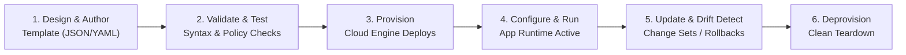
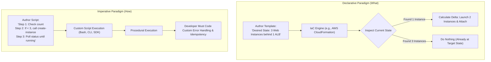
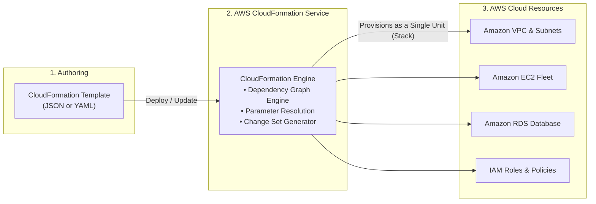
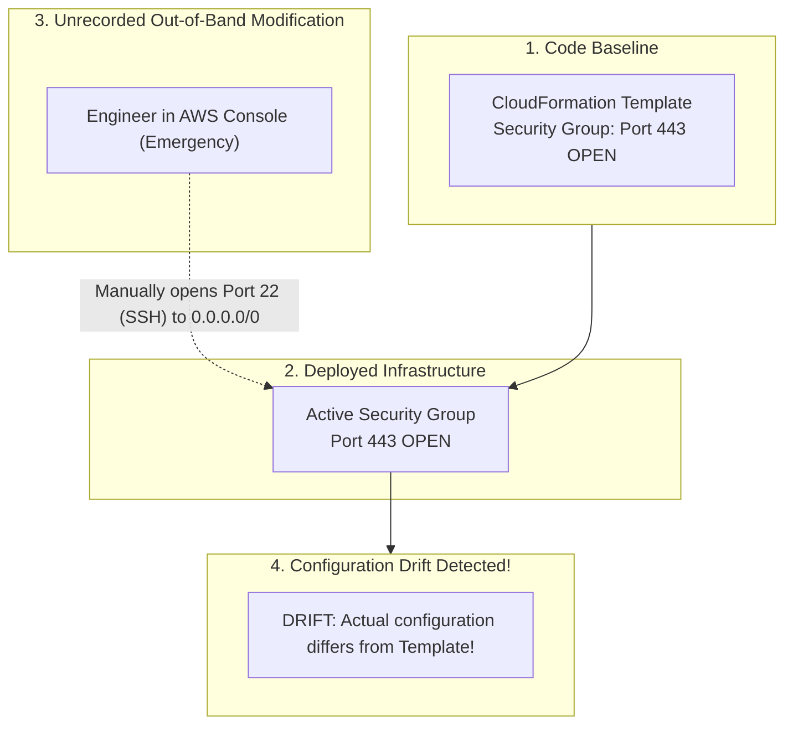
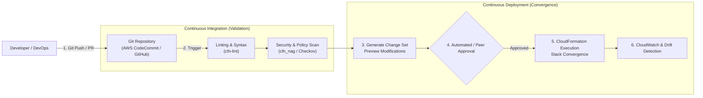

# 🏗️ Infrastructure as Code (IaC) & Cloud Provisioning

> **Course**: AWS re/Start  
> **Module**: Automated and Repeatable Deployments – M13 Infrastructure as Code  
> **Source**: `T22-0006-RSJAWS_EN-US_SG_M13_INFRASTRUCTUREASCODE.pdf`  
> **Target Audience**: AWS re/Start Learners / Cloud Practitioners / SysOps Administrators / DevOps Engineers  

---

## 🎯 Module Overview

In modern cloud computing and enterprise software delivery, modern systems cannot rely on manual, interactive configurations. Point-and-click console modifications, unrecorded terminal commands, and static configuration runbooks lead to human error, environmental divergence, and operational bottlenecks.

**Infrastructure as Code (IaC)** transforms infrastructure management into a software engineering discipline. By expressing compute, storage, networking, and application topologies as declarative, machine-readable configuration files, organizations achieve deterministic repeatability, high-velocity provisioning, rigorous version control, and automated governance.

This study guide explores the foundational principles of Infrastructure as Code, the infrastructure resource provisioning lifecycle, declarative versus imperative automation models, core organizational benefits, post-provisioning configuration management (mutable vs. immutable patterns), configuration drift detection, and the foundational role of **AWS CloudFormation**.

---

### 📌 Learning Objectives

- [ ] **Define Infrastructure as Code (IaC)**: Articulate the principles of treating infrastructure definitions as versioned software source code.
- [ ] **Analyze the Resource Provisioning Lifecycle**: Contrast traditional manual provisioning with automated declarative cloud provisioning.
- [ ] **Differentiate Declarative vs. Imperative IaC**: Compare intent-driven engines (CloudFormation, Terraform) with procedural script execution (CLI, SDKs, Bash).
- [ ] **Identify the Five Core Benefits of IaC**: Evaluate version control, environment parity, self-documenting architectures, cost optimization, and disaster recovery.
- [ ] **Explore AWS CloudFormation Architecture**: Understand templates, stacks, change sets, dependency graphing, and automated rollbacks.
- [ ] **Examine Post-Deployment Configuration Management**: Evaluate tools like AWS Systems Manager and AWS OpsWorks for Chef Automate.
- [ ] **Evaluate Immutable vs. Mutable Infrastructure**: Analyze the trade-offs between in-place configuration patching and immutable replacement deployments.
- [ ] **Understand Configuration Drift**: Identify causes of drift, detection mechanisms, and strategies for maintaining architectural fidelity.

---

## ⚙️ 1. What is Infrastructure as Code (IaC)?

### Treating Infrastructure as Software

**Infrastructure as Code (IaC)** is the architectural practice of defining, provisioning, configuring, and managing computer data center resources through machine-readable definition files—rather than physical hardware configuration or interactive configuration tools (such as web consoles or command-line wizards).

```
┌────────────────────────────────────────────────────────────────────────┐
│                        The Core Philosophy of IaC                      │
├────────────────────────────────────────────────────────────────────────┤
│  1. Code-First Definition : Architecture is declared in JSON, YAML,   │
│                             or high-level programming languages.       │
│  2. Version Control Single Source of Truth: All changes pass through   │
│                             repositories (Git) via commits & reviews.  │
│  3. Automated Orchestration: Cloud API engines interpret definitions   │
│                             and converge infrastructure to state.      │
│  4. Deterministic Outcome : Executing the same template 100 times      │
│                             produces 100 identical environments.       │
└────────────────────────────────────────────────────────────────────────┘
```

Historically, standing up servers required system engineers to physically rack hardware, run networking cables, install operating systems via optical media, and manually execute software installers. Early virtualization and cloud computing simplified physical logistics, but engineers initially managed resources through "ClickOps"—manually clicking through web management consoles.

IaC elevates infrastructure management to the same standard as application development, applying proven software engineering best practices:
- **Version Control**: Tracking every architectural modification over time.
- **Continuous Integration / Continuous Delivery (CI/CD)**: Validating, testing, and deploying infrastructure changes through automated pipelines.
- **Modular Reusability**: Packaging standard architectural patterns into reusable, parameterized templates.
- **Peer Review**: Requiring team pull requests (PRs) before modifying production environments.

> [!NOTE]
> Infrastructure as Code does not simply automate the provisioning step; it defines the entire state of the environment over its operational lifetime, from initial creation through updates, scaling, and eventual deprovisioning.

---

## 🔄 2. The Resource Provisioning Lifecycle

Every cloud resource—whether an Amazon Virtual Private Cloud (VPC), Amazon Elastic Compute Cloud (EC2) instance, Amazon Relational Database Service (RDS) database, or security group—progresses through a discrete lifecycle:



### Traditional Manual Provisioning vs. Automated Declarative Provisioning

Before IaC, infrastructure provisioning relied on procedural runbooks—human-readable operational documents detailing step-by-step instructions for engineers to execute.

| Dimension | Traditional Manual Provisioning ("ClickOps") | Automated Declarative IaC Provisioning |
| :--- | :--- | :--- |
| **Execution Method** | Interactive web console or sequential CLI prompts | Machine-parsed code files executed by an IaC engine |
| **Consistency** | Low; subject to fatigue, typos, and missed steps | 100% deterministic; identical across all iterations |
| **Speed & Lead Time** | Hours to weeks depending on personnel availability | Seconds to minutes via automated API orchestration |
| **Auditability** | Poor; relies on manual change tickets or log retrospectives | Complete; Git history provides exact commit diffs and authors |
| **Scalability** | Linear human effort required for each new server or region | Exponential; one template can spin up dozens of regions |
| **Configuration Drift** | High; manual hotfixes create "Snowflake" servers | Minimized; configuration drift can be detected and corrected |
| **Rollback Capability** | High risk; requires manual reversal of complex steps | Automated; engines automatically rollback upon failure |

> [!IMPORTANT]
> Manual provisioning inevitably produces **"Snowflake Servers"**—systems that have undergone so many ad-hoc manual tweaks, emergency patches, and unrecorded configuration edits that no two servers are identical, and no single engineer understands the complete system state. IaC completely eliminates snowflake environments.

---

## ⚖️ 3. Declarative vs. Imperative IaC Paradigms

Infrastructure automation tools operate across two fundamental paradigms: **Declarative** ("What") and **Imperative** ("How").



### 1. Declarative IaC: Specifying the "What"
In a **declarative** model, the engineer defines the **desired end state** of the target infrastructure without detailing the specific procedural steps needed to achieve it.
- **Example Tools**: AWS CloudFormation, HashiCorp Terraform.
- **Engine Intelligence**: The provisioning engine inspects the current state of the cloud environment, compares it to the target template, computes the differential delta, and determines the optimal sequence of API calls.
- **Dependency Management**: The declarative engine constructs a **Directed Acyclic Graph (DAG)** to determine resource creation ordering automatically (e.g., creating a VPC and subnet before launching an EC2 instance into it).
- **Idempotency**: Running a declarative template multiple times produces no unintended changes if the infrastructure already matches the template.

```yaml
# Declarative Example: AWS CloudFormation (YAML)
Type: AWS::EC2::Instance
Properties:
  ImageId: ami-0c55b159cbfafe1f0
  InstanceType: t3.micro
  SecurityGroupIds:
    - !Ref WebServerSecurityGroup
```

### 2. Imperative IaC: Specifying the "How"
In an **imperative** (or procedural) model, the engineer writes explicit, sequential instructions directing the computer on *how* to execute every single task.
- **Example Tools**: AWS Command Line Interface (AWS CLI), AWS SDKs (Boto3, Java SDK), Bash/PowerShell scripts.
- **Operational Burden**: The script author is solely responsible for verifying preconditions, catching API throttling errors, polling resource statuses, handling partial failures, and ensuring idempotency.

```bash
# Imperative Example: AWS CLI (Bash)
VPC_ID=$(aws ec2 create-vpc --cidr-block 10.0.0.0/16 --query 'Vpc.VpcId' --output text)
aws ec2 create-tags --resources $VPC_ID --tags Key=Name,Value=ProductionVPC
SUBNET_ID=$(aws ec2 create-subnet --vpc-id $VPC_ID --cidr-block 10.0.1.0/24 --query 'Subnet.SubnetId' --output text)
# What if create-subnet fails? The script stops, leaving an unmanaged VPC orphaned!
```

### Architectural Comparison: Declarative vs. Imperative

| Feature | Declarative Model (Desired State) | Imperative Model (Step-by-Step Procedure) |
| :--- | :--- | :--- |
| **Core Directive** | *"Make the environment look like this specification."* | *"Run step 1, then step 2, then step 3."* |
| **State Awareness** | Native; the engine maintains or discovers state. | Manual; script must query and calculate current state. |
| **Idempotency** | Inherent; applying twice results in no change. | Must be manually coded; naive scripts create duplicates. |
| **Error Recovery** | Automated rollback to previous working state. | Complex; manual cleanup of half-created resources required. |
| **Primary Use Case**| Complete architectural lifecycle and stack provisioning. | Ad-hoc administrative tasks, operational scripts, data pipelines. |

> [!TIP]
> **AWS Cloud Development Kit (CDK)** bridges both worlds: developers write imperative object-oriented code (TypeScript, Python, C#), which the CDK synthesizes into purely **declarative AWS CloudFormation templates** for deterministic execution.

---

## 🌟 4. Core Benefits of Infrastructure as Code

Infrastructure as Code delivers five foundational advantages that transform cloud operations:

```
┌────────────────────────────────────────────────────────────────────────┐
│                        The 5 Pillars of IaC Value                      │
├────────────────────────────────────────────────────────────────────────┤
│  1. Version Control & History  ──> Git commits, reviews, audit trails  │
│  2. Environment Parity         ──> Identical Dev, Test, Staging, Prod  │
│  3. Self-Documenting Arch      ──> Code is the authoritative truth     │
│  4. Cost Management            ──> Ephemeral on-demand sandbox teardown│
│  5. Rapid Disaster Recovery    ──> Multi-region rebuild in minutes     │
└────────────────────────────────────────────────────────────────────────┘
```

### 1. Version Control & Audit History
Because infrastructure is stored in plain text files (JSON, YAML, code), it integrates natively with distributed version control systems such as **Git**:
- **Granular Commit Logs**: Teams maintain a comprehensive chronological record of who changed what, when, and why.
- **Code Reviews & Pull Requests (PRs)**: Junior engineers or architects can submit infrastructure proposals that must be reviewed, linted, and approved by senior staff before merging.
- **Instant Rollback**: If a modified database security group introduces latency or vulnerabilities, the team can revert the Git commit to immediately return to a known stable state.

### 2. Repeatability & Environment Parity
One of the most persistent challenges in software development is the *"Works on my machine / Works in Dev"* syndrome, where code functions perfectly in testing but breaks in Production due to subtle configuration differences:
- **Zero Divergence**: IaC guarantees that Development, Staging, Quality Assurance (QA), and Production share identical networking boundaries, routing rules, operating system baselines, and runtime dependencies.
- **Isolated Sandbox Environments**: Developers can spin up private, dedicated replica stacks to test radical new features without touching shared systems.

### 3. Self-Documenting Architecture
In traditional IT, architecture diagrams and Confluence runbooks become obsolete the moment an engineer performs an undocumented hotfix:
- **Code as Single Source of Truth**: The CloudFormation template accurately reflects the deployed cloud environment. If it is not in the code, it does not exist in the architecture.
- **Standardized Onboarding**: New engineers can inspect template files to understand VPC topology, CIDR allocations, security group rules, and resource relationships without guessing.

### 4. Cost Optimization & Ephemeral Environments
In static infrastructure models, non-production environments often remain idle 24/7, consuming budget unnecessarily:
- **Ephemeral Staging Stacks**: IaC enables development and testing environments to be stood up automatically at 08:00 and destroyed at 18:00, or spun up dynamically for the duration of an automated test suite and terminated upon completion.
- **Dramatic Cost Reductions**: Destroying non-production infrastructure outside working hours can reduce compute costs by more than 60%.

### 5. Disaster Recovery (DR) & Multi-Region Resilience
When disasters occur—whether localized data center outages, fiber-optic cuts, or regional disruptions—manual rebuilds are slow, stressful, and error-prone:
- **Rapid Reconstitution**: With parameterized IaC templates, spinning up a full application replica in a secondary AWS Region (e.g., moving from `us-east-1` to `us-west-2`) requires only executing the template against the new region.
- **RTO & RPO Reduction**: Recovery Time Objective (RTO) drops from days or hours to minutes, ensuring business continuity.

---

## 🛠️ 5. AWS CloudFormation: The Foundation of AWS IaC

**AWS CloudFormation** is the native, fully managed AWS service designed to provision and manage cloud resources using declarative templates.



### Core Concepts of AWS CloudFormation

1. **Templates**:
   - A formatted text file in **JSON** or **YAML**.
   - Contains declarations of the AWS resources desired, input parameters, configuration mappings, conditions, and output values.
2. **Stacks**:
   - The fundamental operational unit in CloudFormation.
   - When you submit a template, CloudFormation provisions a **Stack** containing all resources declared within that template.
   - If you delete the stack, CloudFormation deletes all associated resources in the correct dependency order.
3. **Change Sets**:
   - A preview mechanism that displays the exact additions, modifications, and deletions CloudFormation will perform *before* applying an update to an existing stack.
   - Prevents accidental resource replacement (such as inadvertently recreating a production database).
4. **StackSets**:
   - Extends stack management across multiple AWS accounts and multiple AWS Regions using a single operation.
5. **Automated Rollback on Failure**:
   - If CloudFormation fails to create any resource in a stack (e.g., due to an invalid subnet ID or insufficient IAM permissions), it automatically deletes all resources created up to that point, returning the environment to its initial state.

---

## 🔁 6. Day-2 Operations: Configuration Management & Infrastructure Evolution

Resource provisioning is only the first phase of the operational lifecycle. Once an environment is active, engineering teams must address ongoing **Day-2 configuration management**:
- Deploying new application releases across server fleets.
- Applying operating system security patches and package upgrades.
- Updating database connection strings and configuration settings.

```
┌────────────────────────────────────────────────────────────────────────┐
│                 Two Paradigms for Ongoing Environment Updates           │
├────────────────────────────────────────────────────────────────────────┤
│                                                                        │
│  [A] Immutable Infrastructure (Reprovisioning)                         │
│      Build fresh resources from updated code ──> Test ──> Terminate old│
│      • Best for: Stateless web tiers, containerized microservices      │
│      • Result  : Eliminates configuration drift completely             │
│                                                                        │
│  [B] Mutable Infrastructure (In-Place Incremental Updates)             │
│      Apply patches to existing live instances in-place                 │
│      • Best for: High-durability stateful systems, persistent databases│
│      • Managed : AWS Systems Manager, AWS OpsWorks for Chef Automate   │
│                                                                        │
└────────────────────────────────────────────────────────────────────────┘
```

### Immutable Infrastructure vs. Mutable Configuration

#### 1. Immutable Infrastructure Pattern
In an **immutable** paradigm, infrastructure components are never updated in-place. If an OS patch or application update is needed:
1. Update the base template or launch template (or bake a new Amazon Machine Image using EC2 Image Builder).
2. Provision a completely new set of instances running the updated configuration.
3. Shift traffic to the new instances (e.g., via Blue/Green deployment).
4. Terminate the old instances.
- **Benefits**: Zero configuration drift, complete predictability, simplified rollbacks.

#### 2. Mutable Infrastructure (Incremental Updates)
Some architectures—particularly high-durability, stateful environments storing permanent transactional data—cannot easily be destroyed and reprovisioned for minor configuration tweaks. For these systems, teams apply controlled, incremental changes:

- **AWS Systems Manager (SSM)**:
  - **SSM Run Command**: Remotely executes scripts and commands across fleets of EC2 instances and on-premises servers without requiring SSH or bastion hosts.
  - **SSM State Manager**: Automates the process of keeping managed instances in a defined state (e.g., ensuring anti-virus definitions are up-to-date or specific ports are closed).
  - **SSM Patch Manager**: Automates the rollout of operating system and security patches according to preconfigured patch baselines.
- **AWS OpsWorks for Chef Automate**:
  - Provides a fully managed **Chef** server that uses Chef cookbooks to manage server configuration, deploy software, and enforce compliance policies across hybrid fleets.

---

## 🧭 7. Understanding and Combating Configuration Drift



### What is Configuration Drift?
**Configuration drift** occurs when the actual runtime configuration of a cloud resource diverges from its declared specification in the IaC template.

### Common Causes of Drift:
1. **Console "Hotfixes"**: An on-call engineer opens a security group rule via the AWS Management Console during an outage but forgets to update the IaC template.
2. **Ad-Hoc CLI Modifications**: Scripts executed directly against instances or cloud APIs outside the deployment pipeline.
3. **Inconsistent Manual Patching**: Patching three out of five web servers due to timeout interruptions.

### Consequences of Drift:
- Security vulnerabilities due to undocumented open ports.
- Deployment failures when CloudFormation attempts updates against drifted resources.
- Inability to accurately reproduce environments during disaster recovery.

### How AWS Prevents & Resolves Drift:
1. **CloudFormation Drift Detection**: CloudFormation natively analyzes a live stack, compares the real-time resource properties with the stack template, and outputs a detailed drift status report.
2. **AWS Config Rules**: Continuously evaluates AWS resource configurations against governance rules and automatically flags non-compliant alterations.
3. **Service Control Policies (SCPs) & IAM**: Restrict direct interactive console access in production accounts, forcing all infrastructure updates through automated CI/CD deployment pipelines.

---

## 🚀 8. The IaC CI/CD Pipeline Architecture

To achieve continuous governance, enterprise cloud teams embed Infrastructure as Code within automated Continuous Integration and Continuous Delivery (CI/CD) pipelines.



### Pipeline Stages Explained:
1. **Linting & Syntax Validation**: Tools like `cfn-lint` check templates against the AWS CloudFormation Resource Specification to catch syntax errors and missing parameters before runtime.
2. **Static Security Scanning**: Tools like `cfn_nag` and `Checkov` scan templates for security antipatterns (e.g., wildcards in IAM policies, public S3 buckets, unencrypted EBS volumes).
3. **Change Set Creation**: CloudFormation generates an execution plan outlining the exact resources that will be created, updated, or deleted.
4. **Automated Deployment**: The pipeline applies the Change Set, provisioning or updating resources deterministically with automated rollback protection.

---

## 📝 9. Checkpoint Review Questions & Answers

### Question 1
**An organization needs to ensure that their development, testing, and production environments are strictly identical in networking topology and resource configuration. Which practice best achieves this goal?**
- A) Writing a detailed 50-page runbook for system administrators to follow step-by-step.
- B) Taking manual console screenshots of the production environment and copying them.
- C) Defining the architecture in an AWS CloudFormation template and deploying it across all environments.
- D) Deploying all environments in a single AWS account using the AWS Management Console.

> **Answer: C**  
> **Explanation**: AWS CloudFormation enables infrastructure to be defined as declarative code. Deploying the same template across development, testing, and production environments guarantees environment parity and eliminates human configuration error.

---

### Question 2
**What is the fundamental difference between declarative and imperative Infrastructure as Code?**
- A) Declarative tools require Python, whereas imperative tools require JSON.
- B) Declarative defines the desired end state, while imperative defines the sequential commands to achieve it.
- C) Declarative is only used for on-premises hardware, while imperative is used for cloud resources.
- D) Declarative scripts must manually handle error recovery, while imperative scripts roll back automatically.

> **Answer: B**  
> **Explanation**: Declarative IaC (e.g., AWS CloudFormation) specifies *what* the final environment should look like, delegating execution logic and state convergence to the orchestration engine. Imperative IaC (e.g., AWS CLI, SDKs) specifies *how* to execute every procedural step.

---

### Question 3
**A development team wants to reduce cloud expenditure by provisioning staging environments only when automated test suites run, and tearing them down immediately after testing finishes. How does IaC facilitate this?**
- A) By making servers run faster during test executions.
- B) By enabling ephemeral environments to be stood up and torn down reliably via automated code pipelines.
- C) By automatically upgrading all EC2 instances to the free tier.
- D) By disabling billing alarms during test runs.

> **Answer: B**  
> **Explanation**: IaC allows the creation of *ephemeral* environments on demand. Teams can programmatically stand up a full production replica, run tests, and execute a stack deletion command to eliminate idle infrastructure costs.

---

### Question 4
**An engineer modifies an EC2 security group directly through the AWS Management Console to allow SSH access during an incident. The original CloudFormation template still specifies that SSH is blocked. What term describes this discrepancy?**
- A) Stack rollback
- B) Configuration drift
- C) Idempotent failure
- D) Resource starvation

> **Answer: B**  
> **Explanation**: Configuration drift occurs when the actual runtime configuration of deployed infrastructure diverges from its declared specification in the IaC template or code repository.

---

### Question 5
**Which AWS service provides native capabilities for managing incremental in-place configuration updates, patch baselines, and inventory across fleets of EC2 instances?**
- A) AWS CloudFormation
- B) AWS Systems Manager
- C) AWS Route 53
- D) Amazon S3 Glacier

> **Answer: B**  
> **Explanation**: AWS Systems Manager provides comprehensive operational management for running infrastructure, including SSM Run Command, Patch Manager, and State Manager for handling ongoing Day-2 mutable maintenance tasks.

---

## 📌 10. Key Takeaways & Exam Quick Reference

| Concept | Key Exam / Real-World Takeaway |
| :--- | :--- |
| **Infrastructure as Code (IaC)** | Managing and provisioning infrastructure through machine-readable definition files rather than manual processes. |
| **Declarative Model** | Focuses on the **"What"** (desired state). AWS CloudFormation analyzes current state, calculates deltas, and automates convergence. |
| **Imperative Model** | Focuses on the **"How"** (procedural instructions). Requires developer-managed error handling and idempotency logic. |
| **Core IaC Benefits** | 1. Version Control & History<br/>2. Environment Parity<br/>3. Self-Documenting Architecture<br/>4. Cost Management (Ephemeral Staging)<br/>5. Rapid Disaster Recovery |
| **AWS CloudFormation** | The foundational AWS IaC service. Operates via **Templates** (JSON/YAML), provisions **Stacks**, previews updates via **Change Sets**, and features **automatic rollback**. |
| **Immutable Infrastructure** | Components are never modified in-place; fresh resources are built anew from code baselines, eliminating drift. |
| **Mutable Infrastructure** | In-place modifications to existing resources, managed using tools like **AWS Systems Manager** and **AWS OpsWorks for Chef Automate**. |
| **Configuration Drift** | Divergence between live resource configurations and IaC template definitions. Detected using CloudFormation Drift Detection. |
