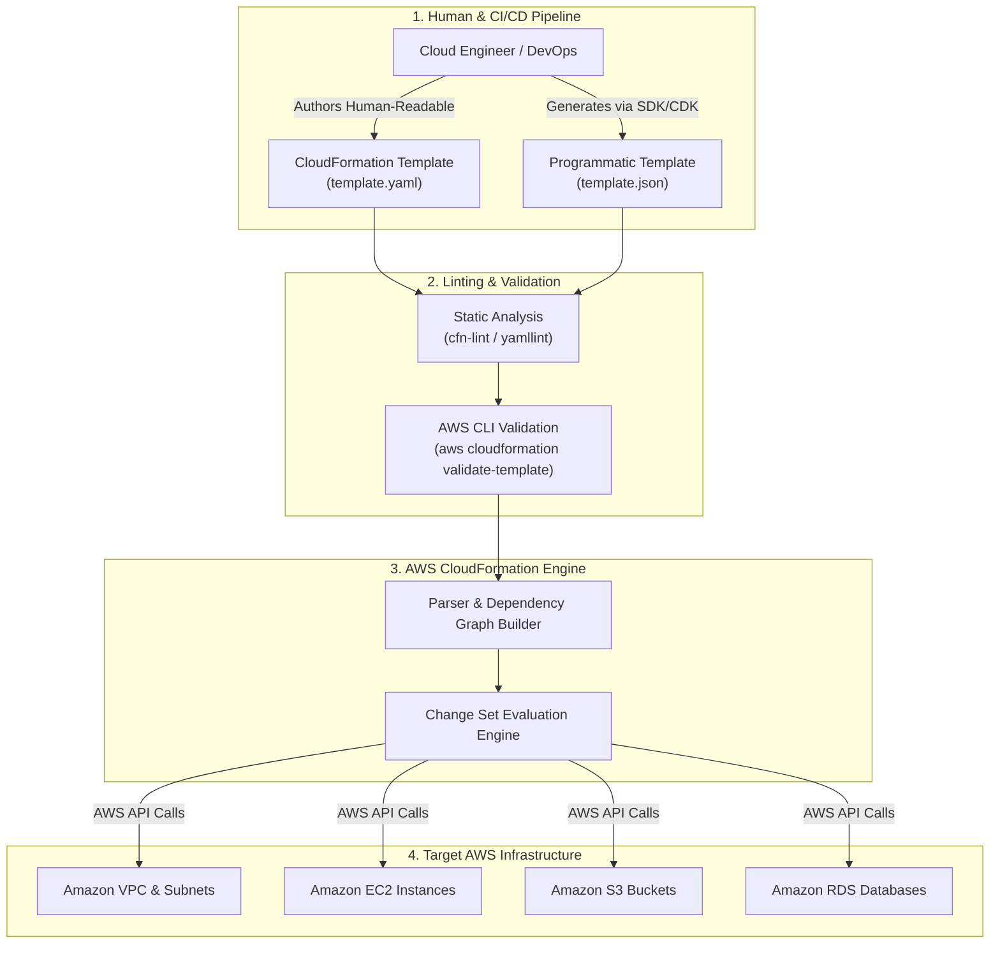
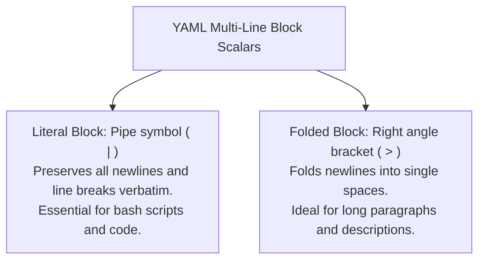
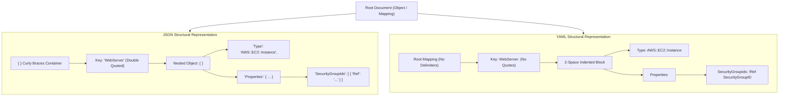

# 📄 Introduction to JSON and YAML: Data Serialization for Infrastructure as Code

> **Course**: AWS re/Start  
> **Module**: Automated and Repeatable Deployments – M13 Introduction to JSON and YAML  
> **Source**: `T22-0007-RSJAWS_EN-US_SG_M13_JSONYAML.pdf`  
> **Target Audience**: AWS re/Start Learners / Cloud Practitioners / SysOps Administrators / DevOps Engineers  

---

## 🎯 Executive Summary & Learning Objectives

In modern cloud computing, manual infrastructure provisioning—clicking through graphical web consoles or executing ad-hoc terminal commands—is error-prone, untraceable, and impossible to scale predictably across development, staging, and production environments. **Infrastructure as Code (IaC)** resolves these operational liabilities by allowing cloud architectures to be declared, versioned, reviewed, and deployed using machine-readable text files.

Within the Amazon Web Services (AWS) ecosystem, **AWS CloudFormation** provides declarative orchestration to provision resources as a unified stack. CloudFormation templates are written in two ubiquitous data serialization languages:
1. **JavaScript Object Notation (JSON)**
2. **YAML Ain't Markup Language (YAML)**

Mastering the precise syntax rules, structural hierarchies, intrinsic function notations, and error-handling characteristics of both JSON and YAML is mandatory for cloud engineers, systems operators, and DevOps practitioners. This study guide provides a comprehensive breakdown of both formats, side-by-side syntactic comparisons, CloudFormation resource implementations, linting workflows, and troubleshooting methodologies.

```
┌──────────────────────────────────────────────────────────────────────────────┐
│                    The Two Syntaxes of Cloud Infrastructure                  │
├────────────────────────────────────────┬─────────────────────────────────────┤
│ JavaScript Object Notation (JSON)      │ YAML Ain't Markup Language (YAML)   │
│ Strict, delimiter-driven, universal    │ Indentation-driven, human-readable, │
│ web standard optimized for machines.   │ expressive syntax optimized for ops.│
└────────────────────────────────────────┴─────────────────────────────────────┘
```

---

### 📌 Learning Objectives

- [ ] **Define Data Serialization in Cloud Contexts**: Explain the role of data serialization formats as the foundational syntaxes for Infrastructure as Code (IaC) and declarative provisioning.
- [ ] **Analyze JSON Architecture & Syntax Rules**: Master JSON formatting requirements, including object container braces `{ }`, array brackets `[ ]`, key-value formatting, double-quote mandates, comma separators, and the strict prohibition of trailing commas.
- [ ] **Enumerate JSON Data Types**: Correctly implement Strings, Numbers, Booleans (`true`/`false`), Arrays, Objects, and `null` within structured payloads.
- [ ] **Analyze YAML Architecture & Syntax Rules**: Master YAML indentation standards (strict whitespace usage, absolute prohibition of tab characters), colon spacing rules, list hyphen markers `-`, and native comment syntax `#`.
- [ ] **Distinguish Advanced YAML String Types**: Differentiate between scalar strings, literal multi-line block scalar notation (`|`), folded multi-line block scalar notation (`>`), and chomping indicators (`+`, `-`).
- [ ] **Evaluate Trade-offs & Engineering Suitability**: Contrast JSON and YAML regarding human readability, parser complexity, comment support, payload density, and debugging friction.
- [ ] **Map CloudFormation Intrinsic Functions Across Formats**: Translate intrinsic functions between JSON standard object notation (`{"Fn::Sub": "..."}`, `{"Ref": "..."}`) and YAML short-form tags (`!Sub`, `!Ref`, `!GetAtt`).
- [ ] **Implement Identical Cloud Resources in JSON and YAML**: Construct equivalent AWS CloudFormation templates for Amazon S3 buckets and Amazon EC2 instances with user data scripts.
- [ ] **Diagnose & Troubleshoot Syntax Errors**: Detect and resolve syntax failures such as the YAML "Norway Problem", tab indentation corruption, missing colon spaces, unescaped JSON strings, and trailing commas.
- [ ] **Apply Authoring & Linting Best Practices**: Integrate static analysis and validation tools (`cfn-lint`, `aws cloudformation validate-template`, `checkov`) into CI/CD infrastructure deployment workflows.

---

## 🏗️ 1. Infrastructure as Code (IaC) & Data Serialization Foundations

### 1.1 The Imperative vs. Declarative Paradigm
Traditional systems management relied on **imperative scripts** (e.g., shell scripts, Python `boto3` sequences) detailing step-by-step commands to create servers, networks, and databases. If a step failed midway, the environment was left in an indeterminate state.

By contrast, **Infrastructure as Code (IaC)** utilizes a **declarative paradigm**:
- **Declarative Approach**: The engineer defines the *desired end state* of the infrastructure (e.g., "A VPC with CIDR `10.0.0.0/16` and two public subnets"). The provisioning engine (such as AWS CloudFormation) calculates the required API calls, dependency order, creation graph, and rollback steps automatically.
- **Serialization Syntax**: To communicate this desired state to the CloudFormation engine, configuration declarations are written in structured text formats—specifically **JSON** or **YAML**.



### 1.2 What is Data Serialization?
**Data serialization** is the process of converting complex data structures or object states (stored in memory as trees, hashes, or objects) into a standardized, textual, or binary format that can be stored on disk or transmitted across computer networks. **Deserialization** reconstructs the original in-memory data structures from the serialized format.

- **Portability**: Serialized JSON and YAML documents are agnostic to operating systems and programming languages (C, Java, Python, Go, Ruby, Perl, Node.js).
- **Interoperability**: Any language with a compliant parser can read, manipulate, and generate identical infrastructure models.

---

## 🟨 2. JavaScript Object Notation (JSON) Deep Dive

### 2.1 Historical Context & Philosophy
JavaScript Object Notation (JSON) emerged from the ECMAScript programming language standard in the early 2000s (standardized under **RFC 8259** and **ECMA-404**). It was engineered as a lightweight, text-based alternative to the heavy, verbose Extensible Markup Language (XML) for web applications and client-server asynchronous communication.

In cloud infrastructure, JSON became the primary wire protocol and payload format for RESTful APIs, AWS SDKs, AWS CLI input/output, and initial AWS CloudFormation template designs.

### 2.2 Core Syntax Rules of JSON
JSON requires strict adherence to mathematical grammar rules. A single misplaced character renders an entire document invalid:

1. **Object Boundaries**: Objects are enclosed in curly braces `{ }`.
2. **Array Boundaries**: Ordered lists (arrays) are enclosed in square brackets `[ ]`.
3. **Key Delimiters**: All keys **must** be strings enclosed in standard double quotation marks (`"key"`). Single quotes (`'key'`) are strictly invalid.
4. **Value Delimiters**: String values **must** be enclosed in double quotes. Numbers, booleans, arrays, objects, and null are unquoted.
5. **Key-Value Separator**: A colon followed by optional whitespace separates a key from its associated value (`"key": "value"`).
6. **Element Separators**: Commas (`,`) separate consecutive key-value pairs inside an object and consecutive items inside an array.
7. **Strict Prohibition of Trailing Commas**: The final item inside an object or array **must never** have a trailing comma. Including a trailing comma results in a catastrophic parse error.
8. **No Native Comments**: JSON does not support comments (`//`, `/* */`, or `#`). Any configuration intent must be captured in dedicated metadata properties.

```
   ┌──────────────────────────────────────────────────────────────┐
   │                  JSON Syntax Anatomy                         │
   │                                                              │
   │   {  <── Opening Curly Brace (Object Start)                  │
   │     "ResourceName": {  <── Key in Double Quotes + Colon      │
   │       "Type": "AWS::S3::Bucket",  <── Comma Separator        │
   │       "Properties": {                                        │
   │         "BucketName": "production-app-bucket",               │
   │         "AccessControl": "Private"  <── NO TRAILING COMMA    │
   │       }  <── Closing Child Brace                             │
   │   }  <── Closing Root Brace (Object End)                     │
   └──────────────────────────────────────────────────────────────┘
```

### 2.3 Supported JSON Data Types
JSON natively supports exactly six fundamental data types:

| Data Type | Description | Valid JSON Example |
| :--- | :--- | :--- |
| **String** | Sequence of zero or more Unicode characters wrapped in double quotes. Special characters must be escaped with a backslash (`\"`, `\\`, `\n`, `\t`). | `"ami-09ead922c1dad67e4"`, `"WebServer"` |
| **Number** | Signed decimal number (integer or floating-point). Can use standard scientific notation (`e` or `E`). No octal or hexadecimal representations. | `42`, `3.14159`, `-10`, `1.5e3` |
| **Boolean** | Logical literal values in lowercase only: `true` or `false`. (Uppercase or title case such as `True` or `FALSE` are invalid). | `true`, `false` |
| **Null** | A literal representing an empty or non-existent value in lowercase: `null`. | `null` |
| **Object** | An unordered collection of key-value pairs wrapped in `{ }`. Keys must be unique strings within the object. | `{"key1": "value1", "key2": 100}` |
| **Array** | An ordered collection of zero or more values wrapped in `[ ]`. Values can be heterogeneous (differing data types). Indexed starting at 0. | `["subnet-1", "subnet-2", 443, true]` |

### 2.4 Representation of Data: Columnar Tables to JSON
Curriculum materials demonstrate how relational or tabular data maps into non-graphical, machine-parseable JSON structures:

#### Source Columnar Table:
| StudentName | Location | FavoriteSport |
| :--- | :--- | :--- |
| María | USA | Tennis |
| John | UK | Cricket |
| Diego | USA | Basketball |
| Kwesi | India | Hockey |

#### Serialized JSON Representation:
```json
{
  "students": [
    {
      "StudentName": "María",
      "Location": "USA",
      "FavoriteSport": "Tennis"
    },
    {
      "StudentName": "John",
      "Location": "UK",
      "FavoriteSport": "Cricket"
    },
    {
      "StudentName": "Diego",
      "Location": "USA",
      "FavoriteSport": "Basketball"
    },
    {
      "StudentName": "Kwesi",
      "Location": "India",
      "FavoriteSport": "Hockey"
    }
  ]
}
```

> [!NOTE]
> In JSON, tabular rows become objects inside an ordered array (`students`). Each column header becomes a key (`StudentName`, `Location`, `FavoriteSport`), and each cell entry becomes an associated value.

### 2.5 JSON Building Blocks: The Dessert Object & Array Progression
The AWS curriculum utilizes a descriptive dessert example to illustrate object encapsulation and array indexing:

#### Step 1: Encapsulating Characteristics into a Single JSON Object
```json
{
  "type": "cake",
  "flavor": "chocolate",
  "price": "20",
  "feeds": "8"
}
```
*Properties are unordered key-value pairs enclosed in braces `{ }`.*

#### Step 2: Defining a Second Object with Identical Schema
```json
{
  "type": "pie",
  "flavor": "apple",
  "price": "16",
  "feeds": "6"
}
```
*Keys remain identical, but values vary according to the instance being described.*

#### Step 3: Expanding Objects with Nested Ordered Arrays
When an attribute requires multiple values (e.g., additional ingredients: Blueberries and Mint), an array `[ ]` is introduced:

```json
{
  "type": "cake",
  "flavor": "chocolate",
  "price": "20",
  "feeds": "8",
  "additional_ingredients": [
    "blueberries",
    "mint"
  ]
}
```

#### Step 4: Accessing Array Elements via Zero-Based Indexing
Unlike the root object where properties are accessed by key name (`dessert.flavor`), array values are ordered and addressed by index:
- Index `0`: `dessert.additional_ingredients[0]` $\rightarrow$ `"blueberries"`
- Index `1`: `dessert.additional_ingredients[1]` $\rightarrow$ `"mint"`

### 2.6 Advantages and Disadvantages of JSON

#### Advantages
- **Ubiquitous Standard**: Native support in every major programming language runtime, browser engine, operating system, and cloud platform.
- **Strict, Deterministic Parsing**: Rigid grammar rules eliminate parsing ambiguity. A parser will either parse JSON deterministically or fail immediately.
- **Machine Generation**: Effortlessly generated by code, API gateways, database engines (e.g., PostgreSQL `jsonb`, DynamoDB documents), and AWS SDKs.
- **Lightweight Wire Protocol**: Excellent for high-throughput, low-latency RESTful APIs.

#### Disadvantages
- **No Embedded Comments**: Cannot annotate rationale, architectural warnings, or documentation inline.
- **High Delimiter Overhead (Verbosity)**: Requires excessive punctuation (`"`, `:`, `,`, `{`, `}`, `[`, `]`), inflating file size and visual noise.
- **Strict Delimiter Vulnerability**: A single missing or extra comma breaks the entire file.
- **Lack of Native Multi-line Strings**: Multi-line strings (e.g., bash scripts in EC2 `UserData`) must be written as arrays of concatenated strings or injected with explicit `\n` escape sequences.

---

## 🟩 3. YAML Ain't Markup Language (YAML) Deep Dive

### 3.1 Historical Context & Philosophy
Originally created in 2001 by Clark Evans, Ingy döt Net, and Oren Ben-Kiki, YAML originally stood for *Yet Another Markup Language*. It was subsequently renamed to the recursive acronym **YAML Ain't Markup Language** to emphasize that its primary objective was data serialization rather than document markup (like HTML or SGML).

YAML was deliberately engineered for **human readability**, **ergonomic configuration**, and **visual clarity**, making it the de facto standard for Kubernetes manifests, Ansible playbooks, GitHub Actions workflows, Docker Compose files, and AWS CloudFormation templates.

### 3.2 Core Syntax Rules of YAML
YAML replaces structural braces and quotation marks with **visual hierarchy via whitespace**:

1. **Whitespace Indentation**: Hierarchical child relationships are defined entirely by indentation.
   - **Absolute Prohibition of Tabs**: Tab characters (`\t`) are strictly forbidden in YAML documents. Parsers throw fatal syntax errors when tabs are encountered.
   - **Indentation Standard**: The universal industry standard is **two spaces (2)** per indentation level. Consistent indentation depth must be maintained throughout a block.
2. **Associative Arrays (Mappings / Dictionaries)**:
   - Defined using `<key>: <value>`.
   - **Crucial Rule**: The colon (`:`) **must** be immediately followed by a space or a newline. Writing `key:value` without a space is a fatal syntax error (or interpreted as a single literal string).
3. **Sequences (Lists / Arrays)**:
   - Denoted by starting the line with a hyphen followed by a space (`- item`).
   - Each item occupies its own line at the same indentation level.
   - Alternatively, YAML supports inline flow lists: `[item1, item2, item3]`.
4. **Strings**:
   - Strings generally do **not** require quotation marks (unquoted by default).
   - Single quotes (`'`) or double quotes (`"`) are used when escaping reserved characters (`:`, `#`, `[`, `{`, `@`, `!`), or when forcing a value to be treated as a string rather than a boolean or number.
5. **Native Embedded Comments**:
   - Any text preceded by a number sign (`#`) is treated as a comment and ignored by the parser.
   - Best practice: Include a blank line preceding and following large comment blocks for visual isolation.

```
   ┌──────────────────────────────────────────────────────────────┐
   │                  YAML Syntax Anatomy                         │
   │                                                              │
   │   # Infrastructure Declaration in YAML <── Embedded Comment  │
   │   ResourceName:            <── Key + Colon + Space           │
   │     Type: AWS::S3::Bucket  <── 2-Space Indented Child        │
   │     Properties:            <── Nested Mapping                │
   │       BucketName: my-bucket <── Unquoted String              │
   │       Tags:                <── Sequence of Mappings          │
   │         - Key: Environment <── Hyphen + Space                │
   │           Value: Production <── Matching Indentation         │
   └──────────────────────────────────────────────────────────────┘
```

### 3.3 Supported YAML Data Types
YAML supports a rich set of scalar, sequence, and mapping types:

| Data Type | Syntax Notation | Valid YAML Example |
| :--- | :--- | :--- |
| **Scalar String** | Plain (unquoted), single-quoted, or double-quoted text. | `InstanceType: t2.micro`<br/>`Name: 'Production: Server'` |
| **Scalar Integer** | Whole numbers (decimal, octal `0o`, hex `0x`). | `Port: 443`<br/>`Count: 5` |
| **Scalar Float** | Real numbers with decimal points or exponents. | `Version: 1.0`<br/>`Threshold: 0.85` |
| **Scalar Boolean** | Canonical booleans: `true` / `false` (YAML 1.2). Older parsers (YAML 1.1) also recognized `yes`/`no`, `on`/`off`. | `Enabled: true`<br/>`Encrypted: false` |
| **Scalar Null** | Denoted by `~`, `null`, or an empty value. | `Description: ~`<br/>`Config: null` |
| **Mapping (Dictionary)**| Key-value pairs separated by colon and space. | `Owner: DevTeam`<br/>`Department: Engineering` |
| **Sequence (List)** | Hyphen followed by space, or bracketed flow format. | `Subnets:`<br/>`  - subnet-aaa`<br/>`  - subnet-bbb` |

### 3.4 Multi-Line Strings: Literal (`|`) vs. Folded (`>`) Blocks
In AWS CloudFormation, embedding shell scripts or configuration files into EC2 `UserData` is common. YAML provides specialized block scalar operators that eliminate awkward string concatenations:



#### The Literal Block Scalar (`|`) — Preserves Newlines
Maintains every line break exactly as written. This is mandatory for bash scripts where commands must execute sequentially:

```yaml
UserData:
  Fn::Base64: !Sub |
    #!/bin/bash
    yum update -y
    yum install -y httpd
    systemctl start httpd
    systemctl enable httpd
    echo "<h1>Hello from CloudFormation</h1>" > /var/www/html/index.html
```

#### The Folded Block Scalar (`>`) — Folds Newlines into Spaces
Converts newlines into single spaces, creating a single continuous string unless an empty blank line forces a paragraph break:

```yaml
Description: >
  This AWS CloudFormation template provisions a highly available,
  multi-Availability Zone architecture including an Application Load
  Balancer, Auto Scaling group, and Amazon Aurora PostgreSQL cluster.
```

#### Chomping Indicators (`+` and `-`)
- **Clip (Default, no indicator)**: Preserves the single final newline, stripping additional trailing newlines.
- **Strip (`|-` or `>-`)**: Strips all trailing newlines and whitespace from the end of the block.
- **Keep (`|+` or `>+`)**: Preserves all trailing newlines and whitespace exactly as entered.

### 3.5 Advantages and Disadvantages of YAML

#### Advantages
- **Optimal Human Readability**: Clean, minimalist structure without braces, brackets, or pervasive quotation marks.
- **Native Embedded Comments**: Engineers can document architectural rationale directly alongside configuration keys.
- **Multi-Line String Elegance**: Simple inclusion of raw shell scripts and configuration files without messy escape strings.
- **Concise CloudFormation Shortcuts**: Supports YAML-specific shorthand tags for CloudFormation intrinsic functions (e.g., `!Ref`, `!Sub`, `!GetAtt`).

#### Disadvantages
- **Whitespace Indentation Fragility**: Accidental space insertion, misalignment, or copy-pasting code with misconfigured tabs causes hard-to-detect syntax bugs.
- **Complex Parser Implementations**: YAML specification (especially YAML 1.1) is complex and contains edge cases.
- **Type Coercion Gotchas (The "Norway Problem")**: In YAML 1.1, unquoted country abbreviations such as `NO` (Norway) are parsed as boolean `false`. Country code `SE` (Sweden) remains string `"SE"`. Keys and strings with special words must be explicitly quoted.

---

## ⚖️ 4. Direct Side-by-Side Comparison Matrix & Code Equivalents

### 4.1 Comparison Matrix: JSON vs. YAML

| Feature / Dimension | JavaScript Object Notation (JSON) | YAML Ain't Markup Language (YAML) |
| :--- | :--- | :--- |
| **Primary Design Focus** | Data interchange, API messaging, programmatic parsing. | Human readability, configuration files, operations authoring. |
| **Structure Delimiters** | Curly braces `{ }`, square brackets `[ ]`, commas `,`. | Indentation whitespace (spaces only), line breaks. |
| **Indentation Rule** | Whitespace ignored by parser (used only for human layout). | **Mandatory semantic whitespace**. Strict hierarchy. |
| **Tabs Permitted?** | Yes (valid inside whitespace). | **NO. Tabs are strictly forbidden.** |
| **Native Comments?** | **No**. Comments are invalid and throw parse errors. | **Yes**. Full line or inline comments via `#`. |
| **Key Enclosure** | **Mandatory double quotes** (`"key"`). | Generally unquoted (`key:`), quotes optional. |
| **String Enclosure** | **Mandatory double quotes** (`"value"`). | Unquoted by default; single/double quotes optional. |
| **Trailing Commas** | **Strictly forbidden** (causes fatal syntax error). | N/A (commas not used in standard block form). |
| **Multi-line Strings** | Array of strings joined with `\n` or single escaped string. | Native literal (`\|`) and folded (`>`) block scalars. |
| **CloudFormation Short Tags** | **Not supported**. Must use full object notation (`{"Ref": "..."}`).| **Fully supported** (`!Ref`, `!Sub`, `!GetAtt`, `!Join`). |
| **Parsing Performance** | Extremely fast and lightweight memory footprint. | Slower and more resource-intensive parsing engine. |
| **File Verbosity** | High (punctuation overhead). | Low (compact and concise). |

---

### 4.2 Structural Equivalency: Data Structure Tree Representation



---

### 4.3 Side-by-Side Code Equivalents

#### Scenario 1: Basic Amazon S3 Bucket with Server-Side Encryption
Below is an identical CloudFormation resource declaring an Amazon S3 Bucket with AES-256 server-side encryption and tagging:

##### JSON Implementation:
```json
{
  "AWSTemplateFormatVersion": "2010-09-09",
  "Description": "Amazon S3 Bucket with Server-Side Encryption",
  "Resources": {
    "AppStorageBucket": {
      "Type": "AWS::S3::Bucket",
      "Properties": {
        "BucketName": "corporate-financial-records-bucket",
        "BucketEncryption": {
          "ServerSideEncryptionConfiguration": [
            {
              "ServerSideEncryptionByDefault": {
                "SSEAlgorithm": "AES256"
              }
            }
          ]
        },
        "Tags": [
          {
            "Key": "Environment",
            "Value": "Production"
          },
          {
            "Key": "DataClassification",
            "Value": "Confidential"
          }
        ]
      }
    }
  }
}
```

##### YAML Implementation:
```yaml
AWSTemplateFormatVersion: '2010-09-09'
Description: Amazon S3 Bucket with Server-Side Encryption
Resources:
  AppStorageBucket:
    Type: AWS::S3::Bucket
    Properties:
      BucketName: corporate-financial-records-bucket
      BucketEncryption:
        ServerSideEncryptionConfiguration:
          - ServerSideEncryptionByDefault:
              SSEAlgorithm: AES256
      Tags:
        - Key: Environment
          Value: Production
        - Key: DataClassification
          Value: Confidential
```

---

#### Scenario 2: EC2 WebServer Instance (Slide 19 Direct Alignment)
Comparison of the Amazon EC2 Instance specification featured directly in Slide 19 of the AWS curriculum:

##### JSON Implementation:
```json
{
  "WebServer": {
    "Type": "AWS::EC2::Instance",
    "Properties": {
      "ImageId": "ami-09ead922c1dad67e4",
      "InstanceType": "t2.micro",
      "KeyName": "myKey",
      "SecurityGroupIds": [
        {
          "Ref": "SecurityGroupIDs"
        }
      ],
      "SubnetId": "subnet-42b01138"
    }
  }
}
```

##### YAML Implementation:
```yaml
WebServer:
  Type: AWS::EC2::Instance
  Properties:
    ImageId: ami-09ead922c1dad67e4
    InstanceType: t2.micro
    KeyName: myKey
    SecurityGroupIds:
      - !Ref SecurityGroupIDs
    SubnetId: subnet-42b01138
```

---

#### Scenario 3: Amazon EC2 Instance with Multi-Line UserData Bootstrapping Script
This scenario illustrates how multi-line scripts are handled in each format:

##### JSON Implementation:
*In JSON, multi-line scripts require an explicit array of strings joined by `Fn::Join` with `\n` characters:*
```json
{
  "Resources": {
    "ProductionWebServer": {
      "Type": "AWS::EC2::Instance",
      "Properties": {
        "ImageId": "ami-0abcdef1234567890",
        "InstanceType": "t3.micro",
        "UserData": {
          "Fn::Base64": {
            "Fn::Join": [
              "\n",
              [
                "#!/bin/bash",
                "dnf update -y",
                "dnf install -y httpd php",
                "systemctl enable --now httpd",
                "echo '<h1>Application Online</h1>' > /var/www/html/index.html"
              ]
            ]
          }
        }
      }
    }
  }
}
```

##### YAML Implementation:
*In YAML, the literal block scalar (`|`) combined with the shorthand `!Base64` and `!Sub` creates clean, natural shell scripts:*
```yaml
Resources:
  ProductionWebServer:
    Type: AWS::EC2::Instance
    Properties:
      ImageId: ami-0abcdef1234567890
      InstanceType: t3.micro
      UserData:
        Fn::Base64: !Sub |
          #!/bin/bash
          dnf update -y
          dnf install -y httpd php
          systemctl enable --now httpd
          echo '<h1>Application Online</h1>' > /var/www/html/index.html
```

---

### 4.4 CloudFormation Intrinsic Functions Syntax Differential

AWS CloudFormation provides built-in intrinsic functions to assign values to properties at runtime that are not available until resources are created. YAML supports convenient **short-form tags** (prefixed with `!`), whereas JSON requires the complete object structure:

| Function | JSON Standard Notation | YAML Full Form | YAML Short-Form Tag |
| :--- | :--- | :--- | :--- |
| **Ref** | `{"Ref": "VPCID"}` | `Ref: VPCID` | `!Ref VPCID` |
| **Fn::Sub** | `{"Fn::Sub": "https://${DomainName}/api"}` | `Fn::Sub: "https://${DomainName}/api"` | `!Sub "https://${DomainName}/api"` |
| **Fn::GetAtt** | `{"Fn::GetAtt": ["MyALB", "DNSName"]}` | `Fn::GetAtt: [MyALB, DNSName]` | `!GetAtt MyALB.DNSName` |
| **Fn::Join** | `{"Fn::Join": [":", ["arn", "aws", "s3"]]}` | `Fn::Join:`<br/>`  - ':'`<br/>`  - ['arn', 'aws', 's3']` | `!Join [ ':', [ 'arn', 'aws', 's3' ] ]` |
| **Fn::Select** | `{"Fn::Select": ["1", ["a", "b", "c"]]}` | `Fn::Select:`<br/>`  - '1'`<br/>`  - ['a', 'b', 'c']` | `!Select [ '1', [ 'a', 'b', 'c' ] ]` |
| **Fn::FindInMap** | `{"Fn::FindInMap": ["RegionMap", {"Ref": "AWS::Region"}, "AMI"]}` | `Fn::FindInMap:`<br/>`  - RegionMap`<br/>`  - !Ref AWS::Region`<br/>`  - AMI` | `!FindInMap [ RegionMap, !Ref 'AWS::Region', AMI ]` |
| **Fn::Base64** | `{"Fn::Base64": "echo Hello"}` | `Fn::Base64: "echo Hello"` | `!Base64 "echo Hello"` |
| **Fn::ImportValue** | `{"Fn::ImportValue": "ExportedSubnetId"}` | `Fn::ImportValue: ExportedSubnetId` | `!ImportValue ExportedSubnetId` |

> [!WARNING]
> **Short-Form Nesting Restriction in YAML**: You cannot directly nest two shorthand functions consecutively on the same line if both take a single scalar parameter (e.g., `!Sub !Ref ParameterName` is strictly invalid). To nest functions, you must expand the outer function into its full map syntax (e.g., `Fn::Sub: ...`) or use string interpolation syntax `${ParameterName}` inside `!Sub`.

---

## 🛠️ 5. Syntax Error Troubleshooting & Debugging Guide

```
┌──────────────────────────────────────────────────────────────────────────────┐
│                    Common Syntax Errors & Fixes                              │
├────────────────────────────────────────┬─────────────────────────────────────┤
│ ❌ Common JSON Trap                    │ ❌ Common YAML Trap                 │
│ Trailing commas at end of lists/objects│ Using tab characters for indentation│
│ Unquoted object property keys          │ Missing space after key colon (`k:v`)│
│ Single quotes around strings           │ Unquoted boolean keywords (yes/no)  │
└────────────────────────────────────────┴─────────────────────────────────────┘
```

### 5.1 Troubleshooting Common JSON Errors

#### Trap 1: Trailing Commas in Objects or Arrays
```json
/* ❌ INVALID JSON: Trailing comma after feeds */
{
  "type": "cake",
  "flavor": "chocolate",
  "feeds": "8",
}
```
**Error message**: `SyntaxError: Unexpected token '}' at line 5`  
**Resolution**: Remove the comma from the final element in every object and array.

#### Trap 2: Unquoted Keys or Single-Quoted Strings
```json
/* ❌ INVALID JSON: Unquoted key and single quotes */
{
  type: 'cake',
  "flavor": 'chocolate'
}
```
**Error message**: `SyntaxError: Expected double-quoted property name at line 2`  
**Resolution**: Enclose all keys and string values in double quotation marks (`"type": "cake"`).

#### Trap 3: Unescaped Characters in Strings
```json
/* ❌ INVALID JSON: Unescaped internal double quote */
{
  "Description": "Web server for "Project Apollo" environment"
}
```
**Error message**: `SyntaxError: Unexpected identifier 'Project' at line 2`  
**Resolution**: Escape internal double quotes with a backslash: `"Web server for \"Project Apollo\" environment"`.

---

### 5.2 Troubleshooting Common YAML Errors

#### Trap 1: The Tab Indentation Character
```yaml
# ❌ INVALID YAML: Indented with \t (Tab) character
WebServer:
	Type: AWS::EC2::Instance
```
**Error message**: `yaml.scanner.ScannerError: while scanning for the next token found character '\t' that cannot start any token`  
**Resolution**: Configure code editors to convert tabs to spaces automatically (`Insert Spaces: True`, `Tab Size: 2`).

#### Trap 2: Missing Space After Colon
```yaml
# ❌ INVALID YAML: Missing space after colon
Properties:
  InstanceType:t2.micro
```
**Error message**: `yaml.parser.ParserError: mapping values are not allowed here`  
**Resolution**: Always insert a single space following the colon: `InstanceType: t2.micro`.

#### Trap 3: The "Norway Problem" (Boolean Coercion)
```yaml
# ❌ UNINTENDED BEHAVIOR IN YAML 1.1:
CountryCodes:
  - US
  - UK
  - NO   # Evaluates to boolean 'false' instead of string "NO"!
  - CA
```
**Resolution**: Enclose country codes, affirmative keywords, or state indicators in explicit quotation marks:
```yaml
CountryCodes:
  - 'US'
  - 'UK'
  - 'NO'
  - 'CA'
```

---

## 🏆 6. Best Practices for Authoring CloudFormation Templates

1. **Use YAML for Manual Authoring; Use JSON for Programmatic Generation**:
   - **Human Engineers**: Author in **YAML**. The visual cleanliness, indentation structure, embedded comments, and short-form intrinsic functions (`!Ref`, `!Sub`) drastically reduce cognitive load and authoring errors.
   - **Automated Pipelines & SDKs**: Generate in **JSON**. Machines and compilers (e.g., AWS Cloud Development Kit - CDK, Pulumi, custom Python scripts) reliably serialize JSON without indentation bugs.
2. **Standardize on Two-Space Indentation**:
   - Establish `.editorconfig` rules across engineering teams enforcing `indent_style = space` and `indent_size = 2` for all `.yaml` and `.yml` files.
3. **Integrate Automated Static Analysis (`cfn-lint`)**:
   - Run `cfn-lint` in pre-commit git hooks and CI/CD pull request pipelines to detect syntax errors, invalid AWS resource property names, and cyclic dependencies before reaching AWS.
   ```bash
   # Install and run cfn-lint
   pip install cfn-lint
   cfn-lint template.yaml
   ```
4. **Validate Templates via AWS CLI**:
   - Verify template syntax against the AWS CloudFormation service parser without creating stack resources:
   ```bash
   aws cloudformation validate-template --template-body file://template.yaml
   ```
5. **Enforce Security & Compliance Scanning**:
   - Utilize static security scanners such as **Checkov** or **cfn_nag** to identify unencrypted storage volumes, open security groups (`0.0.0.0/0`), or missing logging policies.
   ```bash
   # Run Checkov security scanner
   checkov -f template.yaml
   ```

---

## 📝 7. Comprehensive Checkpoint Review & Knowledge Assessment

### 7.1 Review Questions & Rationales

#### Question 1
**Which of the following characters is strictly forbidden for creating indentation in a YAML document?**
- A) Space (` `)
- B) Tab (`\t`)
- C) Hyphen (`-`)
- D) Colon (`:`)

> **Answer: B**  
> **Rationale**: The YAML specification strictly forbids tab characters (`\t`) for indentation. Using tabs triggers a fatal scanner error. Indentation must be constructed entirely using space characters (two spaces is the universal standard).

---

#### Question 2
**What is the primary operational consequence of adding a trailing comma after the last property of a JSON object?**
- A) The JSON parser ignores it as benign whitespace.
- B) The JSON parser treats the final property as `null`.
- C) The document fails to parse, throwing a fatal syntax error.
- D) The parser automatically converts the JSON document into YAML format.

> **Answer: C**  
> **Rationale**: Unlike JavaScript code or Python dictionaries, the JSON specification (RFC 8259) strictly forbids trailing commas after the final element in an array or object. A trailing comma causes all compliant JSON parsers to abort with a syntax error.

---

#### Question 3
**Consider the following JSON payload. How would an engineer retrieve the value `"mint"`?**
```json
{
  "type": "cake",
  "additional_ingredients": [
    "blueberries",
    "mint"
  ]
}
```
- A) `dessert.additional_ingredients["mint"]`
- B) `dessert.additional_ingredients[0]`
- C) `dessert.additional_ingredients[1]`
- D) `dessert.additional_ingredients[2]`

> **Answer: C**  
> **Rationale**: Arrays in JSON are zero-indexed, ordered collections. Index `0` corresponds to `"blueberries"`, and index `1` corresponds to `"mint"`.

---

#### Question 4
**In an AWS CloudFormation YAML template, which intrinsic function shorthand notation is equivalent to the JSON object `{"Ref": "VpcId"}`?**
- A) `#Ref VpcId`
- B) `!Ref VpcId`
- C) `&Ref VpcId`
- D) `*Ref VpcId`

> **Answer: B**  
> **Rationale**: YAML templates for AWS CloudFormation support shorthand exclamation-point tags for intrinsic functions. `!Ref VpcId` is the direct short form for `{"Ref": "VpcId"}`.

---

#### Question 5
**Which YAML multi-line block scalar operator preserves literal newlines verbatim, making it ideal for embedding bash shell scripts into Amazon EC2 `UserData`?**
- A) Greater-than symbol (`>`)
- B) Pipe symbol (`|`)
- C) Ampersand (`&`)
- D) Asterisk (`*`)

> **Answer: B**  
> **Rationale**: The pipe symbol (`|`) represents the literal block scalar in YAML, which preserves all internal newlines and formatting verbatim. The right angle bracket (`>`) folds newlines into single spaces.

---

### 7.2 Practical Refactoring Exercise

#### Flawed JSON Snippet:
Identify the three syntax errors in the following snippet:
```json
{
  'InstanceType': "t3.micro",
  "SecurityGroups": [
    "sg-0123456789abcdef0",
    "sg-abcdef01234567890",
  ],
  "Monitoring": True,
}
```

#### Error Analysis:
1. `'InstanceType'`: Key uses single quotes; JSON mandates double quotes (`"InstanceType"`).
2. Trailing comma in `"SecurityGroups"` array after `"sg-abcdef01234567890",`.
3. `True`: Boolean literal must be strictly lowercase (`true`).
4. Trailing comma after `"Monitoring": true,` prior to the closing brace.

#### Corrected JSON:
```json
{
  "InstanceType": "t3.micro",
  "SecurityGroups": [
    "sg-0123456789abcdef0",
    "sg-abcdef01234567890"
  ],
  "Monitoring": true
}
```

#### Converted Equivalent YAML:
```yaml
InstanceType: t3.micro
SecurityGroups:
  - sg-0123456789abcdef0
  - sg-abcdef01234567890
Monitoring: true
```

---

## 📌 8. Key Takeaways & Summary Cheat Sheet

- **Data Serialization for IaC**: JSON and YAML serve as the foundational declarative syntaxes enabling AWS CloudFormation to provision cloud infrastructure reliably, repeatedly, and predictably.
- **JSON Characteristics**:
  - Enclosed in `{ }` (objects) and `[ ]` (arrays).
  - Keys **must** be double-quoted strings.
  - Comma-separated elements; **no trailing commas**.
  - Strict, deterministic, universal across web APIs, but lacks comments and multi-line strings.
- **YAML Characteristics**:
  - Uses **whitespace indentation** (spaces only, tabs strictly forbidden).
  - Standard indentation is **two spaces**.
  - Key-value pairs use `<key>: <value>` (space required after colon).
  - Lists use `- item`.
  - Supports native comments (`#`) and clean multi-line blocks (`|` literal, `>` folded).
- **CloudFormation Shorthands**: YAML unlocks expressive short-form tags (`!Ref`, `!Sub`, `!GetAtt`, `!Join`), significantly shortening templates compared to JSON.
- **Operational Rule of Thumb**: Author CloudFormation templates in **YAML** for readability, collaboration, and maintainability; leverage **JSON** for programmatic generation, CLI payloads, and automated CI/CD pipelines.
