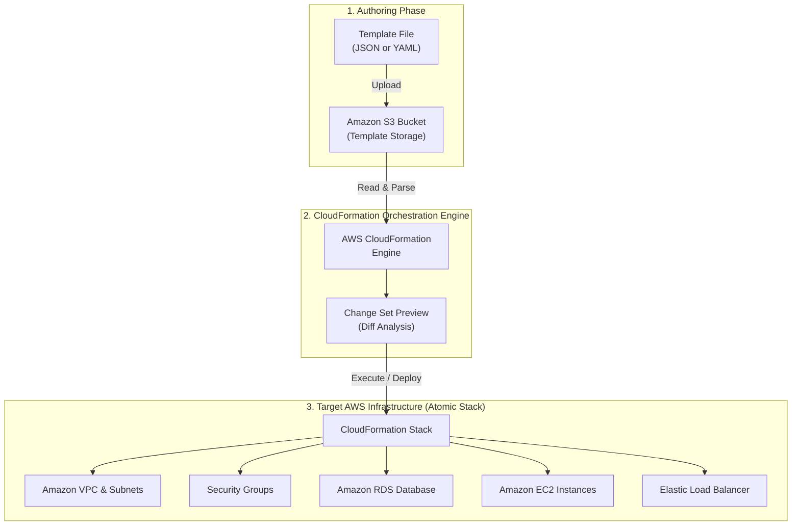
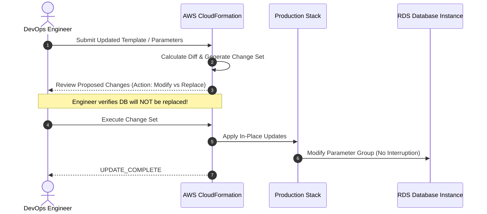
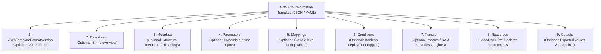
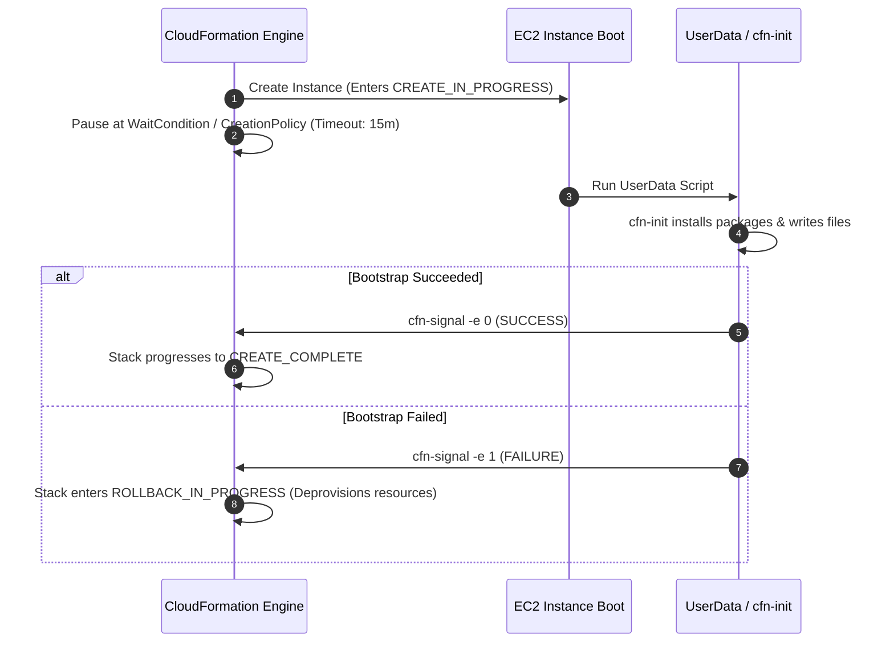
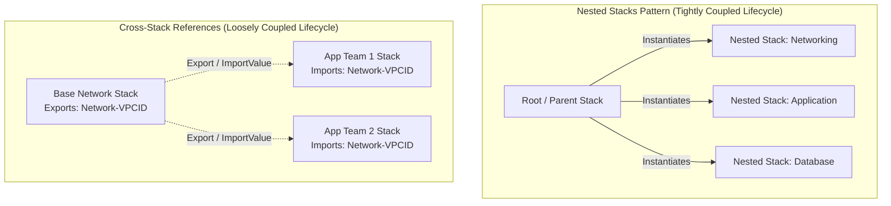
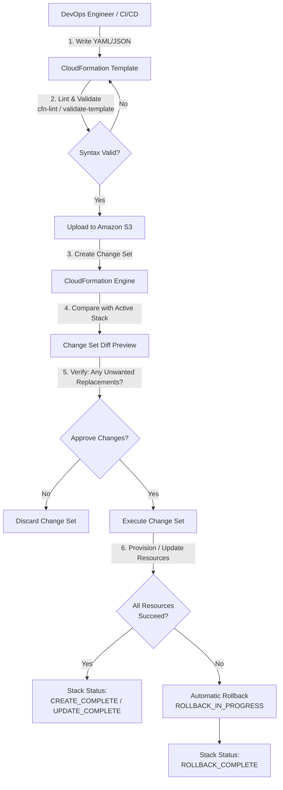

# ⚡ AWS CloudFormation: Declarative Infrastructure Automation

> **Course**: AWS re/Start  
> **Module**: Automated and Repeatable Deployments – AWS CloudFormation  
> **Source Document**: `T22-0008-RSJAWS_EN-US_SG_AWSCLOUDFORMATION.pdf`  
> **Target Audience**: AWS re/Start Learners / Cloud Practitioners / SysOps Administrators / DevOps Engineers  

---

## 🎯 Module Overview

As organizations scale their cloud footprints across multiple environments, accounts, and geographical regions, relying on manual configuration through the AWS Management Console ("ClickOps") becomes unsustainable. Manual provisioning introduces human error, deployment delays, undocumented configuration drift, and catastrophic rollback risks.

**AWS CloudFormation** provides an automated, repeatable, and declarative mechanism for modeling, provisioning, and managing AWS and third-party cloud infrastructure resources. By treating **Infrastructure as Code (IaC)**, CloudFormation enables engineers to define complete application architectures in text files (JSON or YAML), version-control them in repositories alongside application code, and deploy them as unified, atomic management units termed **Stacks**.

This comprehensive study guide explores the core architecture of AWS CloudFormation, its template anatomy, runtime lifecycle, intrinsic functions, instance bootstrapping workflows, operational safety controls, and industry best practices for enterprise cloud automation.

---

### 📌 Learning Objectives

- [ ] **Explain the Purpose and Value of AWS CloudFormation**: Understand how declarative templates solve manual cloud provisioning, configuration drift, and deployment velocity challenges.
- [ ] **Master Core Terminology & Architectural Units**: Define and differentiate Templates, Stacks, StackSets, and Change Sets.
- [ ] **Deconstruct CloudFormation Template Anatomy**: Master the 9 top-level template sections, identifying the mandatory `Resources` block and auxiliary sections (`Parameters`, `Mappings`, `Conditions`, `Outputs`, `Metadata`, `Transform`).
- [ ] **Implement Parameterization and Dynamic Typings**: Utilize string, numerical, list, AWS-specific parameter types (e.g., `AWS::EC2::KeyPair::KeyName`), and Systems Manager (SSM) parameter references with validation constraints.
- [ ] **Leverage CloudFormation Intrinsic Functions & Pseudo Parameters**: Formulate template logic using `!Ref`, `!GetAtt`, `!Sub`, `!Join`, `!Select`, `!Split`, `!FindInMap`, and `!ImportValue`, alongside pseudo parameters like `AWS::Region` and `AWS::AccountId`.
- [ ] **Bootstrap Compute Resources with CloudFormation Helper Scripts**: Contrast User Data with `AWS::CloudFormation::Init`, configuring packages, files, commands, and services, and coordinating state completion via `AWS::CloudFormation::WaitCondition` and `cfn-signal`.
- [ ] **Architect Safe and Resilient Deployments**: Apply `DeletionPolicy: Retain`/`Snapshot`, implement Termination Protection, configure Stack Policies, preview mutations using Change Sets, and remediate `UPDATE_ROLLBACK_FAILED` states using `continue-update-rollback`.
- [ ] **Evaluate Multi-Stack Architectures**: Compare Nested Stacks (fine-grained component composition) with Cross-Stack References (loose coupling across independent lifecycles).
- [ ] **Detect and Remediate Configuration Drift**: Identify out-of-band modifications made outside CloudFormation and restore alignment with template definitions.

---

## 🌩️ 1. The Challenge of Cloud Deployment

### The Fragility of Manual Deployments ("ClickOps")

Deploying enterprise systems in modern cloud environments presents significant operational complexity. Before infrastructure automation, teams relied on interactive web consoles, custom shell scripts, and static wiki runbooks.

```
┌─────────────────────────────────────────────────────────────────────────┐
│                    Pitfalls of Manual Cloud Deployments                 │
├─────────────────────────────────────────────────────────────────────────┤
│  ❌ Configuration Drift       : Unrecorded changes create "Snowflake"   │
│                                 servers impossible to replicate.        │
│  ❌ Inconsistent Multi-Region : High risk of human error when launching │
│                                 identical topologies across Regions.   │
│  ❌ Complex Rollbacks         : Failed intermediate steps leave orphan  │
│                                 resources and unbilled active services. │
│  ❌ System Dependencies       : Subsystems launch out of order, leading │
│                                 to connection timeouts and failures.    │
│  ❌ Lack of Auditability      : Changes cannot be tracked via commit    │
│                                 diffs, pull requests, or code reviews.  │
└─────────────────────────────────────────────────────────────────────────┘
```

### Core Deployment Challenges Addressed by AWS CloudFormation

1. **Multi-Region & Multi-Account Rollouts**: Deploying identical environments across disparate geographical locations without manual discrepancies.
2. **Deterministic Repeatability**: Ensuring development, staging, and production environments share identical networking, security groups, and compute topologies.
3. **Dependency Orchestration**: Automatically determining the sequence of resource provisioning (e.g., creating a VPC and subnet before launching an EC2 instance, or provisioning an RDS database before starting the backend application server).
4. **Automated Rollback Management**: Reclaiming and deleting partially provisioned resources when an error occurs during deployment, returning the environment to a known good state.
5. **Living Documentation**: Maintaining human-readable, machine-verifiable source files that describe the exact current state of the architecture.

---

## 🧱 2. What is AWS CloudFormation?

**AWS CloudFormation** is a fully managed AWS service that enables developers and systems administrators to easily create and provision a collection of related AWS and third-party resources, predict and manage their dependencies, and update them throughout their operational lifecycle in an orderly and predictable fashion.

CloudFormation operates on a **declarative model**: rather than writing imperative scripts detailing *how* to build infrastructure step-by-step (e.g., call API A, wait 30 seconds, call API B), you author a template describing *what* resources you need and their intended properties. CloudFormation figures out the underlying API sequencing, dependency tree, error handling, and rollbacks.



### Key Characteristics of AWS CloudFormation

- **Broad Service Coverage**: Supports virtually all core AWS compute, networking, storage, database, analytics, and security services.
- **Zero Additional Cost**: CloudFormation itself is provided at no extra charge; you pay only for the underlying AWS resources (EC2 instances, RDS databases, NAT Gateways, etc.) created by your stacks.
- **Atomic Operations**: Stack operations are all-or-nothing. If any resource fails to create or update, CloudFormation automatically rolls back all actions taken up to that point.
- **Declarative State Enforcement**: CloudFormation maintains the active state of your infrastructure and manages the transitions between states.

---

## 🔑 3. Core CloudFormation Terminology & Concepts

CloudFormation revolves around four foundational operational constructs:

```
┌────────────────────────────────────────────────────────────────────────┐
│                        Core Conceptual Units                           │
├────────────────────────────────────────────────────────────────────────┤
│  1. Template : The blueprint (JSON/YAML text file).                    │
│  2. Stack    : The deployed instantiation of a template.               │
│  3. StackSet : Multi-account, multi-Region stack deployment manager.   │
│  4. Change Set: The execution preview showing resource diffs.         │
└────────────────────────────────────────────────────────────────────────┘
```

### 1. CloudFormation Template
A text file formatted in **JSON** or **YAML** that declaratively describes your AWS infrastructure, its resource configurations, relationships, inputs, and outputs. Templates act as version-controlled blueprints and can be deployed multiple times to create identical, isolated environments.

### 2. CloudFormation Stack
The deployed instantiation of a CloudFormation template. A stack is managed as a single unit:
- When you create a stack, all resources specified in the template are provisioned.
- When you update a stack, changes are applied across all modified resources.
- When you delete a stack, all associated resources are deprovisioned together in the reverse order of their creation.

> [!IMPORTANT]
> The order of resource creation and deletion is calculated dynamically by CloudFormation by building an internal **directed acyclic graph (DAG)** of dependencies. You do not manually write procedural provisioning loops.

### 3. CloudFormation StackSets
**StackSets** extend stack management by enabling you to create, update, or delete stacks across **multiple AWS accounts and AWS Regions** with a single CloudFormation operation. StackSets integrate deeply with **AWS Organizations**, enabling automated baseline provisioning (e.g., default VPCs, IAM roles, AWS Config rules, GuardDuty detectors) whenever a new AWS account is added to an Organizational Unit (OU).

### 4. CloudFormation Change Sets
Before updating a running stack, you can generate a **Change Set**. A change set provides a preview of proposed modifications, showing:
- Which resources will be added, modified, or deleted.
- Whether a modification will cause a resource to be updated **with no interruption**, **with some interruption**, or **replaced entirely** (which destroys the existing resource and creates a brand-new one with a new physical ID, such as a database endpoint or EC2 instance).



---

## 📐 4. Anatomy of a CloudFormation Template

A CloudFormation template consists of **nine top-level sections**. Among these sections, only **`Resources`** is mandatory; all other sections are optional but provide essential parameterization, logic, and reusability.



### Template Sections Summary

| Section | Required? | Purpose & Scope |
| :--- | :---: | :--- |
| **`AWSTemplateFormatVersion`** | Optional | Declares the capabilities of the template format. Latest and only valid value is `'2010-09-09'`. |
| **`Description`** | Optional | A text string describing the template's architecture, purpose, and usage. Must immediately follow format version. |
| **`Metadata`** | Optional | JSON/YAML objects providing arbitrary configuration data (e.g., UI parameter grouping, `AWS::CloudFormation::Init`). |
| **`Parameters`** | Optional | Dynamic inputs passed into the template at launch/update time without altering template code. |
| **`Mappings`** | Optional | Static two-level lookup tables (e.g., matching Region names to specific Amazon Machine Image IDs). |
| **`Conditions`** | Optional | Boolean rules controlling whether specific resources are provisioned or specific properties are assigned. |
| **`Transform`** | Optional | Specifies macros or AWS Serverless Application Model (SAM) transforms applied before template processing. |
| **`Resources`** | **MANDATORY** | Declares the actual AWS resources to provision, their configurations, dependencies, and lifecycle policies. |
| **`Outputs`** | Optional | Returns values (e.g., DNS names, IPs, resource IDs) to the console, CLI, or exports them for cross-stack references. |

---

### Detailed Section Breakdown

#### 1. `AWSTemplateFormatVersion` & `Description`
The format version identifies the template language specification. The only valid value is `'2010-09-09'`. If omitted, CloudFormation assumes the latest version. The description provides operational context for administrators.

```yaml
AWSTemplateFormatVersion: '2010-09-09'
Description: >
  AWS re/Start Study Guide Sample Template - Multi-Tier Web Architecture
  featuring an Amazon VPC, Application Load Balancer, and Auto-Scaled EC2 instances.
```

---

#### 2. `Metadata`
The `Metadata` section accepts arbitrary key-value pairs. Standard AWS implementations include:
- `AWS::CloudFormation::Designer`: Layout coordinates used by the visual drag-and-drop template designer.
- `AWS::CloudFormation::Interface`: Defines parameter grouping, sorting, and custom friendly labels in the AWS Management Console wizard.
- `AWS::CloudFormation::Init`: Defines host configuration tasks (packages, files, commands, services) for EC2 instances.

```yaml
Metadata:
  AWS::CloudFormation::Interface:
    ParameterGroups:
      - Label:
          default: "Network Configuration"
        Parameters:
          - VpcCIDR
          - PublicSubnetCIDR
      - Label:
          default: "Compute Configuration"
        Parameters:
          - InstanceType
          - KeyPairName
```

---

#### 3. `Parameters`
Parameters allow templates to remain generic, reusable, and portable across multiple environments (Dev, Staging, Prod) by prompting users for input values during stack deployment.

##### Supported Parameter Types

| Parameter Type Category | Type Name | Description & Example |
| :--- | :--- | :--- |
| **General Types** | `String` | Plain text, e.g., `"t3.micro"` or `"MyEnvironment"` |
| | `Number` | Integers or floating point values, e.g., `80` or `500` |
| | `List<Number>` | Comma-delimited list of integers, e.g., `80, 443, 8080` |
| | `CommaDelimitedList` | Comma-separated strings, e.g., `"10.0.1.0/24, 10.0.2.0/24"` |
| **AWS-Specific Types** | `AWS::EC2::KeyPair::KeyName` | Populates console dropdown with valid EC2 key pairs |
| | `AWS::EC2::VPC::Id` | Validates and lists existing VPCs in the target region |
| | `AWS::EC2::Subnet::Id` | Validates and lists existing Subnet IDs |
| | `AWS::EC2::SecurityGroup::Id` | Validates existing security group IDs |
| | `AWS::EC2::Image::Id` | Validates existing AMI IDs in the region |
| **Systems Manager Types** | `AWS::SSM::Parameter::Value<String>` | Fetches live parameters directly from AWS Systems Manager Parameter Store |

##### Parameter Constraints & Security Properties
- `AllowedValues`: An array of permissible inputs (e.g., `['t3.micro', 't3.small', 't3.medium']`).
- `AllowedPattern`: Regular expression pattern matching valid inputs.
- `ConstraintDescription`: Custom human-readable error message displayed when constraints are violated.
- `MinLength` / `MaxLength`: String length boundaries.
- `MinValue` / `MaxValue`: Numerical boundaries.
- `Default`: Fallback value if no input is supplied.
- `NoEcho: true`: Masks sensitive values (passwords, tokens, API keys) in console, CLI outputs, and CloudFormation logs.

```yaml
Parameters:
  EnvironmentName:
    Type: String
    Default: "development"
    AllowedValues:
      - "development"
      - "staging"
      - "production"
    Description: "Deployment target environment."

  WebServerPort:
    Type: Number
    Default: 80
    MinValue: 1
    MaxValue: 65535
    Description: "TCP port for web server traffic."

  KeyPairName:
    Type: AWS::EC2::KeyPair::KeyName
    Description: "Name of an existing EC2 KeyPair for SSH access."

  DBPassword:
    Type: String
    NoEcho: true
    MinLength: 8
    MaxLength: 41
    AllowedPattern: "^[a-zA-Z0-9]*$"
    ConstraintDescription: "Must contain only alphanumeric characters, min 8 chars."
    Description: "Database administrative master password."
```

---

#### 4. `Mappings`
Mappings are static lookup tables formatted as **two-level key-value dictionaries**. They are ideal for binding configuration constants that depend on regional attributes—most commonly Amazon Machine Image (AMI) IDs, which vary across AWS Regions.

> [!CAUTION]
> You **cannot** use parameters, pseudo parameters, or intrinsic functions inside the `Mappings` section itself. Values must be hardcoded literals. You evaluate mappings in the `Resources` section using the `!FindInMap` intrinsic function.

```yaml
Mappings:
  RegionToAmiMap:
    us-east-1:
      HVM64: "ami-0c55b159cbfafe1f0"
      ARM64: "ami-0a26968614f8b1ac8"
    us-west-2:
      HVM64: "ami-0892d3c7ee96c0bf7"
      ARM64: "ami-0d593311db5abb72b"
    eu-west-1:
      HVM64: "ami-047bb4163c506cd98"
      ARM64: "ami-0773391ae604c49e7"
```

---

#### 5. `Conditions`
Conditions are boolean expressions evaluated at stack creation or update. They allow you to conditionally provision resources (e.g., only create a read replica or NAT Gateway in production) or conditionally assign property values.

##### Condition Intrinsic Functions
- `Fn::Equals` (`!Equals`): Compares whether two values are equal.
- `Fn::If` (`!If`): Three-argument ternary operator (`[ConditionName, ValueIfTrue, ValueIfFalse]`).
- `Fn::Not` (`!Not`): Inverts boolean value.
- `Fn::And` (`!And`): Evaluates true if all conditions in a list evaluate to true (2 to 10 conditions).
- `Fn::Or` (`!Or`): Evaluates true if any condition in a list evaluates to true (2 to 10 conditions).

```yaml
Conditions:
  IsProduction: !Equals [!Ref EnvironmentName, "production"]
  CreateNatGateway: !And
    - !Condition IsProduction
    - !Equals [!Ref EnableEgress, "true"]

Resources:
  ProductionNatGateway:
    Type: AWS::EC2::NatGateway
    Condition: CreateNatGateway
    Properties:
      AllocationId: !GetAtt EIPAllocation.AllocationId
      SubnetId: !Ref PublicSubnet
```

---

#### 6. `Transform`
The `Transform` section specifies one or more macros that AWS CloudFormation uses to process your template before creating or updating the stack.
- **AWS SAM Transform**: `Transform: 'AWS::Serverless-2016-10-31'` allows developers to write simplified serverless syntax (e.g., `AWS::Serverless::Function`) which CloudFormation expands into full IAM roles, Lambda functions, and API Gateways.
- **AWS CloudFormation Macros**: Custom AWS Lambda-backed transforms that enable template search-and-replace, string manipulation, or automated architectural governance.

---

#### 7. `Resources` (The Mandatory Core)
The `Resources` section declares the actual AWS infrastructure components. Each resource entry consists of a **Logical ID**, a **Type**, and associated **Properties**.

```yaml
Resources:
  <LogicalID>:
    Type: <ResourceTypeString>
    Properties:
      <PropertyName>: <PropertyValue>
    DependsOn: <LogicalID or List of LogicalIDs>
    DeletionPolicy: <Delete | Retain | Snapshot>
    UpdateReplacePolicy: <Delete | Retain | Snapshot>
```

##### Resource Types & Logical Identifiers
- **Logical ID**: An alphanumeric name (unique within the template) used to reference the resource throughout the file.
- **Resource Type**: An AWS-defined string identifier following the pattern: `AWS::Service::ResourceType` (e.g., `AWS::EC2::Instance`, `AWS::RDS::DBInstance`, `AWS::S3::Bucket`).

##### Resource Attributes
In addition to resource-specific properties, CloudFormation provides standard attributes to control provisioning behavior:

1. **`DependsOn`**: Explicitly defines creation dependencies. While CloudFormation automatically detects implicit dependencies when you use `!Ref` or `!GetAtt`, some resources require explicit ordering (e.g., an internet-facing gateway must be attached before an EC2 instance in a public subnet attempts internet access).
2. **`DeletionPolicy`**: Defines what occurs to a resource when the containing stack is deleted:
   - `Delete` (Default): Destroys the underlying AWS resource.
   - `Retain`: Leaves the resource intact in the AWS account when the stack is deleted.
   - `Snapshot`: Creates a final snapshot before deletion (applicable to Amazon EBS volumes, RDS DB instances/clusters, Amazon Redshift clusters).
3. **`UpdateReplacePolicy`**: Controls whether a replaced resource during a stack update is deleted, retained, or snapshotted.
4. **`CreationPolicy`**: Pauses stack creation until CloudFormation receives a specified count of success signals (used with Auto Scaling groups and EC2 instances).

```yaml
Resources:
  MyVPC:
    Type: AWS::EC2::VPC
    Properties:
      CidrBlock: "10.0.0.0/16"
      EnableDnsHostnames: true
      EnableDnsSupport: true
      Tags:
        - Key: Name
          Value: "Production-VPC"

  ProductionDatabase:
    Type: AWS::RDS::DBInstance
    DeletionPolicy: Snapshot
    UpdateReplacePolicy: Snapshot
    Properties:
      DBInstanceClass: "db.t3.medium"
      Engine: "mysql"
      AllocatedStorage: "20"
      MasterUsername: "admin"
      MasterUserPassword: !Ref DBPassword
```

---

#### 8. `Outputs`
The `Outputs` section exports values generated during stack creation. Outputs serve two primary purposes:
1. **Reporting & Console Visibility**: Displaying important resource identifiers, connection strings, or web URLs in the AWS CloudFormation Management Console and CLI outputs.
2. **Cross-Stack Referencing**: Exporting values (such as a VPC ID or Security Group ID) so that independent stacks in the same AWS account and Region can reference them using `!ImportValue`.

```yaml
Outputs:
  VPCIdOutput:
    Description: "The ID of the provisioned VPC"
    Value: !Ref MyVPC
    Export:
      Name: !Sub "${AWS::StackName}-VPCID"

  WebsiteURL:
    Description: "Application Load Balancer Public URL"
    Value: !Sub "http://${ApplicationLoadBalancer.DNSName}"
```

---

## ⚡ 5. CloudFormation Intrinsic Functions & Pseudo Parameters

Because templates are written in static JSON or YAML, CloudFormation provides **Intrinsic Functions** to dynamically inject runtime values, concatenate strings, look up values, and query resource states.

### Intrinsic Function Reference

| Function Name | YAML Short Form | JSON / Full Form | Primary Purpose & Usage Example |
| :--- | :---: | :--- | :--- |
| **`Ref`** | `!Ref <LogicalID>` | `{"Ref": "LogicalID"}` | Returns the value of a parameter, the physical ID of a resource, or the value of a pseudo parameter.<br/>Example: `VpcId: !Ref MyVPC` |
| **`Fn::GetAtt`** | `!GetAtt <Res>.<Attr>` | `{"Fn::GetAtt": ["Res", "Attr"]}` | Retrieves the value of a named attribute from a resource in the template.<br/>Example: `!GetAtt WebServer.PublicIp` |
| **`Fn::Sub`** | `!Sub "<String>"` | `{"Fn::Sub": "String"}` | Substitutes variables inside a string template with live parameter/resource values.<br/>Example: `!Sub "arn:aws:s3:::${BucketName}/*"` |
| **`Fn::Join`** | `!Join [ "delim", [vals] ]` | `{"Fn::Join": ["delim", [...]]}` | Concatenates a list of strings using a specified delimiter.<br/>Example: `!Join [ "-", [ !Ref Env, "app-cluster" ] ]` |
| **`Fn::Select`** | `!Select [ index, list ]` | `{"Fn::Select": [index, [...]]}` | Extracts a single item from a list or comma-delimited string by zero-based index.<br/>Example: `!Select [ 0, !Ref SubnetList ]` |
| **`Fn::Split`** | `!Split [ "delim", string ]` | `{"Fn::Split": ["delim", "str"]}` | Splits a single string into a list of strings using a delimiter.<br/>Example: `!Split [ ",", "a,b,c" ]` |
| **`Fn::FindInMap`** | `!FindInMap [ Map, K1, K2 ]` | `{"Fn::FindInMap": [M, K1, K2]}` | Looks up a value in the `Mappings` section based on two keys.<br/>Example: `ImageId: !FindInMap [ RegionToAmiMap, !Ref 'AWS::Region', HVM64 ]` |
| **`Fn::ImportValue`** | `!ImportValue <ExportName>` | `{"Fn::ImportValue": "Name"}` | Imports a value exported by another stack in the same Region.<br/>Example: `VpcId: !ImportValue "CoreNetwork-VPCID"` |
| **`Fn::Base64`** | `!Base64 <Value>` | `{"Fn::Base64": "Value"}` | Encodes an input string as Base64 (frequently used for EC2 `UserData` scripts).<br/>Example: `UserData: !Base64 !Sub "#!/bin/bash\n..."` |
| **`Fn::Cidr`** | `!Cidr [ ip, count, bits ]` | `{"Fn::Cidr": [...]}` | Dynamically generates an array of CIDR blocks from an initial IP block. |

> [!TIP]
> **Ref Return Values Vary by Resource Type!**
> - For an `AWS::EC2::Instance`, `!Ref` returns the **Instance ID** (`i-0123456789abcdef0`).
> - For an `AWS::S3::Bucket`, `!Ref` returns the **Bucket Name** (`my-app-storage-bucket`).
> - For an `AWS::SQS::Queue`, `!Ref` returns the **Queue URL** (`https://sqs.us-east-1.amazonaws.com/...`).
> - To get the S3 Bucket ARN or EC2 Private IP, you must use `!GetAtt Resource.Arn` or `!GetAtt Resource.PrivateIp`.

---

### Pseudo Parameters Reference

Pseudo parameters are predefined by AWS CloudFormation. You do not declare them in the `Parameters` section; they are resolved dynamically by the engine at runtime using `!Ref`.

| Pseudo Parameter | Example Resolved Value | Common Architectural Use Case |
| :--- | :--- | :--- |
| **`AWS::Region`** | `us-east-1` | Looking up region-specific AMIs or constructing regional ARNs. |
| **`AWS::AccountId`** | `123456789012` | Constructing IAM role ARNs, S3 bucket policies, and cross-account permissions. |
| **`AWS::StackName`** | `Production-VPC-Stack` | Naming resources dynamically and namespacing exported output values. |
| **`AWS::StackId`** | `arn:aws:cloudformation:us-east-1:...` | Passing exact stack identity to initialization scripts or CloudTrail filters. |
| **`AWS::NoValue`** | *N/A (Removes property)* | Used in `!If` expressions to cleanly omit an optional property if a condition is false. |
| **`AWS::Partition`** | `aws` (or `aws-cn`, `aws-us-gov`) | Building portable ARNs across commercial, China, or GovCloud partitions. |
| **`AWS::URLSuffix`** | `amazonaws.com` | Constructing service endpoint domain names. |

```yaml
# Constructing an S3 Bucket Policy dynamically with Pseudo Parameters
Outputs:
  ConstructedRoleArn:
    Value: !Sub "arn:${AWS::Partition}:iam::${AWS::AccountId}:role/${AWS::StackName}-ExecutionRole"
```

---

## 🛠️ 6. Instance Bootstrapping & Helper Scripts

Configuring software on Amazon EC2 instances during stack provisioning can be achieved via two primary methodologies: **EC2 User Data** or **`AWS::CloudFormation::Init`**.

### EC2 User Data vs. `AWS::CloudFormation::Init`

| Feature / Dimension | Standard EC2 User Data | `AWS::CloudFormation::Init` + Helper Scripts |
| :--- | :--- | :--- |
| **Execution Paradigm** | Procedural shell script (`bash` or `powershell`) | Declarative configuration metadata |
| **Error Handling** | Difficult; failures in scripts do not halt stack creation | Automatic; failure triggers immediate stack rollback via `cfn-signal` |
| **Complexity & Formatting** | Sensitive to escaping quotes, multiline JSON/YAML errors | Clean JSON/YAML objects; organized into discrete logical tasks |
| **Updates & Modifications** | Changing User Data triggers an instance replacement | Can update configurations in-place without replacing instances using `cfn-hup` |
| **Reusability** | Monolithic script embedded in resource properties | Modular **Configsets** that can be shared across multiple instance roles |

---

### The CloudFormation Helper Scripts Suite

CloudFormation provides four specialized Python-based helper scripts pre-installed on Amazon Linux AMIs:

```
┌────────────────────────────────────────────────────────────────────────┐
│                   CloudFormation Helper Scripts Suite                  │
├────────────────────────────────────────────────────────────────────────┤
│  1. cfn-init         : Reads AWS::CloudFormation::Init metadata and    │
│                        installs packages, files, users, and services.  │
│  2. cfn-signal       : Sends success/failure signals to WaitConditions │
│                        or CreationPolicies to unblock stack creation.  │
│  3. cfn-hup          : Daemon listening for metadata changes to        │
│                        apply in-place configuration updates.           │
│  4. cfn-get-metadata : Retrieves metadata blocks for custom scripting. │
└────────────────────────────────────────────────────────────────────────┘
```

#### `AWS::CloudFormation::Init` Metadata Structure
`cfn-init` processes metadata defined under the `AWS::CloudFormation::Init` key in the following strict order:

1. **`packages`**: Installs packages using package managers (`yum`, `apt`, `rubygems`, `python`, `rpm`).
2. **`groups`**: Creates Linux/Windows system groups.
3. **`users`**: Creates local system user accounts.
4. **`sources`**: Downloads and unpacks archives (`.tar`, `.tar.gz`, `.zip`) directly into target directories.
5. **`files`**: Writes configuration files to disk with specified file paths, permissions, owners, and content.
6. **`commands`**: Executes commands in alphabetical order.
7. **`services`**: Manages daemon services (`sysvinit`, `systemd`, `windows`), ensuring services are started, enabled on boot, or restarted when specific configuration files change.

```yaml
Resources:
  WebServerInstance:
    Type: AWS::EC2::Instance
    Metadata:
      AWS::CloudFormation::Init:
        config:
          packages:
            yum:
              httpd: []
              php: []
          files:
            "/var/www/html/index.php":
              content: !Sub |
                <?php
                echo "<h1>Deployed via AWS CloudFormation!</h1>";
                echo "<p>Region: ${AWS::Region}</p>";
                ?>
              mode: "000644"
              owner: "apache"
              group: "apache"
          services:
            sysvinit:
              httpd:
                enabled: "true"
                ensureRunning: "true"
    Properties:
      ImageId: !FindInMap [ RegionToAmiMap, !Ref 'AWS::Region', HVM64 ]
      InstanceType: "t3.micro"
      UserData:
        Fn::Base64: !Sub |
          #!/bin/bash -xe
          # Run cfn-init to bootstrap application
          /opt/aws/bin/cfn-init -v --stack ${AWS::StackName} --resource WebServerInstance --region ${AWS::Region}
          # Signal stack completion
          /opt/aws/bin/cfn-signal -e $? --stack ${AWS::StackName} --resource WebServerInstance --region ${AWS::Region}
```

---

### Coordinating Execution with `WaitCondition` & `cfn-signal`

By default, CloudFormation marks an EC2 instance as `CREATE_COMPLETE` as soon as the instance passes basic AWS hypervisor status checks—long before custom software, web servers, or databases have finished installing via user data.

To prevent premature stack completion, CloudFormation uses a signaling mechanism:
1. **`AWS::CloudFormation::WaitCondition` & `WaitConditionHandle`**: A pause barrier that holds stack creation in a pending state until a specified number of success signals are received or a timeout threshold expires.
2. **`CreationPolicy`**: The modern alternative to WaitConditions for EC2 instances and Auto Scaling Groups. You specify `Count` and `Timeout`, and the instance sends signals using `cfn-signal -e $?`. If the script exits with non-zero status (`$? != 0`), CloudFormation fails and initiates an automatic rollback.



---

## 🛡️ 7. Operational Resilience, Drift Detection & Best Practices

### 1. Nested Stacks vs. Cross-Stack References

As cloud environments grow, monolithic templates containing hundreds of resources become unmanageable. CloudFormation provides two primary modularization strategies:



| Architectural Pattern | How It Works | Best Use Cases | Trade-offs & Considerations |
| :--- | :--- | :--- | :--- |
| **Nested Stacks** | A parent stack declares child stacks using `AWS::CloudFormation::Stack` resource type and template URLs. | Reusable architectural components deployed and destroyed **together** (e.g., standard standard auto-scaled load-balanced cluster). | Child stacks share the lifecycle of the root stack. Maximum nesting depth of 5 levels. |
| **Cross-Stack References** | An independent stack exports output values using `Export: Name`; consuming stacks reference them using `!ImportValue`. | Shared foundation resources owned by different teams (e.g., Core Networking VPC shared by multiple dev stacks). | **Strict lock-in**: You cannot delete or modify the exported output of a base stack while any other stack is importing it. |

---

### 2. Protecting Stateful Resources: `DeletionPolicy` & `UpdateReplacePolicy`

Accidental deletion of stateful data storage (relational databases, persistent disk volumes, object stores) can lead to catastrophic business data loss.

- **`DeletionPolicy: Retain`**: Preserves the resource when the stack is deleted.
- **`DeletionPolicy: Snapshot`**: Generates a final snapshot before deletion (Amazon EBS volumes, Amazon RDS, Amazon Redshift).
- **Termination Protection**: A stack-level flag that prevents accidental deletion of the entire stack. Any user attempting to delete a protected stack receives an `AccessDenied` error until termination protection is explicitly disabled.

```bash
# Enabling Termination Protection via AWS CLI
aws cloudformation update-termination-protection \
    --enable-termination-protection \
    --stack-name Production-ECommerce-Stack
```

---

### 3. Stack Policies: Preventing Accidental Updates

By default, during a stack update, any resource in the stack can be modified or replaced if the user possesses update permissions. A **Stack Policy** is an IAM-like JSON document applied directly to a stack that defines which update actions are allowed on specific resources.

```json
{
  "Statement": [
    {
      "Effect": "Allow",
      "Action": "Update:*",
      "Principal": "*",
      "Resource": "*"
    },
    {
      "Effect": "Deny",
      "Action": ["Update:Replace", "Update:Delete"],
      "Principal": "*",
      "Resource": "LogicalResourceId/ProductionDatabase"
    }
  ]
}
```

> [!IMPORTANT]
> The policy above permits all in-place configuration updates across the stack, but strictly **denies** any change set that would result in the replacement or deletion of `ProductionDatabase`.

---

### 4. Configuration Drift Detection

**Configuration Drift** occurs when a resource's actual cloud configuration diverges from the expected configuration declared in its CloudFormation template—typically caused by emergency console edits, unrecorded manual CLI commands, or automated patching scripts outside CloudFormation.

```
┌────────────────────────────────────────────────────────────────────────┐
│                        Drift Detection Workflow                        │
├────────────────────────────────────────────────────────────────────────┤
│  1. Initiate Drift Detection : Via Console, CLI, or scheduled SDK.     │
│  2. CloudFormation Scans API : Compares live resource properties with  │
│                                expected template values.               │
│  3. Status Reported          : IN_SYNC, MODIFIED, or DELETED.          │
│  4. Remediation Steps        : Update template to reflect reality, or  │
│                                revert live resource back to spec.      │
└────────────────────────────────────────────────────────────────────────┘
```

```bash
# Initiating Drift Detection via AWS CLI
aws cloudformation detect-stack-drift --stack-name Production-Stack

# Checking Drift Detection Results
aws cloudformation describe-stack-resource-drifts --stack-name Production-Stack
```

---

### 5. Managing Rollbacks & Troubleshooting Failures

#### The Default Rollback Behavior
If an error occurs during stack creation (e.g., invalid AMI ID, insufficient IAM permissions, VPC CIDR conflict), CloudFormation by default initiates **automatic rollback**: all successfully provisioned resources are deleted, and the stack status transitions to `ROLLBACK_COMPLETE`.

#### Debugging with `--on-failure DO_NOTHING`
When developing templates, automatic rollback destroys the resources you need to inspect (such as EC2 system logs or security group bindings). You can override this behavior using the AWS CLI:

```bash
aws cloudformation create-stack \
    --stack-name DebugStack \
    --template-body file://template.yml \
    --on-failure DO_NOTHING
```
With `DO_NOTHING`, CloudFormation leaves successfully created resources active, allowing you to log in, diagnose the failure, and inspect log files.

#### Handling `UPDATE_ROLLBACK_FAILED`
A stack enters the `UPDATE_ROLLBACK_FAILED` state when an update encounters an error and CloudFormation is unable to roll back to the original configuration—often because a dependent resource was deleted out-of-band outside CloudFormation.

To recover:
1. Identify the root cause via the **Events** tab in the CloudFormation console or CloudTrail logs.
2. Manually fix the out-of-band issue (e.g., recreate a deleted security group or adjust an IAM policy).
3. Execute `continue-update-rollback`:

```bash
aws cloudformation continue-update-rollback --stack-name ExistingProductionStack
```

---

### 6. CloudFormation Best Practices Checklist

```
┌─────────────────────────────────────────────────────────────────────────┐
│               Enterprise CloudFormation Best Practices                  │
├─────────────────────────────────────────────────────────────────────────┤
│  ✔️  Never Embed Hardcoded Credentials: Use NoEcho parameters & AWS     │
│      Secrets Manager / Systems Manager Parameter Store.                 │
│  ✔️  Organize Stacks by Lifecycle: Group short-lived apps separately    │
│      from long-lived networking and persistent database infrastructure. │
│  ✔️  Always Use Change Sets for Updates: Inspect replacement impacts    │
│      before triggering production mutations.                            │
│  ✔️  Implement Parameter Validation: Use AWS-specific types & regex.   │
│  ✔️  Validate Syntax Early: Run 'aws cloudformation validate-template'  │
│      and 'cfn-lint' in local pre-commit hooks and CI/CD pipelines.      │
│  ✔️  Enable CloudTrail Auditing: Monitor and record all CloudFormation │
│      API calls to an encrypted Amazon S3 audit bucket.                  │
│  ✔️  Enforce Stack Termination Protection on Production Workloads.     │
│  ✔️  Use AWS::CloudFormation::Init: Avoid complex User Data scripting.  │
└─────────────────────────────────────────────────────────────────────────┘
```

---

## 📊 8. Visual Architecture & Workflow Diagrams

### Complete CloudFormation Provisioning Lifecycle Pipeline



---

## 📝 9. Practical Template Walkthrough: Complete YAML Blueprint

The following standalone YAML template demonstrates **Parameters**, **Mappings**, **Conditions**, **Resources**, **CloudFormation::Init**, **WaitConditions**, and **Outputs** working together:

```yaml
AWSTemplateFormatVersion: '2010-09-09'
Description: >
  AWS re/Start End-to-End CloudFormation Reference Blueprint:
  Provisions a VPC, Security Group, and an EC2 Instance bootstrapped with cfn-init.

Parameters:
  EnvironmentType:
    Type: String
    Default: "development"
    AllowedValues: ["development", "production"]
    Description: "Select target environment type."

  InstanceType:
    Type: String
    Default: "t3.micro"
    AllowedValues: ["t3.micro", "t3.small", "t3.medium"]
    Description: "EC2 instance type."

  KeyPairName:
    Type: AWS::EC2::KeyPair::KeyName
    Description: "Existing EC2 KeyPair for SSH administration."

Mappings:
  RegionMap:
    us-east-1:
      AMI: "ami-0c55b159cbfafe1f0"
    us-west-2:
      AMI: "ami-0892d3c7ee96c0bf7"
    eu-west-1:
      AMI: "ami-047bb4163c506cd98"

Conditions:
  IsProd: !Equals [!Ref EnvironmentType, "production"]

Resources:
  ApplicationVPC:
    Type: AWS::EC2::VPC
    Properties:
      CidrBlock: "10.100.0.0/16"
      EnableDnsSupport: true
      EnableDnsHostnames: true
      Tags:
        - Key: Name
          Value: !Sub "${AWS::StackName}-VPC"

  PublicSubnet:
    Type: AWS::EC2::Subnet
    Properties:
      VpcId: !Ref ApplicationVPC
      CidrBlock: "10.100.1.0/24"
      MapPublicIpOnLaunch: true
      AvailabilityZone: !Select [0, !GetAZs ""]
      Tags:
        - Key: Name
          Value: !Sub "${AWS::StackName}-PublicSubnet"

  InternetGateway:
    Type: AWS::EC2::InternetGateway

  AttachGateway:
    Type: AWS::EC2::VPCGatewayAttachment
    Properties:
      VpcId: !Ref ApplicationVPC
      InternetGatewayId: !Ref InternetGateway

  WebServerSecurityGroup:
    Type: AWS::EC2::SecurityGroup
    Properties:
      GroupDescription: "Allow HTTP and SSH access"
      VpcId: !Ref ApplicationVPC
      SecurityGroupIngress:
        - IpProtocol: "tcp"
          FromPort: 80
          ToPort: 80
          CidrIp: "0.0.0.0/0"
        - IpProtocol: "tcp"
          FromPort: 22
          ToPort: 22
          CidrIp: "0.0.0.0/0"

  WebServerInstance:
    Type: AWS::EC2::Instance
    DependsOn: AttachGateway
    Metadata:
      AWS::CloudFormation::Init:
        config:
          packages:
            yum:
              httpd: []
          files:
            "/var/www/html/index.html":
              content: !Sub |
                <html>
                <body style="font-family: Arial; text-align: center; margin-top: 50px;">
                  <h1>Hello from AWS CloudFormation!</h1>
                  <p>Stack: <b>${AWS::StackName}</b></p>
                  <p>Region: <b>${AWS::Region}</b> | Environment: <b>${EnvironmentType}</b></p>
                </body>
                </html>
              mode: "000644"
              owner: "root"
              group: "root"
          services:
            sysvinit:
              httpd:
                enabled: "true"
                ensureRunning: "true"
    Properties:
      ImageId: !FindInMap [RegionMap, !Ref 'AWS::Region', AMI]
      InstanceType: !Ref InstanceType
      KeyName: !Ref KeyPairName
      SubnetId: !Ref PublicSubnet
      SecurityGroupIds:
        - !Ref WebServerSecurityGroup
      UserData:
        Fn::Base64: !Sub |
          #!/bin/bash -xe
          /opt/aws/bin/cfn-init -v --stack ${AWS::StackName} --resource WebServerInstance --region ${AWS::Region}
          /opt/aws/bin/cfn-signal -e $? '${WebServerWaitHandle}'

  WebServerWaitHandle:
    Type: AWS::CloudFormation::WaitConditionHandle

  WebServerWaitCondition:
    Type: AWS::CloudFormation::WaitCondition
    DependsOn: WebServerInstance
    Properties:
      Handle: !Ref WebServerWaitHandle
      Timeout: "300"
      Count: 1

Outputs:
  WebServerPublicIP:
    Description: "Public IP address of bootstrapped web server"
    Value: !GetAtt WebServerInstance.PublicIp

  WebsiteURL:
    Description: "Direct URL to web application"
    Value: !Sub "http://${WebServerInstance.PublicIp}"
    Export:
      Name: !Sub "${AWS::StackName}-WebsiteURL"
```

---

## 💡 10. Checkpoint Review Questions & Answers

Test your mastery of AWS CloudFormation concepts with these comprehensive review questions:

### Question 1: Mandatory Template Sections
**What is the only required section in an AWS CloudFormation template?**
- A) `Parameters`
- B) `AWSTemplateFormatVersion`
- C) `Resources`
- D) `Outputs`

> **Answer: C**  
> **Explanation**: The `Resources` section is the only mandatory section in an AWS CloudFormation template. A template can omit parameters, mappings, outputs, and format versions, but it must declare at least one resource to provision.

---

### Question 2: Rollback Behaviors
**What is the default behavior of AWS CloudFormation when a resource fails to create during stack provisioning?**
- A) CloudFormation pauses execution and waits for user intervention via the console.
- B) CloudFormation deletes all successfully created resources and returns the environment to its initial state.
- C) CloudFormation logs the error and continues provisioning remaining resources.
- D) CloudFormation terminates the AWS account session.

> **Answer: B**  
> **Explanation**: CloudFormation treats stacks as atomic operations. By default, if any resource fails to create or update, CloudFormation automatically rolls back all changes (`ROLLBACK_IN_PROGRESS`), deleting all resources provisioned during that failed operation.

---

### Question 3: Avoiding Accidental Database Deletion
**A DevOps engineer is preparing to update an AWS CloudFormation stack containing a production Amazon RDS database. Which two mechanisms should be applied to prevent accidental data loss and replacement? (Select TWO)**
- A) Create a Change Set prior to executing the stack update.
- B) Set `DeletionPolicy: Retain` on the `AWS::RDS::DBInstance` resource.
- C) Configure `NoEcho: true` on the database password parameter.
- D) Execute `aws cloudformation continue-update-rollback`.
- E) Delete the stack and recreate it from scratch.

> **Answer: A and B**  
> **Explanation**: A Change Set allows the engineer to inspect whether the proposed modification requires in-place update or resource replacement (which would destroy the database). Setting `DeletionPolicy: Retain` (or `Snapshot`) guarantees that even if the stack is deleted or replaced, the database or its snapshot will persist.

---

### Question 4: Dynamic Cross-Stack Outputs
**An infrastructure team manages a shared networking stack that exports the VPC ID using `Export: Name: SharedVPC-ID`. How should an application team reference this VPC ID in a separate CloudFormation template?**
- A) `!Ref SharedVPC-ID`
- B) `!GetAtt SharedVPC-ID.VpcId`
- C) `!ImportValue SharedVPC-ID`
- D) `!FindInMap [SharedVPC-ID, VPC, Id]`

> **Answer: C**  
> **Explanation**: The `!ImportValue` intrinsic function is explicitly designed for cross-stack references, allowing consuming stacks in the same account and region to import values exported by foundational stacks.

---

### Question 5: EC2 Bootstrapping Signaling
**An engineer is deploying an Amazon EC2 instance using CloudFormation. The stack marks the instance as `CREATE_COMPLETE` immediately, but the application installed via `UserData` fails to start. How can the engineer ensure the stack only completes after the application has verified its startup?**
- A) Add a `DependsOn` attribute linking the EC2 instance to itself.
- B) Use `AWS::CloudFormation::WaitCondition` and call `cfn-signal -e $?` at the end of the bootstrapping script.
- C) Increase the EC2 instance size to `m5.large`.
- D) Enable termination protection on the stack.

> **Answer: B**  
> **Explanation**: A `WaitCondition` (or `CreationPolicy`) halts stack completion until the helper script `cfn-signal` reports a successful exit code (`-e 0`). If bootstrapping fails, `cfn-signal` sends a failure status, triggering an automatic rollback.

---

### Question 6: Configuration Drift Remediation
**A system administrator notices that someone manually changed the security group rules on a production instance via the EC2 console. What feature of CloudFormation identifies this discrepancy?**
- A) StackSets
- B) Change Sets
- C) Drift Detection
- D) CloudFormation Designer

> **Answer: C**  
> **Explanation**: Drift Detection compares the live configuration of stack resources with the expected properties defined in the stack template, identifying out-of-band modifications as `MODIFIED` or `DELETED`.

---

## 📚 11. Study Summary & Quick Reference

```
┌────────────────────────────────────────────────────────────────────────┐
│                   AWS CloudFormation Quick Reference                   │
├────────────────────────────────────────────────────────────────────────┤
│  Service Purpose       : Automated, repeatable, declarative IaC       │
│  Format Support         : JSON and YAML                                │
│  Mandatory Section     : Resources                                    │
│  Default Error Action  : Full automatic rollback                       │
│  Primary Functions     : !Ref, !GetAtt, !Sub, !FindInMap, !ImportValue │
│  Helper Scripts        : cfn-init, cfn-signal, cfn-hup, cfn-get-metadata│
│  Data Protection       : DeletionPolicy: Retain / Snapshot             │
│  Previewing Updates    : Change Sets                                   │
│  Multi-Region/Account  : StackSets                                     │
│  Out-of-Band Auditing  : Drift Detection                               │
└────────────────────────────────────────────────────────────────────────┘
```
