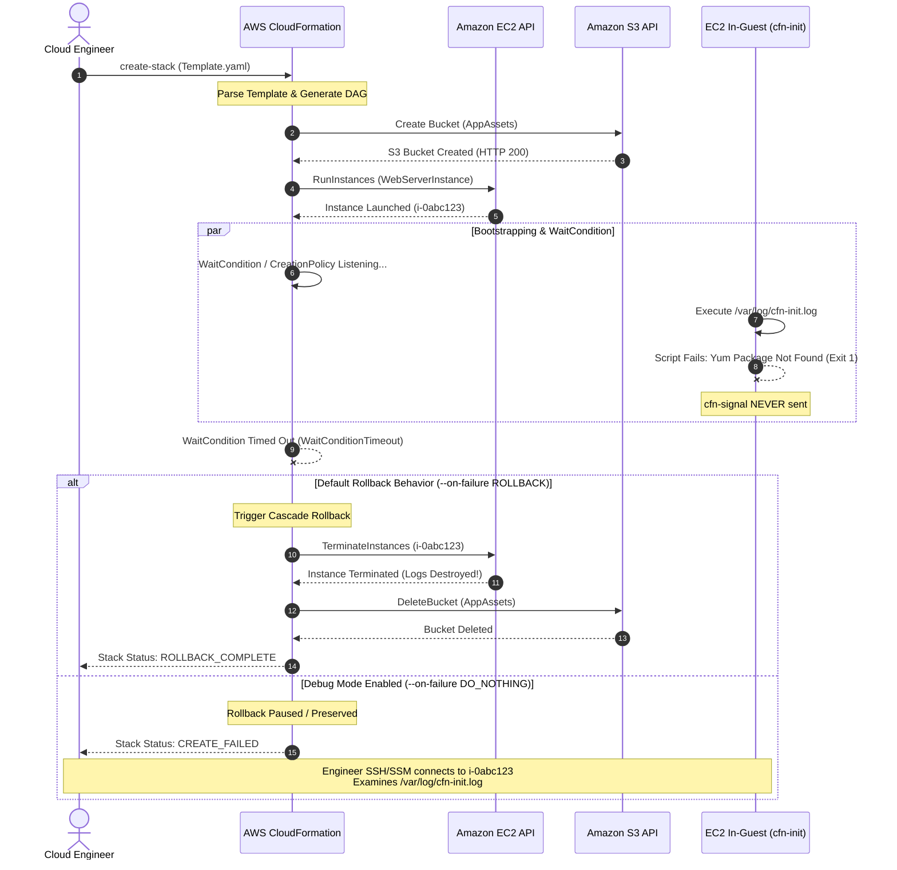
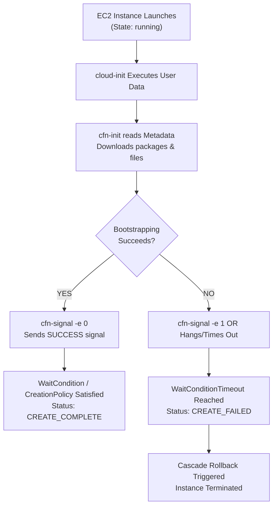
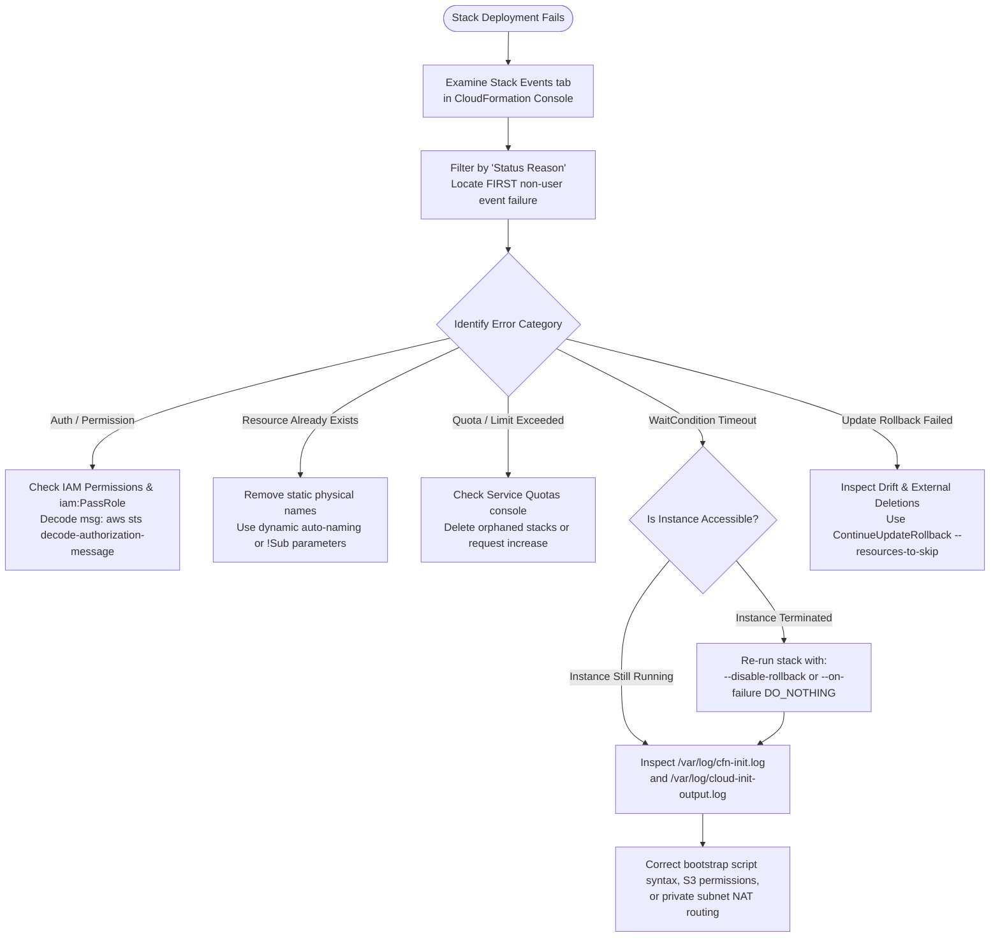
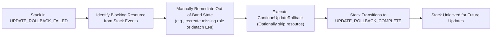

# 🛠️ Troubleshooting AWS CloudFormation: Failure Analysis, Diagnostics, and Remediation

> **Course**: AWS re/Start  
> **Module**: Automated and Repeatable Deployments – M13 Troubleshooting AWS CloudFormation  
> **Source Document**: `T22-0009-RSJAWS_EN-US_SG_M13_TROUBLESHOOTAWSCLOUDFORMATION.pdf`  
> **Target Audience**: AWS re/Start Learners / Cloud Practitioners / SysOps Administrators / DevOps Engineers  

---

## 🎯 Module Overview

Infrastructure as Code (IaC) allows organizations to codify cloud infrastructure into predictable, repeatable templates. However, when deploying complex distributed architectures—encompassing virtual networks, IAM security boundaries, compute clusters, and relational databases—orchestration failures can and do occur. 

When an AWS CloudFormation stack encounters an error during provisioning, updating, or deleting, understanding **why** the failure occurred, **how** CloudFormation responds, and **where** to find diagnostic logs is essential for cloud practitioners and SysOps administrators.

This study guide provides an exhaustive, engineering-grade walkthrough of CloudFormation troubleshooting. Learners will master the mechanics of stack rollbacks, how to intercept failed resources before they are torn down, concrete remediations for the five most frequent CloudFormation deployment errors, in-guest bootstrapping diagnostics (including `cfn-init` and `WaitCondition` timeouts), handling `UPDATE_ROLLBACK_FAILED` conditions, configuration drift detection, and formal integration into the **Troubleshooting Knowledge Base** under the **Automation and Optimization** category.

---

### 📌 Learning Objectives

- [ ] **Analyze the Anatomy of a CloudFormation Failure**: Trace the precise status progression from `CREATE_IN_PROGRESS` to `ROLLBACK_COMPLETE` or `ROLLBACK_FAILED`, understanding CloudFormation's atomic rollback behavior.
- [ ] **Preserve Failed Resources for In-Depth Diagnostics**: Utilize `--disable-rollback`, `--on-failure DO_NOTHING`, and the AWS Management Console rollback pause controls to inspect failing resources in runtime.
- [ ] **Diagnose & Remedy the Top 5 CloudFormation Errors**:
  1. *IAM Authorization Failures* (`ec2:RunInstances`, missing PassRole permissions).
  2. *Dependency & Order-of-Creation Errors* (`DependsOn`, circular dependencies, intrinsic references).
  3. *Resource Already Exists / Naming Conflicts* (`AlreadyExistsException`, dynamic naming strategies).
  4. *Service Quota / Limit Exceeded* (VPC limits, vCPU quotas, orphaned resource cleanup).
  5. *Invalid Parameter / Property Values* (unsupported instance types, invalid CIDRs, template validation).
- [ ] **Troubleshoot EC2 In-Guest Bootstrapping**: Inspect `cloud-init`, `cfn-init`, `cfn-wire`, and `cfn-hup` logs across Linux and Windows instances to resolve `WaitCondition` and `CreationPolicy` timeouts.
- [ ] **Resolve Update and Rollback Failures**: Recover stacks trapped in `UPDATE_ROLLBACK_FAILED` using `ContinueUpdateRollback` and `--resources-to-skip`.
- [ ] **Detect and Reconcile Configuration Drift**: Leverage CloudFormation Drift Detection to identify out-of-band modifications and restore infrastructure fidelity.
- [ ] **Populate the Troubleshooting Knowledge Base**: Formulate production-grade Knowledge Base entries across the **Automation and Optimization** category using the standard 8-Pillar schema.

---

## 🧬 1. Anatomy of a CloudFormation Failure

### 1.1 The Atomicity Principle: All-or-Nothing Orchestration

AWS CloudFormation operates on the principle of **architectural atomicity**. A CloudFormation stack represents a single, cohesive unit of deployment. If a template specifies twenty distinct resources (e.g., VPC, Subnets, Route Tables, Internet Gateway, Security Groups, IAM Roles, and EC2 Instances) and nineteen succeed, but the twentieth fails:

> **CloudFormation considers the entire deployment a failure.**

To prevent "half-baked," unmanaged, or orphaned infrastructure from lingering in an AWS account—which would incur unbudgeted costs and pose security risks—CloudFormation initiates an automated, cascade rollback mechanism.

```
┌────────────────────────────────────────────────────────────────────────┐
│                   The CloudFormation Atomicity Rule                     │
├────────────────────────────────────────────────────────────────────────┤
│  Either 100% of the resources in the stack transition to CREATE_COMPLETE│
│                                   OR                                   │
│  The stack automatically rolls back, deleting all created resources     │
│  to restore the environment to its pristine baseline state.            │
└────────────────────────────────────────────────────────────────────────┘
```

---

### 1.2 Stack Status Lifecycle Progression

When an error occurs during initial creation, CloudFormation transitions through a deterministic sequence of stack states:

```mermaid
stateDiagram-v2
    [*] --> CREATE_IN_PROGRESS: aws cloudformation create-stack
    CREATE_IN_PROGRESS --> CREATE_COMPLETE: All resources provisioned successfully
    CREATE_IN_PROGRESS --> CREATE_FAILED: Single resource fails (e.g., AMI invalid)
    
    CREATE_FAILED --> ROLLBACK_IN_PROGRESS: Default rollback triggered
    ROLLBACK_IN_PROGRESS --> ROLLBACK_COMPLETE: All provisioned resources deleted
    ROLLBACK_IN_PROGRESS --> ROLLBACK_FAILED: Resource cannot be deleted (e.g., S3 bucket non-empty)
    
    CREATE_COMPLETE --> [*]
    ROLLBACK_COMPLETE --> [*]: Stack in terminal dead-state; must be deleted
    ROLLBACK_FAILED --> [*]: Requires manual intervention / stack deletion retry
```



#### Detailed State Descriptions

1. **`CREATE_IN_PROGRESS`**: CloudFormation has parsed the template, resolved intrinsic functions, generated the Directed Acyclic Graph (DAG) of dependencies, and begun making asynchronous AWS service API calls (e.g., `ec2:CreateVpc`, `rds:CreateDBInstance`).
2. **`CREATE_FAILED`**: A resource encountered a fatal error (e.g., invalid parameter, permission denied, quota exceeded, or script timeout). CloudFormation immediately halts creation of subsequent downstream resources.
3. **`ROLLBACK_IN_PROGRESS`**: CloudFormation traverses the dependency graph in reverse order, issuing delete API calls for every resource that was successfully provisioned prior to the failure.
4. **`ROLLBACK_COMPLETE`**: All resources created during the failed attempt have been successfully deleted. 
   - *Crucial Note*: A stack in `ROLLBACK_COMPLETE` on initial creation **cannot be updated or rerun**. It exists only as an audit trail of events. You must delete the stack before reusing the stack name.
5. **`ROLLBACK_FAILED`**: CloudFormation encountered an error *while attempting to roll back*. For example, an Amazon S3 bucket was created, an application wrote an object to it during the stack creation, and when CloudFormation attempted to delete the bucket during rollback, the Amazon S3 API rejected the deletion because the bucket was not empty.

> [!CAUTION]
> If a stack reaches `ROLLBACK_FAILED`, AWS resources provisioned prior to the failure may still exist and continue to accrue hourly billing charges. You must manually resolve the blocking condition (e.g., empty the S3 bucket) and re-trigger stack deletion.

---

### 1.3 Preserving Failed Resources for Debugging

By default, CloudFormation's automatic rollback deletes the exact resources you need to investigate. If an Amazon EC2 instance fails its software bootstrapping, CloudFormation terminates the instance during rollback, permanently destroying `/var/log/cfn-init.log` and `/var/log/cloud-init.log`.

To prevent this data destruction, AWS provides mechanisms to **disable rollback**:

#### Method 1: AWS Management Console
When creating a stack via the AWS Management Console:
1. Navigate to **Step 4: Configure stack options**.
2. Locate the **Stack failure options** section.
3. Select **Preserve successfully provisioned resources** (or toggle **Rollback on failure** to *Disabled*).
4. If a failure occurs, CloudFormation leaves successfully created resources running and keeps the failed resource in its terminal error state without deleting it.

#### Method 2: AWS CLI Creation Flags
When launching stacks via the AWS CLI, two primary flags suppress rollback:

```bash
# Option A: Disable rollback entirely (leaves all created resources active)
aws cloudformation create-stack \
    --stack-name Production-Web-Fleet \
    --template-body file://template.yaml \
    --disable-rollback

# Option B: Explicitly specify failure behavior
aws cloudformation create-stack \
    --stack-name Production-Web-Fleet \
    --template-body file://template.yaml \
    --on-failure DO_NOTHING
```

| Flag | Values | Operational Effect |
| :--- | :--- | :--- |
| `--disable-rollback` | Boolean flag | Preserves all provisioned resources upon creation failure. |
| `--on-failure` | `DO_NOTHING` | Leaves all resources running; allows SSH/SSM access to inspect instance logs. |
| `--on-failure` | `ROLLBACK` | Standard default; rolls back and deletes all created resources. |
| `--on-failure` | `DELETE` | Automatically deletes the entire stack and stack record immediately upon failure. |

> [!TIP]
> Always deploy into development and sandbox environments with `--disable-rollback` or `--on-failure DO_NOTHING`. This allows you to SSH into failed EC2 instances or inspect security groups directly. Once the issue is diagnosed and fixed in code, delete the failed stack manually and re-deploy.

---

## 🔄 2. CloudFormation Failure & Rollback Lifecycle

The following sequence diagram illustrates the lifecycle of a stack deployment encountering an error, contrasting standard rollback against debugging mode (`DO_NOTHING`):



---

## ⚠️ 3. The Five Most Common CloudFormation Errors

### 3.1 Error 1: Resource Creation / IAM Authorization Failure

#### Observable Error Signature
```
API: ec2:RunInstances You are not authorized to perform this operation. 
Encoded authorization failure message: AYABe...
```
or
```
User: arn:aws:iam::123456789012:user/developer is not authorized to perform: 
iam:PassRole on resource: arn:aws:iam::123456789012:role/WebServerInstanceRole
```

#### Root Cause Analysis
1. **Missing Deployer Permissions**: The IAM user or role submitting the CloudFormation stack does not possess the required IAM action permissions for the underlying AWS services (e.g., `ec2:RunInstances`, `s3:CreateBucket`, `rds:CreateDBSubnetGroup`).
2. **Missing `iam:PassRole`**: When CloudFormation creates a compute resource (such as an EC2 instance or AWS Lambda function) that assumes an IAM Role, the deploying identity must have explicit `iam:PassRole` permissions to attach that role to the resource.
3. **Missing CloudFormation Service Role**: If using a dedicated CloudFormation Execution Role (`--role-arn`), that service role lacks the IAM policy required to provision the declared resources.

#### Concrete Remedies

##### A. Configure a Dedicated CloudFormation Service Role
Instead of granting broad administrator permissions to developers, create a dedicated IAM service role with least-privilege resource provisioning permissions and pass it to CloudFormation:

```bash
aws cloudformation create-stack \
    --stack-name Secure-VPC-Stack \
    --template-body file://vpc-template.yaml \
    --role-arn arn:aws:iam::123456789012:role/CloudFormationDeploymentRole
```

##### B. Ensure `iam:PassRole` is Granted in IAM Policies
Add the following IAM policy statement to the deploying identity:

```json
{
  "Version": "2012-10-17",
  "Statement": [
    {
      "Sid": "AllowPassRoleToCloudFormation",
      "Effect": "Allow",
      "Action": "iam:PassRole",
      "Resource": "arn:aws:iam::123456789012:role/WebServer*",
      "Condition": {
        "StringEquals": {
          "iam:PassedToService": "ec2.amazonaws.com"
        }
      }
    }
  ]
}
```

##### C. Decode Authorization Failure Messages
If an error provides an encoded authorization failure string, decode it using the AWS CLI:
```bash
aws sts decode-authorization-message \
    --encoded-message "AYABe..." \
    --query DecodedMessage --output text | jq .
```

---

### 3.2 Error 2: Dependency & Order-of-Creation Errors

#### Observable Error Signature
```
Cannot find default subnet for availability zone (Service: AmazonEC2; Status Code: 400; Error Code: InvalidSubnet.NotFound)
```
or
```
RouteTableGatewayAttachment not found. Route creation failed.
```
or
```
Circular dependency between resources: [ResourceA, ResourceB]
```

#### Root Cause Analysis
CloudFormation automatically models dependencies between resources by analyzing intrinsic functions (`!Ref` and `!GetAtt`). If Resource B uses `!Ref ResourceA`, CloudFormation ensures Resource A reaches `CREATE_COMPLETE` before starting Resource B.

However, errors occur when:
1. **Hidden/Implicit Dependencies**: Resource B relies on Resource A, but Resource B does not reference Resource A through an intrinsic function. CloudFormation attempts to provision both concurrently in parallel, causing Resource B to fail because Resource A is not yet ready.
2. **Circular Dependencies**: Resource A references Resource B, and Resource B references Resource A (e.g., Security Group A referencing Security Group B while Security Group B references Security Group A).

#### Concrete Remedies

##### A. Use the Explicit `DependsOn` Attribute
When an intrinsic function does not directly link two resources, use `DependsOn` to instruct CloudFormation's DAG engine to enforce ordering:

```yaml
# Enforcing that the VPC Internet Gateway Attachment completes 
# BEFORE attempting to create the Public Route pointing to that Gateway
PublicRoute:
  Type: AWS::EC2::Route
  DependsOn: AttachInternetGateway
  Properties:
    RouteTableId: !Ref PublicRouteTable
    DestinationCidrBlock: 0.0.0.0/0
    GatewayId: !Ref InternetGateway
```

##### B. Resolving Circular Security Group Dependencies
Instead of embedding cross-referencing rules directly inside both `AWS::EC2::SecurityGroup` definitions, decouple the rules into separate `AWS::EC2::SecurityGroupIngress` resources:

```yaml
# Step 1: Declare Group A without embedded rules
SecurityGroupA:
  Type: AWS::EC2::SecurityGroup
  Properties:
    GroupDescription: Security Group A
    VpcId: !Ref CustomVPC

# Step 2: Declare Group B without embedded rules
SecurityGroupB:
  Type: AWS::EC2::SecurityGroup
  Properties:
    GroupDescription: Security Group B
    VpcId: !Ref CustomVPC

# Step 3: Attach ingress rules independently to break the circular loop
GroupAIngressFromB:
  Type: AWS::EC2::SecurityGroupIngress
  Properties:
    GroupId: !Ref SecurityGroupA
    IpProtocol: tcp
    FromPort: 443
    ToPort: 443
    SourceSecurityGroupId: !Ref SecurityGroupB
```

---

### 3.3 Error 3: Resource Already Exists / Naming Conflicts

#### Observable Error Signature
```
Resource of type 'AWS::S3::Bucket' with identifier 'corporate-data-lake-prod' already exists.
```
or
```
Role with name 'AppExecutionRole' already exists. (Service: AmazonIdentityManagement; Status Code: 409; Error Code: EntityAlreadyExists)
```

#### Root Cause Analysis
This error occurs when a template hardcodes a static physical name for a resource (e.g., `BucketName: my-static-bucket-name` or `RoleName: my-iam-role`), and:
1. The resource was created manually outside CloudFormation.
2. The resource was created by another CloudFormation stack in the same account or Region.
3. For Amazon S3 buckets, the bucket name is globally registered by another AWS customer worldwide.
4. A previous stack deployment failed and was retained or left behind in a separate stack.

#### Concrete Remedies

##### A. Leverage CloudFormation Dynamic Auto-Naming (Best Practice)
Omit the physical name property (e.g., omit `BucketName`, `RoleName`, `QueueName`). CloudFormation will automatically generate an immutable, unique physical name by concatenating the Stack Name, Logical ID, and an 8-character random alphanumeric hash:

```yaml
# Anti-Pattern (Hardcoded static physical name):
AppBucket:
  Type: AWS::S3::Bucket
  Properties:
    BucketName: my-company-app-bucket # Collides across environments/accounts!

# Recommended Pattern (Omit physical name):
AppBucket:
  Type: AWS::S3::Bucket
  # CloudFormation auto-generates: my-company-app-bucket-stack-appbucket-1a2b3c4d5e
```

##### B. Dynamic Parameterized Naming
If an enterprise naming convention demands explicit names, parameterize them with pseudo-parameters such as `${AWS::StackName}` and `${AWS::Region}`:

```yaml
Parameters:
  EnvironmentName:
    Type: String
    Default: dev

Resources:
  ApplicationQueue:
    Type: AWS::SQS::Queue
    Properties:
      QueueName: !Sub "${AWS::StackName}-${EnvironmentName}-orders-queue"
```

---

### 3.4 Error 4: Service Quota / Limit Exceeded

#### Observable Error Signature
```
Service quota exceeded: Maximum number of VPCs reached. (Service: AmazonEC2; Status Code: 400; Error Code: VpcLimitExceeded)
```
or
```
Client.VcpuLimitExceeded: You have requested more vCPU capacity than your current vCPU limit of 32 allows.
```

#### Root Cause Analysis
Every AWS account enforces default soft and hard regional **Service Quotas** to prevent accidental overspending and resource exhaustion (e.g., 5 VPCs per Region, standard On-Demand vCPU caps, 5 Elastic IP addresses per Region). When automated CI/CD pipelines repeatedly spin up test stacks without deleting old ones, quotas are quickly exhausted.

#### Concrete Remedies

##### A. Audit and Clean Up Orphaned Stacks and Resources
Identify running stacks in failed or obsolete states and delete them:

```bash
# List all active stacks to locate orphaned environments
aws cloudformation list-stacks \
    --stack-status-filter CREATE_COMPLETE ROLLBACK_COMPLETE UPDATE_ROLLBACK_FAILED

# Delete orphaned stack
aws cloudformation delete-stack --stack-name Old-Test-Environment
```

##### B. Request a Service Quota Increase
Use the AWS CLI or AWS Management Console to check and request quota adjustments:

```bash
# Check current VPC quota
aws service-quotas get-service-quota \
    --service-code vpc \
    --quota-code L-F97851A1

# Request an increase to 10 VPCs
aws service-quotas request-service-quota-increase \
    --service-code vpc \
    --quota-code L-F97851A1 \
    --desired-value 10
```

---

### 3.5 Error 5: Invalid Parameter / Property Values & Template Syntax

#### Observable Error Signature
```
The image id '[ami-0123456789abcdef0]' does not exist (Service: AmazonEC2; Status Code: 400; Error Code: InvalidAMIID.NotFound)
```
or
```
Value of property CidrBlock is invalid: '10.0.0.0/33'
```
or
```
Template format error: Unrecognized resource type: AWS::EC2::Instnace
```

#### Root Cause Analysis
1. **Region-Specific Resource IDs**: AMI IDs (`ami-xxxx`) are globally unique per Region. Deploying a template with a hardcoded `us-east-1` AMI into `us-west-2` fails immediately.
2. **Syntax and Property Typos**: Misspelling property names (e.g., `InstnaceType` instead of `InstanceType`).
3. **CIDR Mask Range Errors**: Providing subnet CIDRs outside IPv4 standards (e.g., subnet mask greater than `/28` or `/32`).

#### Concrete Remedies

##### A. Pre-Deployment Static Validation & Linting
Validate the template structure using the AWS CLI and community linting tools before submitting API requests:

```bash
# 1. AWS CloudFormation native validation (validates JSON/YAML syntax and schema)
aws cloudformation validate-template \
    --template-body file://infrastructure.yaml

# 2. cfn-lint (deep schema and resource property verification)
cfn-lint infrastructure.yaml

# 3. checkov / cfn_nag (security and compliance scanning)
checkov -f infrastructure.yaml
```

##### B. Use AWS-Specific Parameter Types
Use AWS-specific parameter types instead of generic `String` types. CloudFormation validates that the specified resource actually exists in the target account and Region **before** attempting to provision the stack:

```yaml
Parameters:
  TargetVpc:
    Type: AWS::EC2::VPC::Id
    Description: Select an existing VPC in this Region
  
  InstanceKey:
    Type: AWS::EC2::KeyPair::KeyName
    Description: Select an existing EC2 Key Pair
    
  LatestAmiId:
    Type: AWS::SSM::Parameter::Value<AWS::EC2::Image::Id>
    Default: /aws/service/ami-amazon-linux-latest/al2023-ami-kernel-default-x86_64
```

> [!NOTE]
> Using SSM Parameter Store references (`AWS::SSM::Parameter::Value<AWS::EC2::Image::Id>`) ensures CloudFormation dynamically resolves the latest official, patched AMI ID in any target Region without hardcoding.

---

## 💻 4. Troubleshooting EC2 In-Guest Bootstrapping, Helper Scripts, & WaitConditions

When provisioning Amazon EC2 instances, CloudFormation often coordinates in-guest software configuration via **CloudFormation Helper Scripts** (`cfn-init`, `cfn-signal`, `cfn-hup`) and pause mechanisms (`AWS::CloudFormation::WaitCondition` or `CreationPolicy`).

### 4.1 The WaitCondition & CreationPolicy Mechanism



If a `WaitCondition` or `CreationPolicy` fails, the error message in the console typically states:
```
WaitCondition timed out. Received 0 conditions when 1 was expected.
```
or
```
Failed to receive 1 resource signal(s) within the specified duration.
```

### 4.2 In-Guest Diagnostic Log Files

When an in-guest failure occurs, you must inspect the helper script and bootstrap log files on the host instance:

| Log File Path (Linux) | Log File Path (Windows) | Contents & Troubleshooting Purpose |
| :--- | :--- | :--- |
| `/var/log/cloud-init.log` | `C:\ProgramData\Amazon\EC2-Windows\Launch\Log` | Records early OS boot stages, cloud-init initialization, and script parsing. |
| `/var/log/cloud-init-output.log` | `C:\cfn\log\cloud-init-output.log` | Captures standard output (`stdout`) and standard error (`stderr`) generated by scripts declared in `UserData`. |
| `/var/log/cfn-init.log` | `C:\cfn\log\cfn-init.log` | **Most Critical**: Logs execution of `AWS::CloudFormation::Init` metadata (packages, groups, users, sources, files, commands, and services). |
| `/var/log/cfn-wire.log` | `C:\cfn\log\cfn-wire.log` | Captures raw HTTP(S) network requests and responses transmitted between the helper scripts and CloudFormation endpoints. |
| `/var/log/cfn-hup.log` | `C:\cfn\log\cfn-hup.log` | Logs daemon activity for `cfn-hup` when listening for metadata changes during stack updates. |

---

### 4.3 The Three Most Common WaitCondition Failure Causes

#### 1. HTTP 403 / 404 on Remote Resource Downloads
In `AWS::CloudFormation::Init`, templates often specify remote files to download (e.g., application binaries, configuration scripts, MSI installers):
```yaml
files:
  /opt/app/install.sh:
    source: https://my-bucket.s3.amazonaws.com/install.sh
    mode: "000755"
```
- **HTTP 404 (Not Found)**: The file URL is incorrect or the object does not exist.
- **HTTP 403 (Forbidden)**: The EC2 instance does not have IAM permissions to access the S3 object, or the S3 bucket policy denies access.
- *Remedy*: Ensure the EC2 instance has an attached **IAM Instance Profile** with `s3:GetObject` permissions for the target bucket, and use the `authentication` key in `cfn-init` to pass credentials.

#### 2. Network Routing & Egress Isolation (No Path to CloudFormation API)
`cfn-signal` must communicate with the public AWS CloudFormation endpoint (e.g., `cloudformation.us-east-1.amazonaws.com`).
- If an EC2 instance is launched in a **private subnet** without a **NAT Gateway** or without an **Interface VPC Endpoint (AWS PrivateLink) for CloudFormation**, `cfn-signal` cannot send its completion packet.
- The command hangs until the `Timeout` period expires (e.g., 15 minutes), after which CloudFormation fails the stack.
- *Remedy*: Verify private subnets have a route to a working NAT Gateway, or configure Interface VPC Endpoints (`com.amazonaws.<region>.cloudformation`) in the VPC.

#### 3. Premature Signal Execution or Missing Exit Code Capture
If `cfn-signal` is invoked before commands finish, or if a failing bash command does not propagate its exit status to `cfn-signal`:
```bash
# Anti-Pattern (cfn-signal runs even if yum or script fails):
yum install -y httpd
systemctl start httpd
/opt/aws/bin/cfn-signal -e 0 --stack ${AWS::StackName} --resource WaitConditionHandle

# Recommended Pattern (Captures exit code of the preceding command):
/opt/aws/bin/cfn-init -v --stack ${AWS::StackName} --resource LaunchConfig --region ${AWS::Region}
# Pass the exact exit code of cfn-init ($?) to cfn-signal:
/opt/aws/bin/cfn-signal -e $? --stack ${AWS::StackName} --resource WaitHandle --region ${AWS::Region}
```

---

### 4.4 Automated Log Collection via Amazon CloudWatch Logs

To avoid manually logging in via SSH/SSM to read log files before a stack rollback destroys them, configure `cfn-init` to stream logs directly to **Amazon CloudWatch Logs** in real time:

```yaml
# In AWS::CloudFormation::Init metadata:
files:
  /etc/awslogs/awslogs.conf:
    content: !Sub |
      [general]
      state_file = /var/lib/awslogs/agent-state
      [/var/log/cfn-init.log]
      file = /var/log/cfn-init.log
      log_group_name = /aws/cloudformation/${AWS::StackName}/cfn-init
      log_stream_name = {instance_id}
```

---

## 🧭 5. Systematic Troubleshooting Decision Matrix

The following decision tree provides a systematic diagnostic workflow for resolving CloudFormation errors:



---

## 🔄 6. Troubleshooting Update & Rollback Failures

### 6.1 The Dreaded `UPDATE_ROLLBACK_FAILED` State

During a stack update, CloudFormation creates new resources, updates existing ones, and removes obsolete ones. If an error occurs during an update, CloudFormation initiates an **Update Rollback** to return all resources to their previous working state.

However, if CloudFormation **cannot roll back** a resource to its original state, the stack enters the critical:

$$\mathbf{UPDATE\_ROLLBACK\_FAILED}$$

#### Why Does an Update Rollback Fail?
1. **Out-of-Band Deletion**: A resource created by the original stack (e.g., an IAM role, subnet, or EBS volume) was deleted manually outside CloudFormation via the AWS Management Console or CLI. When CloudFormation attempts to roll back to that resource, the resource no longer exists.
2. **Dependent Resources Attached**: An external resource was manually attached to a CloudFormation-managed resource (e.g., an unmanaged Elastic Network Interface attached to a managed security group), preventing CloudFormation from modifying or rolling it back.
3. **IAM Permissions Changed**: The deploying role's permissions were altered mid-deployment.

---

### 6.2 Recovering with `ContinueUpdateRollback`

When a stack is in `UPDATE_ROLLBACK_FAILED`, normal operations are locked. You cannot perform new updates. To recover, you must use **`ContinueUpdateRollback`**:



#### Executing Recovery via AWS CLI

```bash
# Scenario A: After manually fixing the underlying issue out-of-band:
aws cloudformation continue-update-rollback \
    --stack-name Production-Backend-Stack

# Scenario B: Skip the resource that cannot be rolled back:
aws cloudformation continue-update-rollback \
    --stack-name Production-Backend-Stack \
    --resources-to-skip MyProblematicSecurityGroup
```

> [!IMPORTANT]
> When you skip a resource using `--resources-to-skip`, CloudFormation marks the rollback as complete, but the skipped resource's runtime state no longer matches the template. You must immediately reconcile the resource manually and run **Drift Detection**.

---

### 6.3 Configuration Drift Detection

**Configuration Drift** occurs when the actual runtime configuration of deployed AWS infrastructure diverges from the expected template configuration due to out-of-band changes (e.g., manual console edits during an emergency incident).

CloudFormation provides native **Drift Detection** to identify discrepancies:

```bash
# 1. Initiate drift detection on an entire stack
aws cloudformation detect-stack-drift \
    --stack-name Production-Infrastructure

# 2. Check the drift status and review detected differences
aws cloudformation describe-stack-drift-detection-status \
    --stack-drift-detection-id "1a2b3c4d-5e6f-7a8b-9c0d-1e2f3a4b5c6d"

# 3. List details of drifted resources
aws cloudformation describe-stack-resource-drifts \
    --stack-name Production-Infrastructure \
    --stack-resource-drift-status-filters MODIFIED DELETED
```

#### Drift Status Classifications
- **`IN_SYNC`**: The live resource configuration exactly matches the template specification.
- **`MODIFIED`**: Properties on the live resource have been altered out-of-band (e.g., security group port 22 was manually opened).
- **`DELETED`**: The live resource was completely deleted outside of CloudFormation.
- **`NOT_CHECKED`**: The resource type does not currently support automated drift detection.

---

## 📊 7. Master Error Diagnosis & Remedy Quick Reference

| Error Signature / Phenomenon | Root Cause | Primary Diagnostic Command / Location | Definite Remedy |
| :--- | :--- | :--- | :--- |
| `API: ec2:RunInstances You are not authorized` | Deployer identity or CloudFormation role lacks IAM permissions. | `aws sts decode-authorization-message` | Attach required IAM policy or configure `--role-arn` execution role. |
| `iam:PassRole: User is not authorized to perform iam:PassRole` | Deploying identity cannot pass the instance role to EC2. | IAM policy audit on deploying user/role | Grant `iam:PassRole` with condition `iam:PassedToService: ec2.amazonaws.com`. |
| `WaitCondition timed out. Received 0 conditions` | `cfn-init` crashed, script failed, or instance lacks network route to CloudFormation. | `/var/log/cfn-init.log`<br/>`/var/log/cloud-init-output.log` | Deploy with `--disable-rollback`; fix script syntax, NAT route, or S3 credentials. |
| `Resource with identifier 'X' already exists` | Hardcoded physical name collides with existing resource. | Stack Events tab in Console | Remove static physical name; use dynamic naming or `${AWS::StackName}`. |
| `Service quota exceeded: Maximum number of VPCs reached` | Account limit for VPCs reached in target Region. | `aws service-quotas get-service-quota` | Delete orphaned stacks or request quota increase via Service Quotas CLI. |
| `The image id 'ami-xxx' does not exist` | Hardcoded AMI ID is invalid for the selected target Region. | `aws ec2 describe-images` | Use `AWS::SSM::Parameter::Value<AWS::EC2::Image::Id>` to query dynamic regional AMI. |
| `TemplateURL must reference a valid S3 bucket` | S3 bucket hosting template does not exist or lacks read permissions. | `aws s3 ls s3://<bucket-name>` | Verify bucket name spelling, region, and S3 bucket read policy. |
| `UPDATE_ROLLBACK_FAILED` | Out-of-band manual modification or deletion prevents rollback. | Stack Events tab for failure point | Fix out-of-band blocker; run `continue-update-rollback --resources-to-skip`. |
| `Circular dependency between resources` | Resource A references Resource B while B references A. | CloudFormation template syntax | Decouple references using standalone attachment resources (e.g., `SecurityGroupIngress`). |

---

## 🏛️ 8. Troubleshooting Knowledge Base (KB) Project Integration

### Category: Automation and Optimization

In enterprise cloud operations, resolving a failed deployment is only the first step. SysOps engineers must document deployment failures, root causes, and verified remediations in the organization's **Troubleshooting Knowledge Base** to build institutional resilience.

Below are four formal Knowledge Base entries documenting the primary CloudFormation failure patterns, formatted according to the standard **8-Pillar Knowledge Base Schema**.

---

### Knowledge Base Entry: KB-AUT-001

| Pillar # | Pillar Name | Engineering Record |
| :---: | :--- | :--- |
| **1** | **Issue Number** | `KB-AUT-001` |
| **2** | **Category & AWS Service** | **Automation and Optimization**: AWS CloudFormation / AWS IAM |
| **3** | **Issue Description** | Stack Provisioning Fails on EC2 Launch: `iam:PassRole` Access Denied |
| **4** | **Symptoms & Observable Indicators** | - CloudFormation Stack creation fails with status `ROLLBACK_COMPLETE`.<br/>- Event Log Reason: `API: iam:PassRole User: arn:aws:iam::123456789012:user/ci-deployer is not authorized to perform: iam:PassRole on resource: arn:aws:iam::123456789012:role/AppServerRole`.<br/>- EC2 instance creation never begins. |
| **5** | **Root Cause Analysis (RCA)** | The CI/CD deployment IAM user possesses permissions to invoke CloudFormation and EC2 APIs, but lacks the necessary `iam:PassRole` permission to pass the newly created or referenced IAM instance profile role (`AppServerRole`) to the Amazon EC2 compute service. |
| **6** | **Resolution Procedures** | 1. Update the CI deployer's IAM policy to include explicit `iam:PassRole` access:<br/>```json<br/>{<br/>  "Effect": "Allow",<br/>  "Action": "iam:PassRole",<br/>  "Resource": "arn:aws:iam::123456789012:role/AppServerRole",<br/>  "Condition": { "StringEquals": { "iam:PassedToService": "ec2.amazonaws.com" } }<br/>}<br/>```<br/>2. Re-trigger stack deployment via AWS CLI:<br/>`aws cloudformation create-stack --stack-name AppFleet --template-body file://template.yaml` |
| **7** | **Helpful Tools & Diagnostic Resources** | - AWS CloudFormation Console Events tab.<br/>- AWS CLI: `aws sts decode-authorization-message`.<br/>- IAM Policy Simulator (`aws iam simulate-principal-policy`). |
| **8** | **Prevention & Guardrail Comments** | - Enforce the use of a dedicated **CloudFormation Execution Role** (`--role-arn`) for all automated pipeline deployments rather than individual developer IAM users.<br/>- Add pipeline pre-checks that simulate IAM actions against the execution role. |

---

### Knowledge Base Entry: KB-AUT-002

| Pillar # | Pillar Name | Engineering Record |
| :---: | :--- | :--- |
| **1** | **Issue Number** | `KB-AUT-002` |
| **2** | **Category & AWS Service** | **Automation and Optimization**: AWS CloudFormation / EC2 In-Guest Helper Scripts |
| **3** | **Issue Description** | `WaitCondition` Timeout During Stack Creation; EC2 Bootstrapping Incomplete |
| **4** | **Symptoms & Observable Indicators** | - Stack creation hangs in `CREATE_IN_PROGRESS` for exactly 15 minutes (or configured timeout).<br/>- Stack status transitions to `CREATE_FAILED` with reason: `WaitCondition timed out. Received 0 conditions when 1 was expected`.<br/>- Instance is terminated immediately due to cascade rollback, preventing terminal access. |
| **5** | **Root Cause Analysis (RCA)** | 1. The EC2 instance was launched into a private subnet without a NAT Gateway or VPC Endpoint, preventing `cfn-signal` from reaching the CloudFormation HTTPS API endpoint.<br/>2. A bash command in `UserData` failed (returned non-zero exit code), aborting script execution before `cfn-signal` was ever invoked. |
| **6** | **Resolution Procedures** | 1. Re-launch stack with rollback disabled to inspect runtime state:<br/>`aws cloudformation create-stack --stack-name DebugStack --template-body file://template.yaml --disable-rollback`<br/>2. Connect to the running instance via AWS Systems Manager Session Manager.<br/>3. Inspect the bootstrap execution log:<br/>`sudo cat /var/log/cfn-init.log`<br/>`sudo cat /var/log/cloud-init-output.log`<br/>4. Fix the identified script error or add a NAT Gateway route to the private subnet route table.<br/>5. Delete the debug stack and redeploy cleanly. |
| **7** | **Helpful Tools & Diagnostic Resources** | - In-guest logs: `/var/log/cfn-init.log`, `/var/log/cfn-wire.log`, `/var/log/cloud-init-output.log`.<br/>- AWS CLI: `aws cloudformation create-stack --disable-rollback`.<br/>- AWS VPC Reachability Analyzer. |
| **8** | **Prevention & Guardrail Comments** | - Configure `UserData` with proper exit trapping: `cfn-signal -e $?` to notify CloudFormation immediately upon failure rather than waiting for the entire timeout.<br/>- Stream bootstrap logs to **Amazon CloudWatch Logs** automatically to preserve forensic records across rollbacks. |

---

### Knowledge Base Entry: KB-AUT-003

| Pillar # | Pillar Name | Engineering Record |
| :---: | :--- | :--- |
| **1** | **Issue Number** | `KB-AUT-003` |
| **2** | **Category & AWS Service** | **Automation and Optimization**: AWS CloudFormation / Stack Maintenance & Recovery |
| **3** | **Issue Description** | Stack Trapped in `UPDATE_ROLLBACK_FAILED` Due to Out-of-Band Resource Deletion |
| **4** | **Symptoms & Observable Indicators** | - CloudFormation stack update fails and triggers rollback.<br/>- Rollback fails with status `UPDATE_ROLLBACK_FAILED`.<br/>- Stack Status Reason: `Subnet 'subnet-0a1b2c3d' does not exist in the VPC`.<br/>- All subsequent stack update actions are disabled in the console and CLI. |
| **5** | **Root Cause Analysis (RCA)** | A systems administrator manually deleted `subnet-0a1b2c3d` directly via the AWS Management Console during an off-hours incident. When CloudFormation encountered an update failure and attempted to roll back to the previous template configuration referencing that subnet, the subnet could not be found, causing the rollback itself to abort. |
| **6** | **Resolution Procedures** | 1. Run CloudFormation drift detection to verify the discrepancy:<br/>`aws cloudformation detect-stack-drift --stack-name CoreNet`<br/>2. Issue the `continue-update-rollback` command while skipping the deleted resource:<br/>`aws cloudformation continue-update-rollback --stack-name CoreNet --resources-to-skip SubnetPublicA`<br/>3. Verify the stack transitions to `UPDATE_ROLLBACK_COMPLETE`.<br/>4. Update the template to match the current real-world state and re-apply cleanly. |
| **7** | **Helpful Tools & Diagnostic Resources** | - AWS CLI: `aws cloudformation continue-update-rollback --resources-to-skip`.<br/>- CloudFormation Drift Detection: `aws cloudformation describe-stack-resource-drifts`.<br/>- AWS CloudTrail Event History to identify who deleted the subnet out-of-band. |
| **8** | **Prevention & Guardrail Comments** | - Enforce **Service Control Policies (SCPs)** and strict IAM permissions that prohibit out-of-band modifications or deletions of resources bearing the tag `aws:cloudformation:stack-name`.<br/>- Run scheduled Drift Detection jobs to identify manual divergence before updates are attempted. |

---

### Knowledge Base Entry: KB-AUT-004

| Pillar # | Pillar Name | Engineering Record |
| :---: | :--- | :--- |
| **1** | **Issue Number** | `KB-AUT-004` |
| **2** | **Category & AWS Service** | **Automation and Optimization**: AWS CloudFormation / Amazon S3 |
| **3** | **Issue Description** | Stack Deployment Fails Due to S3 Bucket Physical Name Collision (`AlreadyExistsException`) |
| **4** | **Symptoms & Observable Indicators** | - Stack creation aborts at resource `AppBucket` with status `CREATE_FAILED`.<br/>- Event reason: `Resource of type 'AWS::S3::Bucket' with identifier 'acme-data-lake-prod' already exists`.<br/>- Entire stack rolls back to `ROLLBACK_COMPLETE`. |
| **5** | **Root Cause Analysis (RCA)** | The CloudFormation template statically declared `BucketName: acme-data-lake-prod`. Because Amazon S3 bucket names share a single global namespace across all AWS accounts worldwide, the name was either already registered by another tenant or created in a prior testing stack in the same account. |
| **6** | **Resolution Procedures** | 1. Modify the CloudFormation template to remove the static `BucketName` property entirely, allowing CloudFormation to dynamically generate a unique name:<br/>```yaml<br/>AppBucket:<br/>  Type: AWS::S3::Bucket<br/>  # BucketName property removed for dynamic auto-naming<br/>```<br/>2. Alternatively, parameterize the bucket name with pseudo-parameters:<br/>`BucketName: !Sub "acme-data-lake-${AWS::AccountId}-${AWS::Region}"`<br/>3. Delete the rolled-back stack record and redeploy. |
| **7** | **Helpful Tools & Diagnostic Resources** | - AWS CloudFormation Console Events tab.<br/>- AWS CLI: `aws s3api head-bucket --bucket <name>`.<br/>- Template linter: `cfn-lint`. |
| **8** | **Prevention & Guardrail Comments** | - Establish an organizational IaC rule: **Never hardcode static physical names for resources with global or account-level uniqueness requirements** (S3 buckets, IAM roles, DynamoDB tables).<br/>- Enforce this rule using automated pre-commit hooks running `cfn-lint` or Checkov policy-as-code guards. |

---

## ⚡ 9. Practical AWS CLI Diagnostic Command Reference

```bash
# =============================================================================
# 1. Inspecting Failed Stack Events
# =============================================================================
# List all events for a failed stack in chronological order to find the root error
aws cloudformation describe-stack-events \
    --stack-name Production-Web-App \
    --query "StackEvents[?ResourceStatus=='CREATE_FAILED' || ResourceStatus=='UPDATE_FAILED'].[LogicalResourceId, ResourceStatus, ResourceStatusReason]" \
    --output table

# =============================================================================
# 2. Deploying with Rollback Suppressed (Debug Mode)
# =============================================================================
# Create stack without rollback so instances remain available for log analysis
aws cloudformation create-stack \
    --stack-name Debug-Cluster \
    --template-body file://cluster.yaml \
    --disable-rollback

# =============================================================================
# 3. Validating Templates Before Deployment
# =============================================================================
# Check syntax and structure against CloudFormation schema
aws cloudformation validate-template \
    --template-body file://cluster.yaml

# =============================================================================
# 4. Recovering from UPDATE_ROLLBACK_FAILED
# =============================================================================
# Continue rollback while skipping problematic resources
aws cloudformation continue-update-rollback \
    --stack-name Production-Web-App \
    --resources-to-skip DatabaseSecurityGroup OrphanedSubnet

# =============================================================================
# 5. Drift Detection & Analysis
# =============================================================================
# Initiate stack drift detection
DRIFT_ID=$(aws cloudformation detect-stack-drift \
    --stack-name Production-Web-App \
    --query "StackDriftDetectionId" --output text)

# Query drift results
aws cloudformation describe-stack-drift-detection-status \
    --stack-drift-detection-id "$DRIFT_ID"

# Display all drifted resources with exact property differences
aws cloudformation describe-stack-resource-drifts \
    --stack-name Production-Web-App \
    --stack-resource-drift-status-filters MODIFIED DELETED \
    --query "StackResourceDrifts[*].[LogicalResourceId, ResourceType, StackResourceDriftStatus]" \
    --output table
```

---

## ❓ 10. Checkpoint Review Questions & Answers

### Question 1
**An engineer deploys a CloudFormation template to create a new VPC, subnets, and an EC2 instance. The EC2 instance fails to launch due to an invalid AMI ID. What is the immediate default behavior of AWS CloudFormation?**
- A) CloudFormation pauses the deployment and prompts the engineer to enter a new AMI ID.
- B) CloudFormation leaves the VPC and subnets active and enters a `CREATE_COMPLETE` status with warnings.
- C) CloudFormation terminates the instance creation, triggers a cascade rollback, deletes the subnets and VPC, and transitions to `ROLLBACK_COMPLETE`.
- D) CloudFormation automatically retries launching the instance using the latest Amazon Linux AMI.

> **Answer: C**  
> **Explanation**: By default, CloudFormation enforces atomic deployments. If any single resource fails to create, CloudFormation halts creation and initiates a cascade rollback, deleting all successfully provisioned resources in reverse order to return the environment to its initial state (`ROLLBACK_COMPLETE`).

---

### Question 2
**A CloudFormation stack fails with the error: `WaitCondition timed out. Received 0 conditions when 1 was expected`. The engineer wants to log in to the EC2 instance to examine `/var/log/cfn-init.log`, but the instance is terminated before they can connect. How can the engineer prevent this termination on the next deployment?**
- A) Add `DependsOn: WaitCondition` to the EC2 instance resource.
- B) Set `--disable-rollback` or `--on-failure DO_NOTHING` when executing `aws cloudformation create-stack`.
- C) Increase the timeout of the `WaitCondition` to 24 hours.
- D) Change the instance tenancy to dedicated.

> **Answer: B**  
> **Explanation**: Specifying `--disable-rollback` or `--on-failure DO_NOTHING` tells CloudFormation to suppress the automatic teardown of provisioned resources upon a failure. This leaves the EC2 instance running in its failed state, allowing the administrator to SSH or SSM into the machine and inspect `/var/log/cfn-init.log` and `/var/log/cloud-init-output.log`.

---

### Question 3
**During a stack update, an out-of-band manual change prevents a resource from rolling back to its previous state, stranding the stack in `UPDATE_ROLLBACK_FAILED`. What is the correct operational procedure to recover the stack?**
- A) Delete the AWS account and restore from backup.
- B) Run `aws cloudformation continue-update-rollback`, using `--resources-to-skip` if necessary to bypass the blocking resource.
- C) Run `aws cloudformation create-stack` with the original template.
- D) Manually modify the CloudFormation backend database in DynamoDB.

> **Answer: B**  
> **Explanation**: The `ContinueUpdateRollback` API operation resumes the rollback process from the point of failure. If a specific resource cannot be rolled back due to external modification or deletion, passing `--resources-to-skip` allows CloudFormation to acknowledge the error, skip that resource, and complete the rollback for the remainder of the stack (`UPDATE_ROLLBACK_COMPLETE`).

---

### Question 4
**A CloudFormation template fails during deployment with the error: `Resource of type 'AWS::S3::Bucket' with identifier 'company-finance-reports' already exists`. How should the template be refactored to eliminate this error across multiple deployment environments?**
- A) Add an `AWS::CloudFormation::WaitCondition` to wait for the bucket to become available.
- B) Omit the static `BucketName` property entirely or use dynamic naming with `!Sub "${AWS::StackName}-finance-reports-${AWS::AccountId}"`.
- C) Change the IAM user deploying the stack.
- D) Set the S3 bucket access control list (ACL) to PublicReadWrite.

> **Answer: B**  
> **Explanation**: Amazon S3 bucket names are globally unique across all AWS accounts. Hardcoding static physical names causes collisions if another stack or account creates the same name. Omitting the physical name allows CloudFormation to generate a unique, non-colliding physical ID, or dynamic parameterization can ensure uniqueness across accounts and stacks.

---

### Question 5
**An EC2 instance is deployed into a private subnet with no internet access and no VPC endpoints. The instance metadata includes an `AWS::CloudFormation::Init` block and executes `cfn-signal`. What error will occur, and why?**
- A) The instance will fail with `InvalidAMIID.NotFound` because the image cannot be verified.
- B) The stack will succeed immediately because `cfn-signal` operates over internal hardware buses.
- C) The stack will hang until the `WaitCondition` or `CreationPolicy` times out because `cfn-signal` cannot establish an HTTPS connection to the public CloudFormation endpoint.
- D) CloudFormation will automatically provision a public IP address on the instance.

> **Answer: C**  
> **Explanation**: `cfn-signal` must communicate with the AWS CloudFormation control plane API over HTTPS (port 443). Without a default route to an Internet Gateway (with a public IP), a NAT Gateway in a public subnet, or an Interface VPC Endpoint for CloudFormation (`com.amazonaws.<region>.cloudformation`), the instance cannot reach the API. The signal never arrives, resulting in a `WaitCondition timed out` failure.

---

## 📌 11. Key Takeaways & Summary

- **Atomic Deployments**: CloudFormation ensures all-or-nothing deployments. A single failed resource triggers a reverse cascade rollback to maintain environment consistency.
- **Root Cause Identification**: Always check the **Stack Events** tab in the CloudFormation Console or query `describe-stack-events` via CLI to locate the *first* non-user failure event; subsequent failures are usually downstream consequences of the rollback.
- **Preserve for Forensics**: Default rollback destroys in-guest log files. Use `--disable-rollback` or `--on-failure DO_NOTHING` in development to preserve running instances for log analysis.
- **The Top 5 Failure Causes**:
  1. *IAM Permissions & PassRole*: Missing service role or deployer authorization.
  2. *Resource Dependencies*: Missing `DependsOn` or unresolved circular references.
  3. *Naming Collisions*: Hardcoded static physical IDs colliding across stacks or accounts.
  4. *Service Quotas*: Exceeding regional AWS limits (VPCs, vCPUs, EIPs).
  5. *Invalid Properties*: Syntax errors, unsupported instance types, or region-specific AMI IDs.
- **In-Guest Log Hierarchy**: Examine `/var/log/cfn-init.log` for package and script setup, and `/var/log/cloud-init-output.log` for stdout/stderr output. Ensure outbound HTTPS reachability for `cfn-signal`.
- **Update Rollback Recovery**: Resolve `UPDATE_ROLLBACK_FAILED` using `ContinueUpdateRollback` and `--resources-to-skip`.
- **Drift Detection**: Use `detect-stack-drift` to identify and reconcile manual, out-of-band changes before initiating stack updates.
- **Knowledge Base Documentation**: Capture troubleshooting discoveries in standardized 8-Pillar entries under **Automation and Optimization** to elevate institutional operations and decrease MTTR.
